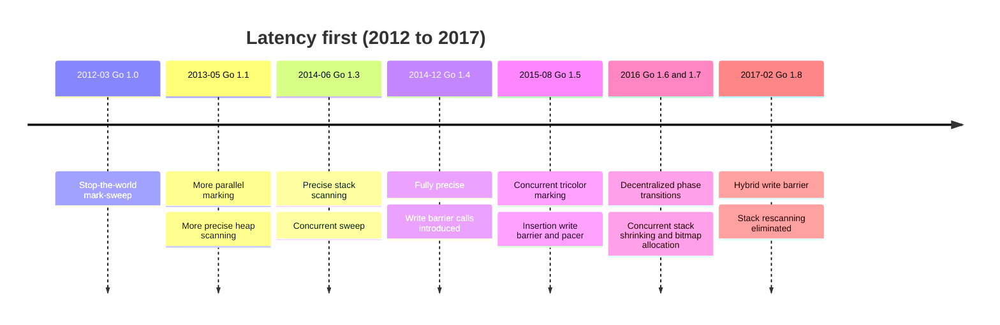
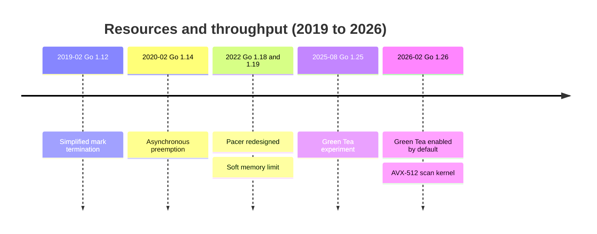

# 13.12 Past, Present, and Future

The previous eleven sections covered the components of the Go collector one by one: tricolor
marking ([13.1](./basic.md)), the hybrid write barrier ([13.2](./barrier.md)), the pacer
([13.3](./pacing.md)), marking and sweeping ([13.4](./mark.md), [13.5](./sweep.md)), mark
termination ([13.6](./termination.md)), the abandoned generational and ROC experiments
([13.8](./generational.md), [13.9](./roc.md)) and the new Green Tea marking algorithm
([13.11](./greentea.md)). This section puts them back on a timeline and shows when, and out of what
considerations, they became what they are today.

The history falls roughly into three phases. From 2014 to 2017 the team put latency first and cut
stop-the-world pauses from hundreds of milliseconds to under a millisecond, an improvement Hudson
calls three orders of magnitude [[Hudson, 2018](#ref-hudson-2018)]. The focus then shifted to the
rhythm of collection and to memory use: the pacer was redesigned and the runtime gained a soft
memory limit. From 2025, Green Tea turned attention to the throughput of marking itself. Running
through all three phases are a few basic choices already fixed in 2014: the collector is
non-generational and non-moving, and the write barrier is enabled only while a collection is running
[[Hudson, 2014](#ref-hudson-2014)] [[Hudson, 2018](#ref-hudson-2018)]. Every improvement proposed
since has had to prove its worth within these constraints.

## 13.12.1 The Stop-the-World Collector: Go 1.0 to 1.4

Before Go 1.5, the collector stopped the world during marking: when a collection began all
goroutines were paused, and user code resumed only after the collector had marked the live objects.
The early releases improved it mainly in two directions. The first was precision. Go 1.1 made the
collector more precise when scanning the heap, at the cost of a little CPU time, in exchange for a
significant reduction in heap size, especially on 32-bit platforms
[[Go Authors, 2013](#ref-go-authors-2013)]; Go 1.3 extended the same precision to stacks, so that
non-pointer values such as integers were no longer mistaken for pointers and kept memory from being
reclaimed [[Go Authors, 2014a](#ref-go-authors-2014a)]; Go 1.4 rewrote most of the runtime from C
into Go, so the collector knew exactly where the pointers on the runtime's own stacks were and
became fully precise [[Go Authors, 2014b](#ref-go-authors-2014b)]. The difference between precise
and conservative scanning is covered in [13.7](./safe.md).

The second was shorter pauses. Parallel and concurrent need to be told apart here: parallel means
several collector threads working at once, concurrent means collection running at the same time as
user code. Go 1.1 made the collector more parallel to reduce latency on multicore machines
[[Go Authors, 2013](#ref-go-authors-2013)]. Go 1.3 adopted a concurrent sweep algorithm, improved
parallelization and used larger pages, and together these changes cut collection pauses by 50% to
70% [[Go Authors, 2014a](#ref-go-authors-2014a)]. But the mark phase still had to stop the world,
and pause time grew with the size of the heap.

Go 1.4 also prepared for the next release: writes to pointers on the heap became calls to a
function, the write barrier, so that the collector of the next release could intervene in these
writes while it ran [[Go Authors, 2014b](#ref-go-authors-2014b)]. In his 2014 plan, Hudson explained
why it was introduced early: a new algorithm inevitably affects throughput, and putting part of the
cost into 1.4 up front offsets the performance gain 1.4 would otherwise have had, so that
performance improves monotonically from release to release instead of 1.4 getting faster and 1.5
slower again [[Hudson, 2014](#ref-hudson-2014)].

## 13.12.2 Latency First: The Concurrent Collector of Go 1.5

Looking back on the situation in 2014, Hudson said that if Go could not somehow solve the problem of
collection latency, Go would not succeed [[Hudson, 2018](#ref-hudson-2018)]. Why tail latency
matters more than average latency is explained in [13.1.6](./basic.md). In August of that year
Hudson published the plan for the collector after Go 1.4, with quantitative goals: on a properly
configured machine, collection latency below 10 milliseconds and at least 40 milliseconds of mutator
availability in every 50; hardware configured so that the heap may grow to twice the reachable
memory, with 25% of CPU cycles, typically one of four hardware threads, available to the collector.
The plan summarized the shape of the Go 1.5 collector in a string of terms: a non-generational,
non-moving, concurrent, tricolor mark-sweep collector. It also admitted that low latency inevitably
affects mutator throughput [[Hudson, 2014](#ref-hudson-2014)].

This shape is the result of trade-offs. In his 2018 talk Hudson revealed that the original long-term
plan was a concurrent copying collector without read barriers, but the cost of read barriers was
highly uncertain and the team wanted to avoid them. In 2014, more pressing was the rewrite of the
runtime and compiler from C into Go and the need to ship a latency-focused collector quickly, whose
performance loss must not exceed the speedup the compiler would deliver within a year. The team
therefore gave up copying and chose a tricolor concurrent algorithm; the write barrier is enabled
only during collection, and the rest of the time the compiled code merely checks a global variable,
which has little effect on compiler optimization. There were also reasons not to move objects:
size-segregated spans make it efficient to find the start of the object an interior pointer points
to, the experience of TCMalloc, Hoard and the Intel Scalable Malloc, in which Hudson himself took
part, showed that fragmentation in non-moving allocators does not become a problem, and not moving
objects means no need to pin objects or add a layer of indirection when interacting with C
[[Hudson, 2018](#ref-hudson-2018)]. These choices form the common basis of the allocator in Chapter
12 and the collector in this chapter.

The Go 1.5 collector rests on three parts: a Dijkstra-style insertion write barrier maintains the
correctness of concurrent marking ([13.2](./barrier.md)); the pacer designed by Clements decides
when to start collecting and asks allocators to assist with marking when they allocate too fast
([13.3](./pacing.md)) [[Clements, 2015a](#ref-clements-2015a)]; and background mark workers with a
25% CPU budget do most of the marking ([13.4](./mark.md)). The release notes say the stop-the-world
phases are almost always below 10 milliseconds and usually much shorter
[[Go Authors, 2015](#ref-go-authors-2015)]. Data from Twitter production servers cited by Hudson
show that the first release in August 2015 reduced pauses from 300 to 400 milliseconds to 30 to 40
milliseconds, the first order of magnitude [[Hudson, 2018](#ref-hudson-2018)].

## 13.12.3 Eliminating Stop-the-World Work One by One: Go 1.6 to 1.8

The work after Go 1.5, in Hudson's words, was to systematically eliminate all work proportional to
heap size during stop-the-world. Six months later the pause on the same server dropped from 40
milliseconds to 4 to 5 milliseconds, the second order of magnitude; 1.6.3 fixed several problems and
made pauses stay below the 10 millisecond target [[Hudson, 2018](#ref-hudson-2018)]. One structural
change in Go 1.6 was decentralized phase transitions. In Go 1.5, collection was driven by a
dedicated coordinator goroutine running straight-line code, and all phase transitions had to go
through it and so were at the mercy of the scheduler; a delayed transition would lengthen the
collection cycle, block allocation and occasionally cause very long latencies. Go 1.6 changed this
to an explicit state machine in which any goroutine can drive a phase transition
[[Clements, 2015c](#ref-clements-2015c)].

Go 1.7 moved stack shrinking from mark termination into concurrent marking
[[Clements, 2016](#ref-clements-2016)]. The release notes of this version state that for programs
with many idle goroutines, wildly varying stack sizes or large package-level variables, pauses are
significantly shorter than in Go 1.6 [[Go Authors, 2016](#ref-go-authors-2016)]. The same release
merged the dense mark bits and sweep-free allocation proposed by Clements: the mark bitmap is used
directly as the allocation bitmap of the next cycle, allocation looks for free slots by consulting
the bitmap, and sweeping no longer needs to build free lists ([13.5](./sweep.md))
[[Clements, 2015b](#ref-clements-2015b)]. Recalling the data of August 2016, Hudson mentioned that
the heap of that server was 18 GB; as the stop-the-world work proportional to heap size was
eliminated one piece after another, the heap could keep growing without affecting latency
[[Hudson, 2018](#ref-hudson-2018)].

By then the only remaining unbounded stop-the-world work was stack rescanning. The insertion barrier
does not intercept writes to the stack, so at mark termination all stacks had to be rescanned with
the world stopped, which in programs with many live goroutines could take tens or even hundreds of
milliseconds [[Clements and Hudson, 2016a](#ref-clements-hudson-2016a)]. The team first designed a
scheme for concurrent stack rescanning but then found a much simpler way; when the design document
for concurrent rescanning was made public, it noted that it was not actually being proposed and was
kept only for its historical value [[Clements and Hudson, 2016b](#ref-clements-hudson-2016b)]. That
way is the hybrid write barrier of Go 1.8, which combines a Yuasa-style deletion barrier with a
Dijkstra-style insertion barrier so that a stack need not be rescanned once it has been scanned
black; the design document reports that in preliminary experiments the worst-case stop-the-world
time fell below 50 microseconds, and that mechanisms that existed only to serve stack rescanning,
such as stack barriers and the rescan list, could be deleted along with it
[[Clements and Hudson, 2016a](#ref-clements-hudson-2016a)]. The Go 1.8 release notes say collection
pauses are typically below 100 microseconds and often as low as 10 microseconds
[[Go Authors, 2017](#ref-go-authors-2017)]. The mechanism and measurements are in
[13.2.3](./barrier.md). Hudson calls this improvement the third order of magnitude
[[Hudson, 2018](#ref-hudson-2018)].

Later pause work turned to the remaining details. In 2018 Hudson proposed a new goal of at most 500
microseconds per stop-the-world, while noting that outside demand for still lower latency was no
longer great [[Hudson, 2018](#ref-hudson-2018)]. Go 1.12 simplified mark termination: the new mark
completion algorithm is based on distributed termination detection and eliminated the races in the
old algorithm; Go 1.5 had divided concurrent marking into two sub-phases, mark 1 and mark 2, to
reduce premature entry into mark termination, and the latter was removed along with it
[[Clements, 2018](#ref-clements-2018)]; the current termination detection is in
[13.6](./termination.md). In Go 1.14 goroutines can be preempted asynchronously, and loops without
function calls can no longer deadlock the scheduler or significantly delay collection
[[Go Authors, 2020](#ref-go-authors-2020)]; see
[9.7.5](../../part3concurrency/ch09sched/preemption.md) and [13.7.3](./safe.md).

## 13.12.4 From Pauses to Resources: Go 1.18 to 1.21

Once pauses were below a millisecond, the questions for the collector became when to collect, how
much CPU to use and how much memory to occupy. Go 1.18 redesigned the pacer: non-heap collection
work such as stacks and global variables now counts in the calculation of collection frequency, and
collection cost became more predictable when these sources are large
[[Go Authors, 2022a](#ref-go-authors-2022a)]. Go 1.19 added the soft memory limit, set by
`GOMEMLIMIT` or `debug.SetMemoryLimit`. It covers the Go heap and other memory managed by the
runtime and is honored even with `GOGC=off`; to avoid thrashing when the live heap approaches the
limit, the runtime also tries to cap the CPU use of collection at 50% (not counting idle time),
preferring to use more memory rather than let the program stall
[[Go Authors, 2022b](#ref-go-authors-2022b)]. The GC guide recommended in the release notes
systematically explains the trade-off between `GOGC` and the memory limit
[[Go Authors, 2022c](#ref-go-authors-2022c)]. The Go 1.21 release notes say that after tuning of the
collector inside the runtime, the tail latency of applications can drop by up to 40% and memory use
drops slightly [[Go Authors, 2023](#ref-go-authors-2023)]. Every change to the pacer in these
versions is covered in [13.3.7](./pacing.md).

The memory limit also involves the scavenger, which returns free memory to the operating system.
Since Go 1.18 the CPU target of the background scavenger has been fixed at 1% of total CPU time and
does not speed up even near the limit; the return target on the memory limit side is 95% of the
limit, compared against the memory the runtime has committed, `mappedReady`; if an allocation would
push it over the limit, the party requesting memory returns the excess on the spot. This part of the
mechanism is covered in [12.7.7](../ch12alloc/pagealloc.md) and [12.7.8](../ch12alloc/pagealloc.md).

## 13.12.5 Roads Not Taken

Not every plan made it into a release. For Go 1.6, Hudson's 2014 plan envisioned improving
throughput: introducing bump-pointer allocation and a generational copying collector for the young
space, with the old space still managed by the concurrent collector and the size of the young space
chosen so that it could be collected within 10 milliseconds; the plan said that putting concurrency
first in Go 1.5 and throughput in 1.6 was a deliberate choice [[Hudson, 2014](#ref-hudson-2014)].
This plan was not carried out. The two later attempts, the request-oriented collector of 2016 to
2017 ([13.9](./roc.md)) and the non-moving generational collection of 2018
([13.8](./generational.md)), both required the write barrier to stay on throughout mutator
execution, and this cost was not offset by the benefit; for generational collection, escape analysis
had already put many short-lived objects on the stack, so the benefit was even more limited. Both
were eventually abandoned [[Hudson, 2018](#ref-hudson-2018)]. The two sections give the details of
the experiments and the reasons for abandoning them.

Another road was to have programmers manage part of the memory explicitly. Since Go 1.20 the runtime
has carried the experiment `GOEXPERIMENT=arenas`, providing an `arena.Arena` type that can be freed
in bulk. The design document on memory regions recalls that arenas brought 10% to 15% performance
improvements in real applications, almost all of it from reusing memory earlier and postponing
collection; but to be useful in more places, a large number of APIs would need an extra arena
parameter, the standard library first among them, a cost out of proportion to the benefit; arenas
also compose poorly with existing language mechanisms, for example once one chooses to allocate from
an arena, objects that escape analysis could have put on the stack are forced into the arena as
well. The proposal was therefore put on hold indefinitely [[Knyszek, 2024](#ref-knyszek-2024)], and
proposal #51317 is still on hold [[Go Authors, 2022d](#ref-go-authors-2022d)].

## 13.12.6 Toward Locality: Green Tea from Go 1.25

The 2014 plan hoped to improve throughput through generations, and that goal was eventually achieved
in another way. Green Tea does not shrink the set of objects to scan but improves the locality of
scanning: it accumulates the objects waiting to be scanned that fall in the same span and scans them
together, without needing an always-on write barrier ([13.11](./greentea.md)). The idea of
accumulating per span and then scanning was written down by Clements in 2018, the same year as the
generational experiment [[Knyszek and Clements, 2025a](#ref-knyszek-clements-2025a)]; a prototype in
2024 proved it feasible, and in 2025 Knyszek implemented it and put it into production
[[Knyszek and Clements, 2025b](#ref-knyszek-clements-2025b)].

Green Tea shipped with Go 1.25 as the experiment `GOEXPERIMENT=greenteagc` and has been enabled by
default since Go 1.26, which also added the AVX-512 scan kernel on amd64. The release notes of both
versions expect the collection overhead of real programs that use the collector heavily to drop by
10% to 40%; the Go 1.26 release notes additionally expect a further reduction of about 10% on newer
amd64 processors through vector instructions [[Go Authors, 2025](#ref-go-authors-2025)]
[[Go Authors, 2026a](#ref-go-authors-2026a)]. The evaluation in the design document also shows the
improvement growing broadly with core count
[[Knyszek and Clements, 2025a](#ref-knyszek-clements-2025a)]. The Go 1.26 release notes expect the
opt-out `GOEXPERIMENT=nogreenteagc` to be removed in Go 1.27, but as of Go 1.27.3 the old marking
implementation is still in the source [[Go Authors, 2026a](#ref-go-authors-2026a)]
[[Go Authors, 2026c](#ref-go-authors-2026c)]. The Green Tea implementation is in
`mgcmark_greenteagc.go` [[Go Authors, 2026b](#ref-go-authors-2026b)].

## 13.12.7 Outlook

Green Tea itself is still evolving. The design document plans to continue exploring the concentrator
network of Clements's original design to obtain higher scan density
[[Knyszek and Clements, 2025a](#ref-knyszek-clements-2025a)]; the blog hopes that the assembly code
of the scan kernels can soon be replaced by Go code
[[Knyszek and Clements, 2025b](#ref-knyszek-clements-2025b)].

The larger direction is to reduce the amount of collection work without changing the basic choices
of the collector. In November 2024 Knyszek started a discussion of memory regions as a composable
alternative to arenas [[Knyszek, 2024](#ref-knyszek-2024)]. According to the design document, a
program opens a region belonging only to the current goroutine with `region.Do(f)`, and allocations
during the execution of `f` go into a dedicated part of the heap; only this goroutine, and only
while the region is active, enables a new kind of write barrier that catches writes in which a
pointer to region memory escapes the region and hands the object graph rooted at that pointer over
to the regular tricolor collector, which the design document calls fading; when `f` returns, the
spans of the region are swept immediately and the memory that did not escape is reused at once. Its
primary goal is to reduce the resource cost of collection and its second is composability: it
requires no API changes and can coexist with `sync.Pool`, `unique.Handle` and the stack allocation
of escape analysis. It can be seen to identify short-lived objects by request or task boundaries
just as the ROC of [13.9](./roc.md) does; the difference is that the programmer selects them
explicitly, and the write barrier is confined to the goroutines that use regions. As of Go 1.27 it
remains at the design stage, with no corresponding entry in the experiment flags.

Another attempt has already entered the source. Go 1.26 added the experiment
`GOEXPERIMENT=runtimefreegc`, whose comment says it lets the runtime, in some cases and with the
help of the compiler, free and reuse memory earlier [[Go Authors, 2026c](#ref-go-authors-2026c)]
[[Malloy, 2025](#ref-malloy-2025)]. What these directions have in common, as with every improvement
since 2014, is that they look for opportunities to reduce collection cost without moving objects and
without requiring an always-on write barrier.

## 13.12.8 Summary

The evolution of the Go collector can be summarized as three shifts of goal. From 2014 to 2017,
latency came first: Go 1.5 introduced concurrent marking, later releases eliminated one by one the
stop-the-world work proportional to heap size, and Go 1.8 eliminated stack rescanning with the
hybrid write barrier, bringing pauses below a millisecond. After 2018 the focus shifted to
resources: the pacer was redesigned and continually tuned, and Go 1.19 added the soft memory limit,
which together with the scavenger's returns controls memory use. From 2025 the focus shifted to
throughput: Green Tea improves marking efficiency through locality and has been the default
implementation since Go 1.26. The failure of the two attempts at generations and ROC and the success
of Green Tea show that in Go, any scheme for speeding up collection must first answer the question
of the cost of the write barrier. The two figures below summarize the main changes of the releases.

## Further Reading

- [Clements, 2015a] Austin Clements. *Go 1.5 concurrent garbage
  collector pacing.* 2015. https://golang.org/s/go15gcpacing
- [Clements, 2015b] Austin Clements. *Proposal: Dense mark bits and
  sweep-free allocation.* 2015. https://go.dev/design/12800-sweep-free-alloc
- [Clements, 2015c] Austin Clements. *Proposal: Decentralized GC
  coordination.* 2015. https://go.dev/design/11970-decentralized-gc
- [Clements, 2016] Austin Clements. runtime: shrink stacks during
  concurrent mark (Fixes #12967). Go CL 20044, 2016. https://go.dev/cl/20044
- [Clements, 2018] Austin Clements. *Proposal: Simplify mark
  termination and eliminate mark 2.* 2018. https://go.dev/design/26903-simplify-mark-termination
- [Clements and Hudson, 2016a] Austin Clements, Rick Hudson.
  *Proposal: Eliminate STW stack re-scanning* (issue #17503, the hybrid write barrier of Go
  1.8). 2016. https://github.com/golang/go/issues/17503 https://go.dev/design/17503-eliminate-rescan
- [Clements and Hudson, 2016b] Austin Clements, Rick Hudson.
  *Proposal: Concurrent stack re-scanning.* 2016. https://go.dev/design/17505-concurrent-rescan
- [Go Authors, 2013] The Go Authors. *Go 1.1 Release Notes.* 2013.
  https://go.dev/doc/go1.1
- [Go Authors, 2014a] The Go Authors. *Go 1.3 Release Notes.* 2014.
  https://go.dev/doc/go1.3
- [Go Authors, 2014b] The Go Authors. *Go 1.4 Release Notes.* 2014.
  https://go.dev/doc/go1.4
- [Go Authors, 2015] The Go Authors. *Go 1.5 Release Notes.* 2015.
  https://go.dev/doc/go1.5
- [Go Authors, 2016] The Go Authors. *Go 1.7 Release Notes.* 2016.
  https://go.dev/doc/go1.7
- [Go Authors, 2017] The Go Authors. *Go 1.8 Release Notes.* 2017.
  https://go.dev/doc/go1.8
- [Go Authors, 2020] The Go Authors. *Go 1.14 Release Notes.* 2020.
  https://go.dev/doc/go1.14
- [Go Authors, 2022a] The Go Authors. *Go 1.18 Release
  Notes.* 2022. https://go.dev/doc/go1.18
- [Go Authors, 2022b] The Go Authors. *Soft memory limit
  (`GOMEMLIMIT`), Go 1.19 release notes.* 2022. https://go.dev/doc/go1.19#runtime
- [Go Authors, 2022c] The Go Authors. *A Guide to the Go Garbage
  Collector.* https://go.dev/doc/gc-guide (the official guide to the pacer, `GOMEMLIMIT` and the
  latency/throughput/memory trade-offs; formerly at https://tip.golang.org/doc/gc-guide)
- [Go Authors, 2022d] The Go Authors. *proposal: arena: new package
  providing memory arenas* (Go issue #51317). 2022. https://github.com/golang/go/issues/51317
- [Go Authors, 2023] The Go Authors. *Go 1.21 Release Notes.* 2023.
  https://go.dev/doc/go1.21
- [Go Authors, 2025] The Go Authors. Go 1.25 Release Notes: New
  experimental garbage collector. https://go.dev/doc/go1.25#new-experimental-garbage-collector
- [Go Authors, 2026a] The Go Authors. Go 1.26 Release Notes: New
  garbage collector. https://go.dev/doc/go1.26#new-garbage-collector
- [Go Authors, 2026b] The Go Authors.
  *runtime/mgcmark_greenteagc.go.* Go 1.26.
  https://github.com/golang/go/blob/release-branch.go1.26/src/runtime/mgcmark_greenteagc.go (the
  implementation of `GOEXPERIMENT=greenteagc`; formerly at
  https://github.com/golang/go/blob/master/src/runtime/mgcmark_greenteagc.go)
- [Go Authors, 2026c] The Go Authors.
  src/internal/goexperiment/flags.go, src/runtime/mgcmark_nogreenteagc.go. Go 1.26 and Go 1.27.3.
  https://github.com/golang/go/tree/release-branch.go1.27/src
- [Hudson, 2014] Richard L. Hudson. *Go 1.4+ Garbage Collection (GC)
  Plan and Roadmap.* August 6, 2014. https://golang.org/s/go14gc
- [Hudson, 2018] Richard L. Hudson. *Getting to Go: The Journey of Go's
  Garbage Collector.* ISMM 2018 keynote / The Go Blog, 2018. https://go.dev/blog/ismmkeynote
  (a first-hand account of the turn to concurrent collection in 1.5 and the low-latency stance)
- [Knyszek, 2024] Michael Knyszek. *Memory regions* (design document
  and GitHub discussion #70257). 2024. https://go.dev/design/70257-memory-regions
  https://github.com/golang/go/discussions/70257
- [Knyszek and Clements, 2025a] Michael Knyszek, Austin
  Clements. *runtime: green tea garbage collector* (issue #73581).
  https://github.com/golang/go/issues/73581 (the design motivation and benchmarks of Green Tea)
- [Knyszek and Clements, 2025b] Michael Knyszek, Austin
  Clements. The Green Tea Garbage Collector. The Go Blog, October 29, 2025.
  https://go.dev/blog/greenteagc
- [Malloy, 2025] PJ Malloy. *Directly freeing user memory to reduce GC
  work* (Go issue #74299). 2025. https://go.dev/design/74299-runtime-freegc
- This book: [13.1 The Basic Idea of Garbage Collection](./basic.md),
  [13.2 Write Barrier Techniques](./barrier.md),
  [13.3 Trigger Frequency and the Pacing Algorithm](./pacing.md),
  [13.8 The Generational Hypothesis and Generational Collection](./generational.md), [13.9 The
  Request Hypothesis and the Request-Oriented Collector](./roc.md),
  [13.11 Green Tea: Locality-Aware Marking](./greentea.md),
  [12.7 The Page Allocator](../ch12alloc/pagealloc.md).
