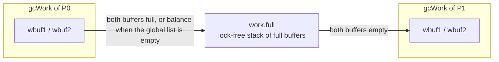

# 13.4 Scan Marking and Mark Assist

Marking is the main work of a collection: starting from the roots ([13.1](./basic.md)), follow
pointers to find every reachable object and turn it from white to black. Since Go 1.5, marking runs
concurrently with the mutator, which raises three questions. Who does the marking, and how much CPU
may it use? How do several markers share the gray objects waiting to be scanned without contending
on a shared data structure? And since the mutator keeps allocating during marking, what guarantees
that marking finishes before the heap grows to its goal? This section covers the mark workers and
their CPU budget, the queues of gray objects, the scanning of a single object, and mark assists,
which make allocating goroutines share the marking work.

## 13.4.1 Mark Workers and the 25% Budget

Marking is done mainly by a set of background goroutines called **mark workers**, whose entry point
is `gcBgMarkWorker`. At the start of each cycle the runtime ensures that every P has a mark worker;
they normally sit parked in a pool and are scheduled only during the mark phase. The pacer sets the
CPU used by background marking to 25% of `GOMAXPROCS` ([13.3](./pacing.md)), and `startCycle`
converts this budget into a number of workers [[Go Authors, 2026c](#ref-go-authors-2026c)]:

```go
	// Compute the background mark utilization goal. In general,
	// this may not come out exactly. We round the number of
	// dedicated workers so that the utilization is closest to
	// 25%. For small GOMAXPROCS, this would introduce too much
	// error, so we add fractional workers in that case.
	totalUtilizationGoal := float64(procs) * gcBackgroundUtilization
	dedicatedMarkWorkersNeeded := int64(totalUtilizationGoal + 0.5)
	utilError := float64(dedicatedMarkWorkersNeeded)/totalUtilizationGoal - 1
	const maxUtilError = 0.3
	if utilError < -maxUtilError || utilError > maxUtilError {
		// Rounding put us more than 30% off our goal. With
		// gcBackgroundUtilization of 25%, this happens for
		// GOMAXPROCS<=3 or GOMAXPROCS=6. Enable fractional
		// workers to compensate.
```

A quarter of `GOMAXPROCS`, rounded, gives the number of dedicated workers: 2 when `GOMAXPROCS` is 8,
and 1 when it is 5 (an actual utilization of 20%, within the 30% error bound). When the error
exceeds 30%, fractional workers make up the difference. With `GOMAXPROCS` equal to 6, 1.5 rounds to
2, which is a third too many, so only 1 dedicated worker is kept and the remaining 0.5 of a P is
shared among the Ps, each spending about 8.3% of its time. With `GOMAXPROCS` of 3 or less there are
no dedicated workers, and the fractional workers carry the whole budget. The three worker modes are
defined as follows:

```go
	// gcMarkWorkerDedicatedMode indicates that the P of a mark
	// worker is dedicated to running that mark worker. The mark
	// worker should run without preemption.
	gcMarkWorkerDedicatedMode

	// gcMarkWorkerFractionalMode indicates that a P is currently
	// running the "fractional" mark worker. The fractional worker
	// is necessary when GOMAXPROCS*gcBackgroundUtilization is not
	// an integer and using only dedicated workers would result in
	// utilization too far from the target of gcBackgroundUtilization.
	// The fractional worker should run until it is preempted and
	// will be scheduled to pick up the fractional part of
	// GOMAXPROCS*gcBackgroundUtilization.
	gcMarkWorkerFractionalMode

	// gcMarkWorkerIdleMode indicates that a P is running the mark
	// worker because it has nothing else to do. The idle worker
	// should run until it is preempted and account its time
	// against gcController.idleMarkTime.
	gcMarkWorkerIdleMode
```

A dedicated worker is assigned to a P when marking starts and the world restarts, and holds that P
for the whole mark phase. It first runs until its first preemption, using that preemption to move
the goroutines in the P's local run queue to the global queue so that other Ps can run them. After
that it no longer yields the P for ordinary preemption requests and marks until no work remains;
only a stop-the-world or a `forEachP` request ([13.6](./termination.md)) can stop it midway. A
fractional worker is chosen by the scheduler when a P is behind its fractional target, and exits
voluntarily once it passes 1.2 times that target. An idle worker is started by `findRunnable` when a
P finds no runnable goroutine ([9.4](../../part3concurrency/ch09sched/schedule.md)). It does not
count toward the 25% budget and uses only CPU that would otherwise be idle. Its number is capped at
`GOMAXPROCS` minus the number of dedicated workers, and a cycle triggered by the two-minute timer
lowers the cap to 0 or 1 [[Go Authors, 2026a](#ref-go-authors-2026a)], because the program is idle
anyway and has no need for a full-speed collection [[Go Authors, 2022](#ref-go-authors-2022)].

This arrangement goes back to Go 1.5. Clements originally envisioned scheduling background marking
dynamically from measured CPU utilization; the final implementation instead hands 25% of
`GOMAXPROCS` directly to background marking: some Ps are dedicated to marking and the remainder is
time-shared among the other Ps, because this avoids fine-grained measurement and control of CPU
utilization [[Clements, 2015](#ref-clements-2015)].

## 13.4.2 Queues of Gray Objects

Marking is naturally parallel; the difficulty is how several workers share the gray objects waiting
to be scanned. Each P holds a `gcWork` that serves as a local cache of gray objects; globally there
is a list of full buffers, `work.full`, which is a lock-free stack. A `gcWork` has two buffers, and
a source comment explains the design [[Go Authors, 2026b](#ref-go-authors-2026b)]:

```go
	// wbuf1 and wbuf2 are the primary and secondary work buffers.
	//
	// This can be thought of as a stack of both work buffers'
	// pointers concatenated. When we pop the last pointer, we
	// shift the stack up by one work buffer by bringing in a new
	// full buffer and discarding an empty one. When we fill both
	// buffers, we shift the stack down by one work buffer by
	// bringing in a new empty buffer and discarding a full one.
	// This way we have one buffer's worth of hysteresis, which
	// amortizes the cost of getting or putting a work buffer over
	// at least one buffer of work and reduces contention on the
	// global work lists.
	//
	// wbuf1 is always the buffer we're currently pushing to and
	// popping from and wbuf2 is the buffer that will be discarded
	// next.
```

A full buffer is fetched from the global list only when both buffers are empty, and one is handed
over only when both are full, so at least one whole buffer (2 KiB) of local operations separates two
accesses to the global list. This follows the same idea as the local cache fetching and returning
spans from the central cache in batches ([12.2](../ch12alloc/component.md)). Work moves between Ps
by sharing, not by stealing. Before processing each object, a worker that finds the global list
empty calls `balance` and pushes a buffer onto it; a worker that has run out of local work takes
only from the global list and never touches another P's `gcWork`.

The workers' main loop is `gcDrain`. It first claims root marking tasks (`markroot`), then
repeatedly takes a gray object, scans it, and queues the white objects it discovers as gray, until
no work is left. A trimmed sketch follows:

```go
// The skeleton of gcDrain (a sketch that omits the Green Tea span queue and the various exit conditions)
for !(gp.preempt && preemptible) {
	if work.full == 0 {
		gcw.balance() // the global list is empty: hand over part of the local work
	}
	b := gcw.tryGetObjFast() // local buffer
	if b == 0 {
		b = gcw.tryGetObj() // exchange buffers with the global list if necessary
	}
	if b == 0 {
		wbBufFlush() // the write barrier buffer may still hold gray objects
		b = gcw.tryGetObj()
	}
	if b == 0 {
		break // no work for now
	}
	scanObject(b, gcw)
	if gcw.heapScanWork >= gcCreditSlack {
		// after about every 2000 bytes of scan work, report it to the pacer
		// and make it available as scan credit that mark assists can draw on (13.4.4)
	}
}
```

When the local queue is empty, the worker also flushes the write barrier buffer
([13.2](./barrier.md)), because the pointers in the buffer are another source of gray objects. The
following diagram summarizes the flow of work:



The Green Tea collector, enabled by default in Go 1.26, adds a span-organized queue on top of this:
it gathers the objects waiting to be scanned in the same span and processes them in batches, and
stealing is allowed between span queues. It extends this queue structure without changing what a
gray object means; see [13.11](./greentea.md).

## 13.4.3 Scanning an Object

When an object is found reachable, `greyobject` sets its bit in the mark bitmap of the span that
owns it. If the span holds no pointers (noscan), the object has no fields to trace and becomes black
directly without entering a queue; otherwise the object becomes gray and enters the local queue to
await scanning [[Go Authors, 2026a](#ref-go-authors-2026a)]. With Green Tea disabled, every object
takes this path. With Green Tea enabled by default in Go 1.26, this path serves only the remaining
objects: small objects of 16 to 512 bytes instead set a mark bit inside their own span and then
enter a span queue as a unit, to be scanned in batches ([13.11](./greentea.md)).

Scanning a gray object requires knowing which of its words are pointers. This information was
recorded by type at allocation time ([12.5](../ch12alloc/smallalloc.md)). Since Go 1.22 there are
three ways of recording it. For objects of at most 512 bytes, a pointer bitmap with one bit per word
sits at the end of the owning span. Larger objects carry a one-word allocation header at the start
that points to the object's type descriptor, and scanning looks up pointers word by word using the
pointer mask in the type. For a large object that occupies a span by itself, the type is recorded in
the span [[Go Authors, 2026a](#ref-go-authors-2026a)]. Before that, Go 1.20 changed each arena's
heap bitmap from two bits per word to one bit per word [[Randall, 2022](#ref-randall-2022)]; the
allocation header of Go 1.22 removed the work of expanding the bitmap at allocation time
[[Knyszek, 2022](#ref-knyszek-2022)], and the release notes say the change improves CPU performance
of programs by 1% to 3% and reduces memory overhead by about 1%
[[Go Authors, 2024](#ref-go-authors-2024)].

Given the pointer locations, `scanObject` reads the pointer fields one by one: it skips nil and
pointers into the object itself, looks up the heap object each one points to, and passes it to
`greyobject`; under Green Tea, pointers to small objects go to the span queue. Two details affect
the cost of scanning. First, the number of bytes credited as scan work counts only up to the last
pointer field in the object; the plain data after the last pointer is not counted, and an object
without pointers is not scanned at all. Second, a large object above 128 KiB is cut into 128 KiB
pieces called oblets, of which only one is scanned at a time while the rest are put back on the
queue. This began in Go 1.8 and bounds the time of a single scan to about 100 microseconds. Before
that, a goroutine performing a mark assist could be blocked for a long time once it picked up a
large object, and background workers could not hand in scan credit until they had scanned the entire
large object [[Clements, 2016](#ref-clements-2016)].

The following program retains a 16 MiB `[]int64`, which holds no pointers, and a 16 MiB `[]*int64`
whose elements are all nil, and after each collection reads the live heap and the scannable heap:

```go {run=true}
package main

import (
	"fmt"
	"runtime"
	"runtime/metrics"
)

var (
	ints []int64  // no pointers
	ptrs []*int64 // contains pointers, all elements nil
)

func report(label string) {
	runtime.GC()
	s := []metrics.Sample{
		{Name: "/gc/heap/live:bytes"}, // live heap after the previous mark
		{Name: "/gc/scan/heap:bytes"}, // scannable heap
	}
	metrics.Read(s)
	fmt.Printf("%-14s live heap %4.1f MiB, scannable heap %4.1f MiB\n",
		label, mib(s[0].Value.Uint64()), mib(s[1].Value.Uint64()))
}

func mib(b uint64) float64 { return float64(b) / (1 << 20) }

func main() {
	report("initial")
	ints = make([]int64, 2<<20) // 16 MiB
	report("add []int64")
	ptrs = make([]*int64, 2<<20) // 16 MiB
	report("add []*int64")
}
```

The output is:

```
initial        live heap  0.3 MiB, scannable heap  0.3 MiB
add []int64    live heap 16.3 MiB, scannable heap  0.3 MiB
add []*int64   live heap 32.4 MiB, scannable heap 16.3 MiB
```

Right after a collection finishes, the scannable heap equals the amount of heap scan work actually
done in that cycle. Both slices increased the live heap by 16 MiB, but only the one with pointers
increased the scan work: the `[]int64` lives in a span without pointers and turns black as soon as
it is marked, whereas the `[]*int64`, although all nil, still requires every pointer field to be
read, and it is scanned as 128 pieces. The initial values vary by platform and are smaller in the
browser's WebAssembly environment; what matters is the two increments. This is also why the headroom
in 13.3 is computed from scannable memory only.

Stacks are not in the heap and are scanned differently. The layout of a stack frame varies with the
function and the execution position, and the pointer information is generated by the compiler as
stack maps. Scanning a goroutine's stack means looking up the stack map of each frame at the
position where the goroutine stopped and graying the objects that the live pointers in it refer to.
Since Go 1.14, a frame that was asynchronously preempted has no precise stack map and must be
scanned conservatively. Stack maps and conservative scanning are covered in [13.7](./safe.md).

## 13.4.4 Mark Assist

The 25% background budget is a steady-state estimate ([13.3](./pacing.md)). If the mutator allocates
faster than expected, the heap may exceed its goal before marking completes. **Mark assist** is the
backstop: during marking, a goroutine that allocates memory must perform marking work in proportion
to what it allocates.

Each goroutine has an assist credit measured in bytes, `gcAssistBytes`. During marking, every
allocation in `mallocgc` deducts the allocated size from it; when the credit goes negative, that is,
when mark debt is owed, `gcAssistAlloc` repays it before the allocation. The following is the
trimmed source, with the tracing and synctest parts omitted
[[Go Authors, 2026a](#ref-go-authors-2026a)]:

```go
retry:
	if gcCPULimiter.limiting() {
		// If the CPU limiter is enabled, intentionally don't
		// assist to reduce the amount of CPU time spent in the GC.
		return
	}
	// Compute the amount of scan work we need to do to make the
	// balance positive. When the required amount of work is low,
	// we over-assist to build up credit for future allocations
	// and amortize the cost of assisting.
	assistWorkPerByte := gcController.assistWorkPerByte.Load()
	assistBytesPerWork := gcController.assistBytesPerWork.Load()
	debtBytes := -gp.gcAssistBytes
	scanWork := int64(assistWorkPerByte * float64(debtBytes))
	if scanWork < gcOverAssistWork {
		scanWork = gcOverAssistWork
		debtBytes = int64(assistBytesPerWork * float64(scanWork))
	}

	// Steal as much credit as we can from the background GC's
	// scan credit. This is racy and may drop the background
	// credit below 0 if two mutators steal at the same time. This
	// will just cause steals to fail until credit is accumulated
	// again, so in the long run it doesn't really matter, but we
	// do have to handle the negative credit case.
	// ... (draw on background credit; return if it suffices)

	// Perform assist work
	systemstack(func() {
		gcAssistAlloc1(gp, scanWork)
	})
	// ...
	if gp.gcAssistBytes < 0 {
		if gp.preempt {
			Gosched()
			goto retry
		}
		if !gcParkAssist() {
			goto retry
		}
	}
```

Repayment proceeds in several steps. If the collector's CPU limit has already been reached, the
assist is skipped altogether ([13.3](./pacing.md)). Otherwise the owed bytes are converted into scan
work using the assist ratio supplied by the pacer; if the amount is too small, at least 64 KiB
(`gcOverAssistWork`) is done, and the excess becomes credit for later allocations, which amortizes
the fixed cost of each assist. The goroutine then first draws on the credit that background marking
has accumulated, `bgScanCredit`, and if it suffices there is no need to mark at all. When the credit
is insufficient, `gcAssistAlloc1` calls `gcDrainN` to complete the remaining scan work; it obtains
work the same way a background worker does, and also claims root marking tasks when there are no
gray objects. If the debt is still not repaid, a preempted goroutine yields the processor and
retries; otherwise it joins the assist queue `work.assistQueue` and parks, waiting for background
marking to produce new credit.

When a background worker hands in credit, `gcFlushBgCredit` first repays the goroutines parked in
the queue and records only the remainder in `bgScanCredit`. A goroutine that can be repaid only in
part is moved to the back of the queue, so that a large debt does not block small ones for long. A
woken goroutine is not placed in the P's `runnext`; a source comment explains that otherwise user
code could exploit the higher scheduling priority of the background worker to always run ahead of
other goroutines [[Go Authors, 2026a](#ref-go-authors-2026a)].

Mark assist ties the allocation rate to the marking rate: the faster a goroutine allocates, the more
marking it takes on, and the allocation itself slows down as a result. In the design of the 1.18
pacer, when the trigger point is estimated accurately, the credit accumulated by background marking
is enough to pay for allocation and the mutator need not mark itself
[[Knyszek, 2021](#ref-knyszek-2021)]; only when the trigger is late do allocation-heavy goroutines
feel a delay during marking. The GC guide lists mark assist as one source of collection-induced
latency and gives a test: if the cumulative time of `runtime.gcAssistAlloc` in a CPU profile exceeds
5%, the program is most likely allocating faster than the collector can keep up
[[Go Authors, 2026d](#ref-go-authors-2026d)]. Mark assist and the write barrier thus form a
complementary pair:

| Mechanism | What it guarantees | How |
| --- | --- | --- |
| Write barrier | Correctness: concurrent marking misses no live object | When the mutator modifies a pointer, it records the objects involved, preserving the tri-color invariant |
| Mark assist | Timeliness: marking completes before the heap grows to its goal | Allocating goroutines take on marking work in proportion to their allocation |

When the gray objects are exhausted, marking enters the termination phase; how the collector
confirms that marking is truly complete is covered in [13.6](./termination.md).

## 13.4.5 Design Trade-offs and Evolution

- Fixed budget plus mark assist: Go 1.5 fixed the CPU used by background marking at 25% and made
  allocators pay for anything beyond it, which makes the collector's effect on throughput
  predictable; the cost is that allocation-heavy programs are slowed down during marking
  [[Clements, 2015](#ref-clements-2015)].
- Local buffers plus global sharing: the double buffering in `gcWork` amortizes access to the global
  list over a whole buffer of work, and work is shared among Ps through the global list. Go 1.8
  introduced 128 KiB pieces to bound the time of a single scan
  [[Clements, 2016](#ref-clements-2016)].
- Pointer metadata: the heap bitmap became one bit per word in Go 1.20
  [[Randall, 2022](#ref-randall-2022)], and in Go 1.22 became an in-span bitmap for small objects
  and an allocation header for large ones [[Knyszek, 2022](#ref-knyszek-2022)]. The Green Tea
  collector, introduced as an experiment in Go 1.25 and enabled by default in Go 1.26, adds batched
  scanning by span ([13.11](./greentea.md)).

The theoretical starting point of concurrent marking is the 1978 work of Dijkstra and colleagues
[[Dijkstra et al., 1978](#ref-dijkstra-1978)]. Go's collector neither moves objects nor is
generational ([13.1](./basic.md), [13.8](./generational.md)), and Hudson explained these trade-offs
in his 2018 keynote [[Hudson, 2018](#ref-hudson-2018)]; the engineering effort therefore
concentrates on pacing and mark assist, so that marking always keeps up with allocation.

## 13.4.6 Summary

Marking is done by the mark workers on each P: dedicated and fractional workers together use 25% of
`GOMAXPROCS`, and idle workers use the remaining idle CPU. Gray objects are held in each P's double
buffer and shared through a global lock-free list; under Green Tea, small objects are queued
separately by span. When an object is scanned, the pointer locations come from the bitmap or
allocation header recorded at allocation time; objects without pointers turn black directly, and
large objects are scanned in pieces. Allocators take on marking work in proportion to their
allocation, or draw on credit accumulated by background marking, which guarantees that marking
completes before the heap grows to its goal.

## Further Reading

- <a id="ref-clements-2015"></a>[Clements, 2015] Austin Clements. *Go 1.5 concurrent garbage
  collector pacing.* 2015. https://golang.org/s/go15gcpacing The original design of mark assist and
  background mark scheduling; the end of the document records the 25% dedicated-plus-fractional
  scheme that Go 1.5 finally adopted.
- <a id="ref-clements-2016"></a>[Clements, 2016] Austin Clements. runtime: bound scanobject to ~100
  µs. Go commit cf4f1d07a1, 2016. https://go.dev/cl/23540 Released with Go 1.8.
- <a id="ref-dijkstra-1978"></a>[Dijkstra et al., 1978] E. W. Dijkstra, L. Lamport, A. J. Martin, et
  al. *On-the-Fly Garbage Collection: An Exercise in Cooperation.* CACM, 1978.
  https://doi.org/10.1145/359642.359655 (The theoretical foundation of concurrent tri-color
  marking.)
- <a id="ref-go-authors-2022"></a>[Go Authors, 2022] The Go Authors. *Go 1.19 Release Notes.* 2022.
  https://go.dev/doc/go1.19
- <a id="ref-go-authors-2024"></a>[Go Authors, 2024] The Go Authors. *Go 1.22 Release Notes.* 2024.
  https://go.dev/doc/go1.22
- <a id="ref-go-authors-2026a"></a>[Go Authors, 2026a] The Go Authors. *runtime/mgcmark.go.*
  `gcDrain`, `scanObject`, `gcAssistAlloc`, `gcDrainN`. See also src/runtime/mgcmark_greenteagc.go,
  src/runtime/mgc.go, src/runtime/mgcpacer.go, src/runtime/mbitmap.go. Go 1.26 source.
  https://github.com/golang/go/blob/release-branch.go1.26/src/runtime/mgcmark.go
- <a id="ref-go-authors-2026b"></a>[Go Authors, 2026b] The Go Authors. *runtime/mgcwork.go.*
  `gcWork`, `workbuf` and the double-buffered queue. Go 1.26 source.
  https://github.com/golang/go/blob/release-branch.go1.26/src/runtime/mgcwork.go
- <a id="ref-go-authors-2026c"></a>[Go Authors, 2026c] The Go Authors. *runtime/mgcpacer.go.*
  `gcBackgroundUtilization`, assist credit and the exchange ratio. Go 1.26 source.
  https://github.com/golang/go/blob/release-branch.go1.26/src/runtime/mgcpacer.go
- <a id="ref-go-authors-2026d"></a>[Go Authors, 2026d] The Go Authors. *A Guide to the Go Garbage
  Collector.* https://go.dev/doc/gc-guide
- <a id="ref-hudson-2018"></a>[Hudson, 2018] Rick Hudson. *Getting to Go: The Journey of Go's
  Garbage Collector.* ISMM 2018 keynote. https://go.dev/blog/ismmkeynote (The designers' own account
  of concurrent marking, the write barrier and mark assist.)
- <a id="ref-knyszek-2021"></a>[Knyszek, 2021] Michael Knyszek. *GC Pacer Redesign.* Go proposal
  44167,
  2021. https://github.com/golang/proposal/blob/master/design/44167-gc-pacer-redesign.md
- <a id="ref-knyszek-2022"></a>[Knyszek, 2022] Michael Knyszek. runtime: implement experiment to
  replace heap bitmap with alloc headers. Go commit 38ac7c41aa, 2022. https://go.dev/cl/437955
  Released with Go 1.22.
- <a id="ref-randall-2022"></a>[Randall, 2022] Keith Randall. runtime: redo heap bitmap. Go commit
  6a9c674a09, 2022. https://go.dev/cl/422634
  Released with Go 1.20.
- This book: [13.2 Write Barrier Techniques](./barrier.md),
  [13.3 Trigger Frequency and the Pacing Algorithm](./pacing.md),
  [13.7 Safe-Point Analysis](./safe.md), [12.1 Design Principles](../ch12alloc/basic.md).
