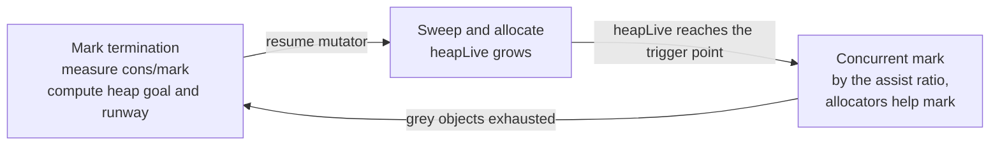

# 13.3 Trigger Frequency and the Pacing Algorithm

Concurrent marking ([13.2](./barrier.md)) lets collection run alongside the mutator, which raises
the question of when the next cycle should start. Start too late, and the heap outgrows its expected
size before marking finishes; start too early, and collection runs too often and burns CPU for
nothing. The part of the runtime that makes this decision is the **pacer**. For each cycle it sets a
**heap goal**, the size the heap should have reached when marking ends; then, from the relative
speeds of mutator allocation and collector scanning, it works out a trigger point earlier than the
goal, so that marking finishes just as the heap grows to the goal. This section covers, in turn, the
conditions that trigger a cycle, how `GOGC` and the memory limit determine the heap goal, how the
trigger point is computed, how it is corrected during marking, and finally the pacer's actual
behavior as seen through gctrace.

## 13.3.1 Trigger Conditions

`runtime.gcTrigger` lists three conditions that end the `_GCoff` phase and start a new cycle
[[Go Authors, 2026a](#ref-go-authors-2026a)]:

- `gcTriggerHeap`: the heap size reaches the trigger point given by the pacer. Almost all cycles
  start this way.
- `gcTriggerTime`: more than two minutes (`forcegcperiod`) have passed since the last cycle. The
  system monitor thread checks this condition periodically
  ([9.8](../../part3concurrency/ch09sched/sysmon.md)); it has no effect when `GOGC=off`.
- `gcTriggerCycle`: the program calls `runtime.GC()` and explicitly asks for a cycle.

The "heap size" in the first condition is the number of live bytes found by the last mark plus the
bytes allocated since; the runtime records it as `heapLive`. To reduce contention, it is updated
only when a local cache fetches a new span from the central cache or when a large object is
allocated; in the former case the slots in the span that are not yet allocated are counted too, so
the value is slightly above the true one. A comment in the source gives the reason: overestimating
only makes a cycle start earlier, never later. Correspondingly, the trigger condition is checked
only on the slow path of allocation: small-object allocation checks once when it has to replace a
span ([12.5](../ch12alloc/smallalloc.md)), and large-object allocation checks every time
([12.4](../ch12alloc/largealloc.md)).

## 13.3.2 GOGC and the Heap Goal

The environment variable `GOGC` (or `runtime/debug.SetGCPercent`) gives a percentage $p$, 100 by
default. At the end of each mark termination, the pacer's `commit` method uses it to compute the
heap goal for the next cycle [[Go Authors, 2026a](#ref-go-authors-2026a)]:

```go
	gcPercentHeapGoal := ^uint64(0)
	if gcPercent := c.gcPercent.Load(); gcPercent >= 0 {
		gcPercentHeapGoal = c.heapMarked + (c.heapMarked+c.lastStackScan.Load()+c.globalsScan.Load())*uint64(gcPercent)/100
	}
	// Apply the minimum heap size here. It's defined in terms of gcPercent
	// and is only updated by functions that call commit.
	if gcPercentHeapGoal < c.heapMinimum {
		gcPercentHeapGoal = c.heapMinimum
	}
```

As a formula:

$$
H_{goal} = H_m + (H_m + S + G)\cdot\frac{p}{100}
$$

Here $H_m$ is the live heap of the last mark (`heapMarked`), $S$ is the number of stack bytes
actually scanned in the last cycle, and $G$ is the number of scannable global bytes. With the
default value, the memory allowed to be newly allocated between two cycles equals the sum of the
live heap and the roots. Before Go 1.18 the formula was just $H_m(1+p/100)$. Stacks and globals are
also collection work, and ignoring them underestimates the cost of collection when there are many
goroutines or large globals; counting them in the goal was the first item of the 1.18 pacer redesign
[[Knyszek, 2021a](#ref-knyszek-2021a)]. The Go 1.18 release notes also warn that some programs will
therefore use somewhat more or less memory than before, and that `GOGC` can be adjusted if necessary
[[Go Authors, 2022a](#ref-go-authors-2022a)].

`GOGC` is the parameter that trades memory against CPU. The GC guide gives a simple derivation
[[Go Authors, 2022c](#ref-go-authors-2022c)]: the CPU cost of each cycle is roughly proportional to
the $H_m + S + G$ that must be scanned; in a steady state with constant allocation rate, the
frequency of collection is inversely proportional to the newly allocated $(H_m + S + G)\cdot p/100$
between cycles. Multiplying the two, once the heap is large enough, the total cost of collection is
roughly proportional to the allocation rate divided by $p/100$, independent of the size of the live
heap. So doubling `GOGC` doubles the heap's extra memory and roughly halves the CPU cost of
collection, and vice versa. With `GOGC=off`, $p$ is negative and the formula gives an infinite goal;
only the memory limit (13.3.3) or an explicit call to `runtime.GC()` triggers collection.

The heap goal also has a lower bound, `heapMinimum`, equal to 4 MiB times $p/100$. When the live
heap is tiny, a proportional goal would make collection too frequent and the fixed cost of each
cycle could not be amortized [[Go Authors, 2026a](#ref-go-authors-2026a)]. The 1.18 redesign once
lowered the default minimum to 512 KiB, on the grounds that the runtime itself has about 200 KiB of
scannable globals, so with roots counted in the goal, collection on small heaps could also be
amortized reasonably [[Knyszek, 2021c](#ref-knyszek-2021c)]. This change was later moved behind the
experiment `HeapMinimum512KiB`, which is off by default, and the default minimum in Go 1.26 is still
4 MiB.

The following program keeps about 64 MiB of live data, and after each call to `runtime.GC()` reads
the pacer's inputs and the heap goal through `runtime/metrics` and compares them with the formula
above:

```go {run=true}
package main

import (
	"fmt"
	"runtime"
	"runtime/debug"
	"runtime/metrics"
)

var keep [][]byte // about 64 MiB of live data

func report(label string) {
	runtime.GC()
	s := []metrics.Sample{
		{Name: "/gc/heap/live:bytes"},    // live heap of the previous mark
		{Name: "/gc/scan/stack:bytes"},   // stack scanned in the previous cycle
		{Name: "/gc/scan/globals:bytes"}, // scannable globals
		{Name: "/gc/gogc:percent"},
		{Name: "/gc/heap/goal:bytes"},
	}
	metrics.Read(s)
	live, stack, globals := s[0].Value.Uint64(), s[1].Value.Uint64(), s[2].Value.Uint64()
	gogc, goal := s[3].Value.Uint64(), s[4].Value.Uint64()
	formula := live + (live+stack+globals)*gogc/100
	fmt.Printf("%s: live %.1f MiB, goal %.1f MiB, equals formula: %t\n",
		label, mib(live), mib(goal), goal == formula)
}

func mib(b uint64) float64 { return float64(b) / (1 << 20) }

func main() {
	for i := 0; i < 64; i++ {
		keep = append(keep, make([]byte, 1<<20))
	}
	report("GOGC=100")
	debug.SetGCPercent(50)
	report("GOGC=50")
	debug.SetGCPercent(200)
	report("GOGC=200")
	debug.SetMemoryLimit(100 << 20)
	report("GOGC=200, limit 100 MiB")
}
```

The output is:

```
GOGC=100: live 64.3 MiB, goal 128.9 MiB, equals formula: true
GOGC=50: live 64.4 MiB, goal 96.6 MiB, equals formula: true
GOGC=200: live 64.4 MiB, goal 193.4 MiB, equals formula: true
GOGC=200, limit 100 MiB: live 64.4 MiB, goal 91.3 MiB, equals formula: false
```

In the first three lines the heap goal equals the formula's result byte for byte; `SetGCPercent`
recomputes the goal immediately, without waiting for the next cycle. The exact values differ
slightly across platforms. The last line sets a 100 MiB memory limit, and the goal is no longer
determined by `GOGC`; the next subsection discusses this case.

## 13.3.3 The Soft Memory Limit

`GOGC` only specifies the relative growth of the heap and does not constrain absolute memory use.
With a 1 GiB live heap, `GOGC=100` means the heap peaks near 2 GiB; in a container with a fixed
memory quota, a brief rise in the live heap can lead to out of memory (OOM). To avoid OOM without
lowering `GOGC`, the community developed some unsupported practices, such as the "heap ballast":
allocating a large block of memory that is never used, so that the collector believes the live heap
is larger than it is [[Knyszek, 2021b](#ref-knyszek-2021b)]. Go 1.19 introduced the environment
variable `GOMEMLIMIT` and the function `debug.SetMemoryLimit` for this purpose, setting a **soft
memory limit** for the runtime [[Go Authors, 2022b](#ref-go-authors-2022b)]. The limit applies to
all memory the runtime has mapped and not yet returned to the operating system, equivalent to `Sys`
minus `HeapReleased` in `runtime.MemStats`; the Go binary itself, memory allocated by C code and
memory mapped by `syscall.Mmap` are not included [[Go Authors, 2026b](#ref-go-authors-2026b)].

The heap goal counts only heap objects while the memory limit covers all kinds of memory, so the two
need a conversion. The comment on `memoryLimitHeapGoal` writes out the conversion
[[Go Authors, 2026a](#ref-go-authors-2026a)]:

```go
	//    goal := memoryLimit - ((mappedReady - heapFree - heapAlloc) + max(mappedReady - memoryLimit, 0))
	//                    ^1                                    ^2
	//    goal -= goal / 100 * memoryLimitHeapGoalHeadroomPercent
	//    ^3
```

Here `mappedReady` is memory that is mapped and not yet returned, `heapFree` is free pages not yet
returned, and `heapAlloc` is the bytes occupied by heap objects. Term 1 is the non-heap overhead
that cannot hold heap objects, such as stacks and runtime metadata; free pages are not counted
because they are a reserve for future allocation, and allocating in them does not increase total
memory use. Term 2 is the part already over the limit; subtracting it from the goal makes collection
start earlier and frees space. Step 3 leaves headroom, to absorb pacing error and to keep some
unreturned memory for the allocator. The headroom is 3% of the goal and at least 1 MiB; the final
goal is not below the live heap of the last cycle. Go 1.19 and 1.20 had only a fixed 1 MiB of
headroom. The 3% proportional headroom was added in 1.21: with `GOGC=off` and a high allocation
rate, the heap goal hugged the limit and allocation returned memory synchronously too often
[[Knyszek, 2023b](#ref-knyszek-2023b)].

The pacer takes the smaller of the two goals. The last line of the example in the previous
subsection is exactly this case: `GOGC=200` gives a goal of about 193 MiB, while the 100 MiB limit
minus non-heap overhead and headroom is about 91 MiB, and the latter takes effect. The non-heap
overhead varies by platform; in a browser's wasm environment the figure is about 95 MiB. In
addition, the target for the scavenger to return memory to the operating system also follows the
memory limit, see [12.7](../ch12alloc/pagealloc.md).

"Soft" means the runtime does not guarantee that the limit is always honored. When the live heap
itself approaches the limit, the goal derived from the limit drops lower and lower, collection
becomes more and more frequent, and eventually it runs almost continuously and the program cannot
make progress. The design document calls this a death spiral [[Knyszek, 2021b](#ref-knyszek-2021b)],
and the GC guide calls it thrashing [[Go Authors, 2022c](#ref-go-authors-2022c)]. To prevent it, the
runtime limits the CPU used by collection with a leaky bucket: CPU time spent in collection is
poured into the bucket and CPU time of the mutator drains it, at equal rates, which amounts to
limiting collection's CPU use to about 50%; the bucket's capacity is one CPU-second per P, to absorb
short peaks [[Go Authors, 2026a](#ref-go-authors-2026a)]. Once the bucket is full, goroutines that
allocate memory no longer take part in marking (13.3.5), so the heap can exceed the limit. The
leaky-bucket idea is borrowed from Netflix's jvmquake, which kills the process when a Java service
falls into a death spiral; Go does not kill the process but suspends mark assists
[[Knyszek, 2021b](#ref-knyszek-2021b)]. This cap is always in effect, but as the release notes
expect, it should come into play only in unusual circumstances
[[Go Authors, 2022b](#ref-go-authors-2022b)].

The GC guide explains the value of 50%: even if the memory limit is set too low by mistake, the
program is at most twice as slow; in many cases an indefinite stall is worse than running out of
memory, which at least fails faster [[Go Authors, 2022c](#ref-go-authors-2022c)]. The guide
therefore advises using the memory limit only when the execution environment is fully under control
(for example, a container with a fixed memory quota), and leaving 5% to 10% of headroom for memory
the runtime cannot see; if the program shares that memory with other processes, `GOGC=off` should
not be set at the same time.

## 13.3.4 The Trigger Point and the Runway

Once the goal is fixed, the pacer still has to decide when to start. Marking takes time, and the
mutator keeps allocating meanwhile; if marking only started when the heap reached the goal, the heap
would be past the goal by the time marking ends. The trigger point must therefore be some distance
ahead of the goal. The source calls this distance the runway.

The 1.18 design document uses a simple model to work out the runway
[[Knyszek, 2021a](#ref-knyszek-2021a)]. Let the mutator allocate $a$ bytes per CPU-second and the
collector scan $s$ bytes per CPU-second; during marking the collector takes a fraction $u$ of the
CPU and the mutator the remaining $1-u$. In the time the collector needs to scan $W$ bytes, the
mutator allocates

$$
R = \frac{a}{s}\cdot\frac{1-u}{u}\cdot W
$$

bytes. The ratio $a/s$ is the ratio of allocation rate to scan rate, called the cons/mark ratio in
the source. Go fixes $u$ at 25%, so $(1-u)/u = 3$. The line in `commit` that computes the runway
corresponds to this one to one [[Go Authors, 2026a](#ref-go-authors-2026a)]:

```go
	c.runway.Store(uint64((c.consMark * (1 - gcGoalUtilization) / (gcGoalUtilization)) * float64(c.lastHeapScan+c.lastStackScan.Load()+c.globalsScan.Load())))
```

The expected scan work $W$ is the heap and stacks scanned in the last cycle plus the scannable
globals. Scan work counts only memory that contains pointers: objects without pointers only need to
be marked, not scanned word by word ([13.4](./mark.md)).

The cons/mark ratio is measured at the end of each mark: the bytes allocated from trigger to the end
of marking, divided by the CPU time the mutator used, divided by the quotient of this cycle's scan
work and the CPU time the collector used. A single cycle's measurement is noisy. Go 1.26 takes the
maximum of this cycle's measurement and the previous four as the estimate for the next cycle,
preferring to start collection earlier and somewhat more often over having more mark assists. The
commit message that introduced this reports that tail latency of some production programs dropped by
up to 45% [[Knyszek, 2023a](#ref-knyszek-2023a)].

The trigger point equals the heap goal minus the runway, then clamped into a range
[[Go Authors, 2026a](#ref-go-authors-2026a)]:

- The lower bound is at about 70% (45/64) of the distance from $H_m$ to the goal. Trigger too early,
  and many objects allocated during marking become black directly ([13.1](./basic.md)), inflating
  the live heap and raising resident memory; a comment in the source explains that it prefers
  spending more CPU during collection to letting resident memory grow this way.
- The upper bound is at about 95% (61/64) of the same distance, which guarantees there is always
  some room when marking starts. For large heaps, the upper bound is relaxed to the goal minus 4
  MiB: the minimum heap size reflects the cost of a cycle with nothing to do, and for a large heap
  with little scan work this distance is just enough.
- If the previous cycle's sweep has not finished, the trigger point is at least 1 MiB above the
  `heapLive` at the time of computation, leaving room for concurrent sweeping ([13.5](./sweep.md)).

If the cons/mark estimate is accurate, marking completes just as the heap grows to the goal, with
the collector using 25% of the CPU and no mark assist needed. The diagram below summarizes the
pacer's work in one cycle:



## 13.3.5 Corrections During Marking

The trigger point rests on a steady-state assumption: this cycle's allocation speed and scan work
are similar to before. When reality deviates, mark assist ([13.4](./mark.md)) is the backstop: a
goroutine that allocates memory takes on a share of marking work in proportion to the amount
allocated, or draws on scan credit accumulated by background marking. The strength of assist is
determined by the assist ratio, computed by the pacer's `revise` method
[[Go Authors, 2026a](#ref-go-authors-2026a)]:

$$
\text{assist ratio} = \frac{\text{remaining scan work}}{\text{heap goal} - \text{current heap}}
$$

For each byte the mutator allocates, it must complete a corresponding amount of scan work, so when
the heap grows to the goal the remaining scan work is exactly done. `revise` recomputes this ratio
whenever `heapLive` or any input to the heap goal changes. It also handles two kinds of deviation:

- Completed scan work exceeds the expectation, which means the live heap is growing. `revise`
  extrapolates the heap goal under the worst case, assuming all scannable memory is live and all
  allocated stacks need scanning, which keeps the assist ratio steady. The extrapolated goal does
  not exceed the "hard goal" $(1 + p/100)\cdot H_{goal}$, on the grounds that even if all memory
  allocated in this cycle stays live, the next cycle will use that much memory anyway
  [[Knyszek, 2021a](#ref-knyszek-2021a)].
- When the heap is already above the goal (including the extrapolated goal), the goal is relaxed to
  1.1 times its former value and the remaining scan work is estimated under the worst case.

By design, when the trigger point is estimated accurately, background marking progresses in step
with mutator allocation, the credit accumulated in the background is enough to pay for allocation,
and the mutator does not have to mark itself [[Knyszek, 2021a](#ref-knyszek-2021a)]; only when the
trigger is late do mark assists visibly slow down allocation.

## 13.3.6 Observing the Pacer

Compile the example in 13.3.2 as `pacedemo`, turn on gctrace, keep only standard error, take the
first seven lines, and delete the time fields already explained in 13.1.5:

```shell
$ go build -o pacedemo
$ GODEBUG=gctrace=1 ./pacedemo >/dev/null 2>trace.txt
$ sed -E -n '1,7s/ @.* ms cpu,//p' trace.txt
gc 1 4->4->4 MB, 4 MB goal, 0 MB stacks, 0 MB globals, 18 P
gc 2 9->9->9 MB, 9 MB goal, 0 MB stacks, 0 MB globals, 18 P
gc 3 19->19->19 MB, 19 MB goal, 0 MB stacks, 0 MB globals, 18 P
gc 4 38->38->38 MB, 38 MB goal, 0 MB stacks, 0 MB globals, 18 P
gc 5 64->64->64 MB, 76 MB goal, 0 MB stacks, 0 MB globals, 18 P (forced)
gc 6 64->64->64 MB, 96 MB goal, 0 MB stacks, 0 MB globals, 18 P (forced)
gc 7 64->64->64 MB, 193 MB goal, 0 MB stacks, 0 MB globals, 18 P (forced)
```

The three numbers joined by arrows are, in order, `heapLive` at the start of collection, `heapLive`
at the end of marking, and the live heap of this mark; `goal` is the heap goal this cycle chased;
`stacks` and `globals` are the $S$ and $G$ of the formula; the last is the number of processors (Ps)
used. All sizes are in MiB (written MB in the output), rounded down
[[Go Authors, 2026a](#ref-go-authors-2026a)].

The first four cycles are triggered by allocation. In cycle 1 there is no live heap from an earlier
mark yet, so the goal takes the lower bound of 4 MiB; after that, each cycle's goal is about twice
the previous cycle's live heap. The program keeps everything it allocates, so the three numbers at
the start, end and live are the same in every cycle. These byte slices contain no pointers, so each
cycle has only a few hundred KB to scan, the runway is tiny, and the trigger point is cut off by the
upper bound, so at the start of each cycle the heap is already close to the goal. The last three
cycles are forced by the `runtime.GC()` calls in the example, marked `(forced)` at the end of the
line. The goal of 76 MB in cycle 5 was computed at the end of cycle 4 from a 38 MB live heap; the
goals in cycles 6 and 7, 96 MB and 193 MB, match the goals in the example's output after the
settings were changed, which shows that changing a setting takes effect immediately. The numbers
vary slightly between runs.

When the pacer's internal values are needed, set `GODEBUG=gcpacertrace=1`: at the start of each
cycle it prints the assist ratio and the number of mark workers, and at the end the actual CPU use
alongside the 25% expectation, the actual and expected scan work, and the cons/mark estimate used in
this cycle [[Go Authors, 2026a](#ref-go-authors-2026a)].

## 13.3.7 The Evolution of the Pacer

The pacer has changed shape several times:

- Go 1.5: the pacer was introduced together with the concurrent collector. Clements's design states
  pacing as optimizing two objectives at once: the heap at the end of marking should be as close as
  possible to the goal given by `GOGC`, and the CPU use of collection during marking should be as
  close as possible to 25%. It has four parts: an estimate of scan work, mark assists proportional
  to allocation, scheduling of background marking, and a proportional controller that adjusts the
  trigger ratio [[Clements, 2015](#ref-clements-2015)]. The final implementation capped the trigger
  ratio at 0.95 times the goal growth rate so that the assist ratio would not go to infinity; the
  trigger point was also at least 1 MB above the live heap, which keeps the rate of proportional
  sweep finite and positive.
- Go 1.10: assists had been computed under the conservative assumption that the whole heap is live,
  whereas in steady state with `GOGC=100` only half the heap is live, so marking finished at the
  midpoint between the trigger point and the goal, and collection used about 50% of the CPU during
  marking [[Clements, 2017c](#ref-clements-2017c)]. Clements accordingly split the goal into a soft
  goal and a hard goal 10% higher, computing assists under the steady-state assumption until the
  soft goal is crossed [[Clements, 2017a](#ref-clements-2017a)]. The same release set the CPU goal
  to 30%, that is, 25% background marking plus 5% assist: without assists the controller cannot push
  CPU use below the 25% of background marking and gets only one-sided feedback
  [[Clements, 2017b](#ref-clements-2017b)].
- Go 1.14: a faster allocator could push the trigger ratio down to 0.07, during marking many objects
  were allocated black, and the live heap and resident memory rose. Knyszek added a lower bound of
  0.6 to the trigger ratio [[Knyszek, 2019](#ref-knyszek-2019)].
- Go 1.18: the pacer was redesigned [[Knyszek, 2021a](#ref-knyszek-2021a)]. Stacks and globals are
  counted in the heap goal; pacing changed from solving an optimization problem to estimating the
  cons/mark ratio, smoothing the measurement with a proportional-integral (PI) controller; assists
  are no longer needed in steady state and the CPU goal returned to 25%; the hard goal became
  $(1+p/100)$ times the goal; the lower bound of the trigger ratio was raised from 0.6 to 0.7
  [[Knyszek, 2021c](#ref-knyszek-2021c)].
- Go 1.19: the soft memory limit and the CPU cap for collection were introduced
  [[Go Authors, 2022b](#ref-go-authors-2022b)], and the code of the old pacer was deleted.
- Go 1.20: the PI controller was sensitive to history and its behavior was hard to analyze, so it
  was replaced with a moving average over two cycles; the computation also uses the actual trigger
  point instead of the precomputed one [[Knyszek, 2022](#ref-knyszek-2022)].
- Go 1.21: the cons/mark estimate became the maximum of five measurements
  [[Knyszek, 2023a](#ref-knyszek-2023a)]; the goal computed from the memory limit gained 3%
  proportional headroom [[Knyszek, 2023b](#ref-knyszek-2023b)].

Other runtimes face the same question. HotSpot's G1 collector
[[Detlefs et al., 2004](#ref-detlefs-2004)] starts concurrent marking when old-generation occupancy
reaches the initiating heap occupancy percent (IHOP); by default it observes how long marking takes
and how much the old generation allocates during marking, and adjusts the threshold automatically
[[Oracle, 2026](#ref-oracle-2026)]. This is the same idea as Go deriving the trigger point from the
cons/mark ratio. The difference lies in the goal: Java collectors usually run on a heap whose size
is capped by `-Xmx` [[Knyszek, 2021b](#ref-knyszek-2021b)], and G1 then uses a pause-time goal to
decide how many regions to collect in each pause; Go's heap has no fixed cap, the heap goal scales
with the live heap according to `GOGC`, and the memory limit is only a soft constraint.

## 13.3.8 Summary

The pacer splits "when to collect" into two questions. The heap goal answers how large the heap
should be when collection ends: `GOGC` gives relative growth based on the size of the live heap and
the roots, the soft memory limit gives an upper bound based on absolute memory use, and the smaller
of the two wins. The trigger point answers when to start: the pacer measures the ratio of allocation
to marking rate, estimates how much the mutator will still allocate during marking, and subtracts
that runway from the goal. Estimation error is corrected by the assist ratio during marking, and the
CPU cap on collection keeps the memory limit from dragging the program into a death spiral. From the
proportional controller of Go 1.5, through the 1.18 redesign, to the later adjustments to smoothing,
the pacer has always pursued the same objective: in steady state, have collection use exactly 25% of
the CPU, and finish marking when the heap grows to the goal.

## Further Reading

- <a id="ref-clements-2015"></a>[Clements, 2015] Austin Clements. *Go 1.5 concurrent garbage
  collector pacing.* 2015. https://golang.org/s/go15gcpacing The design document of the first pacer,
  defining the goal growth rate and the assist model; an August 2015 addendum records how the final
  Go 1.5 implementation differs from the original plan.
- <a id="ref-clements-2017a"></a>[Clements, 2017a] Austin Clements. runtime: separate soft and hard
  heap limits. Go commit 03eb9483e3, 2017. https://go.dev/cl/59970 Shipped with Go 1.10.
- <a id="ref-clements-2017b"></a>[Clements, 2017b] Austin Clements. runtime: allow 5% mutator assist
  over 25% background mark. Go commit af192a3e22, 2017. https://go.dev/cl/59971 Shipped with Go
  1.10.
- <a id="ref-clements-2017c"></a>[Clements, 2017c] Austin Clements. *Proposal: Separate soft and
  hard heap size goal.* Go design document, golang/go#14951, 2017.
  https://github.com/golang/proposal/blob/master/design/14951-soft-heap-limit.md Analyzes why the
  old pacer settled into the wrong steady state.
- <a id="ref-detlefs-2004"></a>[Detlefs et al., 2004] David Detlefs, Christine Flood, Steve Heller,
  Tony Printezis. *Garbage-First Garbage Collection.* ISMM 2004.
  https://doi.org/10.1145/1029873.1029879 (The pause-time-goal pacing of the JVM's G1, to compare
  with Go's heap-growth-goal pacing.)
- <a id="ref-go-authors-2022a"></a>[Go Authors, 2022a] The Go Authors. *Go 1.18 Release
  Notes.* 2022. https://go.dev/doc/go1.18
- <a id="ref-go-authors-2022b"></a>[Go Authors, 2022b] The Go Authors. *Go 1.19 Release
  Notes.* 2022. https://go.dev/doc/go1.19
- <a id="ref-go-authors-2022c"></a>[Go Authors, 2022c] The Go Authors. *A Guide to the Go Garbage
  Collector.* 2022. https://go.dev/doc/gc-guide
  (The official guide to GOGC, GOMEMLIMIT and the intuition behind pacing.)
- <a id="ref-go-authors-2026a"></a>[Go Authors, 2026a] The Go Authors. src/runtime/mgcpacer.go,
  src/runtime/mgclimit.go, src/runtime/mgc.go, src/internal/goexperiment/flags.go. Go 1.26 source.
  https://github.com/golang/go/tree/release-branch.go1.26/src/runtime (The implementation of
  `gcControllerState`, `commit`, `revise`, `trigger` and `heapGoalInternal`; `gcCPULimiter` and the
  gctrace output are also found here.)
- <a id="ref-go-authors-2026b"></a>[Go Authors, 2026b] The Go Authors. *Package runtime/debug:
  SetGCPercent, SetMemoryLimit.* Go 1.26 documentation. https://pkg.go.dev/runtime/debug
- <a id="ref-knyszek-2019"></a>[Knyszek, 2019] Michael Knyszek. runtime: place lower limit on
  trigger ratio. Go commit 74af7fc603, 2019. https://go.dev/cl/200439 Shipped with Go 1.14.
- <a id="ref-knyszek-2021a"></a>[Knyszek, 2021a] Michael Knyszek. *GC Pacer Redesign.* Go proposal
  44167,
  2021. https://github.com/golang/proposal/blob/master/design/44167-gc-pacer-redesign.md
  (The 1.18 pacer redesign, including the derivation that counts roots in pacing.)
- <a id="ref-knyszek-2021b"></a>[Knyszek, 2021b] Michael Knyszek. *Soft memory limit.* Go proposal
  48409,
  2021. https://github.com/golang/proposal/blob/master/design/48409-soft-memory-limit.md
  (The design of `GOMEMLIMIT` and the semantics of the soft limit.) For its early background see
  Brad Fitzpatrick. *runtime: mechanism for monitoring heap size.* Go issue #16843, 2016.
  https://github.com/golang/go/issues/16843 and Austin Clements. *runtime/debug: add SetMaxHeap
  API.* CL 46751, 2017. https://go-review.googlesource.com/c/go/+/46751 (The former is the issue
  that tracks the need of applications to monitor and limit memory use; the latter is the
  `SetMaxHeap` patch tried inside Google for years, whose experience the soft memory limit design
  builds on.)
- <a id="ref-knyszek-2021c"></a>[Knyszek, 2021c] Michael Knyszek. runtime: implement GC pacer
  redesign. Go commit a108b280bc, 2021. https://go.dev/cl/309869 Shipped with Go 1.18.
- <a id="ref-knyszek-2022"></a>[Knyszek, 2022] Michael Knyszek. runtime: smooth cons/mark with a
  moving average and use actual trigger. Go commit 41795528b0, 2022. https://go.dev/cl/417558
  Shipped with Go 1.20.
- <a id="ref-knyszek-2023a"></a>[Knyszek, 2023a] Michael Knyszek. runtime: bias the pacer's
  cons/mark smoothing against noise. Go commit b513bd808f, 2023. https://go.dev/cl/467875 Shipped
  with Go 1.21.
- <a id="ref-knyszek-2023b"></a>[Knyszek, 2023b] Michael Knyszek. runtime: make the memory limit
  heap goal headroom proportional. Go commit e97bd776f9, 2023. https://go.dev/cl/460375 Shipped with
  Go 1.21.
- <a id="ref-oracle-2026"></a>[Oracle, 2026] Oracle. "Garbage-First (G1) Garbage
  Collector." *HotSpot Virtual Machine Garbage Collection Tuning Guide*, Java SE 21,
  F80283-06, 2026.
  https://docs.oracle.com/en/java/javase/21/gctuning/garbage-first-g1-garbage-collector1.html G1's
  pause-time goal and adaptive IHOP.
- This book: [13.2 Write Barrier Techniques](./barrier.md),
  [13.4 Scan Marking and Mark Assist](./mark.md), [13.5 Sweeping and Bitmaps](./sweep.md).
