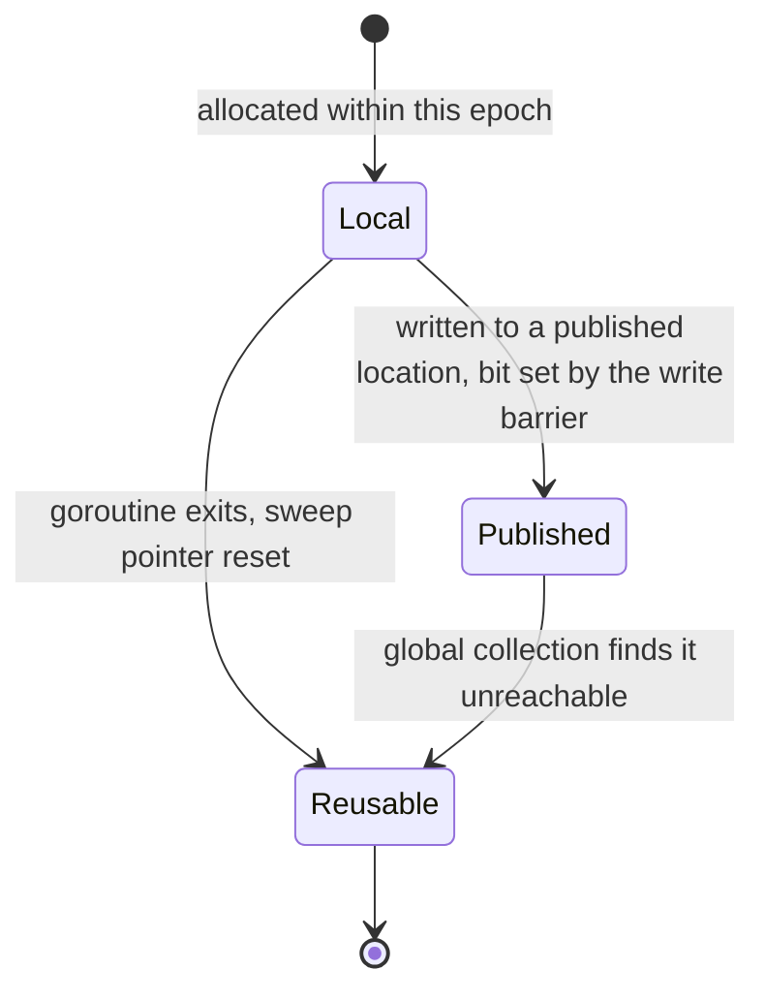

# 13.9 The Request Hypothesis and the Request-Oriented Collector

Before trying generational collection ([13.8](./generational.md)), the Go team experimented with a
different algorithm that also exploits regularities in object lifetimes. In 2016, Rick Hudson and
Austin Clements proposed the request oriented collector (ROC). The algorithm was first called the
transaction oriented collector (TOC); it was renamed, on a suggestion from Randall Farmer, to avoid
confusion with transactions in the ACID sense of databases
[[Hudson and Clements, 2016](#ref-hudson-clements-2016)]. The experiment ran on the `dev.garbage`
branch from 2016 into 2017, and no part of it ever reached the main line. This section presents the
hypothesis, the algorithm and its implementation, and the reasons it was abandoned.

## 13.9.1 The Request Hypothesis

The ROC design document states the **request hypothesis** as follows: objects created by a request
tend to die once that request completes [[Hudson and Clements, 2016](#ref-hudson-clements-2016)].
The observation comes from cloud services. Such a program typically has one goroutine handle a
request that arrives from the network or from another goroutine: it receives a message, deserializes
it, computes, serializes the result into a channel or socket, and then exits or goes to sleep to
wait for the next request. The computation may read a large shared heap, but the data it writes into
the heap and that remains alive after the request ends is usually small. Take the following handler
as an example:

```go
func handle(conn net.Conn) {
	req := decode(conn)        // intermediate objects produced by deserialization
	result := compute(req)     // temporary objects allocated during computation
	conn.Write(encode(result)) // the encoded result is not needed once written
}
```

The request hypothesis and the generational hypothesis look at different aspects of object
lifetimes. The generational hypothesis distinguishes objects by age and says that young objects are
more likely to die. The request hypothesis distinguishes objects by ownership and says that the
lifetimes of a batch of objects are bounded by the request. The latter also says when the batch
dies: when the goroutine handling the request finishes.

## 13.9.2 Local Objects and Publication

The design document calls an object that a goroutine has just allocated and that no other goroutine
has seen a local object. Once the goroutine shares the object with another goroutine, the object is
said to be published. The key observation of ROC is that if a goroutine exits before publishing an
object, the object must be unreachable, and the memory it occupies can be reclaimed and reused
immediately, without waiting for the next global collection
[[Hudson and Clements, 2016](#ref-hudson-clements-2016)].

The algorithm builds on the bitmap allocation of Go 1.7 ([12.5](../ch12alloc/smallalloc.md)). The
allocator advances along a span's bitmap and allocates objects at positions whose bit is unset; each
span maintains a current sweep pointer that marks the part of the bitmap already passed. ROC
additionally records an initial sweep pointer for each running goroutine. A bit between the two
pointers is either set, meaning the object survived the previous collection or has been published,
or unset, meaning the object was allocated by this goroutine and has not been published. The design
document calls these bits mark bits; in the implementation they are the span's allocation bitmap
[[Hudson, 2016a](#ref-hudson-2016a)].

The algorithm maintains an invariant: the mark bit of every published object is set. The write
barrier maintains it ([13.2](./barrier.md)). When a pointer is written into a field of some object,
if the object holding the field is published and the object being written is not, the latter is
about to be published, and so are the objects reachable from it. The write barrier first sets the
bit of the object being written, then sets the bits of all reachable objects with unset bits,
transitively along pointers, stopping a branch when it reaches an object whose bit is already set;
only after all bits are set does the write actually happen. The whole process needs no
synchronization: local objects are visible only to the goroutine that owns them, and until the write
completes these objects are still local.

With this invariant, collection becomes very simple. When a goroutine exits, it only needs to reset
its current sweep pointer to the initial sweep pointer: published objects in between all have their
bits set and are skipped by the allocator, while unpublished objects have unset bits and can be
allocated to other goroutines immediately. For a goroutine that goes to sleep after handling a
request, the algorithm first scans its stack and sets the bits of local objects reachable from it,
and then resets the sweep pointer. As time passes, most bits in the bitmap become set, and a full
global collection is then performed [[Hudson and Clements, 2016](#ref-hudson-clements-2016)]. The
state changes of an object in ROC are shown below:



## 13.9.3 Implementation: Epochs and the Exits of Publication

In the implementation, ROC calls the interval in which a goroutine runs continuously on a P an
epoch, and defines three basic operations around it [[Hudson, 2016c](#ref-hudson-2016c)]. `startG`
begins a new epoch when a goroutine is scheduled to run; `recycleG` returns the local objects of the
epoch to the allocator when the goroutine exits; `publishG` publishes all local objects of the
epoch, ending the epoch early. The epoch is bounded by the P because allocation goes through the P's
local cache ([12.2](../ch12alloc/component.md)); once another goroutine may run on this P, the
epoch's records can no longer be maintained. The initial implementation ended the epoch directly at
the places where a goroutine may lose its P, namely park, system calls and scheduler calls, by
setting the span's `startindex` to `freeindex`, which treats all objects allocated in the epoch as
published. This is conservative and lets objects that could have been reclaimed live at least until
the next collection. It was later changed to scan the stack first, publish the reachable objects,
and then recycle the remaining local objects [[Hudson, 2016d](#ref-hudson-2016d)]; for system calls,
publication is deferred until the call actually blocks and the P is handed off
[[Hudson, 2017](#ref-hudson-2017)].

The function that decides whether an address is published is `isPublic`. An address on the stack is
local. Addresses in the data segment, in the BSS segment, and outside the heap are always treated as
published. For an object in the heap, it is published if its span has not yet been swept or its
allocation bit is set. Among the remaining objects with unset bits, one whose index is not less than
the span's new field `startindex` is a local object allocated in this epoch and not yet published;
the rest are treated as published [[Hudson, 2016a](#ref-hudson-2016a)]. The decision is
conservative: any object not known to belong to this epoch is treated as published. The write
barrier part was added to the then-current `gcmarkwb_m` [[Hudson, 2016b](#ref-hudson-2016b)]:

```go
//go:nowritebarrierrec
//go:systemstack
func gcmarkwb_m(slot *uintptr, ptr uintptr) {
	if writeBarrier.mark {
		// ...
	}

	if ptr == 0 {
		return
	}

	// ROC: publish local ptrs being written into public slots.
	if writeBarrier.roc {
		// local -> public
		// local -> local
		// If slot is local then we are done.
		if !isPublic(uintptr(unsafe.Pointer(slot))) {
			return
		}
		// public -> public
		// if ptr is public we are done
		if isPublic(ptr) {
			return
		}
		// public -> local
		// Turn into a public -> public
		if inheap(ptr) {
			publish(ptr)
			// ...
		}
		return
	}
}
```

`writeBarrier.mark` corresponds to the original marking barrier and is on only during the mark phase
of a collection, whereas `writeBarrier.roc` is on all the time when ROC is enabled. Of the four
kinds of writes, only a write from a published location to a local object needs publication. A
comment in `mbarrier.go` at the time already explained that the write barrier runs before
publication: it happens before `*slot = ptr`, and it is this very write that may let another
goroutine see `ptr` for the first time. The correctness of ROC depends on this ordering. The
transitive traversal in `publish` was first written recursively, but recursion causes stack growth
at inopportune moments, so it was changed to an iterative form that borrows the work buffers of the
mark phase [[Hudson, 2016f](#ref-hudson-2016f)].

The write barrier covers only sharing through pointer writes. In Go an object can be seen by other
goroutines in many other ways, and each needs its own publication handling: elements sent through a
channel, the arguments of `go f(p)` that are placed on the new goroutine's stack, objects referenced
by defers, finalizers and profile records, pointers written by atomic operations, source data copied
by `memmove`, and the appending of map overflow buckets [[Hudson, 2016e](#ref-hudson-2016e)]. These
CLs show that, in a language that allows sharing of mutable memory, determining precisely at run
time whether an object is shared requires finding every exit through which sharing can occur.

## 13.9.4 Evaluation and Abandonment

In May 2017, Ian Lance Taylor still described this work on the mailing list as ongoing research,
with no clear sign yet of whether it would be beneficial in practice
[[Taylor, 2017](#ref-taylor-2017)]. Hudson announced the results in his ISMM 2018 keynote
[[Hudson, 2018](#ref-hudson-2018)]. The ROC write barrier is always on: every write has to check
whether it stores a pointer to a local object into a published object, and if so, to publish the
referenced object and traverse its reachable objects transitively, a traversal that can cause many
cache misses. In an end-to-end RPC benchmark, with little sharing, programs scaled quite well with
ROC on. But the team also had to ensure that ROC did not slow down the rest of the system, and
compilers were exactly the programs on which ROC did worst, with slowdowns of 30%, 40%, 50% and
more, which was unacceptable. On the set of performance benchmarks chosen by the compiler team, the
results were uniformly poor as well. Hudson concluded that ROC did bring scalability, but the
machines of the time had only 4 to 12 hardware threads, and the benefit of scaling could not
outweigh the write barrier tax; perhaps the conclusion deserves to be revisited once 128-core
machines are common.

This result is consistent with the analysis in [13.8](./generational.md). Go's current write barrier
is on only during marking: before a pointer store that needs a barrier, the compiler inserts a check
of the global flag `writeBarrier.enabled`, and while the collector is idle the mutator pays only
this one check per write. ROC and card-table-based generational collection both require the barrier
to stay on for as long as the mutator runs, and the ROC barrier also includes a transitive
traversal, which makes it more expensive. Pointer writes are among the most frequent operations in a
program; however small the cost of an always-on barrier per write, multiplied by the number of
writes it is a considerable fixed expense.

## 13.9.5 A Lineage of Local Collection

ROC belongs to the family of local collection: give each execution unit a region of memory that
belongs only to it, collect that region separately and cheaply, and hand only the shared objects to
global collection. This idea had been put into practice several times before ROC; the
implementations differ in who decides whether an object is shared, and when.

In the collector that Doligez and Leroy designed for Concurrent Caml Light, each thread has a
private heap that serves as its young generation, and the heap shared by all threads serves as the
old generation. When a private heap fills up, the thread copies its live objects to the shared heap
on its own, without synchronizing with other threads. The design requires that no pointer from the
shared heap points into a private heap, so when a private object is written into a mutable object in
the shared heap, the runtime copies it and its private descendants into the shared heap and writes
the address of the copy. Copying is feasible because the ML type system distinguishes mutable from
immutable objects at compile time: copying an immutable object is semantically unobservable, while
mutable objects are allocated directly in the shared heap
[[Doligez and Leroy, 1993](#ref-doligez-leroy-1993)].

The thread-local heaps that Domani et al. designed for Java are the closest to ROC. Each thread
allocates in its own heap partition and can perform local collections on its own. On every pointer
modification, a write barrier checks whether a local object is becoming a descendant of a global
object; if so, before the write it marks all of its descendants global with a depth-first traversal,
again without synchronization. The paper reports that, combined with direct global allocation, total
collection time is greatly reduced and most long pauses are eliminated; however, the write barrier
was not implemented in the JIT, and the measurements were made in interpreter mode
[[Domani et al., 2002](#ref-domani-2002)].

Erlang removes the need for the decision through language semantics. Processes share no data and
communicate only through messages [[Armstrong, 2003](#ref-armstrong-2003)]. The runtime gives each
process a separate heap, collected by a per-process generational semi-space copying collector, and
sending a message copies its contents to the receiver. The exception is binary data larger than 64
bytes, which is stored in a global, reference-counted binary heap, with only references to it kept
on the process heap [[Erlang/OTP, 2026](#ref-erlang-otp-2026)].

The three hand the decision to language semantics (Erlang forbids sharing), the type system (ML
distinguishes mutable from immutable), and a run-time write barrier (Java thread-local heaps and
ROC). Go lets goroutines share mutable objects, and neither the language nor its types guarantees
that an object belongs to a single goroutine, so ROC could take only the third route, and pay for it
on every pointer write. Go's compiler answers a similar question in another way: escape analysis
([15.5](../../part5toolchain/ch15compile/escape.md)) conservatively decides at compile time whether
an object can leave the function that owns it, and objects judged not to escape are allocated
directly on the stack at no run-time cost, but only the cases it can prove are handled.

## 13.9.6 Summary

The request hypothesis says that, in server programs, objects created by a request tend to die once
the request completes. ROC accordingly divides new objects into local and published ones. The write
barrier marks an object and everything reachable from it as published before the object is shared,
and when a goroutine exits, unpublished objects can be reused simply by resetting one pointer. The
implementation showed that, in Go, which allows sharing of mutable memory, every way of sharing
needs publication handling, and an always-on write barrier with transitive traversal slowed programs
such as the compiler by more than 30%. ROC and the generational experiments that followed were
blocked at the same point: both require the mutator to pay for the write barrier continuously. Go
then turned to improving the locality of marking without changing the write barrier, which is Green
Tea ([13.11](./greentea.md)), enabled by default in Go 1.26.

## Further Reading

- <a id="ref-armstrong-2003"></a>[Armstrong, 2003] Joe Armstrong. *Making Reliable Distributed
  Systems in the Presence of Software Errors.* PhD thesis, Royal Institute of Technology
  (KTH), 2003. https://erlang.org/download/armstrong_thesis_2003.pdf Erlang/BEAM per-process heaps
  and copying message semantics, the language-level counterpart of the request hypothesis.
- <a id="ref-doligez-leroy-1993"></a>[Doligez and Leroy, 1993] Damien Doligez, Xavier Leroy. "A
  Concurrent, Generational Garbage Collector for a Multithreaded Implementation of ML." *POPL '93*,
  113–123, 1993. https://doi.org/10.1145/158511.158611 An earlier local collector with small
  per-thread heaps and a shared major heap, sharing its design intuition with ROC.
- <a id="ref-domani-2002"></a>[Domani et al., 2002] Tamar Domani, Gal Goldshtein, Elliot K.
  Kolodner, Ethan Lewis, Erez Petrank, Dafna Sheinwald. "Thread-Local Heaps for Java." *ISMM '02*,
  76–87, 2002. https://doi.org/10.1145/512429.512439
- <a id="ref-erlang-otp-2026"></a>[Erlang/OTP, 2026] Erlang/OTP. Erlang Garbage Collector. ERTS
  User's Guide, 2026. https://www.erlang.org/doc/apps/erts/garbagecollection.html
- <a id="ref-hudson-2016a"></a>[Hudson, 2016a] Rick Hudson. [dev.garbage] runtime: determine if an
  object is public. Go CL 25056, 2016. https://go.dev/cl/25056 `isPublic` and `mspan.startindex`;
  this is the only CL of the ROC series that was merged, and it went into the `dev.garbage` branch,
  not the main line.
- <a id="ref-hudson-2016b"></a>[Hudson, 2016b] Rick Hudson. [dev.garbage] runtime: ROC write barrier
  code. Go CL 25058, 2016. https://go.dev/cl/25058 The write barrier implementation on the ROC
  experimental branch `dev.garbage`.
- <a id="ref-hudson-2016c"></a>[Hudson, 2016c] Rick Hudson. [dev.garbage] runtime: invoke core ROC
  routines. Go CL 25303, 2016. https://go.dev/cl/25303
  The three basic operations `startG`, `publishG` and `recycleG`.
- <a id="ref-hudson-2016d"></a>[Hudson, 2016d] Rick Hudson. [dev.garbage] runtime: add ROC recycle
  calls. Go CL 33316, 2016. https://go.dev/cl/33316
- <a id="ref-hudson-2016e"></a>[Hudson, 2016e] Rick Hudson. [dev.garbage] runtime: publish channel
  elements for ROC. Go CL 25305, 2016. https://go.dev/cl/25305 The same series also handles
  publication in CL 25304 (stacks of new goroutines), 25306 (finalizers), 25307 (profile records),
  25308 (defer), 33307 (atomic operations), 33317 (`memmove`) and 33320 (appending map overflow
  buckets).
- <a id="ref-hudson-2016f"></a>[Hudson, 2016f] Rick Hudson. [dev.garbage] runtime: TOC write barrier
  code. Go CL 22343, 2016. https://go.dev/cl/22343 The write barrier implementation from when the
  algorithm was still called TOC.
- <a id="ref-hudson-2017"></a>[Hudson, 2017] Rick Hudson. [dev.garbage] runtime: lazy publish on
  syscall. Go CL 37101, 2017. https://go.dev/cl/37101
- <a id="ref-hudson-2018"></a>[Hudson, 2018] Rick Hudson. *Getting to Go: The Journey of Go's
  Garbage Collector.* ISMM 2018 keynote, 2018. https://go.dev/blog/ismmkeynote The first-hand
  account of ROC's experimental results, the write barrier tax, and the reasons for abandoning it.
- <a id="ref-hudson-clements-2016"></a>[Hudson and Clements, 2016] Rick Hudson, Austin Clements.
  *Request Oriented Collector (ROC) Algorithm.* 2016. Design document (short link
  `golang.org/s/gctoc`):
  https://docs.google.com/document/d/1gCsFxXamW8RRvOe5hECz98Ftk-tcRRJcDFANj2VwCB0/view The original
  design: local and published objects, the publication write barrier, and collecting a batch at
  goroutine exit.
- <a id="ref-taylor-2017"></a>[Taylor, 2017] Ian Lance Taylor. Re: Why golang garbage-collector not
  implement Generational and Compact gc? golang-nuts, 2017.
  https://groups.google.com/g/golang-nuts/c/KJiyv2mV2pU/m/wdBUH1mHCAAJ
- Go issue tracker: https://github.com/golang/go/issues (code and benchmark discussion of the ROC
  experimental branch).
- This book: [13.2 Write Barrier Techniques](./barrier.md),
  [13.8 The Generational Hypothesis and Generational Collection](./generational.md),
  [13.12 Past, Present, and Future](./history.md).
