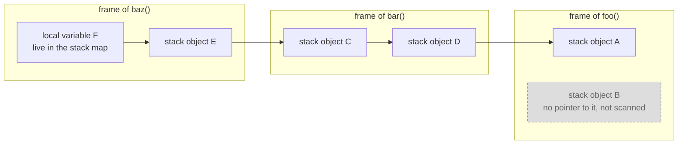

# 13.7 Safe-Point Analysis

Marking scans the stack of every goroutine ([13.4](./mark.md)). A word on a stack may be a pointer
into the heap or just an integer, and the collector has to tell which. Mistaking an integer for a
pointer only keeps garbage alive a little longer; mistaking a pointer for an integer frees an object
that is still in use. Go's collector is precise: it never guesses from the value of a word. The
pointer layout of heap objects comes from per-type bitmaps generated by the compiler
([12.2](../ch12alloc/component.md)), and the layout of a stack frame comes from a **stack map** that
the compiler generates for every function.

Stack maps exist only at call sites in a function, so the collector can scan a stack precisely only
while its goroutine is stopped at one of those places.
[9.7](../../part3concurrency/ch09sched/preemption.md) discusses safe points from the scheduler's
side, including how to stop a goroutine at one. This section takes the collector's side and asks
what can be read once the goroutine is there: how the compiler produces stack maps, how the runtime
uses them to scan a stack, how local variables whose address is taken are handled, and how the two
frames left behind by asynchronous preemption are scanned conservatively.

## 13.7.1 Stack Maps

Stack maps come from the compiler's liveness analysis. It tracks only the local variables and
parameters that live on the stack and whose types contain pointers, and it runs one backward
data-flow analysis per function. It first computes, for each basic block, the variables that are
used before being defined and the variables that are redefined; it then iterates along the control
flow to obtain the live variables at the entry and exit of each block; finally it walks each block
backward instruction by instruction and records the live variables at every instruction that needs a
stack map [[Go Authors, 2026c](#ref-go-authors-2026c)]. The only instructions that need one are
calls:

```go
// Returns true for instructions that must have a stack map.
//
// This does not necessarily mean the instruction is a safe-point. In
// particular, call Values can have a stack map in case the callee
// grows the stack, but not themselves be a safe-point.
func (lv *Liveness) hasStackMap(v *ssa.Value) bool {
	if !v.Op.IsCall() {
		return false
	}
	// wbZero and wbCopy are write barriers and
	// deeply non-preemptible. They are unsafe points and
	// hence should not have liveness maps.
	if sym, ok := v.Aux.(*ssa.AuxCall); ok && (sym.Fn == ir.Syms.WBZero || sym.Fn == ir.Syms.WBMove) {
		return false
	}
	return true
}
```

A call site suffices because every frame that must be scanned precisely is stopped at one. The
topmost frame is stopped in a call into the runtime (entering the scheduler, say, or the call to
`morestack` in a function prologue), and every other frame is waiting for its callee to return. This
is also why the comment distinguishes "has a stack map" from "is a safe point": a call that is not
itself a safe point may still lead to stack growth in the callee, and copying a stack also relies on
stack maps to adjust pointers ([14.4](../ch14stack/copy.md)). Since Go 1.15, stack maps are
generated only at calls. Before that, the compiler recorded stack maps and register maps at almost
every instruction, originally to support non-cooperative preemption
([9.7](../../part3concurrency/ch09sched/preemption.md)) [[Clements, 2020b](#ref-clements-2020b)].

The bitmaps of a function's call sites are deduplicated and form a table in the function's metadata.
Locals and arguments each have a table, `FUNCDATA_LocalsPointerMaps` and `FUNCDATA_ArgsPointerMaps`.
A third table, `PCDATA_StackMapIndex`, is encoded by PC and gives the index of the bitmap used at
each call instruction; the bitmap at function entry is always index 0. At run time the table header
is a `stackmap` [[Go Authors, 2026a](#ref-go-authors-2026a)]:

```go
type stackmap struct {
	n        int32   // number of bitmaps
	nbit     int32   // number of bits in each bitmap
	bytedata [1]byte // bitmaps, each starting on a byte boundary
}
```

Bit i of a bitmap corresponds to word i of the corresponding region of the frame.

Liveness is computed per call site. A variable no longer appears in the stack map after its last
use, even while it is still in scope in the source, so the object it pointed to may be reclaimed
before the function returns. The following program observes this with a weak pointer
([13.10](./finalizer.md)). A weak pointer does not keep its target alive, and `Value` returns nil
once the target has been reclaimed.

```go {run=true}
package main

import (
	"fmt"
	"runtime"
	"weak"
)

type buffer struct{ data [4096]byte }

// collected runs a collection and reports whether the weak pointer's target was reclaimed.
//
//go:noinline
func collected(w weak.Pointer[buffer]) bool {
	runtime.GC()
	return w.Value() == nil
}

func main() {
	p := new(buffer)
	fmt.Println("p collected:", collected(weak.Make(p)))

	q := new(buffer)
	fmt.Println("q collected:", collected(weak.Make(q)))
	runtime.KeepAlive(q)
}
```

The output is:

```
p collected: true
q collected: false
```

Both `new(buffer)` calls allocate on the heap, because the pointer is passed to `weak.Make`, whose
argument escapes (`-gcflags=-m` reports `new(buffer) escapes to heap`). After `p` is passed to
`weak.Make` it is never used again, so it is already absent from the stack map when `collected` is
called; its target is unreachable and is reclaimed in that collection. `q` is still passed to
`runtime.KeepAlive` later, so it is live at the call to `collected`. The compiler option `-live`
reports the variables in the stack map at each call site, and prints nothing when the set is empty:

```shell
$ go build -gcflags=-live 2>&1 | grep 'call to collected'
./main.go:24:39: live at call to collected: q
```

The call on line 21 produces no output, which means its stack map is empty. `collected` is marked
`//go:noinline` so that inlining does not change the reported positions.

`runtime.KeepAlive` exists for exactly this case. Its documentation reads
[[Go Authors, 2026e](#ref-go-authors-2026e)]:

```go
// KeepAlive marks its argument as currently reachable.
// This ensures that the object is not freed, and its finalizer is not run,
// before the point in the program where KeepAlive is called.
```

The compiler replaces a call to it with an SSA operation, `OpKeepAlive`, which generates no machine
instruction. Its definition says "arg[0] is a value that must be kept alive until this mark", and
its only effect is to extend the live range of the argument to the call. The documentation also
warns that `KeepAlive` should be used only to keep a finalizer from running too early; the semantics
of finalizers and cleanups are covered in [13.10](./finalizer.md).

## 13.7.2 Scanning a Stack

A stack is one of the mark roots. Under the hybrid write barrier, each stack needs to be scanned
only once per mark cycle ([13.2](./barrier.md)). After claiming the stack root job for a goroutine
([13.4](./mark.md)), `markroot` calls `suspendG` to stop it at a safe point, scans the stack, and
calls `resumeG` to let it continue ([9.7](../../part3concurrency/ch09sched/preemption.md))
[[Go Authors, 2026b](#ref-go-authors-2026b)]. The goroutine doing the scanning may be the very one
being scanned. In that case it first sets itself to `_Gwaiting`, to avoid deadlocking while waiting
for itself to stop, and the scan runs on the system stack. The checks at the start of `scanstack`
state these preconditions as assertions [[Go Authors, 2026a](#ref-go-authors-2026a)]:

```go
	switch readgstatus(gp) &^ _Gscan {
	default:
		print("runtime: gp=", gp, ", goid=", gp.goid, ", gp->atomicstatus=", readgstatus(gp), "\n")
		throw("mark - bad status")
	case _Gdead, _Gdeadextra:
		return 0
	case _Grunning:
		print("runtime: gp=", gp, ", goid=", gp.goid, ", gp->atomicstatus=", readgstatus(gp), "\n")
		throw("scanstack: goroutine not stopped")
	case _Grunnable, _Gsyscall, _Gwaiting, _Gleaked:
		// ok
	}

	if gp == getg() {
		throw("can't scan our own stack")
	}
```

`_Gleaked` is a status introduced by the goroutine leak profile experiment in Go 1.26
([13.6](./termination.md)). `scanstack` then accumulates the scanned stack size, which is used to
choose the initial stack size of new goroutines ([14.2](../ch14stack/alloc.md)), and shrinks the
stack if that is safe ([14.5](../ch14stack/shrink.md)). It then unwinds from the top of the stack
with an `unwinder` and calls `scanframeworker` for each frame. Before a frame can be scanned
precisely, `getStackMap` determines which bitmap to use:

```go
func (frame *stkframe) getStackMap(debug bool) (locals, args bitvector, objs []stackObjectRecord) {
	targetpc := frame.continpc
	if targetpc == 0 {
		// Frame is dead. Return empty bitvectors.
		return
	}

	f := frame.fn
	pcdata := int32(-1)
	if targetpc != f.entry() {
		// Back up to the CALL. If we're at the function entry
		// point, we want to use the entry map (-1), even if
		// the first instruction of the function changes the
		// stack map.
		targetpc--
		pcdata = pcdatavalue(f, abi.PCDATA_StackMapIndex, targetpc)
	}
	if pcdata == -1 {
		// We do not have a valid pcdata value but there might be a
		// stackmap for this function. It is likely that we are looking
		// at the function prologue, assume so and hope for the best.
		pcdata = 0
	}
	// ...
```

`continpc` is the position where the frame will continue executing, usually the return address of
the call. If the frame will never run again it is 0, and nothing in it needs to be kept. The return
address points to the instruction after the call, which may already belong to the range of a
different bitmap, so the code first steps back one byte to land on the call instruction itself. A
frame stopped at function entry, such as that of a goroutine that has not started running, uses the
entry bitmap, index 0.

`getStackMap` uses the same index to fetch a bitmap from the locals table and another from the
arguments table, and also fetches the stack objects registered by this function (13.7.3).
`scanframeworker` hands the two bitmaps to `scanblock`:

```go
	locals, args, objs := frame.getStackMap(false)

	// Scan local variables if stack frame has been allocated.
	if locals.n > 0 {
		size := uintptr(locals.n) * goarch.PtrSize
		scanblock(frame.varp-size, size, locals.bytedata, gcw, state)
	}

	// Scan arguments.
	if args.n > 0 {
		scanblock(frame.argp, uintptr(args.n)*goarch.PtrSize, args.bytedata, gcw, state)
	}
```

`varp` and `argp` are the top of the locals region and the start of the arguments region; the
positions of the regions in a frame are shown in the layout figure referenced in
[14.4](../ch14stack/copy.md). `scanblock` checks words one by one according to the bitmap:

```go
	for i := uintptr(0); i < n; {
		// Find bits for the next word.
		bits := uint32(*addb(ptrmask, i/(goarch.PtrSize*8)))
		if bits == 0 {
			i += goarch.PtrSize * 8
			continue
		}
		for j := 0; j < 8 && i < n; j++ {
			if bits&1 != 0 {
				// Same work as in scanObject; see comments there.
				p := *(*uintptr)(unsafe.Pointer(b + i))
				if p != 0 {
					if stk != nil && p >= stk.stack.lo && p < stk.stack.hi {
						stk.putPtr(p, false)
					} else {
						if !tryDeferToSpanScan(p, gcw) {
							if obj, span, objIndex := findObject(p, b, i); obj != 0 {
								greyobject(obj, b, i, span, gcw, objIndex)
							}
						}
					}
				}
			}
			bits >>= 1
			i += goarch.PtrSize
		}
	}
```

When a byte of the bitmap is 0, eight words are skipped at once. A word marked as a pointer that
points into the goroutine's own stack is handed to stack-object processing. Otherwise it is treated
as when scanning a heap object: small objects handled by Green Tea are put on a span queue
([13.11](./greentea.md)), and all others are greyed directly. A word outside the bitmap is never
dereferenced, however much its value looks like an address.

Besides the frames, `scanstack` also scans a few pointers attached to the stack: the closure context
register saved in the scheduling context, `gp.sched.ctxt`; the function values and links in defer
records; and panic records. Panic records are always allocated on the stack and are handled as stack
objects.

## 13.7.3 Stack Objects

Liveness analysis can follow direct reads and writes of a variable but struggles with accesses
through pointers. Once the address of a local variable is taken, pointers to it may be passed among
the functions on the stack, or kept conditionally. If such a variable does not escape and stays on
the stack, the compiler cannot decide statically when it dies. Before Go 1.12, the compiler was
conservative: at every call site, a variable whose address had been taken was considered live if any
path reaching that site had initialized it. A variable initialized on only some paths is called
ambiguously live, and also had to be zeroed at function entry so that the collector would not read
an uninitialized value [[Go Authors, 2018](#ref-go-authors-2018)].

This approach kept objects alive unexpectedly. Issue #22350, filed in 2017, reported a program that
keeps extending a linked list in a loop with `curr.next = new(Node)` and moves `root` to the current
node every 3000 nodes; the old nodes were expected to be reclaimed, but memory was never released
[[zardlee1937, 2017](#ref-zardlee1937-2017)]. The discussion pointed out that the first `new(Node)`
does not escape, so the compiler allocates that node on the stack as a temporary, with `curr`
pointing to it. This stack node has to stay alive until the first execution of `curr = curr.next` in
the loop, but the compiler cannot tell the first iteration from the rest and must keep it live
throughout the loop, so the whole list stays reachable through its `next` field.

The **stack objects** introduced in Go 1.12 decide this at run time instead
[[Randall, 2018a](#ref-randall-2018a)] [[Randall, 2018b](#ref-randall-2018b)]. The compiler
registers, in the function metadata `FUNCDATA_StackObjects`, every variable in the function that has
its address taken, has a pointer-containing type, and stays on the stack. While scanning the stack,
the runtime performs a small marking pass over these objects. The comment at the top of
`runtime/mgcstack.go` explains the idea [[Go Authors, 2026d](#ref-go-authors-2026d)]:

```go
// Instead, we will track pointers to stack variables dynamically.
// All pointers to stack-allocated variables will themselves be on the
// stack somewhere (or in associated locations, like defer records), so
// we can find them all efficiently.
//
// Stack tracing is organized as a mini garbage collection tracing
// pass. The objects in this garbage collection are all the variables
// on the stack whose address is taken, and which themselves contain a
// pointer. We call these variables "stack objects".
```

The comment goes on with an example: `foo` calls `bar`, and `bar` calls `baz`. `foo` has stack
objects A and B; `bar` has stack objects C and D, where C points to D and D points to A; `baz` has a
stack object E that points to C, and a local variable F that points to E. Starting from F, the scan
visits E, C, D and A in turn. No live pointer points to B, so B is not scanned. If `foo` does not
access B directly after calling `bar` either, the heap pointers inside B do not keep any heap object
alive.



`scanframeworker` only registers the stack objects of each frame. After all frames are scanned,
`scanstack` completes the small marking pass, using as roots the pointers into the stack found
through the stack maps and through the defer and panic records:

```go
	// Find and scan all reachable stack objects.
	//
	// The state's pointer queue prioritizes precise pointers over
	// conservative pointers so that we'll prefer scanning stack
	// objects precisely.
	state.buildIndex()
	for {
		p, conservative := state.getPtr()
		if p == 0 {
			break
		}
		obj := state.findObject(p)
		if obj == nil {
			continue
		}
		r := obj.r
		if r == nil {
			// We've already scanned this object.
			continue
		}
		obj.setRecord(nil) // Don't scan it again.
		// ...
		ptrBytes, gcData := r.gcdata()
		b := state.stack.lo + uintptr(obj.off)
		if conservative {
			scanConservative(b, ptrBytes, gcData, gcw, &state)
		} else {
			scanblock(b, ptrBytes, gcData, gcw, &state)
		}
	}
```

The record of each stack object gives its size and pointer bitmap, and an object that is reached is
scanned according to that bitmap. Pointers to the heap go to the collector, pointers into the stack
are put back on the queue, and `setRecord(nil)` ensures that each object is scanned only once.
Unlike marking on the heap, unreached stack objects cannot be reclaimed; they stay in the frame
until the function returns. Stack copying does not perform this marking and adjusts the pointers in
all stack objects ([14.4](../ch14stack/copy.md)). The conservative pointers mentioned in the comment
come from the next subsection.

## 13.7.4 Conservative Scanning

Precise scanning rests on one premise: every frame is stopped at a call. The asynchronous preemption
of Go 1.14 breaks it. It uses a signal to pause a goroutine at almost any instruction and injects an
`asyncPreempt` frame onto the stack, which saves all general-purpose registers at the time of the
interruption ([9.7](../../part3concurrency/ch09sched/preemption.md)). The interrupted function is
stopped at an ordinary instruction, where there is no stack map, and the pointers in its registers
are saved only in the frame of `asyncPreempt` [[Clements, 2018](#ref-clements-2018)]. Function calls
injected by the debugger (`debugCallV2`) face the same problem. They originally relied on stack maps
and register maps recorded for almost every instruction, which accounted for about 5% of the binary;
since Go 1.15 they use the same treatment as asynchronous preemption
[[Clements, 2020a](#ref-clements-2020a)]. For these two frames the collector scans
**conservatively**: it ignores the bitmaps and treats every word that looks like a pointer as a
possible pointer [[Clements, 2019a](#ref-clements-2019a)] [[Clements, 2019b](#ref-clements-2019b)].
The start of `scanframeworker` handles this case:

```go
	isAsyncPreempt := frame.fn.valid() && frame.fn.funcID == abi.FuncID_asyncPreempt
	isDebugCall := frame.fn.valid() && frame.fn.funcID == abi.FuncID_debugCallV2
	if state.conservative || isAsyncPreempt || isDebugCall {
		// ...

		// Conservatively scan the frame. Unlike the precise
		// case, this includes the outgoing argument space
		// since we may have stopped while this function was
		// setting up a call.
		//
		// TODO: We could narrow this down if the compiler
		// produced a single map per function of stack slots
		// and registers that ever contain a pointer.
		if frame.varp != 0 {
			size := frame.varp - frame.sp
			if size > 0 {
				// ...
				scanConservative(frame.sp, size, nil, gcw, state)
			}
		}

		// Scan arguments to this frame.
		if n := frame.argBytes(); n != 0 {
			// TODO: We could pass the entry argument map
			// to narrow this down further.
			scanConservative(frame.argp, n, nil, gcw, state)
		}

		if isAsyncPreempt || isDebugCall {
			// This function's frame contained the
			// registers for the asynchronously stopped
			// parent frame. Scan the parent
			// conservatively.
			state.conservative = true
		} else {
			// We only wanted to scan those two frames
			// conservatively. Clear the flag for future
			// frames.
			state.conservative = false
		}
		return
	}
```

Two things differ from the precise path. First, conservative scanning covers the whole region from
SP to `varp`, including the space reserved for outgoing arguments, because the interrupted function
may have been preparing a call; the incoming argument region is also scanned in full, without
consulting the argument bitmap. Second, after the `asyncPreempt` or debug-call frame is scanned,
`state.conservative` is set so that the next frame, the interrupted function, is also scanned
conservatively; the flag is cleared once that frame is done, and the outer frames, all stopped at
calls, are scanned precisely from their stack maps.

What counts as "looks like a pointer" is not lenient. `scanConservative` checks each word in turn:

```go
		val := *(*uintptr)(unsafe.Pointer(b + i))

		// Check if val points into the stack.
		if state != nil && state.stack.lo <= val && val < state.stack.hi {
			// val may point to a stack object. This
			// object may be dead from last cycle and
			// hence may contain pointers to unallocated
			// objects, but unlike heap objects we can't
			// tell if it's already dead. Hence, if all
			// pointers to this object are from
			// conservative scanning, we have to scan it
			// defensively, too.
			state.putPtr(val, true)
			continue
		}

		// Check if val points to a heap span.
		span := spanOfHeap(val)
		if span == nil {
			continue
		}

		// Check if val points to an allocated object.
		//
		// Ignore objects allocated during the mark phase, they've
		// been allocated black.
		idx := span.objIndex(val)
		if span.isFreeOrNewlyAllocated(idx) {
			continue
		}

		// val points to an allocated object. Mark it.
		obj := span.base() + idx*span.elemsize
		if !tryDeferToSpanScan(obj, gcw) {
			greyobject(obj, b, i, span, gcw, idx)
		}
```

A word that points into the heap marks its object only if it lies within a span in use, the slot it
points to is allocated, and the object was not allocated after marking began; a word that points
into the interior of an object is treated as the object's start address.
[12.5](../ch12alloc/smallalloc.md) explains how `isFreeOrNewlyAllocated` uses `freeIndexForScan` to
avoid slots that are not yet initialized. A word that points into the stack is trickier: the stack
object it points to may have died in the previous cycle, and residual pointers in it may refer to
heap slots that have already been freed, while the runtime cannot tell whether a stack object is
dead as it can for a heap object. Therefore, if every pointer to a stack object comes from
conservative scanning, that stack object must be scanned conservatively too. For this reason the
pointer queue of `scanstack` returns precise pointers first, so that stack objects are scanned by
bitmap whenever possible.

The cost of conservative scanning is that an integer that happens to look like an address may be
treated as a pointer, keeping an object that should be reclaimed alive for one more cycle. Here the
scope is limited to the two topmost frames and the stack objects reachable only through them, so the
cost is small. Another restriction is that the pointer information of these two frames is imprecise,
so the runtime cannot move this stack: when a goroutine is stopped at an asynchronous safe point,
`isShrinkStackSafe` returns false, and `scanstack` defers shrinking to the next synchronous safe
point ([14.5](../ch14stack/shrink.md)). Debug calls can accept this restriction because they now
execute on a new goroutine, where the stack can grow freely
[[Clements, 2020a](#ref-clements-2020a)].

## 13.7.5 From Conservative to Precise

Go was not precise from the start. The Go 1.0 collector had almost no type information: `scanblock`
treated every word of a memory block that fell within the heap range as a possible pointer, and only
objects marked as pointer-free could skip content scanning. Stacks were scanned word by word in
their entirety [[Go Authors, 2012](#ref-go-authors-2012)]. On 32-bit platforms the address space is
small, so integers fall into the heap range more easily. The Go 1.1 release notes say that the
collector had become more precise, which costs a small amount of CPU time but can significantly
reduce heap size, especially on 32-bit architectures [[Go Authors, 2013](#ref-go-authors-2013)].

Precise stack scanning came later. During the Go 1.2 development cycle Shapiro enabled scanning
stacks by frames [[Shapiro, 2013a](#ref-shapiro-2013a)]; a few months later Cox disabled it, because
walking the stack frame by frame cost about three times as much as before, and since it did not end
up being precise, the benefit did not justify the cost [[Cox, 2013](#ref-cox-2013)]. Go 1.3 moved
stack scanning into the parallel mark phase to spread the cost
[[Shapiro, 2013b](#ref-shapiro-2013b)]. Its release notes say:

> For a while now, the garbage collector has been precise when examining values in the heap; the Go
> 1.3 release adds equivalent precision to values on the stack.

They also warn that programs that use `unsafe` to store an integer in a pointer-typed value are
illegal, and that the runtime will crash the program if it detects one
[[Go Authors, 2014a](#ref-go-authors-2014a)].

The remaining imprecision came from the runtime itself. Most of the runtime was still written in C,
and the compiler could not generate stack maps for those frames. Go 1.4 rewrote most of the runtime
in Go, and the collector became fully precise: it knows the location of every live pointer in the
program, and the heap is no longer inflated by false pointers. Together with other improvements,
heaps were 10% to 30% smaller than in the previous release
[[Go Authors, 2014b](#ref-go-authors-2014b)]. Except for one place reserved for SWIG, all
conservative scanning in the collector was removed [[Cox, 2014](#ref-cox-2014)]. The two later
changes did not depart from this course: the stack objects of Go 1.12 brought variables whose
address is taken into the precise analysis, and the asynchronous preemption of Go 1.14 reintroduced
conservative scanning but confined it to the two topmost frames.

The representative conservative collector is the one Boehm and Weiser designed in 1988
for "uncooperative environments" such as C [[Boehm and Weiser, 1988](#ref-boehm-weiser-1988)]. It
needs no type information from the compiler and can therefore be used with almost any language. The
price is twofold. False pointers make an object, together with the entire subgraph it references,
linger. And because the collector cannot tell whether a word is a pointer or an integer, it cannot
rewrite the word, so it usually does not move objects referenced by such words
[[Jones et al., 2023](#ref-jones-2023)]. The price of precise collection falls on the compiler and
runtime. The compiler must generate a pointer bitmap for every type and a stack map for every call
site, which enlarges the binary, and programs must obey the corresponding constraints; for example,
a `uintptr` is not considered a pointer and cannot be used to keep an object alive
([14.4](../ch14stack/copy.md)). In return there are no false pointers, and objects are free to move.
Go's heap objects do not move ([13.5](./sweep.md)), but stacks are relocated as a whole when they
grow or shrink, and the runtime rewrites every pointer on the stack using the same stack maps and
stack objects ([14.4](../ch14stack/copy.md)).

## 13.7.6 Summary

The stack map is a contract between the compiler and the collector. The compiler's liveness analysis
records, at each call site, which slots of a stack frame hold live pointers; the runtime looks up
the bitmap by the frame's return address and scans only the marked words. Liveness is computed per
call site, so a variable stops keeping an object alive after its last use, and `runtime.KeepAlive`
extends that range. Variables whose address is taken are handled as stack objects: while scanning
the stack, the runtime runs a small marking pass from the live pointers and scans only the reachable
stack objects. Asynchronous preemption and debug calls stop a goroutine at instructions that have no
stack map, so the collector scans the two topmost frames conservatively and accepts only words that
point to allocated objects. It took Go four releases to turn the collector from conservative to
precise, and since then it falls back to conservative scanning only here, and only to a limited
extent.

## Further Reading

- <a id="ref-boehm-weiser-1988"></a>[Boehm and Weiser, 1988] Hans-J. Boehm, Mark Weiser. Garbage
  Collection in an Uncooperative Environment. *Software: Practice and Experience*, 18(9), 1988,
  807–820. https://doi.org/10.1002/spe.4380180902 The classic representative of conservative
  collection.
- <a id="ref-clements-2018"></a>[Clements, 2018] Austin Clements. runtime: non-cooperative goroutine
  preemption. Go issue #24543, 2018. https://github.com/golang/go/issues/24543 The tracking issue
  for non-cooperative preemption; the conservative inner-frame scanning finally adopted is described
  in Clements (2019a).
- <a id="ref-clements-2019a"></a>[Clements, 2019a] Austin Clements. Proposal: Conservative
  inner-frame scanning for non-cooperative goroutine preemption. Go design document, 2019.
  https://go.googlesource.com/proposal/+/master/design/24543/conservative-inner-frame.md
- <a id="ref-clements-2019b"></a>[Clements, 2019b] Austin Clements. runtime: scan stacks
  conservatively at async safe points. Go commit d16ec13756, 2019. https://go.dev/cl/201761 Shipped
  in Go 1.14.
- <a id="ref-clements-2020a"></a>[Clements, 2020a] Austin Clements. runtime: use conservative
  scanning for debug calls. Go commit 57d751370c, 2020. https://go.dev/cl/229300 Shipped in Go 1.15.
- <a id="ref-clements-2020b"></a>[Clements, 2020b] Austin Clements. cmd/compile,runtime: stack maps
  only at calls, remove register maps. Go commit 9d812cfa5c, 2020. https://go.dev/cl/230544 Shipped
  in Go 1.15.
- <a id="ref-cox-2013"></a>[Cox, 2013] Russ Cox. runtime: do not scan stack by frames during garbage
  collection. Go commit c3dadca977, 2013. https://golang.org/cl/14257043
  Shipped in Go 1.2.
- <a id="ref-cox-2014"></a>[Cox, 2014] Russ Cox. runtime: remove uses of ScanConservatively. Go
  commit d208361cde, 2014. https://golang.org/cl/144860043 Shipped in Go 1.4.
- <a id="ref-go-authors-2012"></a>[Go Authors, 2012] The Go Authors. src/pkg/runtime/mgc0.c
  (scanblock, scanstack). Go 1 source. https://github.com/golang/go/blob/go1/src/pkg/runtime/mgc0.c
- <a id="ref-go-authors-2013"></a>[Go Authors, 2013] The Go Authors. *Go 1.1 Release Notes.* 2013.
  https://go.dev/doc/go1.1
- <a id="ref-go-authors-2014a"></a>[Go Authors, 2014a] The Go Authors. *Go 1.3 Release Notes:
  Changes to the garbage collector.* 2014. https://go.dev/doc/go1.3#garbage_collector
- <a id="ref-go-authors-2014b"></a>[Go Authors, 2014b] The Go Authors. *Go 1.4 Release Notes:
  Changes to the runtime.* 2014. https://go.dev/doc/go1.4#runtime
- <a id="ref-go-authors-2018"></a>[Go Authors, 2018] The Go Authors.
  src/cmd/compile/internal/gc/plive.go (liveness of address-taken variables and ambiguous liveness).
  Go 1.11 source. https://github.com/golang/go/blob/go1.11/src/cmd/compile/internal/gc/plive.go
- <a id="ref-go-authors-2026a"></a>[Go Authors, 2026a] The Go Authors. src/runtime/mgcmark.go
  (scanstack, scanframeworker, scanblock, scanConservative) and src/runtime/stkframe.go
  (getStackMap). See also src/runtime/symtab.go and src/runtime/mbitmap.go. Go 1.26 source.
  https://github.com/golang/go/blob/release-branch.go1.26/src/runtime/mgcmark.go
  https://github.com/golang/go/blob/release-branch.go1.26/src/runtime/stkframe.go Reading stack
  maps; precise and conservative scanning.
- <a id="ref-go-authors-2026b"></a>[Go Authors, 2026b] The Go Authors. src/runtime/preempt.go
  (suspendG, isAsyncSafePoint). Go 1.26 source.
  https://github.com/golang/go/blob/release-branch.go1.26/src/runtime/preempt.go Stopping a
  goroutine at a safe point.
- <a id="ref-go-authors-2026c"></a>[Go Authors, 2026c] The Go Authors.
  src/cmd/compile/internal/liveness/plive.go. Go 1.26 source.
  https://github.com/golang/go/blob/release-branch.go1.26/src/cmd/compile/internal/liveness/plive.go
- <a id="ref-go-authors-2026d"></a>[Go Authors, 2026d] The Go Authors. src/runtime/mgcstack.go. Go
  1.26 source. https://github.com/golang/go/blob/release-branch.go1.26/src/runtime/mgcstack.go
- <a id="ref-go-authors-2026e"></a>[Go Authors, 2026e] The Go Authors. src/runtime/mfinal.go
  (KeepAlive). See also src/cmd/compile/internal/ssa/_gen/genericOps.go (OpKeepAlive). Go 1.26
  source. https://github.com/golang/go/blob/release-branch.go1.26/src/runtime/mfinal.go
- <a id="ref-jones-2023"></a>[Jones et al., 2023] Richard Jones, Antony Hosking, Eliot Moss. *The
  Garbage Collection Handbook: The Art of Automatic Memory Management.* 2nd ed., CRC Press, 2023.
  https://doi.org/10.1201/9781003276142 Precise and conservative collection, pointer identification
  and mobility.
- <a id="ref-randall-2018a"></a>[Randall, 2018a] Keith Randall. cmd/compile,runtime: implement stack
  objects. Go commit cbafcc55e8, 2018. https://go.dev/cl/134155
  Shipped in Go 1.12.
- <a id="ref-randall-2018b"></a>[Randall, 2018b] Keith Randall. cmd/compile,runtime: remove
  ambiguously live logic. Go commit 9a8372f8bd, 2018. https://go.dev/cl/134156 Shipped in Go 1.12.
- <a id="ref-shapiro-2013a"></a>[Shapiro, 2013a] Carl Shapiro. runtime: enable stack scanning by
  frames. Go commit 0e6007e4f9, 2013. https://golang.org/cl/9406046 Committed during the Go 1.2
  development cycle; disabled by Cox (2013) before the release.
- <a id="ref-shapiro-2013b"></a>[Shapiro, 2013b] Carl Shapiro. runtime: move stack scanning into the
  parallel mark phase. Go commit 0368a7ceb6, 2013. https://golang.org/cl/17410043
  Shipped in Go 1.3.
- <a id="ref-zardlee1937-2017"></a>[zardlee1937, 2017] zardlee1937. cmd/compile: compiler can
  unexpectedly preserve memory. Go issue #22350, 2017. https://go.dev/issue/22350
- This book: [9.7 Cooperation and Preemption](../../part3concurrency/ch09sched/preemption.md) (safe
  points, time to reach a safe point, and the full mechanism of cooperative and asynchronous
  preemption, which the stack scan here reuses), [12.2 Components](../ch12alloc/component.md),
  [12.5 Small Object Allocation](../ch12alloc/smallalloc.md),
  [13.2 Write Barrier Techniques](./barrier.md), [13.4 Scan Marking and Mark Assist](./mark.md),
  [13.10 Finalizers](./finalizer.md),
  [14.4 Stack Copying and Pointer Adjustment](../ch14stack/copy.md),
  [14.5 Stack Shrinking and Evolution](../ch14stack/shrink.md) (stack maps, together with the
  pointer bitmaps of mspan and arena, support precise scanning).
