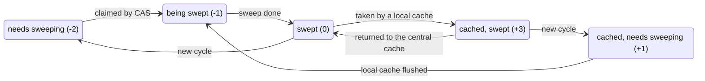

# 13.5 Sweeping and Bitmaps

When marking ends, the objects that are still white are garbage ([13.4](./mark.md)). **Sweeping**
returns the slots they occupy to the allocator and prepares a cleared mark bitmap for the next
cycle. Go sweeps by span and does not visit dead objects one by one: this cycle's mark bitmap
directly becomes the new allocation bitmap, and the unmarked slots become free as a result
([12.5](../ch12alloc/smallalloc.md)). This approach dates from Go 1.7. Before that, sweeping rebuilt
each span's free list from the mark bits ([12.2](../ch12alloc/component.md)); Clements's 2015 design
document proposed allocating directly from the mark bitmap, which removes that step
[[Clements, 2015a](#ref-clements-2015a)].

Sweeping runs concurrently with the user program and has no dedicated pause. At mark termination the
runtime merely flags every span in the heap as needing a sweep; after that, the background sweeper
goroutine, an allocation path that needs a span, or a heap allocation that needs pages may each take
over the sweeping of some span. This section first explains what sweeping one span involves, then
how several sweepers coordinate, who drives sweeping, and how it is guaranteed to finish before the
next mark, and finally discusses the trade-off of not moving objects.

## 13.5.1 Sweeping a Span

The function that sweeps a single span is `mspan.sweep`, and every sweeping path ends up calling it
[[Go Authors, 2026a](#ref-go-authors-2026a)]. It does five things in order.

First, it handles special records. Finalizers, cleanup functions, weak pointer handles and heap
profile samples are all attached to the object's span as special records. For an unmarked object
that has special records, if it has a finalizer, sweeping sets its mark bit to resurrect it, queues
the finalizer, and zeroes the weak pointer handles; otherwise the object is truly dead, and sweeping
frees all of its special records, queuing the cleanup functions and zeroing the weak pointer handles
along the way. These semantics and their consequences are covered in [13.10](./finalizer.md).

Second, it merges the Green Tea mark bits. The Green Tea collector, enabled by default in Go 1.26,
records the mark bits of objects of 16 to 512 bytes inside the span ([13.4](./mark.md)). Sweeping
first merges these bits into `gcmarkBits` and then resets the span's inline mark bits
(`moveInlineMarks`, [13.11](./greentea.md)).

Third, it checks consistency. A slot that is marked but not allocated is called a zombie. Sweeping
compares the mark bitmap with the allocation bitmap byte by byte, and as soon as it finds a zombie
it prints the state of every slot in that span and aborts the program. A source comment lists three
causes [[Go Authors, 2026a](#ref-go-authors-2026a)]:

```go
// reportZombies reports any marked but free objects in s and throws.
//
// This generally means one of the following:
//
// 1. User code converted a pointer to a uintptr and then back
// unsafely, and a GC ran while the uintptr was the only reference to
// an object.
//
// 2. User code (or a compiler bug) constructed a bad pointer that
// points to a free slot, often a past-the-end pointer.
//
// 3. The GC two cycles ago missed a pointer and freed a live object,
// but it was still live in the last cycle, so this GC cycle found a
// pointer to that object and marked it.
```

This precise check dates from Go 1.15. Before that, sweeping merely compared the total number of set
bits in the two bitmaps and reported an error only when there were more marks than allocations,
which provided almost none of the information needed for debugging
[[Clements, 2020](#ref-clements-2020)].

Fourth, it swaps the bitmaps. `countAlloc` counts the slots set in `gcmarkBits`, which is the number
of live objects; `gcmarkBits` then becomes the new `allocBits`, a freshly cleared bitmap takes its
place as the next cycle's `gcmarkBits`, and `freeindex` is reset to zero; the code is in
[12.5](../ch12alloc/smallalloc.md). The memory of dead objects is not touched during sweeping: as
soon as any object is freed, the span is marked as needing zeroing (`needzero`), and a freed slot is
zeroed only when it is next allocated. The cost of sweeping a span is therefore independent of the
number of dead objects and depends mainly on the length of the bitmaps.

Fifth, it decides where the span goes. The sweeper marks the span as swept before handing it over,
because the allocation paths assume that every span they can obtain has been swept. When the
parameter `preserve` is true, the caller (an allocation path) intends to use the span directly, and
sweeping does not put it back on any list; otherwise a span of small objects is handled by the
number of live objects [[Go Authors, 2026a](#ref-go-authors-2026a)]:

```go
		if !preserve {
			// ...
			if nalloc == 0 {
				// Free totally free span directly back to the heap.
				mheap_.freeSpan(s)
				return true
			}
			// Return span back to the right mcentral list.
			if nalloc == s.nelems {
				mheap_.central[spc].mcentral.fullSwept(sweepgen).push(s)
			} else {
				mheap_.central[spc].mcentral.partialSwept(sweepgen).push(s)
			}
		}
```

A span with no live objects is returned whole to the page allocator; its pages can then form spans
of any size class, and free pages may also be returned to the operating system by the scavenger
([12.7](../ch12alloc/pagealloc.md)). A span that still has live objects must stay in its size class
and goes into one of the central cache's two swept sets, depending on whether it has a free slot
([12.2](../ch12alloc/component.md)). A large object occupies a span by itself: if the object is dead
the whole span is freed; otherwise the span is put into the swept full set.

## 13.5.2 The Sweep Generation

Sweeping is concurrent, so one span may be chosen by the background sweeper and an allocator at the
same time, or may be cached in some P's local cache for allocation. The runtime distinguishes these
states with a pair of counters. The heap has a global **sweep generation** `mheap_.sweepgen`, which
each cycle increases by 2 at mark termination; each span also has a `sweepgen` field, and the state
of a span is expressed by the difference between the two
[[Go Authors, 2026a](#ref-go-authors-2026a)]:

```go
	// sweep generation:
	// if sweepgen == h->sweepgen - 2, the span needs sweeping
	// if sweepgen == h->sweepgen - 1, the span is currently being swept
	// if sweepgen == h->sweepgen, the span is swept and ready to use
	// if sweepgen == h->sweepgen + 1, the span was cached before sweep began and is still cached, and needs sweeping
	// if sweepgen == h->sweepgen + 3, the span was swept and then cached and is still cached
	// h->sweepgen is incremented by 2 after every GC
```

When the global sweep generation increases by 2, the fields of the spans do not change, yet their
states shift together: swept becomes needs sweeping, and cached and swept becomes cached and needs
sweeping. Mark termination thus needs a single addition to put the whole heap into the
needs-sweeping state.

To claim a span that needs sweeping, a single compare-and-swap (CAS) changes its sweep generation
from a difference of 2 to a difference of 1 [[Go Authors, 2026a](#ref-go-authors-2026a)]:

```go
	// Attempt to acquire sweep ownership of s.
	if !atomic.Cas(&s.sweepgen, l.sweepGen-2, l.sweepGen-1) {
		return sweepLocked{}, false
	}
```

The winner sweeps, and the loser skips the span. When sweeping completes, `sweep` first atomically
writes the current value into the span's sweep generation and then puts the span back on a list or
returns it to the heap; the source comment calls this the serialization point.

The two cached states, differences of 1 and 3, come from the lazy flushing of Go 1.12. Before that,
the mark termination pause had to flush every P's local cache and return the cached spans to the
central cache, because before sweeping begins every span must be in the state the sweepers expect.
The 2016 design document by Clements and Hudson proposed flushing lazily at the start of the sweep
phase [[Clements and Hudson, 2016](#ref-clements-hudson-2016)], and Clements implemented the idea in
Go 1.12: each local cache records the sweep generation of its last flush, a P that finds its cache
stale before it is acquired and starts allocating flushes it first, and idle Ps are flushed together
after mark termination [[Clements, 2018a](#ref-clements-2018a)]. A cached span can therefore remain
stale for a while, so the sweep generation was extended with two states, and asynchronous sweepers
were told not to touch cached spans; whoever flushes the cache sweeps the stale spans.

The following diagram shows the state changes of a span between two consecutive cycles; the
parentheses give the difference between the span's sweep generation and `mheap_.sweepgen`. The edges
labeled "new cycle" do not rewrite the span; they are only the shift caused by the global sweep
generation increasing by 2:



It must also be decided when sweeping has finished. Checking whether the list of unswept spans is
empty is not enough: the list may be empty while some sweeper is still working on the last few
spans. `runtime.GC` must wait until sweeping has really ended before it returns and updates the heap
profile, and races in this decision were fixed in Go 1.17 [[Clements, 2021](#ref-clements-2021)] and
again in Go 1.18 [[Knyszek, 2021](#ref-knyszek-2021)]. The current `activeSweep` combines "whether
the list has been drained" and "the number of sweepers still working" in one atomic variable: each
sweeper registers before it starts and deregisters when it ends, and sweeping is complete when the
list is empty and no sweeper is active.

## 13.5.3 Who Sweeps

Three paths drive sweeping.

The background sweeper `bgsweep` is a goroutine created when the runtime starts. It is normally
parked, is woken at mark termination, and sweeps the remaining spans one by one. It tries to use
only idle CPU: after every 10 spans it checks, and if there is no idle P it yields the processor. A
source comment explains why it yields in batches: sweeping a span often takes only about 30
nanoseconds, so entering the scheduler after each span costs too much, and the trace events produced
can sometimes make up half of all events [[Knyszek, 2022](#ref-knyszek-2022)]. After sweeping it
also releases the work buffers allocated during the mark phase and the ring buffers of the Green Tea
span queue that are no longer in use.

The allocation path sweeps when a local cache needs a new span. `mcentral.cacheSpan` first takes a
swept span that has a free slot; failing that, it claims one from the unswept sets, sweeps it and
uses it directly, which is the case of `preserve` being true above; a full unswept span that still
has no free slot after sweeping is put into the swept set, and the search moves on to the next. To
bound allocation latency, this search has a budget [[Go Authors, 2026b](#ref-go-authors-2026b)]:

```go
	// If we sweep spanBudget spans without finding any free
	// space, just allocate a fresh span. This limits the amount
	// of time we can spend trying to find free space and
	// amortizes the cost of small object sweeping over the
	// benefit of having a full free span to allocate from. By
	// setting this to 100, we limit the space overhead to 1%.
```

Heap allocation sweeps when it needs new pages. While sweeping is incomplete, `mheap.alloc` reclaims
at least $n$ pages before allocating $n$ pages, so that the heap does not grow unnecessarily.
Sweeping spans one by one in the hope that one happens to be completely empty has an unpredictable
cost; since Go 1.12 this reclamation consults a bitmap instead: during marking, each time an object
is marked, the first page of its span is recorded in the `pageMarks` of its arena, and reclamation
compares `pageInUse` and `pageMarks` bit by bit to find the spans that are in use but have no marked
object, and frees them whole. The commit message says this can check about 300 GB of heap per
millisecond [[Clements, 2018b](#ref-clements-2018b)].

The latter two paths go back to Go 1.3. When Vyukov moved sweeping out of the pause, he specified
that each time a span is taken from a central cache, one span of that central cache is swept, and
each time $n$ pages are allocated from the heap, sweeping continues until at least $n$ pages have
returned to the heap [[Vyukov, 2014](#ref-vyukov-2014)].

## 13.5.4 Proportional Sweep

Sweeping must be complete before marking begins: the mark bitmap of an unswept span still holds the
marks of the previous cycle, and `greyobject` returns immediately on an object whose mark bit is
already set, so those objects would not be scanned. The one-for-one rule of Go 1.3, combined with
stop-the-world marking, usually finished sweeping before the next cycle. The concurrent collector of
Go 1.5 triggers early ([13.3](./pacing.md)), so sweeping often could not finish in time and had to
be completed when the next cycle started, during which the mutator kept allocating and disturbed the
pacer's statistics. Clements therefore replaced the one-for-one rule with **proportional sweep**:
when marking ends, the runtime already knows how many more bytes can be allocated before the next
trigger point and how many pages are waiting to be swept, and the ratio of the two is the number of
pages that must be swept per byte allocated [[Clements, 2015b](#ref-clements-2015b)].
`gcPaceSweeper` computes this ratio [[Go Authors, 2026a](#ref-go-authors-2026a)]:

```go
		// Concurrent sweep needs to sweep all of the in-use
		// pages by the time the allocated heap reaches the GC
		// trigger. Compute the ratio of in-use pages to sweep
		// per byte allocated, accounting for the fact that
		// some might already be swept.
		heapLiveBasis := gcController.heapLive.Load()
		heapDistance := int64(trigger) - int64(heapLiveBasis)
		// Add a little margin so rounding errors and
		// concurrent sweep are less likely to leave pages
		// unswept when GC starts.
		heapDistance -= 1024 * 1024
		// ...
		sweepDistancePages := int64(pagesInUse) - int64(pagesSwept)
		// ...
			mheap_.sweepPagesPerByte = float64(sweepDistancePages) / float64(heapDistance)
```

That is, the number of pages to sweep per byte equals the number of unswept pages divided by the
distance in bytes to the trigger point, which reserves a 1 MiB margin. The ratio is recomputed
whenever the pacing parameters are updated, including at each mark termination. Before obtaining a
span, the allocation path calls `deductSweepCredit` to pay off its sweep debt
[[Go Authors, 2026a](#ref-go-authors-2026a)]:

```go
	pagesTarget := int64(mheap_.sweepPagesPerByte*float64(newHeapLive)) - int64(callerSweepPages)
	for pagesTarget > int64(mheap_.pagesSwept.Load()-sweptBasis) {
		if sweepone() == ^uintptr(0) {
			mheap_.sweepPagesPerByte = 0
			break
		}
		if mheap_.pagesSweptBasis.Load() != sweptBasis {
			// Sweep pacing changed. Recompute debt.
			goto retry
		}
	}
```

`newHeapLive` is the number of bytes allocated since the ratio was set, plus all the bytes of the
span about to be obtained; `pagesTarget` is the number of swept pages that these bytes should
correspond to, and when progress lags, `sweepone` is called on the spot to catch up. The deduction
happens before the span is obtained and is computed over all the span's bytes, so that the system
always runs a slight surplus instead of allocating first and owing afterwards; this is a fix
Clements made before the release of Go 1.5 [[Clements, 2015c](#ref-clements-2015c)]. When a large
object is allocated, the caller deducts, through `callerSweepPages`, as many pages fewer as the
large object spans, because the page reclamation in the subsequent `mheap.alloc` will sweep at least
that many.

If the next cycle begins before sweeping has finished, for example because the program called
`runtime.GC`, the goroutine that triggers the collection first sweeps the remaining spans
concurrently in `gcStart`, and after the world is stopped `finishsweep_m` sweeps any possible
remainder; this is the "finishing the sweep left over from the previous cycle" described in
[13.1](./basic.md). The source comment reads [[Go Authors, 2026a](#ref-go-authors-2026a)]:

```go
	// Sweeping must be complete before marking commences, so
	// sweep any unswept spans. If this is a concurrent GC, there
	// shouldn't be any spans left to sweep, so this should finish
	// instantly. If GC was forced before the concurrent sweep
	// finished, there may be spans to sweep.
```

Once sweeping is complete, the heap holds free pages that can be returned to the operating system. A
sweeper that finds the list drained calls `scavenger.ready()`, asking the system monitor to wake the
scavenger ([9.8](../../part3concurrency/ch09sched/sysmon.md)); `finishsweep_m` wakes it directly
([12.7](../ch12alloc/pagealloc.md)).

## 13.5.5 Observing Sweep Progress

The following program retains about 16 MiB of small objects with pointers and keeps replacing old
objects with new ones, so that every cycle has plenty of garbage to sweep:

```go {run=true native=true env="GODEBUG=gctrace=1,gcpacertrace=1"}
package main

type node [8]*node // 64 bytes, contains pointers

var live []*node

func main() {
	live = make([]*node, 1<<18) // about 16 MiB of live objects
	for i := range live {
		live[i] = new(node)
	}
	for i := 0; i < 1<<23; i++ {
		live[i%len(live)] = new(node) // a new object replaces an old one, which becomes garbage
	}
}
```

With gctrace and gcpacertrace on, the summary of each cycle and the report at the end of sweeping
are kept; cycles 4 to 6 are extracted, and time fields and other parts irrelevant here are removed.
First give the program a single P:

```shell
$ go build -o sweepdemo
$ GOMAXPROCS=1 GODEBUG=gctrace=1,gcpacertrace=1 ./sweepdemo 2>&1 | grep -E '^gc |sweep done' >trace.txt
$ sed -E -n '7,11{s/ @.* ms cpu,//; s/, [0-9]+ MB stacks.*//; s/ at [0-9.]+ pages.*//; p;}' trace.txt
gc 4 39->45->23 MB, 46 MB goal
pacer: sweep done at heap size 39MB; allocated 15MB during sweep; swept 5913 pages
gc 5 40->47->24 MB, 47 MB goal
pacer: sweep done at heap size 41MB; allocated 16MB during sweep; swept 6195 pages
gc 6 42->49->25 MB, 49 MB goal
```

The fields of gctrace are explained in [13.3](./pacing.md). The end-of-sweep report is printed by
the last sweeper to deregister, and gives, in order, the current `heapLive`, the number of bytes
newly allocated during sweeping, and the number of pages swept in this cycle
[[Go Authors, 2026a](#ref-go-authors-2026a)]. At the end of cycle 4 the live heap is 23 MB, and
sweeping ended only when the heap had grown to 39 MB, with 15 MB allocated in between; cycle 5
started at about 40 MB. With a single P, the background sweeper rarely gets a chance to run and
sweeping is done mainly by the allocation path in proportion, so it ends about 1 MB before the
trigger point, which is exactly the margin `gcPaceSweeper` reserves.

Now give the program 8 Ps and repeat the same steps:

```shell
$ GOMAXPROCS=8 GODEBUG=gctrace=1,gcpacertrace=1 ./sweepdemo 2>&1 | grep -E '^gc |sweep done' >trace.txt
$ sed -E -n '7,11{s/ @.* ms cpu,//; s/, [0-9]+ MB stacks.*//; s/ at [0-9.]+ pages.*//; p;}' trace.txt
gc 4 34->41->25 MB, 40 MB goal
pacer: sweep done at heap size 26MB; allocated 1MB during sweep; swept 5421 pages
gc 5 42->47->22 MB, 50 MB goal
pacer: sweep done at heap size 28MB; allocated 5MB during sweep; swept 6203 pages
gc 6 38->42->22 MB, 45 MB goal
```

This time the background sweeper runs on idle Ps, only 1 to 5 MB are allocated during sweeping, and
sweeping finishes well before the next trigger point, so the allocation path rarely has to sweep by
itself. The numbers differ between runs, but the difference between the two cases is stable.

## 13.5.6 Not Moving Objects

Sweeping only rewrites bitmaps and does not move live objects. A slot freed by a dead object in a
span can only be filled by a new object of the same size class, and as long as one object is alive
the span cannot be returned as a whole. The design of size classes limits the waste caused by
rounding ([12.1](../ch12alloc/basic.md)), but the waste here is a different matter: when live
objects are scattered sparsely across many spans, the free slots of those spans can only wait for
allocations of the same size class, and this space has no definite upper bound. A moving collector
gathers the live objects together, which eliminates this kind of fragmentation and also allows
allocation by pointer bumping. For a general discussion of mark-sweep and mark-compact, see chapters
2 and 3 of the handbook by Jones and colleagues [[Jones et al., 2023](#ref-jones-2023)].

Hudson gave the reasons why Go does not move objects in his 2018 keynote
[[Hudson, 2018](#ref-hudson-2018)]. Spans organized by size class let the start of an object be
computed directly from an address, which makes interior pointers easy to handle; the experience of
TCMalloc [[Ghemawat and Menage, 2005](#ref-ghemawat-menage-2005)], Hoard and Intel's Scalable Malloc
convinced the team that fragmentation would not be a problem for a non-moving allocator; allocation
may not be as fast as pointer bumping, but it is comparable to C; and by not moving objects there is
no need to pin objects when interacting with C or to add a layer of indirection between C and Go
objects, which avoids a long list of resulting bugs. The talk also mentions that Go's original
long-term plan was a concurrent copying collector without read barriers, and that in 2014, to
deliver concurrent collection sooner, the copying part was dropped.

Not moving objects is an implementation choice, not a language guarantee, and the documentation
deliberately leaves room for moving. The documentation of the `unsafe` package states that even if a
`uintptr` holds the address of an object, the collector does not update it when the object moves
[[Go Authors, 2026c](#ref-go-authors-2026c)]. cgo requires that a Go pointer passed to C point to
pinned memory: when passed as an argument, the memory is implicitly pinned for the duration of the
call [[Go Authors, 2026d](#ref-go-authors-2026d)]; to pin it for longer, use `runtime.Pinner`,
introduced in Go 1.21, whose documentation says that pinning prevents an object from being moved or
freed by the collector [[Go Authors, 2026e](#ref-go-authors-2026e)]. Goroutine stacks themselves do
move ([14.4](../ch14stack/copy.md)). Generational and moving collection are discussed in
[13.8](./generational.md).

## 13.5.7 Summary

Sweeping works by span, replacing the allocation bitmap with the mark bitmap, at a cost independent
of the number of dead objects. The difference between a span's sweep generation and the global sweep
generation encodes the states of needs sweeping, being swept, swept, and the two cached states; mark
termination only has to add 2 to the global sweep generation, and each sweeper claims a span with
one CAS. The background sweeper uses idle CPU, the allocation path and page reclamation sweep on the
spot when they need to, and proportional sweep spreads the sweeping work over the allocation volume
so that sweeping finishes before the next trigger point; whatever remains unfinished is completed at
the start of the next cycle. Sweeping does not move objects: Go tolerates fragmentation in exchange
for a simpler implementation and easier interaction with C.

## Further Reading

- <a id="ref-clements-2015a"></a>[Clements, 2015a] Austin Clements. *Proposal: Dense mark bits and
  sweep-free allocation.* Go design document, 2015. https://go.dev/design/12800-sweep-free-alloc The
  document planned to replace the free list with allocation directly from a bitmap during the Go 1.6
  cycle; it actually shipped with Go 1.7. Discussion in Go issue #12800:
  https://github.com/golang/go/issues/12800
- <a id="ref-clements-2015b"></a>[Clements, 2015b] Austin Clements. runtime: finish sweeping before
  concurrent GC starts. Go commit 24a7252e25, 2015. https://go.dev/cl/8921
  Released with Go 1.5.
- <a id="ref-clements-2015c"></a>[Clements, 2015c] Austin Clements. runtime: make sweep proportional
  to spans bytes allocated. Go commit fc9ca85f4c, 2015. https://go.dev/cl/13044 Released with Go
  1.5.
- <a id="ref-clements-2018a"></a>[Clements, 2018a] Austin Clements. runtime: flush mcaches lazily.
  Go commit 873bd47dfb, 2018. https://go.dev/cl/134783 Released with Go 1.12.
- <a id="ref-clements-2018b"></a>[Clements, 2018b] Austin Clements. runtime: implement efficient
  page reclaimer. Go commit 5333550bdc, 2018. https://go.dev/cl/138959 Released with Go 1.12.
- <a id="ref-clements-2020"></a>[Clements, 2020] Austin Clements. runtime: detect and report zombie
  slots during sweeping. Go commit ea2de3346f, 2020. https://go.dev/cl/234100 Released with Go 1.15.
- <a id="ref-clements-2021"></a>[Clements, 2021] Austin Clements. runtime: block sweep completion on
  all sweep paths. Go commit a25a77aed2, 2021. https://go.dev/cl/307915 Released with Go 1.17.
- <a id="ref-clements-hudson-2016"></a>[Clements and Hudson, 2016] Austin Clements, Rick Hudson.
  *Proposal: Eliminate STW stack re-scanning.* Go design document, 2016.
  https://go.googlesource.com/proposal/+/master/design/17503-eliminate-rescan.md
  The discussion section proposes flushing the mcache lazily at the start of the sweep phase.
- <a id="ref-ghemawat-menage-2005"></a>[Ghemawat and Menage, 2005] Sanjay Ghemawat, Paul Menage.
  *TCMalloc: Thread-Caching Malloc.* 2005. http://goog-perftools.sourceforge.net/doc/tcmalloc.html
  Current design document: https://google.github.io/tcmalloc/design.html
- <a id="ref-go-authors-2026a"></a>[Go Authors, 2026a] The Go Authors. *runtime/mgcsweep.go.*
  `mspan.sweep`, `sweepone`, `bgsweep`, `deductSweepCredit`, `gcPaceSweeper`, `finishsweep_m`. See
  also src/runtime/mheap.go, src/runtime/mgc.go, src/runtime/mcache.go,
  src/runtime/mgcmark_greenteagc.go. Go 1.26 source.
  https://github.com/golang/go/blob/release-branch.go1.26/src/runtime/mgcsweep.go
- <a id="ref-go-authors-2026b"></a>[Go Authors, 2026b] The Go Authors. *runtime/mcentral.go.* The
  `spanSet`s grouped by sweep generation and the on-demand sweeping in `cacheSpan`. Go 1.26 source.
  https://github.com/golang/go/blob/release-branch.go1.26/src/runtime/mcentral.go
- <a id="ref-go-authors-2026c"></a>[Go Authors, 2026c] The Go Authors. *Package unsafe.* Go 1.26
  documentation. https://pkg.go.dev/unsafe
- <a id="ref-go-authors-2026d"></a>[Go Authors, 2026d] The Go Authors. *Command cgo: Passing
  pointers.* Go 1.26 documentation. https://pkg.go.dev/cmd/cgo#hdr-Passing_pointers
- <a id="ref-go-authors-2026e"></a>[Go Authors, 2026e] The Go Authors. *runtime.Pinner.* Go 1.26
  documentation. https://pkg.go.dev/runtime#Pinner
- <a id="ref-hudson-2018"></a>[Hudson, 2018] Rick Hudson. "Getting to Go: The Journey of Go's
  Garbage Collector." *The Go Blog*, 2018. https://go.dev/blog/ismmkeynote The text of the ISMM 2018
  keynote, which gives the reasons for organizing spans by size class and for not moving objects.
- <a id="ref-jones-2023"></a>[Jones et al., 2023] Richard Jones, Antony Hosking, Eliot Moss. *The
  Garbage Collection Handbook: The Art of Automatic Memory Management.* 2nd ed., CRC Press, 2023.
  https://doi.org/10.1201/9781003276142 Chapter 2 discusses mark-sweep and chapter 3 mark-compact.
- <a id="ref-knyszek-2021"></a>[Knyszek, 2021] Michael Knyszek. runtime: fix sweep termination
  condition. Go commit 3aecb3a8f7, 2021. https://go.dev/cl/333389 Released with Go 1.18.
- <a id="ref-knyszek-2022"></a>[Knyszek, 2022] Michael Knyszek. runtime: tweak
  bgsweep "low-priority" heuristic. Go commit 8451529e9a, 2022. https://go.dev/cl/429615 Released
  with Go 1.20.
- <a id="ref-vyukov-2014"></a>[Vyukov, 2014] Dmitriy Vyukov. runtime: concurrent GC sweep. Go commit
  3c3be62201, 2014. https://golang.org/cl/46430043
  Released with Go 1.3.
- This book: [12.1 Design Principles](../ch12alloc/basic.md),
  [12.2 Components](../ch12alloc/component.md),
  [13.1 The Basic Idea of Garbage Collection](./basic.md),
  [13.4 Scan Marking and Mark Assist](./mark.md), [13.12 Past, Present, and Future](./history.md).
