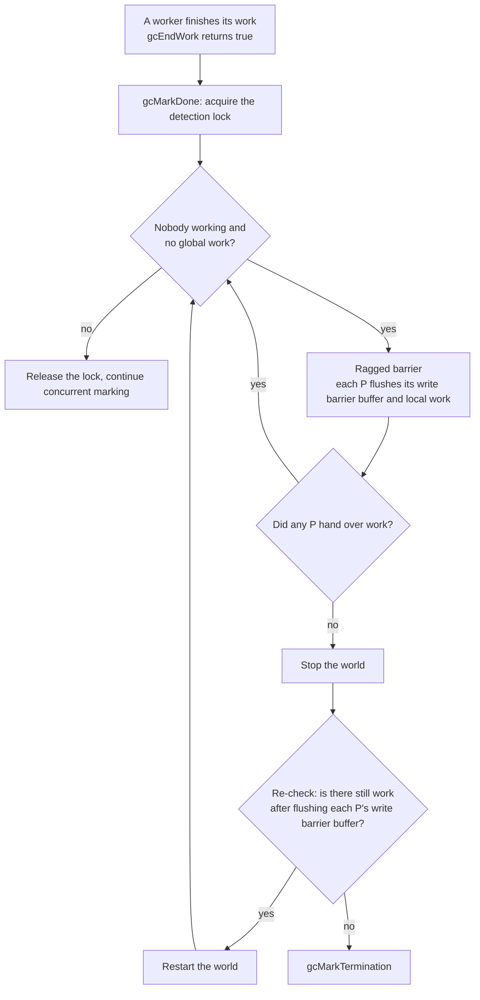

# 13.6 Mark Termination Phase

Concurrent marking ([13.4](./mark.md)) must end somehow: once the gray objects are exhausted, the
collector turns off the write barrier and moves on to sweeping ([13.5](./sweep.md)). This transition
raises two problems. The first is how to conclude that marking is truly complete: the pending work
is scattered across the Ps' local caches, the mutator is still running, and the write barrier may
still produce new gray objects. The second is that the transition itself must happen within one
stop-the-world, and the question is what that pause does and why it can be made so short. This
section covers the termination decision, the wrap-up inside the pause, the evolution of pause times,
and the roles of the two pauses in a cycle.

## 13.6.1 Why Completion Is Hard to Detect

Marking work is spread over several places: the global list of full buffers `work.full`, root
marking tasks not yet claimed, each P's local `gcWork` cache ([13.4](./mark.md)), and each P's write
barrier buffer ([13.2](./barrier.md)). The global part is visible to all Ps; the local part can be
seen only by the P that owns it.

The runtime keeps a pair of counters of how many goroutines are doing marking work. `work.nproc` is
set to a very large number, and `work.nwait` starts equal to it; a background mark worker or a mark
assist decrements `nwait` when it starts working and increments it when it finishes, so equality
means that nobody is working. The check made when finishing work is as follows
[[Go Authors, 2026a](#ref-go-authors-2026a)]:

```go
func gcEndWork() (last bool) {
	incnwait := atomic.Xadd(&work.nwait, +1)
	if incnwait > work.nproc {
		println("runtime: work.nwait=", incnwait, "work.nproc=", work.nproc)
		throw("work.nwait > work.nproc")
	}
	return incnwait == work.nproc && !gcMarkWorkAvailable()
}
```

The caller that receives true is responsible for calling `gcMarkDone`, which tries to end marking.
Since Go 1.6, phase transitions of this kind are no longer delegated to a dedicated coordinating
goroutine; instead the goroutine that finds the condition satisfied executes the transition
directly, so that the transition does not suffer from scheduling delays
[[Clements, 2015](#ref-clements-2015)].

But "nobody is working and there is no global work" does not mean that marking is complete. An idle
P may still cache local work, and others can see it only if it is handed over. The counter and the
global queue are also not read at the same instant: one worker may have just returned a buffer to
the global list, incremented the counter and checked the queue, while another worker takes that
buffer between the two reads and starts producing new work. Clements and Hudson recorded this
interleaving in their 2016 design document; it can cause the collector to enter mark termination
while marking work remains [[Clements and Hudson, 2016](#ref-clements-hudson-2016)].

The premise on which the termination decision rests is that marking work cannot appear out of thin
air: a P must consume a marking task to produce a new one, so once termination holds it does not
become invalid [[Clements, 2018a](#ref-clements-2018a)]. The write barrier buffer is an exception:
it records only pointer writes, and the buffer keeps growing even when the pointed-to object is
already black. Section 13.6.2 explains how the runtime handles this exception and another one
discovered later.

## 13.6.2 Distributed Termination Detection

Go 1.5 divided concurrent marking into two sub-phases, mark 1 and mark 2: when mark 1 drained the
global work, it flushed and disabled the local caches of all Ps and entered mark 2; when mark 2
again drained the global work, it entered mark termination. Disabling local caches slowed down both
marking and the write barrier; the algorithm could detect only a temporary shortage of work, so it
might enter mark 2 early in a cycle, and it still could not fully prevent premature entry into mark
termination [[Clements, 2018a](#ref-clements-2018a)]. Go 1.12 replaced mark 2 with an algorithm
based on the idea of distributed termination detection [[Clements, 2018b](#ref-clements-2018b)]; the
design document cites the survey of such algorithms by Matocha and Camp
[[Matocha and Camp, 1998](#ref-matocha-camp-1998)].

Each P maintains a flag `flushedWork`, which is set whenever it hands local work over to the global
level. Holding any amount of work in the local cache does not set it; the flag means "may have
shared work with other Ps". When some P has exhausted both local and global work, it performs the
following detection:

1. Acquire the global detection lock, so that only one P performs detection at a time.
2. Check the global queue; if it is not empty, give up.
3. Execute a barrier that makes every P, on reaching a safe point, flush its write barrier buffer
   (which may gray objects and put them in the local queue), then flush its local work (which may
   set `flushedWork`), and then read and clear its own `flushedWork`.
4. If any P's flag was set, give up and detect again; otherwise enter mark termination.

The **ragged barrier** is implemented by `forEachP`. It does not require all Ps to stop at the same
time, only that each P execute a given function at some safe point of its own
[[Go Authors, 2026b](#ref-go-authors-2026b)]. A dedicated worker normally does not respond to
preemption, but it also leaves the mark loop on seeing a `forEachP` request ([13.4](./mark.md)), so
the barrier can reach every P:

```go
// forEachP calls fn(p) for every P p when p reaches a GC safe point.
// If a P is currently executing code, this will bring the P to a GC
// safe point and execute fn on that P. If the P is not executing code
// (it is idle or in a syscall), this will call fn(p) directly while
// preventing the P from exiting its state. This does not ensure that
// fn will run on every CPU executing Go code, but it acts as a global
// memory barrier. GC uses this as a "ragged barrier."
```

A running P is brought to a safe point by preemption
([9.7](../../part3concurrency/ch09sched/preemption.md)). The corresponding code in `gcMarkDone` is
as follows [[Go Authors, 2026a](#ref-go-authors-2026a)]:

```go
	// Flush all local buffers and collect flushedWork flags.
	gcMarkDoneFlushed = 0
	forEachP(waitReasonGCMarkTermination, func(pp *p) {
		// Flush the write barrier buffer, since this may add
		// work to the gcWork.
		wbBufFlush1(pp)

		// Flush the gcWork, since this may create global work
		// and set the flushedWork flag.
		//
		// TODO(austin): Break up these workbufs to
		// better distribute work.
		pp.gcw.dispose()

		// Collect the flushedWork flag.
		if pp.gcw.flushedWork {
			atomic.Xadd(&gcMarkDoneFlushed, 1)
			pp.gcw.flushedWork = false
		}
	})

	if gcMarkDoneFlushed != 0 {
		// More grey objects were discovered since the
		// previous termination check, so there may be more
		// work to do. Keep going. It's possible the
		// transition condition became true again during the
		// ragged barrier, so re-check it.
		semrelease(&worldsema)
		goto top
	}
```

The global queue must be checked before the barrier: otherwise a P that has passed the barrier could
still obtain work from the global queue. The interleaving described in 13.6.1 does not disappear,
but it is no longer harmful: work taken by another worker stays in its local cache and must be
handed over at the barrier, which makes this round of detection fail. The design document points out
that, unlike many similar algorithms, this one does not detect "nobody has done work since the last
barrier" but "nobody has communicated work, and all queues were empty at some moment". Whereas many
similar algorithms need at least two rounds to decide termination, it needs only one; with a small
heap, the Ps may complete their work entirely from local caches, and marking can end after the first
barrier [[Clements, 2018a](#ref-clements-2018a)]. If any P handed over work, detection restarts; the
work handed over has also redistributed the load among the Ps.

The Green Tea span queue ([13.11](./greentea.md)) can be stolen by other Ps, which seems to violate
the premise that a P cannot see another P's local work. In fact, only a P's own local ring is
private: when the local ring overflows into the stealable chain, `flushedWork` is set; when the
local cache is flushed, the local ring likewise moves into the chain and is registered in the bitmap
`spanqMask`, and when deciding whether any global work remains, a registration in the bitmap counts
as work [[Go Authors, 2026c](#ref-go-authors-2026c)]. The stealable chain is thus effectively part
of the global queue, and the argument above still holds.

Two exceptions need separate handling. The write barrier buffer may still grow after the detection
has passed, but by then all reachable objects are marked, so the pointers in the buffer must point
to black objects and can simply be discarded at mark termination
[[Go Authors, 2026a](#ref-go-authors-2026a)]:

```go
		// The write barrier may have buffered pointers since
		// the gcMarkDone barrier. However, since the barrier
		// ensured all reachable objects were marked, all of
		// these must be pointers to black objects. Hence we
		// can just discard the write barrier buffer.
```

The other exception is the conversion of a weak pointer to a strong pointer
([13.10](./finalizer.md)). A conversion during marking must gray its result, because it may be the
only pointer to the object, which may still be white; unlike the write barrier, the work from this
source does not vanish naturally as marking proceeds. Since Go 1.24, `gcMarkDone` sets a global flag
before the ragged barrier, after which conversions block until they are woken at mark termination;
this fix was also backported to Go 1.23.4 [[Knyszek, 2024](#ref-knyszek-2024)].

The following diagram summarizes the flow of `gcMarkDone`; the re-check after the stop-the-world is
described in 13.6.3:



## 13.6.3 After the Stop-the-World

After the detection passes, `gcMarkDone` stops the world. By the argument above there should be no
marking work left, but in practice leftovers are occasionally found, so the pause begins with one
more check [[Go Authors, 2026a](#ref-go-authors-2026a)]:

```go
	// There is sometimes work left over when we enter mark termination due
	// to write barriers performed after the completion barrier above.
	// Detect this and resume concurrent mark. This is obviously
	// unfortunate.
	//
	// See issue #27993 for details.
```

This problem surfaced as the error "P has cached GC work at end of mark
termination" [[ianlancetaylor, 2018](#ref-ianlancetaylor-2018)]. Clements added this check before
the release of Go 1.12; the commit message admits that it is still unclear where the leftovers come
from, that the check adds a small amount of time to the pause proportional to `GOMAXPROCS`, and that
it fixes a serious correctness problem [[Clements, 2019](#ref-clements-2019)]. When the check finds
leftovers, the runtime restarts the world and goes back to the start of detection. The goroutine
leak profile that Go 1.26 provides as an experiment also borrows this loop: after marking reaches a
fixed point, goroutines blocked on unreachable synchronization primitives are judged leaked; if
goroutines that may run are discovered after all, the world is restarted and marking continues
[[Go Authors, 2026a](#ref-go-authors-2026a)]. The principle of this profile is described in the
release notes [[Go Authors, 2026d](#ref-go-authors-2026d)].

After the check passes, the runtime stops mark assists and background marking, wakes the parked mark
assists (they run after the world restarts), records this cycle's pacing data, and then calls
`gcMarkTermination`. The following is a sketch of this wrap-up:

```go
// The main steps after the stop-the-world (a sketch that omits statistics and tracing, runtime/mgc.go)
atomic.Store(&gcBlackenEnabled, 0) // stop mark assists and background marking
gcWakeAllAssists()                 // parked assists run after the world restarts
gcController.endCycle(now, int(gomaxprocs), work.userForced) // record pacing data (13.3)

// gcMarkTermination:
setGCPhase(_GCmarktermination) // the write barrier is still on
gcMark(startTime)              // check that no work remains, discard the write barrier buffers
setGCPhase(_GCoff)             // turn off the write barrier
gcSweep(work.mode)             // increase the global sweep generation by 2, wake the background sweeper (13.5)
gcControllerCommit()           // compute the trigger and heap goal for the next cycle (13.3)
mProf_NextCycle()              // end this cycle's heap profile period
startTheWorldWithSema(now, stw)

// After the world restarts: flush the heap profile, prepare to free the work buffers, free the
// spans that held stacks, and flush each P's local cache with forEachP (13.5)
```

Whether the write barrier is on is determined by the phase of the collection
[[Go Authors, 2026a](#ref-go-authors-2026a)]:

```go
func setGCPhase(x uint32) {
	atomic.Store(&gcphase, x)
	writeBarrier.enabled = gcphase == _GCmark || gcphase == _GCmarktermination
}
```

The comment in `gcMarkDone` stresses that the write barrier must stay on until all marking is
complete, including the collector's own writes. The 2018 design document had envisioned that no
write barrier would be needed during mark termination [[Clements, 2018a](#ref-clements-2018a)]; the
current implementation still turns it off only on entering `_GCoff`. `gcMark` no longer does any
marking: it only checks that no work remains anywhere, discards the write barrier buffers, and
resets the pacer's live heap to the number of bytes marked in this cycle.

## 13.6.4 The Evolution of Pause Times

The mark termination pause used to be long. Go 1.5 through 1.7 used a Dijkstra-style insertion
barrier, and writes on the stack did not go through the write barrier, so mark termination had to
rescan the stacks of the goroutines that had run during marking. Go 1.7 rescanned
only "dirty" stacks, so that this step was no longer proportional to the total number of goroutines;
the commit message gives these figures: handling a clean stack takes about 34 nanoseconds, and with
about 300,000 goroutines merely checking these stacks would exceed the 10 millisecond pause target
[[Clements, 2016a](#ref-clements-2016a)]. The hybrid write barrier of Go 1.8 ([13.2](./barrier.md))
made rescanning unnecessary. With rescanning turned off, on a machine with `GOMAXPROCS` of 12, the
worst-case mark termination pause stayed below 100 microseconds across all tests, with a 95th
percentile of about 50 microseconds; these numbers exclude the time needed for the stop-the-world
itself, which typically adds about 20 microseconds more, and up to about 150 microseconds when an
individual goroutine is slow to reach a safe point [[Clements, 2016b](#ref-clements-2016b)]. The
`GODEBUG=gcrescanstacks=1` setting kept as a fallback was removed in Go 1.12
[[Clements, 2018c](#ref-clements-2018c)]. Looking back in his 2018 keynote, Hudson noted that Go 1.8
eliminated the stack scanning done with the world stopped at the end of the cycle, which brought
pauses into the sub-millisecond range; the 2018 goal was set at no more than 500 microseconds of
stop-the-world time per collection cycle [[Hudson, 2018](#ref-hudson-2018)].

The following program makes 1000, 10,000 and 100,000 goroutines each recurse a number of levels and
then block, and then forces collections. To observe only the collections triggered by `runtime.GC`,
the program turns off automatic collection:

```go {run=true env="GODEBUG=gctrace=1"}
package main

import (
	"fmt"
	"os"
	"runtime"
	"runtime/debug"
	"sync"
)

// park recurses depth levels and then blocks, so that every goroutine has a stack to scan.
func park(depth int, ready *sync.WaitGroup, ch chan struct{}) int {
	var frame [8]int
	if depth > 0 {
		return park(depth-1, ready, ch) + frame[depth%8]
	}
	ready.Done()
	<-ch
	return frame[0]
}

func main() {
	debug.SetGCPercent(-1) // observe only the cycles triggered by runtime.GC
	for _, n := range []int{1_000, 10_000, 100_000} {
		var ready, done sync.WaitGroup
		ch := make(chan struct{})
		ready.Add(n)
		for range n {
			done.Go(func() { park(16, &ready, ch) })
		}
		ready.Wait() // all goroutines are blocked
		fmt.Fprintf(os.Stderr, "%d goroutines\n", n)
		for range 2 {
			runtime.GC()
		}
		close(ch)
		done.Wait()
	}
}
```

The gctrace output and the labels printed by the program both go to standard error. Compile and run
it locally, and use sed to keep only the wall-clock times of each cycle:

```shell
$ go build -o marktermdemo
$ GODEBUG=gctrace=1 ./marktermdemo 2>&1 | sed -E 's/ @[^:]*: / /; s/ ms clock.*/ ms clock/'
1000 goroutines
gc 1 0.029+0.50+0.006 ms clock
gc 2 0.049+0.66+0.005 ms clock
10000 goroutines
gc 3 0.053+3.9+0.006 ms clock
gc 4 0.057+5.0+0.005 ms clock
100000 goroutines
gc 5 0.12+44+0.007 ms clock
gc 6 0.088+35+0.006 ms clock
```

The three numbers are, in order, the pause of sweep termination, concurrent marking, and the pause
of mark termination ([13.1](./basic.md)); a pause time includes the time needed for the
stop-the-world itself. With 100 times as many goroutines, the time of concurrent marking grows with
the total amount of stack, from under 1 millisecond to tens of milliseconds, while the mark
termination pause stays at about 6 microseconds throughout. The first number fluctuates considerably
between runs and does not correspond to the number of goroutines. When run in the browser,
concurrent marking is much slower, but the mark termination pause likewise does not vary with the
number of goroutines.

## 13.6.5 The Two Stop-the-Worlds

A collection cycle has two stop-the-worlds. The first is at the start and is called sweep
termination: it completes the sweeping left over from the previous cycle ([13.5](./sweep.md)),
clears `sync.Pool` and several of the runtime's internal caches, begins a new round of pacing,
switches the phase to `_GCmark` to turn on the write barrier, prepares the root marking tasks, marks
the tiny-object blocks each P is using as black, and finally allows mark assists and background
marking. It does not scan the roots; root scanning proceeds concurrently after the world restarts
([13.1](./basic.md)). The reason for stopping the world, according to a source comment, is that the
write barrier must take effect on all Ps before any object is marked
[[Go Authors, 2026a](#ref-go-authors-2026a)]:

```go
	// Enter concurrent mark phase and enable
	// write barriers.
	//
	// Because the world is stopped, all Ps will
	// observe that write barriers are enabled by
	// the time we start the world and begin
	// scanning.
```

The second is the mark termination discussed in this section. The work in both pauses is usually
independent of the size of the heap and the stacks. Even if a new cycle begins before the previous
sweep has finished (for example when `runtime.GC` is called), the remaining spans are swept
concurrently before the world is stopped, leaving only a possible remainder for the first pause
([13.5](./sweep.md)). The remaining cost is mainly the stop-the-world itself: it must wait for every
running goroutine to reach a safe point, and the asynchronous preemption introduced in Go 1.14
shortened this wait ([9.7](../../part3concurrency/ch09sched/preemption.md)).

The two pauses are not impossible to remove in principle. The outlook section of the 2016 design
document proposed that the global memory barrier needed to turn on the write barrier could be
implemented with a ragged barrier or the Linux `membarrier` system call, and that each of the
remaining tasks in mark termination also has a way of being eliminated
[[Clements and Hudson, 2016](#ref-clements-hudson-2016)]. Since then, mark termination no longer
contains any marking work, and the flushing of local caches and the heap profile has moved to after
the world restarts ([13.5](./sweep.md)), but as of Go 1.26 both stop-the-worlds are still retained.
The overall course of the collector's evolution is covered in [13.12](./history.md).

## 13.6.6 Summary

Deciding that marking is complete requires confirming that no work remains in any P's local cache or
write barrier buffer. Since Go 1.12, `gcMarkDone` uses a ragged barrier to make every P flush its
local state and checks whether any P handed over work; if none did, termination can be concluded
within a single round. Residual pointers in the write barrier buffer must point to black objects and
can be discarded; weak pointer conversions are blocked during termination. The re-check after the
stop-the-world is a remedy for a problem whose cause has still not been found. The hybrid write
barrier eliminated stack rescanning, so the mark termination pause is independent of heap and stack
sizes, leaving only a few microseconds of wrap-up and the wait of the stop-the-world itself.

## Further Reading

- <a id="ref-clements-2015"></a>[Clements, 2015] Austin Clements. *Proposal: Decentralized GC
  coordination.* Go design document, 2015. https://go.dev/design/11970-decentralized-gc Discussion
  in Go issue #11970: https://github.com/golang/go/issues/11970 Replaces the coordinating goroutine
  of Go 1.5 with an explicit state machine; implemented in Go 1.6.
- <a id="ref-clements-2016a"></a>[Clements, 2016a] Austin Clements. runtime: make stack re-scan O(#
  dirty stacks). Go commit 2a889b9d93, 2016. https://go.dev/cl/20700 Released with Go 1.7.
- <a id="ref-clements-2016b"></a>[Clements, 2016b] Austin Clements. runtime: disable stack
  rescanning by default. Go commit bd640c882a, 2016. https://go.dev/cl/31766 Released with Go 1.8.
- <a id="ref-clements-2018a"></a>[Clements, 2018a] Austin Clements. *Proposal: Simplify mark
  termination and eliminate mark 2.* Go design document, 2018.
  https://go.dev/design/26903-simplify-mark-termination Discussion in Go issue #26903:
  https://github.com/golang/go/issues/26903
- <a id="ref-clements-2018b"></a>[Clements, 2018b] Austin Clements. runtime: eliminate mark 2 and
  fix mark termination race. Go commit 9108ae7751, 2018. https://go.dev/cl/134318 Released with Go
  1.12.
- <a id="ref-clements-2018c"></a>[Clements, 2018c] Austin Clements. runtime: remove
  GODEBUG=gcrescanstacks=1 mode. Go commit 198440cc3d, 2018. https://go.dev/cl/134777
  Released with Go 1.12.
- <a id="ref-clements-2019"></a>[Clements, 2019] Austin Clements. runtime: work around "P has cached
  GC work" failures. Go commit 95a6f112c6, 2019. https://go.dev/cl/156140 Released with Go 1.12.
- <a id="ref-clements-hudson-2016"></a>[Clements and Hudson, 2016] Austin Clements, Rick Hudson.
  *Proposal: Eliminate STW stack re-scanning.* Go design document, 2016.
  https://go.dev/design/17503-eliminate-rescan
  Discussion in Go issue #17503: https://github.com/golang/go/issues/17503
  The appendix records the race in the completion decision of marking.
- <a id="ref-go-authors-2026a"></a>[Go Authors, 2026a] The Go Authors. *runtime/mgc.go.*
  `gcMarkDone`, `gcMarkTermination`, `gcMark`, `gcStart`, `setGCPhase`. Go 1.26 source.
  https://github.com/golang/go/blob/release-branch.go1.26/src/runtime/mgc.go
- <a id="ref-go-authors-2026b"></a>[Go Authors, 2026b] The Go Authors. *runtime/proc.go.* `forEachP`
  and the ragged barrier. Go 1.26 source.
  https://github.com/golang/go/blob/release-branch.go1.26/src/runtime/proc.go
- <a id="ref-go-authors-2026c"></a>[Go Authors, 2026c] The Go Authors.
  *runtime/mgcmark_greenteagc.go.* `gcMarkWorkAvailable`, `spanQueue`. See also
  src/runtime/mgcwork.go. Go 1.26 source.
  https://github.com/golang/go/blob/release-branch.go1.26/src/runtime/mgcmark_greenteagc.go
- <a id="ref-go-authors-2026d"></a>[Go Authors, 2026d] The Go Authors. *Go 1.26 Release
  Notes.* 2026. https://go.dev/doc/go1.26
- <a id="ref-hudson-2018"></a>[Hudson, 2018] Rick Hudson. "Getting to Go: The Journey of Go's
  Garbage Collector." *The Go Blog*, 2018. https://go.dev/blog/ismmkeynote The text of the ISMM 2018
  keynote, which looks back on the pause targets and actual pauses of each release.
- <a id="ref-ianlancetaylor-2018"></a>[ianlancetaylor, 2018] ianlancetaylor. Go issue #27993.
  *runtime: error message: P has cached GC work at end of mark termination.* 2018.
  https://github.com/golang/go/issues/27993
- <a id="ref-knyszek-2024"></a>[Knyszek, 2024] Michael Knyszek. runtime: prevent weak->strong
  conversions during mark termination. Go commit 80d306da50, 2024. https://go.dev/cl/623615 Released
  with Go 1.24 and backported to Go 1.23.4.
- <a id="ref-matocha-camp-1998"></a>[Matocha and Camp, 1998] Jeff Matocha, Tracy Camp. "A Taxonomy
  of Distributed Termination Detection Algorithms." *Journal of Systems and Software*, 43(3), 1998,
  207-221. https://doi.org/10.1016/S0164-1212(98)10034-1
- This book: [13.2 Write Barrier Techniques](./barrier.md),
  [13.3 Trigger Frequency and the Pacing Algorithm](./pacing.md),
  [13.4 Scan Marking and Mark Assist](./mark.md), [13.5 Sweeping and Bitmaps](./sweep.md),
  [13.12 Past, Present, and Future](./history.md).
