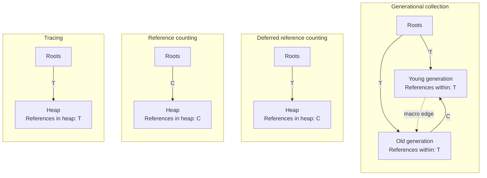

# 13.13 A Unified Theory of Garbage Collection

By 1960 both basic methods of reclaiming storage had appeared: **tracing**, used by McCarthy in
Lisp, and **reference counting**, proposed by Collins [[McCarthy, 1960](#ref-mccarthy-1960)]
[[Collins, 1960](#ref-collins-1960)]. The advances of the following decades, whether generational,
concurrent or real-time collection, were all seen as improvements to one of the two, while the two
themselves were regarded as routes of entirely different character. In 2004 Bacon, Cheng and Rajan
of IBM published *A Unified Theory of Garbage Collection* at OOPSLA and offered a different view:
tracing and reference counting are algorithmic duals of each other. Tracing deals with live objects,
which they call "matter", and reference counting deals with dead objects, "anti-matter"; every
operation of a tracing collector has a precisely corresponding inverse operation in a reference
counting collector; and all high-performance collectors, such as deferred reference counting and
generational collection, are in fact hybrids of the two [[Bacon et al., 2004](#ref-bacon-2004)].

This finding came from engineering experience. The authors had separately implemented a
multiprocessor concurrent reference counting collector with cycle collection and a real-time
incremental tracing collector on a uniprocessor, and noticed that the more fully each was optimized,
the more alike they behaved. The acknowledgments of the paper say that the work began with
a "five-minute" short talk by the first author at the SPACE workshop in 2004, and that the
formulation as a fixed point was suggested by Alex Aiken [[Bacon et al., 2004](#ref-bacon-2004)].
This section introduces the theory and uses it to look back at the collectors discussed in this
chapter, as a closing for the whole chapter. For a systematic treatment of the two families of
algorithms and their many variants, see *The Garbage Collection Handbook* by Jones et al.
[[Jones et al., 2023](#ref-jones-2023)].

## 13.13.1 The Two Methods and Their Convergence

The paper first lists the differences most often cited between the two naive implementations.
Tracing works in batch fashion, scanning the whole heap at once; reference counting is naturally
incremental, updating counts on every pointer write. Tracing adds no cost to pointer writes, while
reference counting pays a high price for every write, including writes to stack frames, so tracing
has higher throughput. Conversely, reference counting has short pauses and is naturally suited to
real-time applications. Finally, tracing can reclaim cyclic garbage and reference counting cannot;
faced with a heap that may contain cycles, the latter must either rely on a backup tracing collector
or use a trial deletion algorithm [[Bacon et al., 2004](#ref-bacon-2004)].

These differences blur, however, once the algorithms are optimized. Incrementality is the
acknowledged fundamental advantage of reference counting, but updating a count every time a pointer
is loaded into a register is too expensive for high-performance applications, so most
high-performance implementations adopt the deferred reference counting proposed by Deutsch and
Bobrow [[Deutsch and Bobrow, 1976](#ref-deutsch-1976)], which handles references from stack frames
separately [[Bacon et al., 2004](#ref-bacon-2004)]. As a result, an object whose count drops to zero
cannot be reclaimed immediately, because there may still be uncounted references from the stack, and
reclamation can only be deferred until the stacks are scanned periodically; the outcome is delayed
reclamation, floating garbage and longer pauses, which are exactly the typical traits of tracing
collectors. On the other hand, the most common first optimization of tracing collectors is
generations, which lowers the average pause and the latency of reclamation but introduces a cost on
every write, bringing in both the advantages and the disadvantages of reference counting. The train
algorithm, proposed to bound pauses more precisely, in turn behaves oddly in the face of circular
references, which are the hallmark problem of reference counting
[[Bacon et al., 2004](#ref-bacon-2004)]. That the two kinds of collectors borrow each other's
features as they are optimized suggests they share a deep structure.

## 13.13.2 The Fixed-Point Formulation

To see this structure, the paper formalizes collection as a fixed-point computation. Think of memory
as a directed graph: $V$ is the set of objects, $E$ is the multiset of edges formed by pointers (an
object may have several pointers to the same object), $R$ is the multiset of roots, that is,
pointers in stack frames and global variables, and $\rho(v)$ is the reference count the collector
computes for object $v$. The reference count has two parts, references from roots and incoming edges
from objects whose count is nonzero:

$$
\rho(x) = \bigl|[\, x : x \in R \,]\bigr| + \bigl|[\, (w, x) : (w, x) \in E \wedge \rho(w) > 0 \,]\bigr|
$$

where the square brackets denote a multiset and the vertical bars the number of its elements. Once
the counts are determined, objects with a count of zero are reclaimed. This equation generally has
several solutions. Let $V = \{a, b\}$, $R = \emptyset$, $E = \{(a, b), (b, a)\}$, a two-node cycle
with no references from roots; then both $\rho(a) = \rho(b) = 0$ and $\rho(a) = \rho(b) = 1$ satisfy
the equation, the former being the least fixed point and the latter the greatest fixed point.
Clearly, the garbage that should be reclaimed is the one determined by the least fixed point
[[Bacon et al., 2004](#ref-bacon-2004)].

Tracing and reference counting are two algorithms for solving this equation. To make the
correspondence between them obvious, the paper treats each of them unconventionally in one respect:
tracing does not merely set a mark bit but rebuilds the complete reference count of every object,
with the mark bit seen as a one-bit count that "sticks" at 1; reference counting does not perform
decrements immediately on writes but records them in a work list to be handled all together at
collection time. The paper stresses that the latter is not a recommended implementation but only a
means of understanding the relationship between the two algorithms; deferring decrements merely
moves part of the work to another time and does not change the complexity of the algorithm.
Following Figures 3 and 4 of the paper, the two collectors can be written as the following
pseudocode:

```
// Tracing: start from the roots, counts start at zero and increase
collect-by-tracing():
    W ← find-roots()
    scan-by-tracing(W)
    sweep-for-tracing()

scan-by-tracing(W):
    while W ≠ ∅:
        remove w from W
        ρ(w) ← ρ(w) + 1
        if ρ(w) = 1:
            for each x ∈ [v : (w, v) ∈ E]:
                W ← W ⊎ [x]

sweep-for-tracing():
    for each v ∈ V:
        if ρ(v) = 0: VF ← VF ∪ {v}
        ρ(v) ← 0

// Reference counting: start from the decrement records, counts start from an overestimate and decrease
assign(a, p):            // pointer write *a = p
    l ← [a]
    [a] ← p
    dec(l)               // W ← W ⊎ [l], deferred until collection time
    inc(p)               // ρ(p) ← ρ(p) + 1

collect-by-counting(W):
    scan-by-counting(W)
    sweep-for-counting()

scan-by-counting(W):
    while W ≠ ∅:
        remove w from W
        ρ(w) ← ρ(w) − 1
        if ρ(w) = 0:
            for each x ∈ [v : (w, v) ∈ E]:
                W ← W ⊎ [x]

sweep-for-counting():
    for each v ∈ V:
        if ρ(v) = 0: VF ← VF ∪ {v}
```

The two scan functions are identical except that tracing adds one to the count and reference
counting subtracts one, and for the condition for recursing: tracing continues the traversal when
the count becomes 1, reference counting when it becomes 0. As the paper puts it, by changing just
two characters in the core of the algorithm, we have gone from tracing to reference counting. The
other difference is that the sweep of tracing must reset counts to zero to prepare for starting from
zero in the next cycle, while the sweep of reference counting need not
[[Bacon et al., 2004](#ref-bacon-2004)].

The two differ in which side they approach the true count from. Tracing starts from an
underestimate: all counts start at zero, the work list is the root set, and counts increase step by
step during the traversal, converging to the least fixed point, where the objects with positive
counts are exactly the live objects reachable from the roots. Reference counting starts from an
overestimate: when collection begins, all increments have been performed while the decrements since
the last collection have not, so the incoming edges from objects that are no longer alive are still
counted; after the decrements are processed one by one, the counts converge to the greatest fixed
point. The difference between the two fixed points is exactly the cyclic garbage. In the absence of
cycles, what reference counting computes is precisely the complement, on the graph, of the tracing
result [[Bacon et al., 2004](#ref-bacon-2004)]. Figure 2 of the paper summarizes this duality as
follows:

| | Tracing | Reference counting |
| --- | --- | --- |
| Starting point | Roots | Anti-roots (objects whose count was decremented to zero) |
| Graph traversal | Forward from roots | Forward from anti-roots |
| Objects traversed | Live objects | Dead objects |
| Initial count | Low (0) | High |
| Count reconstruction | Addition | Subtraction |
| Extra traversal | Sweep phase | Trial deletion |

The last row deserves a word more. It is usually considered a major shortcoming of reference
counting that reclaiming cycles needs an extra traversal, but tracing also needs an extra traversal,
and over the whole object space at that, the sweep phase, which reclaims objects whose count is zero
(whose mark bit is unset). A semispace copying collector copies only live data and so saves this
traversal, but that is merely a linear space-time trade-off: a linear space cost in exchange for a
linear traversal [[Bacon et al., 2004](#ref-bacon-2004)].

Between the least and the greatest fixed point there may be other solutions. If the cyclic garbage
$V_C$ has $n$ nontrivial strongly connected components, the equation has between $n+1$ and $2^n$
solutions, depending on the topology of the graph. The general method for reclaiming cyclic garbage
is to find a subset $S$ of objects that contains no roots and has no incoming edges from outside,
such that there is a solution in which the counts of all objects in $S$ are zero. Reference counting
systems have two basic approaches: a backup tracing collector that occasionally traces the whole
heap, or trial deletion, which starts from objects suspected to be in a cycle, subtracts the
internal references and checks whether any count from outside remains
[[Bacon et al., 2004](#ref-bacon-2004)]. From this the paper draws a conclusion: the existence of
cycles makes collection inherently impossible to make fully incremental, and the process of
reclaiming cycles is tracing in nature.

## 13.13.3 Every High-Performance Collector Is a Hybrid

With the dual view in hand, the paper re-examines the structure of various collectors and concludes
that all realistic collectors are some hybrid of tracing and reference counting. The fundamental
differences among collectors are only two: how storage is partitioned, and, within each partition,
whether tracing or reference counting maintains the counts; once these two decisions are made, the
remaining choices are implementation details that boil down to various space-time trade-offs. By
partitioning of storage, collectors fall into three classes: uniform heap, split heap and multiple
heaps. The paper also notes that this analysis does not consider concurrent collectors
[[Bacon et al., 2004](#ref-bacon-2004)].

Even in a uniform heap there are two regions, the roots and the heap. Deferred reference counting
counts references within the heap and does not count references from roots; at collection time it
inspects the objects the roots point to, removes them from the zero count table, and then reclaims
the objects left in the table. Since writes to roots are extremely frequent, this approach shifts
the cost of handling roots from the application to the collector; and inspecting root pointers and
incrementing the counts of the objects found is itself tracing. Deferred reference counting is
therefore a hybrid that traces the roots and counts the heap
[[Deutsch and Bobrow, 1976](#ref-deutsch-1976)] [[Bacon et al., 2004](#ref-bacon-2004)]. Swapping
the roles gives "partial tracing", which counts the roots and traces the heap and is the dual of
deferred reference counting. The paper knows of no implementation of it and notes that its
performance in a language runtime would be very poor: like pure reference counting it has a very
high write cost, but it does not get the incrementality of reference counting. From these two
examples the paper observes that the write function is always associated with the reference counting
part of a hybrid collector: the barrier of deferred reference counting records pointers from the
heap, the barrier of partial tracing records pointers from the stack; in general, the presence of a
write barrier indicates some reference-counting-like behavior in the algorithm.

The typical split heap is the generational collector. To collect the young generation separately
without tracing the whole old generation, it maintains a remembered set that records the pointers
from the old generation into the young generation, maintained by the write barrier executed on every
heap pointer update. In the unified theory the write barrier is that write function, and the
remembered set is a set representation of the nonzero reference counts, equivalent to the complement
of the zero count table in deferred reference counting, only limited to the young generation. A
standard generational collector thus traces references from the roots and within each generation and
counts the references from the old generation into the young generation; between the young
generation and the old generation there is a summarizing "macro edge", and because the collector
does not record those pointers, the old generation cannot be collected on its own, only when the
young generation is empty [[Bacon et al., 2004](#ref-bacon-2004)]. The figure below follows the
paper's diagram to draw the structure of several collectors; references marked T are handled by
tracing, references marked C by reference counting, and references inside a region are marked in the
node:



Within the same framework the other variants of generational collection are also easy to see.
Counting the young generation and tracing the old can reclaim cycles by tracing the old generation,
but it counts exactly the young objects that are written most often, so the expensive barrier
operation falls on the most frequent operation. Conversely, tracing the young generation and
counting the old means writes in the young generation need not go through a barrier, but the old
generation needs an extra cycle collection mechanism; Ulterior reference counting by Blackburn and
McKinley is exactly this structure, using trial deletion to reclaim cycles in the old generation
[[Blackburn and McKinley, 2003](#ref-blackburn-2003)] [[Bacon et al., 2004](#ref-bacon-2004)]. In
its conclusion the paper reduces the design of a collector to three decisions: partitioning,
dividing the heap, stacks and global variables into regions that each use a different strategy;
traversal, choosing tracing or reference counting for each region; and trade-offs, choosing, for
each region, space-time trade-offs such as semispace copying versus sliding compaction and pointer
reversal versus stack-based traversal.

The paper also builds a unified cost model for all kinds of collectors. Taking tracing as an
example, let $a$ be the allocation rate, $M$ the memory size in objects, $V_L$ the number of live
objects and $D$ the space needed to traverse the stack; then the frequency of collection is
approximately $\varphi(T) \simeq a / (M - D - V_L)$, the cost $\kappa(T)$ of each collection is
proportional to the size of the root set, the number of live objects and edges visited in the mark
phase, and the total number of objects in the sweep phase, and the total cost is
$\tau(T) = \varphi(T) \cdot \kappa(T)$ [[Bacon et al., 2004](#ref-bacon-2004)]. The frequency is
inversely proportional to the free memory after live data is subtracted, which is exactly the
headroom that `GOGC` and the heap goal regulate ([13.3](./pacing.md)).

## 13.13.4 Looking Back at Go Through the Unified Theory

By the paper's classification, the Go collector is a uniform-heap collector: references from roots
and references within the heap are both handled by tracing, placing it at the pure tracing end of
the spectrum. Its mark bit is exactly the one-bit sticky count of the paper, and its sweep is the
extra traversal of tracing; Go takes the allocation bitmap of the next cycle directly from the mark
bitmap of this cycle, which turns most of the work of this traversal into a swap of bitmaps
([13.5](./sweep.md)). As a pure tracing collector it can naturally reclaim cyclic garbage and needs
no form of cycle detection. How Go came in 2014 to choose a tri-color concurrent, non-moving tracing
collector is told in Hudson's retrospective [[Hudson, 2018](#ref-hudson-2018)] and in
[13.12.2](./history.md).

Go's collector also has a write barrier, but its role differs from the one the paper discusses. The
paper's analysis explicitly leaves out concurrent collectors, and the write barriers in it maintain
counts across the partitions of storage; the Go write barrier is enabled only during marking and
serves to maintain the tri-color invariant while the mutator and the collector run concurrently, and
it neither partitions storage nor maintains any counts between partitions ([13.2](./barrier.md)).
Still, the formal similarity between the two is worth mentioning; this is an observation of this
book, not a conclusion of the paper. `mbarrier.go` describes the Go hybrid write barrier in the
following pseudocode [[Go Authors, 2026](#ref-go-authors-2026)]:

```
writePointer(slot, ptr):
    shade(*slot)
    if current stack is grey:
        shade(ptr)
    *slot = ptr
```

It handles the overwritten old value and the new value being written at the time of the write, the
same structure as `assign` in the paper, which first performs `dec` on the old value and then `inc`
on the new value; the difference is that `shade` merely colors an object grey and leaves it to
marking, rather than adjusting a count (in the implementation both shadings are executed
unconditionally, see [13.2.4](./barrier.md)).

The other designs discussed in this chapter fit into the framework too. The write barrier of
generational collection maintains the counts of references from the old generation into the young
generation and must stay on throughout mutator execution; the Go team once implemented a non-moving
generational collector and abandoned it in the end because the cost of an always-on barrier was not
offset by the benefit, see [13.8](./generational.md) and [13.1.6](./basic.md). ROC partitions
objects by goroutine and tracks the publication of objects with a write barrier ([13.9](./roc.md));
from the viewpoint of the unified theory this too is a hybrid structure that partitions storage and
has a write barrier maintain information across partitions, and its fate is the same as that of
generations. Green Tea ([13.11](./greentea.md)) falls under none of the paper's three decisions: it
changes neither the partitioning of storage nor the choice of tracing, and what it computes is still
the same least fixed point; it changes only the order in which objects are traversed and the
locality of memory access, at the level of implementation beneath the paper's model. The timeline of
the collector's designs is in [13.12](./history.md).

## 13.13.5 Summary

The unified theory of Bacon, Cheng and Rajan expresses tracing and reference counting as two ways of
solving the same fixed-point equation: tracing starts from an underestimate, uses addition to find
the least fixed point and traverses live objects; reference counting starts from an overestimate,
uses subtraction to find the greatest fixed point and traverses dead objects; and the difference
between the two fixed points is exactly the cyclic garbage. On this basis, all high-performance
collectors are hybrids of the two, differing only in how storage is partitioned and which method
maintains the counts in each partition, with the write barrier as the mark of the reference counting
side. In this framework Go is a pure tracing collector on a uniform heap whose write barrier exists
only for concurrency; the generations and ROC it tried would both introduce partitions and an
always-on barrier, while Green Tea improves the locality of traversal without changing what is being
solved.

## Further Reading

- <a id="ref-bacon-2004"></a>[Bacon et al., 2004] David F. Bacon, Perry Cheng, V. T. Rajan. *A
  Unified Theory of Garbage Collection.* Proceedings of OOPSLA 2004, pp. 50–68; also *ACM SIGPLAN
  Notices* 39(10). https://doi.org/10.1145/1028976.1028982 (the source of this section: the duality
  and the fixed-point formulation)
- <a id="ref-blackburn-2003"></a>[Blackburn and McKinley, 2003] Stephen M. Blackburn, Kathryn S.
  McKinley. *Ulterior Reference Counting: Fast Garbage Collection without a Long Wait.* Proceedings
  of OOPSLA 2003, pp. 344–358. https://doi.org/10.1145/949305.949336
- <a id="ref-collins-1960"></a>[Collins, 1960] George E. Collins. *A Method for Overlapping and
  Erasure of Lists.* *Communications of the ACM* 3(12): 655-657, 1960.
  https://doi.org/10.1145/367487.367501 (the earliest proposal of reference-counting collection)
- <a id="ref-deutsch-1976"></a>[Deutsch and Bobrow, 1976] L. Peter Deutsch, Daniel G. Bobrow. *An
  Efficient, Incremental, Automatic Garbage Collector.* *Communications of the ACM* 19(9):
  522-526, 1976. https://doi.org/10.1145/360336.360345 (deferred reference counting: the classic
  hybrid in which counting moves toward tracing)
- <a id="ref-go-authors-2026"></a>[Go Authors, 2026] The Go Authors. src/runtime/mbarrier.go. Go
  1.26. https://github.com/golang/go/blob/release-branch.go1.26/src/runtime/mbarrier.go
- <a id="ref-hudson-2018"></a>[Hudson, 2018] Richard L. Hudson. *Getting to Go: The Journey of Go's
  Garbage Collector.* ISMM 2018 keynote / The Go Blog, 2018. https://go.dev/blog/ismmkeynote (Go's
  own account of choosing concurrent tracing collection)
- <a id="ref-jones-2023"></a>[Jones et al., 2023] Richard Jones, Antony Hosking, Eliot Moss. *The
  Garbage Collection Handbook: The Art of Automatic Memory Management.* 2nd ed., CRC Press, 2023.
  (the authoritative survey of tracing, counting and the various hybrid algorithms)
- <a id="ref-mccarthy-1960"></a>[McCarthy, 1960] John McCarthy. *Recursive Functions of Symbolic
  Expressions and Their Computation by Machine, Part I.* *Communications of the ACM* 3(4):
  184-195, 1960. https://doi.org/10.1145/367177.367199 (the earliest proposal of mark-sweep tracing
  collection)
- This book: [13.1 The Basic Idea of Garbage Collection](./basic.md),
  [13.2 Write Barrier Techniques](./barrier.md),
  [13.3 Trigger Frequency and the Pacing Algorithm](./pacing.md),
  [13.5 Sweeping and Bitmaps](./sweep.md),
  [13.8 The Generational Hypothesis and Generational Collection](./generational.md), [13.9 The
  Request Hypothesis and the Request-Oriented Collector](./roc.md),
  [13.11 Green Tea: Locality-Aware Marking](./greentea.md),
  [13.12 Past, Present, and Future](./history.md).
