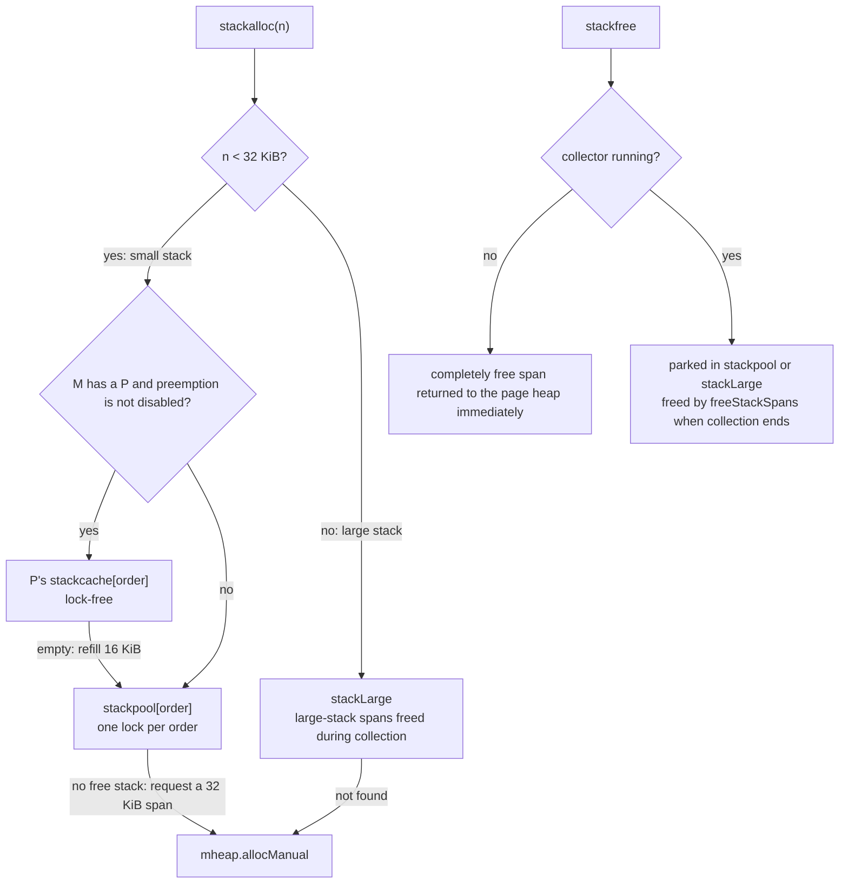

# 14.2 Stack Allocation and Caching

A goroutine's stack comes from the same page heap as heap objects
([12.2](../ch12alloc/component.md)), but it does not go through the object allocator `mallocgc`. It
is managed by a separate allocator in `runtime/stack.go`. The requirements on this allocator differ
from those of object allocation. It cannot grow its own stack while executing; the sizes it
allocates are always powers of 2; the runtime, not the garbage collector, decides when a stack is
freed; and since goroutine creation and stack growth need new stacks frequently, the allocation path
must be short. This section covers why the allocator is separate, the allocation paths for small and
large stacks, how it cooperates with garbage collection, and how the initial stack size of new
goroutines has been determined since Go 1.19.

## 14.2.1 A Separate Allocator

The entry point of the stack allocator is `stackalloc`, which begins with two checks
[[Go Authors, 2026a](#ref-go-authors-2026a)]:

```go
// stackalloc allocates an n byte stack.
//
// stackalloc must run on the system stack because it uses per-P
// resources and must not split the stack.
//
//go:systemstack
func stackalloc(n uint32) stack {
	// Stackalloc must be called on scheduler stack, so that we
	// never try to grow the stack during the code that stackalloc runs.
	// Doing so would cause a deadlock (issue 1547).
	thisg := getg()
	if thisg != thisg.m.g0 {
		throw("stackalloc not on scheduler stack")
	}
	if n&(n-1) != 0 {
		throw("stack size not a power of 2")
	}
	// ...
}
```

The first check comes from a deadlock in 2011. At that time `malg`, which creates a goroutine,
called `stackalloc` on an ordinary goroutine's stack: the stack split triggered by calling
`lock(&stacks)` had to release a stack segment on return, and releasing a stack segment needed the
lock that was already held. As a result gofmt occasionally stopped responding (issue #1547), and
Russ Cox made `stackalloc` always run on the scheduler stack g0 [[Cox, 2011](#ref-cox-2011)]. Today
the `//go:systemstack` marker also makes the prologue verify this on every call
([14.1](./design.md)). The second check expresses that stack sizes are always powers of 2, which
follows from the rounding of `fixedStack` and the doubling during growth ([14.3](./grow.md)).

Stacks were not always managed by a separate allocator. In Go 1.2 and Go 1.3, only stacks of the
minimum size came from a per-M ring cache, which requested memory in batches directly from the
operating system; stacks of other sizes were allocated from the garbage-collected heap through
`mallocgc` with the `FlagNoGC` flag, which kept the collector from freeing them
[[Go Authors, 2013](#ref-go-authors-2013)]. In 2014 Keith Randall separated stack allocation from
`mallocgc`, released with Go 1.4, and the commit message gives two reasons
[[Randall, 2014a](#ref-randall-2014a)]:

> In order to move malloc to Go, we need to have a
> separate stack allocator.  If we run out of stack
> during malloc, malloc will not be available
> to allocate a new stack.
>
> Stacks are the last remaining FlagNoGC objects in the
> GC heap.  Once they are out, we can get rid of the
> distinction between the allocated/blockboundary bits.

The same change also moved the local stack cache from the M to the P, as Dmitry Vyukov had proposed
in issue #7424.

Today stacks still get their memory from the page heap, but through a different entry point. Spans
allocated by `mheap.allocManual` are in the `mSpanManual` state, which distinguishes them from spans
in the garbage-collected heap [[Go Authors, 2026c](#ref-go-authors-2026c)]:

```go
const (
	mSpanDead   mSpanState = iota
	mSpanInUse             // allocated for garbage collected heap
	mSpanManual            // allocated for manual management (e.g., stack allocator)
)
```

The comment on `allocManual` states that memory allocated this way is not counted in `heapInUse`.
`spanOfHeap`, which the collector uses to find the span that owns a pointer, accepts only spans in
the `mSpanInUse` state, so a pointer into stack memory is never marked as a heap object. Memory used
by stacks is also counted separately, as `StackInuse` in `runtime.MemStats`; the same change by
Randall also resolved issue #7468, which asked for stack usage statistics.

## 14.2.2 Size Orders and the Global Pool

The stack allocator divides stacks into two classes by size. Two constants in `runtime/malloc.go`
draw the boundary [[Go Authors, 2026d](#ref-go-authors-2026d)]:

```go
const (
	// ...
	// Per-P, per order stack segment cache size.
	_StackCacheSize = 32 * 1024

	// Number of orders that get caching. Order 0 is FixedStack
	// and each successive order is twice as large.
	// We want to cache 2KB, 4KB, 8KB, and 16KB stacks. Larger stacks
	// will be allocated directly.
	// Since FixedStack is different on different systems, we
	// must vary NumStackOrders to keep the same maximum cached size.
	//   OS               | FixedStack | NumStackOrders
	//   -----------------+------------+---------------
	//   linux/darwin/bsd | 2KB        | 4
	//   windows/32       | 4KB        | 3
	//   windows/64       | 8KB        | 2
	//   plan9            | 4KB        | 3
	_NumStackOrders = 4 - goarch.PtrSize/4*goos.IsWindows - 1*goos.IsPlan9
	// ...
)
```

A stack of size `fixedStack << order` is of order `order`. On most platforms, small stacks of the
four orders 2, 4, 8, and 16 KiB are allocated through the cache, while large stacks of 32 KiB and
above each occupy a dedicated span. Go 1.4 had only three orders; Randall increased it to four in Go
1.5 and explained the origin of the limit: the allocator requests and returns memory from the page
heap in units of 32 KiB, so caching stacks of 32 KiB or more makes no sense
[[Randall, 2014b](#ref-randall-2014b)]. The windows/32 row in the table is out of date: since Go
1.24, windows/386 reserves 4096 bytes of `stackSystem` just like windows/amd64
[[Cox, 2024](#ref-cox-2024)], and its minimum stack is also 8 KiB.

Each of the two classes has a global pool:

```go
// Global pool of spans that have free stacks.
// Stacks are assigned an order according to size.
//
//	order = log_2(size/FixedStack)
//
// There is a free list for each order.
var stackpool [_NumStackOrders]struct {
	item stackpoolItem
	_    [(cpu.CacheLinePadSize - unsafe.Sizeof(stackpoolItem{})%cpu.CacheLinePadSize) % cpu.CacheLinePadSize]byte
}

type stackpoolItem struct {
	_    sys.NotInHeap
	mu   mutex
	span mSpanList
}

// Global pool of large stack spans.
var stackLarge struct {
	lock mutex
	free [heapAddrBits - gc.PageShift]mSpanList // free lists by log_2(s.npages)
}
```

Each order of `stackpool` is a linked list of spans, all of which still have free small stacks. Each
order has its own lock, and the array elements are padded to the cache line size so that the locks
of different orders do not share a cache line. Before Go 1.14, all orders shared a single lock,
`stackpoolmu`; Changkun Ou split it into one lock per order, which cut the time of a stack-depth
growth benchmark by about 9% [[Ou, 2019](#ref-ou-2019)]. `stackLarge` stores the spans of large
stacks in buckets by the logarithm of the page count, but it holds only large stacks freed during
garbage collection, for a reason explained in 14.2.4.

## 14.2.3 Small Stacks: The Local Cache

To allocate a small stack, `stackalloc` first computes the order and then decides where to take the
stack from:

```go
	if n < fixedStack<<_NumStackOrders && n < _StackCacheSize {
		order := uint8(0)
		n2 := n
		for n2 > fixedStack {
			order++
			n2 >>= 1
		}
		var x gclinkptr
		if stackNoCache != 0 || thisg.m.p == 0 || thisg.m.preemptoff != "" {
			// thisg.m.p == 0 can happen in the guts of exitsyscall
			// or procresize. Just get a stack from the global pool.
			// Also don't touch stackcache during gc
			// as it's flushed concurrently.
			lock(&stackpool[order].item.mu)
			x = stackpoolalloc(order)
			unlock(&stackpool[order].item.mu)
		} else {
			c := thisg.m.p.ptr().mcache
			x = c.stackcache[order].list
			if x.ptr() == nil {
				stackcacherefill(c, order)
				x = c.stackcache[order].list
			}
			c.stackcache[order].list = x.ptr().next
			c.stackcache[order].size -= uintptr(n)
		}
		// ...
		v = unsafe.Pointer(x)
	}
```

The usual path takes a free stack from the current P's `mcache.stackcache[order]`. `stackcache` is
an array in `mcache` with one list per order, each threaded through the free stacks themselves
([12.2](../ch12alloc/component.md)). Only one M holds a P at a time, so no lock is needed. In two
cases the local cache is not used, and the global pool is accessed directly under its lock. One is
when the M has no P, which, as the comment notes, can happen during `exitsyscall` or `procresize`.
The other is when `m.preemptoff` is non-empty, that is, when the current M is not allowed to be
preempted, as during stop-the-world. The "during gc" in the second half of the comment is a
leftover: in Go 1.4 this place checked `m.gcing` and `m.helpgc`, that is, whether the current M was
performing garbage collection, and the caches were then flushed concurrently by the collector
[[Go Authors, 2014](#ref-go-authors-2014)]. In 2015 Austin Clements renamed `gcing` to `preemptoff`
and made it a string, on the grounds that it was already widely used to mean "don't preempt this g",
and that once the collector could be preempted it no longer meant that collection was in progress
[[Clements, 2015a](#ref-clements-2015a)].

When the local cache runs out, `stackcacherefill` fetches a batch of stacks from the global pool:

```go
// stackcacherefill/stackcacherelease implement a global pool of stack segments.
// The pool is required to prevent unlimited growth of per-thread caches.
//
//go:systemstack
func stackcacherefill(c *mcache, order uint8) {
	// ...
	// Grab some stacks from the global cache.
	// Grab half of the allowed capacity (to prevent thrashing).
	var list gclinkptr
	var size uintptr
	lock(&stackpool[order].item.mu)
	for size < _StackCacheSize/2 {
		x := stackpoolalloc(order)
		x.ptr().next = list
		list = x
		size += fixedStack << order
	}
	unlock(&stackpool[order].item.mu)
	c.stackcache[order].list = list
	c.stackcache[order].size = size
}
```

The local cache of each order has a capacity of 32 KiB, and a refill brings it to half, 16 KiB.
Freeing works in the opposite direction: `stackfree` puts a small stack back into the local cache,
and if the cache has already reached 32 KiB, `stackcacherelease` first cuts it back to half. Both
refilling and releasing stop at half, so between two lock acquisitions the local cache can always
allocate or accept another 16 KiB, and it does not repeatedly visit the global pool at a boundary;
this is what "to prevent thrashing" in the comment refers to. The "stack segments" and "per-thread
caches" in the comment are also leftovers: these two lines were largely carried over from the era of
segmented stacks and per-thread caches in Go 1.2 [[Go Authors, 2013](#ref-go-authors-2013)].

When one order of the global pool is empty, `stackpoolalloc` requests a 32 KiB span from the page
heap through `allocManual`, cuts it into equal-sized small stacks, and links them into the free list
`manualFreeList` through a word at the start of each stack. It then adds the span to the list of
that order. When all stacks in a span have been handed out, the span is removed from the list, and
it is added back when a stack is returned. A span serves only one order, just as a span in object
allocation serves only one size class ([12.1](../ch12alloc/basic.md)).

## 14.2.4 Cooperation with Garbage Collection

After a small stack is returned to the global pool, its span may become completely free.
`stackpoolfree` returns such a span to the page heap immediately only when the collector is not
running:

```go
	if gcphase == _GCoff && s.allocCount == 0 {
		// Span is completely free. Return it to the heap
		// immediately if we're sweeping.
		//
		// If GC is active, we delay the free until the end of
		// GC to avoid the following type of situation:
		//
		// 1) GC starts, scans a SudoG but does not yet mark the SudoG.elem pointer
		// 2) The stack that pointer points to is copied
		// 3) The old stack is freed
		// 4) The containing span is marked free
		// 5) GC attempts to mark the SudoG.elem pointer. The
		//    marking fails because the pointer looks like a
		//    pointer into a free span.
		//
		// By not freeing, we prevent step #4 until GC is done.
		stackpool[order].item.span.remove(s)
		s.manualFreeList = 0
		osStackFree(s)
		mheap_.freeManual(s, spanAllocStack)
	}
```

The root of the problem is that the collector assumes a span does not change from in use to free
during scanning and marking. Individual objects in the heap (such as the waiter of a channel,
`sudog`, [10.3](../../part3concurrency/ch10chan/sendrecv.md)) may hold pointers into a stack. If,
after the collector reads such a pointer but before it marks it, the stack is copied and the span of
the old stack is freed, then at marking time the pointer points into a free span, which is the
situation the comment describes. Clements described a worse outcome in the 2015 change description:
the freed span may be reused immediately as a heap span, and the collector would mark an object that
does not exist there as an object [[Clements, 2015b](#ref-clements-2015b)]. Before this change, only
the old stacks freed while shrinking a stack were deferred until the end of collection; this change
extended the deferral to stack growth.

Deferred spans are handled together when collection ends. After mark termination,
`gcMarkTermination` calls `freeStackSpans`:

```go
	// Free stack spans. This must be done between GC cycles.
	systemstack(freeStackSpans)
```

It frees all completely free spans in `stackpool` and all spans in `stackLarge`. Then
`gcMarkTermination` uses `forEachP` to have every P run `mcache.prepareForSweep`, in which
`stackcache_clear` returns all stacks in the local cache to the global pool; `freemcache` does the
same when a P is destroyed [[Go Authors, 2026b](#ref-go-authors-2026b)].

Large stacks do not go through the cache. `stackalloc` first looks in `stackLarge` for a span with
the same number of pages, and if none is found, requests one directly from the page heap:

```go
	} else {
		var s *mspan
		npage := uintptr(n) >> gc.PageShift
		log2npage := stacklog2(npage)

		// Try to get a stack from the large stack cache.
		lock(&stackLarge.lock)
		if !stackLarge.free[log2npage].isEmpty() {
			s = stackLarge.free[log2npage].first
			stackLarge.free[log2npage].remove(s)
		}
		unlock(&stackLarge.lock)
		// ...
		if s == nil {
			// Allocate a new stack from the heap.
			s = mheap_.allocManual(npage, spanAllocStack)
			// ...
			s.elemsize = uintptr(n)
		}
		v = unsafe.Pointer(s.base())
	}
```

When freeing a large stack, `stackfree` likewise distinguishes whether the collector is running:

```go
		if gcphase == _GCoff {
			// Free the stack immediately if we're
			// sweeping.
			osStackFree(s)
			mheap_.freeManual(s, spanAllocStack)
		} else {
			// If the GC is running, we can't return a
			// stack span to the heap because it could be
			// reused as a heap span, and this state
			// change would race with GC. Add it to the
			// large stack cache instead.
			log2npage := stacklog2(s.npages)
			lock(&stackLarge.lock)
			stackLarge.free[log2npage].insert(s)
			unlock(&stackLarge.lock)
		}
```

So `stackLarge` is not another cache level after small stacks, but a place to park large-stack spans
during collection. The 2015 change at first only kept these spans until the end of collection and
did not reuse them. If a program allocates large stacks quickly while the heap grows slowly, the
interval between collection cycles is long, and the parked spans pile up. Clements then made new
large-stack allocations reuse the spans in `stackLarge` first, released with Go 1.6. According to
the commit message, the program in issue #13552 had previously grown to more than 1 GB of memory
within a few hours, and after the change it stayed at around 30 MB
[[Clements, 2015c](#ref-clements-2015c)].

The following figure summarizes the allocation and free paths of small and large stacks:



## 14.2.5 Initial Stack Size

Starting a stack at 2 KiB and doubling it on demand is not economical for a goroutine that was going
to use a lot of stack anyway: a goroutine that ends up needing a 32 KiB stack must first go through
four growths and copies. In 2016, Peter Mattis reported this problem in issue #18138: newly created
goroutines could spend a large share of their time in `morestack`
[[Mattis, 2016](#ref-mattis-2016)]. Several proposals have since suggested predicting stack usage
from the past behavior of "similar" goroutines. In his 2021 design document, Randall pointed out
that all such proposals must answer what counts as similar, how to store the statistics, when there
is enough data, and how to react when program behavior changes, and he proposed a simpler approach:
all goroutines share one initial size, recomputed in each garbage collection cycle
[[Randall, 2021a](#ref-randall-2021a)].

The document first analyzes the guarantee that the existing scheme can give. Treating the minimum
stack as 1 byte and assuming that shrinking happens immediately, a stack currently using S bytes has
at most 4S bytes allocated, because a stack shrinks by half as soon as its usage falls below a
quarter of the allocation. Let M be the maximum of total stack usage, and G the maximum number of
goroutines, between the previous collection and this one. If new goroutines start with stacks of
k·M/G, then when M and G are stable the total space allocated does not exceed (4 + k)·M; the
document takes k = 4 as an example, which is still within a constant factor of the optimum.

The implementation in Go 1.19 is simpler than the document [[Randall, 2021b](#ref-randall-2021b)].
As the collector scans each stack, it adds the size of the used part (`stack.hi` minus SP) to the
current P. At mark termination, `gcComputeStartingStackSize` computes the new initial size from the
average:

```go
	avg := scannedStackSize/scannedStacks + stackGuard
	// Note: we add stackGuard to ensure that a goroutine that
	// uses the average space will not trigger a growth.
	if avg > uint64(maxstacksize) {
		avg = uint64(maxstacksize)
	}
	if avg < fixedStack {
		avg = fixedStack
	}
	// Note: maxstacksize fits in 30 bits, so avg also does.
	startingStackSize = uint32(round2(int32(avg)))
```

The average plus the margin below the guard line, rounded up to a power of 2, becomes the stack size
of new goroutines from then on. The comment at the start of the function explains the basis of this
heuristic: starting at the average size uses at most twice the space of an ideal algorithm, and a
stack allocated too small can still grow, while one allocated too large can still shrink. In the
commit message, the benchmark for issue #18138 dropped from 95.3 µs to 67.3 µs, a reduction of 29%.
This behavior is on by default and can be turned off with `GODEBUG=adaptivestackstart=0`.

The initial size takes effect in only one place: goroutines reused from the free list. After a
goroutine exits, `gfput` puts it on the P's free list, and if the size of its stack differs from the
`startingStackSize` at that moment, the stack is freed first. When `gfget` takes a goroutine out, if
the stack size does not match the current `startingStackSize`, it also frees the stack and allocates
a new one [[Go Authors, 2026d](#ref-go-authors-2026d)]. When there is no goroutine to reuse,
`newproc1` calls `malg(stackMin)` to create a new one, and its stack still starts at 2 KiB. The idea
in the document that stacks never shrink below the initial size was not implemented either; the
lower bound of shrinking is still `fixedStack` ([14.5](./shrink.md)).

The runtime exposes the current initial size through `/gc/stack/starting-size:bytes` in
`runtime/metrics`. The following program makes 1000 goroutines each recurse 17 levels, with about 1
KiB of frame per level, triggers a collection while they are all blocked, triggers another after
they have all exited, and observes how the initial size changes:

```go {run=true}
package main

import (
	"fmt"
	"runtime"
	"runtime/metrics"
	"sync"
)

// startingSize reads the initial stack size the runtime currently
// chooses for new goroutines.
func startingSize() uint64 {
	s := []metrics.Sample{{Name: "/gc/stack/starting-size:bytes"}}
	metrics.Read(s)
	return s[0].Value.Uint64()
}

// deep recurses n levels, with a frame of about 1 KiB per level,
// and calls bottom at the bottom.
func deep(n int, bottom func()) byte {
	var buf [1024]byte
	if n == 0 {
		bottom()
		return buf[0]
	}
	buf[n%len(buf)] = byte(n)
	return deep(n-1, bottom) + buf[0]
}

func main() {
	fmt.Println("initial:", startingSize())

	release := make(chan struct{})
	var ready, done sync.WaitGroup
	for range 1000 {
		ready.Add(1)
		done.Add(1)
		go func() {
			defer done.Done()
			deep(16, func() { ready.Done(); <-release })
		}()
	}
	ready.Wait() // all 1000 goroutines have recursed to the bottom and blocked
	runtime.GC()
	fmt.Println("with 1000 goroutines using about 17 KiB of stack each:", startingSize())

	close(release)
	done.Wait()
	runtime.GC()
	fmt.Println("after they have all exited:", startingSize())
}
```

The output is:

```
initial: 2048
with 1000 goroutines using about 17 KiB of stack each: 32768
after they have all exited: 2048
```

At the first collection, the stacks scanned are almost all these 1000 stacks of about 17 KiB, and
the average plus the margin of 928 bytes rounds up to 32 KiB. The new initial size is computed in
the mark termination phase of the same collection cycle, so it can be read as soon as the collection
returns. After these goroutines exit, they are no longer scanned; the second collection counts only
the main goroutine and a few background goroutines of the runtime, whose average usage is small, and
the initial size returns to 2 KiB. The 1000 goroutines with 32 KiB stacks that are then on the free
list will have their old stacks freed by `gfget` when they are reused, and receive new 2 KiB stacks.

## 14.2.6 Summary

The stack allocator shares the page heap with the object allocator and has a similar structure: a
lock-free local cache per P, behind it a global pool under a lock, and finally the page heap. This
structure traces back to TCMalloc's thread cache, central free lists, and page heap
[[TCMalloc Authors, 2026](#ref-tcmalloc-authors-2026)]. Its differences all come from the nature of
stacks. Stack sizes are powers of 2, so the order is computed with a few shifts and no size-class
table lookup is needed. Stacks are freed explicitly by the runtime, and their spans, in the
`mSpanManual` state, are exempt from the collector's marking and sweeping. But the heap may hold
pointers into stacks, so a free stack span cannot be returned to the page heap during collection and
must wait until collection ends. Adaptive initial stack size is a different trade-off: at a cost of
at most twice the space, new goroutines go through fewer stack growths.

## Further Reading

- <a id="ref-clements-2015a"></a>[Clements, 2015a] Austin Clements. runtime: rename m.gcing to
  m.preemptoff and make it a string. Go commit 28b5118415, 2015. https://go.dev/cl/3660
  Released with Go 1.5.
- <a id="ref-clements-2015b"></a>[Clements, 2015b] Austin Clements. runtime: don't free stack spans
  during GC. Go commit d57056ba26, 2015. https://go.dev/cl/11502 Released with Go 1.5.
- <a id="ref-clements-2015c"></a>[Clements, 2015c] Austin Clements. runtime: recycle large stack
  spans. Go commit 0cbf8d13a7, 2015. https://go.dev/cl/17814 Released with Go 1.6.
- <a id="ref-cox-2011"></a>[Cox, 2011] Russ Cox. runtime: always run stackalloc on scheduler stack.
  Go commit b5dfac45ba, 2011. https://golang.org/cl/4216045 Released with Go 1.
- <a id="ref-cox-2024"></a>[Cox, 2024] Russ Cox. runtime: reserve 4kB for system stack on
  windows-386. Go commit 7eeb0a188e, 2024. https://go.dev/cl/627375 Released with Go 1.24.
- <a id="ref-go-authors-2013"></a>[Go Authors, 2013] The Go Authors. src/pkg/runtime/stack.c. Go 1.2
  source. https://github.com/golang/go/blob/go1.2/src/pkg/runtime/stack.c
- <a id="ref-go-authors-2014"></a>[Go Authors, 2014] The Go Authors. src/runtime/stack.c. Go 1.4
  source. https://github.com/golang/go/blob/go1.4/src/runtime/stack.c
- <a id="ref-go-authors-2026a"></a>[Go Authors, 2026a] The Go Authors. src/runtime/stack.go. Go 1.26
  source. https://github.com/golang/go/blob/release-branch.go1.26/src/runtime/stack.go The
  authoritative definitions of `stackalloc`, `stackpool`, `stackLarge`, `stackcacherefill`, and
  `stackpoolalloc`. Formerly at https://github.com/golang/go/blob/go1.26.4/src/runtime/stack.go
- <a id="ref-go-authors-2026b"></a>[Go Authors, 2026b] The Go Authors. src/runtime/mcache.go. Go
  1.26 source. https://github.com/golang/go/blob/release-branch.go1.26/src/runtime/mcache.go The
  `stackcache` field and the `stackfreelist` definition. Formerly at
  https://github.com/golang/go/blob/go1.26.4/src/runtime/mcache.go
- <a id="ref-go-authors-2026c"></a>[Go Authors, 2026c] The Go Authors. src/runtime/mheap.go. Go 1.26
  source. https://github.com/golang/go/blob/release-branch.go1.26/src/runtime/mheap.go
  `allocManual`, `mSpanManual`, and `spanAllocStack`. Formerly at
  https://github.com/golang/go/blob/go1.26.4/src/runtime/mheap.go
- <a id="ref-go-authors-2026d"></a>[Go Authors, 2026d] The Go Authors. src/runtime/malloc.go,
  proc.go, mgc.go, mgcmark.go. Go 1.26 source.
  https://github.com/golang/go/tree/release-branch.go1.26/src/runtime
- <a id="ref-mattis-2016"></a>[Mattis, 2016] Peter Mattis. Go issue #18138. *runtime: new goroutines
  can spend excessive time in morestack.* 2016. https://github.com/golang/go/issues/18138
- <a id="ref-ou-2019"></a>[Ou, 2019] Changkun Ou. runtime: one lock per order. Go commit
  3c56143442, 2019. https://go.dev/cl/188478 Released with Go 1.14.
- <a id="ref-randall-2014a"></a>[Randall, 2014a] Keith Randall. runtime: stack allocator, separate
  from mallocgc. Go commit f378f30034, 2014. https://golang.org/cl/112240044 Released with Go 1.4.
- <a id="ref-randall-2014b"></a>[Randall, 2014b] Keith Randall. runtime: increase number of stack
  orders to 4. Go commit 5aae246f1e, 2014. https://go.dev/cl/2098 Released with Go 1.5.
- <a id="ref-randall-2021a"></a>[Randall, 2021a] Keith Randall. *Determining a good starting stack
  size.* Go design document, 2021.
  https://docs.google.com/document/d/1YDlGIdVTPnmUiTAavlZxBI1d9pwGQgZT7IKFKlIXohQ/edit
- <a id="ref-randall-2021b"></a>[Randall, 2021b] Keith Randall. runtime: measure stack usage; start
  stacks larger if needed. Go commit 016d755213, 2021. https://go.dev/cl/345889 Released with Go
  1.19.
- <a id="ref-tcmalloc-authors-2026"></a>[TCMalloc Authors, 2026] The TCMalloc Authors.
  *TCMalloc: Thread-Caching Malloc.* 2026. https://google.github.io/tcmalloc/design.html
  The prototype of the three levels: thread cache, central list, and page heap.
- This book: [12.2 Components](../ch12alloc/component.md),
  [12.1 Design Principles](../ch12alloc/basic.md),
  [9.2 Work-Stealing Scheduling](../../part3concurrency/ch09sched/steal.md),
  [11.6 Object Pool](../../part3concurrency/ch11sync/pool.md),
  [14.1 Design of Contiguous Stacks](./design.md), [14.3 Stack Growth](./grow.md),
  [14.4 Stack Copying and Pointer Adjustment](./copy.md),
  [14.5 Stack Shrinking and Evolution](./shrink.md).
