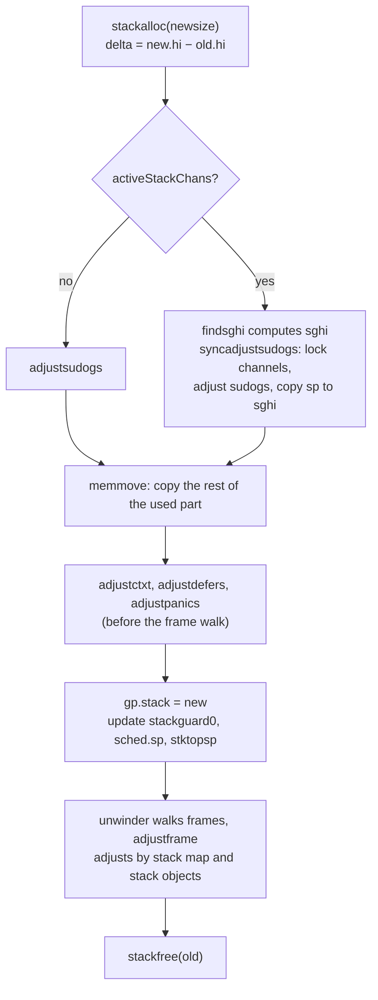

# 14.4 Stack Copying and Pointer Adjustment

Once `newstack` ([14.3](./grow.md)) has decided the size of the new stack, it calls `copystack` to
perform the **stack copy**: copy the contents of the old stack to the new one, then free the old
stack. Copying the bytes takes a single `memmove`. The difficulty is that a stack may hold pointers
to itself, for example when one local variable stores the address of another. Copied byte for byte,
such a pointer keeps its value and still points into the old stack, which is about to be freed.
`copystack` must therefore find every pointer into the old stack and redirect it to the
corresponding location in the new one. The two stacks are aligned at their high-address ends, so a
pointer that falls inside the old range `[old.lo, old.hi)` needs only the offset δ = `new.hi` −
`old.hi` added. What remains is to know which words are pointers and where outside the stack
pointers into it may be stored. This section answers those two questions, then covers the
synchronization between stack copying and channel operations, the overall flow of `copystack`, and
the constraints this mechanism places on the language.

## 14.4.1 Where Pointers into the Stack Live

[14.1](./design.md) quoted the argument in the contiguous-stack design document: escape analysis
guarantees that pointers to data on the stack are passed only down the call tree, so such pointers
exist only in the stack itself [[Randall, 2013](#ref-randall-2013)]. The document also names
exceptions, a few pointers that live outside the stack yet point into it; it lists the function
objects and arguments of deferred calls, and the closure context passed in a register. In Go 1.26
the exceptions are the execution context `g.sched` saved by the goroutine, the linked list of
`defer` records, the head of the `panic` list, and the data address recorded in a `sudog` while the
goroutine is blocked on a channel. `copystack` handles pointers inside stack frames frame by frame
and treats these few places separately.

Wherever the pointer lives, adjusting it works the same way
[[Go Authors, 2026a](#ref-go-authors-2026a)]:

```go
type adjustinfo struct {
	old   stack
	delta uintptr // ptr distance from old to new stack (newbase - oldbase)

	// sghi is the highest sudog.elem on the stack.
	sghi uintptr
}

// adjustpointer checks whether *vpp is in the old stack described by adjinfo.
// If so, it rewrites *vpp to point into the new stack.
func adjustpointer(adjinfo *adjustinfo, vpp unsafe.Pointer) {
	pp := (*uintptr)(vpp)
	p := *pp
	// ……
	if adjinfo.old.lo <= p && p < adjinfo.old.hi {
		*pp = p + adjinfo.delta
	}
}
```

`sghi` is used in 14.4.4.

## 14.4.2 Adjusting Frame by Frame

Which words in a frame are pointers is given by the stack maps the compiler generates: for every
position where execution may pause, the compiler records which words of the locals and arguments
areas hold live pointers ([13.7](../ch13gc/safe.md)) [[Go Authors, 2026c](#ref-go-authors-2026c)].
This information was originally produced for precise garbage collection, and stack copying borrows
it ([14.1](./design.md)). `runtime/stack.go` includes a diagram of where the regions of a stack
frame lie:

```go
// Stack frame layout
//
// (x86)
// +------------------+
// | args from caller |
// +------------------+ <- frame->argp
// |  return address  |
// +------------------+
// |  caller's BP (*) | (*) if framepointer_enabled && varp > sp
// +------------------+ <- frame->varp
// |     locals       |
// +------------------+
// |  args to callee  |
// +------------------+ <- frame->sp
```

`adjustframe` adjusts one frame according to this layout:

```go
// Note: the argument/return area is adjusted by the callee.
func adjustframe(frame *stkframe, adjinfo *adjustinfo) {
	// Adjust saved frame pointer if there is one.
	if (goarch.ArchFamily == goarch.AMD64 || goarch.ArchFamily == goarch.ARM64) && frame.argp-frame.varp == 2*goarch.PtrSize {
		// ……
		adjustpointer(adjinfo, unsafe.Pointer(frame.varp))
	}
	// ……
	if frame.continpc == 0 {
		// Frame is dead. The program might still see the frame pointer
		// saved in the frame, adjusted above, but we don't need to
		// adjust the rest of the frame.
		return
	}
	f := frame.fn

	locals, args, objs := frame.getStackMap(true)

	// Adjust local variables if stack frame has been allocated.
	if locals.n > 0 {
		size := uintptr(locals.n) * goarch.PtrSize
		adjustpointers(unsafe.Pointer(frame.varp-size), &locals, adjinfo, f)
	}

	// Adjust arguments.
	if args.n > 0 {
		adjustpointers(unsafe.Pointer(frame.argp), &args, adjinfo, funcInfo{})
	}

	// Adjust pointers in all stack objects (whether they are live or not).
	// See comments in mgcmark.go:scanframeworker.
	if frame.varp != 0 {
		for i := range objs {
			obj := &objs[i]
			off := obj.off
			base := frame.varp // locals base pointer
			if off >= 0 {
				base = frame.argp // arguments and return values base pointer
			}
			p := base + uintptr(off)
			if p < frame.sp {
				// Object hasn't been allocated in the frame yet.
				// (Happens when the stack bounds check fails and
				// we call into morestack.)
				continue
			}
			// ...call adjustpointer on each word according to the pointer bitmap of the object
		}
	}
}
```

Three things in a frame need adjusting. The first is the caller's frame pointer saved in the frame,
which always points to another frame higher in the stack. The second is the pointers that the stack
map marks in the locals and arguments areas. The third is stack objects, local variables whose
address has been taken ([13.7](../ch13gc/safe.md)). Randall introduced this mechanism in Go 1.12:
the compiler registers the address-taken variables of each function in its metadata, and when
scanning a stack the collector uses it to do a small marking pass among the stack objects, scanning
only those that are actually referenced [[Randall, 2018](#ref-randall-2018)]. Stack copying does no
such marking and adjusts the pointers in every stack object; for an object no longer in use this is
merely some extra work. If the address of an object is below the SP of the current frame, the frame
had not yet been set up when the prologue check failed, so the object does not exist yet and can be
skipped. A dead frame (`continpc` is 0) will never resume, and only its saved frame pointer needs
adjusting.

The function that actually reads the bitmap is `adjustpointers`:

```go
// bv describes the memory starting at address scanp.
// Adjust any pointers contained therein.
func adjustpointers(scanp unsafe.Pointer, bv *bitvector, adjinfo *adjustinfo, f funcInfo) {
	minp := adjinfo.old.lo
	maxp := adjinfo.old.hi
	delta := adjinfo.delta
	num := uintptr(bv.n)
	// If this frame might contain channel receive slots, use CAS
	// to adjust pointers. If the slot hasn't been received into
	// yet, it may contain stack pointers and a concurrent send
	// could race with adjusting those pointers. (The sent value
	// itself can never contain stack pointers.)
	useCAS := uintptr(scanp) < adjinfo.sghi
	for i := uintptr(0); i < num; i += 8 {
		// ……
		b := *(addb(bv.bytedata, i/8))
		for b != 0 {
			j := uintptr(sys.TrailingZeros8(b))
			b &= b - 1
			pp := (*uintptr)(add(scanp, (i+j)*goarch.PtrSize))
		retry:
			p := *pp
			if f.valid() && 0 < p && p < minLegalPointer && debug.invalidptr != 0 {
				// Looks like a junk value in a pointer slot.
				// Live analysis wrong?
				getg().m.traceback = 2
				throw("invalid pointer found on stack")
			}
			if minp <= p && p < maxp {
				if useCAS {
					ppu := (*unsafe.Pointer)(unsafe.Pointer(pp))
					if !atomic.Casp1(ppu, unsafe.Pointer(p), unsafe.Pointer(p+delta)) {
						goto retry
					}
				} else {
					*pp = p + delta
				}
			}
		}
	}
}
```

The bitmap is consumed one byte at a time, and `TrailingZeros8` jumps straight to the next set slot.
Words not marked as pointers are never touched, so an integer that merely looks like an address is
not rewritten. The function also performs a check: if a pointer slot holds a nonzero value smaller
than `minLegalPointer`, either the liveness analysis is wrong or the program has used `unsafe` to
store an integer in a pointer, and the runtime terminates the program with "invalid pointer found on
stack". The check is controlled by `GODEBUG=invalidptr` and is on by default.

## 14.4.3 Pointers Outside Stack Frames

The four places outside the frames are adjusted by four functions:

```go
func adjustctxt(gp *g, adjinfo *adjustinfo) {
	adjustpointer(adjinfo, unsafe.Pointer(&gp.sched.ctxt))
	if !framepointer_enabled {
		return
	}
	// ……
	adjustpointer(adjinfo, unsafe.Pointer(&gp.sched.bp))
	// ...on arm64, also adjust the frame pointer saved one word below SP
}

func adjustdefers(gp *g, adjinfo *adjustinfo) {
	// Adjust pointers in the Defer structs.
	// We need to do this first because we need to adjust the
	// defer.link fields so we always work on the new stack.
	adjustpointer(adjinfo, unsafe.Pointer(&gp._defer))
	for d := gp._defer; d != nil; d = d.link {
		adjustpointer(adjinfo, unsafe.Pointer(&d.fn))
		adjustpointer(adjinfo, unsafe.Pointer(&d.sp))
		adjustpointer(adjinfo, unsafe.Pointer(&d.link))
	}
}

func adjustpanics(gp *g, adjinfo *adjustinfo) {
	// Panics are on stack and already adjusted.
	// Update pointer to head of list in G.
	adjustpointer(adjinfo, unsafe.Pointer(&gp._panic))
}

func adjustsudogs(gp *g, adjinfo *adjustinfo) {
	// the data elements pointed to by a SudoG structure
	// might be in the stack.
	for s := gp.waiting; s != nil; s = s.waitlink {
		adjustpointer(adjinfo, unsafe.Pointer(&s.elem.vu))
		adjustpointer(adjinfo, unsafe.Pointer(&s.elem.vp))
	}
}
```

`g.sched.ctxt` holds the closure context, which may point to a closure on the stack; `g.sched.bp` is
the frame pointer of the innermost frame. A `defer` record may be allocated on the stack, so the
list head `g._defer`, the `link` of each record, its function value `fn` and the stack pointer `sp`
recorded at registration may all point into the stack ([6.2](../../part2lang/ch06func/defer.md)).
`panic` records are on the stack themselves and have already been handled along with the frames,
which leaves only the pointer in `g` to the list head. `sudog.elem` records the address of the data
being sent or received in a channel operation, and this address is usually on the blocked
goroutine's own stack ([10.3](../../part3concurrency/ch10chan/sendrecv.md)). To detect goroutine
leaks, Go 1.26 changed `elem` to `maybeTraceablePtr`, in which `vu` stores the address as an integer
(the comment calls it the only trusted source) and `vp` serves only to let the collector judge
liveness; both must be adjusted [[Saioc, 2025](#ref-saioc-2025)].

## 14.4.4 Synchronizing with Channel Operations

`sudog.elem` raises a problem beyond adjustment. A goroutine blocked on a channel has released the
channel's lock, so another goroutine may at any moment perform the matching operation and write data
directly into its stack (the direct handoff in [10.3](../../part3concurrency/ch10chan/sendrecv.md)).
Stack shrinking can occur while a goroutine is blocked ([14.5](./shrink.md)). If copying and writing
then happen at the same time, the write may land on the old stack and be lost, or it may overwrite
and be overwritten by the pointer adjustment.

In Go 1.14, Austin Clements added a field to `g` that records explicitly whether copying must
synchronize with channels [[Clements, 2019](#ref-clements-2019);
[Go Authors, 2026b](#ref-go-authors-2026b)]:

```go
	// activeStackChans indicates that there are unlocked channels
	// pointing into this goroutine's stack. If true, stack
	// copying needs to acquire channel locks to protect these
	// areas of the stack.
	activeStackChans bool
```

The commit message explains why it was introduced. When a stack grows, the goroutine is running: it
is either not blocked on a channel or holds the channel lock itself, and acquiring the lock again
would deadlock it. When a stack shrinks, the goroutine is not running and the lock must be acquired.
The old code told the two cases apart by whether the stack was growing or shrinking, and the timing
of shrinking was about to change ([14.5](./shrink.md)), so the field now states it directly.

When `activeStackChans` is true, `copystack` first calls `findsghi` to find the upper bound of the
highest send/receive data area on the stack, called `sghi`, and then calls `syncadjustsudogs`:

```go
// syncadjustsudogs adjusts gp's sudogs and copies the part of gp's
// stack they refer to while synchronizing with concurrent channel
// operations. It returns the number of bytes of stack copied.
func syncadjustsudogs(gp *g, used uintptr, adjinfo *adjustinfo) uintptr {
	if gp.waiting == nil {
		return 0
	}

	// Lock channels to prevent concurrent send/receive.
	var lastc *hchan
	for sg := gp.waiting; sg != nil; sg = sg.waitlink {
		if sg.c.get() != lastc {
			// ……
			lockWithRank(&sg.c.get().lock, lockRankHchanLeaf)
		}
		lastc = sg.c.get()
	}

	// Adjust sudogs.
	adjustsudogs(gp, adjinfo)

	// Copy the part of the stack the sudogs point in to
	// while holding the lock to prevent races on
	// send/receive slots.
	var sgsize uintptr
	if adjinfo.sghi != 0 {
		oldBot := adjinfo.old.hi - used
		newBot := oldBot + adjinfo.delta
		sgsize = adjinfo.sghi - oldBot
		memmove(unsafe.Pointer(newBot), unsafe.Pointer(oldBot), sgsize)
	}

	// Unlock channels.
	// ……
	return sgsize
}
```

It locks all channels the goroutine is waiting on, adjusts the `sudog`s, copies the segment from the
stack pointer up to `sghi` while holding the locks (`oldBot` in the code is the stack pointer of the
old stack), and then releases the locks. These channel locks should be acquired before the scan bit
in the goroutine's status, and here the order is reversed; a comment elided above explains that
because the goroutines involved are necessarily suspended, no deadlock can occur here, so a
dedicated lock rank, `lockRankHchanLeaf`, is used. After the locks are released, `copystack` copies
the rest of the stack as usual. The frame-by-frame adjustment, however, happens after the release,
and slots below `sghi` may still be written by a concurrent send. The comment in `adjustpointers`
points out that a slot that has not yet received data may still hold an old pointer into the stack,
while the value being sent can never contain a pointer into the stack. That segment is therefore
adjusted with CAS: if the write wins the race, the CAS fails, and on rereading the new value does
not point into the old stack, so it is left alone. A comment in `copystack` notes that `sghi` is not
far from the stack pointer, so only a very small segment needs this care.

## 14.4.5 The Overall Flow of copystack

`copystack` ties the steps above together:

```go
// Copies gp's stack to a new stack of a different size.
// Caller must have changed gp status to Gcopystack.
func copystack(gp *g, newsize uintptr) {
	if gp.syscallsp != 0 {
		throw("stack growth not allowed in system call")
	}
	old := gp.stack
	// ……
	used := old.hi - gp.sched.sp
	// Add just the difference to gcController.addScannableStack.
	// ……
	gcController.addScannableStack(getg().m.p.ptr(), int64(newsize)-int64(old.hi-old.lo))

	// allocate new stack
	new := stackalloc(uint32(newsize))
	// ……

	// Compute adjustment.
	var adjinfo adjustinfo
	adjinfo.old = old
	adjinfo.delta = new.hi - old.hi

	// Adjust sudogs, synchronizing with channel ops if necessary.
	ncopy := used
	if !gp.activeStackChans {
		if newsize < old.hi-old.lo && gp.parkingOnChan.Load() {
			// ……
			throw("racy sudog adjustment due to parking on channel")
		}
		adjustsudogs(gp, &adjinfo)
	} else {
		// ……
		adjinfo.sghi = findsghi(gp, old)

		// Synchronize with channel ops and copy the part of
		// the stack they may interact with.
		ncopy -= syncadjustsudogs(gp, used, &adjinfo)
	}

	// Copy the stack (or the rest of it) to the new location
	memmove(unsafe.Pointer(new.hi-ncopy), unsafe.Pointer(old.hi-ncopy), ncopy)

	// Adjust remaining structures that have pointers into stacks.
	// We have to do most of these before we traceback the new
	// stack because gentraceback uses them.
	adjustctxt(gp, &adjinfo)
	adjustdefers(gp, &adjinfo)
	adjustpanics(gp, &adjinfo)
	if adjinfo.sghi != 0 {
		adjinfo.sghi += adjinfo.delta
	}

	// Swap out old stack for new one
	gp.stack = new
	gp.stackguard0 = new.lo + stackGuard // NOTE: might clobber a preempt request
	gp.sched.sp = new.hi - used
	gp.stktopsp += adjinfo.delta

	// Adjust pointers in the new stack.
	var u unwinder
	for u.init(gp, 0); u.valid(); u.next() {
		adjustframe(&u.frame, &adjinfo)
	}
	// ……
	stackfree(old)
}
```

Several details deserve attention. The stack cannot be moved during a system call, for the same
reason as the `entersyscall` comment in [14.3](./grow.md): the runtime does not know which `uintptr`
arguments actually point into the stack. Only the used part, `[sched.sp, old.hi)`, is copied, and it
is placed at the high-address end of the new stack; the unused space at the low end need not be
copied. `addScannableStack` accounts for the change in stack size in the collector's pacing
([13.3](../ch13gc/pacing.md)). `g.sched` and the `defer` and `panic` chains must be adjusted before
the frame walk, because the walk over the new stack uses them. The `gentraceback` in the comment is
the old stack-walking function; in Go 1.21 Clements replaced all its callback-style uses with the
`unwinder` iterator, which cut the time of four stack-copying benchmarks by about 10% on average
(geometric mean) [[Clements, 2023](#ref-clements-2023)]. Resetting `stackguard0` clears a pending
preemption request that has been written into it, as the comment notes, while the `gp.preempt` flag
is unaffected (see [9.7](../../part3concurrency/ch09sched/preemption.md) for how preemption requests
are issued and handled). The `parkingOnChan` check relates to stack shrinking and is covered in
[14.5](./shrink.md).

The following diagram summarizes the flow:



## 14.4.6 What Is Adjusted and What Is Not

The following program places an integer `x` on the stack, records its address in a pointer `p` and
in an integer `u`, and then recurses about 1000 levels to force the stack to grow:

```go {run=true}
package main

import (
	"fmt"
	"unsafe"
)

// grow recurses n levels with a frame of about 256 bytes per level, forcing the stack of the current goroutine to grow.
func grow(n int) int {
	var buf [256]byte
	if n == 0 {
		return 0
	}
	buf[n%256] = byte(n)
	return grow(n-1) + int(buf[0])
}

func main() {
	x := 1
	p := &x                          // pointer: the stack map records that this slot holds a pointer
	u := uintptr(unsafe.Pointer(&x)) // integer: the stack map does not know it was once an address

	grow(1000) // about 250 KiB, so the stack moves at least once
	x = 2

	fmt.Println("address of x has changed:", u != uintptr(unsafe.Pointer(&x)))
	fmt.Println("value read through p:", *p)
}
```

The output is:

```
address of x has changed: true
value read through p: 2
```

`x` does not escape and stays in the stack frame of `main`. When the stack grows, `x` is copied to
the new stack, and the slot holding `p` is marked as a pointer in the stack map and is adjusted, so
reading through `p` yields `x` on the new stack. `u` is only an integer and still holds an address
on the old stack. The documentation of the `unsafe` package states this explicitly: even if a
`uintptr` holds the address of an object, the collector does not update its value when the object
moves [[Go Authors, 2026d](#ref-go-authors-2026d)]. Variables on the stack are no exception.

## 14.4.7 Constraints on the Language

Stack copying works because of two premises: pointers into the stack appear only where the runtime
can find them, and every pointer can be identified exactly. These premises in turn constrain how the
language is implemented and used.

The first is guaranteed by escape analysis. If the address of a variable would be stored in the heap
or in a global variable, or returned to the caller, the compiler allocates the variable on the heap
([15.5](../../part5toolchain/ch15compile/escape.md)). Heap objects do not move with the stack, so
addresses held elsewhere stay valid. Conversely, whenever the runtime itself makes a structure
outside the stack point into it, the structure must be registered on `g`, as `sudog` is, so that
`copystack` can adjust it. Memory handed to the operating system cannot live on a movable stack,
which is why overlapped I/O on Windows pins its buffers before starting
([9.9](../../part3concurrency/ch09sched/poller.md)).

The second falls on programs that use `unsafe`. Go 1.3 introduced precise stack scanning together
with stack growth by copying, and its release notes set this rule
[[Go Authors, 2014](#ref-go-authors-2014)]:

> Starting with Go 1.3, the runtime assumes that values with pointer type
> contain pointers and other values do not. This assumption is fundamental
> to the precise behavior of both stack expansion and garbage collection.
> Programs that use package unsafe to store integers in pointer-typed values
> are illegal and will crash if the runtime detects the behavior. Programs
> that use package unsafe to store pointers in integer-typed values are also
> illegal but more difficult to diagnose during execution. Because the
> pointers are hidden from the runtime, a stack expansion or garbage
> collection may reclaim the memory they point at, creating dangling pointers.

The first kind of error, when a small integer is stored, is exactly what the `invalidptr` check in
14.4.2 catches; the second is the `u` in 14.4.6.

## 14.4.8 Summary

Stack copying reduces what looks like a problem of tracking arbitrary pointers to a few bounded
tasks. Pointers inside frames are identified by the compiler's stack maps and stack objects.
Pointers outside frames are found only in `g.sched`, the `defer` chain, the `panic` chain and
`sudog`, and a goroutine blocked on a channel synchronizes with concurrent writes through locks and
CAS. The reduction rests on escape analysis and the rules for using `unsafe`, which together
guarantee that all pointers into the stack are knowable and identifiable.

## Further Reading

- <a id="ref-clements-2019"></a>[Clements, 2019] Austin Clements. runtime: make copystack/sudog
  synchronization more explicit. Go commit 36a432f27b, 2019. https://go.dev/cl/172982
  Shipped with Go 1.14.
- <a id="ref-clements-2023"></a>[Clements, 2023] Austin Clements. runtime: replace all callback uses
  of gentraceback with unwinder. Go commit 2d99109cfc, 2023. https://go.dev/cl/468297 Shipped with
  Go 1.21.
- <a id="ref-go-authors-2014"></a>[Go Authors, 2014] The Go Authors. *Go 1.3 Release Notes: Changes
  to the garbage collector.* 2014. https://go.dev/doc/go1.3#garbage_collector
- <a id="ref-go-authors-2026a"></a>[Go Authors, 2026a] The Go Authors. src/runtime/stack.go:
  copystack, adjustframe, adjustpointers, adjustsudogs, adjustdefers, adjustctxt. Go 1.26 source.
  https://github.com/golang/go/blob/release-branch.go1.26/src/runtime/stack.go The primary
  implementation this section is based on.
- <a id="ref-go-authors-2026b"></a>[Go Authors, 2026b] The Go Authors. src/runtime/runtime2.go (the
  _Gcopystack state), src/runtime/mgcmark.go (stack scanning and shrinkstack). Go 1.26 source.
  https://github.com/golang/go/tree/release-branch.go1.26/src/runtime
- <a id="ref-go-authors-2026c"></a>[Go Authors, 2026c] The Go Authors. cmd/compile: generation of
  stack maps / liveness. Go 1.26 source.
  https://github.com/golang/go/tree/release-branch.go1.26/src/cmd/compile/internal/liveness
- <a id="ref-go-authors-2026d"></a>[Go Authors, 2026d] The Go Authors. src/unsafe/unsafe.go. Go 1.26
  source. https://github.com/golang/go/blob/release-branch.go1.26/src/unsafe/unsafe.go
- <a id="ref-randall-2013"></a>[Randall, 2013] Keith Randall. *Contiguous stacks.* Go design
  document,
  2013. https://go.dev/s/contigstacks
  The design of contiguous stacks replacing segmented stacks, and the motivation for pointer
  adjustment when copying.
- <a id="ref-randall-2018"></a>[Randall, 2018] Keith Randall. cmd/compile,runtime: implement stack
  objects. Go commit cbafcc55e8, 2018. https://go.dev/cl/134155
  Shipped with Go 1.12.
- <a id="ref-saioc-2025"></a>[Saioc, 2025] Vlad Saioc. runtime,net/http/pprof: goroutine leak
  detection by using the garbage collector. Go commit 8c68a1c1ab, 2025. https://go.dev/cl/688335
  Shipped with Go 1.26.
- This book: [13.7 Safe-Point Analysis](../ch13gc/safe.md) (stack maps and safe points, the shared
  basis of pointer adjustment and GC scanning),
  [15.5 Escape Analysis](../../part5toolchain/ch15compile/escape.md) (how stack movability
  constrains allocation decisions),
  [10.3 Send, Receive, and Direct Handoff](../../part3concurrency/ch10chan/sendrecv.md) (sudog and
  the channel send/receive slots, which explain why `adjustsudogs` exists).
