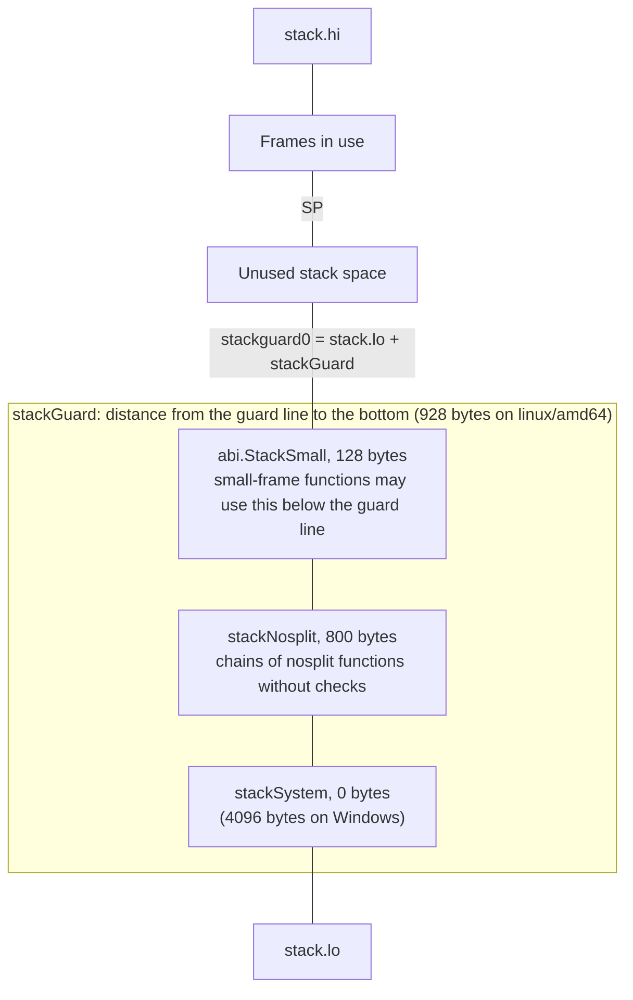

# 14.1 Design of Contiguous Stacks

An operating system allocates a thread's stack once, when the thread is created, and the size does
not change afterwards (the defaults on several systems are given in [14.5](./shrink.md)). A Go
program can have hundreds of thousands of goroutines alive at once, and reserving a stack of that
size for each would exhaust memory quickly. Go therefore starts every goroutine's stack at 2 KiB and
enlarges it when it runs out. This raises two questions: how the runtime notices in time that stack
space is running low, and how to enlarge a stack that is in use. Go has given two answers to the
second. The early implementation linked a new block of memory to the old stack, which is called a
segmented stack. Go 1.3 and Go 1.4 gradually replaced it with a larger contiguous block of memory
into which the whole stack is copied, called a contiguous stack. This section first describes how a
stack is represented in the runtime and the guard line used to check stack space, then compares the
two schemes and explains why Go changed and at what cost. The implementation of allocation, growth,
copying, and shrinking follows in [14.2](./alloc.md) through [14.5](./shrink.md).

## 14.1.1 Representation of a Stack

The runtime describes a stack by a pair of addresses [[Go Authors, 2026b](#ref-go-authors-2026b)]:

```go
// Stack describes a Go execution stack.
// The bounds of the stack are exactly [lo, hi),
// with no implicit data structures on either side.
type stack struct {
	lo uintptr
	hi uintptr
}
```

The stack grows from high addresses toward low addresses. When a goroutine starts executing, the
stack pointer SP is near `hi`, and it moves toward `lo` as calls nest deeper. The comment states
explicitly that there are no implicit data structures on either side of the interval. Section 14.1.3
shows that the early segmented stacks kept at the top of every segment a structure recording the
location of the previous segment.

The `g` structure of each goroutine begins with three stack-related fields:

```go
type g struct {
	// Stack parameters.
	// stack describes the actual stack memory: [stack.lo, stack.hi).
	// stackguard0 is the stack pointer compared in the Go stack growth prologue.
	// It is stack.lo+StackGuard normally, but can be StackPreempt to trigger a preemption.
	// stackguard1 is the stack pointer compared in the //go:systemstack stack growth prologue.
	// It is stack.lo+StackGuard on g0 and gsignal stacks.
	// It is ~0 on other goroutine stacks, to trigger a call to morestackc (and crash).
	stack       stack   // offset known to runtime/cgo
	stackguard0 uintptr // offset known to liblink
	stackguard1 uintptr // offset known to liblink
	// ...
}
```

The trailing comments show that other components depend on the fixed offsets of these fields:
function prologues are generated by the compiler and assembler, and read the guard directly at a
fixed offset. On amd64, `stackguard0` is at offset 16, and it is the value compared by the first
instruction of the prologue in [2.4](../../part1overview/ch02asm/args.md), `CMPQ SP, 16(R14)`.

`stackguard0` is the guard line described in [2.4](../../part1overview/ch02asm/args.md). The
prologue of an ordinary function compares SP with it, and if SP is not above the guard line, the
function calls `morestack` to grow the stack ([14.3](./grow.md)). Normally it equals
`stack.lo + stackGuard`. The runtime can also overwrite it with one of a few special values larger
than any real stack address, which makes the next check fail, so that the goroutine enters the
runtime at its next function call. `stackPreempt` requests preemption
([2.4](../../part1overview/ch02asm/args.md), [9.7](../../part3concurrency/ch09sched/preemption.md)).
`stackFork` is set between `fork` and `exec`, a period in which neither memory allocation nor stack
growth is allowed; any attempt to grow the stack terminates the program with "stack growth after
fork". `stackForceMove` forces the stack to move at the next check and is used only for testing and
debugging [[Go Authors, 2026a](#ref-go-authors-2026a)].

`stackguard1` serves another class of functions. Some functions in the runtime may execute only on a
system stack, that is, the g0 of each M or the gsignal used for signal handling
([9.3](../../part3concurrency/ch09sched/mpg.md)), and they are marked `//go:systemstack`. The
prologue the compiler generates for these functions compares against `stackguard1` instead, and when
the check fails it calls not `morestack` but `morestackc`
[[Go Authors, 2026c](#ref-go-authors-2026c)]. On a system stack, `stackguard1` equals
`stack.lo + stackGuard`, like `stackguard0`. On an ordinary goroutine it is `~0`, so the comparison
always fails, and `morestackc` then terminates the program with "attempt to execute system stack
code on user stack". The constraint "this function may run only on the system stack", which the
compiler cannot prove statically, is thus enforced at run time through the existing stack check,
with no additional instructions.

This field dates from when the runtime was still written in C. In Go 1.4 its comment read "compared
in the C stack growth prologue": C functions in the runtime could execute only on the system stack,
and their prologues compared against `stackguard1` [[Go Authors, 2014c](#ref-go-authors-2014c)].
After all the C code had been rewritten in Go, Shenghou Ma removed the field in late 2014, and Russ
Cox promptly reverted the change, with this reasoning [[Cox, 2015](#ref-cox-2015)]:

> I think it will remain useful to distinguish code that must
> run on a system stack from code that can run on either stack,
> even if that distinction is no
> longer based on the implementation language.
>
> That is, I expect to add a //go:systemstack comment that,
> in terms of the old implementation, tells the compiler,
> to pretend this function was written in C.

To this day the internal attribute the compiler sets for `//go:systemstack` functions is still named
`CFunc` [[Go Authors, 2026c](#ref-go-authors-2026c)].

Not every pointer into a stack lives on that stack. When a goroutine is switched out, its SP is
saved in `g.sched.sp` ([9.3](../../part3concurrency/ch09sched/mpg.md)); records for `defer` and
`panic`, and the `sudog` of a goroutine blocked on a channel, may also point into the stack. When a
stack moves, all these pointers, which lie outside the stack and point into it, must be updated too.
This is the subject of [14.4](./copy.md).

## 14.1.2 The Margin Below the Guard Line

The guard line is not at the very bottom of the stack. Several constants in `runtime/stack.go`
define its distance from the bottom [[Go Authors, 2026a](#ref-go-authors-2026a)]:

```go
const (
	// stackSystem is a number of additional bytes to add
	// to each stack below the usual guard area for OS-specific
	// purposes like signal handling. Used on Windows, Plan 9,
	// and iOS because they do not use a separate stack.
	stackSystem = goos.IsWindows*4096 + goos.IsPlan9*512 + goos.IsIos*goarch.IsArm64*1024

	// The minimum size of stack used by Go code
	stackMin = 2048

	// The minimum stack size to allocate.
	// The hackery here rounds fixedStack0 up to a power of 2.
	fixedStack0 = stackMin + stackSystem
	// ...
	fixedStack  = fixedStack6 + 1

	// stackNosplit is the maximum number of bytes that a chain of NOSPLIT
	// functions can use.
	// ...
	stackNosplit = abi.StackNosplitBase * sys.StackGuardMultiplier

	// The stack guard is a pointer this many bytes above the
	// bottom of the stack.
	//
	// The guard leaves enough room for a stackNosplit chain of NOSPLIT calls
	// plus one stackSmall frame plus stackSystem bytes for the OS.
	// ...
	stackGuard = stackNosplit + stackSystem + abi.StackSmall
)
```

The space below the guard line has three parts, laid out in the figure below. To keep the prologue
as short as possible, a function whose frame is no larger than `abi.StackSmall` (128 bytes) compares
SP directly with the guard line without first subtracting its own frame size, so it may use up to
128 bytes below the guard line. Functions marked `//go:nosplit` perform no check, and a chain of
such functions may use up to `stackNosplit` further bytes; the linker verifies every such call chain
at build time ([14.3](./grow.md)). `stackSystem` is reserved on Windows, Plan 9, and iOS, which do
not use a separate stack for signal handling. `abi.StackNosplitBase` is 800 bytes, and only after
multiplying by `sys.StackGuardMultiplier` does it become `stackNosplit`: system calls on AIX and
OpenBSD, and builds with the race detector enabled, need more stack, and in those cases the factor
is greater than 1 [[Go Authors, 2026c](#ref-go-authors-2026c)]. On linux/amd64 the guard line is
therefore 800 + 128 = 928 bytes from the bottom, nearly half of the 2 KiB minimum stack. The
prologues for frames of different sizes are described in [2.4](../../part1overview/ch02asm/args.md).



`stackMin` is the smallest stack usable by Go code, 2048 bytes. The smallest stack actually
allocated, `fixedStack`, adds `stackSystem` and rounds up to a power of 2, because the stack
allocator handles only power-of-2 sizes ([14.2](./alloc.md)). On Windows, 2048 + 4096 = 6144 bytes
rounds up to 8 KiB, so each goroutine's stack starts at 8 KiB.

This margin has been adjusted several times. In Go 1.2 the guard line was 256 bytes from the bottom,
of which only 128 bytes were left for chains of functions without checks
[[Go Authors, 2013b](#ref-go-authors-2013b)]. The margin was increased several times afterwards, and
since Go 1.15 it has been 928 bytes. In one adjustment in 2014, Russ Cox doubled this reservation,
and the commit message also states the relationship between the margin and the minimum stack size
[[Cox, 2014a](#ref-cox-2014a)]:

> Increase NOSPLIT reservation from 192 to 384 bytes.
> The problem is that the non-Unix systems (Solaris and Windows)
> just can't make system calls in a small amount of space,
> ...
> The good news is that we're doing this to get to only
> using copying stacks for stack growth. Once that is true,
> we can drop the default stack size from 8k to 4k, which
> should more than make up for the bytes we're losing here.

The margin is a fixed part deducted from every stack, so the smaller the minimum stack, the larger
its share; and whether the minimum stack can shrink depends on whether growing the stack is cheap.
Go 1.4 finally lowered the minimum stack to 2 KiB (14.1.4).

## 14.1.3 Segmented Stacks and the Hot Split

The earliest Go implementation used a **segmented stack**: when stack space ran out, the runtime
allocated another block of memory and linked it to the existing stack, and released it when the
function returned to the previous segment. Ken Thompson added this mechanism to the 6l linker in a
commit of June 2008. The linker inserted a comparison against the stack bound at the start of every
function and called `_morestack` when space was insufficient, except for functions marked `NOSPLIT`
[[Thompson, 2008](#ref-thompson-2008)]. The stack check in the function prologue and the `NOSPLIT`
marker have been in use ever since.

Take Go 1.2 as an example [[Go Authors, 2013b](#ref-go-authors-2013b)]. The size of a new segment
was the space needed by the frame that triggered the growth and its arguments, plus 2048 bytes
(`StackExtra`), and at least 8192 bytes (`StackMin`). The runtime placed a `Stktop` structure at the
top of the new segment, recording the bounds of the old segment and the caller's execution state,
copied the call arguments into the new segment, and set the return address of the callee to
`lessstack`. When the callee returned, it entered `lessstack`, which called `oldstack` on g0: it
copied the arguments and results back to the old segment, restored the old segment's bounds,
released the new segment, and returned to the caller to continue. The segments were chained through
`Stktop`, and each segment was released when the earliest frame in it returned. This approach never
moves existing frames, so pointers into the stack always remain valid, and the cost of growth
depends only on the new frame, not on the depth of the stack.

Its weakness is that allocating and releasing segments happens in pairs with calls and returns. If a
loop calls the same function repeatedly, and at the time of the call the current segment happens to
have little space left, every call allocates a new segment and every return releases it. Keith
Randall called this the **hot split** problem in the design document for contiguous stacks
[[Randall, 2013](#ref-randall-2013)]:

> Current split stack mechanism has a "hot split" problem - if the stack is almost full, a call will
> force a new stack chunk to be allocated. When that call returns, the new stack chunk is freed. If
> the same call happens repeatedly in a tight loop, the overhead of the alloc/free causes
> significant overhead.

The document measured this overhead with a purpose-built test: with segmented stacks, the version
whose call site lands exactly on a segment boundary took 5.37 seconds, and the version that does not
took 1.26 seconds; with contiguous stacks, both versions took 1.26 seconds. The document also points
out a more general problem: with segmented stacks, the work of allocating and releasing stacks is
never complete, and every time the stack size crosses a threshold in either direction, extra work is
required. Because whether a call site lands on a segment boundary depends on the frame sizes of the
entire call chain, this overhead is hard to predict. The document measured how sensitive several
standard library benchmarks were to the segment size: `BenchmarkEncode` in encoding/json had long
been a source of complaints (issue #3787), and `BenchmarkEscapedExecute` in html/template behaved
abnormally at what was then the default segment size of 4096 bytes.

Go 1.2 raised the minimum stack of a new goroutine from 4 KiB to 8 KiB. The release notes gave the
reason: many programs had run into performance problems with the old size, because it made it easy
to introduce costly stack segment switches in performance-critical code
[[Go Authors, 2013a](#ref-go-authors-2013a)]. This was only a mitigation: larger segments lowered
the probability that a call site landed on a boundary, but doubled the initial stack of every
goroutine. The release notes acknowledged this and announced that better stack management techniques
would address the problem in the future.

The same idea appeared in C. Ian Lance Taylor implemented segmented stacks for GCC (GCC calls them
split stacks), available on x86 GNU/Linux since GCC 4.6.0 and requiring the gold linker
[[Taylor, 2011](#ref-taylor-2011)]. GCC 4.6.0 was released in March 2011
[[GCC Project, 2011](#ref-gcc-project-2011)], later than Go's implementation in 2008. gccgo uses it
to give goroutines small discontiguous stacks, and still does
[[Go Authors, 2026d](#ref-go-authors-2026d)].

## 14.1.4 Contiguous Stacks

The idea of a **contiguous stack** is straightforward: when stack space runs out, allocate a larger
block of memory, copy the whole stack into it, and release the old stack. The stack is then always
one contiguous block of memory whose size changes only when truly needed, after which no extra work
is required (except shrinking, see [14.5](./shrink.md)). The design document points out that
contiguous stacks avoid both the hot split and the never-ending allocation and release
[[Randall, 2013](#ref-randall-2013)].

The difficulty is that moving the stack invalidates every pointer into the old stack. The argument
in the design document starts from escape analysis:

> It turns out that our compiler's escape analysis provides a very important invariant: pointers to
> data on the stack are only ever passed down in the call tree. Any other escape (written to global
> variables, returned to a parent, written to the heap, etc.) prevents that data from being
> allocated on the stack. This invariant means that the only pointers to stack data are in the stack
> itself (but see below for exceptions), which makes them easy to find and update in case we need to
> copy the stack.

Finding these pointers requires a second condition: the runtime must be able to tell pointers on the
stack from integers that merely look like addresses. The document says that Carl Shapiro was at that
time generating exactly such a data structure for precise garbage collection. A change Shapiro
submitted in late 2013 made the compiler generate bitmaps for the pointers on the stack through
liveness analysis [[Shapiro, 2013](#ref-shapiro-2013)], and today's stack maps
([13.7](../ch13gc/safe.md)) developed from it. Since Go 1.3 the garbage collector has also scanned
stacks precisely [[Go Authors, 2014a](#ref-go-authors-2014a)]. Stack copying and precise collection
have since depended on the same compiler-generated information. The invariant of escape analysis
also has exceptions. The document lists several pointers from outside the stack into it, for example
the function object and arguments of a deferred call, and the closure context passed in a register
to the frame that triggered the growth. They must each be handled during copying
([14.4](./copy.md)).

How large should the new stack be? The document recommends exponential growth to bound the total
amount of copying, and powers of 2 to suit the allocator; the implementation doubles every time.
Measurements on the prototype show the effect of the growth factor: in a modified peano test,
doubling each time was 10% faster than segmented stacks, growing by 50% each time was only 2%
faster, and growing by 25% each time was 20% slower. The document also warns that this test is very
sensitive to the growth rate, so the numbers are for reference only. With growth by a constant
factor, the sum of bytes copied over all copies does not exceed the size of the final stack, and the
total cost of growth is proportional to the final stack size; the program in
[2.4](../../part1overview/ch02asm/args.md) observes this process.

Keith Randall submitted the implementation of growth by copying in February 2014, released with Go
1.3 [[Randall, 2014a](#ref-randall-2014a)]. Most of the runtime was still written in C at the time,
and a stack with a C function's frame on it could not be copied, so the stack was copied only when
all frames on it were copyable, and otherwise a new segment was allocated the old way. The commit
also implemented shrinking: during garbage collection, if a goroutine used less than a quarter of
its stack, the stack was copied to one of half the size. The Go 1.3 release notes announced that the
goroutine stack had been changed from a "segmented" model to a contiguous one
[[Go Authors, 2014a](#ref-go-authors-2014a)].

Go 1.4 rewrote most of the runtime in Go, after which all frames on a stack are copyable. Russ Cox
turned on the always-copy switch `StackCopyAlways` in September 2014 [[Cox, 2014b](#ref-cox-2014b)],
and Randall then removed the copyability check, with the commit titled "get rid of copyable check -
all G frames are copyable" [[Randall, 2014b](#ref-randall-2014b)]. The Go 1.4 release notes state
[[Go Authors, 2014b](#ref-go-authors-2014b)]:

> A consequence is that stacks are no longer segmented, eliminating the "hot split" problem.
> When a stack limit is reached, a new, larger stack is allocated, all active frames for
> the goroutine are copied there, and any pointers into the stack are updated.
> Performance can be noticeably better in some cases and is always more predictable.

The same notes point out that contiguous stacks allow stacks to start smaller without triggering
performance issues, so the default starting size of a new goroutine's stack was reduced from 8192
bytes to 2048 bytes.

The design document also lists the drawbacks of contiguous stacks. The first is virtual memory
pressure and fragmentation: the larger the stack, the harder it is to find enough contiguous space.
The document considered compromises, such as copying up to 1 MiB and switching to segments beyond
that, but concluded that maintaining both mechanisms was not worth it. The second is a restriction
on pointers into the stack: all pointers into the stack region must be accurately tracked, and if
one later wants to allow other forms of pointers into the stack, this implementation will be an
obstacle. The third is that all C and assembly code in the runtime must be reviewed to make sure
that nothing treats the stack pointer specially. The second drawback soon became a constraint on the
language implementation: the Go 1.3 release notes state that programs that use `unsafe` to store
integers in pointer-typed values, or to hide pointers in integers, are illegal, because both stack
growth and garbage collection rely on the assumption that only values of pointer type contain
pointers [[Go Authors, 2014a](#ref-go-authors-2014a)]. [14.4](./copy.md) returns to this point.

## 14.1.5 Summary

The trade-off between the two schemes can be summarized as follows. With segmented stacks every
growth involves only the new frame, but the cost recurs with calls and returns, and where it occurs
is hard to predict. With contiguous stacks the cost of a single growth is proportional to the stack
size, but because of doubling, that cost is amortized to a constant over the whole lifetime of the
stack. The latter requires the runtime to find and fix every pointer into the stack, a condition
that Go's escape analysis and compiler-generated stack maps happen to provide. Only after growing
the stack became cheap and predictable could the minimum stack be lowered to 2 KiB; the smaller the
stack, the larger the share of the fixed margin below the guard line, which on linux/amd64 is
already nearly half.

## Further Reading

- <a id="ref-cox-2014a"></a>[Cox, 2014a] Russ Cox. runtime: increase stack split limit again. Go
  commit b6951bcc0b, 2014. https://golang.org/cl/140350043 Released with Go 1.4.
- <a id="ref-cox-2014b"></a>[Cox, 2014b] Russ Cox. runtime: enable StackCopyAlways. Go commit
  815a843b6a,
  2014. https://golang.org/cl/141280043
  Released with Go 1.4.
- <a id="ref-cox-2015"></a>[Cox, 2015] Russ Cox. Revert "liblink, cmd/ld, runtime: remove
  stackguard1". Go commit e6d3511264, 2015. https://go.dev/cl/2275 Released with Go 1.5.
- <a id="ref-gcc-project-2011"></a>[GCC Project, 2011] The GCC Project. *GCC 4.6 Release
  Series.* 2011. https://gcc.gnu.org/gcc-4.6/ Release date of GCC 4.6.0 (25 March 2011).
- <a id="ref-go-authors-2013a"></a>[Go Authors, 2013a] The Go Authors. *Go 1.2 Release Notes: Stack
  size.*
  2013. https://go.dev/doc/go1.2#stack_size
- <a id="ref-go-authors-2013b"></a>[Go Authors, 2013b] The Go Authors. src/pkg/runtime/stack.h,
  stack.c, asm_amd64.s. Go 1.2 source. https://github.com/golang/go/tree/go1.2/src/pkg/runtime The
  last release to use only segmented stacks: `Stktop`, `newstack`, `lessstack`, and `oldstack`.
- <a id="ref-go-authors-2014a"></a>[Go Authors, 2014a] The Go Authors. *Go 1.3 Release Notes: Stack
  management.* 2014. https://go.dev/doc/go1.3#stacks The official account of the switch from
  segmented to contiguous stacks and the removal of the "hot spot".
- <a id="ref-go-authors-2014b"></a>[Go Authors, 2014b] The Go Authors. *Go 1.4 Release Notes:
  Changes to the runtime.* 2014. https://go.dev/doc/go1.4#runtime
- <a id="ref-go-authors-2014c"></a>[Go Authors, 2014c] The Go Authors. src/runtime/runtime.h. Go 1.4
  source. https://github.com/golang/go/blob/go1.4/src/runtime/runtime.h
- <a id="ref-go-authors-2026a"></a>[Go Authors, 2026a] The Go Authors. src/runtime/stack.go. Go 1.26
  source. https://github.com/golang/go/blob/release-branch.go1.26/src/runtime/stack.go Definitions
  of constants such as `stackMin`, `stackGuard`, and `stackNosplit`. Formerly at
  https://github.com/golang/go/blob/master/src/runtime/stack.go
- <a id="ref-go-authors-2026b"></a>[Go Authors, 2026b] The Go Authors. src/runtime/runtime2.go. Go
  1.26 source. https://github.com/golang/go/blob/release-branch.go1.26/src/runtime/runtime2.go The
  stack-related fields of `stack`, `gobuf`, and `g`. Formerly at
  https://github.com/golang/go/blob/master/src/runtime/runtime2.go
- <a id="ref-go-authors-2026c"></a>[Go Authors, 2026c] The Go Authors. src/internal/abi/stack.go,
  src/internal/runtime/sys/consts.go, src/cmd/internal/obj/x86/obj6.go,
  src/cmd/compile/internal/ir/abi.go. Go 1.26 source.
  https://github.com/golang/go/tree/release-branch.go1.26/src
- <a id="ref-go-authors-2026d"></a>[Go Authors, 2026d] The Go Authors. *Setting up and using
  gccgo.* 2026. https://go.dev/doc/install/gccgo
- <a id="ref-randall-2013"></a>[Randall, 2013] Keith Randall. *Contiguous stacks.* Go design
  document,
  2013. https://go.dev/s/contigstacks
  The primary document on the contiguous stack design: the hot split problem, copying and pointer
  adjustment, performance data.
- <a id="ref-randall-2014a"></a>[Randall, 2014a] Keith Randall. runtime: grow stack by copying. Go
  commit 1665b006a5, 2014. https://golang.org/cl/54650044 Released with Go 1.3.
- <a id="ref-randall-2014b"></a>[Randall, 2014b] Keith Randall. runtime: get rid of copyable check -
  all G frames are copyable. Go commit 00365b13b4, 2014. https://golang.org/cl/133690045 Released
  with Go 1.4.
- <a id="ref-shapiro-2013"></a>[Shapiro, 2013] Carl Shapiro. cmd/5g, cmd/5l, cmd/6g, cmd/6l, cmd/8g,
  cmd/8l, cmd/gc, runtime: generate pointer maps by liveness analysis. Go commit f056daf075, 2013.
  https://golang.org/cl/14430048
  Released with Go 1.3.
- <a id="ref-taylor-2011"></a>[Taylor, 2011] Ian Lance Taylor. *Split Stacks in GCC.* GCC
  Wiki, 2011. https://gcc.gnu.org/wiki/SplitStacks The implementation of segmented stacks in GCC and
  its design trade-offs.
- <a id="ref-thompson-2008"></a>[Thompson, 2008] Ken Thompson. segmented stack. Go commit
  1f6828bcdf,
  2008. https://github.com/golang/go/commit/1f6828bcdf27a46160c12b859e6bab216cd11940
- This book:
  [9.3 The MPG Model and the Units of Concurrent Scheduling](../../part3concurrency/ch09sched/mpg.md),
  [9.7 Cooperation and Preemption](../../part3concurrency/ch09sched/preemption.md),
  [2.4 Argument Passing and Stack Frame Layout](../../part1overview/ch02asm/args.md),
  [14.3 Stack Growth](./grow.md), [14.4 Stack Copying and Pointer Adjustment](./copy.md) (details of
  stack copying, pointer adjustment, and `gobuf` updates).
