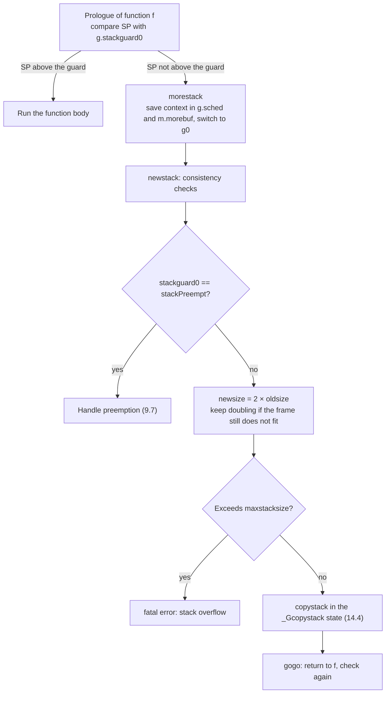

# 14.3 Stack Growth

[14.1](./design.md) explained why Go uses contiguous stacks: when a stack runs out of space, the
runtime allocates a larger one and copies the old stack over in one piece. This section covers how
that process is triggered, how the size of the new stack is chosen, and how large a stack may grow.
A **stack growth** passes through four steps. The check in a function prologue finds too little
space and calls the assembly function `morestack`. `morestack` saves the context, switches to g0 and
calls `newstack`. `newstack` picks the new size and calls `copystack`. Finally, control returns to
the function that triggered the growth, which starts over from its beginning. The copy itself is
left to [14.4](./copy.md).

## 14.3.1 The Check in the Function Prologue

The compiler inserts a stack check at the start of every function, except those marked
`//go:nosplit` and small functions it determines need none
([2.4](../../part1overview/ch02asm/args.md)). The check takes one of three forms, depending on the
frame size. A frame of at most `abi.StackSmall` (128 bytes) compares SP directly with the guard. A
frame of at most `abi.StackBig` (4096 bytes) first subtracts the part of the frame size beyond 128
bytes from SP. A larger frame must also check that the subtraction did not wrap around
[[Go Authors, 2026d](#ref-go-authors-2026d)]. [2.4](../../part1overview/ch02asm/args.md) shows the
three forms as amd64 instructions, and [14.1](./design.md) describes how the margin below the guard
is composed. `cmd/internal/obj/x86/obj6.go`, which generates these instructions, explains the third
form as follows [[Go Authors, 2026c](#ref-go-authors-2026c)]:

```go
		// Such a large stack we need to protect against underflow.
		// The runtime guarantees SP > objabi.StackBig, but
		// framesize is large enough that SP-framesize may
		// underflow, causing a direct comparison with the
		// stack guard to incorrectly succeed. We explicitly
		// guard against underflow.
```

The same file also marks the check and the `morestack` call that follows as non-preemptible
asynchronously. If a goroutine were preempted between those instructions, the preemption request
would be cleared by the time it resumed, yet it would still call `morestack`, and the stack would be
doubled for nothing (issue #35470).

`runtime/stack.go` opens with a long comment describing these checks, which in fact dates from the
era of segmented stacks [[Go Authors, 2026a](#ref-go-authors-2026a)]:

```go
/*
Stack layout parameters.
Included both by runtime (compiled via 6c) and linkers (compiled via gcc).

The per-goroutine g->stackguard is set to point StackGuard bytes
above the bottom of the stack.  Each function compares its stack
pointer against g->stackguard to check for overflow.  To cut one
instruction from the check sequence for functions with tiny frames,
the stack is allowed to protrude StackSmall bytes below the stack
guard.  Functions with large frames don't bother with the check and
always call morestack.  The sequences are (for amd64, others are
similar):
	// ……
	stack frame size >= StackBig:
		MOVQ m->morearg, $((argsize << 32) | frame)
		CALL morestack(SB)
	// ……
*/
```

The comment is almost word for word the one in `stack.h` of Go 1.2
[[Go Authors, 2013b](#ref-go-authors-2013b)]; "compiled via 6c" and "g->stackguard" are the idiom of
the C runtime. When a segmented stack grew, the arguments had to be copied to the new segment, so
`morestack` needed to know their size, and the prologue stored it in `m->morearg`. With a large
frame, the size of the new segment also depended on the frame size, so the prologue skipped the
comparison and called `morestack` unconditionally. A contiguous stack copies no arguments and needs
no frame size. The design document says to double the stack and retry; if the space is still
insufficient, the check fires again, until the frame fits [[Randall, 2013](#ref-randall-2013)].
Today `m` has no `morearg` field, and functions with large frames perform the same comparison;
`Huge`, with its 8208-byte frame in [2.4](../../part1overview/ch02asm/args.md), is an example.

Functions marked `//go:nosplit` perform no check and may use only the space reserved below the
guard. The linker verifies this constraint at build time. Russ Cox added the check to the linker in
2011, and the commit itself found and fixed several runtime functions that exceeded the reservation
[[Cox, 2011](#ref-cox-2011)]. Today the check lives in `cmd/link/internal/ld/stackcheck.go`
[[Go Authors, 2026e](#ref-go-authors-2026e)]:

```go
	// limit is number of bytes a splittable function ensures are
	// available on the stack. If any call chain exceeds this
	// depth, the stack check test fails.
	//
	// The call to morestack in every splittable function ensures
	// that there are at least StackLimit bytes available below SP
	// when morestack returns.
	limit := objabi.StackNosplit(*flagRace) - sc.callSize
	if buildcfg.GOARCH == "arm64" {
		// Need an extra 8 bytes below SP to save FP.
		limit -= 8
	}
```

On amd64, `StackNosplit` is 800 bytes; subtracting the 8 bytes the `CALL` instruction pushes for the
return address leaves a limit of 792 bytes. On arm64, a call stores the return address in the link
register and uses no stack, but 8 more bytes are needed to save the frame pointer, so the limit is
also 792 bytes. The following function has a 1 KiB local array and is marked `//go:nosplit`:

```go
//go:nosplit
//go:noinline
func f(i int) byte {
	var buf [1024]byte
	for j := range buf {
		buf[j] = byte(j)
	}
	return buf[i]
}

func main() { println(f(3)) }
```

Built for linux/amd64, it is rejected by the linker:

```shell
$ GOOS=linux GOARCH=amd64 go build
# ex
main.f: nosplit stack over 792 byte limit
main.f<1>
    grows 1040 bytes, calls runtime.panicBounds<1>
        grows 160 bytes, calls runtime.panicBounds64<1>
            grows 8 bytes, calls runtime.morestack<0>
            416 bytes over limit
```

The linker reports the deepest call chain. `buf[i]` needs a bounds check, which calls
`runtime.panicBounds` on failure, and that in turn calls `runtime.panicBounds64`. `panicBounds64`
performs a stack check and may call `morestack`, which must also fit. The total is 1040 + 160 + 8 =
1208 bytes, 416 bytes over the limit. On darwin/arm64 the last call pushes nothing, and the output
reads "grows 0 bytes" and "408 bytes over limit".

## 14.3.2 From morestack to newstack

When the check fails, the function calls `morestack`; a function that uses no closure context calls
`morestack_noctxt`, which zeroes the register holding the context and jumps to `morestack`:

```asm
TEXT runtime·morestack_noctxt(SB),NOSPLIT,$0
	MOVL	$0, DX
	JMP	runtime·morestack(SB)
```

`morestack` stores the context of the function f that triggered the growth in `g.sched` and the
context of f's caller in `m.morebuf`, then switches to the g0 stack and calls `newstack`
[[Go Authors, 2026b](#ref-go-authors-2026b)]. [2.2](../../part1overview/ch02asm/frame.md) walks
through this assembly line by line. The switch to g0 is necessary: the user stack is about to be
copied, so the code that grows it cannot run on it. The g0 stack itself cannot grow, and triggering
`morestack` on g0 terminates the program immediately
([9.3](../../part3concurrency/ch09sched/mpg.md)).

`newstack` begins with a few consistency checks. Failing any of them means the runtime itself is
broken:

```go
func newstack() {
	thisg := getg()
	// TODO: double check all gp. shouldn't be getg().
	if thisg.m.morebuf.g.ptr().stackguard0 == stackFork {
		throw("stack growth after fork")
	}
	if thisg.m.morebuf.g.ptr() != thisg.m.curg {
		// ……
		throw("runtime: wrong goroutine in newstack")
	}

	gp := thisg.m.curg
	// ……
	if thisg.m.curg.throwsplit {
		// ……
		throw("runtime: stack split at bad time")
	}
	// ……
}
```

[14.1](./design.md) explains `stackFork`. `throwsplit` is set on entering a system call
([9.5](../../part3concurrency/ch09sched/thread.md)). The comment in `entersyscall` gives the reason:
the stack cannot safely be moved during a system call, because the runtime does not know which
`uintptr` arguments are really pointers back into the stack
[[Go Authors, 2026f](#ref-go-authors-2026f)]. `newstack` then reads the guard to decide whether this
is a preemption request. [9.7](../../part3concurrency/ch09sched/preemption.md) covers preemption,
including the stack shrinking that is deferred to this point ([14.5](./shrink.md)). If SP is already
below `stack.lo`, some code has gone past the reserve below the guard, and the runtime terminates
the program with "split stack overflow".

## 14.3.3 The Size of the New Stack

With those cases excluded, what remains is a real stack growth:

```go
	// Allocate a bigger segment and move the stack.
	oldsize := gp.stack.hi - gp.stack.lo
	newsize := oldsize * 2

	// Make sure we grow at least as much as needed to fit the new frame.
	// (This is just an optimization - the caller of morestack will
	// recheck the bounds on return.)
	if f := findfunc(gp.sched.pc); f.valid() {
		max := uintptr(funcMaxSPDelta(f))
		needed := max + stackGuard
		used := gp.stack.hi - gp.sched.sp
		for newsize-used < needed {
			newsize *= 2
		}
	}

	if stackguard0 == stackForceMove {
		// Forced stack movement used for debugging.
		// Don't double the stack (or we may quickly run out
		// if this is done repeatedly).
		newsize = oldsize
	}

	if newsize > maxstacksize || newsize > maxstackceiling {
		if maxstacksize < maxstackceiling {
			print("runtime: goroutine stack exceeds ", maxstacksize, "-byte limit\n")
		} else {
			print("runtime: goroutine stack exceeds ", maxstackceiling, "-byte limit\n")
		}
		print("runtime: sp=", hex(sp), " stack=[", hex(gp.stack.lo), ", ", hex(gp.stack.hi), "]\n")
		throw("stack overflow")
	}

	// The goroutine must be executing in order to call newstack,
	// so it must be Grunning (or Gscanrunning).
	casgstatus(gp, _Grunning, _Gcopystack)

	// The concurrent GC will not scan the stack while we are doing the copy since
	// the gp is in a Gcopystack status.
	copystack(gp, newsize)
	// ……
	casgstatus(gp, _Gcopystack, _Grunning)
	gogo(&gp.sched)
}
```

By default the new stack is twice the size of the old one. The comment at the top of the function
reads "Stack growth is multiplicative, for constant amortized cost." With multiplicative growth, the
total number of bytes copied over all growths never exceeds the final size of the stack, which is a
constant cost per byte ([2.4](../../part1overview/ch02asm/args.md) observes this with a program).
Growing by a fixed amount each time would make the total copying grow with the square of the stack
size. The word "segment" in the first comment is a leftover from segmented stacks.

After doubling, if the new stack still cannot hold the frame that triggered the growth, the size
doubles again. `funcMaxSPDelta` gives the maximum amount SP drops while the function executes, and
adding the margin below the guard yields the space the frame needs. Randall added this loop in Go
1.15. The commit message notes that it does not help the case of many small frames but may improve
the case of a few large ones [[Randall, 2020](#ref-randall-2020)]. The comment also says this is
only an optimization: after `morestack` returns, the function reruns the prologue check from the
start. `stackForceMove` asks only for a move, not for growth, so it keeps the original size.

While the copy is in progress, the goroutine is in the `_Gcopystack` state. The concurrent collector
does not scan such a stack, and `suspendG`, which needs to pause the goroutine, waits for the copy
to finish when it meets this state. When `copystack` returns, the SP saved in `g.sched` already
points into the new stack. `gogo` uses it to return to the point in f after the `morestack` call,
where f fetches the arguments that spilled onto the stack and jumps back to the start to rerun the
prologue check, which now passes.

## 14.3.4 The Stack Limit

If the size of the new stack exceeds `maxstacksize`, the runtime treats it as a stack overflow. At
program start this value is provisionally 1 MiB; `runtime.main` then sets the real limit
[[Go Authors, 2026f](#ref-go-authors-2026f)]:

```go
	// Max stack size is 1 GB on 64-bit, 250 MB on 32-bit.
	// Using decimal instead of binary GB and MB because
	// they look nicer in the stack overflow failure message.
	if goarch.PtrSize == 8 {
		maxstacksize = 1000000000
	} else {
		maxstacksize = 250000000
	}

	// An upper limit for max stack size. Used to avoid random crashes
	// after calling SetMaxStack and trying to allocate a stack that is too big,
	// since stackalloc works with 32-bit sizes.
	maxstackceiling = 2 * maxstacksize
```

The limit dates from Go 1.2. The release notes say that before it, runaway recursion could easily
exhaust all of a machine's memory; the new `runtime/debug.SetMaxStack` adjusts the maximum size of a
single goroutine stack, which defaults to 1 GB on 64-bit systems and 250 MB on 32-bit systems
[[Go Authors, 2013a](#ref-go-authors-2013a)]. `maxstackceiling` is a hard ceiling that even
`SetMaxStack` cannot exceed, because `stackalloc` represents sizes as 32-bit integers.

Stack sizes are always powers of two, so a decimal limit does not correspond to any actual stack
size. On a 64-bit system, doubling a 512 MiB stack gives 1 GiB, that is 1073741824 bytes, which
exceeds 1000000000, so the largest goroutine stack is in practice 512 MiB. The following recursion
has no termination condition:

```go
func f(n int) int {
	var buf [64]byte
	buf[n%64] = byte(n)
	return f(n+1) + int(buf[0])
}

func main() { f(0) }
```

Run on darwin/arm64, the program terminates after a few seconds with the following message (the
stack trace that follows is omitted):

```shell
$ go run .
runtime: goroutine stack exceeds 1000000000-byte limit
runtime: sp=0x52b849d60390 stack=[0x52b849d60000, 0x52b869d60000]
fatal error: stack overflow
……
exit status 2
```

The stack range at termination spans 0x20000000 bytes, exactly 512 MiB. A stack overflow is reported
by `throw`, so it is a fatal error rather than a panic; `recover` cannot catch it, and the program
exits directly.

The following diagram summarizes the flow of this section:



## 14.3.5 Summary

Every step of stack growth is carried out by the compiler, assembly and the runtime, and the growing
function is unaware of it. For nearly all functions the prologue check is one comparison and one
conditional jump. `morestack` calls `newstack` on g0, and `newstack` doubles the stack, copies it
and lets the function rerun its check. Doubling keeps the total cost of copying proportional to the
final stack size, and the decimal limit makes runaway recursion end in a fatal error at 512 MiB.

## Further Reading

- <a id="ref-cox-2011"></a>[Cox, 2011] Russ Cox. ld: detect stack overflow due to NOSPLIT. Go commit
  d9fd11443c, 2011. https://golang.org/cl/4188061
  Shipped with Go 1.
- <a id="ref-go-authors-2013a"></a>[Go Authors, 2013a] The Go Authors. *Go 1.2 Release Notes: Stack
  size.*
  2013. https://go.dev/doc/go1.2#stack_size
- <a id="ref-go-authors-2013b"></a>[Go Authors, 2013b] The Go Authors. src/pkg/runtime/stack.h. Go
  1.2 source. https://github.com/golang/go/blob/go1.2/src/pkg/runtime/stack.h
- <a id="ref-go-authors-2026a"></a>[Go Authors, 2026a] The Go Authors. src/runtime/stack.go:
  `newstack`, `maxstacksize`, stack growth comment block. Go 1.26 source.
  https://github.com/golang/go/blob/release-branch.go1.26/src/runtime/stack.go The growth decision,
  preemption detection and the limit guard.
- <a id="ref-go-authors-2026b"></a>[Go Authors, 2026b] The Go Authors. src/runtime/asm_amd64.s:
  `morestack`, `morestack_noctxt`. Go 1.26 source.
  https://github.com/golang/go/blob/release-branch.go1.26/src/runtime/asm_amd64.s
  Sealing the context and switching to g0.
- <a id="ref-go-authors-2026c"></a>[Go Authors, 2026c] The Go Authors.
  src/cmd/internal/obj/x86/obj6.go: `stacksplit`. Go 1.26 source.
  https://github.com/golang/go/blob/release-branch.go1.26/src/cmd/internal/obj/x86/obj6.go The
  prologue stack-split check inserted by the compiler.
- <a id="ref-go-authors-2026d"></a>[Go Authors, 2026d] The Go Authors. src/internal/abi/stack.go:
  `StackSmall`, `StackBig`. Go 1.26 source.
  https://github.com/golang/go/blob/release-branch.go1.26/src/internal/abi/stack.go
  The threshold constants of the three check forms.
- <a id="ref-go-authors-2026e"></a>[Go Authors, 2026e] The Go Authors.
  src/cmd/link/internal/ld/stackcheck.go. Go 1.26 source.
  https://github.com/golang/go/blob/release-branch.go1.26/src/cmd/link/internal/ld/stackcheck.go
- <a id="ref-go-authors-2026f"></a>[Go Authors, 2026f] The Go Authors. src/runtime/proc.go,
  preempt.go. Go 1.26 source. https://github.com/golang/go/tree/release-branch.go1.26/src/runtime
- <a id="ref-randall-2013"></a>[Randall, 2013] Keith Randall. *Contiguous stacks.* Go design
  document,
  2013. https://docs.google.com/document/d/1wAaf1rYoM4S4gtnPh0zOlGzWtrZFQ5suE8qr2sD8uWQ
  The design rationale for replacing segmented stacks with contiguous stacks.
- <a id="ref-randall-2020"></a>[Randall, 2020] Keith Randall. runtime: grow stack more than 2x if
  the new frame is large. Go commit b1760f3a27, 2020. https://go.dev/cl/225800 Shipped with Go 1.15.
- This book: [2.4 Argument Passing and Stack Frame Layout](../../part1overview/ch02asm/args.md)
  (setting up stackguard0),
  [2.2 Stack Frames and Symbols in Assembly](../../part1overview/ch02asm/frame.md),
  [9.3 The MPG Model and the Units of Concurrent Scheduling](../../part3concurrency/ch09sched/mpg.md),
  [9.7 Cooperation and Preemption](../../part3concurrency/ch09sched/preemption.md) (stackPreempt
  piggybacks on the prologue check), [14.1 Design of Contiguous Stacks](./design.md),
  [14.4 Stack Copying and Pointer Adjustment](./copy.md) (copystack and pointer adjustment).
