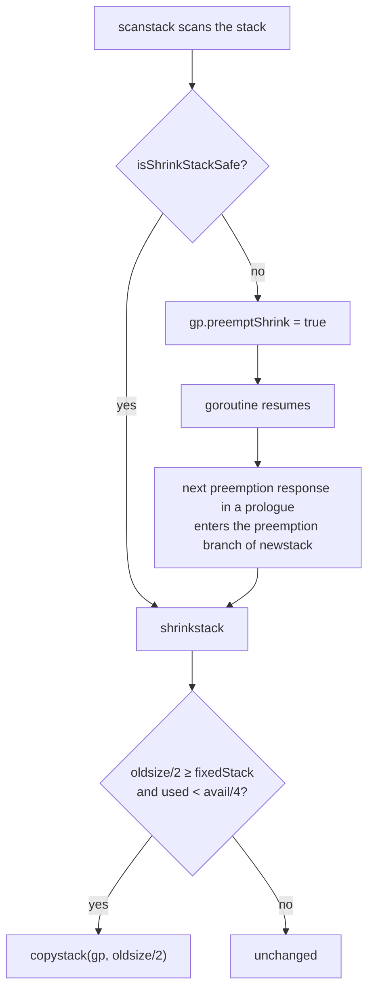

# 14.5 Stack Shrinking and Evolution

The stack growth of [14.3](./grow.md) goes in one direction only: when space runs out, the goroutine
moves to a stack twice as large. The call depth of a goroutine, however, is not monotonic. After a
deep recursion returns, the stack in actual use may be small, yet the enlarged stack still belongs
to the goroutine. If stacks only grew and never gave space back, every goroutine's stack would stay
at its historical maximum. When Go 1.3 switched goroutine stacks to contiguous stacks, the release
notes stressed that the cost of growth is well amortized [[Go Authors, 2014](#ref-go-authors-2014)].
The same implementation also introduced the opposite operation, **stack shrinking**: when garbage
collection scans a goroutine's stack and finds that it uses only a small part, it copies the stack
to one half the size [[Randall, 2014](#ref-randall-2014)]. This section covers when and under what
criterion shrinking happens, the space guarantee it provides, and finally how other systems handle
the size of execution stacks.

## 14.5.1 When Shrinking Happens

Moving a goroutine's stack requires two conditions: the runtime owns the stack exclusively, and it
has precise pointer information for every frame on it ([14.4](./copy.md)). When the garbage
collector scans a stack, the first condition already holds. Before scanning, the collector uses
`suspendG` to stop the target goroutine at a safe point
([9.7](../../part3concurrency/ch09sched/preemption.md)) and holds the scan bit in its status, then
scans the stack frame by frame ([13.4](../ch13gc/mark.md)). The decision to shrink therefore sits in
`scanstack` [[Go Authors, 2026b](#ref-go-authors-2026b)]:

```go
func scanstack(gp *g, gcw *gcWork) int64 {
	// ……
	scannedSize := gp.stack.hi - sp

	// Keep statistics for initial stack size calculation.
	// Note that this accumulates the scanned size, not the allocated size.
	p := getg().m.p.ptr()
	p.scannedStackSize += uint64(scannedSize)
	p.scannedStacks++

	if isShrinkStackSafe(gp) {
		// Shrink the stack if not much of it is being used.
		shrinkstack(gp)
	} else {
		// Otherwise, shrink the stack at the next sync safe point.
		gp.preemptShrink = true
	}
	// ……
}
```

The first lines accumulate the scanned stack size, from which the starting stack size of new
goroutines is computed ([14.2](./alloc.md)). The second condition does not always hold, and
`isShrinkStackSafe` lists the cases in which the stack cannot be moved
[[Go Authors, 2026a](#ref-go-authors-2026a)]:

```go
// isShrinkStackSafe returns whether it's safe to attempt to shrink
// gp's stack. Shrinking the stack is only safe when we have precise
// pointer maps for all frames on the stack. The caller must hold the
// _Gscan bit for gp or must be running gp itself.
func isShrinkStackSafe(gp *g) bool {
	// We can't copy the stack if we're in a syscall.
	// The syscall might have pointers into the stack and
	// often we don't have precise pointer maps for the innermost
	// frames.
	if gp.syscallsp != 0 {
		return false
	}
	// We also can't copy the stack if we're at an asynchronous
	// safe-point because we don't have precise pointer maps for
	// all frames.
	if gp.asyncSafePoint {
		return false
	}
	// We also can't *shrink* the stack in the window between the
	// goroutine calling gopark to park on a channel and
	// gp.activeStackChans being set.
	if gp.parkingOnChan.Load() {
		return false
	}
	// We also can't copy the stack while a gp is in _Gwaiting solely
	// to make itself available to suspendG.
	//
	// In these cases, the G is actually executing on the system
	// stack, and the execution tracer, mutex profiler, etc. may want
	// to take a stack trace of the G's stack.
	// ……
	if readgstatus(gp)&^_Gscan == _Gwaiting && gp.waitreason.isWaitingForSuspendG() {
		return false
	}
	return true
}
```

Each of the four cases has its own reason. The arguments of a system call may contain pointers into
the stack, and the innermost frame often has no precise pointer information. A goroutine stopped at
an asynchronous safe point was interrupted by a signal, and its innermost frame has no precise
pointer information ([9.7](../../part3concurrency/ch09sched/preemption.md)); the collector may scan
it conservatively but cannot move it. The third case is the window in which a goroutine has decided
to block on a channel but `activeStackChans` is not yet set: if the collector saw `activeStackChans`
as false, it would skip the channel synchronization of [14.4](./copy.md) and race with concurrent
sends and receives. In the fourth case, the goroutine is nominally in `_Gwaiting` but is actually
running on the system stack, and the execution tracer or the mutex profiler may need to take its
call stack.

When shrinking is unsafe, it is not abandoned but recorded in `gp.preemptShrink`. This flag is
checked only in the preemption branch of `newstack` [[Go Authors, 2026a](#ref-go-authors-2026a)]:

```go
	if preempt {
		// ……
		if gp.preemptShrink {
			// We're at a synchronous safe point now, so
			// do the pending stack shrink.
			gp.preemptShrink = false
			shrinkstack(gp)
		}
		// ……
	}
```

A deferred shrink is thus made up only after the goroutine resumes and next responds to a preemption
request in a function prologue. The request comes from `sysmon` preempting a long-running goroutine,
or from the next collection suspending it; if the next scan finds the goroutine at a safe moment,
the shrink also happens directly.



These rules took shape step by step. The first implementation, in Go 1.3, called `shrinkstack` in
`addstackroots`, before scanning each goroutine's stack; this happened in the stop-the-world mark
phase, and goroutines in system calls were simply skipped [[Randall, 2014](#ref-randall-2014)].
After Go 1.5 introduced the concurrent collector, shrinking remained in the stop-the-world mark
termination phase, because shrinking concurrently was not safe at the time. Austin Clements measured
the cost of shrinking at about 5 ms per MB copied plus 2 µs per shrink, which noticeably lengthens
the pause of programs with many stacks. Go 1.7 moved shrinking into the concurrent mark phase, and
in issue #12967 the 95th percentile of mark termination time dropped from 23.8 ms to 1.80 ms
[[Clements, 2016](#ref-clements-2016)]. When Go 1.14 introduced asynchronous preemption, Clements
first restricted shrinking to synchronous safe points, deferring it to the next synchronous safe
point when the conditions are not met; goroutines in system calls were also changed from being
skipped to being deferred [[Clements, 2019](#ref-clements-2019)], and this is where `preemptShrink`
comes from. In Go 1.16, Michael Knyszek fixed the race window between `gopark` changing the status
and `activeStackChans` being set, introducing `parkingOnChan` (issue #40641)
[[Knyszek, 2020](#ref-knyszek-2020)]. In Go 1.26 he extended the fourth case to every situation in
which a goroutine enters `_Gwaiting` to cooperate with `suspendG`: previously shrinking was avoided
only when execution tracing was on, but the mutex profiler had begun taking call stacks in similar
situations, so the commit message decided to stop trying to accommodate each case and instead
guarantee that the stack does not move in these situations [[Knyszek, 2025](#ref-knyszek-2025)].

## 14.5.2 The Shrinking Criterion

`shrinkstack` decides whether to shrink and by how much
[[Go Authors, 2026a](#ref-go-authors-2026a)]:

```go
// Maybe shrink the stack being used by gp.
//
// gp must be stopped and we must own its stack. It may be in
// _Grunning, but only if this is our own user G.
func shrinkstack(gp *g) {
	// ...check that we own the stack, and isShrinkStackSafe
	if debug.gcshrinkstackoff > 0 {
		return
	}

	oldsize := gp.stack.hi - gp.stack.lo
	newsize := oldsize / 2
	// Don't shrink the allocation below the minimum-sized stack
	// allocation.
	if newsize < fixedStack {
		return
	}
	// Compute how much of the stack is currently in use and only
	// shrink the stack if gp is using less than a quarter of its
	// current stack. The currently used stack includes everything
	// down to the SP plus the stack guard space that ensures
	// there's room for nosplit functions.
	avail := gp.stack.hi - gp.stack.lo
	if used := gp.stack.hi - gp.sched.sp + stackNosplit; used >= avail/4 {
		return
	}
	// ……
	copystack(gp, newsize)
}
```

The new size is always half the old size and never below the minimum stack `fixedStack`
([14.1](./design.md)). Shrinking happens only when the used part is less than a quarter of the
current stack; the used part is measured from the high end of the stack, `hi`, to the stack pointer,
plus `stackNosplit`, which leaves room for nosplit functions that perform no stack check. The two
numbers, half and a quarter, were already fixed in the first implementation in Go 1.3
[[Randall, 2014](#ref-randall-2014)].

Together the two numbers determine the state after shrinking. After a shrink, the used part is less
than half of the new stack; after a growth ([14.3](./grow.md)), the used part is about half of the
new stack. So when usage fluctuates within a factor of two, the stack does not oscillate between
growing and shrinking. When the fluctuation exceeds a factor of two, oscillation can still occur,
but shrinking happens only during scans and at most once per collection cycle, so the frequency of
oscillation is bounded by the frequency of collections. Only the used part is copied when shrinking
([14.4](./copy.md)), less than a quarter of the old stack, so it costs less than the copy during
growth.

Shrinking can be turned off. The documentation of the `runtime` package describes the `GODEBUG`
option `gcshrinkstackoff` as follows [[Go Authors, 2026c](#ref-go-authors-2026c)]:

> gcshrinkstackoff: setting gcshrinkstackoff=1 disables moving goroutines
> onto smaller stacks. In this mode, a goroutine's stack can only grow.

The following program has 100 goroutines each recurse about 1 MiB deep and return, then block on a
channel. It then triggers ten collections in a row and observes the memory used by all stacks:

```go {run=true}
package main

import (
	"fmt"
	"runtime"
	"sync"
)

// grow recurses n levels with a frame of about 1 KiB per level.
func grow(n int) int {
	var buf [1024]byte
	if n == 0 {
		return 0
	}
	buf[n%1024] = byte(n)
	return grow(n-1) + int(buf[0])
}

// stackMiB returns the memory used by all goroutine stacks, in MiB.
func stackMiB() float64 {
	var m runtime.MemStats
	runtime.ReadMemStats(&m)
	return float64(m.StackInuse) / (1 << 20)
}

func main() {
	release := make(chan struct{})
	var ready sync.WaitGroup
	for range 100 {
		ready.Add(1)
		go func() {
			grow(1000) // recurse about 1 MiB and return; the stack keeps its grown size
			ready.Done()
			<-release
		}()
	}
	ready.Wait()
	fmt.Printf("after recursion returns: %6.1f MiB\n", stackMiB())
	for i := 1; i <= 10; i++ {
		runtime.GC()
		fmt.Printf("after GC %2d: %6.1f MiB\n", i, stackMiB())
	}
	close(release)
}
```

The output is:

```
after recursion returns:  200.7 MiB
after GC  1:  100.7 MiB
after GC  2:   50.7 MiB
after GC  3:   25.7 MiB
after GC  4:   13.2 MiB
after GC  5:    7.0 MiB
after GC  6:    3.8 MiB
after GC  7:    2.3 MiB
after GC  8:    1.5 MiB
after GC  9:    1.1 MiB
after GC 10:    1.1 MiB
```

The exact numbers vary slightly across platforms and runs, but the halving pattern does not. The
recursion uses a little over 1 MiB, so each goroutine's stack grows to 2 MiB, and the 100 together
take about 200 MiB. After the recursion returns, the stacks stay as they are until the next
collection. After that, each collection halves them once, until the used part reaches a quarter of
the current stack. The final figures also include the stacks of other goroutines such as `main` and
stack memory held in allocator caches, so they do not belong to these 100 goroutines alone. The
goroutines are blocked on a channel and `activeStackChans` is true, so shrinking takes the
channel-synchronizing path of [14.4](./copy.md); but `<-release` does not need the received value,
`sudog.elem` is empty, and the part to copy under the lock is empty too.

## 14.5.3 The Space Bound

In the 2021 design document on the starting stack size, Keith Randall first analyzes a simplified
model in which the minimum stack is 1 byte and shrinking happens immediately when the condition is
met, instead of waiting for a collection [[Randall, 2021a](#ref-randall-2021a)]:

> This ideal design gives us some hard guarantees about how much space we
> use vs. how much is needed. If S is the current stack usage, then the
> allocated space is at most 4S.

This follows because halving happens as soon as the used part falls below a quarter, so the
allocated space never exceeds four times the usage. The document then describes how reality departs
from the model:

> Waiting to shrink until the next GC ruins the space bound in theory, but in practice we haven't
> seen any bad behavior as a result. (The bad behavior is to, one goroutine at a time, use lots of
> stack but only briefly. This will cause all allocated stacks to be large, although only one at
> any given time needed that space.)

The example above shows the cost of deferral: after the recursion returns and before the first
collection, only a small fraction of the 200 MiB of stacks is in use. The document also recommends
not shrinking stacks below the starting size, but when Go 1.19 implemented the adaptive starting
size it left the shrinking path unchanged [[Randall, 2021b](#ref-randall-2021b)], and `shrinkstack`
still uses only `fixedStack` as its lower bound.

## 14.5.4 The Choices of Other Systems

Comparing Go's approach with other systems shows what conditions growable stacks depend on.

The stack size of an operating system thread is fixed at creation. On Linux, threads created by NPTL
default to the size of the `RLIMIT_STACK` soft limit at process start, or 2 MiB on most
architectures if that limit is unlimited
[[Linux man-pages Project, 2026](#ref-linux-man-pages-project-2026)]; the kernel's default for
`RLIMIT_STACK`, `_STK_LIM`, is 8 MiB [[Linux Kernel Authors, 2026](#ref-linux-kernel-authors-2026)].
On macOS, secondary threads get a 512 KiB stack by default and the main thread 8 MiB; this space is
reserved in the process address space when the thread is created, and physical pages are allocated
on demand [[Apple, 2014](#ref-apple-2014)]. A fixed-size stack must be large enough for every
execution short of the pathological ones, so it is usually large, while most tasks come nowhere near
using it; in a thread-per-task model this space is wasted [[Boats, 2020](#ref-boats-2020)].

Before 1.0, Rust implemented segmented stacks for green threads. In November 2013, Brian Anderson
announced on the rust-dev mailing list that the new runtime would not implement segmented stacks
[[Anderson, 2013](#ref-anderson-2013)], and summarized three problems. The first is stack thrashing:
when a stack boundary falls inside a tight loop, every call allocates a new segment and every return
frees it. The message notes that Go was abandoning segmented stacks over the same problem (the hot
split) and cites Go's contiguous-stack design document [[Randall, 2013](#ref-randall-2013)]. The
second is the foreign function interface: foreign code usually expects a large stack, so calls often
need to switch stacks. The third is that LLVM converts some libc calls into intrinsics and some
intrinsics into runtime calls, and every approach compatible with segmented stacks required a large
minimum stack. The new runtime instead relied on the operating system and the MMU to map pages
lazily. RFC 230, accepted in September 2014, then moved the runtime system out of the standard
library altogether: the green-thread library libgreen became a separate package, and the standard
library's I/O was built directly on native threads and system calls
[[Turon, 2014](#ref-turon-2014)].

Rust's later async model took another path. In a 2020 post, Boats sorted the answers to running out
of stack space into three: preallocate a fixed size, segment, or copy. The post points out that Go
can copy stacks because the runtime needs to rewrite the pointers into the stack, and it already has
a tracing garbage collector; this does not work in Rust, which is why Rust first changed green
threads to fixed-size stacks and finally removed them [[Boats, 2020](#ref-boats-2020)]. A Rust
future holds all the state that must survive between suspension points in the future object itself,
with a size fixed at compile time; the post calls this a perfectly sized stack. One cost is that a
recursive async function cannot have a determined size, so somewhere the recursive state must be
allocated on the heap; the post notes that this in effect builds a segmented stack into the future,
except that the program marks the segment boundaries explicitly. The other cost is that async
functions and ordinary functions now live in two separate worlds, the function coloring problem
([9.3](../../part3concurrency/ch09sched/mpg.md)).

Virtual threads in Java 21 are close to Go. JEP 444 states that the stack of a virtual thread is
stored in the Java garbage-collected heap as stack chunk objects, growing and shrinking as the
application runs, both to save memory and to accommodate calls as deep as the stacks of platform
threads allow [[Pressler and Bateman, 2023](#ref-pressler-and-bateman-2023)].

The dividing line among these choices is whether the runtime can move the stack. Go can find and
rewrite the pointers into the stack ([14.4](./copy.md)), and Java's virtual threads store the stack
in the heap managed by the garbage collector, so these stacks can start very small and grow and
shrink as needed. Where this is not possible, a system either reserves a fixed space large enough,
as operating system threads do, or fixes the required size at compile time, as Rust's futures do.

## 14.5.5 Summary

Shrinking completes the other half of contiguous stacks: growth is triggered on demand in the
function prologue, while shrinking is done in passing when the collector scans the stack, and both
move the stack to a new location through `copystack`. The criterion of half and a quarter has been
in use since Go 1.3. What has changed is when shrinking happens: it moved from the stop-the-world
collection to the concurrent mark phase, was then restricted to synchronous safe points with the
introduction of asynchronous preemption, and has gradually ruled out windows that conflict with
channels, execution tracing and profiling.

## Further Reading

- <a id="ref-anderson-2013"></a>[Anderson, 2013] Brian Anderson. *Abandoning segmented stacks in
  Rust.* rust-dev mailing list, 2013-11-04.
  https://mail.mozilla.org/pipermail/rust-dev/2013-November/006314.html Archived:
  https://web.archive.org/web/2015/https://mail.mozilla.org/pipermail/rust-dev/2013-November/006314.html
- <a id="ref-apple-2014"></a>[Apple, 2014] Apple Inc. *Threading Programming Guide: Thread
  Management.*
  2014. https://developer.apple.com/library/archive/documentation/Cocoa/Conceptual/Multithreading/CreatingThreads/CreatingThreads.html
- <a id="ref-boats-2020"></a>[Boats, 2020] Boats. *Futures and Segmented Stacks.* 2020-06-08.
  https://without.boats/blog/futures-and-segmented-stacks/
- <a id="ref-clements-2016"></a>[Clements, 2016] Austin Clements. runtime: shrink stacks during
  concurrent mark. Go commit f11e4eb5cc, 2016. https://go.dev/cl/20044 Shipped with Go 1.7.
- <a id="ref-clements-2019"></a>[Clements, 2019] Austin Clements. runtime: only shrink stacks at
  synchronous safe points. Go commit 6058603471, 2019. https://go.dev/cl/201438
  Shipped with Go 1.14.
- <a id="ref-go-authors-2014"></a>[Go Authors, 2014] The Go Authors. *Go 1.3 Release Notes: Stack
  management.* 2014. https://go.dev/doc/go1.3#stacks
- <a id="ref-go-authors-2026a"></a>[Go Authors, 2026a] The Go Authors. src/runtime/stack.go:
  shrinkstack, isShrinkStackSafe, copystack. Go 1.26 source.
  https://github.com/golang/go/blob/release-branch.go1.26/src/runtime/stack.go
- <a id="ref-go-authors-2026b"></a>[Go Authors, 2026b] The Go Authors. src/runtime/mgcmark.go:
  scanstack. Go 1.26 source.
  https://github.com/golang/go/blob/release-branch.go1.26/src/runtime/mgcmark.go
- <a id="ref-go-authors-2026c"></a>[Go Authors, 2026c] The Go Authors. src/runtime/extern.go:
  GODEBUG options. Go 1.26 source.
  https://github.com/golang/go/blob/release-branch.go1.26/src/runtime/extern.go
- <a id="ref-knyszek-2020"></a>[Knyszek, 2020] Michael Knyszek. runtime: disable stack shrinking in
  activeStackChans race window. Go commit eb3c6a93c3, 2020. https://go.dev/cl/247050
  Shipped with Go 1.16.
- <a id="ref-knyszek-2025"></a>[Knyszek, 2025] Michael Knyszek. runtime: disable stack shrinking for
  all waiting-for-suspendG cases. Go commit bd07fafb0a, 2025. https://go.dev/cl/692716 Shipped with
  Go 1.26.
- <a id="ref-linux-kernel-authors-2026"></a>[Linux Kernel Authors, 2026] The Linux Kernel Authors.
  include/uapi/linux/resource.h.
  https://github.com/torvalds/linux/blob/master/include/uapi/linux/resource.h
- <a id="ref-linux-man-pages-project-2026"></a>[Linux man-pages Project, 2026] The Linux man-pages
  project. *pthread_create(3).* https://man7.org/linux/man-pages/man3/pthread_create.3.html
- <a id="ref-pressler-and-bateman-2023"></a>[Pressler and Bateman, 2023] Ron Pressler, Alan Bateman.
  *JEP 444: Virtual Threads.* OpenJDK, 2023. https://openjdk.org/jeps/444 Shipped with Java 21.
- <a id="ref-randall-2013"></a>[Randall, 2013] Keith Randall. *Contiguous stacks.* Go design
  document,
  2013. https://docs.google.com/document/d/1wAaf1rYoM4S4gtnPh0zOlGzWtrZFQ5suE8qr2sD8uWQ/edit
- <a id="ref-randall-2014"></a>[Randall, 2014] Keith Randall. runtime: grow stack by copying. Go
  commit 1665b006a5, 2014. https://golang.org/cl/54650044 Shipped with Go 1.3.
- <a id="ref-randall-2021a"></a>[Randall, 2021a] Keith Randall. *Determining a good starting stack
  size.* Go design document, 2021.
  https://docs.google.com/document/d/1YDlGIdVTPnmUiTAavlZxBI1d9pwGQgZT7IKFKlIXohQ/edit
- <a id="ref-randall-2021b"></a>[Randall, 2021b] Keith Randall. runtime: measure stack usage; start
  stacks larger if needed. Go commit 016d755213, 2021. https://go.dev/cl/345889 Shipped with Go
  1.19.
- <a id="ref-turon-2014"></a>[Turon, 2014] Aaron Turon. *RFC 230: Remove runtime system, and move
  libgreen into an external library.* Rust RFCs, 2014.
  https://rust-lang.github.io/rfcs/0230-remove-runtime.html
