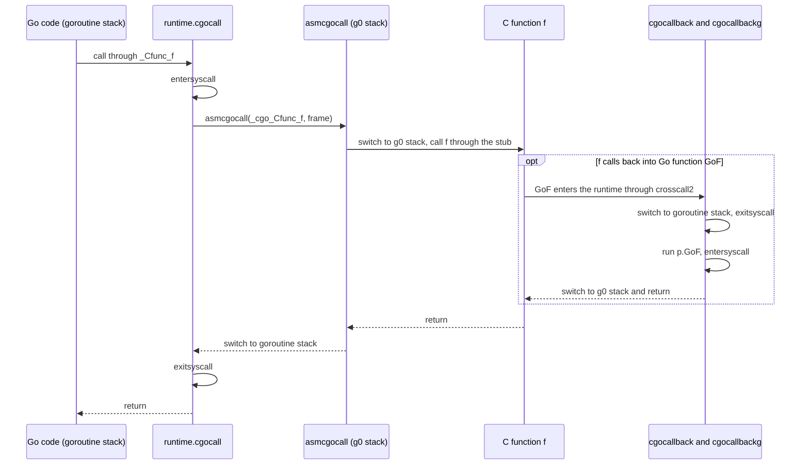

# 15.6 cgo

cgo lets a Go package call C code [[Gerrand, 2011](#ref-gerrand-2011)]. In a source file that
imports the pseudo-package `"C"`, the comment immediately before `import "C"` is called the
preamble. The C functions, types and variables it declares are reachable through the `C.` prefix.
The mechanism is almost as old as Go itself. In August 2009 Russ Cox added the first foreign
function call support to the runtime [[Cox, 2009a](#ref-cox-2009a)], and in September of that year
the `cgo` tool began to take shape; the example in its commit message wraps the GMP big-integer
library [[Cox, 2009b](#ref-cox-2009b)].

A call to a C function takes one line of source, but behind it lies a translation between two
runtime conventions. A goroutine runs on a stack that grows and moves, is multiplexed by the
scheduler onto a few threads, and uses memory tracked by the garbage collector. C code assumes it
owns a thread and a fixed stack, manages its own memory, and knows nothing about the scheduler or
the collector. Rob Pike's proverb "Cgo is not Go" [[Pike, 2015](#ref-pike-2015)] names this divide,
and Dave Cheney's article of the same title lists its costs in building, deployment and tooling
[[Cheney, 2016](#ref-cheney-2016)].

This section examines how Go 1.26 implements the translation: what code `cmd/cgo` generates for a
call, how the runtime enters C from Go and returns to Go from C, why the pointer-passing rules are
what they are, which restrictions the `#cgo noescape` and `#cgo nocallback` directives relax, and
what all of this costs. For the effect of the cgo boundary on GPU programming, see
[18.1 Crossing the FFI Boundary](../../part6hetero/ch18gpu/boundary.md).

## 15.6.1 The Generated Code

Take the following package, whose preamble defines a C function `add`:

```go
package demo

// static int add(int a, int b) { return a + b; }
import "C"

func Add(a, b int) int {
	return int(C.add(C.int(a), C.int(b)))
}
```

When `go build` meets a file that imports `"C"`, it first runs `cmd/cgo` to rewrite the file into
ordinary Go and C files, hands them to the Go compiler and the C compiler respectively, and finally
links the object files from both sides. The rewriting step can be run on its own with `go tool cgo`;
the output below is from Go 1.26.10:

```shell
$ go tool cgo -objdir out add.go
```

In the rewritten source `out/add.cgo1.go`, `C.add` and `C.int` have become `_Cfunc_add` and
`_Ctype_int`, both defined in `out/_cgo_gotypes.go`. `_Cfunc_add` is the Go-side wrapper for this
call:

```go
//go:cgo_unsafe_args
func _Cfunc_add(p0 _Ctype_int, p1 _Ctype_int) (r1 _Ctype_int) {
	_cgo_runtime_cgocall(_cgo_e9c5c984e178_Cfunc_add, uintptr(unsafe.Pointer(&p0)))
	if _Cgo_always_false {
		_Cgo_use(p0)
		_Cgo_use(p1)
	}
	return
}
```

`_cgo_runtime_cgocall` points to `runtime.cgocall` through `//go:linkname`. It takes two arguments:
the address of the C-side stub and the address of the argument frame. The hexadecimal string in the
stub's name is a hash that cgo computes from the package's import path and the contents of the
source file, so that symbols generated for different packages do not collide. `//go:cgo_unsafe_args`
makes the function use the stack-based ABI0
([2.3 Calling Convention and the Register ABI](../../part1overview/ch02asm/callconv.md)), so the
parameters `p0` and `p1` and the result `r1` are laid out consecutively on the stack, and `&p0` is
the start of the whole argument frame. For the same reason the compiler does not inline this
function. The frame address is passed as a `uintptr` rather than a pointer; a comment next to the
generating code in `cmd/cgo` explains that this hides the address-taking from escape analysis
[[Go Authors, 2026c](#ref-go-authors-2026c)], so the argument frame can stay on the goroutine's
stack.

The C-side stub is in `out/add.cgo2.c`:

```c
CGO_NO_SANITIZE_THREAD
void
_cgo_e9c5c984e178_Cfunc_add(void *v)
{
	struct {
		int p0;
		int p1;
		int r;
		char __pad12[4];
	} __attribute__((__packed__)) *_cgo_a = v;
	char *_cgo_stktop = _cgo_topofstack();
	__typeof__(_cgo_a->r) _cgo_r;
	_cgo_tsan_acquire();
	_cgo_r = add(_cgo_a->p0, _cgo_a->p1);
	_cgo_tsan_release();
	_cgo_a = (void*)((char*)_cgo_a + (_cgo_topofstack() - _cgo_stktop));
	_cgo_a->r = _cgo_r;
	_cgo_msan_write(&_cgo_a->r, sizeof(_cgo_a->r));
}
```

The stub interprets `v` as a struct with the same layout as the Go-side frame, reads the arguments
from it, calls `add`, and writes the result back into the frame. The adjustment of `_cgo_a` before
the write-back deserves attention. The argument frame lives on the goroutine's stack, and while the
C function runs it may call back into Go; the Go code in the callback may grow the stack, which
copies the whole stack to a new location
([14.4 Stack Copying and Pointer Adjustment](../../part4memory/ch14stack/copy.md)). Stack copying
adjusts pointers in Go frames but has no way to adjust addresses held by C code. `_cgo_topofstack`
returns the upper bound of the current goroutine's stack. Stack copying preserves each frame's
distance from that bound, so the difference between the values read before and after the call is
exactly how far the argument frame moved. The code in `cmd/cgo` that generates this line carries a
comment to that effect [[Go Authors, 2026c](#ref-go-authors-2026c)]:

```go
	if tr != nil {
		// The cgo call may have caused a stack copy (via a callback).
		// Adjust the return value pointer appropriately.
		fmt.Fprintf(fgcc, "\t_cgo_a = (void*)((char*)_cgo_a + (_cgo_topofstack() - _cgo_stktop));\n")
		// Save the return value.
		fmt.Fprintf(fgcc, "\t_cgo_a->r = _cgo_r;\n")
```

Back on the Go side, the `if _Cgo_always_false` branch at the end of the wrapper never executes. A
comment in `runtime/cgo.go` explains its purpose [[Go Authors, 2026b](#ref-go-authors-2026b)]:

```go
// cgoUse is called by cgo-generated code (using go:linkname to get at
// an unexported name). The calls serve two purposes:
// 1) they are opaque to escape analysis, so the argument is considered to
// escape to the heap.
// 2) they keep the argument alive until the call site; the call is emitted after
// the end of the (presumed) use of the argument by C.
// cgoUse should not actually be called (see cgoAlwaysFalse).
func cgoUse(any) { throw("cgoUse should not be called") }

// ...

// cgoAlwaysFalse is a boolean value that is always false.
// The cgo-generated code says if cgoAlwaysFalse { cgoUse(p) },
// or if cgoAlwaysFalse { cgoKeepAlive(p) }.
// The compiler cannot see that cgoAlwaysFalse is always false,
// so it emits the test and keeps the call, giving the desired
// escape/alive analysis result. The test is cheaper than the call.
var cgoAlwaysFalse bool
```

The second purpose is easy to understand. C code reads the arguments through the frame address in
`uintptr` form, a use the compiler cannot see; if nothing used the arguments after the call, the
objects they point to could be considered dead while the C function is still using them. The first
purpose means that every Go pointer passed to C has its referent judged by escape analysis to escape
to the heap ([15.5 Escape Analysis](./escape.md)). In this example all arguments are integers and it
makes no difference, but when an argument contains a pointer it becomes a hidden cost of a cgo call.
The reason for the rule is given in 15.6.4.

## 15.6.2 From Go to C

The comment at the top of `runtime/cgocall.go` describes the whole path of a call
[[Go Authors, 2026a](#ref-go-authors-2026a)]:

```go
// To call into the C function f from Go, the cgo-generated code calls
// runtime.cgocall(_cgo_Cfunc_f, frame), where _cgo_Cfunc_f is a
// gcc-compiled function written by cgo.
//
// runtime.cgocall (below) calls entersyscall so as not to block
// other goroutines or the garbage collector, and then calls
// runtime.asmcgocall(_cgo_Cfunc_f, frame).
//
// runtime.asmcgocall (in asm_$GOARCH.s) switches to the m->g0 stack
// (assumed to be an operating system-allocated stack, so safe to run
// gcc-compiled code on) and calls _cgo_Cfunc_f(frame).
//
// _cgo_Cfunc_f invokes the actual C function f with arguments
// taken from the frame structure, records the results in the frame,
// and returns to runtime.asmcgocall.
//
// After it regains control, runtime.asmcgocall switches back to the
// original g (m->curg)'s stack and returns to runtime.cgocall.
//
// After it regains control, runtime.cgocall calls exitsyscall, which blocks
// until this m can run Go code without violating the $GOMAXPROCS limit,
// and then unlocks g from m.
```

Two kinds of transitions happen along this path: `entersyscall` and `exitsyscall` change the
goroutine's state as the scheduler sees it, and `asmcgocall` changes the stack on which execution
takes place. The body of `cgocall` is as follows:

```go
func cgocall(fn, arg unsafe.Pointer) int32 {
	// ...
	mp := getg().m
	mp.ncgocall++

	// ...

	// Announce we are entering a system call
	// so that the scheduler knows to create another
	// M to run goroutines while we are in the
	// foreign code.
	//
	// The call to asmcgocall is guaranteed not to
	// grow the stack and does not allocate memory,
	// so it is safe to call while "in a system call", outside
	// the $GOMAXPROCS accounting.
	//
	// fn may call back into Go code, in which case we'll exit the
	// "system call", run the Go code (which may grow the stack),
	// and then re-enter the "system call" reusing the PC and SP
	// saved by entersyscall here.
	entersyscall()

	// ...

	mp.incgo = true
	// ...
	mp.ncgo++

	errno := asmcgocall(fn, arg)

	// Update accounting before exitsyscall because exitsyscall may
	// reschedule us on to a different M.
	mp.incgo = false
	mp.ncgo--

	// ...

	exitsyscall()
```

`incgo` and `ncgo` record that this M is executing C code, for use by signal handling, execution
tracing and similar facilities. The other three steps do the real work.

**Entering a "system call".** To the scheduler a cgo call is no different from a system call:
control has left Go code and there is no telling when it will return. `entersyscall` sets the
goroutine to `_Gsyscall` and saves the current program counter and stack pointer, but it does not
release the P. If the C function returns quickly, `exitsyscall` finds the P still there and
continues. If the C function does not return for a long time, the monitor thread sysmon takes the P
away and hands it to another M to run other goroutines. These fast and slow paths, and how Go 1.26
simplifies them, are covered in [9.5.4](../../part3concurrency/ch09sched/thread.md). A blocking C
call therefore does not prevent other goroutines from running, but it occupies its thread for as
long as it blocks.

**Staying out of the garbage collector's way.** The state saved by `entersyscall` also serves the
garbage collector. Before scanning a goroutine's stack, the collector must stop the goroutine
through `suspendG`. For a goroutine in `_Gsyscall`, `suspendG` does the same as for a runnable or
waiting goroutine: it only needs to claim the scan bit and does not wait for the goroutine to return
[[Go Authors, 2026d](#ref-go-authors-2026d)]:

```go
		case _Grunnable, _Gsyscall, _Gwaiting, _Gleaked:
			// Claim goroutine by setting scan bit.
			// This may race with execution or readying of gp.
			// The scan bit keeps it from transition state.
			if !castogscanstatus(gp, s, s|_Gscan) {
				break
			}
```

At this point the Go frames on the goroutine's stack stop where `entersyscall` saved them, and the C
frames are on a different stack, so the collector only needs to scan the former. This also explains
the comment's requirement on `asmcgocall`. It runs in the "system call" state, in which the
goroutine no longer counts against `$GOMAXPROCS` and cannot use the P's resources to allocate
memory; the saved stack pointer is what the collector relies on, so the stack must not grow either,
and `entersyscall` makes any stack growth in between a fatal error (see 9.5.4).

**Switching to the `g0` stack.** `asmcgocall` is written in assembly. It saves the goroutine's stack
pointer, switches to the current M's `g0` stack, aligns the stack according to the C calling
convention, calls the stub, and after the stub returns switches back to the stack of `m.curg`. The
switch is necessary because a goroutine's stack is small and grows on demand only through the checks
in function prologues ([14.3 Stack Growth](../../part4memory/ch14stack/grow.md)), whereas code
generated by a C compiler performs no such check. The `g0` stack is the thread's own stack: with cgo
enabled, the runtime creates threads through the C library's `pthread_create`, which also allocates
their stacks, large enough to run C code.

## 15.6.3 From C Back to Go

C code can call Go as well. Placing an `//export GoF` comment before a Go function makes cgo
generate a C function of the same name, and calling it from C enters Go. The comment at the top of
`cgocall.go` spends most of its length describing this reverse path. The diagram below draws it
together with the forward path:



The reverse path performs every step of the forward path in reverse. The C function calls `GoF`,
generated by cgo, which packs the arguments into a frame and calls `crosscall2`, written in
assembly, which adapts the C calling convention to the Go one. `runtime.cgocallback` switches from
the `g0` stack back to the original goroutine's stack. `runtime.cgocallbackg` calls `exitsyscall`
and reacquires a P once `$GOMAXPROCS` permits, after which it can allocate memory and run Go
functions. When the Go function returns, `cgocallbackg` calls `entersyscall` to re-enter the "system
call" and returns to C along the same path.

A call with a callback therefore pays for twice the state transitions plus two extra stack switches.
The Go code in the callback runs on the original goroutine's stack and can grow it like any other Go
code, which is why the stub in 15.6.1 adjusts the address of the argument frame.

**Time running backwards.** Callbacks also pose a subtle problem for the garbage collector. The end
of `cgocall` carries this comment [[Go Authors, 2026a](#ref-go-authors-2026a)]:

```go
	// From the garbage collector's perspective, time can move
	// backwards in the sequence above. If there's a callback into
	// Go code, GC will see this function at the call to
	// asmcgocall. When the Go call later returns to C, the
	// syscall PC/SP is rolled back and the GC sees this function
	// back at the call to entersyscall. Normally, fn and arg
	// would be live at entersyscall and dead at asmcgocall, so if
	// time moved backwards, GC would see these arguments as dead
	// and then live. Prevent these undead arguments from crashing
	// GC by forcing them to stay live across this time warp.
	KeepAlive(fn)
	KeepAlive(arg)
	KeepAlive(mp)

	return errno
}
```

The collector relies on stack maps to decide which slots in a frame hold live pointers, and stack
maps are recorded per call site ([13.7.1](../../part4memory/ch13gc/safe.md)). During a callback the
collector sees `cgocall` stopped at the call to `asmcgocall`, after which `fn` and `arg` are no
longer used and are dead values. After the callback returns to C, the "system call" state rolls back
to the position saved by `entersyscall`, where both are live again. A slot that is first considered
dead and then live again may point to memory that has already been reclaimed. The `KeepAlive` calls
at the end of the function keep them live throughout.

**Threads created by C.** The above assumes the callback happens on a thread created by the Go
runtime, where `m.curg` is the goroutine that made the call. Threads that C code creates itself can
also call Go. Such a thread has no M, so the runtime first has to borrow a pre-prepared extra M
([9.5.5](../../part3concurrency/ch09sched/thread.md)). Since Go 1.21, on Unix platforms later calls
on the same thread reuse the earlier preparation, and the release notes put the per-call overhead at
roughly 100 to 200 ns, down from about 1 to 3 µs [[Go Authors, 2023b](#ref-go-authors-2023b)].

## 15.6.4 The Pointer-Passing Rules

Passing a Go pointer to C is the most common use of cgo, for example handing the backing array of a
`[]byte` to a C function to fill. In October 2015, Ian Lance Taylor wrote a proposal that laid down
explicit rules for this [[Taylor, 2015](#ref-taylor-2015)]. The proposal first reviewed the de facto
rules of the time. Go 1.4 allowed any Go pointer to be passed to C, and C code could use it freely;
Go 1.5 added some restrictions, but the proposal declined to document them as permanent rules
because they "are somewhat confusing, they limit future garbage collection choices, and in
particular they prohibit any future development of a moving garbage collector."

It instead required that the following invariant be maintained:

> The Go garbage collector must be aware of the location of all Go
> pointers, except for a known set of pointers that are temporarily
> visible to C code.
> The pointers visible to C code exist in an area that the garbage
> collector can not see, and the garbage collector may not modify or
> release them.

The design of the rules is a compromise. The simplest rule would forbid passing Go pointers to C
altogether, but that would break existing code: `gonum/blas` hands slices of floating-point numbers
directly to C for efficiency, and the standard library passes the address of a `C.struct_addrinfo`
to `C.getaddrinfo`. The proposal therefore allows passing Go pointers but limits how many, and
requires that the collector know exactly which pointers have been passed out; if a future collector
moves objects, cgo would temporarily pin those objects for the duration of the call. Two core rules
follow:

1. Go code may pass a Go pointer to C provided that the Go memory to which it points does not
   contain any Go pointers. When a pointer to a struct field is passed, the memory involved is just
   that field; when a pointer to an array or slice element is passed, it is the whole array or the
   whole underlying array.
2. C code may not keep a copy of a Go pointer after the call returns.

The first rule guarantees that only one block of Go memory is visible to C per call: that block
holds no other Go pointers, so C cannot follow pointers to reach more Go memory. The second confines
this visibility to the duration of the call. In its section on consequences, the proposal also draws
a corollary about the stack:

> Because C code can call back into Go code, and that Go code may need
> to copy the stack, we can never pass a Go stack pointer into C code.
> Any pointer passed into C code must be treated by the compiler as
> escaping, even though the above rules mean that we know it will not
> escape.
> This is an additional cost to the already high cost of calling C code.

This is where `_Cgo_use` in 15.6.1 comes from. An address held by C code is not in any Go stack
frame, so stack copying cannot adjust it ([14.4.6](../../part4memory/ch14stack/copy.md)); an object
allocated on the heap has an address that stack copying never invalidates.

The rules took effect with Go 1.6 and are checked by the runtime during execution; on a violation it
prints a diagnostic and crashes the program [[Go Authors, 2016](#ref-go-authors-2016)]. The check
can be turned off with `GODEBUG=cgocheck=0`, but the release notes specifically warn that the
overwhelming majority of the code the check caught was incompatible with garbage collection in some
way, so disabling it usually only buys failures that are harder to understand.

The proposal also states that once adopted the rules could never be tightened, only relaxed.
`runtime.Pinner`, added in Go 1.21, is one such relaxation [[Anderson, 2023](#ref-anderson-2023)]:
Go memory pinned with a `Pinner` can be used more freely by C, and memory passed to C may contain Go
pointers to pinned memory [[Go Authors, 2023b](#ref-go-authors-2023b)]. The `cmd/cgo` documentation
accordingly restates the rules around pinning [[Go Authors, n.d.a](#ref-go-authors-nda)]. A Go
pointer passed to C as an argument has the memory it points to implicitly pinned for the duration of
the call. Go memory reachable from those arguments must stay pinned for as long as C can access it.
After the call returns, C may keep a pointer to memory only if that memory was pinned with a
`Pinner` and has not yet been unpinned. Strings, slices, channels and the like cannot be pinned with
a `Pinner`, so C cannot keep them after the call returns.

For arguments of pointer type, the code cgo generates calls `cgoCheckPointer` before the call
[[Go Authors, 2026a](#ref-go-authors-2026a)]:

```go
// cgoCheckPointer checks if the argument contains a Go pointer that
// points to an unpinned Go pointer, and panics if it does.
func cgoCheckPointer(ptr any, arg any) {
	if !goexperiment.CgoCheck2 && debug.cgocheck == 0 {
		return
	}
```

The following program hands C a struct that contains a Go pointer, first without pinning and then
after pinning the memory that the inner pointer refers to:

```go {run=true native=true}
package main

// static void use(void *p) { (void)p; }
import "C"

import (
	"fmt"
	"runtime"
	"unsafe"
)

type node struct {
	val  int
	next *int
}

func call(n *node) (err any) {
	defer func() { err = recover() }()
	C.use(unsafe.Pointer(n))
	return nil
}

func main() {
	x := 42
	n := &node{val: 1, next: &x}

	// n points to memory that holds the Go pointer n.next to unpinned memory.
	fmt.Println("unpinned:", call(n))

	// With x pinned, n.next points to pinned memory and the call is legal.
	var pinner runtime.Pinner
	pinner.Pin(&x)
	fmt.Println("pinned:", call(n))
	pinner.Unpin()
}
```

The output is:

```
unpinned: runtime error: argument of cgo function has Go pointer to unpinned Go pointer
pinned: <nil>
```

The argument has type `unsafe.Pointer`, so the checker does not know the type of the memory it
refers to and scans the entire heap object that `n` points to, where it finds that `n.next` points
to the unpinned `x`. Once `x` is pinned, the same call is legal. Run with `GODEBUG=cgocheck=0`, even
the first call reports no error, though the violation is still there.

The default `cgocheck=1` checks arguments only at the call boundary, which is cheap. A more thorough
check requires setting `GOEXPERIMENT=cgocheck2` at build time: in the compiler pass that inserts
write barriers ([13.2 Write Barrier Techniques](../../part4memory/ch13gc/barrier.md)), it generates
an extra call to `cgoCheckPtrWrite` for every pointer write, and the program crashes immediately if
Go code stores a Go pointer to unpinned memory into non-Go memory
[[Go Authors, 2026g](#ref-go-authors-2026g)]. This mode was originally the runtime option
`GODEBUG=cgocheck=2`; Go 1.21 turned it into a build-time experiment so that the write barrier could
be optimized further [[Randall, 2023](#ref-randall-2023)]. Like the pointer checker in
[15.4 The Pointer Checker](./unsafe.md), both checks find violations at run time and cannot prove a
program free of them.

There are three supported ways to give C long-lived access to data. Memory allocated with `C.malloc`
is outside the collector's purview and C may keep it as long as it likes, at the price of calling
`C.free` yourself, and Go's memory safety no longer holds on that memory. `runtime.Pinner` is
lighter: it pins a block of Go memory until `Unpin`, during which C may keep pointers to it. If C
only needs to hand a Go value back to Go in a later callback, it can use `runtime/cgo.Handle`, added
in Go 1.17 [[Ou, 2021](#ref-ou-2021)] [[Go Authors, n.d.b](#ref-go-authors-ndb)]. `NewHandle` stores
any Go value in a global map and returns an integer handle; C stores only that integer, Go code uses
it in the callback to retrieve the original value, and calls `Delete` when done. C never holds a Go
pointer, so there is no rule to violate.

## 15.6.5 noescape and nocallback

The corollary in 15.6.4 makes every pointer passed to C cost a heap allocation. For many C functions
this is unnecessary: they read and write the memory they are given only during the call, neither
keeping the pointer nor calling back into Go. In October 2022, doujiang24 proposed annotations for
such functions so that their arguments do not escape [[doujiang24, 2022](#ref-doujiang24-2022)]. In
the discussion Russ Cox pointed out that declaring "does not escape" alone is not enough
[[Cox, 2023a](#ref-cox-2023a)]:

> Unfortunately to put something on the stack in the main Go toolchain we also need to know that
> there is no call back into Go, because that might grow the stack.

Cox suggested two directives, one for each property: `#cgo noescape` declares that the arguments do
not escape through the C function, and `#cgo nocallback` declares that the function does not call
back into Go. An implementation with segmented stacks
([14.1 Design of Contiguous Stacks](../../part4memory/ch14stack/design.md)) could keep values on the
stack with only the former, while the current toolchain needs both. Ian Lance Taylor added that
`nocallback` does not imply `noescape` either: the C function can hand the pointer to another
thread, which then calls back into Go [[Taylor, 2023](#ref-taylor-2023)].

The two directives were implemented in August 2023 [[doujiang24, 2023](#ref-doujiang24-2023)] and
disabled in November of that year, before the Go 1.22 release [[Cox, 2023b](#ref-cox-2023b)]: Go
1.21 and earlier do not recognize the two lines, and `go mod vendor` fails on code that uses them.
Go 1.22 first made `go/build` ignore the directives, and only after the older versions that did not
recognize them went out of support was the feature formally enabled in Go 1.24
[[doujiang24, 2024](#ref-doujiang24-2024)] [[Go Authors, 2025](#ref-go-authors-2025)]. The enabling
commit also fixed a bug: once arguments were no longer used through `_Cgo_use`, the compiler treated
the second and later arguments as no longer live and marked them as non-pointers in the stack map,
so stack copying did not adjust the pointers in them.

The implementation in `cmd/cgo` is straightforward [[Go Authors, 2026c](#ref-go-authors-2026c)]:

```go
	// Use _Cgo_keepalive instead of _Cgo_use when noescape & nocallback exist,
	// so that the compiler won't force to escape them to heap.
	// Instead, make the compiler keep them alive by using _Cgo_keepalive.
	touchFunc := "_Cgo_use"
	if p.noEscapes[n.C] && p.noCallbacks[n.C] {
		touchFunc = "_Cgo_keepalive"
	}
```

`_Cgo_keepalive` points to `runtime.cgoKeepAlive`, declared `//go:noescape` in the generated code.
It keeps the effect of `_Cgo_use` that holds the arguments live, and drops the effect that forces
them to escape. `nocallback` also makes the wrapper set a flag on the goroutine before and after the
call; if the C function breaks its promise and calls back into Go, `cgocallbackg` sees the flag and
panics with "runtime: function marked with #cgo nocallback called back into Go". A violation of
`noescape` cannot be detected, and the documentation warns that it can cause crashes or memory
corruption [[Go Authors, n.d.a](#ref-go-authors-nda)].

In the following `inc.go`, two functions call, respectively, an unannotated C function and a C
function that carries both directives:

```go
package demo

/*
#cgo noescape incB
#cgo nocallback incB

static void incA(int *p) { (*p)++; }
static void incB(int *p) { (*p)++; }
*/
import "C"

func A() C.int {
	var x C.int
	C.incA(&x)
	return x
}

func B() C.int {
	var x C.int
	C.incB(&x)
	return x
}
```

The escape analysis diagnostics are as follows, from Go 1.26.10:

```shell
$ go build -gcflags=-m .
# demo
_cgo_gotypes.go:15:6: can inline _Cgo_ptr
./inc.go:12:6: can inline A
./inc.go:18:6: can inline B
_cgo_gotypes.go:15:15: leaking param: ptr to result ~r0 level=0
_cgo_gotypes.go:31:43: assuming ~p1 is unsafe uintptr
_cgo_gotypes.go:47:18: leaking param: p0
_cgo_gotypes.go:60:18: p0 does not escape
./inc.go:13:6: moved to heap: x
```

Lines 47 and 60 of `_cgo_gotypes.go` are the parameter `p0` of `_Cfunc_incA` and `_Cfunc_incB`: the
former leaks through `_Cgo_use`, the latter does not escape. As a result `x` in `A` is moved to the
heap, while `x` in `B` stays on the stack. Line 31 is the declaration of `_cgo_runtime_cgocall`. For
a function without a body, escape analysis assumes that its `uintptr` parameters are addresses that
must stay live for the duration of the call; this convention was originally made for
`syscall.Syscall` [[Go Authors, 2026h](#ref-go-authors-2026h)]. The argument frame thus stays alive
until the call ends, while the frame itself does not escape (15.6.1).

The following program uses `testing.AllocsPerRun` to measure the heap allocations per call in three
cases:

```go {run=true native=true}
package main

/*
#cgo noescape incB
#cgo noescape incC
#cgo nocallback incC

static void incA(int *p) { (*p)++; }
static void incB(int *p) { (*p)++; }
static void incC(int *p) { (*p)++; }
*/
import "C"

import (
	"fmt"
	"testing"
)

func main() {
	a := testing.AllocsPerRun(1000, func() {
		var x C.int
		C.incA(&x)
	})
	b := testing.AllocsPerRun(1000, func() {
		var x C.int
		C.incB(&x)
	})
	c := testing.AllocsPerRun(1000, func() {
		var x C.int
		C.incC(&x)
	})
	fmt.Println("no directive:", a)
	fmt.Println("noescape only:", b)
	fmt.Println("noescape + nocallback:", c)
}
```

The output is:

```
no directive: 1
noescape only: 1
noescape + nocallback: 0
```

With only `noescape` declared the allocation remains: the C function may still call back into Go and
grow the stack, in which case `x` on the stack would be moved while the address held by C is not
updated.

## 15.6.6 Costs

Taken together, the preceding sections give a cgo call several sources of cost.

**Fixed overhead.** Every call goes through the two state transitions `entersyscall` and
`exitsyscall` and the two stack switches in `asmcgocall`, and a callback doubles them.
`internal/runtime/cgobench` in the Go 1.26 source measures three kinds of call: an empty Go function
(marked `//go:noinline`), an empty C function, and a C function that calls back into an empty Go
function. The results below are from Go 1.26.10, run 8 times on an Apple M5 Pro (darwin/arm64),
taking the median:

```shell
$ go test -run '^$' -bench '^Benchmark(Call|CgoCall|CgoCallWithCallback)$' -count 8 internal/runtime/cgobench
```

| Benchmark | Callee | Time per call |
|---|---|---|
| `BenchmarkCall` | empty Go function (not inlined) | 2.09 ns |
| `BenchmarkCgoCall` | empty C function | 16.3 ns |
| `BenchmarkCgoCallWithCallback` | C function calling back an empty Go function | 72.3 ns |

A cgo call costs about 8 times a non-inlined Go call, close to an order of magnitude, and a call
with a callback costs about 4.4 times one without. The exact numbers vary with platform and load;
the gap in magnitude follows from the structure described above and cannot be eliminated.

The gap narrowed in Go 1.26. Three commits by Michael Knyszek streamlined the system call path:
removing the P's `_Psyscall` state in favor of synchronizing through the goroutine's state
([9.5.4](../../part3concurrency/ch09sched/thread.md)); no longer recording scheduling latency for
transitions between `_Grunning` and `_Gsyscall`; and optimistically changing the goroutine's state
directly with a CAS on entering and leaving a system call. On an AMD EPYC 7B13 the three commits
lowered the `CgoCall` benchmark from 43.69 ns to 35.83 ns, from 35.83 ns to 34.69 ns, and from 34.62
ns to 30.55 ns respectively [[Knyszek, 2025a](#ref-knyszek-2025a)]
[[Knyszek, 2025b](#ref-knyszek-2025b)] [[Knyszek, 2025c](#ref-knyszek-2025c)]. The total of about
30% agrees with the Go 1.26 release notes, which state that the baseline runtime overhead of cgo
calls is reduced by about 30% [[Go Authors, 2026f](#ref-go-authors-2026f)].

**Hidden heap allocation.** Every Go pointer passed to C makes its referent escape to the heap
(15.6.4), unless the C function declares both `noescape` and `nocallback` (15.6.5). This cost does
not appear in the benchmark above, yet it grows with the number of pointers among the arguments and
adds load on the garbage collector.

**Threads.** A blocking C call occupies a thread, and once sysmon takes the P away, the scheduler
needs another thread to run other goroutines. Many concurrent blocking calls make the number of
threads grow, up to the limit described in [9.5.3](../../part3concurrency/ch09sched/thread.md). The
runtime also cannot preempt C code that is running. These problems are especially acute in GPU
programming; see
[18.2 The Scheduler and Blocking Foreign Calls](../../part6hetero/ch18gpu/sched.md).

**Building.** A pure Go program needs only the Go toolchain to build, whereas a package that uses
cgo also needs a C compiler and C libraries for the target platform. The rule by which the `go`
command decides whether to enable cgo is as follows [[Go Authors, 2026e](#ref-go-authors-2026e)]:

```go
	// The go/build rule for whether cgo is enabled is:
	//  1. If $CGO_ENABLED is set, respect it.
	//  2. Otherwise, if this is a cross-compile, disable cgo.
	//  3. Otherwise, use built-in default for GOOS/GOARCH.
	// ...
		// All that said, starting in Go 1.20 we layer one more rule
		// on top of the go/build decision: if CC is unset and
		// the default C compiler we'd look for is not in the PATH,
		// we automatically default cgo to off.
		// This makes go builds work automatically on systems
		// without a C compiler installed.
```

Cross-compiling disables cgo by default, so enabling it means preparing a C cross toolchain for
every target platform. Every build must invoke the C compiler as well, which slows it down. The
single static binary that Go prides itself on is no longer a given, because linking C libraries
often introduces dependencies on shared libraries [[Cheney, 2016](#ref-cheney-2016)]. The fourth
rule, added in Go 1.20, turns cgo off by default on systems without a C compiler, and the standard
library packages that use cgo are built with their pure Go implementations instead
[[Go Authors, 2023a](#ref-go-authors-2023a)].

These costs determine where cgo is appropriate:

| Scenario | Recommendation | Reason |
|---|---|---|
| Reusing a mature, large C library (such as SQLite or audio and video codecs) | Use cgo | Rewriting costs far more than crossing the boundary, and calls are usually coarse-grained |
| Occasional calls to system-level C APIs | Use cgo | Calls are sparse, so the fixed overhead is amortized |
| Fine-grained calls on a hot path | Avoid | Fixed overhead and hidden heap allocations accumulate with each call; move the whole loop to the C side, or use a pure Go implementation |
| Static linking, cross-compilation or fast builds required | Avoid | cgo compromises these toolchain properties |
| High concurrency where C calls may block | Be careful | Each blocking call occupies a thread, and the thread count can balloon |

## 15.6.7 Summary

The implementation of cgo comes down to two kinds of transitions. The scheduling-state transitions
(`entersyscall` and `exitsyscall`) make C code look to the scheduler and the collector like a system
call, and the stack transitions (`asmcgocall` and `cgocallback`) let C code run on the fixed thread
stack. The pointer-passing rules preserve the collector's grip on Go pointers: only pinned memory is
visible to C. That a callback can move the goroutine's stack during a C call runs through the whole
design: the stub must correct the address of the argument frame, pointers passed to C must be
allocated on the heap, and `noescape` must be used together with `nocallback`. The `Pinner` of Go
1.21 relaxed the pointer rules, the two directives of Go 1.24 removed unnecessary heap allocations,
and Go 1.26 lowered the fixed cost of a call, but the price of crossing the boundary has not
disappeared: a cgo call still takes about 8 times as long as a Go call.

## Further Reading

- <a id="ref-anderson-2023"></a>[Anderson, 2023] Sven Anderson. runtime: implement Pinner API for
  object pinning. Go commit 251daf46fb, 2023. https://go.dev/cl/367296 Shipped in Go 1.21.
- <a id="ref-cheney-2016"></a>[Cheney, 2016] Dave Cheney. "cgo is not Go." 2016.
  https://dave.cheney.net/2016/01/18/cgo-is-not-go The classic account of the engineering costs of
  cgo: building, cross-compilation, tooling, performance and deployment.
- <a id="ref-cox-2009a"></a>[Cox, 2009a] Russ Cox. start of FFI support, and a demo. Go commit
  fdc4b4a47f,
  2009. https://github.com/golang/go/commit/fdc4b4a47f
- <a id="ref-cox-2009b"></a>[Cox, 2009b] Russ Cox. first step toward cgo tool. Go commit
  0b7878a96e, 2009. https://github.com/golang/go/commit/0b7878a96e
- <a id="ref-cox-2023a"></a>[Cox, 2023a] Russ Cox. Comment on *cmd/cgo: add #cgo noescape/nocallback
  annotations.* Go issue #56378, 2023.
  https://github.com/golang/go/issues/56378#issuecomment-1423064380 Proposes splitting `noescape`
  and `nocallback` into two directives.
- <a id="ref-cox-2023b"></a>[Cox, 2023b] Russ Cox. cmd/cgo: disable #cgo noescape/nocallback until
  Go 1.23. Go commit 607e020150, 2023. https://go.dev/cl/539235
- <a id="ref-doujiang24-2022"></a>[doujiang24, 2022] doujiang24. *cmd/cgo: add #cgo
  noescape/nocallback annotations.* Go issue #56378, 2022. https://go.dev/issue/56378
- <a id="ref-doujiang24-2023"></a>[doujiang24, 2023] doujiang24. cmd/cgo: add #cgo
  noescape/nocallback annotations. Go commit 24b9ef1a73, 2023. https://go.dev/cl/497837
- <a id="ref-doujiang24-2024"></a>[doujiang24, 2024] doujiang24. cmd/cgo: enable #cgo
  noescape/nocallback. Go commit ff271cd391, 2024. https://go.dev/cl/579955 Shipped in Go 1.24.
- <a id="ref-gerrand-2011"></a>[Gerrand, 2011] Andrew Gerrand. "C? Go? Cgo!" The Go Blog, 2011.
  https://go.dev/blog/cgo
  An introduction to cgo and its design intent.
- <a id="ref-go-authors-nda"></a>[Go Authors, n.d.a] The Go Authors. *Command cgo.*
  https://pkg.go.dev/cmd/cgo
  The authoritative definition of cgo usage and of the "Passing pointers" rules.
- <a id="ref-go-authors-ndb"></a>[Go Authors, n.d.b] The Go Authors. *runtime.Pinner.*
  https://pkg.go.dev/runtime#Pinner and *runtime/cgo.Handle.* https://pkg.go.dev/runtime/cgo#Handle
  Two supported ways to hold on to Go objects for a long time.
- <a id="ref-go-authors-2016"></a>[Go Authors, 2016] The Go Authors. *Go 1.6 Release Notes:
  Cgo.* 2016. https://go.dev/doc/go1.6
- <a id="ref-go-authors-2023a"></a>[Go Authors, 2023a] The Go Authors. *Go 1.20 Release Notes:
  Cgo.* 2023. https://go.dev/doc/go1.20
- <a id="ref-go-authors-2023b"></a>[Go Authors, 2023b] The Go Authors. *Go 1.21 Release
  Notes.* 2023. https://go.dev/doc/go1.21 See the runtime section (overhead of C threads calling Go)
  and the `runtime` package section (`cgocheck2`, `Pinner`).
- <a id="ref-go-authors-2025"></a>[Go Authors, 2025] The Go Authors. *Go 1.24 Release Notes:
  Cgo.* 2025. https://go.dev/doc/go1.24
- <a id="ref-go-authors-2026a"></a>[Go Authors, 2026a] The Go Authors. runtime/cgocall.go. Go 1.26
  source. https://github.com/golang/go/blob/release-branch.go1.26/src/runtime/cgocall.go
  Implementation of `cgocall`, `asmcgocall`, `cgocallbackg` and `cgoCheckPointer`.
- <a id="ref-go-authors-2026b"></a>[Go Authors, 2026b] The Go Authors. runtime/cgo.go. Go 1.26
  source. https://github.com/golang/go/blob/release-branch.go1.26/src/runtime/cgo.go `cgoUse`,
  `cgoKeepAlive` and `cgoAlwaysFalse`.
- <a id="ref-go-authors-2026c"></a>[Go Authors, 2026c] The Go Authors. cmd/cgo/out.go. Go 1.26
  source. https://github.com/golang/go/blob/release-branch.go1.26/src/cmd/cgo/out.go Generation of
  wrapper and stub functions.
- <a id="ref-go-authors-2026d"></a>[Go Authors, 2026d] The Go Authors. runtime/preempt.go. Go 1.26
  source. https://github.com/golang/go/blob/release-branch.go1.26/src/runtime/preempt.go How
  `suspendG` handles each goroutine state.
- <a id="ref-go-authors-2026e"></a>[Go Authors, 2026e] The Go Authors. cmd/go/internal/cfg/cfg.go.
  Go 1.26 source.
  https://github.com/golang/go/blob/release-branch.go1.26/src/cmd/go/internal/cfg/cfg.go The rule by
  which the `go` command decides whether to enable cgo.
- <a id="ref-go-authors-2026f"></a>[Go Authors, 2026f] The Go Authors. *Go 1.26 Release Notes:
  Runtime.*
  2026. https://go.dev/doc/go1.26
  See the "Faster cgo calls" section.
- <a id="ref-go-authors-2026g"></a>[Go Authors, 2026g] The Go Authors. runtime/cgocheck.go. Go 1.26
  source. https://github.com/golang/go/blob/release-branch.go1.26/src/runtime/cgocheck.go The
  pointer-write check under `GOEXPERIMENT=cgocheck2`.
- <a id="ref-go-authors-2026h"></a>[Go Authors, 2026h] The Go Authors.
  cmd/compile/internal/escape/escape.go. Go 1.26 source.
  https://github.com/golang/go/blob/release-branch.go1.26/src/cmd/compile/internal/escape/escape.go
  The `uintptr` parameter tag for functions without a body.
- <a id="ref-knyszek-2025a"></a>[Knyszek, 2025a] Michael Knyszek. runtime: eliminate _Psyscall. Go
  commit 7244e9221f, 2025. https://go.dev/cl/646198 Shipped in Go 1.26.
- <a id="ref-knyszek-2025b"></a>[Knyszek, 2025b] Michael Knyszek. runtime: don't track scheduling
  latency for _Grunning <-> _Gsyscall. Go commit 5b8e850340, 2025. https://go.dev/cl/646275 Shipped
  in Go 1.26.
- <a id="ref-knyszek-2025c"></a>[Knyszek, 2025c] Michael Knyszek. runtime: optimistically CAS
  atomicstatus directly in enter/exitsyscall. Go commit 8683bb846d, 2025. https://go.dev/cl/708596
  Shipped in Go 1.26.
- <a id="ref-ou-2021"></a>[Ou, 2021] Changkun Ou. runtime/cgo: add Handle for managing (c)go
  pointers. Go commit 972e883925, 2021. https://go.dev/cl/295369 Shipped in Go 1.17.
- <a id="ref-pike-2015"></a>[Pike, 2015] Rob Pike. "Go Proverbs." Gopherfest, 2015.
  https://go-proverbs.github.io/
  Proverbs including "Cgo is not Go".
- <a id="ref-randall-2023"></a>[Randall, 2023] Keith Randall. runtime: reimplement
  GODEBUG=cgocheck=2 as a GOEXPERIMENT. Go commit 55044288ad, 2023. https://go.dev/cl/447778 Shipped
  in Go 1.21.
- <a id="ref-taylor-2015"></a>[Taylor, 2015] Ian Lance Taylor. *Proposal: Rules for passing pointers
  between Go and C.* 2015. https://go.dev/design/12416-cgo-pointers The design document for the
  pointer-passing rules, with the invariant, the rationale and the effect on escape analysis.
- <a id="ref-taylor-2023"></a>[Taylor, 2023] Ian Lance Taylor. Comment on *cmd/cgo: add #cgo
  noescape/nocallback annotations.* Go issue #56378, 2023.
  https://github.com/golang/go/issues/56378#issuecomment-1425002635
  Explains why `nocallback` does not imply `noescape`.
- This book: [2.3 Calling Convention and the Register ABI](../../part1overview/ch02asm/callconv.md)
  (ABI0 and the register ABI), [9.5 Thread Management](../../part3concurrency/ch09sched/thread.md)
  (system calls, handing off the P, extra M),
  [13.7 Safe-Point Analysis](../../part4memory/ch13gc/safe.md) (stack maps),
  [14.4 Stack Copying and Pointer Adjustment](../../part4memory/ch14stack/copy.md) (stacks move, so
  C cannot hold stack addresses), [15.4 The Pointer Checker](./unsafe.md),
  [15.5 Escape Analysis](./escape.md),
  [18.1 Crossing the FFI Boundary](../../part6hetero/ch18gpu/boundary.md).
