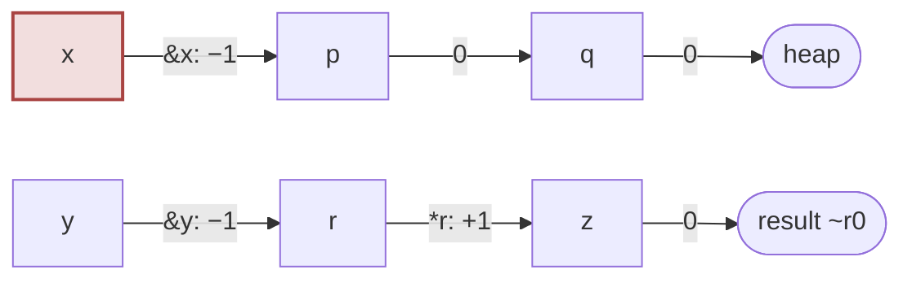

# 15.5 Escape Analysis

[3.2.4](../../part1overview/ch03life/compile.md) introduced the problem escape analysis solves: a
local variable that may still be referenced after its function returns cannot be released with the
stack frame and must be allocated on the heap. The compiler maintains two invariants for this: a
pointer to a stack object must not be stored in the heap, and must not outlive the object. The Go
FAQ points out that, as far as correctness is concerned, programmers need not care where a variable
is allocated, because the storage chosen by the implementation has no bearing on the semantics of
the language; the choice does, however, directly affect the efficiency of the program
[[Go Authors, n.d.](#ref-go-authors-nd)]. This section examines the implementation in Go 1.26,
`cmd/compile/internal/escape`: where it sits in the compilation pipeline, how it abstracts a program
into a weighted directed graph and solves it, how it carries its conclusions across function
boundaries, how to read the compiler's diagnostics, and how the implementation has evolved and where
it is limited.

## 15.5.1 Position in the Pipeline

Escape analysis runs after type checking and inlining, and before walk and SSA (for the whole
pipeline see [3.2](../../part1overview/ch03life/compile.md)). A comment in `gc/main.go` explains why
it is indispensable [[Go Authors, 2026c](#ref-go-authors-2026c)]:

```go
	// Escape analysis.
	// Required for moving heap allocations onto stack,
	// which in turn is required by the closure implementation,
	// which stores the addresses of stack variables into the closure.
	// If the closure does not escape, it needs to be on the stack
	// or else the stack copier will not update it.
	// Large values are also moved off stack in escape analysis;
	// because large values may contain pointers, it must happen early.
	base.Timer.Start("fe", "escapes")
	escape.Funcs(typecheck.Target.Funcs)

	slice.Funcs(typecheck.Target.Funcs)
```

A closure object holds the addresses of the variables it captures
([6.1](../../part2lang/ch06func/func.md)). A closure that does not escape must be allocated on the
stack; otherwise, when the stack is copied, the addresses in the closure that point into the old
stack are not adjusted ([14.4](../../part4memory/ch14stack/copy.md)). The `slice.Funcs` pass that
follows is new in Go 1.26; see 15.5.6.

`escape.Funcs` does not process functions in source order. It calls `ir.VisitFuncsBottomUp` to
compute the strongly connected components of the static call graph, and hands each component to
`Batch` in reverse topological order [[Go Authors, 2026a](#ref-go-authors-2026a)]. When a function
is analyzed, the functions it calls have already been analyzed and their conclusions can be used
directly (15.5.4); only mutually recursive functions that fall in the same batch are solved
together.

Inlining happens before escape analysis. An inlined function body becomes part of its caller, so the
allocations in it are judged again in the caller's context. Consider a constructor that returns a
pointer:

```go
package demo

type Point struct{ X, Y int }

func NewPoint(x, y int) *Point {
	return &Point{x, y}
}

func Sum() int {
	p := NewPoint(1, 2)
	return p.X + p.Y
}
```

`-gcflags=-m` makes the compiler print its inlining and escape decisions. The output below is from
Go 1.26.10:

```shell
$ go build -gcflags=-m point.go
# command-line-arguments
./point.go:5:6: can inline NewPoint
./point.go:9:6: can inline Sum
./point.go:10:15: inlining call to NewPoint
./point.go:6:9: &Point{...} escapes to heap
./point.go:10:15: &Point{...} does not escape
```

In `NewPoint`, the composite literal `&Point{...}` is returned to an unknown caller and can only be
allocated on the heap. Once inlined into `Sum`, the same literal is only read for its two fields and
stays in `Sum`'s stack frame. Constructors that return pointers are idiomatic Go, and inlining
spares most of their call sites a heap allocation. Conversely, with inlining disabled by
`-gcflags=-l`, escape analysis can only make conservative judgments at function boundaries. The
remaining examples in this section all add `-l` so that escape analysis can be observed on its own.

## 15.5.2 Locations and Assignment Edges

The comment at the top of `escape.go` describes how the graph is constructed
[[Go Authors, 2026a](#ref-go-authors-2026a)]:

```go
// Constructing the location graph.
//
// Every allocating statement (e.g., variable declaration) or
// expression (e.g., "new" or "make") is first mapped to a unique
// "location."
//
// We also model every Go assignment as a directed edges between
// locations. The number of dereference operations minus the number of
// addressing operations is recorded as the edge's weight (termed
// "derefs"). For example:
//
//     p = &q    // -1
//     p = q     //  0
//     p = *q    //  1
//     p = **q   //  2
//
//     p = **&**&q  // 2
//
// Note that the & operator can only be applied to addressable
// expressions, and the expression &x itself is not addressable, so
// derefs cannot go below -1.
//
// Every Go language construct is lowered into this representation,
// generally without sensitivity to flow, path, or context; and
// without distinguishing elements within a compound variable. For
// example:
//
//     var x struct { f, g *int }
//     var u []*int
//
//     x.f = u[0]
//
// is modeled simply as
//
//     x = *u
//
// That is, we don't distinguish x.f from x.g, or u[0] from u[1],
// u[2], etc. However, we do record the implicit dereference involved
// in indexing a slice.
```

The vertices of the graph are called **locations**, each standing for a piece of abstract storage.
Every declared variable has a location, and so does every implicit allocation: `new`, `make`,
composite literals, closure objects, the `...` slice built for a variadic call, and the storage
needed to box a value into an interface. In diagnostics the latter kinds appear as
`{storage for ...}`. In addition, each batch has a few special locations, the most important being
`heapLoc`, which stands for the heap.

Edges represent assignments, and the weight, derefs, is the number of dereferences minus the number
of address-of operations. Along a path the weights add up: if a path from location l to location d
has total weight 0, the value of l is stored into d; if it is −1, the address of l is stored into d;
if it is positive, what is stored into d is a value obtained from l through that many dereferences.
Escape analysis cares about paths with total weight −1, that is, where the addresses of locations
end up.

The second half of the comment explains how coarse the model is. It ignores the order of statements
(flow-insensitive), ignores which way conditional branches go (path-insensitive), gives the same
conclusion for every call of a function (context-insensitive), and does not distinguish different
fields of a struct or different elements of a slice. These simplifications keep the model simple, at
a cost in precision: if the address of one field escapes, the whole struct escapes with it.

Writes through pointers reflect the same trade-off. The function `addr`, which determines the target
of an assignment, is as follows [[Go Authors, 2026a](#ref-go-authors-2026a)]:

```go
func (e *escape) addr(n ir.Node) hole {
	// ...
	k := e.heapHole()

	switch n.Op() {
	// ...
	case ir.ONAME:
		n := n.(*ir.Name)
		if n.Class == ir.PEXTERN {
			break
		}
		k = e.oldLoc(n).asHole()
	// ...
	case ir.ODEREF:
		n := n.(*ir.StarExpr)
		e.mutate(n.X)
	case ir.ODOTPTR:
		n := n.(*ir.SelectorExpr)
		e.mutate(n.X)
	// ...
	}

	return k
}
```

The target of an assignment defaults to the heap (`heapHole`) and becomes the variable's own
location only when the target is a local variable; package-level variables (`PEXTERN`) remain the
heap. For `*p = ...` and `p.f = ...` (where `p` is a pointer), the target stays the heap, and the
pointer `p` itself flows to another special location that records that the memory it points to may
be modified. Writes to slice elements are handled the same way. The analysis does not track where a
pointer points: any value written through a pointer is treated as written to the heap.

```go
package demo

type T struct{ p *int }

func store(t *T, v int) {
	t.p = &v
}
```

Besides the conclusions, `-m=2` prints the paths from which they were derived:

```shell
$ go build -gcflags='-m=2 -l' store.go
# command-line-arguments
./store.go:5:18: v escapes to heap in store:
./store.go:5:18:   flow: {heap} ← &v:
./store.go:5:18:     from &v (address-of) at ./store.go:6:8
./store.go:5:18:     from t.p = &v (assign) at ./store.go:6:6
./store.go:5:12: t does not escape
./store.go:5:18: moved to heap: v
```

`t.p = &v` is modeled as an edge of weight −1 from `v` to the heap: the address of `v` reaches the
heap, so `v` is allocated there. Even if the caller passes a `t` that points to a `T` on the
caller's stack, the conclusion does not change, because the analysis cannot see where `t` points.
The pointer `t` itself is only used for the write and its value is not stored anywhere, so it does
not escape.

## 15.5.3 Solving on the Graph

Once the graph is built, `walkAll` walks it once from each location as a root, the heap included.
The walk is done by `walkOne`, which computes the minimum derefs from every location in the graph to
the root. Because the graph has edges of weight −1, `walkOne` follows the idea of the Bellman-Ford
algorithm, relaxing repeatedly with a work queue until nothing changes. The following is the core
decision made while processing a location [[Go Authors, 2026a](#ref-go-authors-2026a)]:

```go
		// If l.derefs < 0, then l's address flows to root.
		addressOf := derefs < 0
		if addressOf {
			// For a flow path like "root = &l; l = x",
			// l's address flows to root, but x's does
			// not. We recognize this by lower bounding
			// derefs at 0.
			derefs = 0

			// If l's address flows somewhere that
			// outlives it, then l needs to be heap
			// allocated.
			if b.outlives(root, l) {
				// ...
				newAttrs |= attrEscapes | attrPersists | attrMutates | attrCalls
			} else
			// If l's address flows to a persistent location, then l needs
			// to persist too.
			if root.hasAttr(attrPersists) {
				newAttrs |= attrPersists
			}
		}
```

If the address of a location reaches a root that outlives it, the location must be allocated on the
heap. Clamping derefs from below at 0 has two effects. Semantically, `root = &l; l = x` makes the
address of `l` reach `root` but not the address of `x`. Algorithmically, a cycle of negative weight
cannot make the distance decrease without bound. Once a location is marked as escaping, it is queued
again as a root of its own, so that the fact of escaping keeps propagating. According to the comment
on `walkAll`, each attribute of each location flips at most once, so the total number of walks is a
constant multiple of the number of locations.

Whether something "outlives" another is decided by `outlives`:

```go
func (b *batch) outlives(l, other *location) bool {
	// The heap outlives everything.
	if l.hasAttr(attrEscapes) {
		return true
	}
	// ...
	// We don't know what callers do with returned values, so
	// pessimistically we need to assume they flow to the heap and
	// outlive everything too.
	if l.paramOut {
		// ...
		return true
	}

	// If l and other are within the same function, then l
	// outlives other if it was declared outside other's loop
	// scope. For example:
	//
	//	var l *int
	//	for {
	//		l = new(int) // must heap allocate: outlives for loop
	//	}
	if l.curfn == other.curfn && l.loopDepth < other.loopDepth {
		return true
	}
	// ...
}
```

There are four rules. The heap outlives every location. A function's result parameters are handed to
unknown callers and are likewise assumed to outlive everything (the exception is closures whose call
sites are all known). Within one function, a location declared in an outer loop outlives one
declared in an inner loop, because a variable in the loop body is a different variable on each
iteration yet may reuse the same stack slot. A location in an outer function outlives a location in
an inner closure.

The following example touches the first three rules:

```go
package demo

var sink *int

func f() int {
	var x, y int
	p := &x
	q := p
	sink = q
	r := &y
	z := *r
	return z
}

func g() int {
	var p *int
	for i := 0; i < 3; i++ {
		v := i
		p = &v
	}
	return *p
}
```

The location graph of `f` is shown below, with derefs on the edges:



With the heap as the root, the minimum derefs of `x` is −1: its address reaches the heap, so it
escapes. With the result parameter as the root, the minimum derefs of `y` is −1 + 1 + 0 = 0: only
the value of `y` reaches the result, so `y` stays on the stack. In `g` there is no heap and no
returned pointer: `p` is declared outside the loop and `v` inside it, so `p` outlives `v`; the
address of `v` is stored into `p`, and `v` therefore escapes. The compiler's derivation agrees:

```shell
$ go build -gcflags='-m=2 -l' flow.go
# command-line-arguments
./flow.go:6:6: x escapes to heap in f:
./flow.go:6:6:   flow: p ← &x:
./flow.go:6:6:     from &x (address-of) at ./flow.go:7:7
./flow.go:6:6:     from p := &x (assign) at ./flow.go:7:4
./flow.go:6:6:   flow: q ← p:
./flow.go:6:6:     from q := p (assign) at ./flow.go:8:4
./flow.go:6:6:   flow: {heap} ← q:
./flow.go:6:6:     from sink = q (assign) at ./flow.go:9:7
./flow.go:6:6: moved to heap: x
./flow.go:18:3: v escapes to heap in g:
./flow.go:18:3:   flow: p ← &v:
./flow.go:18:3:     from &v (address-of) at ./flow.go:19:7
./flow.go:18:3:     from p = &v (assign) at ./flow.go:19:5
./flow.go:18:3: moved to heap: v
```

The core decision above also mentions three other attributes. `attrPersists` means that the address
of a location is still used after the statement ends; closures, method values and slice literals
without this attribute are marked as temporary, and their storage can be reused immediately.
`attrMutates` means that the memory reachable from a location may be modified; since Go 1.22 it is
used to turn a `[]byte(s)` conversion whose result is never modified into direct sharing of the
string's bytes ([5.2.3](../../part2lang/ch05data/string.md)). `attrCalls` means that a closure
reachable from a location may be called without its results being tracked, which is used to improve
indirect closure calls. All three share the same graph and the same walk with escaping.

## 15.5.4 Across Function Boundaries: Parameter Tags

After a batch of functions is solved, `finish` produces a **parameter tag** for each parameter,
recording where the parameter's value flows. Tags are stored in the package's export data, so other
packages that call the function can use them as well
([3.2.7](../../part1overview/ch03life/compile.md)). The content of a tag is a `leaks` value
[[Go Authors, 2026b](#ref-go-authors-2026b)]:

```go
// A leaks represents a set of assignment flows from a parameter to
// the heap, mutator, callee, or to any of its function's (first
// numEscResults) result parameters.
type leaks [8]uint8

const (
	leakHeap = iota
	leakMutator
	leakCallee
	leakResult0
)

const numEscResults = len(leaks{}) - leakResult0
```

The 8 bytes correspond, in order, to the heap, memory that is modified, closures that are called,
and the first 5 result parameters. Each byte holds the minimum derefs from the parameter to that
destination plus 1, and 0 means there is no such flow. At a call site the compiler no longer enters
the callee's body; it connects the argument to the heap or to the call result according to the tag.
For example, if the tag says a parameter flows to the first result with derefs 0, the call site adds
an edge of weight 0 from the argument to the call result. This summary-based treatment lets the
analysis cross function boundaries without analyzing the callee again.

```go
package demo

import (
	"fmt"
	"io"
)

func passthrough(p *int) *int {
	return p
}

func show(w io.Writer, x int) {
	fmt.Fprint(w, x)
}
```

```shell
$ go build -gcflags='-m -l' tags.go
# command-line-arguments
./tags.go:8:18: leaking param: p to result ~r0 level=0
./tags.go:12:11: leaking param: w
./tags.go:13:12: ... argument does not escape
./tags.go:13:16: x escapes to heap
```

The parameter of `passthrough` flows unchanged to the result, so its tag reads "flows to result
`~r0`, level 0". If a caller passes it the address of a stack variable, whether that address escapes
depends on how the caller uses the return value.

The two lines for `show` come from the tag of `fmt.Fprint`. `fmt.Fprint` calls `w.Write` through an
interface, and the compiler cannot know how the actual method will use `w`, so it must assume `w`
flows to the heap, and `w` is marked `leaking param`. The tag of the variadic `a ...any` is
`leaking param content`: the slice itself does not escape, but the elements in it flow to the heap.
The reason lies in the implementation of `fmt`: `Fprint` takes a `*pp` from a `sync.Pool` and stores
each argument in its field `p.arg`, and objects in the pool live on the heap. The `...` slice can
therefore stay on the stack, while `x`, boxed into an interface, must go to the heap. This is why an
ordinary `fmt` call causes a heap allocation.

A function without a body (implemented in assembly, or referenced through `//go:linkname`) has no
code to analyze, so the compiler assumes its pointer parameters flow to the heap unless the
declaration is preceded by `//go:noescape`.

## 15.5.5 A Guide to the Diagnostics

The output of `-gcflags=-m` falls into the following categories:

| Output | Meaning |
|------|------|
| `moved to heap: x` | The named variable `x` is allocated on the heap |
| `E escapes to heap` | The storage needed by expression `E` (composite literal, closure, `make`, interface boxing and so on) is allocated on the heap |
| `E does not escape` | The storage needed by expression `E` stays on the stack |
| `leaking param: p` | The value of parameter `p` flows to the heap |
| `leaking param content: p` | The content `p` points to flows to the heap; `p` itself does not escape |
| `leaking param: p to result r level=n` | `p` flows to result `r` after n dereferences |
| `p does not escape` | Parameter `p` flows neither to the heap nor to a result |

After each escape conclusion, `-m=2` prints the derivation path, each step written
as "`flow: destination ← source`", followed by the corresponding source location and the reason; it
also reports whether each variable captured by a closure is captured by value or by reference (for
the criteria see [6.1.1](../../part2lang/ch06func/func.md)). Note that this output is the conclusion
of escape analysis itself. Later passes can still change where an allocation ends up, for example
the `append` optimization in Go 1.26 described in 15.5.6. The wording of the diagnostics also
changes between versions, so the actual output of the toolchain in use is authoritative.

## 15.5.6 Evolution

Go's escape analysis dates from August 2011. Luuk van Dijk added `esc.c` to `gc`, the compiler
written in C; at first it had to be enabled with `-s`, and `-m` showed the results
[[van Dijk, 2011](#ref-van-dijk-2011)]. Four days later Russ Cox made it the default, turned `-s`
into the switch that disables the analysis, and rewrote `new(T)` and slice literals into stack
allocations where that is safe [[Cox, 2011](#ref-cox-2011)]. Go 1 shipped with this analysis. In Go
1.5 the compiler was automatically translated from C to Go ([15.7](./future.md)) and `esc.c` became
`esc.go`, with the algorithm largely unchanged: starting from a "sink" that stands for every
external destination, it propagates an "escape level" along the flow graph.

Over the following years the code became hard to understand through patching. In December 2017,
Matthew Dempsky filed issue #23109, which begins: "Despite repeated efforts, I'm still confused by
our escape analysis code." He added that discussion with other compiler developers showed the
confusion was not unique to him [[Dempsky, 2017](#ref-dempsky-2017)]. In April 2019 Dempsky
submitted a new implementation with simplicity as its first goal, the location graph and derefs
model described in this section. The commit message states that in pursuing simplicity it used less
memory, shortened some compile times, fixed memory corruption problems, and significantly improved
the analysis results [[Dempsky, 2019a](#ref-dempsky-2019a)]. The new implementation became the
default in Go 1.13 [[Dempsky, 2019b](#ref-dempsky-2019b)]. The release notes warned that the higher
precision might break invalid code that happened to work, such as code that violates the
`unsafe.Pointer` rules [[Go Authors, 2019](#ref-go-authors-2019)]. The old implementation was kept
as a fallback for one release and removed in Go 1.14 [[Dempsky, 2019c](#ref-dempsky-2019c)]. In
December 2020 the `dev.regabi` branch split the large `gc` package into several subpackages, and
escape analysis became the standalone `cmd/compile/internal/escape`, released with Go 1.17
[[Cox, 2020](#ref-cox-2020)].

Improvements in recent releases do not change this model. They extend the reach of stack allocation
on top of its conclusions, mainly for slices. Previously, `make([]T, n)` with a size unknown at
compile time was always allocated on the heap, even if the result did not escape. Go 1.25 reserves a
32-byte array on the stack instead: at run time, if `cap` does not exceed 32/sizeof(T), that array
is used as the backing store; otherwise `makeslice` is still called
[[Randall, 2025a](#ref-randall-2025a)]. The change initially accepted only element types without
pointers; the very next commit relaxed this to types containing pointers, because the existing
escape semantics already guarantee that values stored into such a slice escape as usual
[[Randall, 2025b](#ref-randall-2025b)]. Different versions therefore judge the same code
differently:

```go
package demo

func sizes(n int) int {
	a := make([]byte, 64)
	b := make([]byte, n)
	return len(a) + len(b)
}
```

```shell
$ GOTOOLCHAIN=go1.21.13 go build -gcflags='-m -l' size.go
# command-line-arguments
./size.go:4:11: make([]byte, 64) does not escape
./size.go:5:11: make([]byte, n) escapes to heap
$ GOTOOLCHAIN=go1.26.10 go build -gcflags='-m -l' size.go
# command-line-arguments
./size.go:4:11: make([]byte, 64) does not escape
./size.go:5:11: make([]byte, n) does not escape
```

In the same release, an `append` that does not escape also began to use a stack backing store of the
same size [[Randall, 2025c](#ref-randall-2025c)]. Go 1.26 goes further and handles the case where
the result escapes. Take a slice built by appending one element at a time and then returned: every
growth calls `growslice` to allocate a new backing array, and all of those allocations except the
last immediately become garbage. The new `slice.Funcs` pass runs after escape analysis. It finds
slice variables that lose exclusive ownership only at a return or an assignment, and inserts a
single `move2heap` just before that point, so the `append` calls before it can use a stack backing
store [[Randall, 2025d](#ref-randall-2025d)]. A comment in `slice/slice.go` explains the idea
[[Go Authors, 2026d](#ref-go-authors-2026d)]:

```go
// If we can determine that the "return s" statement is the
// *only* way that the backing store for s escapes, then we
// can rewrite the code to something like:
//
//     var s []int
//     for i := range N {
//        s = append(s, i)
//     }
//     s = move2heap(s)
//     return s
//
// Using the move2heap runtime function, which does:
//
//     move2heap(s):
//         If s is not backed by a stackframe-allocated
//         backing store, return s. Otherwise, copy s
//         to the heap and return the copy.
```

Because this pass runs after escape analysis, `-m` still reports "append escapes to heap" for such
an `append`. The following program measures the average number of heap allocations per call for two
functions:

```go {run=true}
package main

import (
	"fmt"
	"testing"
)

// checksum uses a slice whose size is known only at run time, and the slice does not escape.
//
//go:noinline
func checksum(n int) int {
	b := make([]byte, n)
	for i := range b {
		b[i] = byte(i)
	}
	sum := 0
	for _, v := range b {
		sum += int(v)
	}
	return sum
}

// collect builds a slice with append and returns it to the caller.
//
//go:noinline
func collect(n int) []int {
	var s []int
	for i := 0; i < n; i++ {
		s = append(s, i)
	}
	return s
}

func main() {
	for _, n := range []int{8, 32, 33, 1024} {
		a := testing.AllocsPerRun(1000, func() { checksum(n) })
		fmt.Printf("checksum(%4d): %.0f heap allocations\n", n, a)
	}
	for _, n := range []int{3, 4, 5, 100} {
		a := testing.AllocsPerRun(1000, func() { collect(n) })
		fmt.Printf("collect(%3d): %.0f heap allocations\n", n, a)
	}
}
```

Run with Go 1.26.10, the output is:

```text
checksum(   8): 0 heap allocations
checksum(  32): 0 heap allocations
checksum(  33): 1 heap allocations
checksum(1024): 1 heap allocations
collect(  3): 1 heap allocations
collect(  4): 1 heap allocations
collect(  5): 1 heap allocations
collect(100): 5 heap allocations
```

`checksum` does not allocate at all when n is at most 32. The elements of `collect` are 8 bytes, so
the stack buffer holds 4 of them: when n is at most 4, the only allocation is the `move2heap` before
the return; when n is 5, the fifth `append` has already grown the slice onto the heap, so
`move2heap` has nothing to copy; when n is 100, what is saved are the earliest allocations in the
growth sequence. Recompiling with `-gcflags=all=-d=variablemakehash=n` to disable these stack
allocations changes the four `collect` lines to 3, 3, 4 and 8 allocations, and all four `checksum`
lines to 1. In a build with `-race`, walk expands `append` into the older form needed for
instrumentation, and the optimization for `collect` no longer applies. The Go 1.25 release notes
warn that such optimizations can amplify the consequences of misusing `unsafe.Pointer`; the release
notes of both versions describe how to locate the offending allocation with the `bisect` tool
(`-compile=variablemake`) [[Go Authors, 2025](#ref-go-authors-2025)]
[[Go Authors, 2026e](#ref-go-authors-2026e)].

Also in Go 1.26, the `escape` package gained an alias analysis: under `GOEXPERIMENT=runtimefreegc`,
if it can prove that the old backing array of an `append` has no aliases before the growth, the
compiler inserts a call to `freegc` to return that memory immediately
[[thepudds, 2025](#ref-thepudds-2025)]. This experiment is off by default; for the runtime side of
the mechanism see [12.9.4](../../part4memory/ch12alloc/history.md).

## 15.5.7 Limits and Trade-offs

Escape analysis is conservative: a location that cannot be proven not to escape is allocated on the
heap. Placing a variable on the heap is always safe, while wrongly placing one on the stack leaves a
dangling pointer, so the two kinds of error are not symmetric in cost. 15.5.2 and 15.5.4 have
already shown several typical conservative cases: writes through pointers or slice elements, method
calls through interfaces, and functions without bodies. There are also size limits: an explicitly
declared variable larger than 128 KiB, or an implicit allocation (`new`, `&T{}`, constant-size
`make` and so on) larger than 64 KiB, is reported as "too large for stack" in the diagnostics, and
the compiler option `-smallframes` lowers the two limits to 64 KiB and 16 KiB respectively. The
limits are defined in `cmd/compile/internal/ir/cfg.go`, and the check is done by `HeapAllocReason`
in the `escape` package [[Go Authors, 2026a](#ref-go-authors-2026a)].

What these conservative judgments buy is a property the runtime can rely on: pointers to the stack
appear only on the stack, and in the few places the runtime has registered. Growable contiguous
stacks are built on this property: when a stack is copied, the runtime uses it to find and adjust
all pointers into the old stack ([14.4.7](../../part4memory/ch14stack/copy.md)). It also shaped the
design of the garbage collector: escape analysis keeps a large number of short-lived objects on the
stack, where they are freed when the function returns, so generational collection has limited
benefit in Go ([13.8](../../part4memory/ch13gc/generational.md)).

For programmers, `-gcflags=-m` is a direct way to check allocation decisions, but there is no need
to rewrite code to make a value "never escape". A heap allocation that is not on a hot path barely
affects performance, and sacrificing readability to remove it is not worth it. The sensible order is
to measure first and confirm that allocation really is the bottleneck (for `-benchmem` in benchmarks
and memory profiling see [16.5](../ch16tools/perf.md)), and then use the diagnostics to find the
cause.

## 15.5.8 Summary

Escape analysis abstracts a program into a location graph whose edges are assignments and whose
weights are derefs, and computes on it the minimum number of dereferences from each location to each
root: a location whose address reaches somewhere that outlives it must be allocated on the heap.
Conclusions pass between functions as parameter tags, and the bottom-up analysis order together with
the preceding inlining determines the precision of the analysis. The model is flow-insensitive and
field-insensitive, and treats every write through a pointer as a write to the heap, trading
precision for simplicity. The 2019 rewrite established this model, and later improvements extend the
reach of stack allocation on top of its conclusions, as the handling of `make` and `append` in Go
1.25 and Go 1.26 shows.

## Further Reading

- <a id="ref-cox-2011"></a>[Cox, 2011] Russ Cox. gc: tweak and enable escape analysis. Go commit
  db5f9da425, 2011. https://golang.org/cl/4954043
  Shipped with Go 1.
- <a id="ref-cox-2020"></a>[Cox, 2020] Russ Cox. [dev.regabi] cmd/compile: split out package escape
  [generated]. Go commit de454eef5f, 2020. https://go.dev/cl/279472
  Shipped with Go 1.17.
- <a id="ref-dempsky-2017"></a>[Dempsky, 2017] Matthew Dempsky. *cmd/compile: rewrite escape
  analysis.* Go issue #23109, 2017. https://go.dev/issue/23109
- <a id="ref-dempsky-2019a"></a>[Dempsky, 2019a] Matthew Dempsky. cmd/compile: add new escape
  analysis implementation. Go commit 97c4ad4327, 2019. https://go.dev/cl/170322 Shipped with Go
  1.13.
- <a id="ref-dempsky-2019b"></a>[Dempsky, 2019b] Matthew Dempsky. cmd/compile: enable -newescape by
  default. Go commit 996a687ebb, 2019. https://go.dev/cl/170448
  Shipped with Go 1.13.
- <a id="ref-dempsky-2019c"></a>[Dempsky, 2019c] Matthew Dempsky. cmd/compile: remove -newescape
  flag. Go commit 991b0fd46c, 2019. https://go.dev/cl/187597 Shipped with Go 1.14.
- <a id="ref-go-authors-nd"></a>[Go Authors, n.d.] The Go Authors. *Frequently Asked Questions: How
  do I know whether a variable is allocated on the heap or the stack?*
  https://go.dev/doc/faq#stack_or_heap Whether a variable is allocated on the stack or the heap.
- <a id="ref-go-authors-2019"></a>[Go Authors, 2019] The Go Authors. *Go 1.13 Release Notes:
  Compiler toolchain.* 2019. https://go.dev/doc/go1.13#compiler
- <a id="ref-go-authors-2025"></a>[Go Authors, 2025] The Go Authors. *Go 1.25 Release Notes:
  Compiler.*
  2025. https://go.dev/doc/go1.25#compiler
  See the "Faster slices" section.
- <a id="ref-go-authors-2026a"></a>[Go Authors, 2026a] The Go Authors. cmd/compile/internal/escape.
  Go 1.26 source.
  https://github.com/golang/go/tree/release-branch.go1.26/src/cmd/compile/internal/escape The escape
  analysis implementation: data-flow graph, parameter tags, solving.
- <a id="ref-go-authors-2026b"></a>[Go Authors, 2026b] The Go Authors.
  cmd/compile/internal/escape/leaks.go. Go 1.26 source.
  https://github.com/golang/go/blob/release-branch.go1.26/src/cmd/compile/internal/escape/leaks.go
  Definition of the parameter flow tag `leaks`.
- <a id="ref-go-authors-2026c"></a>[Go Authors, 2026c] The Go Authors.
  cmd/compile/internal/gc/main.go. Go 1.26 source.
  https://github.com/golang/go/blob/release-branch.go1.26/src/cmd/compile/internal/gc/main.go The
  order of the compiler front-end phases.
- <a id="ref-go-authors-2026d"></a>[Go Authors, 2026d] The Go Authors.
  cmd/compile/internal/slice/slice.go. Go 1.26 source.
  https://github.com/golang/go/blob/release-branch.go1.26/src/cmd/compile/internal/slice/slice.go
  Stack allocation of slice backing stores and `move2heap`.
- <a id="ref-go-authors-2026e"></a>[Go Authors, 2026e] The Go Authors. *Go 1.26 Release Notes:
  Compiler.*
  2026. https://go.dev/doc/go1.26#compiler
- <a id="ref-randall-2025a"></a>[Randall, 2025a] Keith Randall. cmd/compile: stack allocate
  variable-sized makeslice. Go commit 7a427143b6, 2025. https://go.dev/cl/653856 Shipped with Go
  1.25.
- <a id="ref-randall-2025b"></a>[Randall, 2025b] Keith Randall. cmd/compile: allow
  pointer-containing elements in stack allocations. Go commit 2d050e91a3, 2025.
  https://go.dev/cl/657937 Shipped with Go 1.25.
- <a id="ref-randall-2025c"></a>[Randall, 2025c] Keith Randall. cmd/compile: allocate backing store
  for append on the stack. Go commit ce88e341b9, 2025. https://go.dev/cl/664299 Shipped with Go
  1.25.
- <a id="ref-randall-2025d"></a>[Randall, 2025d] Keith Randall. cmd/compile: stack allocate backing
  stores during append. Go commit 32f5aadd2f, 2025. https://go.dev/cl/707755 Shipped with Go 1.26.
- <a id="ref-thepudds-2025"></a>[thepudds, 2025] thepudds. cmd/compile: introduce alias analysis and
  automatically free non-aliased memory after growslice. Go commit 4879151d1d, 2025.
  https://go.dev/cl/710015
  Shipped with Go 1.26.
- <a id="ref-van-dijk-2011"></a>[van Dijk, 2011] Luuk van Dijk. gc: Escape analysis. Go commit
  847b61b554,
  2011. https://golang.org/cl/4634073
  Shipped with Go 1.
- This book: [3.2.4 Escape Analysis](../../part1overview/ch03life/compile.md) (the problem and the
  two invariants), [13 Garbage Collector](../../part4memory/ch13gc/readme.md) and
  [13.8 The Generational Hypothesis and Generational Collection](../../part4memory/ch13gc/generational.md)
  (why escape analysis weakens the generational benefit),
  [14.4 Stack Copying and Pointer Adjustment](../../part4memory/ch14stack/copy.md) (stacks move, so
  addresses held outside must escape), [15.3 The Optimizer](./optimize.md) (where escape analysis
  sits in the compilation pipeline),
  [16.5 Benchmarking and Performance Profiling](../ch16tools/perf.md) (measure before tuning).
