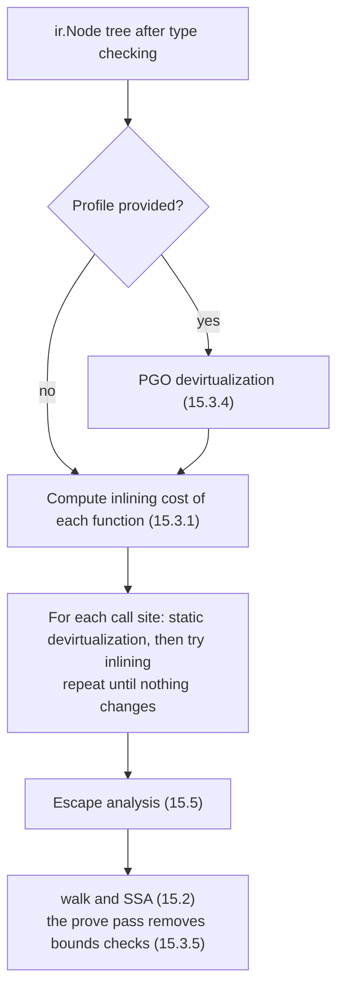

# 15.3 The Optimizer

The Go compiler optimizes in two layers. The first works on the `ir` node tree and includes
inlining, devirtualization and escape analysis ([15.5](./escape.md)). These decisions need to see
caller and callee together, so they can only be made while the function bodies are still visible to
one another. The second layer works on SSA: each function passes independently through dozens of
transformations ([15.2](./ssa.md)), and because these passes touch only the inside of a single
function, they can run in parallel. [3.2.3](../../part1overview/ch03life/compile.md) introduced the
inlining budget of 80 and the PGO budget of 2000. This section covers the cost model those numbers
belong to and how it evolved, how devirtualization and profile-guided optimization widen the reach
of inlining, and how the `prove` pass in SSA removes bounds checks.

The order of the `ir`-layer optimizations is set by the `Main` function of package `gc`
[[Go Authors, 2026c](#ref-go-authors-2026c)]:



## 15.3.1 The Inlining Cost Model

Inlining takes two steps. First the compiler computes an **inlining cost** for every function,
decides whether it can be inlined, and if so saves a copy of its body. Then it visits each call site
and replaces calls to inlinable functions with a copy of the body. The parameters of the cost model
are gathered in a block of constants at the top of `inl.go`
[[Go Authors, 2026a](#ref-go-authors-2026a)]:

```go
// Inlining budget parameters, gathered in one place
const (
	inlineMaxBudget       = 80
	inlineExtraAppendCost = 0
	// default is to inline if there's at most one call. -l=4 overrides this by using 1 instead.
	inlineExtraCallCost  = 57              // 57 was benchmarked to provided most benefit with no bad surprises; see https://github.com/golang/go/issues/19348#issuecomment-439370742
	inlineParamCallCost  = 17              // calling a parameter only costs this much extra (inlining might expose a constant function)
	inlineExtraPanicCost = 1               // do not penalize inlining panics.
	inlineExtraThrowCost = inlineMaxBudget // with current (2018-05/1.11) code, inlining runtime.throw does not help.

	inlineBigFunctionNodes      = 5000                 // Functions with this many nodes are considered "big".
	inlineBigFunctionMaxCost    = 20                   // Max cost of inlinee when inlining into a "big" function.
	inlineClosureCalledOnceCost = 10 * inlineMaxBudget // if a closure is just called once, inline it.
)
```

The cost is computed by `hairyVisitor`, which walks the function body. The name comes from the
`ishairy` function of the early implementation; "hairy" meant too complicated to inline. Every node
costs 1, and calls have their own rules. If the callee can itself be inlined, the call is charged
that callee's inlining cost, because its body is what will appear here after inlining. Otherwise the
call is charged `inlineExtraCallCost`, which is 57. Calling a parameter of function type adds only
17, because after inlining the argument may be a known function and the call can become direct. A
`panic` costs almost nothing, while `runtime.throw` exhausts the whole budget at once. Some
constructs prevent inlining no matter how cheap they are, such as `go` and `defer` statements, calls
to `recover`, and directives such as `//go:noinline`.

The following program shows these rules (output from Go 1.26.10):

```go
package main

func add(a, b int) int { return a + b }

//go:noinline
func slow(x int) int { return x * 2 }

func wrap1(x int) int { return slow(x) + 1 }

func wrap2(x int) int { return slow(x) + slow(x+1) }

func twice(x int) int { return add(add(x, x), x) }

func main() {
	println(wrap1(1), wrap2(2), twice(3))
}
```

```shell
$ go build -gcflags=-m=2 .
# example
./main.go:3:6: can inline add with cost 4 as: func(int, int) int { return a + b }
./main.go:6:6: cannot inline slow: marked go:noinline
./main.go:8:6: can inline wrap1 with cost 63 as: func(int) int { return slow(x) + 1 }
./main.go:10:6: cannot inline wrap2: function too complex: cost 124 exceeds budget 80
./main.go:12:6: can inline twice with cost 16 as: func(int) int { return add(add(x, x), x) }
./main.go:14:6: cannot inline main: function too complex: cost 146 exceeds budget 80
./main.go:12:39: inlining call to add
./main.go:12:35: inlining call to add
./main.go:15:15: inlining call to wrap1
./main.go:15:35: inlining call to twice
./main.go:15:35: inlining call to add
./main.go:15:35: inlining call to add
```

The cost of `wrap1`, 63, is 57 for one non-inlinable call plus 6 other nodes. `wrap2` makes two such
calls, costs 124, and exceeds the budget. `twice` also makes two calls, but `add` is itself
inlinable and is charged only its own cost of 4 each time, so the total is just 16. The last six
lines are the result of the second step: in `main`, the calls to `wrap1` and `twice` are replaced by
their bodies, and the two calls to `add` inside `twice` are expanded with them. Costs are computed
bottom-up along the call graph, one strongly connected component at a time, so a callee's cost is
always known before its callers'.

When the caller itself has more than 5000 nodes, the cost limit for callees drops from 80 to 20.
When Keith Randall introduced this rule, he explained that 20 approximates the point at which the
inlined body is no larger than the call instruction sequence [[Randall, 2018a](#ref-randall-2018a)]:
a function that is already large gains little from growing further just to save a call.

Charging cost by syntax tree node is a crude approximation. In his 2023 plan to improve inlining,
Austin Clements pointed out that some trees are simple but generate a lot of code, while others are
complicated and shrink to almost nothing after optimization [[Clements, 2023](#ref-clements-2023)].
Estimating cost on SSA would be more accurate, but it raises a series of problems: inlining must
finish before escape analysis, so escape analysis would have to move to SSA as well; the SSA phase
compiles functions in parallel, whereas inlining needs them ordered by the call relation; and export
data cannot carry function bodies in SSA form. Inlining has therefore stayed at the `ir` layer, and
the crudeness of the cost model is compensated for by a conservative budget.

## 15.3.2 From Leaf Functions to Mid-Stack Inlining

The main value of inlining lies less in saving the cost of a call than in letting constant
propagation, dead code elimination, devirtualization and escape analysis work across what used to be
a function boundary. Before Go 1.12, however, a function containing a single call that would not
itself be inlined could not be inlined at all, so only the leaves of the call graph could be
expanded. The restriction came from the runtime: `runtime.Caller` and stack tracebacks report
callers by machine stack frame, and if an inlined callee went on to call another function, the
traceback would be missing a level. Russ Cox recorded this concern in a Go 1.5 commit
[[Cox, 2015](#ref-cox-2015)]. The same commit implemented **transitive inlining**: a call that will
itself be inlined no longer prevents its caller from being inlined. It also raised the budget from
40 to 80 so that the runtime's `heapBits.next` could be inlined.

The design that lifted the leaf restriction was proposed by David Lazar and Austin Clements in 2017
[[Lazar and Clements, 2017](#ref-lazar-and-clements-2017)]. For every function containing inlined
calls, the compiler generates an extra **inlining tree** that records the file, line number and
function name of each inlined call, together with a PC-value table mapping each instruction to a
node in that tree. From these the runtime reconstructs the "logical frames" of inlined functions in
a traceback, and functions such as `runtime.Callers` work in terms of logical frames; the design
also planned DWARF inlining information for debuggers. The preliminary results it reported were a 9%
speedup on the Go1 benchmarks and a 15% larger binary. These tables shipped in Go 1.9
[[Lazar, 2017](#ref-lazar-2017)], but mid-stack inlining itself still had to be enabled explicitly
with `-l=4`. In Go 1.12, Keith Randall lowered the extra cost of a call from 80 to 60, enough to fit
one call in a function body but not two [[Randall, 2018b](#ref-randall-2018b)], and David Chase then
lowered it to 57 [[Chase, 2018](#ref-chase-2018)]. The Go 1.12 release notes warned that, with
inlining now more widespread, programs should resolve call stacks with `runtime.CallersFrames`
rather than iterate directly over the program counters returned by `runtime.Callers`
[[Go Authors, 2019](#ref-go-authors-2019)].

The budget of one call gave the standard library an idiom: split the rare slow path into a separate
function so that the common fast path is small enough to be inlined at every call site. `Lock` in
`sync.Mutex` merely forwards to the method of the same name in `internal/sync`, which looks like
this [[Go Authors, 2026c](#ref-go-authors-2026c)]:

```go
func (m *Mutex) Lock() {
	// Fast path: grab unlocked mutex.
	if atomic.CompareAndSwapInt32(&m.state, 0, mutexLocked) {
		if race.Enabled {
			race.Acquire(unsafe.Pointer(m))
		}
		return
	}
	// Slow path (outlined so that the fast path can be inlined)
	m.lockSlow()
}
```

The call to `lockSlow` costs 57, and with the compare-and-swap of the fast path the total stays
within 80. At the call site, `mu.Lock()` therefore expands to one compare-and-swap and one
conditional branch, and a real function call happens only when the lock is held.

Clements is blunt about this model in the 2023 plan: the Go compiler's inliner was never good, and
not until Go 1.12 in 2019 could it inline anything other than leaf functions
[[Clements, 2023](#ref-clements-2023)]. The existing heuristic counts only the cost of inlining and
never the benefit, which makes it extremely conservative. It is also insensitive to the call site: a
function is inlined either at all call sites or at none, although a call inside a loop is clearly a
better candidate than a call on an error-handling path. Go 1.22 accordingly added an experimental
new inliner (`GOEXPERIMENT=newinliner`) that scores each call site: a call inside a loop subtracts
5, a call on a panic path adds 40, and passing a constant to an `if` condition in the callee
subtracts 20; the call is inlined if the score does not exceed the budget
[[Go Authors, 2024](#ref-go-authors-2024); [Go Authors, 2026a](#ref-go-authors-2026a)]. As of Go
1.26 the experiment is still off by default.

## 15.3.3 Devirtualization

An interface call is an indirect call ([4.2](../../part2lang/ch04type/interface.md)): the method
address is loaded from the itab at run time, so the compiler does not know the target at compile
time, cannot inline it, and cannot propagate constants in the arguments. When the compiler can
determine the dynamic type of an interface value, **devirtualization** rewrites the indirect call
into a direct call to the concrete method, which then becomes a candidate for inlining.

Devirtualization first appeared in Go 1.9. Philip Hofer added a rewrite rule to SSA: if the itab in
an interface value is a known static symbol, the interface call becomes a direct call. The typical
case is `h.Write(buf)` after a constructor such as `sha1.New()` has been inlined and the receiver
type has become known [[Hofer, 2017](#ref-hofer-2017)]. This rule runs after escape analysis, so its
results cannot help escape analysis. In Go 1.16, Matthew Dempsky added a devirtualization step at
the `ir` layer, after inlining and before escape analysis, so that escape analysis could see the
concrete method [[Dempsky, 2020](#ref-dempsky-2020)]. That step ran only once, however, so the
direct calls it produced had already missed inlining. Since Go 1.22, devirtualization and inlining
alternate in a single loop: newly exposed call sites go through devirtualization and inlining again,
until nothing changes [[Dempsky, 2023](#ref-dempsky-2023);
[Go Authors, 2024](#ref-go-authors-2024)].

What static analysis can see through depends on how it determines the dynamic type. Before Go 1.26
the compiler handled only local variables assigned exactly once. Mateusz Poliwczak's rewrite lets
the analysis follow all assignments to a local interface variable
[[Poliwczak, 2025](#ref-poliwczak-2025)]: `concreteType1` first traces back through interface
conversions, type assertions and inlined results to some local variable, then inspects each of its
assignments (excerpt) [[Go Authors, 2026b](#ref-go-authors-2026b)]:

```go
	var typ *types.Type
	for _, v := range s.assignments(name) {
		var t *types.Type
		switch v := v.(type) {
		case *types.Type:
			t = v
		case ir.Node:
			t = concreteType1(s, v, seen)
			if t == &noType {
				continue
			}
		}
		if t == nil {
			return nil // unknown concrete type
		}
		// ...
		if typ != nil && typ != t {
			return nil // assigned with a different type
		}

		typ = t
	}
```

If all assignments yield the same concrete type, the call can be devirtualized. As soon as the
variable's address is taken, the analysis gives up, because the variable could be assigned another
type through the pointer. In `two` below, the interface variable is assigned in two different
branches (output from Go 1.26.10):

```go
package main

type Shape interface{ Area() int }

type Square struct{ side int }

func (q Square) Area() int { return q.side * q.side }

func one() int {
	var s Shape = Square{2}
	return s.Area()
}

func two(big bool) int {
	var s Shape
	if big {
		s = Square{10}
	} else {
		s = Square{1}
	}
	return s.Area()
}

func main() {
	println(one(), two(true))
}
```

```shell
$ go build -gcflags=-m . 2>&1 | grep -E 'main.go:(11|17|19|21):'
./main.go:11:15: devirtualizing s.Area to Square
./main.go:21:15: devirtualizing s.Area to Square
./main.go:11:15: inlining call to Square.Area
./main.go:21:15: inlining call to Square.Area
./main.go:17:13: Square{...} does not escape
./main.go:19:13: Square{...} does not escape
```

Both calls are devirtualized and inlined. Compiling the same program with Go 1.25, line 21 is not
devirtualized, and the `Square{...}` values on lines 17 and 19 both escape to the heap: a value
stored in an interface is passed to an unknown method by the interface call, so escape analysis can
only assume that it escapes ([15.5](./escape.md)). Here devirtualization eliminates one indirect
call and two heap allocations at once.

The rewritten call has the form `s.(Square).Area()`, that is, a type assertion is inserted before
the call. If the interface is non-nil the assertion necessarily succeeds; if it is nil, the compiler
makes the assertion panic in the same way as a method call on a nil interface, so the semantics of
the original call are preserved.

## 15.3.4 Profile-Guided Optimization

Static analysis has its limits. If an interface variable receives several types at run time, static
analysis cannot tell which is most common; and the budget of 80 treats all call sites alike,
although the running time of a program is usually concentrated in a few of them. **Profile-guided
optimization** (PGO) fills in this missing information by handing the compiler a profile collected
while the program actually runs.

Go's PGO was proposed by Cherry Mui, Austin Clements and Michael Pratt in 2022
[[Mui et al., 2022](#ref-mui-et-al-2022)], and Raj Barik and Jin Lin submitted an implementation
plan at the same time [[Barik and Lin, 2022](#ref-barik-and-lin-2022)]. The central choice in the
design is where the profile comes from. Traditional PGO is based on instrumentation: first build a
version with counting code inserted, run it on benchmarks, then recompile using the exact counts
obtained. GCC's `-fprofile-generate` and LLVM's `-fprofile-instr-generate` work this way. The
instrumented build has high overhead and usually cannot run in production, so it needs a set of
representative benchmarks that must be maintained as code and load change. The alternative is
Google's AutoFDO: low-overhead sampling profiling of an ordinary build directly in production, which
was reported to improve the performance of C/C++ programs in Google's data centers by 5% to 15%
[[Chen et al., 2016](#ref-chen-et-al-2016)]. Go chose the latter, with the CPU profile of
`runtime/pprof` as the input format: it is available on almost every operating system, architecture
and deployment environment, whereas more precise hardware profiling is usually unavailable in cloud
environments [[Mui et al., 2022](#ref-mui-et-al-2022)].

Sampled profiles bring two requirements. The first is **source stability**: the profile comes from
the previous release while the compiler is building the latest source, so the samples in the profile
must still map to the right code. The compiler therefore matches call sites by their line offset
from the start of the enclosing function rather than by absolute line number, so edits outside the
function, or moving the function to another file of the same package, do not affect the match. The
second is **iterative stability**: after a PGO-built program is deployed, the next profile comes
from the already optimized program, and a hot spot that has been optimized until it no longer looks
hot may lose that optimization in the next build, so performance can oscillate between consecutive
builds [[Go Authors, n.d.](#ref-go-authors-nd)].

The compiler converts the profile into a weighted call graph. Each sample contributes only its
innermost two stack frames, forming a "caller, callee, call site" edge. Edges are sorted by weight
in descending order, and those whose cumulative weight reaches 99% of the total are considered hot
[[Go Authors, 2026a](#ref-go-authors-2026a)]:

```go
func hotNodesFromCDF(p *pgoir.Profile) (float64, []pgo.NamedCallEdge) {
	cum := int64(0)
	for i, n := range p.NamedEdgeMap.ByWeight {
		w := p.NamedEdgeMap.Weight[n]
		cum += w
		if pgo.WeightInPercentage(cum, p.TotalWeight) > inlineCDFHotCallSiteThresholdPercent {
			// nodes[:i+1] to include the very last node that makes it to go over the threshold.
			// (Say, if the CDF threshold is 50% and one hot node takes 60% of weight, we want to
			// include that node instead of excluding it.)
			return pgo.WeightInPercentage(w, p.TotalWeight), p.NamedEdgeMap.ByWeight[:i+1]
		}
	}
	return 0, p.NamedEdgeMap.ByWeight
}
```

The callee of a hot edge has its inlining cost computed against a budget of 2000 rather than 80, and
its body is saved. At the call site, a call whose cost exceeds 80 is inlined only if the call site
is itself a hot edge and the caller is not a large function of more than 5000 nodes, and the cost
still may not exceed 2000.

PGO has another use: **PGO devirtualization**. For an interface call, the compiler finds the hottest
concrete callee in the profile and inserts a type check; on a hit the call goes directly to that
method, and otherwise it falls back to the original interface call
[[Go Authors, 2026b](#ref-go-authors-2026b)]:

```go
//	func foo(i Iface) {
//		i.Foo()
//	}
//
// to:
//
//	func foo(i Iface) {
//		if c, ok := i.(Concrete); ok {
//			c.Foo()
//		} else {
//			i.Foo()
//		}
//	}
```

The branch with the direct call can then be inlined. If the profile guessed wrong, the cost is only
one redundant type comparison. Since Go 1.22 the same transformation is also applied to calls
through function values. The following program puts 990 `*Square` and 10 `*Rect` among 1000 shapes
and writes a CPU profile at run time:

```go
package main

import (
	"os"
	"runtime/pprof"
)

type Shape interface{ Area() int }

type Square struct{ side int }

func (q *Square) Area() int { return q.side * q.side }

type Rect struct{ w, h int }

func (r *Rect) Area() int { return r.w * r.h }

func total(shapes []Shape) int {
	n := 0
	for _, s := range shapes {
		n += s.Area()
	}
	return n
}

func main() {
	shapes := make([]Shape, 1000)
	for i := range shapes {
		if i%100 == 0 {
			shapes[i] = &Rect{i, 2}
		} else {
			shapes[i] = &Square{i}
		}
	}

	f, _ := os.Create("cpu.pprof")
	pprof.StartCPUProfile(f)
	n := 0
	for range 500000 {
		n += total(shapes)
	}
	pprof.StopCPUProfile()
	println(n)
}
```

Run it once to obtain a profile, then rename the profile to `default.pgo`, place it in the main
package directory, and rebuild (output from Go 1.26.10):

```shell
$ go run .
164996250000000
$ mv cpu.pprof default.pgo
$ go build -gcflags=-m . 2>&1 | grep main.go:21
./main.go:21:14: PGO devirtualizing interface call s.Area to (*Square).Area
./main.go:21:14: inlining call to (*Square).Area
```

`go build` enables PGO automatically when it finds `default.pgo`. The interface call on line 21 is
rewritten as "call directly if it is a `*Square`", and the branch with the direct call is inlined in
turn.

PGO was released as a preview in Go 1.20, used only for hot-spot inlining, with typical gains of 3%
to 4% reported in the release notes [[Go Authors, 2023a](#ref-go-authors-2023a);
[Pratt, 2023a](#ref-pratt-2023a)]. Go 1.21 made it a regular feature: the `-pgo` flag defaults to
`auto`, and PGO devirtualization of interface calls was added, with typical gains of 2% to 7%
[[Go Authors, 2023b](#ref-go-authors-2023b); [Pratt, 2023b](#ref-pratt-2023b)]. Go 1.22 widened the
coverage of devirtualization, raising typical gains to 2% to 14%
[[Go Authors, 2024](#ref-go-authors-2024)]. The compiler itself has been built with PGO since Go
1.21: the directory `src/cmd/compile` holds a profile collected while compiling the standard library
and toolchain [[Mui, 2023](#ref-mui-2023)]. Go 1.21 builds up to 6% faster, which the release notes
attribute mainly to this [[Go Authors, 2023b](#ref-go-authors-2023b)].

## 15.3.5 Bounds Check Elimination

Go guarantees that indexing into slices, arrays and strings never goes out of range, so the compiler
inserts a check before every `a[i]` and panics on an out-of-range index. Most of these checks are
redundant in context. Alexandru Moșoi explained in a 2016 document why removing them matters: checks
make programs slower and binaries larger, and if they slow a program down, developers have reason to
turn them off with `-gcflags=-B`, giving up the safety guarantee [[Moșoi, 2016a](#ref-mosoi-2016a)].

In SSA a bounds check is represented by two kinds of value, `IsInBounds` and `IsSliceInBounds`,
followed by a branch leading to a panic. The pass that removes them is `prove`, whose comment states
the basic idea [[Go Authors, 2026c](#ref-go-authors-2026c)]:

```go
// prove removes redundant BlockIf branches that can be inferred
// from previous dominating comparisons.
//
// By far, the most common redundant pair are generated by bounds checking.
// For example for the code:
//
//	a[i] = 4
//	foo(a[i])
//
// The compiler will generate the following code:
//
//	if i >= len(a) {
//	    panic("not in bounds")
//	}
//	a[i] = 4
//	if i >= len(a) {
//	    panic("not in bounds")
//	}
//	foo(a[i])
//
// The second comparison i >= len(a) is clearly redundant because if the
// else branch of the first comparison is executed, we already know that i < len(a).
// The code for the second panic can be removed.
//
// prove works by finding contradictions and trimming branches whose
// conditions are unsatisfiable given the branches leading up to them.
// It tracks a "fact table" of branch conditions. For each branching
// block, it asserts the branch conditions that uniquely dominate that
// block, and then separately asserts the block's branch condition and
// its negation. If either leads to a contradiction, it can trim that
// successor.
```

`prove` traverses the dominator tree depth-first, adding the branch conditions that dominate a block
to the fact table on entry and undoing them on exit. The design went through several stages. In Go
1.7, Moșoi implemented the first version on SSA branches; it mainly removed conditions already
decided on the dominating path, and a separate pass removed checks based on loop induction variables
[[Moșoi, 2016a](#ref-mosoi-2016a)]. In Go 1.11, Austin Clements changed "decide whether the known
facts imply the current condition" into "add the condition to the fact table and see whether it
produces a contradiction": the same code is used both to record facts and to decide branches, so
facts derived from length and capacity relations work however the branch condition is written
[[Clements, 2018](#ref-clements-2018)]. In the same release, Giovanni Bajo merged loop bounds check
elimination into `prove` [[Bajo, 2018](#ref-bajo-2018)] and introduced a partially ordered set
(poset) to record transitive relations between values. In Go 1.24, Keith Randall rewrote the
representation of numeric ranges: relations between two values may need O(n²) space while relations
between a value and a constant need only O(n), so the signed and unsigned lower and upper bounds of
every SSA value are recorded in a slice indexed by value number
[[Randall, 2024](#ref-randall-2024)].

The comment on the fact table says that its logic is sound but not complete: apart from a few
special cases it does no deduction and no arithmetic; a complete decision procedure exists, but this
ad hoc approach already works on real code and is very efficient
[[Go Authors, 2026c](#ref-go-authors-2026c)]. Facts that `prove` cannot derive can be written into
the code by the programmer. In the following program, `le32` and `le32hint` compute the same result,
but the latter touches `b[3]` once more at the start (output from Go 1.26.10):

```go
package main

func le32(b []byte) uint32 {
	return uint32(b[0]) | uint32(b[1])<<8 | uint32(b[2])<<16 | uint32(b[3])<<24
}

func le32hint(b []byte) uint32 {
	_ = b[3]
	return uint32(b[0]) | uint32(b[1])<<8 | uint32(b[2])<<16 | uint32(b[3])<<24
}

func sum(a []int) int {
	s := 0
	for i := 0; i < len(a); i++ {
		s += a[i]
	}
	return s
}

func sumN(a []int, n int) int {
	s := 0
	for i := 0; i < n; i++ {
		s += a[i]
	}
	return s
}

func main() {
	b := []byte{1, 2, 3, 4}
	println(le32(b), le32hint(b), sum([]int{1, 2}), sumN([]int{1, 2}, 2))
}
```

```shell
$ go build -gcflags=-d=ssa/check_bce/debug=1 .
# example
./main.go:4:17: Found IsInBounds
./main.go:4:32: Found IsInBounds
./main.go:4:50: Found IsInBounds
./main.go:4:69: Found IsInBounds
./main.go:8:7: Found IsInBounds
./main.go:23:9: Found IsInBounds
```

`-d=ssa/check_bce/debug=1` lists the checks that remain after elimination. `le32` accesses `b[0]`
through `b[3]` in turn; `b[0]` being valid does not imply `b[1]` is valid, so none of the four
checks can be removed. `le32hint` checks `b[3]` first, after which `len(b) > 3` is a fact, all four
later accesses are valid, and only the one check on line 8 remains. In `sum`, the loop condition
`i < len(a)` together with `i` starting at 0 and increasing is enough to prove `a[i]` valid; in
`sumN`, the upper bound `n` is unrelated to `len(a)`, so the check must stay. The standard library's
`encoding/binary` is written exactly this way [[Go Authors, 2026c](#ref-go-authors-2026c)]:

```go
func (littleEndian) Uint32(b []byte) uint32 {
	_ = b[3] // bounds check hint to compiler; see golang.org/issue/14808
	return uint32(b[0]) | uint32(b[1])<<8 | uint32(b[2])<<16 | uint32(b[3])<<24
}
```

Moșoi added this hint in Go 1.7, and the commit message calls it the simplest approach that requires
no change to the compiler [[Moșoi, 2016b](#ref-mosoi-2016b)]. The same line in write methods such as
`PutUint32` carries the comment early bounds check to guarantee safety of writes below: an
out-of-range slice panics before any byte is written, so no half-written result is left behind.

## 15.3.6 Summary

The compiler's optimizations have a consistent shape. Decisions that cross function boundaries are
made at the `ir` layer, relying on a simple cost model and fixed budgets; simplifications within a
function are made on SSA, relying on analyses that are sound but incomplete and close to linear in
cost. As a result many textbook transformations were slow to reach the compiler: the pass list of Go
1.26 has neither loop-invariant code motion nor automatic vectorization. One implementation of
loop-invariant code motion was submitted as CL 27656 as early as 2016 and never merged; ten years
later it entered Go 1.27 in heavily revised form [[Tocar, 2026](#ref-tocar-2026)]. This restraint
buys compilation speed ([1.1](../../part1overview/ch01intro/history.md)).

Inlining is the hub of these optimizations: the evolution of mid-stack inlining, devirtualization
and PGO has all been about widening the effective reach of inlining without relaxing the overall
budget. PGO gives the more aggressive budget only to call sites that the profile shows to be
worthwhile, which does not conflict with the emphasis on compilation speed; the compiler itself
compiles faster because of PGO.

## Further Reading

- <a id="ref-bajo-2018"></a>[Bajo, 2018] Giovanni Bajo. cmd/compile: implement loop BCE in prove. Go
  commit 7ec25d0acf, 2018. https://go.dev/cl/104038
  Shipped in Go 1.11.
- <a id="ref-barik-and-lin-2022"></a>[Barik and Lin, 2022] Raj Barik, Jin Lin. *Proposal: Design and
  Implementation of Profile-Guided Optimization (PGO) for Go.* Go design document, 2022.
  https://go.dev/design/55022-pgo-implementation
  Discussion: https://go.dev/issue/55025
- <a id="ref-chase-2018"></a>[Chase, 2018] David Chase. cmd/compile: decrease inlining call cost
  from 60 to 57. Go commit 624e197c71, 2018. https://go.dev/cl/151977 Shipped in Go 1.12.
- <a id="ref-chen-et-al-2016"></a>[Chen et al., 2016] Dehao Chen, David Xinliang Li, Tipp
  Moseley. "AutoFDO: Automatic Feedback-Directed Optimization for Warehouse-Scale
  Applications." *CGO 2016*, 2016. https://doi.org/10.1145/2854038.2854044
- <a id="ref-clements-2018"></a>[Clements, 2018] Austin Clements. cmd/compile: make prove pass use
  unsatisfiability. Go commit 669db2cef5, 2018. https://go.dev/cl/87478
  Shipped in Go 1.11.
- <a id="ref-clements-2023"></a>[Clements, 2023] Austin Clements. *Go 1.22 inlining overhaul.*
  Design notes, 2023.
  https://docs.google.com/document/d/1a6p7-nbk5PVyM1S2tmccFrrIuGzCyzclstBtaciHxVw A systematic
  review of the existing inlining cost model and scheduling, and the starting point of the Go 1.22
  new inliner experiment.
- <a id="ref-cox-2015"></a>[Cox, 2015] Russ Cox. cmd/internal/gc: transitive inlining. Go commit
  77ccb16eb1, 2015. https://go.dev/cl/5952
  Shipped in Go 1.5.
- <a id="ref-dempsky-2020"></a>[Dempsky, 2020] Matthew Dempsky. cmd/compile: early devirtualization
  of interface method calls. Go commit 5cc43c51c9, 2020. https://go.dev/cl/264837 Shipped in Go
  1.16.
- <a id="ref-dempsky-2023"></a>[Dempsky, 2023] Matthew Dempsky. cmd/compile: interleave
  devirtualization and inlining. Go commit 4a90cdb03d, 2023. https://go.dev/cl/528321 Shipped in Go
  1.22.
- <a id="ref-go-authors-nd"></a>[Go Authors, n.d.] The Go Authors. *Profile-guided optimization.*
  https://go.dev/doc/pgo The PGO user guide, covering profile collection and merging, source
  stability and iterative stability.
- <a id="ref-go-authors-2019"></a>[Go Authors, 2019] The Go Authors. *Go 1.12 Release Notes*:
  Compiler toolchain. 2019. https://go.dev/doc/go1.12
- <a id="ref-go-authors-2023a"></a>[Go Authors, 2023a] The Go Authors. *Go 1.20 Release Notes*:
  Compiler.
  2023. https://go.dev/doc/go1.20
- <a id="ref-go-authors-2023b"></a>[Go Authors, 2023b] The Go Authors. *Go 1.21 Release Notes*:
  Compiler.
  2023. https://go.dev/doc/go1.21
  PGO became a regular feature; `default.pgo` is enabled automatically.
- <a id="ref-go-authors-2024"></a>[Go Authors, 2024] The Go Authors. *Go 1.22 Release Notes*:
  Compiler.
  2024. https://go.dev/doc/go1.22
- <a id="ref-go-authors-2026a"></a>[Go Authors, 2026a] The Go Authors. cmd/compile/internal/inline
  (inlining budget and PGO hot-spot inlining). Go 1.26 source.
  https://github.com/golang/go/tree/master/src/cmd/compile/internal/inline
- <a id="ref-go-authors-2026b"></a>[Go Authors, 2026b] The Go Authors.
  cmd/compile/internal/devirtualize (static and PGO devirtualization). Go 1.26 source.
  https://github.com/golang/go/tree/master/src/cmd/compile/internal/devirtualize
- <a id="ref-go-authors-2026c"></a>[Go Authors, 2026c] The Go Authors.
  src/cmd/compile/internal/gc/main.go, src/cmd/compile/internal/ssa/prove.go,
  src/internal/sync/mutex.go, src/encoding/binary/binary.go. Go 1.26 source.
  https://github.com/golang/go/tree/release-branch.go1.26/src
- <a id="ref-hofer-2017"></a>[Hofer, 2017] Philip Hofer. cmd/compile: de-virtualize interface calls.
  Go commit 4e0c7c3f61, 2017. https://go.dev/cl/37751 Shipped in Go 1.9.
- <a id="ref-lazar-2017"></a>[Lazar, 2017] David Lazar. cmd/compile,link: generate PC-value tables
  with inlining information. Go commit 699175a11a, 2017. https://go.dev/cl/37231 Shipped in Go 1.9.
- <a id="ref-lazar-and-clements-2017"></a>[Lazar and Clements, 2017] David Lazar, Austin Clements.
  *Proposal: Mid-stack inlining in the Go compiler.* Go design document, 2017.
  https://go.dev/design/19348-midstack-inlining
- <a id="ref-mosoi-2016a"></a>[Moșoi, 2016a] Alexandru Moșoi. *Bounds Checking Elimination.* 2016.
  https://docs.google.com/document/d/1vdAEAjYdzjnPA9WDOQ1e4e05cYVMpqSxJYZT33Cqw2g The kinds of
  bounds checks `prove` could and could not remove in the Go 1.7 era, with a guide to `check_bce`.
- <a id="ref-mosoi-2016b"></a>[Moșoi, 2016b] Alexandru Moșoi. encoding/binary: remove bound checks
  from conversions. Go commit ebd9f1bd4c, 2016. https://go.dev/cl/20654 Shipped in Go 1.7.
- <a id="ref-mui-2023"></a>[Mui, 2023] Cherry Mui. cmd/compile: build compiler with PGO. Go commit
  45b74d20a0, 2023. https://go.dev/cl/497455
  Shipped in Go 1.21.
- <a id="ref-mui-et-al-2022"></a>[Mui et al., 2022] Cherry Mui, Austin Clements, Michael Pratt.
  *Proposal: profile-guided optimization.* Go design document, 2022. https://go.dev/design/55022-pgo
  Compares instrumentation-based PGO with AutoFDO-style workflows and explains why pprof CPU
  profiles were chosen.
- <a id="ref-poliwczak-2025"></a>[Poliwczak, 2025] Mateusz Poliwczak.
  cmd/compile/internal/devirtualize: improve concrete type analysis. Go commit de9da0de30, 2025.
  https://go.dev/cl/652036 Shipped in Go 1.26.
- <a id="ref-pratt-2023a"></a>[Pratt, 2023a] Michael Pratt. *Profile-guided optimization preview.*
  The Go Blog, 2023. https://go.dev/blog/pgo-preview
- <a id="ref-pratt-2023b"></a>[Pratt, 2023b] Michael Pratt. *Profile-guided optimization in Go
  1.21.* The Go Blog, 2023. https://go.dev/blog/pgo
- <a id="ref-randall-2018a"></a>[Randall, 2018a] Keith Randall. cmd/compile: set stricter inlining
  threshold in large functions. Go commit 5fc70b6fac, 2018. https://go.dev/cl/125516
  Shipped in Go 1.11.
- <a id="ref-randall-2018b"></a>[Randall, 2018b] Keith Randall. cmd/compile: encourage inlining of
  functions with single-call bodies. Go commit 13baf4b2cd, 2018. https://go.dev/cl/147361
  Shipped in Go 1.12.
- <a id="ref-randall-2024"></a>[Randall, 2024] Keith Randall. cmd/compile: move limit fact table in
  prove pass to dense encoding. Go commit 553443d41f, 2024. https://go.dev/cl/599255 Shipped in Go
  1.24.
- <a id="ref-tocar-2026"></a>[Tocar, 2026] Ilya Tocar. cmd/compile: add loop invariant code motion.
  Go commit f9f351b130, 2026. https://go.dev/cl/697235 The commit message says it is a heavily
  revised version of CL 27656 from 2016. Shipped in Go 1.27.
- This book: [15.2 Intermediate Representation](./ssa.md), [15.5 Escape Analysis](./escape.md),
  [16.5 Benchmarking and Performance Profiling](../ch16tools/perf.md),
  [4.2 Interfaces](../../part2lang/ch04type/interface.md),
  [3.2 The Go Compilation Pipeline](../../part1overview/ch03life/compile.md).
