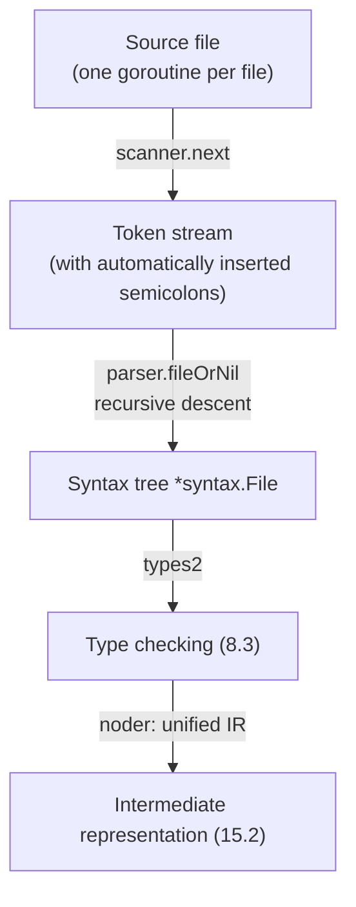

# 15.1 Lexing and Grammar

The first phase of the compiler turns source text into a syntax tree.
[3.2.2](../../part1overview/ch03life/compile.md) already noted that Go's grammar was designed
deliberately so that parsing needs neither type information nor a symbol table. This section looks
at how that phase is implemented: how the scanner splits the input into tokens and inserts
semicolons automatically, how the parser builds the tree by recursive descent, resolves the few
ambiguities in the grammar and keeps going after an error, and how the gc front end evolved from a
yacc-generated parser into today's `syntax` package.

The phase lives in the package `cmd/compile/internal/syntax`: `scanner.go` is the scanner,
`parser.go` the parser, and `nodes.go` defines the tree nodes
[[Go Authors, 2026a](#ref-go-authors-2026a)]. According to the compiler README, each syntax tree is
an exact representation of its source file; nodes correspond one to one with the expressions,
declarations and statements of the source, and carry position information used for error reports and
debug information [[Go Authors, 2026b](#ref-go-authors-2026b)]. The compiler starts one goroutine
per source file in the package to parse it, with at most `GOMAXPROCS+10` files open at a time. Once
all files are parsed, the trees go to type checking and are then converted into the intermediate
representation of the compiler's middle end ([15.2](./ssa.md))
[[Go Authors, 2026c](#ref-go-authors-2026c)].



## 15.1.1 Tokens and Automatic Semicolon Insertion

Lexical analysis splits the character stream into **tokens**: identifiers, keywords, operators and
punctuation, and literals. Go's lexical rules largely follow C. The most visible difference is the
semicolon. Go's formal grammar terminates statements with semicolons, as C does, yet semicolons are
almost absent from Go source, because the language specification gives two rules for omitting them
[[Go Authors, 2026d](#ref-go-authors-2026d)]:

1. When the input is broken into tokens, a semicolon is automatically inserted after a line's final
   token if that token is an identifier; an integer, floating-point, imaginary, rune or string
   literal; one of the keywords `break`, `continue`, `fallthrough` or `return`; or one of the
   operators and punctuation `++`, `--`, `)`, `]` or `}`.
2. To allow complex statements to occupy a single line, a semicolon may be omitted before a closing
   `)` or `}`.

Effective Go summarizes the first rule this way: "if the newline comes after a token that could end
a statement, insert a semicolon" [[Go Authors, n.d.](#ref-go-authors-nd)]. The rule looks only at
the one token before the newline, regardless of what the next line says or how far parsing has
progressed. It can therefore be applied entirely in the scanner, and a reader can tell at a glance
where a semicolon was inserted. JavaScript's automatic semicolon insertion makes a useful contrast.
The ECMAScript specification inserts a semicolon only when the parser meets a token that no
production allows (the offending token) and a line terminator separates it from the previous token;
a few "restricted productions" such as `return` and `continue` additionally forbid a line break
after them [[Ecma International, 2025](#ref-ecma-international-2025)]. There the semicolon is a
repair after a parse failure, and whether it is inserted depends on whether the next line can
continue the current production. In Go the lexical rules decide in advance.

The `syntax` scanner implements the first rule with a boolean field, `nlsemi`:

```go
type scanner struct {
	source
	mode   uint
	nlsemi bool // if set '\n' and EOF translate to ';'
	// ……
}
```

Each call to `next` reads one token. It first takes the `nlsemi` value left by the previous token
and clears the field. While skipping white space, a newline counts as white space only if `nlsemi`
is false; if it is true, the newline and the end of file are translated into a semicolon whose
literal value is recorded as `"newline"` or `"EOF"`. When the scanner recognizes `)`, `]` or `}`, it
sets `nlsemi` to true for the next call:

```go
func (s *scanner) next() {
	nlsemi := s.nlsemi
	s.nlsemi = false

redo:
	// skip white space
	s.stop()
	startLine, startCol := s.pos()
	for s.ch == ' ' || s.ch == '\t' || s.ch == '\n' && !nlsemi || s.ch == '\r' {
		s.nextch()
	}
	// ……
	switch s.ch {
	case -1:
		if nlsemi {
			s.lit = "EOF"
			s.tok = _Semi
			break
		}
		s.tok = _EOF

	case '\n':
		s.nextch()
		s.lit = "newline"
		s.tok = _Semi
	// ……
	case ')':
		s.nextch()
		s.nlsemi = true
		s.tok = _Rparen
```

Literals set `nlsemi` through `setLit`, and `++` and `--` set it individually. Identifiers and
keywords share one path: after `ident` reads a name, it looks the name up in the keyword table using
a perfect hash function (the hash is computed from the first two bytes and the length of the name;
the table has 64 entries, and initialization panics on a collision). If the name is a keyword, only
`break`, `continue`, `fallthrough` and `return` set `nlsemi`; otherwise the name is an ordinary
identifier and `nlsemi` is always set:

```go
	// possibly a keyword
	lit := s.segment()
	if len(lit) >= 2 {
		if tok := keywordMap[hash(lit)]; tok != 0 && tokStrFast(tok) == string(lit) {
			s.nlsemi = contains(1<<_Break|1<<_Continue|1<<_Fallthrough|1<<_Return, tok)
			s.tok = tok
			return
		}
	}

	s.nlsemi = true
	s.lit = string(lit)
	s.tok = _Name
}
```

The whole first rule reduces to the question of when `nlsemi` is true; the scanner has no separate
semicolon-insertion step. A multi-line `/* */` comment at a position where a semicolon would be
inserted is treated as a newline, and `nlsemi` again decides whether it becomes a semicolon. The
second rule needs no help from the scanner: the parser simply accepts an optional semicolon before
the closing token of a list.

The compiler's internal `syntax` package cannot be imported from outside, but the standard library's
`go/scanner` implements the same rules from the same specification: an automatically inserted
semicolon is distinguished from a written one by its literal value `"\n"`. The following program
splits a piece of code into tokens and marks the semicolons that came from newlines as `⟨;⟩`:

```go {run=true}
package main

import (
	"fmt"
	"go/scanner"
	"go/token"
	"strings"
)

func main() {
	src := []byte("x := f(a,\n\tb)\ny++\nif x > 0 {\n\treturn\n}\n")

	fset := token.NewFileSet()
	file := fset.AddFile("", fset.Base(), len(src))
	var s scanner.Scanner
	s.Init(file, src, nil, 0)

	line, toks := 1, []string{}
	for {
		pos, tok, lit := s.Scan()
		if tok == token.EOF {
			break
		}
		if l := fset.Position(pos).Line; l != line {
			fmt.Printf("%d: %s\n", line, strings.Join(toks, " "))
			line, toks = l, nil
		}
		switch {
		case tok == token.SEMICOLON && lit == "\n":
			toks = append(toks, "⟨;⟩") // a semicolon converted from a newline
		case lit != "":
			toks = append(toks, lit)
		default:
			toks = append(toks, tok.String())
		}
	}
	fmt.Printf("%d: %s\n", line, strings.Join(toks, " "))
}
```

The output is:

```
1: x := f ( a ,
2: b ) ⟨;⟩
3: y ++ ⟨;⟩
4: if x > 0 {
5: return ⟨;⟩
6: } ⟨;⟩
```

Line 1 ends with `,`, so its newline is white space and the arguments of a call can span lines. The
`)` on line 2, the `++` on line 3, the `return` on line 5 and the `}` on line 6 each turn the
following newline into a semicolon. Line 4 ends with `{` and gets none.

The rule did not start out this way. In October 2008 the gc implementation required that "all
statements and declarations are terminated by semicolons, except at the top level and around closing
`)` or `}`" [[Cox, 2008](#ref-cox-2008)], so the grammars for types and statements each had to be
written in two versions. In June 2009 Russ Cox changed the scanner to help insert semicolons, which
removed the duplicated grammar [[Cox, 2009a](#ref-cox-2009a)]. Go was open-sourced in November 2009,
and a month later the specification was changed to today's rule
[[Griesemer, 2009](#ref-griesemer-2009)], which gc implemented right away
[[Cox, 2009b](#ref-cox-2009b)]. To migrate source from the old syntax to the new, gofmt was used to
rewrite the entire source tree in bulk and delete the semicolons that were no longer needed
[[Pike, 2012](#ref-pike-2012)].

## 15.1.2 Placement of the Opening Brace

Automatic semicolon insertion directly determines where the opening brace goes: it cannot start a
new line. The following function declaration puts `{` on the next line:

```go
package main

func f()
{
}

func main() {}
```

With Go 1.26.10, compiling reports:

```shell
$ go build .
# example
./main.go:4:1: syntax error: unexpected semicolon or newline before {
```

Line 3 ends with `)`, so the scanner inserts a semicolon after it, and the parser sees `func f();`
followed by `{`. `func f();` is itself a valid declaration: the specification allows a function
declaration without type parameters to omit its body, which supplies a signature for a function
implemented outside Go (for example in assembly) [[Go Authors, 2026d](#ref-go-authors-2026d)]. The
error is therefore not on line 3 but at the `{` that appears at top level on line 4. The parser
recognizes this case specifically: if a `{` appears at top level and the previous declaration is a
function declaration without a body, it gives the targeted message above; otherwise it reports a
non-declaration statement outside a function body:

```go
		default:
			if p.tok == _Lbrace && len(f.DeclList) > 0 && isEmptyFuncDecl(f.DeclList[len(f.DeclList)-1]) {
				// opening { of function declaration on next line
				p.syntaxError("unexpected semicolon or newline before {")
			} else {
				p.syntaxError("non-declaration statement outside function body")
			}
			p.advance(_Import, _Const, _Type, _Var, _Func)
			continue
		}
```

Control structures behave the same way. `if x > 0` ends in a literal, so the newline after it
becomes a semicolon, the parser finds a semicolon where it needs a `{`, and it reports
`syntax error: unexpected newline, expected { after if clause`. Effective Go lists this as a direct
consequence of the semicolon rules: the opening brace of a control structure cannot be on the next
line [[Go Authors, n.d.](#ref-go-authors-nd)]. In C-family languages the brace position is a matter
of style that each project settles for itself. In Go it follows from the lexical rules, and gofmt
fixes the remaining layout details, so the argument never arises.

## 15.1.3 Recursive Descent

The parser uses **recursive descent**: each production of the grammar corresponds to a method, and
the method picks a branch from the current token and calls the methods of the other productions to
parse the components [[Aho et al., 2006](#ref-aho-et-al-2006)]. The grammar of a source file is a
package clause followed by import declarations and top-level declarations. The entry method
`fileOrNil` first requires a `package` clause and then loops over the top-level declarations:

```go
	for p.tok != _EOF {
		// ……
		switch p.tok {
		case _Import:
			p.next()
			f.DeclList = p.appendGroup(f.DeclList, p.importDecl)

		case _Const:
			p.next()
			f.DeclList = p.appendGroup(f.DeclList, p.constDecl)
		// ……
		case _Func:
			p.next()
			if d := p.funcDeclOrNil(); d != nil {
				f.DeclList = append(f.DeclList, d)
			}
```

`p.tok` is the current token and `p.next()` reads the next one. Every top-level declaration starts
with a keyword, so one token is enough to tell the kind of declaration; `importDecl`, `constDecl`
and `funcDeclOrNil` then descend further, down to the names and literals inside expressions. To be
forgiving, `fileOrNil` accepts an import declaration after other declarations but reports
`imports must appear before other declarations`.

The product of parsing is the syntax tree defined in `nodes.go`. Every node implements the `Node`
interface and carries a position. For a terminal (a name or literal) the position is its position in
the source; for a nonterminal it is the position of the single token uniquely associated with the
production, usually the leftmost one, so that the position of an `IfStmt` is that of the keyword
`if` [[Go Authors, 2026a](#ref-go-authors-2026a)]. The parser checks only syntax: whether the `T` in
`x == T{1}` really is a type is left to type checking
([8.3](../../part2lang/ch08generics/checker.md)). Labels and jumps are an exception. The compiler
invokes the parser in `CheckBranches` mode, so the correct use of labels and of `break`, `continue`
and `goto` is already checked during parsing [[Go Authors, 2026c](#ref-go-authors-2026c)].

## 15.1.4 Ambiguities in the Grammar

In "Go at Google", Pike writes that Go's grammar is regular and therefore easy to parse, then
adds: "mostly; there are a couple of quirks we might have fixed but didn't discover early
enough" [[Pike, 2012](#ref-pike-2012)]. Next to C++, these quirks are minor. In C++,
`Widget w(Thing());` can be grammatically either an object definition or a function declaration; the
standard says to parse it as a function declaration, the so-called most vexing parse
[[Meyers, 2001](#ref-meyers-2001)]. The Go specification records two ambiguities of its own, and
they show how a recursive-descent parser handles a construct that one token cannot decide.

The first is the conflict between composite literals and blocks. The header of an `if`, `for` or
`switch` is followed by the `{` of a block, and a composite literal such as `T{1}` also starts with
`{`. When parsing `if x == T{1} {`, the parser cannot tell at the first `{` whether it belongs to a
composite literal or to a block. The specification rules that, in this position, if a composite
literal written with a type name is not enclosed in parentheses, brackets or braces, its `{` is
always taken to start the block; where a composite literal is wanted, it must be parenthesized
[[Go Authors, 2026d](#ref-go-authors-2026d)]. The following program therefore does not compile:

```go
package main

type T struct{ a int }

func main() {
	x := T{1}
	if x == T{1} {
		println("equal")
	}
}
```

With Go 1.26.10, compiling reports:

```shell
$ go build .
# example
./main.go:7:15: syntax error: unexpected { at end of statement
./main.go:10:1: syntax error: non-declaration statement outside function body
```

The parser takes `x == T` as the condition and `{1}` as the block, so the second `{` becomes a stray
token and all the braces after it are misaligned. Writing `if x == (T{1}) {` compiles. The ruling is
implemented by the parser's `xnest` counter, which records the expression nesting level:

```go
	xnest  int    // expression nesting level (for complit ambiguity resolution)
```

Before parsing the header of a control structure, the `header` method sets `xnest` to -1:

```go
	outer := p.xnest
	p.xnest = -1
```

From then on, each parenthesis (including a call's argument list), bracket or composite-literal
brace increments `xnest` on entry and decrements it on exit. When the parser meets a `{` after an
operand, and the operand is a name or qualified name, it treats the `{` as the start of a composite
literal only if `xnest` is non-negative. If the operand is itself the literal notation of an array,
slice, struct or map type, there is no ambiguity:

```go
		case _Lbrace:
			// operand may have returned a parenthesized complit
			// type; accept it but complain if we have a complit
			t := Unparen(x)
			// determine if '{' belongs to a composite literal or a block statement
			complit_ok := false
			switch t.(type) {
			case *Name, *SelectorExpr:
				if p.xnest >= 0 {
					// x is possibly a composite literal type
					complit_ok = true
				}
			// ……
			case *ArrayType, *SliceType, *StructType, *MapType:
				// x is a comptype
				complit_ok = true
			}
			if !complit_ok {
				break loop
			}
```

The yacc-era parser handled the same rule in a sharply different way. Expressing the restriction
directly in an LALR(1) grammar would require a second expression grammar without bare composite
literals for control-structure headers. Go 1.4's gc did not do that. Instead, the hand-written
scanner `lex.c` kept a state called `loophack`: after reading `if`, `for`, `switch` or `select`, it
handed the parser the next `{` outside parentheses as a different token, `LBODY`, and the grammar
required the blocks of these statements to begin with `LBODY`
[[Go Authors, 2014](#ref-go-authors-2014)]:

```c
	/*
	 * clumsy dance:
	 * to implement rule that disallows
	 *	if T{1}[0] { ... }
	 * but allows
	 * 	if (T{1}[0]) { ... }
	 * the block bodies for if/for/switch/select
	 * begin with an LBODY token, not '{'.
	 *
	 * when we see the keyword, the next
	 * non-parenthesized '{' becomes an LBODY.
	 * loophack is normally 0.
	 * a keyword makes it go up to 1.
	 * parens push loophack onto a stack and go back to 0.
	 * a '{' with loophack == 1 becomes LBODY and disables loophack.
	 *
	 * i said it was clumsy.
	 */
```

The comment ends with "i said it was clumsy". The scanner had to know the parser's state, which
broke the boundary between the two. The recursive-descent parser keeps the same context in an
integer field of its own, and the scanner goes back to looking only at characters.

The second ambiguity comes from generics. `type T[P *C] …` can be read either as a generic type with
type parameter `P` and constraint `*C`, or as an array type whose length is the constant expression
`P * C`. The specification says that such a declaration is parsed as an array type; to get a type
parameter, write the constraint as `interface{*C}` or add a trailing comma
[[Go Authors, 2026d](#ref-go-authors-2026d)]. Compiling `type C int` and
`type T[P *C] struct{ p P }` with Go 1.26.10 reports `undefined: P` and
`C (type) is not an expression`, which shows that `P * C` was indeed taken as the array length;
`type T[P *C,] struct{ p P }` compiles. When the parser reads `type T[`, it likewise cannot decide
immediately. It parses on as the form common to both, an expression, and afterwards checks whether
the result can be split into a type parameter name and a constraint:

```go
			if pname, ptype := extractName(x, p.tok == _Comma); pname != nil && (ptype != nil || p.tok != _Rbrack) {
				// d.Name "[" pname ...
				// d.Name "[" pname ptype ...
				// d.Name "[" pname ptype "," ...
				d.TParamList = p.paramList(pname, ptype, _Rbrack, true, false) // ptype may be nil
				d.Alias = p.gotAssign()
				d.Type = p.typeOrNil()
			} else {
				// d.Name "[" pname "]" ...
				// d.Name "[" x ...
				d.Type = p.arrayType(pos, x)
			}
```

The two treatments have one thing in common: the parser never backs up to re-read tokens. When one
token cannot decide a construct, it either rules from known context, as `xnest` does, or parses the
common form first and classifies afterwards.

## 15.1.5 Error Recovery

A syntax error should not end the analysis of the whole file. After reporting an error, the parser
calls `advance`, which skips tokens until it reaches a position where parsing can resume:

```go
// The stopset contains keywords that start a statement.
// They are good synchronization points in case of syntax
// errors and (usually) shouldn't be skipped over.
const stopset uint64 = 1<<_Break |
	1<<_Const |
	// ……
	1<<_Var

// advance consumes tokens until it finds a token of the stopset or followlist.
// The stopset is only considered if we are inside a function (p.fnest > 0).
// The followlist is the list of valid tokens that can follow a production;
// if it is empty, exactly one (non-EOF) token is consumed to ensure progress.
func (p *parser) advance(followlist ...token) {
```

There are two kinds of synchronization points. One is the tokens that may legally follow the current
production, supplied by the caller; for example, when `fileOrNil` hits an error at top level it
passes `import`, `const`, `type`, `var` and `func`. The other is the keywords that begin a statement
inside a function body. Discarding input until a synchronizing token appears is what compiler
textbooks call panic-mode recovery [[Aho et al., 2006](#ref-aho-et-al-2006)]. The following file has
one error in each of two functions:

```go
package main

func f(a int) int {
	return a + )
}

func g(b bool) {
	if b {
		println(1
	}
}

func main() {}
```

With Go 1.26.10, a single compilation reports both errors:

```shell
$ go build .
# example
./main.go:4:13: syntax error: unexpected ), expected expression
./main.go:9:12: syntax error: unexpected newline in argument list; possibly missing comma or )
```

The second message also owes something to the semicolon rule: the newline after the argument `1` is
translated into a semicolon, and when the parser finds a semicolon in an argument list it infers
that a comma or closing parenthesis is probably missing.

## 15.1.6 From yacc to the syntax Package

Through Go 1.4, gc was written in C. Its parser was generated by bison from the grammar file `go.y`,
and the scanner `lex.c` was handwritten [[Go Authors, 2014](#ref-go-authors-2014)]. bison produces
an LALR(1) parser. `go.y` resolved grammar conflicts with precedence declarations (`%left`, `%prec`)
and used a script, `bisonerrors`, to map the parser's error states to customized messages. The
comment at the top of `go.y` states the semicolon rule of that time: statements and declarations are
terminated by semicolons, the semicolon may be omitted before a closing `)` or `}`, and the scanner
inserts the semicolon before a newline.

Go 1.5 translated the compiler mechanically from C to Go ([15.7](./future.md)), and `go.y` was then
processed by a Go version of yacc. During the Go 1.6 development cycle, Robert Griesemer translated
the yacc grammar into a handwritten recursive-descent parser
[[Griesemer, 2015a](#ref-griesemer-2015a)]. According to the commit message, the new parser is a
translation of the yacc parser, with adjustments to make the grammar suitable for recursive descent
and with most yacc semantic actions copied unchanged to preserve correctness. For the files in
`make.bash`, parsing took about 18% less time per file on average, and compiling `cmd/compile`
itself took about 3% less. As for error messages, reproducing the yacc parser's wording in every
case is very hard, and the new parser sometimes gives better messages. A little over ten days later
the yacc parser was deleted [[Griesemer, 2015b](#ref-griesemer-2015b)]. The Go 1.6 release notes
call the most important internal change in the compiler the switch from a yacc-generated parser to a
handwritten one [[Go Authors, 2016](#ref-go-authors-2016)].

That parser still built the compiler's internal `Node` directly while parsing, so the syntax tree
was not separate from the compiler's data structures. In August 2016, Griesemer submitted the
standalone `syntax` package, with the tree nodes, scanner, parser and printer; the commit message
records that, in a warmed-up state, it parses the whole standard library at about 1.8 million lines
per second [[Griesemer, 2016](#ref-griesemer-2016)]. Matthew Dempsky then wrote `noder`, which
converts a `syntax` tree into the compiler's `Node` [[Dempsky, 2016a](#ref-dempsky-2016a)]. In
October of that year the new front end became the default [[Dempsky, 2016b](#ref-dempsky-2016b)],
and the old scanner and parser were deleted soon after [[Dempsky, 2016c](#ref-dempsky-2016c)]. The
Go 1.8 release notes say the new compiler front end is invisible to users but lays the foundation
for future performance work [[Go Authors, 2017](#ref-go-authors-2017)]. Since then the `syntax` tree
has been the input first of `types2` ([8.3](../../part2lang/ch08generics/checker.md)) and then of
the unified IR ([15.2](./ssa.md)).

The standard library's `go/scanner`, `go/parser` and `go/ast` are a separate implementation. The
compiler README explains why: the compiler was originally written in C, and the `go/*` packages were
developed for tools that process Go code, such as gofmt and vet, which the compiler mostly does not
use [[Go Authors, 2026b](#ref-go-authors-2026b)]. Tools such as gopls
([16.7](../ch16tools/gopls.md)) are also built on `go/*`. The two front ends each implement the same
specification, so a syntax change such as generics has to be implemented in both, and their error
messages differ. Give the `if x == T{1} {` that fails to compile in 15.1.4 to `go vet`, which is
based on `go/parser`, and it reports `expected ';', found '{'` at the same position.

## 15.1.7 Summary

Go's front end can be summed up as two instances of "look at only one": the scanner looks at the
single token before a newline to decide whether to insert a semicolon, and at almost every position
the parser looks at the single current token to choose a branch. The two ambiguities recorded in the
specification are settled by an explicit ruling together with an internal counter or a
classification after the fact in the parser, never by backtracking. A grammar like this lets a
handwritten recursive-descent parser do the job: it is faster than a yacc-generated one, its error
messages can be customized case by case, and the standard library can provide an independent parser
for tools in the same way.

## Further Reading

- <a id="ref-aho-et-al-2006"></a>[Aho et al., 2006] Alfred V. Aho, Monica S. Lam, Ravi Sethi,
  Jeffrey D. Ullman. *Compilers: Principles, Techniques, and Tools.* 2nd ed. Addison-Wesley, 2006.
  Chapter 4, "Syntax Analysis": recursive descent, LALR parsing, and error-recovery strategies such
  as panic mode.
- <a id="ref-cox-2008"></a>[Cox, 2008] Russ Cox. implement new semicolon rules. Go commit
  d364d28142,
  2008. https://github.com/golang/go/commit/d364d28142
  The semicolon rule before open sourcing: statements end with a semicolon, which may be omitted at
  top level and around closing brackets.
- <a id="ref-cox-2009a"></a>[Cox, 2009a] Russ Cox. implement optional semicolons with help from the
  lexer, instead of having to double the type and statement grammars. Go commit 8abcdee175, 2009.
  https://github.com/golang/go/commit/8abcdee175
- <a id="ref-cox-2009b"></a>[Cox, 2009b] Russ Cox. gc: semicolons. Go commit 3997495dc3, 2009.
  https://github.com/golang/go/commit/3997495dc3
  gc implements today's semicolon rule.
- <a id="ref-dempsky-2016a"></a>[Dempsky, 2016a] Matthew Dempsky. cmd/compile/internal/gc: use new
  AST parser. Go commit 2ff463948c, 2016. https://go.dev/cl/27198 Released with Go 1.8.
- <a id="ref-dempsky-2016b"></a>[Dempsky, 2016b] Matthew Dempsky. cmd/compile/internal/gc: enable
  new parser by default. Go commit adda7ad295, 2016. https://go.dev/cl/27203 Released with Go 1.8.
- <a id="ref-dempsky-2016c"></a>[Dempsky, 2016c] Matthew Dempsky. cmd/compile: remove old lexer and
  parser. Go commit 57df2f802f, 2016. https://go.dev/cl/32020
  Released with Go 1.8.
- <a id="ref-ecma-international-2025"></a>[Ecma International, 2025] Ecma International. *ECMAScript
  2025 Language Specification* (ECMA-262, 16th edition), §12.10 "Automatic Semicolon
  Insertion". 2025. https://tc39.es/ecma262/2025/#sec-automatic-semicolon-insertion
- <a id="ref-go-authors-nd"></a>[Go Authors, n.d.] The Go Authors. *Effective Go*: Semicolons.
  https://go.dev/doc/effective_go#semicolons
- <a id="ref-go-authors-2014"></a>[Go Authors, 2014] The Go Authors. src/cmd/gc/go.y and lex.c. Go
  1.4 source. https://github.com/golang/go/tree/go1.4/src/cmd/gc The bison grammar and the
  handwritten scanner, including the implementation of `loophack`.
- <a id="ref-go-authors-2016"></a>[Go Authors, 2016] The Go Authors. *Go 1.6 Release Notes*:
  Compiler Toolchain. 2016. https://go.dev/doc/go1.6#compiler
- <a id="ref-go-authors-2017"></a>[Go Authors, 2017] The Go Authors. *Go 1.8 Release Notes*:
  Compiler Toolchain. 2017. https://go.dev/doc/go1.8#compiler
- <a id="ref-go-authors-2026a"></a>[Go Authors, 2026a] The Go Authors.
  cmd/compile/internal/syntax (scanner and parser). Go 1.26 source.
  https://github.com/golang/go/tree/release-branch.go1.26/src/cmd/compile/internal/syntax
  https://github.com/golang/go/tree/master/src/cmd/compile/internal/syntax
- <a id="ref-go-authors-2026b"></a>[Go Authors, 2026b] The Go Authors.
  cmd/compile/README (overview of the compiler front end: the parsing phase).
  https://github.com/golang/go/blob/release-branch.go1.26/src/cmd/compile/README.md
  https://github.com/golang/go/blob/master/src/cmd/compile/README.md
- <a id="ref-go-authors-2026c"></a>[Go Authors, 2026c] The Go Authors.
  src/cmd/compile/internal/noder/noder.go (LoadPackage), src/cmd/compile/internal/syntax/syntax.go
  (CheckBranches). Go 1.26 source.
  https://github.com/golang/go/blob/release-branch.go1.26/src/cmd/compile/internal/noder/noder.go
- <a id="ref-go-authors-2026d"></a>[Go Authors, 2026d] The Go Programming Language Specification:
  *Lexical elements / Semicolons*, Function declarations, Composite literals, Type parameter
  declarations. Language version go1.26, 2026. https://go.dev/ref/spec#Semicolons
- <a id="ref-griesemer-2009"></a>[Griesemer, 2009] Robert Griesemer. Spec modified to reflect new
  semicolon rules. Go commit 130ac74010, 2009. https://github.com/golang/go/commit/130ac74010
- <a id="ref-griesemer-2015a"></a>[Griesemer, 2015a] Robert Griesemer. cmd/compile/internal/gc:
  recursive-descent parser. Go commit b569b87ca1, 2015. https://go.dev/cl/16665
  Released with Go 1.6.
- <a id="ref-griesemer-2015b"></a>[Griesemer, 2015b] Robert Griesemer. cmd/compile: remove
  yacc-based parser. Go commit b5fe07710f, 2015. https://go.dev/cl/17176
  https://github.com/golang/go/commit/b5fe07710f Completes the migration from the yacc grammar to a
  handwritten recursive-descent parser. Released with Go 1.6.
- <a id="ref-griesemer-2016"></a>[Griesemer, 2016] Robert Griesemer. cmd/compile/internal/syntax:
  fast Go syntax trees, initial commit. Go commit c8683ff797, 2016. https://go.dev/cl/27195 Released
  with Go 1.8.
- <a id="ref-meyers-2001"></a>[Meyers, 2001] Scott Meyers. *Effective STL.* Addison-Wesley, 2001.
  Item 6 "Be alert for C++'s most vexing parse". The classic treatment of a C++ parsing ambiguity,
  to compare with the two ambiguities recorded in the Go specification.
- <a id="ref-pike-2012"></a>[Pike, 2012] Rob Pike. "Go at Google: Language Design in the Service of
  Software Engineering." 2012. https://go.dev/talks/2012/splash.article Why Go's grammar can be
  parsed without a symbol table, and how gofmt migrated the source tree to the new semicolon rule.
- This book: [3.2 The Go Compilation Pipeline](../../part1overview/ch03life/compile.md),
  [8.3 Type-Checking Techniques](../../part2lang/ch08generics/checker.md),
  [15.2 Intermediate Representation](./ssa.md),
  [16.7 The Language Server Protocol](../ch16tools/gopls.md).
