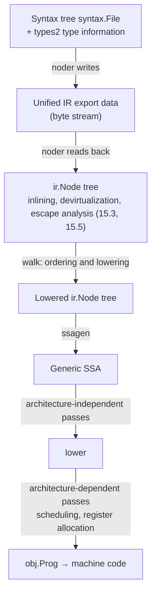

# 15.2 Intermediate Representation

A Go function passes through several representations on its way from syntax tree
([15.1](./parse.md)) to machine code. The type-checked syntax tree is serialized as the export data
of the **unified IR**, then read back as a tree of `ir` nodes in the compiler's middle end.
Inlining, devirtualization, escape analysis and walk all operate on `ir`. After walk, the function
is converted to **static single assignment** (SSA) form, goes through dozens of
architecture-independent and architecture-dependent passes, and finally yields machine instructions
[[Go Authors, 2026a](#ref-go-authors-2026a)]. [3.2](../../part1overview/ch03life/compile.md)
outlined these phases and used a small function to explain SSA and the φ function. This section is
about the representations themselves: why each one exists, how adjacent ones connect, and the data
structures of SSA in the Go compiler, the organization of its optimization passes, and its rewrite
rules.



## 15.2.1 Unified IR

The compiler's middle end uses its own syntax tree and type representation, a legacy from when the
compiler was written in C, and all of the middle end's code is written against it. The first step
after type checking is therefore to convert the `syntax` tree and the `types2` type information into
`ir` and `types`, a process called noding [[Go Authors, 2026a](#ref-go-authors-2026a)]. Since Go
1.20, noding has used the **unified IR**. Instead of walking the syntax tree and constructing `ir`
nodes directly, it first serializes the type-checked code into export data and then builds `ir` from
that data.

The reason for the detour is in the commit message in which Matthew Dempsky introduced the unified
IR [[Dempsky, 2021](#ref-dempsky-2021)]. Before it, a function body was copied several times during
compilation, and each copy was done by a separate implementation. Noding copied the syntax tree into
`ir`. To support generics, stenciling copied the generic `ir` into instantiated `ir`. The inliner
saved a copy of each inlinable function, copied it again at each inlining site, and rewrote
positions, variable references and `return` statements. The exporter wrote out the `ir` the inliner
had saved, and the importer read it back. The message points out that these tasks are conceptually
the same one, copying a function body with possibly a few substitutions, yet they were independent
implementations, and with so many details in `ir` the same problems kept recurring. The unified IR
merges the copies into one path: a writer walks the syntax tree and the `types2` type information
and produces a sectioned byte stream, and a reader rebuilds `ir` from the stream. The same reader
constructs the functions of the local package, reads on demand the inlinable function bodies of
imported packages, and reads other packages' export data for `types2`, so the export format and the
compiler's intermediate representation become one. The comment on the function `unified` in the
`noder` package summarizes the pipeline:

```go
// unified constructs the local package's Internal Representation (IR)
// from its syntax tree (AST).
//
// The pipeline contains 2 steps:
//
//  1. Generate the export data "stub".
//
//  2. Generate the IR from the export data above.
//
// The package data "stub" at step (1) contains everything from the local package,
// but nothing that has been imported. When we're actually writing out export data
// to the output files (see writeNewExport), we run the "linker", which:
//
//   - Updates compiler extensions data (e.g. inlining cost, escape analysis results).
//
//   - Handles re-exporting any transitive dependencies.
//
//   - Prunes out any unnecessary details (e.g. non-inlineable functions, because any
//     downstream importers only care about inlinable functions).
```

The same comment admits that source files are currently type-checked twice: once by `types2` before
the export data is written, and once more by the old `typecheck` after it is read back. The latter
is still responsible for some rewrites, such as expanding multi-value function calls and
distinguishing map index operations [[Go Authors, 2026d](#ref-go-authors-2026d)].

The unified IR was added as an experiment on the Go 1.18 development branch
[[Dempsky, 2021](#ref-dempsky-2021)], became the default in Go 1.20
[[Dempsky, 2022](#ref-dempsky-2022)], and Go 1.21 removed the old noding path
[[Dempsky, 2023](#ref-dempsky-2023)]. For a long time its format was defined only implicitly by the
code of the `noder` package. Since Go 1.25, `noder/doc.go` describes the byte stream as a grammar: a
package consists of a header, several sections (strings, metadata, positions, packages, names,
types, objects, function bodies and so on) and an 8-byte SHA-256 fingerprint
[[Freeman, 2025](#ref-freeman-2025)]. The implementation of generics, which shares code by GC shape
and passes type information through dictionaries, is also built on the unified IR; see
[8.1](../../part2lang/ch08generics/history.md).

## 15.2.2 ir and walk

The `ir` nodes form a tree that broadly mirrors the source structure but has been type-checked and
has all names resolved. Until Go 1.16, the whole front end used a single large `Node` struct for
every kind of node, and fields such as `Left`, `Right` and `List` meant different things depending
on the operation. From November to December 2020, Russ Cox reworked it into a typed intermediate
representation on the `dev.regabi` branch. First he added accessor methods for every field and
rewrote all callers [[Cox, 2020a](#ref-cox-2020a)], then replaced `*Node` with an interface `Node`
[[Cox, 2020b](#ref-cox-2020b)], and then gradually split out concrete node types such as `ir.Name`,
`ir.Func` and `ir.CallExpr`, with the methods for traversing and copying nodes generated by a
program from the struct definitions. Most of these changes were made mechanically by
refactoring-tool scripts and shipped with Go 1.17. Today's `ir.Node` interface looks like this:

```go
// A Node is the abstract interface to an IR node.
type Node interface {
	// Formatting
	Format(s fmt.State, verb rune)

	// Source position.
	Pos() src.XPos
	SetPos(x src.XPos)

	// For making copies. For Copy and SepCopy.
	copy() Node

	doChildren(func(Node) bool) bool
	// ……
	// Abstract graph structure, for generic traversals.
	Op() Op
	Init() Nodes

	// Fields specific to certain Ops only.
	Type() *types.Type
	SetType(t *types.Type)
	// ……
}
```

Inlining, devirtualization ([15.3](./optimize.md)) and escape analysis ([15.5](./escape.md)) all
operate on `ir`. The last middle-end pass is walk, which has two tasks. One is to break complex
statements into sequences of simple ones, introducing temporaries and respecting evaluation order;
this step is also called order. The other is to lower high-level language constructs to more basic
forms, for example turning `switch` into binary search or a jump table, and replacing map and
channel operations with runtime calls [[Go Authors, 2026a](#ref-go-authors-2026a)]
([3.2.5](../../part1overview/ch03life/compile.md)). The following function swaps the values pointed
to by two pointers:

```go
//go:noinline
func swap(p, q *int) {
	*p, *q = *q, *p
}
```

With Go 1.26.10, compiling with `GOSSAFUNC=swap+` first prints the `ir` after walk (excerpt):

```
.   .   AS tc(1) # main.go:5:9
.   .   .   NAME-main..autotmp_2 esc(N) Class:PAUTO Offset:0 AutoTemp OnStack Used int tc(1) # main.go:5:9
.   .   .   DEREF int tc(1) # main.go:5:15
.   .   .   .   NAME-main.p esc(no) Class:PPARAM Offset:0 OnStack Used PTR-*int tc(1) # main.go:4:11
.   .   AS tc(1) # main.go:5:9
.   .   .   DEREF int tc(1) # main.go:5:2
.   .   .   .   NAME-main.p esc(no) Class:PPARAM Offset:0 OnStack Used PTR-*int tc(1) # main.go:4:11
.   .   .   DEREF int tc(1) # main.go:5:11
.   .   .   .   NAME-main.q esc(no) Class:PPARAM Offset:0 OnStack Used PTR-*int tc(1) # main.go:4:14
.   .   AS tc(1) # main.go:5:9
.   .   .   DEREF int tc(1) # main.go:5:6
.   .   .   .   NAME-main.q esc(no) Class:PPARAM Offset:0 OnStack Used PTR-*int tc(1) # main.go:4:14
.   .   .   NAME-main..autotmp_2 esc(N) Class:PAUTO Offset:0 AutoTemp OnStack Used int tc(1) # main.go:5:9
```

The tuple assignment has been broken into three single assignments: first `*p` is stored in the
temporary `autotmp_2`, then `*p = *q` runs, and finally `*q = autotmp_2`. The specification requires
that all operands on the right of a tuple assignment be evaluated before any assignment takes place,
and walk honors that order with this temporary.

## 15.2.3 Constructing SSA

The idea of bringing SSA into the Go compiler comes from a design document Keith Randall wrote in
February 2015 [[Randall, 2015](#ref-randall-2015)]. The compiler was about to be translated from C
to Go, and the document proposed replacing the syntax-tree-based intermediate representation with an
SSA-based one, in phases and starting from the back end. The fork would come after walk, because the
representation at that point is already quite low-level and largely architecture-independent. The
document argued that most of the easy improvements happen after that point, while most of the thorny
Go-specific processing happens before it. Escape analysis, inlining and lowering Go syntax to
runtime calls were all outside the first phase. To the frequently asked question of why not convert
directly to the intermediate representation of LLVM or GCC, the document gave three reasons: compile
speed, since the new SSA and its passes had to be fast by design, using linear-time algorithms
wherever possible; runtime information, since garbage collection and stack copying need precise
stack frame maps that an off-the-shelf back end cannot provide; and a reluctance to add another
external dependency to the build of Go.

The design first shipped with Go 1.7 for 64-bit x86. The release notes say the new back end
generates more compact and more efficient code and reduces CPU time on benchmark programs by 5% to
35% [[Go Authors, 2016](#ref-go-authors-2016)]. Go 1.8 extended it to all architectures, reducing
CPU time on 32-bit ARM by 20% to 30% [[Go Authors, 2017](#ref-go-authors-2017)]. Randall presented
the back end at GopherCon 2017 in the talk "Generating Better Machine Code with
SSA" [[Randall, 2017b](#ref-randall-2017b)]. Today the `ssagen` package converts each function to
SSA after walk, and the substitution of intrinsics also happens in this step: some functions the
compiler recognizes, such as the bit operations in `math/bits`, are replaced directly by the
corresponding instruction sequences [[Go Authors, 2026a](#ref-go-authors-2026a)].

The crux of constructing SSA is placing φ functions. `ssagen` translates each basic block in order.
When it meets a read of a variable that is not yet defined in the current block, it first places a
placeholder `FwdRef` value. After the whole function has been translated, it decides in one pass
which blocks need φ functions and replaces each `FwdRef` with the corresponding definition or φ
function. The beginning of `phi.go` states the algorithms used:

```go
// This file contains the algorithm to place phi nodes in a function.
// For small functions, we use Braun, Buchwald, Hack, Leißa, Mallon, and Zwinkau.
// https://pp.info.uni-karlsruhe.de/uploads/publikationen/braun13cc.pdf
// For large functions, we use Sreedhar & Gao: A Linear Time Algorithm for Placing Φ-Nodes.
// http://citeseerx.ist.psu.edu/viewdoc/download?doi=10.1.1.8.1979&rep=rep1&type=pdf

const smallBlocks = 500
```

The classic approach is due to Cytron et al.: compute the dominator tree and dominance frontiers
first, then place φ functions on the iterated dominance frontier of all definition points of each
variable [[Cytron et al., 1991](#ref-cytron-et-al-1991)]. The algorithm of Braun et al. needs no
precomputed dominance information. During translation it looks up a variable's definition in
predecessor blocks on demand and generates a φ function only where control flow merges; it is simple
to implement and fast for small functions [[Braun et al., 2013](#ref-braun-et-al-2013)]. The
algorithm of Sreedhar and Gao uses a structure called the DJ graph to find φ placements in linear
time [[Sreedhar and Gao, 1995](#ref-sreedhar-and-gao-1995)]. In 2016 Randall switched large
functions to the latter. The commit message says the old algorithm is still faster on small
functions, hence the threshold of 500 basic blocks, and that for the example in issue #16407 the
compile time dropped from about 20 minutes to about 30 seconds [[Randall, 2016](#ref-randall-2016)].

## 15.2.4 Values and Blocks

Go's SSA consists of **values** and **blocks**, a block being a basic block of the control flow
graph. SSA has no variables and no scopes. Values are named by sequential numbers and rarely
correspond to names in the source; the numbering lets the compiler use slices indexed by number
instead of maps, and position information traces back to the source when needed
[[Go Authors, 2026b](#ref-go-authors-2026b)]. The definition of `Value` is as follows (excerpt):

```go
// A Value represents a value in the SSA representation of the program.
// The ID and Type fields must not be modified. The remainder may be modified
// if they preserve the value of the Value (e.g. changing a (mul 2 x) to an (add x x)).
type Value struct {
	// A unique identifier for the value. For performance we allocate these IDs
	// densely starting at 1.  There is no guarantee that there won't be occasional holes, though.
	ID ID

	// The operation that computes this value. See op.go.
	Op Op

	// The type of this value. Normally this will be a Go type, but there
	// are a few other pseudo-types, see ../types/type.go.
	Type *types.Type

	// ……
	AuxInt int64
	Aux    Aux

	// Arguments of this value
	Args []*Value

	// Containing basic block
	Block *Block

	// ……
	// Use count. Each appearance in Value.Args and Block.Controls counts once.
	Uses int32
	// ……
}
```

The comment at the top determines how Go's SSA is rewritten. A value points through `Args` to the
values it uses but does not record who uses it, keeping only a use count, `Uses`. To rewrite a
value, the compiler does not create a new value and update every user; it modifies the `Op` and
`Args` of the value in place. As long as the new computation is equivalent to the old one, the ID
stays the same, and every pointer that holds the value sees the new definition. The "changing a
`(mul 2 x)` to an `(add x x)`" in the comment is exactly such an in-place rewrite. The comment
already appears, almost word for word, in the prototype attached to Randall's 2015 design document
[[Randall, 2015](#ref-randall-2015)].

Two things in the definition of `Block` deserve attention (excerpt):

```go
	// Subsequent blocks, if any. The number and order depend on the block kind.
	Succs []Edge

	// Inverse of successors.
	// The order is significant to Phi nodes in the block.
	// ……
	Preds []Edge

	// ……
	Controls [2]*Value
	// ……
	// The unordered set of Values that define the operation of this block.
	// After the scheduling pass, this list is ordered.
	Values []*Value
```

First, the order of predecessors is significant: the i-th argument of a φ function corresponds to
the i-th predecessor. Second, before scheduling, the values in a block are an unordered set. The
order among values is constrained by only two kinds of dependency: a value's arguments must be
computed before it, and memory-accessing operations are chained through values of type `memory`,
where every operation that reads memory takes a memory state as an argument and every operation that
writes memory produces a new memory state [[Go Authors, 2026b](#ref-go-authors-2026b)]. Taking
`swap` again, with Go 1.26.10 its initial SSA form is:

```
swap func(*int, *int)
  b1:
    (?) v1 = InitMem <mem>
    (?) v2 = SP <uintptr> DEAD
    (?) v3 = SB <uintptr> DEAD
    (?) v4 = LocalAddr <**int> {p} v2 v1 DEAD
    (?) v5 = LocalAddr <**int> {q} v2 v1 DEAD
    (-4) v6 = Arg <*int> {p} (p[*int])
    (-4) v7 = Arg <*int> {q} (q[*int])
    (5) v8 = NilCheck <*int> v6 v1
    (5) v9 = Load <int> v8 v1
    (5) v10 = NilCheck <*int> v7 v1
    (5) v11 = Load <int> v10 v1
    (5) v12 = NilCheck <*int> v6 v1
    (5) v13 = Store <mem> {int} v12 v11 v1
    (5) v14 = NilCheck <*int> v7 v13
    (5) v15 = Store <mem> {int} v14 v9 v13
    (6) v16 = MakeResult <mem> v15
    Ret v16
```

The temporary introduced by walk is gone, replaced by the value `v9`. Both loads, `v9` and `v11`,
take the initial memory state `v1` as an argument, so there is no ordering constraint between them.
The first store, `v13`, produces a new memory state and the second store, `v15`, takes `v13` as an
argument, so the two stores cannot be exchanged, and both loads must come before the first store.
These dependencies fully capture the semantics of the swap, and the scheduler may arrange
instructions freely within them. On arm64 the function ends up as just four memory instructions,
with the load of `*q` placed before the load of `*p` and the explicit nil checks removed:

```
 v11   	00006 (5)	MOVD	(R1), R2
 v9    	00007 (5)	MOVD	(R0), R3
 v13   	00008 (5)	MOVD	R2, (R0)
 v15   	00009 (5)	MOVD	R3, (R1)
```

For the use of `GOSSAFUNC` see [3.2.6](../../part1overview/ch03life/compile.md). Without the `+` it
generates only the web page `ssa.html`, in which each column corresponds to one transformation pass;
writing `GOSSAFUNC="Foo:sccp,generic deadcode"` also attaches control flow graphs for the named
passes [[Go Authors, 2026b](#ref-go-authors-2026b)].

## 15.2.5 Optimization Passes

Transformations on SSA are organized as a sequence of **passes**. Each pass processes one function,
and by default each runs once, in order. The `passes` array in `compile.go` lists all of them: in Go
1.26 there are 57, of which 3 are disabled by default (excerpt):

```go
var passes = [...]pass{
	{name: "number lines", fn: numberLines, required: true},
	// ……
	{name: "opt", fn: opt, required: true},
	// ……
	{name: "generic cse", fn: cse},
	// ……
	{name: "nilcheckelim", fn: nilcheckelim},
	{name: "prove", fn: prove},
	// ……
	{name: "middle opt", fn: opt, required: true},
	// ……
	{name: "late opt", fn: opt, required: true},
	// ……
	{name: "lower", fn: lower, required: true},
	// ……
	{name: "layout", fn: layout, required: true},     // schedule blocks
	{name: "schedule", fn: schedule, required: true}, // schedule values
	{name: "late nilcheck", fn: nilcheckelim2},
	{name: "flagalloc", fn: flagalloc, required: true}, // allocate flags register
	{name: "regalloc", fn: regalloc, required: true},   // allocate int & float registers + stack slots
	{name: "loop rotate", fn: loopRotate},
	{name: "trim", fn: trim}, // remove empty blocks
}
```

`lower` is the dividing line: the first half is architecture-independent and the second half
architecture-dependent. The first half includes `opt`, which simplifies by rules; common
subexpression elimination, `cse`; `nilcheckelim`, which removes redundant nil checks; `prove`, which
removes redundant bounds checks based on value ranges; sparse conditional constant propagation,
`sccp`; and dead store elimination, `dse`. Most of these are classic optimizations implemented on
SSA [[Muchnick, 1997](#ref-muchnick-1997)]. `lower` replaces generic operations with operations of
the target architecture. After it come block layout, `layout`; value scheduling, `schedule`; flags
register allocation, `flagalloc`; and register allocation, `regalloc`
[[Go Authors, 2026b](#ref-go-authors-2026b)]. In the `swap` above, the redundant `NilCheck`s are
removed by `late nilcheck`: the memory instruction that follows faults anyway when the pointer is
nil, and the runtime reports a panic on that basis.

Some passes occur more than once. `opt` runs three times, under the names `opt`, `middle opt` and
`late opt`, and `deadcode` appears eight times in the pipeline, because earlier transformations keep
creating new opportunities for simplification and new dead code. The ordering requirements between
passes are recorded separately in the array `passOrder` and checked one by one when the compiler
initializes; a violation causes a panic (excerpt):

```go
var passOrder = [...]constraint{
	// ……
	// prove relies on common-subexpression elimination for maximum benefits.
	{"generic cse", "prove"},
	// deadcode after prove to eliminate all new dead blocks.
	{"prove", "generic deadcode"},
```

## 15.2.6 Rewrite Rules

Most passes are handwritten Go code, but `opt` and `lower` are generated from **rewrite rules**. The
rules live in `ssa/_gen/*.rules`: `generic.rules` holds simplifications that apply to all
architectures, and `AMD64.rules`, `ARM64.rules` and so on hold the lowering rules and
simplifications of each architecture. The left side of a rule is a pattern for a value, the right
side is the replacement value, and a condition can be attached in between with `&&`
[[Go Authors, 2026c](#ref-go-authors-2026c)]. For example, the rule that rewrites multiplication by
a power of two as a left shift:

```
// Strength reduce multiplication by a power of two to a shift.
// Excluded from early opt so that prove can recognize mod
// by the x - (x/d)*d pattern.
// (Runs during "middle opt" and "late opt".)
(Mul64 <t> x (Const64 [c])) && isPowerOfTwo(c) && v.Block.Func.pass.name != "opt" =>
  (Lsh64x64 <t> x (Const64 <typ.UInt64> [log64(c)]))
```

The condition `v.Block.Func.pass.name != "opt"` keeps the rule from firing in the first `opt`, and
the comment gives the reason: `prove` has to recognize modulo operations in the form `x - (x/d)*d`,
and turning the multiplication into a shift too early would destroy that form. Rules can also
express facts about value ranges, for example `(IsInBounds (Mod64u _ y) y) => (ConstBool [true])`:
an unsigned `x % y` always falls within `[0, y)`, so using it as an index into a sequence of length
`y` makes the bounds check always true.

Rules are not interpreted at compile time. `_gen/rulegen.go` translates each rules file into a Go
source file: the left-side pattern becomes conditional tests that compare operations and arguments
level by level, and the right side becomes statements that construct new values. In Go 1.26,
`rewritegeneric.go`, generated from `generic.rules`, has about 37,000 lines, and `rewriteAMD64.go`
about 79,000. The code generated for the rule above is:

```go
	// match: (Mul64 <t> x (Const64 [c]))
	// cond: isPowerOfTwo(c) && v.Block.Func.pass.name != "opt"
	// result: (Lsh64x64 <t> x (Const64 <typ.UInt64> [log64(c)]))
	for {
		t := v.Type
		for _i0 := 0; _i0 <= 1; _i0, v_0, v_1 = _i0+1, v_1, v_0 {
			x := v_0
			if v_1.Op != OpConst64 {
				continue
			}
			c := auxIntToInt64(v_1.AuxInt)
			if !(isPowerOfTwo(c) && v.Block.Func.pass.name != "opt") {
				continue
			}
			v.reset(OpLsh64x64)
			v.Type = t
			v0 := b.NewValue0(v.Pos, OpConst64, typ.UInt64)
			v0.AuxInt = int64ToAuxInt(log64(c))
			v.AddArg2(x, v0)
			return true
		}
		break
	}
```

Two details tie back to earlier points. The inner loop swaps `v_0` and `v_1` and tries again:
multiplication is commutative, so a rule needs to be written in only one argument order and the
generator tries both. Randall added this in Go 1.9; before that, every such rule had to be written
as a pair [[Randall, 2017a](#ref-randall-2017a)]. And `v.reset(OpLsh64x64)` rewrites the matched
value in place, the ID-preserving rewrite described in 15.2.4. `applyRewrite`, which executes the
rules, repeatedly scans all blocks and values of the function until no rule applies. Once the number
of iterations exceeds a limit that depends on the size of the function, it also turns on cycle
detection to keep two rules that rewrite each other from running forever
[[Go Authors, 2026c](#ref-go-authors-2026c)]. The opcode tables are likewise generated, from
`_gen/*Ops.go`; after changing rules or opcodes, run `go generate cmd/compile/internal/ssa` to
regenerate them.

Declarative rules suit local simplifications whose patterns can be enumerated: a rule is a single
line of "what to match, what to replace it with", which makes review easy. Analyses that need global
information, such as the value ranges that `prove` maintains, are still written by hand in Go as
separate passes [[Go Authors, 2026b](#ref-go-authors-2026b)]. `lower` also performs many of the
simplifications in the architecture rules, so it is not only a translation but an important
optimization pass in its own right [[Go Authors, 2026a](#ref-go-authors-2026a)].

## 15.2.7 Summary

The compiler's intermediate representations divide the work. The unified IR lets noding, generic
instantiation, inlining and import/export share one path for copying function bodies. `ir` carries
the analyses that need source structure, such as inlining and escape analysis, and walk lowers it to
a level close to runtime calls. SSA begins after walk and performs the architecture-independent and
architecture-dependent optimizations with in-place rewritten values, blocks whose order is fixed
only at scheduling, and simplifications generated from rules. From the 2015 design document to
today, the basic data structures of SSA have barely changed, and the two original design
constraints, compile speed and precise runtime information, have remained the basis for the
trade-offs in this representation.

## Further Reading

- <a id="ref-braun-et-al-2013"></a>[Braun et al., 2013] Matthias Braun, Sebastian Buchwald,
  Sebastian Hack, Roland Leißa, Christoph Mallon, Andreas Zwinkau. "Simple and Efficient
  Construction of Static Single Assignment Form." *Compiler Construction (CC 2013)*, LNCS 7791,
  102–122, 2013. https://doi.org/10.1007/978-3-642-37051-9_6 A construction algorithm that places φ
  functions on demand during translation without precomputing dominance; `ssagen` uses it for small
  functions.
- <a id="ref-cox-2020a"></a>[Cox, 2020a] Russ Cox. [dev.regabi] cmd/compile: add Node field getters
  and setters. Go commit d166ef6876, 2020. https://go.dev/cl/273007 Released with Go 1.17.
- <a id="ref-cox-2020b"></a>[Cox, 2020b] Russ Cox. [dev.regabi] cmd/compile: replace *Node type with
  an interface Node [generated]. Go commit 41f3af9d04, 2020. https://go.dev/cl/272935 Released with
  Go 1.17.
- <a id="ref-cytron-et-al-1991"></a>[Cytron et al., 1991] Ron Cytron, Jeanne Ferrante, Barry K.
  Rosen, Mark N. Wegman, F. Kenneth Zadeck. *Efficiently Computing Static Single Assignment Form and
  the Control Dependence Graph.* ACM TOPLAS 13(4), 1991. DOI:
  [10.1145/115372.115320](https://doi.org/10.1145/115372.115320) (The foundational paper on SSA
  construction and dominance frontiers.)
- <a id="ref-dempsky-2021"></a>[Dempsky, 2021] Matthew Dempsky. [dev.typeparams] cmd/compile:
  unified IR construction. Go commit 79cd1687e6, 2021. https://go.dev/cl/324573 The first commit of
  the unified IR; its message details the four earlier paths for copying function bodies and their
  problems. Released with Go 1.18 (as an experiment).
- <a id="ref-dempsky-2022"></a>[Dempsky, 2022] Matthew Dempsky. internal/buildcfg: enable unified IR
  by default. Go commit 833367e98a, 2022. https://go.dev/cl/422235 Released with Go 1.20.
- <a id="ref-dempsky-2023"></a>[Dempsky, 2023] Matthew Dempsky. cmd/compile: remove
  GOEXPERIMENT=nounified frontend. Go commit da9761303c, 2023. https://go.dev/cl/458620 Released
  with Go 1.21.
- <a id="ref-freeman-2025"></a>[Freeman, 2025] Mark Freeman. cmd/compile/internal/noder: begin a
  formal UIR grammar. Go commit cad1fc5207, 2025. https://go.dev/cl/670616 Released with Go 1.25.
- <a id="ref-go-authors-2016"></a>[Go Authors, 2016] The Go Authors. *Go 1.7 Release Notes*:
  Compiler Toolchain. 2016. https://go.dev/doc/go1.7#compiler
- <a id="ref-go-authors-2017"></a>[Go Authors, 2017] The Go Authors. *Go 1.8 Release Notes*:
  Compiler Toolchain. 2017. https://go.dev/doc/go1.8#compiler
- <a id="ref-go-authors-2026a"></a>[Go Authors, 2026a] The Go Authors. "Introduction to the Go
  compiler." `cmd/compile/README.md`.
  https://github.com/golang/go/blob/release-branch.go1.26/src/cmd/compile/README.md The official
  description of the compiler phases: noding and the unified IR, the middle end, walk, SSA and code
  generation.
- <a id="ref-go-authors-2026b"></a>[Go Authors, 2026b] The Go Authors. *Introduction to the Go
  compiler's SSA backend (README).* `cmd/compile/internal/ssa/README.md`.
  https://github.com/golang/go/blob/release-branch.go1.26/src/cmd/compile/internal/ssa/README.md
  https://github.com/golang/go/blob/master/src/cmd/compile/internal/ssa/README.md
- <a id="ref-go-authors-2026c"></a>[Go Authors, 2026c] The Go Authors. *Rewrite rules and code
  generation: `_gen/generic.rules`, `_gen/rulegen.go`, the `passes` list in `compile.go`.*
  https://github.com/golang/go/tree/release-branch.go1.26/src/cmd/compile/internal/ssa/_gen
  https://github.com/golang/go/tree/master/src/cmd/compile/internal/ssa/_gen See also `value.go`,
  `block.go`, `compile.go` and `rewrite.go` one directory up.
- <a id="ref-go-authors-2026d"></a>[Go Authors, 2026d] The Go Authors.
  src/cmd/compile/internal/noder: unified.go, doc.go; src/cmd/compile/internal/ir/node.go;
  src/cmd/compile/internal/ssagen/phi.go. Go 1.26 source.
  https://github.com/golang/go/tree/release-branch.go1.26/src/cmd/compile/internal
- <a id="ref-muchnick-1997"></a>[Muchnick, 1997] Steven S. Muchnick. *Advanced Compiler Design and
  Implementation.* Morgan Kaufmann, 1997.
  (A systematic textbook on SSA, data-flow analysis and optimization passes.)
- <a id="ref-randall-2015"></a>[Randall, 2015] Keith Randall. *New SSA Backend for the Go Compiler.*
  Go design document, 2015. https://go.dev/s/go17ssa Proposes replacing the syntax-tree-based back
  end with SSA, explains the reasons for forking after walk and the three reasons for not using the
  LLVM or GCC back ends, and attaches the prototype definitions of `Value` and `Block`.
- <a id="ref-randall-2016"></a>[Randall, 2016] Keith Randall. cmd/compile: Use Sreedhar+Gao phi
  building algorithm. Go commit 5a6e511c61, 2016. https://github.com/golang/go/commit/5a6e511c61
  Released with Go 1.8.
- <a id="ref-randall-2017a"></a>[Randall, 2017a] Keith Randall. cmd/compile: automatically handle
  commuting ops in rewrite rules. Go commit 53f8a6aeb0, 2017. https://go.dev/cl/38801
  Released with Go 1.9.
- <a id="ref-randall-2017b"></a>[Randall, 2017b] Keith Randall. *Generating Better Machine Code with
  SSA.* GopherCon 2017. https://www.youtube.com/watch?v=uTMvKVma5ms (The motivation and history
  behind Go's adoption of an SSA back end.)
- <a id="ref-sreedhar-and-gao-1995"></a>[Sreedhar and Gao, 1995] Vugranam C. Sreedhar, Guang R.
  Gao. "A Linear Time Algorithm for Placing φ-Nodes." *Proceedings of the 22nd ACM SIGPLAN-SIGACT
  Symposium on Principles of Programming Languages (POPL '95)*, 62–73, 1995.
  https://doi.org/10.1145/199448.199464 Places φ functions in linear time using the DJ graph;
  `ssagen` uses it for large functions.
- This book: [3.2 The Go Compilation Pipeline](../../part1overview/ch03life/compile.md),
  [8.1 The Evolution of Generics Design](../../part2lang/ch08generics/history.md),
  [15.1 Lexing and Grammar](./parse.md), [15.3 The Optimizer](./optimize.md),
  [15.5 Escape Analysis](./escape.md).
