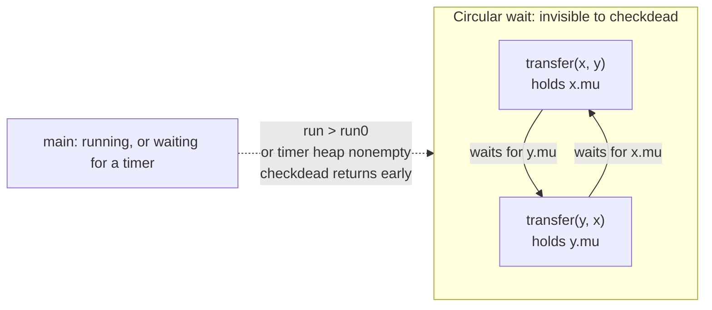

# 16.1 Runtime Deadlock Detection

`fatal error: all goroutines are asleep - deadlock!` is one of the first runtime errors a Go
programmer meets. It comes from the runtime's built-in deadlock check, whose criterion is a single
condition: no thread is running, and no event can make any goroutine run again. The criterion is
simple because it concludes something only about the whole program. To assert that a subset of
goroutines is deadlocked, one must first establish that nothing outside the subset can wake them,
and that takes more information.

This section first dissects the runtime's global check, `checkdead`, and explains why it is sound
but incomplete, and which partial deadlocks it structurally cannot find. It then presents three
mechanisms aimed at partial deadlocks. `testing/synctest` draws a closed world inside a test with a
bubble. The goroutine leak profile of Go 1.26 infers closure from the garbage collector's
reachability analysis. The runtime itself uses static lock ranking to catch code that violates the
locking order before a deadlock occurs.

## 16.1.1 The Criterion: No Running Thread

The deadlock check is performed by `checkdead` in `runtime/proc.go`
[[Go Authors, 2026a](#ref-go-authors-2026a)]. The comment at the top of the function summarizes the
criterion: the check is based on the number of running Ms, and zero means deadlock.

```go
// Check for deadlock situation.
// The check is based on number of running M's, if 0 -> deadlock.
// sched.lock must be held.
func checkdead() {
	assertLockHeld(&sched.lock)

	// For -buildmode=c-shared or -buildmode=c-archive it's OK if
	// there are no running goroutines. The calling program is
	// assumed to be running.
	// One exception is Wasm, which is single-threaded. If we are
	// in Go and all goroutines are blocked, it deadlocks.
	if (islibrary || isarchive) && GOARCH != "wasm" {
		return
	}
	// ……
	run := mcount() - sched.nmidle - sched.nmidlelocked - sched.nmsys
	if run > run0 {
		return
	}
	// ……
```

The number of running Ms comes from one subtraction: the total number of Ms, minus the idle Ms
(`nmidle`), the Ms idle because their thread is locked (`nmidlelocked`), and the system Ms that do
not take part in the decision (`nmsys`, that is, sysmon and the template thread). If the difference
exceeds `run0`, some thread is still executing and may make a goroutine runnable again, so the check
returns. `run0` is normally zero; a program that does not use cgo but holds an extra M (needed on
Windows by callbacks created with `syscall.NewCallback`) uses 1. When the program is built as a
c-shared or c-archive library, the host program is still running, so having no running goroutine is
normal; wasm is single-threaded and is excluded from this rule. The elided code contains one more
exemption: when the program is terminating because of a panic, `freezetheworld` blocks all remaining
threads, and no deadlock should be reported.

When the difference is zero, all user goroutines should be blocked, and `checkdead` walks every
goroutine to confirm:

```go
	grunning := 0
	forEachG(func(gp *g) {
		if isSystemGoroutine(gp, false) {
			return
		}
		s := readgstatus(gp)
		switch s &^ _Gscan {
		case _Gwaiting,
			_Gpreempted:
			grunning++
		case _Grunnable,
			_Grunning,
			_Gsyscall:
			print("runtime: checkdead: find g ", gp.goid, " in status ", s, "\n")
			unlock(&sched.lock)
			throw("checkdead: runnable g")
		}
	})
	if grunning == 0 { // possible if main goroutine calls runtime·Goexit()
		unlock(&sched.lock) // unlock so that GODEBUG=scheddetail=1 doesn't hang
		fatal("no goroutines (main called runtime.Goexit) - deadlock!")
	}
	// ……
	// There are no goroutines running, so we can look at the P's.
	for _, pp := range allp {
		if len(pp.timers.heap) > 0 {
			return
		}
	}

	unlock(&sched.lock) // unlock so that GODEBUG=scheddetail=1 doesn't hang
	fatal("all goroutines are asleep - deadlock!")
}
```

System goroutines, whose entry function is in the `runtime` package (except `runtime.main`), are not
counted. A goroutine in `_Gwaiting` or `_Gpreempted` counts as blocked. A goroutine found runnable,
running or in a system call contradicts the count, which is a bug in the runtime itself, so the
function terminates with `throw`. When there is no blocked user goroutine at all, it is usually
because the main goroutine called `runtime.Goexit`, and a different message is reported.

The last check concerns timers. That all goroutines are blocked does not mean they are blocked
forever: as long as some P's timer heap still holds a timer, its expiry will wake some goroutine,
for example the one in `time.Sleep`. Only when every timer heap is empty does `checkdead` report a
deadlock. The Go Playground uses fake time, and the elided code there advances the clock straight to
the expiry of the next timer instead of reporting a deadlock.

`checkdead` does no periodic polling. It is called when an M goes idle, when a locked M goes idle,
when an M exits, and when sysmon and the template thread start
([9.8](../../part3concurrency/ch09sched/sysmon.md)), so the check happens at the moment the last
thread stops. The following program is a typical global deadlock: the main goroutine waits in
`wg.Wait()` for the senders to finish, while the senders wait for a receive that has not started.

```go {run=true}
package main

import (
	"fmt"
	"sync"
)

func main() {
	results := make(chan int) // unbuffered channel
	var wg sync.WaitGroup
	for i := range 3 {
		wg.Add(1)
		go func() {
			defer wg.Done()
			results <- i * i // no receiver yet, the send blocks
		}()
	}
	wg.Wait() // waits for the senders, who wait for the receiver
	close(results)
	for r := range results {
		fmt.Println(r)
	}
}
```

The first line of the output is the deadlock report, followed by the stack of each goroutine: the
main goroutine is stopped in `sync.WaitGroup.Wait`, and the three senders are stopped in
`chan send`.

The criterion is almost as old as the Go runtime. In August 2008, Russ Cox added multithreading
support to the runtime for the first time, and the scheduler printed this message when the number of
waiting Ms equaled the total number of Ms, then went to sleep as usual [[Cox, 2008](#ref-cox-2008)].
The scheduler rewrite in Go 1.1 turned it into `checkdead`, with the same criterion: the total
number of Ms minus the idle Ms, the locked Ms and sysmon [[Vyukov, 2013](#ref-vyukov-2013)]. Later
changes only added exemptions and counting terms.

## 16.1.2 Sound but Incomplete

In their 1971 survey, Coffman, Elphick and Shoshani gave four necessary conditions for deadlock:
mutual exclusion, hold and wait, no preemption, and circular wait. The classic way to detect
deadlock is to maintain a wait-for graph and look for cycles in it
[[Coffman et al., 1971](#ref-coffman-et-al-1971)]. Every edge of a wait-for graph answers the same
question: who is waiting for whom. For locks that have owners, the question has a definite answer.
The JVM's `jstack` detects deadlocks while dumping thread stacks, and reports cycles such as "the
monitor thread A waits for is held by thread B" [[Oracle, n.d.a](#ref-oracle-nda)].
`ThreadMXBean.findDeadlockedThreads` looks for the same situation, where each thread in the cycle
holds one lock and requests a lock already held by another thread in the cycle; its documentation
adds that it does not find cycles that include virtual threads [[Oracle, 2023](#ref-oracle-2023)].
InnoDB detects deadlocks on the lock waits of transactions; when it finds one, it rolls back one or
several transactions to break the cycle, preferring smaller transactions
[[Oracle, n.d.b](#ref-oracle-ndb)].

Go's synchronization primitives cannot supply such edges. The documentation of `sync.Mutex` states
that a locked Mutex is not associated with a particular goroutine, and one goroutine may lock a
Mutex and arrange for another goroutine to unlock it [[Go Authors, 2026c](#ref-go-authors-2026c)]. A
goroutine blocked on a channel receive waits for any future sender, not for a specific goroutine.
Without owners, no "who waits for whom" edge can be drawn. `checkdead` therefore does not ask what
each goroutine is waiting for; it asks only whether the program as a whole can still make progress.

Such a criterion has definite logical properties. Let $D$ be "the program is globally
deadlocked" and $R$ be "`checkdead` reports a deadlock". Then

$$
R \Rightarrow D, \qquad D \not\Rightarrow R.
$$

The first is **soundness**: a report is always true. When all threads have stopped and all timer
heaps are empty, no execution flow can make a blocked goroutine runnable, and the exemptions above
rule out the situations where no conclusion should be drawn, such as the host program still running
or the program terminating. The second is **incompleteness**: a deadlock that really exists is not
necessarily reported. As long as one thread in the program is running, `run > run0` holds, and the
check returns before it looks at any goroutine.

## 16.1.3 Partial Deadlock

The most typical consequence of incompleteness is the partial deadlock: some goroutines wait for
each other while the rest keep running. In the following program, two transfers in opposite
directions each lock the source account first and then request the lock of the destination account,
forming an AB-BA circular wait. The main goroutine keeps working and finally uses `TryLock` to
examine the state of the two locks.

```go {run=true}
package main

import (
	"fmt"
	"sync"
	"time"
)

type account struct {
	mu      sync.Mutex
	balance int
}

func transfer(from, to *account, amount int) {
	from.mu.Lock()
	defer from.mu.Unlock()
	time.Sleep(time.Millisecond) // widen the window so the opposite transfer takes the other lock first
	to.mu.Lock()
	defer to.mu.Unlock()
	from.balance -= amount
	to.balance += amount
}

func main() {
	x, y := &account{balance: 100}, &account{balance: 100}
	go transfer(x, y, 10)
	go transfer(y, x, 20)

	for i := range 3 { // the main goroutine keeps working
		time.Sleep(10 * time.Millisecond)
		fmt.Println("tick", i)
	}
	fmt.Println("x lockable:", x.mu.TryLock(), "y lockable:", y.mu.TryLock())
}
```

The program exits normally without any deadlock report; the last line shows that both locks are
still held, and the two transfer goroutines will never return. The main goroutine is either running
or waiting for a timer in `time.Sleep`. The former keeps the number of running Ms above zero, the
latter keeps the timer heap nonempty, and in both cases `checkdead` returns early. The same defect
in a long-running service shows up as some requests hanging and the resources they hold never being
released, while the process itself looks perfectly healthy.



Another case that is not reported is waiting for external events. When the network poller has
waiters, `findRunnable` does not let the last M go idle after finding no work; it blocks that M in
`netpoll` until an event becomes ready or a timer expires
[[Go Authors, 2026a](#ref-go-authors-2026a)] ([9.9](../../part3concurrency/ch09sched/poller.md)).
The same holds for a goroutine that receives signals: the receive loop of `os/signal` waits in
`signal_recv` through `notetsleepg`, which first calls `entersyscallblock`, so the M it runs on is
inside a system call [[Go Authors, 2026h](#ref-go-authors-2026h)]. For a program that only waits for
`SIGINT`, this is correct behavior: the signal comes from outside the process, and the runtime
cannot determine that it will not arrive. It follows that "will not progress again" makes sense only
relative to a closed world. A process is open to the outside, so the runtime can draw a conclusion
only when it knows there is no external event to wait for.

## 16.1.4 Drawing a Closed World: the synctest Bubble

To assert deadlock for a subset of goroutines, a smaller closed world is needed. Go 1.24 introduced
`testing/synctest` as an experiment (`GOEXPERIMENT=synctest`)
[[Go Authors, 2025a](#ref-go-authors-2025a)], and Go 1.25 made it a regular feature with the entry
point `synctest.Test` [[Go Authors, 2025b](#ref-go-authors-2025b)]. `Test` runs the test function in
an isolated bubble. Every goroutine started inside the bubble belongs to it; channels, `time.Timer`
and `time.Ticker` created inside the bubble are associated with it, and operating on them from
outside the bubble panics [[Go Authors, 2026d](#ref-go-authors-2026d)].

Isolation lets the bubble define **durably blocked**: a goroutine is blocked, and can be unblocked
only by another goroutine in the same bubble. Sending or receiving on a channel created in the
bubble, a `select` whose cases are all channels of the bubble, `sync.Cond.Wait`,
`sync.WaitGroup.Wait` on a `WaitGroup` whose `Add` was called inside the bubble, and `time.Sleep`
are durable blocking. Locking a `sync.Mutex`, network I/O and system calls are not, because the
events that release them may come from outside the bubble
[[Go Authors, 2026d](#ref-go-authors-2026d)]. When all goroutines in the bubble are durably blocked,
one of three things happens. If some goroutine is waiting in `synctest.Wait`, `Wait` returns.
Otherwise, if the root goroutine has not exited and there is a moment at which at least one
goroutine can be woken, the bubble's fake clock jumps directly to that moment. If neither holds, it
is a deadlock and `Test` panics. This is the criterion of `checkdead` replicated on a subset, and
isolation guarantees that nothing outside the subset can wake the goroutines in it. The panic
message distinguishes two cases: `deadlock: all goroutines in bubble are blocked` when the root
goroutine is still blocked, and
`deadlock: main bubble goroutine has exited but blocked goroutines remain` when the root goroutine
has exited and some goroutines are still blocked [[Go Authors, 2026d](#ref-go-authors-2026d)].

The second case can be used directly to find leaks. In the following code, `first` queries several
backends concurrently and takes only the first result to return; the result channel is unbuffered,
so the losing backends will block forever on the send.

```go
package st

import (
	"testing"
	"testing/synctest"
	"time"
)

func first(backends ...func() int) int {
	c := make(chan int)
	for _, b := range backends {
		go func() { c <- b() }()
	}
	return <-c
}

func TestFirst(t *testing.T) {
	synctest.Test(t, func(t *testing.T) {
		fast := func() int { return 1 }
		slow := func() int { time.Sleep(time.Second); return 2 }
		if got := first(fast, slow); got != 1 {
			t.Fatalf("first = %d, want 1", got)
		}
	})
}
```

Run with Go 1.26.10, the output abridged:

```shell
$ go test
--- FAIL: TestFirst (0.00s)
panic: deadlock: main bubble goroutine has exited but blocked goroutines remain [recovered, repanicked]
……
goroutine 8 [sleep (durable), synctest bubble 1]:
time.Sleep(0x3b9aca00)
……
st.first.func1()
	first_test.go:12 +0x28
created by st.first in goroutine 6
……
```

After `fast` returns, the root goroutine exits and the bubble's clock stops, so `slow`, sitting in
`time.Sleep`, never sees its timer expire. The test fails on the spot and points out that the leaked
goroutine was created by `first`. In real time, this goroutine would wake after one second and then
block on the send, becoming yet another partial deadlock.

## 16.1.5 Relying on Reachability: the Goroutine Leak Profile

The closed world of synctest is drawn artificially inside a test. For programs running in
production, Go 1.26 added the `goroutineleak` profile as an experiment (set
`GOEXPERIMENT=goroutineleakprofile` at build time), and Go 1.27 made it a regular feature
[[Go Authors, 2026e](#ref-go-authors-2026e); [Go Authors, 2026f](#ref-go-authors-2026f)]. It
replaces the wait-for graph with the garbage collector's reachability: if goroutine G is blocked on
synchronization primitive P, and P is unreachable from every runnable goroutine and from every
goroutine those goroutines could wake, then P can never be operated on again and G will never wake
[[Go Authors, 2026e](#ref-go-authors-2026e)]. This criterion needs no knowledge of who holds the
lock or who will send; it relies on a plain fact: a goroutine able to unblock G must be able to
access P. Detection runs in a special garbage collection. The initial roots include only the
goroutines that may run, and the stacks of blocked goroutines are added gradually as the primitives
they wait on are marked, until a fixed point is reached
[[Saioc and Chabbi, 2025](#ref-saioc-and-chabbi-2025)]. For the runtime implementation see
[9.3](../../part3concurrency/ch09sched/mpg.md); the theoretical basis is in the paper by Saioc et
al. [[Saioc et al., 2025](#ref-saioc-et-al-2025)], and the implementation landed in Go 1.26
[[Saioc, 2025](#ref-saioc-2025)].

Modify the transfer program of 16.1.3 slightly so that it creates two AB-BA pairs at once: one
between the package-level variables `x` and `y`, the other between two accounts allocated on the
heap and no longer referenced by `main` afterwards.

```go
package main

import (
	"os"
	"runtime/pprof"
	"sync"
	"time"
)

type account struct {
	mu      sync.Mutex
	balance [4]int64
}

var x, y account // package-level variables: not on the heap

func transfer(from, to *account) {
	from.mu.Lock()
	time.Sleep(time.Millisecond)
	to.mu.Lock()
	to.mu.Unlock()
	from.mu.Unlock()
}

func main() {
	go transfer(&x, &y) // AB-BA between package-level variables
	go transfer(&y, &x)
	a, b := new(account), new(account) // accounts on the heap
	go transfer(a, b)
	go transfer(b, a)
	a, b = nil, nil // main no longer references them
	time.Sleep(50 * time.Millisecond)
	pprof.Lookup("goroutineleak").WriteTo(os.Stdout, 1)
}
```

Run with Go 1.26.10, the output with addresses and path prefixes removed:

```shell
$ GOEXPERIMENT=goroutineleakprofile go run .
goroutineleak profile: total 2
2 @ ……
#  internal/sync.runtime_SemacquireMutex+0x27  runtime/sema.go:95
#  internal/sync.(*Mutex).lockSlow+0x16f       internal/sync/mutex.go:149
#  internal/sync.(*Mutex).Lock+0xcf            internal/sync/mutex.go:70
#  sync.(*Mutex).Lock+0x84                     sync/mutex.go:46
#  main.transfer+0x7c                          main.go:20
```

Without this experiment, `pprof.Lookup("goroutineleak")` returns `nil`. The profile reports only two
goroutines, with stacks pointing at the second lock acquisition in `transfer`, which correspond to
the heap pair. Package-level variables are not on the heap, and `isMarkedOrNotInHeap`, which decides
whether a primitive has been marked, always returns true for them, so goroutines waiting on them are
always treated as possibly running [[Go Authors, 2026b](#ref-go-authors-2026b)]. This is exactly the
limitation the release notes point out: if the primitive is reachable through a global variable or a
local variable of a runnable goroutine, the corresponding leak cannot be identified
[[Go Authors, 2026e](#ref-go-authors-2026e)]. The `balance` array in `account` is not decoration
either: an object that contains no pointers and is smaller than 16 bytes is combined with other
objects into one block by the tiny allocator ([12.6](../../part4memory/ch12alloc/tinyalloc.md)), and
every mark phase directly greys the tiny block each P is currently using (`gcMarkTinyAllocs`), so a
lock inside such a block would always be reachable.

Conversely, every goroutine the profile reports really can never be woken again; the design document
states that the method is theoretically sound, with no false positives
[[Saioc and Chabbi, 2025](#ref-saioc-and-chabbi-2025)]. It is sound but incomplete, like
`checkdead`. The difference is that the closed world shrinks from the whole process to "the part of
memory unreachable from the goroutines that may run".

## 16.1.6 Prevention: Static Lock Ranking in the Runtime

All the mechanisms above find a deadlock only after it has happened. For the runtime's own locks, Go
has a preventive check as well. Static lock ranking, added in Go 1.15 (enabled with
`GOEXPERIMENT=staticlockranking`), assigns a rank to every lock in the runtime. The rank graph is
recorded in `mklockrank.go`, which generates `lockrank.go`; the line `sched < allg, allp;` in the
graph means that when both are held, `sched` must be acquired first, so while holding `allg` the
runtime may not acquire `sched` [[Go Authors, 2026g](#ref-go-authors-2026g)]. With the check
enabled, on every lock acquisition `checkRanks` compares the new lock with the last lock currently
held. The rank of the new lock must not be lower. If the new lock is not a leaf lock (locks with no
assigned rank are treated as leaf locks), the held lock must also appear in the partial-order table
of the new lock's rank, that is, be explicitly allowed to be held before it. A violation of either
rule terminates with `lock ordering problem` [[Go Authors, 2026g](#ref-go-authors-2026g)].

The commit message points out a property of this check: a violation may mean a deadlock has already
happened, or may be only one side of a potential deadlock that has just appeared; as long as the
order is respected, no deadlock due to lock order can occur [[Scales, 2020](#ref-scales-2020)]. In
terms of the four conditions of Coffman et al., it eliminates circular wait, so it can find the
problem without waiting for the two directions to actually interleave. During the development of
this check, it found one deadlock and two potential deadlocks in the new timer code
[[Scales, 2020](#ref-scales-2020)]. The rank graph has also become documentation of the runtime's
locking order.

This check covers only locks inside the runtime, and user code has no equivalent tool. Prevention in
user code still relies on conventions: always lock the same set of locks in a consistent order
([11.2](../../part3concurrency/ch11sync/mutex.md)), and set a timeout or cancellation for operations
that may block forever ([11.8](../../part3concurrency/ch11sync/context.md)). When a deadlock has
already happened, the goroutine profile lists the stack and blocking reason of every goroutine and
is the starting point for locating the problem [[Go Authors, n.d.](#ref-go-authors-nd)]
([16.5](./perf.md)).

## 16.1.7 Summary

| Mechanism | Scope | Criterion | Availability |
|:----------|:------|:----------|:-------------|
| `checkdead` | The whole process | No running M, all timer heaps empty | Always on |
| `synctest` bubble | Goroutines in the bubble | All durably blocked, and the clock cannot advance | In tests; regular feature in Go 1.25 |
| `goroutineleak` profile | Any set of goroutines | The awaited primitive is unreachable from goroutines that may run | Triggered on demand; experiment in Go 1.26, regular feature in Go 1.27 |
| Static lock ranking | Locks inside the runtime | Lock order violates the rank graph | Runtime development; `GOEXPERIMENT=staticlockranking` |

The four mechanisms differ in how they confirm that "nothing can wake these goroutines". `checkdead`
requires the whole process to stop, synctest draws a bubble by isolation, the leak profile infers it
from memory reachability, and static lock ranking does not wait for the deadlock at all. The first
three are sound but incomplete: seeing a deadlock report means the problem really exists, but seeing
none does not show that the program is free of deadlock.

## Further Reading

- <a id="ref-coffman-et-al-1971"></a>[Coffman et al., 1971] E. G. Coffman, M. Elphick, A. Shoshani.
  *System Deadlocks.* ACM Computing Surveys, 3(2):67–78, 1971.
  https://dl.acm.org/doi/10.1145/356586.356588
  The four necessary conditions for deadlock and the classic framework of wait-for graph detection.
- <a id="ref-cox-2008"></a>[Cox, 2008] Russ Cox. first cut at multithreading. works on Linux. Go
  commit d28acc42ec, 2008.
  https://github.com/golang/go/commit/d28acc42ec0f8dff9471e4663cfe55aa5da86656 The scheduler prints
  `all goroutines are asleep - deadlock!` when all Ms are waiting.
- <a id="ref-go-authors-nd"></a>[Go Authors, n.d.] The Go Authors. *Diagnostics.*
  https://go.dev/doc/diagnostics
  Diagnostic tools such as the goroutine profile.
- <a id="ref-go-authors-2025a"></a>[Go Authors, 2025a] The Go Authors. *Go 1.24 Release
  Notes.* 2025. https://go.dev/doc/go1.24 The experimental `testing/synctest`
  (`GOEXPERIMENT=synctest`).
- <a id="ref-go-authors-2025b"></a>[Go Authors, 2025b] The Go Authors. *Go 1.25 Release
  Notes.* 2025. https://go.dev/doc/go1.25 `testing/synctest` becomes a regular feature.
- <a id="ref-go-authors-2026a"></a>[Go Authors, 2026a] The Go Authors. src/runtime/proc.go:
  `checkdead`, `findRunnable`. Go 1.26 source.
  https://github.com/golang/go/blob/release-branch.go1.26/src/runtime/proc.go
- <a id="ref-go-authors-2026b"></a>[Go Authors, 2026b] The Go Authors.
  src/runtime/mgc.go: `isMaybeRunnable`, `findGoroutineLeaks`. Go 1.26 source.
  https://github.com/golang/go/blob/release-branch.go1.26/src/runtime/mgc.go
- <a id="ref-go-authors-2026c"></a>[Go Authors, 2026c] The Go Authors. src/sync/mutex.go. Go 1.26
  source. https://github.com/golang/go/blob/release-branch.go1.26/src/sync/mutex.go
- <a id="ref-go-authors-2026d"></a>[Go Authors, 2026d] The Go Authors.
  src/testing/synctest/synctest.go and src/runtime/synctest.go. Go 1.26 source.
  https://github.com/golang/go/blob/release-branch.go1.26/src/testing/synctest/synctest.go The
  definition of durable blocking and the two panics for a deadlocked bubble.
- <a id="ref-go-authors-2026e"></a>[Go Authors, 2026e] The Go Authors. *Go 1.26 Release
  Notes.* 2026. https://go.dev/doc/go1.26 The experimental `goroutineleak` profile.
- <a id="ref-go-authors-2026f"></a>[Go Authors, 2026f] The Go Authors. *Go 1.27 Release
  Notes.* 2026. https://go.dev/doc/go1.27 The `goroutineleak` profile becomes a regular feature.
- <a id="ref-go-authors-2026g"></a>[Go Authors, 2026g] The Go Authors. src/runtime/mklockrank.go and
  src/runtime/lockrank_on.go. Go 1.26 source.
  https://github.com/golang/go/blob/release-branch.go1.26/src/runtime/mklockrank.go
- <a id="ref-go-authors-2026h"></a>[Go Authors, 2026h] The Go Authors. src/runtime/sigqueue.go:
  `signal_recv`. Go 1.26 source.
  https://github.com/golang/go/blob/release-branch.go1.26/src/runtime/sigqueue.go
- <a id="ref-oracle-nda"></a>[Oracle, n.d.a] Oracle. *Java Platform, Standard Edition
  Troubleshooting Guide.* https://docs.oracle.com/javase/8/docs/technotes/guides/troubleshoot/
  Deadlock detection in `jstack` thread dumps, for comparison with wait-for graph detection.
- <a id="ref-oracle-ndb"></a>[Oracle, n.d.b] Oracle. *MySQL Reference Manual: Deadlock Detection.*
  https://dev.mysql.com/doc/refman/8.0/en/innodb-deadlock-detection.html
  InnoDB's lock wait detection and rollback of victim transactions.
- <a id="ref-oracle-2023"></a>[Oracle, 2023] Oracle. *Java SE 21 API: Interface ThreadMXBean.* 2023.
  https://docs.oracle.com/en/java/javase/21/docs/api/java.management/java/lang/management/ThreadMXBean.html
  `findDeadlockedThreads` finds deadlock cycles on monitors and ownable synchronizers, excluding
  virtual threads.
- <a id="ref-saioc-2025"></a>[Saioc, 2025] Vlad Saioc. runtime,net/http/pprof: goroutine leak
  detection by using the garbage collector. Go commit 8c68a1c1ab, 2025. https://go.dev/cl/688335
  Shipped in Go 1.26 (`GOEXPERIMENT=goroutineleakprofile`).
- <a id="ref-saioc-and-chabbi-2025"></a>[Saioc and Chabbi, 2025] Georgian-Vlad Saioc and Milind
  Chabbi. Proposal: Goroutine leak detection via garbage collection. Go design document, 2025-08-14.
  https://go.dev/design/74609-goroutine-leak-detection-gc
- <a id="ref-saioc-et-al-2025"></a>[Saioc et al., 2025] Georgian-Vlad Saioc, I-Ting Angelina Lee,
  Anders Møller, and Milind Chabbi. Dynamic Partial Deadlock Detection and Recovery via Garbage
  Collection. In *Proceedings of the 30th ACM International Conference on Architectural Support for
  Programming Languages and Operating Systems (ASPLOS '25), Volume 2*, 244–259, 2025.
  https://doi.org/10.1145/3676641.3715990
- <a id="ref-scales-2020"></a>[Scales, 2020] Dan Scales. runtime: static lock ranking for the
  runtime (enabled by GOEXPERIMENT). Go commit 0a820007e7, 2020. https://go.dev/cl/207619 Shipped in
  Go 1.15.
- <a id="ref-vyukov-2013"></a>[Vyukov, 2013] Dmitriy Vyukov. runtime: improved scheduler. Go commit
  779c45a507, 2013. https://golang.org/cl/7314062
  Shipped in Go 1.1.
- This book:
  [9.3 The MPG Model and the Units of Concurrent Scheduling](../../part3concurrency/ch09sched/mpg.md),
  [9.8 System Monitoring](../../part3concurrency/ch09sched/sysmon.md),
  [9.9 The Network Poller](../../part3concurrency/ch09sched/poller.md),
  [11.2 Mutex](../../part3concurrency/ch11sync/mutex.md),
  [11.8 Context](../../part3concurrency/ch11sync/context.md) (preventing permanent blocking with
  timeouts), [16.3 Execution Tracing](./trace.md),
  [16.5 Benchmarking and Performance Profiling](./perf.md) (locating partial deadlocks with the
  goroutine profile).
