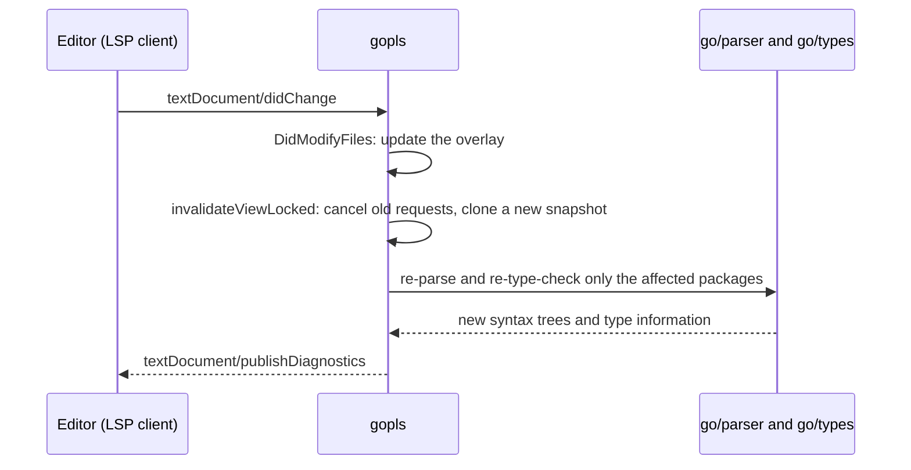

# 16.7 The Language Server Protocol

Code completion, go to definition, live diagnostics and renaming in an editor are provided for Go by
**`gopls`** (the Go language server, pronounced "go please"), and it talks to editors through the
**Language Server Protocol** (LSP). This section covers the problem LSP solves and the design of the
protocol, the background in which gopls arose, how it maintains a consistent understanding of a
project in a long-lived process, how v0.12 borrows the idea of separate compilation to control
memory, and finally a comparison with language servers for other languages.

## 16.7.1 LSP: From M × N to M + N

To let M editors support the semantic features of N languages, the most direct approach is to write
an integration for each editor-language pair. That takes M × N implementations, and every change in
language semantics must be followed separately in M editors. On June 27, 2016, the Visual Studio
Code team published the Language Server Protocol and announced a collaboration with Red Hat and
Codenvy to make it an open standard [[VS Code Team, 2016](#ref-vs-code-team-2016);
[Wikipedia, n.d.](#ref-wikipedia-nd)]. The protocol puts semantic analysis in a separate process,
the language server; the editor acts as a client and talks to it over standard input and output or a
socket. Each language needs to implement only one server and each editor only one client, so M × N
becomes M + N.

The protocol is built on JSON-RPC, and messages fall into three kinds: requests that a client sends
and waits for a response to, the responses, and one-way notifications that need no reply
[[Microsoft, n.d.](#ref-microsoft-nd)]. The protocol deliberately uses only data types that editors
already understand: documents are identified by URI and positions are zero-based line numbers and
column offsets, with no reference to the syntax tree or symbol table of any language. For example,
when the cursor rests on an identifier at line 4, column 13 of `main.go`, the request and response
for "go to definition" are:

```json
{ "jsonrpc": "2.0", "id": 1, "method": "textDocument/definition",
  "params": {
    "textDocument": { "uri": "file:///app/main.go" },
    "position":     { "line": 3, "character": 12 } } }

{ "jsonrpc": "2.0", "id": 1,
  "result": {
    "uri":   "file:///app/user/user.go",
    "range": { "start": { "line": 12, "character": 5 },
               "end":   { "line": 12, "character": 9 } } } }
```

The unit of the column offset is a representative detail. Before version 3.17, column offsets were
always counted in UTF-16 code units; since 3.17 the two sides can negotiate other encodings, but
UTF-16 remains the only one that must be supported [[Microsoft, n.d.](#ref-microsoft-nd)]. Go
strings are UTF-8 and `go/token` records byte offsets, so gopls has to convert between the two
coordinate systems, a job done by `protocol.Mapper` [[Go Authors, 2026a](#ref-go-authors-2026a)].

Diagnostics flow in the opposite direction from queries: after the server finishes analysis, it
pushes errors and warnings proactively with a `textDocument/publishDiagnostics` notification. The
editor tells the server about files being opened and modified with notifications such as
`textDocument/didOpen` and `textDocument/didChange`, and the server maintains the current content of
files from them, including unsaved edits. When the connection is established, the two sides exchange
the capabilities each supports in the `initialize` request. Capability negotiation lets the protocol
grow gradually: when one end supports a new feature and the other does not yet, both degrade
according to the negotiated result. The protocol has thus grown from a handful of methods to today's
version 3.18, a specification that covers dozens of kinds of interaction such as semantic
highlighting, inlay hints and call hierarchy, without requiring clients and servers to upgrade at
the same time.

## 16.7.2 Where gopls Came From

Before gopls, editor support for Go was assembled from a set of independent command-line tools:
gocode for completion, godef for jumping, guru for queries and gorename for renaming. The gopls
design document records the situation at the time: the VS Code Go extension installed 24
command-line tools to support its existing features; counting all the tools in all editors that
needed to migrate to module mode gives 63; these tools reprocessed the code on every invocation, and
almost none could return a result within 100 ms [[Go Authors, 2019](#ref-go-authors-2019)]. After Go
1.11 introduced modules, all of these tools, which looked for code by the GOPATH layout, needed
migration. Rebecca Stambler told the story of this experience, and of gopls's response, in the
GopherCon 2019 keynote "Go, please stop breaking my editor!" [[Stambler, 2019](#ref-stambler-2019)].

gopls began in 2018 [[Findley and Donovan, 2023](#ref-findley-and-donovan-2023)]. The design
document sets its latency target on the basis of human-computer interaction research: direct
feedback to a user's continuous actions must arrive within 100 ms to go unnoticed, and more than 200
ms is irritating, so the goal for everything that happens while the user types is under 100 ms. The
document also names the largest obstacle: the foundation libraries `go/token`, `go/ast` and
`go/types` were designed for compiler-like applications, care about throughput rather than memory,
and have data structures that grow and are discarded wholesale when the program exits; they are not
meant to keep working when the source has errors, and they have no ability to be modified
incrementally [[Go Authors, 2019](#ref-go-authors-2019)]. Code being edited almost always has
errors, and each keystroke changes only one place. What gopls has to do is build, on top of these
libraries designed for one-shot compilation, a long-lived, fault-tolerant, incremental system. The
preface added to the design document later says that its first two goals have been achieved: gopls
implements LSP in full and has become the default backend of the VS Code Go extension and of many
other editors.

## 16.7.3 Built on go/parser and go/types

gopls did not write a separate semantic analysis. It calls `go list` through `go/packages` to obtain
package metadata, that is, which files make up each package, which packages it depends on and which
build settings apply [[Go Authors, 2024](#ref-go-authors-2024)]; it then parses source with
`go/parser` ([15.1 Lexing and Grammar](../ch15compile/parse.md)) and type-checks with `go/types`
([8.3 Type-Checking Techniques](../../part2lang/ch08generics/checker.md)). While checking, the type
checker records which object each identifier defines or refers to, and this is all the raw material
that go to definition, find references and rename need [[Go Authors, 2026b](#ref-go-authors-2026b)]:

```go
fset := token.NewFileSet()
f, _ := parser.ParseFile(fset, "main.go", src, parser.AllErrors) // source -> syntax tree
info := &types.Info{
	Defs: map[*ast.Ident]types.Object{}, // which object an identifier defines
	Uses: map[*ast.Ident]types.Object{}, // which object an identifier refers to
}
conf := types.Config{Importer: importer.Default()}
pkg, _ := conf.Check("app", fset, []*ast.File{f}, info) // syntax tree -> type information
```

Together, `Defs` and `Uses` give a mapping from identifiers to objects, and from objects to all of
their references. Most of gopls's features reorganize, according to the editor's question,
information that the type checker has to compute anyway.

`go/types` and the compiler's type checker `cmd/compile/internal/types2` are two versions of the
same implementation. In Go 1.26, 46 of the 74 non-test source files of `go/types` are generated from
types2, with the line "Code generated by "go test -run=Generate -write=all"" at the top; in Go 1.21
Robert Findley changed this generation to run as a test, which checks that `go/types` stays in sync
with types2 [[Findley, 2023](#ref-findley-2023)]. The type errors seen in an editor and the errors
reported by the compiler therefore come from the same set of rules.

## 16.7.4 Snapshots: A Consistent View in a Long-Lived Process

A compiler is one-shot: it reads all the source, computes once, writes its output and exits. A
language server is the opposite. It stays resident in memory and faces a project that is constantly
being modified while several requests concurrently read its state. gopls divides its state into
layers: a `Session` is the session with one client; a `View` is a workspace directory tree observed
under particular build settings; a `Snapshot` is the state of all files in the workspace after a
given edit; and a `Cache` holds memoized results that can be shared between sessions
[[Go Authors, 2024](#ref-go-authors-2024)]. The `Snapshot` is the core
[[Go Authors, 2026a](#ref-go-authors-2026a)]:

```go
type Snapshot struct {
	// sequenceID is the monotonically increasing ID of this snapshot within its View.
	// ...
	sequenceID uint64
	// ...
	store *memoize.Store // cache of handles shared by all snapshots
	// ...
	// refcount holds the number of outstanding references to the current
	// Snapshot. When refcount is decremented to 0, the Snapshot maps are
	// destroyed and the done function is called.
	// ...
	refcount int
	// ...
	// meta holds loaded metadata.
	// ...
	meta *metadata.Graph

	// files maps file URIs to their corresponding FileHandles.
	// It may invalidated when a file's content changes.
	files *fileMap

	// packages maps a packageKey to a *packageHandle.
	// It may be invalidated when a file's content changes.
	// ...
	packages *persistent.Map[PackageID, *packageHandle]
	// ...
}
```

A snapshot is never modified once built. When a file changes, `Session.DidModifyFiles` first updates
the overlay of unsaved content, and then `invalidateViewLocked` clones a new snapshot from the old
one:

```go
	// Cancel all still-running previous requests, since they would be
	// operating on stale data.
	prevSnapshot.cancel()
	// ...
	var needsDiagnosis bool
	s.snapshotWG.Add(1)
	v.snapshot, needsDiagnosis = prevSnapshot.clone(ctx, v.baseCtx, changed, s.snapshotWG.Done)

	// Remove the initial reference created when prevSnapshot was created.
	prevSnapshot.decref()
```

Requests still running on the old snapshot are cancelled first, since their results are already
stale. The new snapshot is cloned immediately, yet cloning is cheap: the maps in a snapshot are
`persistent.Map`, a randomized persistent treap that can be cloned in constant time; a modification
copies only a few nodes, the rest are shared by the old and new maps, and lifetimes are managed by
reference counting [[Go Authors, 2026a](#ref-go-authors-2026a)]. Cloning deletes only the entries
affected by this modification; the results of parsing, type checking and analyzing packages are
recomputed only when a request needs them, and are memoized through `memoize.Store`, so unaffected
packages reuse their old results directly. Immutability ensures that every request sees a complete
and consistent state at one moment, and never a half-modified intermediate result; structural
sharing ensures that each keystroke pays a cost proportional to the size of the change. An old
snapshot that no request holds any longer is released when its reference count drops to zero. The
path from an edit to a diagnostics update is:



## 16.7.5 Separate Compilation: The Redesign in v0.12

Snapshots solved consistency, but memory grows with project size. Before v0.12, gopls kept in memory
the type-annotated syntax trees of all packages in the workspace and of all their dependencies, as
if compiling the whole program; a syntax tree with type information is usually 30 times the size of
the source text. Version v0.12, released in May 2023, redesigned this part, and Robert Findley and
Alan Donovan described the ideas in a Go blog post that year
[[Findley and Donovan, 2023](#ref-findley-and-donovan-2023)]:

- **Separate compilation.** When the compiler compiles package P, it does not need the syntax trees
  of the packages P depends on, only a summary of their exported API, the export data. v0.12 does
  the same and reuses the compiler's summary format: when type-checking a package, its dependencies
  are read in as summaries. The memory use of gopls is therefore proportional only to the open
  packages and their direct dependencies, and independent of the size of the whole project. In the
  measurements the post reports, memory fell by about 75% on average, and the larger the project,
  the larger the reduction.
- **Pruning.** After a package is modified, if its exported summary has not changed, the packages
  that depend on it need not be rechecked, and the work is proportional to the extent of the change.
  The post points out that this is not a new idea, as the Vesta system and `go build` both use it;
  v0.12 goes further and implements, in the `typerefs` package, a heuristic pruning based on syntax
  analysis, which is faster.
- **A persistent cache.** Summaries and indexes such as cross-references and method sets are
  serialized to a file cache on disk, so gopls recovers quickly after a restart and several gopls
  processes running at the same time can share these results
  [[Go Authors, 2024](#ref-go-authors-2024)].

Alex Kladov, one of the authors of rust-analyzer, summarized in 2020 the architectures of responsive
IDE backends as three kinds: building an index up front in a map-reduce fashion (IntelliJ, Sorbet);
using interface summaries such as header files (Merlin, clangd); and query-based incremental
computation that can be cut off early (rust-analyzer) [[Kladov, 2020](#ref-kladov-2020)]. In my
view, gopls after v0.12 is close to the second: Go's export data plays the role of header files.
This approach works in Go because of two design decisions in the language: the package is the unit
of compilation, and the language specification forbids a package from importing itself directly or
indirectly [[Go Authors, 2026c](#ref-go-authors-2026c)], so import relationships never form a cycle.
Every package can be checked independently after its dependencies, and its summary has a clear
boundary.

## 16.7.6 A Comparison with Other Language Servers

All language servers must answer the same question: where to get an accurate, incremental, queryable
understanding of the source. The clangd design document says that it is based on the clang compiler
and that its core runs clang's parser repeatedly in a loop; to answer queries across files, it
additionally maintains a symbol index [[Clang Team, n.d.](#ref-clang-team-nd)]. clangd shares its
front end with the compiler, so diagnostics in the editor agree with compilation results, as with
gopls. rust-analyzer, by contrast, has its own "compiler part" and uses the salsa framework for
incremental, on-demand computation. Its architecture document explains one reason for not keeping
the traditional compiler structure: in a traditional compiler it is convenient to use the syntax
tree as the store of semantic information, but that does not work in an IDE
[[rust-analyzer Authors, n.d.](#ref-rust-analyzer-authors-nd)].

Go sits between the two. `go/parser` and `go/types` are standard libraries protected by the
compatibility promise, so any tool can depend on them stably; `go/types` also shares its origin with
the compiler's types2. gopls, `go vet` and various static analysis tools therefore stand on the same
front end, and their understanding of what a piece of code means is consistent by construction. The
shortcomings that the design document names, no fault tolerance and no incrementality, are filled in
by gopls on top of the libraries: snapshots and persistent data structures provide consistent
incremental state, and separate compilation and pruning control memory and repeated computation.

The tools discussed in this chapter cover Go programs from correctness
([16.1 Runtime Deadlock Detection](./deadlock.md), [16.2 Race Detection](./race.md),
[16.4 Testing Code](./testing.md)), performance ([16.3 Execution Tracing](./trace.md),
[16.5 Benchmarking and Performance Profiling](./perf.md)) and runtime state
([16.6 Runtime Metrics](./metric.md)) to developer experience (this section). Most of them ship with
the toolchain and are built on the same set of standard libraries, a notable characteristic of the
Go tool ecosystem.

## Further Reading

- <a id="ref-clang-team-nd"></a>[Clang Team, n.d.] The Clang Team. *clangd Design.*
  https://clangd.llvm.org/design/ Built on the clang compiler, with its core running clang's parser
  in a loop; like gopls, it reuses the compiler front end.
- <a id="ref-findley-2023"></a>[Findley, 2023] Robert Findley. go/types: add a test that generated
  files match types2. Go commit 59964663e5, 2023. https://go.dev/cl/462758 Shipped in Go 1.21.
- <a id="ref-findley-and-donovan-2023"></a>[Findley and Donovan, 2023] Robert Findley, Alan Donovan.
  *Scaling gopls for the growing Go ecosystem.* The Go Blog, 2023.
  https://go.dev/blog/gopls-scalability Separate compilation, pruning and the persistent cache in
  v0.12.
- <a id="ref-go-authors-2019"></a>[Go Authors, 2019] The Go Authors. *gopls design documentation.*
  https://github.com/golang/tools/blob/master/gopls/doc/design/design.md Design material collected
  from 2018 to 2019: goals, latency requirements and the shortcomings of the foundation libraries.
- <a id="ref-go-authors-2024"></a>[Go Authors, 2024] The Go Authors. *Gopls architecture.*
  https://github.com/golang/tools/blob/master/gopls/doc/design/implementation.md
  The layered structure of gopls and the Session, View and Snapshot in the cache layer.
- <a id="ref-go-authors-2026a"></a>[Go Authors, 2026a] The Go Authors. *gopls documentation and
  source.* https://pkg.go.dev/golang.org/x/tools/gopls ;
  https://github.com/golang/tools/tree/master/gopls Session, View and Snapshot in `internal/cache`,
  `internal/util/persistent` and `internal/protocol`; this section follows gopls/v0.24.0.
- <a id="ref-go-authors-2026b"></a>[Go Authors, 2026b] The Go Authors.
  *go/types, go/parser, go/ast (reusable front-end libraries).* https://pkg.go.dev/go/types
  ; https://pkg.go.dev/go/parser
- <a id="ref-go-authors-2026c"></a>[Go Authors, 2026c] The Go Authors. *The Go Programming Language
  Specification* (Import declarations). https://go.dev/ref/spec#Import_declarations
- <a id="ref-kladov-2020"></a>[Kladov, 2020] Alex Kladov. *Three Architectures for a Responsive
  IDE.* rust-analyzer blog, 2020.
  https://rust-analyzer.github.io/blog/2020/07/20/three-architectures-for-responsive-ide.html
- <a id="ref-microsoft-nd"></a>[Microsoft, n.d.] Microsoft. *Language Server Protocol Specification
  (3.18).* https://microsoft.github.io/language-server-protocol/
- <a id="ref-rust-analyzer-authors-nd"></a>[rust-analyzer Authors, n.d.] *rust-analyzer
  Architecture.* https://rust-analyzer.github.io/book/contributing/architecture.html
- <a id="ref-stambler-2019"></a>[Stambler, 2019] Rebecca Stambler. *Go, please stop breaking my
  editor!* GopherCon 2019 keynote. https://www.youtube.com/watch?v=EFJfdWzBHwE
- <a id="ref-vs-code-team-2016"></a>[VS Code Team, 2016] VS Code Team. *A Common Protocol for
  Languages.* Visual Studio Code blog, 2016.
  https://code.visualstudio.com/blogs/2016/06/27/common-language-protocol
- <a id="ref-wikipedia-nd"></a>[Wikipedia, n.d.] Wikipedia. *Language Server Protocol* (announced by
  Microsoft with Red Hat and Codenvy on June 27, 2016).
  https://en.wikipedia.org/wiki/Language_Server_Protocol
- This book: [15.1 Lexing and Grammar](../ch15compile/parse.md),
  [8.3 Type-Checking Techniques](../../part2lang/ch08generics/checker.md),
  [Chapter 17 Modules and Dependencies](../ch17modules),
  [3.1 Starting from the `go` Command](../../part1overview/ch03life/cmd.md).
