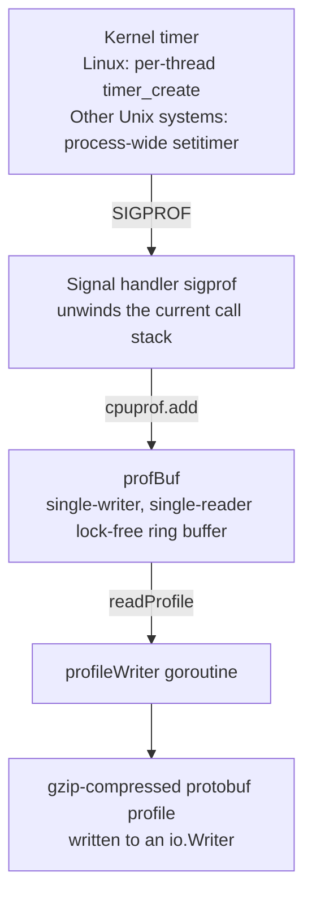

# 16.5 Benchmarking and Performance Profiling

Measure before optimizing. Where a program spends its time often contradicts intuition, and a single
reading or two cannot establish that a change really helped. The Go toolchain offers three kinds of
tools for this. A **benchmark** measures how long one execution of a piece of code takes and how
much memory it allocates. `benchstat` applies a statistical test to decide whether the difference
between two sets of benchmark results exceeds the noise. **Profiling** samples the program and
attributes CPU time, memory allocation and blocking time to specific call stacks; the result is
called a **profile**.

This section covers how the `testing` package chooses the iteration count and keeps time, what
problems `B.Loop` (introduced in Go 1.24) solves, which statistical methods `benchstat` uses and how
many samples it needs, and how the runtime collects CPU, blocking and lock-contention profiles.
Execution tracing is covered in [16.3 Execution Tracing](./trace.md), runtime metrics in
[16.6 Runtime Metrics](./metric.md), and the sampling principle of the heap profile in
[12.8.5 The Heap Profile](../../part4memory/ch12alloc/mstats.md).

## 16.5.1 Iteration Counts and Timing

A benchmark function has the form `func BenchmarkXxx(b *testing.B)` and is run by `go test -bench`.
An operation that takes nanoseconds cannot be timed on its own: the resolution of the clock and the
cost of reading it are of the same order as the operation. The `testing` package therefore runs the
code under test `b.N` times and divides the total time by `b.N` to get the time per operation
(ns/op). The framework chooses `b.N`: it first runs with `b.N` = 1, then repeatedly estimates the
count for the next round until a round's timing reaches `-benchtime` (1 second by default). The
estimate is made by `predictN` [[Go Authors, 2026b](#ref-go-authors-2026b)]:

```go
func predictN(goalns int64, prevIters int64, prevns int64, last int64) int {
	if prevns == 0 {
		// Round up to dodge divide by zero. See https://go.dev/issue/70709.
		prevns = 1
	}

	// Order of operations matters.
	// For very fast benchmarks, prevIters ~= prevns.
	// If you divide first, you get 0 or 1,
	// which can hide an order of magnitude in execution time.
	// So multiply first, then divide.
	n := goalns * prevIters / prevns
	// Run more iterations than we think we'll need (1.2x).
	n += n / 5
	// Don't grow too fast in case we had timing errors previously.
	n = min(n, 100*last)
	// Be sure to run at least one more than last time.
	n = max(n, last+1)
	// Don't run more than 1e9 times. (This also keeps n in int range on 32 bit platforms.)
	n = min(n, maxBenchPredictIters)
	return int(n)
}
```

The estimate extrapolates linearly from the speed of the previous round to the target time, plus a
20% margin. Because the previous timing may be off, each round grows by at most a factor of 100, by
at least one iteration, and the total never exceeds 1 billion. The comment on multiplying before
dividing records an integer-arithmetic detail: for a very fast operation the iteration count and the
number of nanoseconds are close, so dividing first yields 0 or 1 and hides an order of magnitude of
difference.

Each round is executed by `runN`. It first calls `runtime.GC()` to clear the garbage left by the
previous round, so that all rounds start from similar conditions, then resets the timer and calls
the whole benchmark function. Every change of `b.N` therefore runs the benchmark function from the
start, and any setup or cleanup code outside the loop is repeated with it. The following program
runs benchmarks with `testing.Benchmark` from `main` and records the value of `b.N` on each call of
the benchmark function:

```go {run=true}
package main

import (
	"fmt"
	"strings"
	"testing"
)

var sink string

func work() string { return strings.Repeat("x", 64) }

func main() {
	var calls []int
	r := testing.Benchmark(func(b *testing.B) {
		calls = append(calls, b.N)
		for range b.N {
			sink = work()
		}
	})
	fmt.Println("b.N form: benchmark function called", len(calls), "times, b.N values", calls)
	fmt.Println("  final", r.N, "iterations,", r.NsPerOp(), "ns/op")

	calls = nil
	r = testing.Benchmark(func(b *testing.B) {
		calls = append(calls, b.N)
		for b.Loop() {
			sink = work()
		}
	})
	fmt.Println("b.Loop form: benchmark function called", len(calls), "times, b.N on entry", calls)
	fmt.Println("  final", r.N, "iterations,", r.NsPerOp(), "ns/op")
}
```

One run with Go 1.26.10 on arm64 produced the following output; iteration counts and times vary with
the machine:

```
b.N form: benchmark function called 5 times, b.N values [1 100 10000 1000000 22206732]
  final 22206732 iterations, 110 ns/op
b.Loop form: benchmark function called 1 times, b.N on entry [1]
  final 13740837 iterations, 105 ns/op
```

The counts of the second through fourth rounds are exactly 100 times the previous round: those
rounds take far less than 1 second, and the linear extrapolation exceeds the growth cap. The count
of the fifth round comes from the extrapolation; its timing exceeds 1 second, which ends the
measurement. The second half of the output is discussed in the next subsection.

The timed region is controlled by `StartTimer`, `StopTimer` and `ResetTimer`, which allow setup work
to be excluded. These methods carry an easily overlooked cost: to account for memory allocation,
both `StartTimer` and `StopTimer` call `runtime.ReadMemStats`
[[Go Authors, 2026b](#ref-go-authors-2026b)], and each call stops the world
([12.8.4 Two Read Interfaces](../../part4memory/ch12alloc/mstats.md)). If a loop body calls a
`StopTimer`/`StartTimer` pair on every iteration, the timing covers only the code under test, but
the wall-clock time is dominated by stop-the-world pauses. Since `predictN` works from the timing
rather than the wall-clock time, it keeps scaling up the iteration count, and the actual run time
far exceeds `-benchtime`. This is the origin of the report in Go issue #27217 that a tiny benchmark
using `StopTimer` never finishes [[peterGo, 2018](#ref-petergo-2018)]; it and the earlier #20875
[[Bleecher Snyder, 2017](#ref-bleecher-snyder-2017)] are both still open.

## 16.5.2 `B.Loop`

The `b.N` form has two long-standing problems. The first is described above: the benchmark function
is called several times, so expensive setup is repeated and must be excluded by calling `ResetTimer`
by hand. The second is that the compiler may delete the code under test: once a function called in
the loop body is inlined and its result is unused, dead-code elimination can remove the whole call,
and the benchmark measures an empty loop. In 2023 Austin Clements proposed `testing.B.Loop` (Go
issue #61515), and Go 1.24 adopted it [[Clements, 2023b](#ref-clements-2023b);
[Go Authors, 2025](#ref-go-authors-2025)]. Its documentation explains how each problem is solved
[[Go Authors, 2026b](#ref-go-authors-2026b)]:

```go
// Loop resets the benchmark timer the first time it is called in a benchmark,
// so any setup performed prior to starting the benchmark loop does not count
// toward the benchmark measurement. Likewise, when it returns false, it stops
// the timer so cleanup code is not measured.
//
// Within the body of a "for b.Loop() { ... }" loop, arguments to and
// results from function calls and assigned variables within the loop are kept
// alive, preventing the compiler from fully optimizing away the loop body.
// Currently, this is implemented as a compiler transformation that wraps such
// variables with a runtime.KeepAlive intrinsic call. This applies only to
// statements syntactically between the curly braces of the loop, and the loop
// condition must be written exactly as "b.Loop()".
```

The timing problem is solved by moving the estimation of the iteration count inside the loop. The
first time `B.Loop` is called, it sets the target count to 1 and resets the timer; whenever the
iterations reach the target, it estimates a new target with the same `predictN`, until the timing
reaches `-benchtime`. All of this happens within a single call of the benchmark function, and
`launch` sees that the iterations are complete and does not call the benchmark function again. The
second half of the output above confirms this: the benchmark function is called only once, and the
`b.N` on entry is the 1 set by the initial call. Since Go 1.25, `b.N` is 0 inside the loop and the
total iteration count is written only after the loop ends, so that users do not confuse the two
forms and misuse is easier to spot [[Clements, 2025](#ref-clements-2025)]. To avoid adding
noticeable cost to each iteration, the fast path of `Loop` consists of one comparison and one
increment and can be inlined; when the timer is stopped, `StopTimer` sets the top bit of the
iteration counter, which forces the next call into the slow path, where it reports an error
[[Go Authors, 2026b](#ref-go-authors-2026b)]:

```go
func (b *B) Loop() bool {
	// ...
	if b.loop.i < b.loop.n {
		b.loop.i++
		return true
	}
	return b.loopSlowPath()
}
```

The dead-code problem is solved by a compiler transformation that recognizes only loops written
literally as `for b.Loop() { ... }`. Go 1.24 and 1.25 disabled inlining inside such loop bodies.
That does preserve the code under test, but it introduces another distortion. Go issue #73137 gives
an example: a function makes a slice internally and returns it to its caller. In a real program the
function is inlined, so escape analysis can keep the slice on the caller's stack
([15.5 Escape Analysis](../ch15compile/escape.md)); inside a `B.Loop` body it cannot be inlined, the
slice must be allocated on the heap, and the benchmark shows a heap allocation that does not exist
in the real program. Go 1.26 keeps inlining and instead wraps the function arguments, return values
and assigned variables in the loop body with `runtime.KeepAlive`, so their computation cannot be
removed [[Shao, 2025](#ref-shao-2025)]. The release notes therefore expect that all benchmarks can
be changed from the `b.N` form to the `B.Loop` form without side effects
[[Go Authors, 2026a](#ref-go-authors-2026a)].

Keeping the code under test from being optimized away is a problem common to all microbenchmark
frameworks. Java's JMH requires users to hand results to `Blackhole.consume`
[[Shipilëv, n.d.](#ref-shipilev-nd)], so the user marks explicitly which values must not be removed.
`B.Loop` leaves this work to the compiler, at the price of a restricted syntax: the loop condition
must be written literally as `b.Loop()`, and the transformation applies only to statements
syntactically inside the loop body.

## 16.5.3 Allocation Statistics and Custom Metrics

With `-benchmem`, or a call to `b.ReportAllocs()` in the benchmark function, the result gains two
columns: the bytes allocated per operation (B/op) and the number of objects (allocs/op). They come
from the differences in `MemStats.TotalAlloc` and `MemStats.Mallocs` between the two reads in
`StartTimer` and `StopTimer` [[Go Authors, 2026b](#ref-go-authors-2026b)]. Both counters are
cumulative for the whole process, so allocations by other goroutines during the timed region are
counted as well.

allocs/op is often more stable than ns/op and easier to interpret. Every heap allocation adds work
for the garbage collector ([Chapter 13 Garbage Collector](../../part4memory/ch13gc)); when allocs/op
changes from 0 to 1, a value has usually escaped to the heap, and the escape analysis output of
`go build -gcflags=-m` shows which line causes the allocation
([15.5 Escape Analysis](../ch15compile/escape.md)).

When the built-in metrics are not enough, `b.ReportMetric(n, unit)` reports a custom metric, such as
the number of elements processed per operation or a cache hit rate. The unit must not contain
whitespace; if it has the same name as a built-in unit (such as allocs/op), it overrides the
built-in value, and setting ns/op to 0 suppresses the time report
[[Go Authors, 2026b](#ref-go-authors-2026b)].

## 16.5.4 Deciding Whether a Difference Is Significant

### The Benchmark Data Format and Noise

The output of `go test -bench` is itself a data format. In 2016 Russ Cox and Austin Clements fixed
it in a design document as the standard format for recording Go benchmark data. They wrote that they
could not find any standard format for recording raw benchmark data; even SPEC CPU2006 publishes
only results after analysis. In this format, configuration lines of the form `key: value` (such as
`goos`, `goarch`, `pkg`) describe the environment, and each result line consists of the benchmark
name, the iteration count and several "value unit" pairs
[[Cox and Clements, 2016](#ref-cox-and-clements-2016)]. The `testing` package also appends the
runtime `GOMAXPROCS` to the name, as in `-18`, and omits it when it is 1
[[Go Authors, 2026b](#ref-go-authors-2026b)]. With an agreed format, the programs that produce data
and the programs that analyze it can evolve independently.

Repeating the same benchmark on the same machine also gives fluctuating readings. Dynamic CPU
frequency scaling, thermal limits, background processes and hyper-threads sharing a physical core
all move readings by a few percent or more. Clements wrote `perflock`, which serializes benchmarks
on a shared machine with a system-wide lock and, in exclusive mode, also fixes the CPU frequency for
the duration of the run at a point 90% of the way between the lowest and highest frequency; once the
frequency is fixed, dynamic scaling no longer affects the readings
[[Clements, n.d.](#ref-clements-nd)]. Even so, noise cannot be eliminated entirely, and comparing
only a before reading and an after reading is unreliable.

### The Statistics of `benchstat`

`benchstat` was originally written by Russ Cox and merged into `golang.org/x/perf` in 2017
[[Cox, 2017b](#ref-cox-2017b)]. In 2023 Clements rewrote its statistics
[[Clements, 2023a](#ref-clements-2023a)]. The old version first discarded outliers by the
interquartile range and then reported the mean and range of the remaining samples; but any outlier
rejection assumes a distribution of the data, here the normal distribution, which benchmark data
usually does not follow. The new version discards no samples, and so must switch to statistics that
are insensitive to outliers: each group reports the median and its 95% confidence interval. Two
groups are still compared with the **Mann-Whitney U test**, but now on the complete samples, which
raises the power of the test.

Mann and Whitney published the test in 1947 [[Mann and Whitney, 1947](#ref-mann-and-whitney-1947)];
it is equivalent to the rank-sum test proposed by Wilcoxon in 1945
[[Wilcoxon, 1945](#ref-wilcoxon-1945)]. Its idea is to look only at the ranks of the two samples
after sorting them together, not at the values themselves. If both samples come from the same
distribution (the null hypothesis), every arrangement of ranks is equally likely, and the p value is
the probability, under the null hypothesis, of an arrangement at least as extreme as the observed
one. It makes no assumption about the shape of the distribution, so it suits benchmark data with
outliers or even multimodal distributions. The default significance level α of `benchstat` is 0.05;
when the p value is below α it reports the percentage change, and otherwise it prints `~` to
indicate that no significant difference was detected [[Go Authors, 2026g](#ref-go-authors-2026g)].

The resolving power of a rank test is limited by the sample count. With n samples per group, the
most extreme arrangement puts all samples of one group before all samples of the other, and under
the null hypothesis its probability is $2/\binom{2n}{n}$: 0.1 for n = 3, and about 0.029 for n = 4.
So with fewer than 4 samples per group, the p value cannot fall below 0.05 no matter how far apart
the groups are. The confidence interval of the median has a similar limit: with the minimum and
maximum of the sample as endpoints, the probability that the interval contains the population median
is $1-2\cdot 2^{-n}$, which is 0.9375 for n = 5 and exceeds 0.95 only at n = 6. `benchstat`
tabulates these two lower bounds and warns directly when the samples are insufficient
[[Go Authors, 2026g](#ref-go-authors-2026g)].

### A Complete Comparison

The following compares two implementations of string concatenation. The old one concatenates with
`+=`, allocating a new string on every concatenation; the new one first computes the total length
and then writes everything at once with a `strings.Builder`:

```go
// old
func join(parts []string) string {
	var s string
	for _, p := range parts {
		s += p
	}
	return s
}

// new
func join(parts []string) string {
	n := 0
	for _, p := range parts {
		n += len(p)
	}
	var b strings.Builder
	b.Grow(n)
	for _, p := range parts {
		b.WriteString(p)
	}
	return b.String()
}
```

`BenchmarkJoin` concatenates 32 words repeatedly with `for b.Loop()`; `BenchmarkCount` measures
`strings.Count`, which is unrelated to this change, as a control. The `benchstat` documentation
recommends alternating runs of the two versions so that noise is spread evenly over both samples,
rather than running the old version 10 times in a row and then the new version 10 times in a row
[[Go Authors, 2026g](#ref-go-authors-2026g)]. Compile the two test programs in advance with
`go test -c` and run them alternately. The following uses Go 1.26.10 and revision be2c69f of
`golang.org/x/perf`:

```shell
$ go test -c -o old.test     # old join
$ go test -c -o new.test     # new join
$ for i in $(seq 10); do
>   ./old.test -test.run='^$' -test.bench=. -test.benchmem >> old.txt
>   ./new.test -test.run='^$' -test.bench=. -test.benchmem >> new.txt
> done
$ benchstat old.txt new.txt
goos: darwin
goarch: arm64
pkg: join
cpu: Apple M5 Pro
         │    old.txt     │               new.txt                │
         │     sec/op     │    sec/op     vs base                │
Join-18    1817.0n ±  35%   187.4n ± 30%  -89.69% (p=0.000 n=10)
Count-18    16.91n ± 121%   14.80n ± 36%        ~ (p=0.631 n=10)
geomean     175.3n          52.66n        -69.95%

         │    old.txt    │               new.txt                │
         │     B/op      │    B/op     vs base                  │
Join-18    2720.0 ± 0%     160.0 ± 0%  -94.12% (p=0.000 n=10)
Count-18    0.000 ± 0%     0.000 ± 0%        ~ (p=1.000 n=10) ¹
geomean                ²               -75.75%                ²
¹ all samples are equal
² summaries must be >0 to compute geomean

         │    old.txt    │               new.txt                │
         │   allocs/op   │ allocs/op   vs base                  │
Join-18    31.000 ± 0%     1.000 ± 0%  -96.77% (p=0.000 n=10)
Count-18    0.000 ± 0%     0.000 ± 0%        ~ (p=1.000 n=10) ¹
geomean                ²               -82.04%                ²
¹ all samples are equal
² summaries must be >0 to compute geomean
```

Many other processes were running on the machine during this run, so the confidence intervals of the
times are unusually wide, which shows well what the statistical test does. The two samples of `Join`
do not overlap at all, and even with this much noise the p value is close to 0. The medians of
`Count` differ by about 12%, yet the p value is 0.631, and `benchstat` concludes that the difference
cannot be told apart from noise. The `± 35%` is the width of the 95% confidence interval of the
median relative to the median, not the dispersion of the samples. The geometric mean in the last row
of each table summarizes the change over all benchmarks: if one of n benchmarks becomes twice as
large, the geometric mean becomes $\sqrt[n]{2}$ times as large. The geometric mean requires every
value to be greater than 0; `Count` allocates no memory, so the geometric means in the last two
tables carry a warning. The allocation statistics have no noise: the old version allocates 31 times
to concatenate 32 words (the left operand of the first concatenation is the empty string, so the
runtime returns the right operand directly without allocating), and the new version allocates once,
in `Grow`.

With only 3 runs per group, `benchstat` reports the two lower bounds derived in the previous
subsection:

```shell
$ benchstat a3.txt b3.txt
         │    a3.txt    │             b3.txt              │
         │    sec/op    │    sec/op     vs base           │
Count-18   17.17n ± ∞ ¹   14.75n ± ∞ ¹  ~ (p=0.400 n=3) ²
¹ need >= 6 samples for confidence interval at level 0.95
² need >= 4 samples to detect a difference at alpha level 0.05
```

The `benchstat` documentation also warns of two statistical traps
[[Go Authors, 2026g](#ref-go-authors-2026g)]. First, the sample count should be fixed in advance (at
least 10, preferably 20), and the benchmark should not be rerun repeatedly when the result is not
significant until it becomes so: α = 0.05 means that even with no difference at all there is a 5%
chance of reporting one, and repeated reruns will eventually hit it. Second, for the same reason,
when many benchmarks are compared at once, about 5% of them should be expected to show a significant
change even if the code did not change.

## 16.5.5 How the Runtime Collects Profiles

A benchmark tells us how fast a piece of code is; profiling answers which call stacks a running
program spends its time and memory on. `runtime/pprof` predefines the following profiles
[[Go Authors, 2026c](#ref-go-authors-2026c)]:

```go
//	goroutine      - stack traces of all current goroutines
//	goroutineleak  - stack traces of all leaked goroutines
//	allocs         - a sampling of all past memory allocations
//	heap           - a sampling of memory allocations of live objects
//	threadcreate   - stack traces that led to the creation of new OS threads
//	block          - stack traces that led to blocking on synchronization primitives
//	mutex          - stack traces of holders of contended mutexes
```

The CPU profile is not among them. It writes data to an `io.Writer` continuously while profiling, so
it has its own interface, `StartCPUProfile` and `StopCPUProfile`. Although `goroutineleak` appears
in the documentation, in Go 1.26 it is registered only when building with
`GOEXPERIMENT=goroutineleakprofile` [[Go Authors, 2026a](#ref-go-authors-2026a);
[Go Authors, 2026f](#ref-go-authors-2026f)]. It uses the garbage collector to find goroutines that
can never be woken up, and it becomes officially available in Go 1.27
[[Go Authors, 2026h](#ref-go-authors-2026h)]; the detection principle is in
[16.1 Runtime Deadlock Detection](./deadlock.md). The `heap` and `allocs` profiles sample by
recording on average once per 512 KiB allocated; the principle is in
[12.8.5 The Heap Profile](../../part4memory/ch12alloc/mstats.md). The following discusses how CPU,
blocking and lock-contention profiles are collected.

### The CPU Profile

The CPU profile relies on timer-signal sampling: at fixed intervals of CPU time the kernel sends the
process a `SIGPROF`, and the signal handler records the current call stack. The fraction of samples
in which a function appears approximates the fraction of CPU time it uses. The sampling frequency is
fixed at 100 Hz, and the comment in `StartCPUProfile` gives the reason
[[Go Authors, 2026c](#ref-go-authors-2026c)]:

```go
	// The runtime routines allow a variable profiling rate,
	// but in practice operating systems cannot trigger signals
	// at more than about 500 Hz, and our processing of the
	// signal is not cheap (mostly getting the stack trace).
	// 100 Hz is a reasonable choice: it is frequent enough to
	// produce useful data, rare enough not to bog down the
	// system, and a nice round number to make it easy to
	// convert sample counts to seconds. Instead of requiring
	// each client to specify the frequency, we hard code it.
	const hz = 100
```

From signal to profile file, the data passes through the following steps:



A signal handler cannot allocate memory or acquire a lock that may already be held, so `sigprof`
only writes the call stack into `profBuf`. `profBuf` is a lock-free ring buffer that allows exactly
one writer and one reader; the writer may be a signal handler with no user goroutine. Besides the
call stack, each record carries a pointer to the profiling labels of the current goroutine (set by
`pprof.Do`). Cox reimplemented this buffer in 2017 to support labels, shipped in Go 1.9
[[Cox, 2017a](#ref-cox-2017a)]. The reader, `profileWriter`, is an ordinary goroutine that
continually takes records from the buffer and aggregates them into a profile in protobuf format.
This format was introduced by Michael Matloob in Go 1.8 to replace the earlier legacy pprof format:
the protobuf format is easier to extend and is the format preferred by the pprof tool, and profiling
labels can be written only in this format [[Matloob, 2016](#ref-matloob-2016)].

The choice of timer was corrected once. `setitimer` counts the CPU time consumed by the whole
process, but Linux settles a process's CPU time only periodically (usually every 4 ms); if more than
one signal should be sent between two settlements (every 10 ms at the default 100 Hz), the kernel
can often deliver only one of them. As a result, when a program runs more than about 2.5 goroutines
in parallel, the CPU profile systematically undercounts. Rhys Hiltner reported this in Go issue
#35057 and, in Go 1.18, switched to creating one timer with `timer_create` for each thread managed
by the runtime; each timer counts that thread's own CPU time, and the signal is sent directly to the
thread [[Hiltner, 2021](#ref-hiltner-2021)]. Threads created by cgo are not managed by the runtime
and still need the process-wide `setitimer` to cover them, and `validSIGPROF` deduplicates by the
origin of the signal: a thread that has an M and its own timer accepts only signals from
`timer_create`, and a thread without an M accepts only signals from `setitimer`
[[Go Authors, 2026c](#ref-go-authors-2026c)]. Per-thread timing brings a new bias: a short-lived
thread, or one that runs only briefly now and then (such as a garbage collection worker thread on an
idle system), may stop running before the first signal arrives. For this reason the first expiry of
each timer is chosen uniformly at random between zero and one full sampling period.

### The Blocking Profile and the Mutex Profile

Both profiles are off by default. They need to take timestamps on the slow paths of synchronization
primitives, which costs more than CPU and heap sampling, and the user decides whether it is worth
it: `runtime.SetBlockProfileRate` turns on the blocking profile and
`runtime.SetMutexProfileFraction` turns on the mutex profile. The blocking profile was added by
Dmitriy Vyukov in Go 1.1 [[Vyukov, 2012](#ref-vyukov-2012)], and the mutex profile by Peter
Weinberger in Go 1.8 [[Weinberger, 2016](#ref-weinberger-2016)].

The two record different call stacks. The blocking profile records the stack of the **waiter**:
however long a goroutine blocks on a channel, `select`, `sync.Cond` or a mutex, that time is charged
to the call stack where it blocked. The mutex profile records the stack of the **holder**: when a
waiter is woken, `semrelease1` charges the waiting time to the goroutine that performed the unlock
[[Go Authors, 2026d](#ref-go-authors-2026d)]:

```go
	if s != nil { // May be slow or even yield, so unlock first
		acquiretime := s.acquiretime
		if acquiretime != 0 {
			// Charge contention that this (delayed) unlock caused.
			// If there are N more goroutines waiting beyond the
			// one that's waking up, charge their delay as well, so that
			// contention holding up many goroutines shows up as
			// more costly than contention holding up a single goroutine.
			// It would take O(N) time to calculate how long each goroutine
			// has been waiting, so instead we charge avg(head-wait, tail-wait)*N.
			// head-wait is the longest wait and tail-wait is the shortest.
			// ...
			dt0 := t0 - acquiretime
			dt := dt0
			if s.waiters != 0 {
				dtail := t0 - tailtime
				dt += (dtail + dt0) / 2 * int64(s.waiters)
			}
			mutexevent(dt, 3+skipframes)
		}
```

If N more goroutines are still queued after the one being woken, the unlocker is charged not only
the waiting time of the woken goroutine but also the estimated waiting time of the rest, computed as
the average of the head and tail waiting times multiplied by N, so that a critical section that
blocks many goroutines looks more expensive. The blocking profile thus answers "where is the
waiting," and the mutex profile answers "whose critical section causes the waiting."

Accumulating by the number of queued goroutines was added only in Go 1.22. The mutex profile was
meant to follow the lock-contention profiler that Mike Burrows designed for Google's C++ library
(today's Abseil), which computes blocking time per thread: 100 threads blocked on the same lock for
10 ms at the same time count as 1000 ms of contention. The original Go implementation missed this
and counted only 10 ms. In 2023 Russ Cox changed it to accumulate by the number of blocked
goroutines, while still charging the time to the unlock that caused the backlog rather than to the
later unlocks affected by the congestion [[Cox, 2023](#ref-cox-2023)]. Locks inside the runtime have
also been counted in the mutex profile since Go 1.22, but at first only against a placeholder frame,
`runtime._LostContendedRuntimeLock` [[Go Authors, 2024](#ref-go-authors-2024)]; only from Go 1.25
are they treated like `sync.Mutex` and charged to the end of the critical section that caused the
wait, that is, to the unlocker's call stack [[Hiltner, 2025](#ref-hiltner-2025)].

The following program has `holder` hold the lock for 50 ms while `waiter` waits for it, and then
reads out the call stacks belonging to package `main` from the two profiles:

```go {run=true}
package main

import (
	"fmt"
	"runtime"
	"strings"
	"sync"
	"time"
)

var mu sync.Mutex

func holder(locked chan<- struct{}) {
	mu.Lock()
	close(locked)
	time.Sleep(50 * time.Millisecond) // keep the lock so that waiter has to wait
	mu.Unlock()
}

func waiter() {
	mu.Lock()
	mu.Unlock()
}

// frames returns the names of the functions in the stack that belong to package main.
func frames(stk []uintptr) []string {
	var names []string
	fs := runtime.CallersFrames(stk)
	for {
		f, more := fs.Next()
		if strings.HasPrefix(f.Function, "main.") {
			names = append(names, f.Function)
		}
		if !more {
			return names
		}
	}
}

func main() {
	runtime.SetBlockProfileRate(1)     // record every blocking event
	runtime.SetMutexProfileFraction(1) // record every contention event

	locked := make(chan struct{})
	var wg sync.WaitGroup
	wg.Go(func() { holder(locked) })
	<-locked
	wg.Go(waiter)
	wg.Wait()

	for _, p := range []struct {
		name  string
		fetch func([]runtime.BlockProfileRecord) (int, bool)
	}{{"block", runtime.BlockProfile}, {"mutex", runtime.MutexProfile}} {
		recs := make([]runtime.BlockProfileRecord, 64)
		n, _ := p.fetch(recs)
		for _, r := range recs[:n] {
			if names := frames(r.Stack()); len(names) > 0 && names[0] != "main.main" {
				fmt.Printf("%s profile: %v\n", p.name, names)
			}
		}
	}
}
```

The program skips records whose top frame is `main.main`, which are `main`'s own blocking on the
channel and the `WaitGroup`. The output is:

```
block profile: [main.waiter]
mutex profile: [main.holder main.main.func1]
```

The same wait is attributed to `waiter`, which waits for the lock, in one profile, and to `holder`,
which holds it, in the other.

The two profiles also sample differently, but both weight the samples so that the total time in the
profile is an unbiased estimate of the actual total [[Go Authors, 2026d](#ref-go-authors-2026d)]:

```go
	if which == blockProfile && cycles < rate {
		// Remove sampling bias, see discussion on http://golang.org/cl/299991.
		bp.count += float64(rate) / float64(cycles)
		bp.cycles += rate
	} else if which == mutexProfile {
		bp.count += float64(rate)
		bp.cycles += rate * cycles
	} else {
		bp.count++
		bp.cycles += cycles
	}
```

The blocking profile samples by time: every event that blocks for at least `rate` is recorded, and a
shorter event is recorded with probability "blocking time / `rate`" and scaled up by the inverse of
that probability. Before Go 1.17, a short event that was sampled was counted once as it was, so the
profile favored few long blockings and underestimated many short ones; Felix Geisendörfer fixed this
bias on a suggestion from Vyukov [[Geisendörfer, 2021](#ref-geisendorfer-2021)]. The mutex profile
samples by event: on average one in every `rate` contention events is recorded, scaled up by a
factor of `rate`. The heap profile recovers the allocation volume from the sampling probability
([12.8.5 The Heap Profile](../../part4memory/ch12alloc/mstats.md)) and uses the same weighting by
inverse probability.

### The Goroutine Profile and Stack Depth

The goroutine profile needs the call stacks of all goroutines at a single instant. Early
implementations walked all goroutines while the world was stopped, so the pause grew in proportion
to the number of goroutines. Go 1.19 changed this to do only a fixed amount of work during the
stop-the-world pause, including setting up a barrier: after the program resumes, if a goroutine is
scheduled before it has been recorded, the scheduler first records its call stack as of the stop
time and then lets it run; the profiler records the remaining goroutines one by one while the
program runs, and finally stops the world once more to remove the barrier. The pause no longer grows
with the number of goroutines, at the price of more CPU time spent in profiling itself and a longer
wall-clock time for the call [[Hiltner, 2022](#ref-hiltner-2022)]. In addition, all profiles other
than the CPU profile originally recorded only the 32 innermost frames of a call stack, which were
often truncated in production; Go 1.23 raised the limit to 128 frames, the same as execution tracing
[[Geisendörfer, 2024](#ref-geisendorfer-2024)].

## 16.5.6 From Profiles to Conclusions

The standard format of a profile is gzip-compressed protobuf, read by `go tool pprof`.
`runtime/pprof` writes profiles to a file, and `net/http/pprof` serves the same data over HTTP under
`/debug/pprof/`, so it can be fetched directly from a running service [[Cox, 2011](#ref-cox-2011);
[Go Authors, 2026e](#ref-go-authors-2026e)]:

```go
import _ "net/http/pprof" // registers /debug/pprof/ on DefaultServeMux

func main() {
	go func() { log.Println(http.ListenAndServe("localhost:6060", nil)) }()
	// ...
}
```

`/debug/pprof/profile?seconds=30` collects a 30-second CPU profile; for cumulative profiles such as
`heap`, `block` and `mutex`, the `seconds` parameter returns the delta over that period instead.
Since Go 1.22 these paths accept only GET requests [[Go Authors, 2026e](#ref-go-authors-2026e)].
These endpoints expose the internal state of the program, and normally they should listen only on a
local address or require authentication.

```shell
$ go tool pprof -http=localhost:8080 'http://localhost:6060/debug/pprof/profile?seconds=30'
```

`go tool pprof -http` opens a web interface, which since Go 1.26 shows a **flame graph** by default
[[Go Authors, 2026a](#ref-go-authors-2026a)]. The flame graph was proposed by Brendan Gregg
[[Gregg, 2016](#ref-gregg-2016); [Gregg, n.d.](#ref-gregg-nd)]. Each rectangle is a frame of the
call stack, stacked level by level according to the calling relationship, with a width proportional
to the number of samples that contain the frame; the horizontal order has no meaning in time.
Gregg's original layout puts the root at the bottom with call stacks growing upward, and the frames
on the top edge are the functions executing on the CPU when the sample was taken; the flame graph in
the pprof web interface puts the root at the top and lets callees grow downward, the opposite
direction [[Go Authors, 2026c](#ref-go-authors-2026c)]. In either direction the height reflects only
the depth of the call stack, and when looking for hot spots one should look for wide,
flat "plateaus" on the leaf side, that is, functions that account for many samples themselves. Flame
graphs do not depend on a particular profiler; call stacks collected by DTrace or Linux `perf` can
be presented the same way.

Profiles can also leave the developer's machine and become part of infrastructure. Google-Wide
Profiling at Google collects profiles continuously and at a low rate on the machines of its data
centers and stores them centrally, so performance analysis can cover long-term data from the whole
fleet [[Ren et al., 2010](#ref-ren-et-al-2010)]. The low overhead of sampling is what makes
continuous profiling possible. Profiles can also be handed to the compiler: since Go 1.21, a
`default.pgo` in the main package directory is used by default for profile-guided optimization
(PGO), on whose basis the compiler inlines and devirtualizes hot spots more aggressively. The Go
1.21 release notes report a typical gain of 2% to 7% [[Go Authors, 2023](#ref-go-authors-2023)]; Go
1.22 let PGO devirtualize more calls, and its release notes report the gain rising to 2% to 14%
[[Go Authors, 2024](#ref-go-authors-2024)]. The mechanism is in
[15.3 The Optimizer](../ch15compile/optimize.md).

Profiling answers where time goes overall. When the problem is occasional tail latency, the
statistical aggregation in a profile hides the experience of individual requests; there an execution
trace, which records scheduling, garbage collection and system call events in time order, is needed
([16.3 Execution Tracing](./trace.md)).

## 16.5.7 Summary

Benchmarks, statistical tests and profiling answer "how fast," "did it really change" and "where
does it go." The `testing` package determines the iteration count by exponential growth followed by
extrapolation; `B.Loop` moves this process inside the loop and prevents the code under test from
being deleted with a compiler transformation, and Go 1.26 makes that transformation stop interfering
with inlining. `benchstat` handles benchmark data that does not follow a normal distribution with
the median, confidence intervals and the Mann-Whitney U test; the nature of the rank test requires
at least 4 samples per group, and the confidence interval of the median requires at least 6. The
runtime collects the CPU profile with a 100 Hz timer signal, using per-thread timers on Linux to
avoid undercounting on multiple cores; the blocking profile and the mutex profile charge the same
wait to the waiter and to the holder respectively, and both weight by sampling probability to stay
unbiased.

## Further Reading

- <a id="ref-bleecher-snyder-2017"></a>[Bleecher Snyder, 2017] Josh Bleecher Snyder. Go issue
  #20875. *testing: consider calling ReadMemStats less during benchmarking.* 2017.
  https://go.dev/issue/20875
- <a id="ref-clements-2023a"></a>[Clements, 2023a] Austin Clements. cmd/benchstat: new version of
  benchstat. golang.org/x/perf commit 02c55175bb, 2023. https://go.dev/cl/309969 Switches to the
  median, the confidence interval of the median and a U test over all samples, and no longer
  discards outliers.
- <a id="ref-clements-2023b"></a>[Clements, 2023b] Austin Clements. Go issue #61515. *testing: add
  testing.B.Loop for iteration.* 2023. https://go.dev/issue/61515
- <a id="ref-clements-2025"></a>[Clements, 2025] Austin Clements. testing: separate b.Loop counter
  from b.N. Go commit 9003154206, 2025. https://go.dev/cl/659655 Shipped in Go 1.25.
- <a id="ref-clements-nd"></a>[Clements, n.d.] Austin Clements. *perflock.*
  https://github.com/aclements/perflock Runs benchmarks serially under a system-wide lock and
  adjusts the CPU frequency for the duration of the run.
- <a id="ref-cox-2011"></a>[Cox, 2011] Russ Cox. *Profiling Go Programs.* The Go Blog, 2011 (updated
  by Shenghou Ma in 2013). https://go.dev/blog/pprof Uses a benchmark program as the example to show
  how CPU and heap profiles are collected and analyzed.
- <a id="ref-cox-2017a"></a>[Cox, 2017a] Russ Cox. runtime: new profile buffer implementation
  supporting label pointers. Go commit b788fd80e6, 2017. https://go.dev/cl/36713 Shipped in Go 1.9.
- <a id="ref-cox-2017b"></a>[Cox, 2017b] Russ Cox. cmd/benchstat: import from rsc.io/benchstat.
  golang.org/x/perf commit 1da04cc6cd, 2017. https://go.dev/cl/35503
- <a id="ref-cox-2023"></a>[Cox, 2023] Russ Cox. runtime: change mutex profile to count every
  blocked goroutine. Go commit 1c00354013, 2023. https://go.dev/cl/506415 Shipped in Go 1.22; fixes
  Go issue #61015. The commit message explains the origin of the mutex profile in the Abseil lock
  profiler.
- <a id="ref-cox-and-clements-2016"></a>[Cox and Clements, 2016] Russ Cox, Austin Clements.
  *Proposal: Go Benchmark Data Format.* Go design document, 2016.
  https://go.googlesource.com/proposal/+/master/design/14313-benchmark-format.md Fixes the output of
  `go test -bench` as the standard format for recording benchmark data.
- <a id="ref-geisendorfer-2021"></a>[Geisendörfer, 2021] Felix Geisendörfer. runtime/pprof: fix
  block profile bias. Go commit 0ae9c3b98b, 2021. https://go.dev/cl/299991 Shipped in Go 1.17; fixes
  Go issue #44192.
- <a id="ref-geisendorfer-2024"></a>[Geisendörfer, 2024] Felix Geisendörfer. runtime: increase
  profiling stack depth to 128. Go commit 1b9dc3e178, 2024. https://go.dev/cl/572396 Shipped in Go
  1.23.
- <a id="ref-go-authors-2023"></a>[Go Authors, 2023] The Go Authors. *Go 1.21 Release Notes.* 2023.
  https://go.dev/doc/go1.21
  PGO becomes generally available; `-pgo` defaults to `auto`.
- <a id="ref-go-authors-2024"></a>[Go Authors, 2024] The Go Authors. *Go 1.22 Release Notes.* 2024.
  https://go.dev/doc/go1.22 The mutex profile accumulates by the number of blocked goroutines and
  starts counting locks inside the runtime; the PGO gain rises to 2% to 14%.
- <a id="ref-go-authors-2025"></a>[Go Authors, 2025] The Go Authors. *Go 1.24 Release Notes.* 2025.
  https://go.dev/doc/go1.24
  Introduces `testing.B.Loop`.
- <a id="ref-go-authors-2026a"></a>[Go Authors, 2026a] The Go Authors. *Go 1.26 Release
  Notes.* 2026. https://go.dev/doc/go1.26 `B.Loop` no longer interferes with inlining; the
  experimental goroutine leak profile; the pprof web interface shows a flame graph by default.
- <a id="ref-go-authors-2026b"></a>[Go Authors, 2026b] The Go Authors. src/testing/benchmark.go
  (`predictN`, `launch`, `runN`, `Loop`, `StartTimer`, `StopTimer`). Go 1.26 source.
  https://github.com/golang/go/blob/release-branch.go1.26/src/testing/benchmark.go
- <a id="ref-go-authors-2026c"></a>[Go Authors, 2026c] The Go Authors. src/runtime/pprof/pprof.go
  (predefined profiles, `StartCPUProfile`, `profileWriter`), src/runtime/cpuprof.go,
  src/runtime/profbuf.go, src/runtime/os_linux.go (`validSIGPROF`),
  src/cmd/vendor/github.com/google/pprof/internal/driver/html/stacks.js (drawing direction of the
  flame graph). Go 1.26 source. https://github.com/golang/go/tree/release-branch.go1.26/src/runtime
- <a id="ref-go-authors-2026d"></a>[Go Authors, 2026d] The Go Authors.
  src/runtime/mprof.go (`blocksampled`, `mutexevent`, `saveBlockEventStack`),
  src/runtime/sema.go (`semrelease1`). Go 1.26 source.
  https://github.com/golang/go/tree/release-branch.go1.26/src/runtime
- <a id="ref-go-authors-2026e"></a>[Go Authors, 2026e] The Go Authors.
  *Package runtime/pprof, net/http/pprof.* https://pkg.go.dev/runtime/pprof
  ; https://pkg.go.dev/net/http/pprof
  The meaning of each profile, and the parameters of the HTTP endpoints.
- <a id="ref-go-authors-2026f"></a>[Go Authors, 2026f] The Go Authors. *testing.B.Loop (introduced
  in Go 1.24).* https://pkg.go.dev/testing#B.Loop ; for the `goroutineleak` profile see
  `src/runtime/pprof/pprof.go` (in Go 1.26 it must be built with
  `GOEXPERIMENT=goroutineleakprofile`; generally available from Go 1.27).
- <a id="ref-go-authors-2026g"></a>[Go Authors, 2026g] The Go Authors. *benchstat.*
  https://pkg.go.dev/golang.org/x/perf/cmd/benchstat ; for the implementation see
  `golang.org/x/perf/benchmath` (Mann-Whitney U test). This section follows revision be2c69f: the
  median with a 95% confidence interval, the default α = 0.05, the lower bounds on sample counts and
  the usage advice.
- <a id="ref-go-authors-2026h"></a>[Go Authors, 2026h] The Go Authors. *Go 1.27 Release
  Notes.* 2026. https://go.dev/doc/go1.27 The goroutine leak profile becomes generally available,
  and the `goroutineleakprofile` experiment is removed.
- <a id="ref-gregg-2016"></a>[Gregg, 2016] Brendan Gregg. "The Flame Graph." *Communications of the
  ACM*, 59(6): 48–57, 2016. https://doi.org/10.1145/2909476 A systematic introduction to the
  notation by its originator.
- <a id="ref-gregg-nd"></a>[Gregg, n.d.] Brendan Gregg. *Flame Graphs.*
  https://www.brendangregg.com/flamegraphs.html ;
  *Systems Performance.* 2nd ed. Pearson, 2020.
- <a id="ref-hiltner-2021"></a>[Hiltner, 2021] Rhys Hiltner. runtime: profile with per-thread timers
  on Linux. Go commit 8cfd8c3db8, 2021. https://go.dev/cl/324129 Shipped in Go 1.18; corresponds to
  Go issue #35057.
- <a id="ref-hiltner-2022"></a>[Hiltner, 2022] Rhys Hiltner. runtime: decrease STW pause for
  goroutine profile. Go commit 52bd1c4d6c, 2022. https://go.dev/cl/387415 Shipped in Go 1.19.
- <a id="ref-hiltner-2025"></a>[Hiltner, 2025] Rhys Hiltner. runtime: blame unlocker for mutex
  delay. Go commit 4d0f955a5e, 2025. https://go.dev/cl/667615 Shipped in Go 1.25; fixes Go issue
  #66999.
- <a id="ref-mann-and-whitney-1947"></a>[Mann and Whitney, 1947] H. B. Mann, D. R. Whitney. "On a
  Test of Whether one of Two Random Variables is Stochastically Larger than the Other." *The Annals
  of Mathematical Statistics*, 18(1): 50–60, 1947. https://doi.org/10.1214/aoms/1177730491 The
  original paper of the U test used by `benchstat`.
- <a id="ref-matloob-2016"></a>[Matloob, 2016] Michael Matloob. runtime/pprof: output CPU profiles
  in pprof protobuf format. Go commit 76f12cdaa2, 2016. https://go.dev/cl/33071 Shipped in Go 1.8;
  fixes Go issue #16093 (*runtime/pprof: generate profiles in gzipped proto format*).
- <a id="ref-petergo-2018"></a>[peterGo, 2018] peterGo. Go issue #27217. *testing: tiny benchmark
  with StopTimer runs forever.* 2018. https://go.dev/issue/27217
- <a id="ref-ren-et-al-2010"></a>[Ren et al., 2010] Gang Ren, Eric Tune, Tipp Moseley, Yixin Shi,
  Silvius Rus, Robert Hundt. "Google-Wide Profiling: A Continuous Profiling Infrastructure for Data
  Centers." *IEEE Micro*, 30(4): 65–79, 2010. https://doi.org/10.1109/MM.2010.68 The founding work
  on continuous profiling.
- <a id="ref-shao-2025"></a>[Shao, 2025] Junyang Shao. cmd/compile: change testing.B.Loop keep alive
  semantic. Go commit 22f24f90b5, 2025. https://go.dev/cl/716660
  Shipped in Go 1.26; fixes Go issue #73137.
- <a id="ref-shipilev-nd"></a>[Shipilëv, n.d.] Aleksey Shipilëv. *JMH (Java Microbenchmark
  Harness).* https://openjdk.org/projects/code-tools/jmh/ `Blackhole` counters dead-code
  elimination, the same problem that `B.Loop` solves.
- <a id="ref-vyukov-2012"></a>[Vyukov, 2012] Dmitriy Vyukov. pprof: add goroutine blocking
  profiling. Go commit 4cc7bf326a, 2012. https://go.dev/cl/6443115 Shipped in Go 1.1.
- <a id="ref-weinberger-2016"></a>[Weinberger, 2016] Peter Weinberger. runtime: Profile goroutines
  holding contended mutexes. Go commit ca922b6d36, 2016. https://go.dev/cl/29650 Shipped in Go 1.8.
- <a id="ref-wilcoxon-1945"></a>[Wilcoxon, 1945] Frank Wilcoxon. "Individual Comparisons by Ranking
  Methods." *Biometrics Bulletin*, 1(6): 80–83, 1945. https://doi.org/10.2307/3001968
- This book: [15.3 The Optimizer](../ch15compile/optimize.md), [16.3 Execution Tracing](./trace.md),
  [16.1 Runtime Deadlock Detection](./deadlock.md),
  [Chapter 13 Garbage Collector](../../part4memory/ch13gc),
  [15.5 Escape Analysis](../ch15compile/escape.md).
