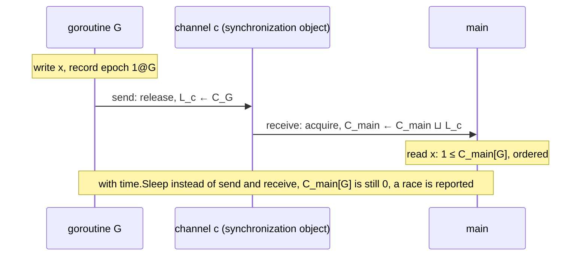

# 16.2 Race Detection

Two goroutines access the same memory location, at least one access is a write, and the
happens-before relation does not order them: this is a data race
([11.9.5](../../part3concurrency/ch11sync/mem.md)). The Go memory model is built on DRF-SC: a
data-race-free program behaves as if it were sequentially consistent
[[Go Authors, 2022a](#ref-go-authors-2022a)], so the programmer's obligation reduces to eliminating
data races ([11.9.2](../../part3concurrency/ch11sync/mem.md)). This obligation cannot be met
reliably by reading code, because races often show up only under particular loads, hardware and
scheduling. The **race detector** turns it into a property that can be checked: a program built with
`-race` constructs the happens-before relation as it runs, and reports a race as soon as it finds
two conflicting accesses that the relation does not order.

This section first uses two examples to show what the detector reports. It then discusses its
theoretical basis (vector clocks), the work done by the compiler and by the runtime, the data
structures of the ThreadSanitizer runtime and their cost, and finally the limits of its capability.

## 16.2.1 What Is Reported Is Missing Ordering

`go test`, `go run`, `go build` and `go install` all accept the `-race` flag. In the following
program, two goroutines each increment `counter` once. The `WaitGroup` only guarantees that `main`
reads after both have finished; it does not order the two increments:

```go
package main

import (
	"fmt"
	"sync"
)

func main() {
	var counter int
	var wg sync.WaitGroup
	for range 2 {
		wg.Add(1)
		go func() {
			defer wg.Done()
			counter++ // read-modify-write, no synchronization
		}()
	}
	wg.Wait()
	fmt.Println(counter)
}
```

Built with Go 1.26.10 and run with `GOMAXPROCS=1`, with path prefixes removed from the output:

```shell
$ go build -race -o counter .
$ GOMAXPROCS=1 ./counter
==================
WARNING: DATA RACE
Read at 0x00c000012158 by goroutine 7:
  main.main.func1()
      main.go:15 +0x68

Previous write at 0x00c000012158 by goroutine 8:
  main.main.func1()
      main.go:15 +0x78

Goroutine 7 (running) created at:
  main.main()
      main.go:13 +0x6c

Goroutine 8 (finished) created at:
  main.main()
      main.go:13 +0x6c
==================
2
Found 1 data race(s)
$ echo $?
66
```

The report gives the stacks of the two conflicting accesses and the creation sites of the goroutines
involved [[Go Authors, n.d.](#ref-go-authors-nd)]. The run conditions deserve attention: there is
only one P, goroutine 8 had already finished before goroutine 7 started, the two increments did not
interleave in time, and the program even printed the correct result 2. The detector still reports a
race, because it checks not whether the accesses actually overlap in time but whether a
happens-before relation exists between them. With `GOMAXPROCS` set to 1, 2 and 8, five runs gave the
same report. The program runs to completion as usual and finally exits with status 66; run with
`GORACE=halt_on_error=1`, it terminates after the first report
[[Go Authors, n.d.](#ref-go-authors-nd)].

The second example shows that being earlier in time is not synchronization. The writer goroutine
finished long before the main goroutine reads the variable, 100 milliseconds later:

```go
package main

import (
	"fmt"
	"time"
)

func main() {
	var ready bool
	go func() { ready = true }()
	time.Sleep(100 * time.Millisecond) // earlier in time, not synchronization
	fmt.Println(ready)
}
```

```shell
$ go build -race -o sleep . && ./sleep
==================
WARNING: DATA RACE
Read at 0x00c00001215f by main goroutine:
  main.main()
      main.go:12 +0xb0

Previous write at 0x00c00001215f by goroutine 7:
  main.main.func1()
      main.go:10 +0x2c

Goroutine 7 (finished) created at:
  main.main()
      main.go:10 +0x98
==================
true
Found 1 data race(s)
```

`time.Sleep` is not among the synchronization operations the memory model specifies, and it does not
establish a happens-before relation. On most machines this program prints `true`, but the memory
model does not guarantee it. Replace the `Sleep` with a channel send and receive, or wait for the
writer with a `sync.WaitGroup`, and the report disappears.

## 16.2.2 Vector Clocks

The happens-before relation is generated by program order and synchronization order
([11.9.5](../../part3concurrency/ch11sync/mem.md)). The detector maintains it at run time with
**vector clocks**. Each goroutine $t$ holds a vector $C_t$ whose component $C_t[u]$ is the logical
time of goroutine $u$ that $t$ already knows; each synchronization object $m$ (a lock, a channel
buffer slot) also holds a vector $L_m$. Synchronization operations update them by the following
rules:

$$
\begin{aligned}
\text{release}(t, m):&\quad L_m \leftarrow C_t,\quad C_t[t] \leftarrow C_t[t] + 1,\\
\text{acquire}(t, m):&\quad C_t \leftarrow C_t \sqcup L_m,
\end{aligned}
$$

where $\sqcup$ is the componentwise maximum. An access made by $t$ at local time $c = C_t[t]$ is
recorded as the epoch $c@t$. When goroutine $u$ later accesses the same location, the earlier access
happens before this one if and only if $c \le C_u[t]$, that is, $u$ already knows $t$'s time $c$
through some release-acquire chain. Two accesses that do not satisfy this condition, with at least
one a write, form a race.



Keeping a full vector clock for every memory location costs time proportional to the number of
goroutines. Flanagan and Freund's FastTrack observed that the vast majority of accesses only need
the epoch of the most recent access, which reduces the comparison from $O(n)$ to $O(1)$; a full
vector is needed only when a read is shared concurrently by several threads
[[Flanagan and Freund, 2009](#ref-flanagan-and-freund-2009)]. As shown below, ThreadSanitizer's
shadow memory records exactly such epochs.

## 16.2.3 Division of Labor between the Compiler and the Runtime

Constructing the happens-before relation needs two kinds of events: memory accesses and
synchronization. The first is produced by compiler instrumentation, the second is reported by the
runtime and the standard library.

When compiling with `-race`, `cmd/compile` inserts calls into the runtime for every memory read and
write, in the phase that generates SSA [[Go Authors, 2026a](#ref-go-authors-2026a)]:

```go
func (s *state) instrument2(t *types.Type, addr, addr2 *ssa.Value, kind instrumentKind) {
	if !s.instrumentMemory {
		return
	}

	w := t.Size()
	if w == 0 {
		return // can't race on zero-sized things
	}

	if ssa.IsSanitizerSafeAddr(addr) {
		return
	}
	// ……
	} else if base.Flag.Race && t.NumComponents(types.CountBlankFields) > 1 {
		// for composite objects we have to write every address
		// because a write might happen to any subobject.
		// composites with only one element don't have subobjects, though.
		switch kind {
		case instrumentRead:
			fn = ir.Syms.Racereadrange
		case instrumentWrite:
			fn = ir.Syms.Racewriterange
		default:
			panic("unreachable")
		}
		needWidth = true
	} else if base.Flag.Race {
		// for non-composite objects we can write just the start
		// address, as any write must write the first byte.
		switch kind {
		case instrumentRead:
			fn = ir.Syms.Raceread
		case instrumentWrite:
			fn = ir.Syms.Racewrite
		default:
			panic("unreachable")
		}
	// ……
```

Objects of size zero cannot race. `IsSanitizerSafeAddr` excludes addresses on the stack, read-only
data, and itabs, string data and closure fields that are read-only after initialization. A write to
a composite object may land on any sub-object, so it is reported as a range, while a scalar needs
only its start address reported. In addition, the compiler inserts `racefuncenter` and
`racefuncexit` at the entry and exit of every function; the shadow call stack they maintain lets
reports give complete stacks. Not all packages are instrumented: `runtime` and its internal
dependencies are not instrumented at all; packages such as `sync` and `sync/atomic` are instrumented
neither for memory accesses nor for function entry and exit, and the source comment gives the reason
that memory accesses in these packages are either irrelevant or would cause false positives
[[Go Authors, 2026b](#ref-go-authors-2026b)].

These packages instead report synchronization semantics directly. After `sync.Mutex` locks
successfully it performs an acquire, and on unlock it performs a release first
[[Go Authors, 2026d](#ref-go-authors-2026d)]:

```go
func (m *Mutex) Lock() {
	// Fast path: grab unlocked mutex.
	if atomic.CompareAndSwapInt32(&m.state, 0, mutexLocked) {
		if race.Enabled {
			race.Acquire(unsafe.Pointer(m))
		}
		return
	}
	// ……
}
```

```go
func (m *Mutex) Unlock() {
	if race.Enabled {
		_ = m.state
		race.Release(unsafe.Pointer(m))
	}
	// ……
```

In a `-race` build, the atomic operations of `sync/atomic` are forwarded by assembly stubs to
ThreadSanitizer's atomic interface; for example `AddInt32` becomes `__tsan_go_atomic32_fetch_add`,
so the detector handles them with the semantics of atomic operations
[[Go Authors, 2026d](#ref-go-authors-2026d)]. Channel sends and receives are reported in
`runtime/chan.go`. A buffered channel treats each buffer slot as a synchronization object, and sends
and receives perform release-acquire on the corresponding slot. This implements the memory model
rule that "the kth receive on a channel with capacity C is synchronized before the completion of the
k+Cth send"; a channel whose element size is zero allocates no buffer, so all sends and receives can
only share one synchronization object [[Go Authors, 2026d](#ref-go-authors-2026d)]. This rule was
once not implemented literally. In 2020, Daniel S Fava found that the order of acquire and release
in `chansend` and `chanrecv` was reversed, so the detector missed some races; the fix changed the
call order and relied on a new ThreadSanitizer interface, and shipped with Go 1.16
[[Fava, 2020](#ref-fava-2020)].

For synchronization the detector cannot see, the `runtime` package exports `RaceAcquire`,
`RaceRelease` and `RaceReleaseMerge`. The source comment explains their purpose and gives the
correspondence with the C11 memory model [[Go Authors, 2026c](#ref-go-authors-2026c)]:

```go
// RaceAcquire/RaceRelease/RaceReleaseMerge establish happens-before relations
// between goroutines. These inform the race detector about actual synchronization
// that it can't see for some reason (e.g. synchronization within RaceDisable/RaceEnable
// sections of code).
// RaceAcquire establishes a happens-before relation with the preceding
// RaceReleaseMerge on addr up to and including the last RaceRelease on addr.
// In terms of the C memory model (C11 §5.1.2.4, §7.17.3),
// RaceAcquire is equivalent to atomic_load(memory_order_acquire).
```

## 16.2.4 The ThreadSanitizer Runtime

The detector's runtime comes from ThreadSanitizer (TSan) in LLVM's `compiler-rt`. Go links it into
the program as a precompiled `.syso` object file, and the README under `src/runtime/race` records
the LLVM commit each file is based on [[Go Authors, 2026e](#ref-go-authors-2026e)]. ThreadSanitizer
was proposed in 2009 by Serebryany and Iskhodzhanov
[[Serebryany and Iskhodzhanov, 2009](#ref-serebryany-and-iskhodzhanov-2009)]; the description of the
algorithm in its second version says the original version was slow and has been deprecated
[[Google, n.d.](#ref-google-nd)]. Vyukov connected it to Go's compiler and runtime in 2012
[[Vyukov, 2012](#ref-vyukov-2012)], and Go 1.1 soon shipped the race detector
[[Go Authors, 2013](#ref-go-authors-2013)].

Before Go 1.19 the detector used the second version, whose algorithm description presents the basic
structure of detection [[Google, n.d.](#ref-google-nd)]. Each aligned 8 bytes of application memory
corresponds, by a direct address mapping, to N shadow words. Each shadow word records the thread id,
the scalar clock, the access kind (read or write) and the range of bytes accessed. On every access
the runtime compares the new access with the existing shadow words one by one; if the two accesses
touch overlapping bytes, come from different threads and have no happens-before relation, it reports
a race. It then writes the new access into an empty slot, or replaces an old record that happens
before it, and evicts one at random if there is no room. To give the stack of the earlier access in
the report, each thread also records its access events in a circular buffer.

In 2022, Vyukov updated Go's runtime to the third version of ThreadSanitizer. The commit message
lists the properties of the new runtime: the shadow memory is half the size, twice the application
memory; race detection is fully vectorized (on x86); the vector clock is a fixed 512 bytes; and
there is no longer a limit on the number of simultaneously live threads and goroutines
[[Vyukov, 2022](#ref-vyukov-2022)]. The Go 1.19 release notes say that the new version is typically
1.5 to 2 times faster than the second and uses half the memory; windows/amd64 and openbsd/amd64
stayed on the second version at the time [[Go Authors, 2022b](#ref-go-authors-2022b)]. These numbers
can be read off the definitions of the version Go 1.26 links on most platforms: every 8 bytes of
application memory corresponds to 4 32-bit shadow values, so the shadow memory is
$4 \times 4 / 8 = 2$ times the application memory; a shadow value records an 8-bit thread slot id
and a 14-bit epoch; the vector clock has 256 slots of 16 bits each, 512 bytes in all, and is used
for both threads and synchronization objects [[LLVM Project, 2023](#ref-llvm-project-2023)]. Slots
are reused among threads, so the number of live goroutines is no longer limited by the number of
slots. The "slot and epoch" in a shadow value is exactly the epoch representation described earlier:
to check whether an old access happens before the current one, it suffices to compare its epoch with
the corresponding component of the current thread's vector clock.

To the user, the cost can be summarized by the rule-of-thumb numbers the documentation gives: for
typical programs, memory use grows by 5 to 10 times and execution time by 2 to 20 times. In
addition, the detector allocates an extra 8 bytes for every `defer` and `recover` statement and does
not reclaim them until the goroutine exits, so a long-running goroutine that executes `defer` and
`recover` periodically makes memory grow without bound, and these allocations do not appear in the
output of `runtime.ReadMemStats` or `runtime/pprof` [[Go Authors, n.d.](#ref-go-authors-nd)]. As for
building, `-race` requires cgo to be enabled on every platform except macOS; since Go 1.20 the
detector on macOS has been rewritten not to depend on cgo, so Xcode need not be installed
[[Go Authors, 2023](#ref-go-authors-2023); [Go Authors, 2026f](#ref-go-authors-2026f)].

## 16.2.5 Limits of Capability

The detector can report only accesses that actually execute. The documentation states that it can
find only races that happen at run time and cannot find races in code paths that are not executed;
when test coverage is incomplete, running a `-race` build under a realistic load finds more races
[[Go Authors, n.d.](#ref-go-authors-nd)]. Even when a path is executed, a race may be missed: every
8 bytes of memory keep only the last few accesses and older records are evicted; the stack of an
earlier access is kept in a bounded history buffer, and the `history_size` option of `GORACE` can
enlarge it to avoid "failed to restore the stack" in reports
[[Go Authors, n.d.](#ref-go-authors-nd)]. Instrumentation covers only Go code compiled by
`cmd/compile`; accesses in assembly and in C code called through cgo are outside its reach.

On the other hand, the detector's reports can be trusted. The FastTrack paper calls this kind of
detector precise: it computes the exact happens-before relation for the observed execution, so it
never produces false positives, at the price of being incomplete
[[Flanagan and Freund, 2009](#ref-flanagan-and-freund-2009)]. Vyukov and Gerrand also wrote in the
blog post announcing the detector that it does not produce false positives, so every warning it
gives should be taken seriously [[Vyukov and Gerrand, 2013](#ref-vyukov-and-gerrand-2013)]. This
property presupposes that the detector sees all synchronization: synchronization that happens where
it cannot see must be communicated through interfaces such as `RaceAcquire`, which is the situation
the comment quoted above describes. The blog post also tells the story of a "benign race". The
`ReadFrom` method of `ioutil.Discard` made all users share one buffer; the developers thought the
data written would be discarded anyway, so the race did not matter, and after the detector reported
it they merely switched to a race-free implementation in `-race` builds. A few months later, a
program that computed a hash while reading used this buffer as a staging area between reading and
writing the hash; when several goroutines computed hashes at the same time, their data overwrote one
another and wrong hash values resulted.

The overhead determines how the detector is used. The blog post estimates that a program built with
`-race` may consume ten times the CPU and memory, so always keeping it on is unrealistic; it
suggests enabling the detector in load tests and integration tests, or deploying just one `-race`
instance within a group of production servers
[[Vyukov and Gerrand, 2013](#ref-vyukov-and-gerrand-2013)].

## 16.2.6 Summary

The race detector is the executable form of the memory model. The memory model defines a data race
in terms of the happens-before relation ([11.9](../../part3concurrency/ch11sync/mem.md)), and the
detector constructs this relation at run time: the compiler instruments memory accesses, the runtime
and the standard library report synchronization, and ThreadSanitizer uses shadow memory and vector
clocks to decide whether two accesses are ordered. What it reports is missing ordering, not
interleaving that happened by chance, so a single run can find races whose accesses never overlapped
in time; it sees only the paths that are executed, so its effectiveness depends on test coverage and
load.

## Further Reading

- <a id="ref-fava-2020"></a>[Fava, 2020] Daniel S Fava. runtime: swap the order of raceacquire() and
  racerelease(). Go commit 35455fff0e, 2020. https://go.dev/cl/220419
  Shipped in Go 1.16.
- <a id="ref-flanagan-and-freund-2009"></a>[Flanagan and Freund, 2009] Cormac Flanagan and Stephen
  N. Freund. FastTrack: Efficient and Precise Dynamic Race Detection. In *Proceedings of the 30th
  ACM SIGPLAN Conference on Programming Language Design and Implementation (PLDI '09)*,
  121–133, 2009. https://doi.org/10.1145/1542476.1542490 The optimization from vector clocks to
  epochs.
- <a id="ref-go-authors-nd"></a>[Go Authors, n.d.] The Go Authors. *Data Race Detector.*
  https://go.dev/doc/articles/race_detector
  Report format, `GORACE` options, runtime overhead and known limitations.
- <a id="ref-go-authors-2013"></a>[Go Authors, 2013] The Go Authors. *Go 1.1 Release Notes.* 2013.
  https://go.dev/doc/go1.1
  The race detector shipped with Go 1.1.
- <a id="ref-go-authors-2022a"></a>[Go Authors, 2022a] The Go Authors. *The Go Memory Model.*
  Version of June 6, 2022. https://go.dev/ref/mem
- <a id="ref-go-authors-2022b"></a>[Go Authors, 2022b] The Go Authors. *Go 1.19 Release
  Notes.* 2022. https://go.dev/doc/go1.19 The detector is upgraded to the third version of
  ThreadSanitizer.
- <a id="ref-go-authors-2023"></a>[Go Authors, 2023] The Go Authors. *Go 1.20 Release Notes.* 2023.
  https://go.dev/doc/go1.20
  The detector on macOS no longer depends on cgo.
- <a id="ref-go-authors-2026a"></a>[Go Authors, 2026a] The Go Authors.
  src/cmd/compile/internal/ssagen/ssa.go: `instrument2`. Go 1.26 source.
  https://github.com/golang/go/blob/release-branch.go1.26/src/cmd/compile/internal/ssagen/ssa.go
- <a id="ref-go-authors-2026b"></a>[Go Authors, 2026b] The Go Authors.
  src/cmd/internal/objabi/pkgspecial.go. Go 1.26 source.
  https://github.com/golang/go/blob/release-branch.go1.26/src/cmd/internal/objabi/pkgspecial.go
  The packages that are not instrumented, and the reasons.
- <a id="ref-go-authors-2026c"></a>[Go Authors, 2026c] The Go Authors. src/runtime/race.go. Go 1.26
  source. https://github.com/golang/go/blob/release-branch.go1.26/src/runtime/race.go
- <a id="ref-go-authors-2026d"></a>[Go Authors, 2026d] The Go Authors. src/internal/sync/mutex.go,
  src/runtime/race_amd64.s and src/runtime/chan.go: `racenotify`. Go 1.26 source.
  https://github.com/golang/go/blob/release-branch.go1.26/src/runtime/chan.go
- <a id="ref-go-authors-2026e"></a>[Go Authors, 2026e] The Go Authors. src/runtime/race/README. Go
  1.26 source. https://github.com/golang/go/blob/release-branch.go1.26/src/runtime/race/README The
  LLVM commit each platform's `.syso` is based on.
- <a id="ref-go-authors-2026f"></a>[Go Authors, 2026f] The Go Authors.
  src/cmd/go/internal/work/init.go. Go 1.26 source.
  https://github.com/golang/go/blob/release-branch.go1.26/src/cmd/go/internal/work/init.go
- <a id="ref-google-nd"></a>[Google, n.d.] Google. *ThreadSanitizerAlgorithm.* google/sanitizers
  wiki. https://github.com/google/sanitizers/wiki/ThreadSanitizerAlgorithm A description of the
  second-version algorithm.
- <a id="ref-llvm-project-2023"></a>[LLVM Project, 2023] LLVM Project.
  compiler-rt/lib/tsan/rtl/tsan_defs.h, tsan_shadow.h and tsan_vector_clock.h. LLVM commit
  51bfeff0e4,
  2023. https://github.com/llvm/llvm-project/blob/51bfeff0e4b0757ff773da6882f4d538996c9b04/compiler-rt/lib/tsan/rtl/tsan_defs.h
        The ThreadSanitizer version Go 1.26 links on most platforms.
- <a id="ref-serebryany-and-iskhodzhanov-2009"></a>[Serebryany and Iskhodzhanov, 2009] Konstantin
  Serebryany and Timur Iskhodzhanov. ThreadSanitizer: data race detection in practice. In
  *Proceedings of the Workshop on Binary Instrumentation and Applications (WBIA '09)*, 62–71, 2009.
  https://doi.org/10.1145/1791194.1791203 The origin of ThreadSanitizer; what Go links is the
  runtime from LLVM's `compiler-rt`, which has been the third version since Go 1.19, see
  `runtime/race/README`.
- <a id="ref-vyukov-2012"></a>[Vyukov, 2012] Dmitriy Vyukov. race: gc changes. Go commit
  041fc8bf96, 2012. https://golang.org/cl/6497074 Shipped in Go 1.1.
- <a id="ref-vyukov-2022"></a>[Vyukov, 2022] Dmitry Vyukov. runtime/race: update runtime (v3). Go
  commit d6a1ffd624, 2022. https://go.dev/cl/333529 Shipped in Go 1.19.
- <a id="ref-vyukov-and-gerrand-2013"></a>[Vyukov and Gerrand, 2013] Dmitry Vyukov and Andrew
  Gerrand. *Introducing the Go Race Detector.* The Go Blog, 2013-06-26.
  https://go.dev/blog/race-detector
- This book: [11.9 Memory Consistency Models](../../part3concurrency/ch11sync/mem.md),
  [11 Synchronization Primitives and Patterns](../../part3concurrency/ch11sync).
