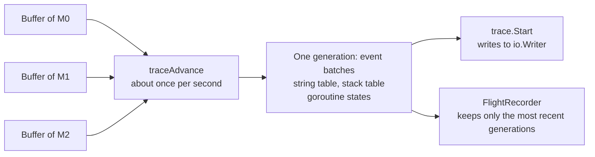

# 16.3 Execution Tracing

Profiling ([16.5](./perf.md)) answers the question "which functions is the time spent in" by
sampling: at a fixed interval it records the call stack being executed and aggregates the samples
into a call tree. This method cannot see waiting. A goroutine blocked on a channel uses no CPU, is
on no thread when a sample is taken, and therefore never appears in a CPU profile. Knyszek's blog
post introducing the execution tracer gives exactly this example: a concurrency bottleneck in which
many goroutines block on the same channel is hard to see in a CPU profile, because there is no
execution to sample [[Knyszek, 2024](#ref-knyszek-2024)]. If a request takes 50 milliseconds and the
goroutine handling it is not running for 45 of them, explaining those 45 milliseconds takes a
different tool.

The **execution tracer** does not sample. It records runtime events one by one: the creation,
blocking, wakeup and exit of goroutines, the starting and stopping of Ps, entry to and exit from
system calls, the phases of garbage collection, and changes in heap size; most events also carry a
timestamp and a call stack [[Go Authors, 2026a](#ref-go-authors-2026a)]. Laid out along a time axis,
waiting is as visible as execution. This section first uses an example to show what a trace records.
It then discusses how the tracer writes events at low cost, how it orders events without trusting
the clock, how it cuts a trace into self-contained generations, and the flight recorder built on top
of generations.

## 16.3.1 The Timeline of Events

The following program starts a goroutine inside a task. The goroutine sleeps for 10 milliseconds
inside a region named `work`, while `main` blocks on a channel receive waiting for it to finish:

```go
package main

import (
	"context"
	"log"
	"os"
	"runtime/trace"
	"time"
)

func main() {
	f, err := os.Create("trace.out")
	if err != nil {
		log.Fatal(err)
	}
	defer f.Close()
	if err := trace.Start(f); err != nil {
		log.Fatal(err)
	}
	defer trace.Stop()

	ctx, task := trace.NewTask(context.Background(), "request")
	defer task.End()

	done := make(chan struct{})
	go func() {
		trace.WithRegion(ctx, "work", func() {
			time.Sleep(10 * time.Millisecond)
		})
		close(done)
	}()
	<-done // main blocks here, waiting for work to finish
	trace.Log(ctx, "result", "ok")
}
```

Run with Go 1.26.10, then print the parsed events with the debug mode `-d=parsed` of
`go tool trace`. The full output is over four hundred lines; the listing below keeps only the events
related to goroutine 1 (`main`) and goroutine 10, and omits the thread numbers `M=`, most stacks and
the path prefixes:

```shell
$ go run .
$ go tool trace -d=parsed trace.out
P=0 G=1 TaskBegin Time=2837339101203840 ID=1 Parent=18446744073709551615 Type="request"
P=0 G=1 StateTransition Time=2837339101207552 GoID=10 NotExist->Runnable Reason=""
P=0 G=1 StateTransition Time=2837339101208704 GoID=1 Running->Waiting Reason="chan receive"
TransitionStack=
	runtime.chanrecv1 @ 0x104ff6d63
		runtime/chan.go:509
	main.main @ 0x105091fcb
		main.go:32
P=0 G=-1 StateTransition Time=2837339101210112 GoID=10 Runnable->Running Reason=""
P=0 G=10 RegionBegin Time=2837339101211072 Task=1 Type="work"
P=0 G=10 StateTransition Time=2837339101211456 GoID=10 Running->Waiting Reason="sleep"
P=17 G=-1 StateTransition Time=2837339111460480 GoID=10 Waiting->Runnable Reason=""
P=17 G=-1 StateTransition Time=2837339111466880 GoID=10 Runnable->Running Reason=""
P=17 G=10 RegionEnd Time=2837339111468864 Task=1 Type="work"
P=17 G=10 StateTransition Time=2837339111469568 GoID=1 Waiting->Runnable Reason=""
Stack=
	main.main.func1 @ 0x105092093
		main.go:30
P=17 G=10 StateTransition Time=2837339111469632 GoID=10 Running->NotExist Reason=""
P=17 G=-1 StateTransition Time=2837339111471168 GoID=1 Runnable->Running Reason=""
P=17 G=1 Log Time=2837339111473152 Task=1 Category="result" Message="ok"
P=17 G=1 TaskEnd Time=2837339111473408 ID=1 Parent=18446744073709551615 Type="request"
```

The output reconstructs how `main` spent its 10 milliseconds. Goroutine 1 goes from `Running` to
`Waiting` at the channel receive at `main.go:32`, with the reason `chan receive`; goroutine 10 then
starts running, enters the region `work`, and waits again because of `sleep`. About 10.25
milliseconds later, goroutine 10 is made runnable and runs again, ends the region, and then makes
goroutine 1 runnable. That last event is emitted by goroutine 10, and its attached stack points to
`close(done)` at `main.go:30`, so the trace records who woke whom. Another 1.6 microseconds pass
before goroutine 1 actually starts running; this is its scheduling latency. `Time` is in
nanoseconds, and every value above is a multiple of 64, for a reason explained in the next
subsection.

None of this information is available from a CPU profile. Over the whole run the two goroutines
execute for only microseconds, so a profile contains almost nothing, whereas the trace gives the
start, end and cause of every wait and the goroutine that ended it. `go tool trace trace.out`
renders the same data as a timeline in a web page (16.3.7).

## 16.3.2 Per-Thread Buffers and Compact Encoding

While tracing is on, almost every scheduling operation writes an event, so the write path must be
cheap enough. The Go 1.26 tracer gives each M its own buffer; an M writes only to its own buffer,
with no synchronization with other threads, and each M also has a write flag indicating that its
buffer is in use [[Go Authors, 2026a](#ref-go-authors-2026a)]. The event encoding is just as simple:
a one-byte event type followed by zero or more unsigned variable-length integers in LEB128 encoding,
with the arguments of each event in each trace version specified by a table in
`internal/trace/tracev2`. The goroutine part of that table is shown below
[[Go Authors, 2026c](#ref-go-authors-2026c)]:

```go
	// Goroutines.
	EvGoCreate            // goroutine creation [timestamp, new goroutine ID, new stack ID, stack ID]
	EvGoCreateSyscall     // goroutine appears in syscall (cgo callback) [timestamp, new goroutine ID]
	EvGoStart             // goroutine starts running [timestamp, goroutine ID, goroutine seq]
	EvGoDestroy           // goroutine ends [timestamp]
	EvGoDestroySyscall    // goroutine ends in syscall (cgo callback) [timestamp]
	EvGoStop              // goroutine yields its time, but is runnable [timestamp, reason, stack ID]
	EvGoBlock             // goroutine blocks [timestamp, reason, stack ID]
	EvGoUnblock           // goroutine is unblocked [timestamp, goroutine ID, goroutine seq, stack ID]
	EvGoSyscallBegin      // syscall enter [timestamp, P seq, stack ID]
	EvGoSyscallEnd        // syscall exit [timestamp]
	EvGoSyscallEndBlocked // syscall exit and it blocked at some point [timestamp]
	EvGoStatus            // goroutine status at the start of a generation [timestamp, goroutine ID, M ID, status]
```

Take `GoBlock` as an example. Its timestamp is actually recorded as the difference from the previous
event in the same buffer; neither the blocking reason nor the stack is inlined in the event, but
each is an index into the string table or stack table. The time difference and the indices are small
numbers that occupy one or two bytes each after variable-length encoding, so a block event takes
only a few bytes. The trace file of the previous subsection is just 4857 bytes in total, of which
the first 16 are the version header `go 1.26 trace` and padding zero bytes.

Timestamps come from the operating system's monotonic clock `nanotime`, divided by 64; on Windows,
where the system clock is not precise enough, the tracer uses the CPU clock counter `cputicks`
instead, with the divisor adjusted accordingly. A source comment gives the basis for the
64-nanosecond resolution: the tracer emits events no more often than about once every 200
nanoseconds, because that is roughly the time it takes to run through the scheduler once; after
dividing by 64 the absolute values of the time differences are smaller, and encoding them takes
fewer bytes [[Go Authors, 2026b](#ref-go-authors-2026b)].

## 16.3.3 Ordering Without Trusting the Clock

Because each M writes to its own buffer, the order of events in the trace data is no longer the
order in which they happened. The most direct remedy is to sort by timestamp, but that requires the
clocks read by different cores to agree, which many modern CPUs do not guarantee
[[Knyszek, 2023](#ref-knyszek-2023)]. The Go 1.5 tracer originally ordered events by `cputicks`
timestamps, and on machines and virtual machines with unsynchronized clocks it produced traces with
scrambled order; before Go 1.5 was released, Cox changed the ordering to be recorded explicitly with
a global sequence number, keeping timestamps only for display [[Cox, 2015](#ref-cox-2015)]. A global
sequence number requires every event to increment the same counter synchronously, which is expensive
on multicore machines. Go 1.7 switched to a sequence number per goroutine
[[Vyukov, 2016](#ref-vyukov-2016)]: a running goroutine does not leave its thread, so the events it
emits itself are naturally ordered, and only events emitted on its behalf elsewhere, such as the
`GoUnblock` that wakes another goroutine, need to carry a sequence number so they can be ordered
against that goroutine's `GoStart` [[Knyszek, 2023](#ref-knyszek-2023)]. The Go 1.7 release notes
state that this reduced the typical tracing overhead from at least 400% to about 25%
[[Go Authors, 2016](#ref-go-authors-2016)].

The current tracer follows the same idea. Each G and each P has a sequence counter whose value is
written into the relevant events, encoding a partial order; the counters are reset to zero at the
start of each generation. An M needs no sequence number, because the events written by one thread,
and indeed the order of whole buffers, are in the data stream in the order they were emitted
[[Go Authors, 2026a](#ref-go-authors-2026a)]. In the event table above, both `GoStart` and
`GoUnblock` have a `goroutine seq` argument. The parser's algorithm is written in a comment in
`internal/trace` [[Go Authors, 2026d](#ref-go-authors-2026d)]:

```go
	// Trace v2 parsing algorithm.
	//
	// (1) Read in all the batches for the next generation from the stream.
	//   (a) Use the size field in the header to quickly find all batches.
	// (2) Parse out the strings, stacks, CPU samples, and timestamp conversion data.
	// (3) Group each event batch by M, sorted by timestamp. (batchCursor contains the groups.)
	// (4) Organize batchCursors in a min-heap, ordered by the timestamp of the next event for each M.
	// (5) Try to advance the next event for the M at the top of the min-heap.
	//   (a) On success, select that M.
	//   (b) On failure, sort the min-heap and try to advance other Ms. Select the first M that advances.
	//   (c) If there's nothing left to advance, goto (1).
```

Timestamps are only a hint here: the parser first tries the thread with the smallest timestamp, and
if that thread's next event cannot yet happen according to sequence numbers (for example, a
`GoStart` whose sequence number shows that the `GoUnblock` that woke it has not appeared), it tries
other threads. The sequence numbers decide the order, so even with an unreliable clock the result is
a total order compatible with the partial order. This has something in common with the race detector
of [16.2](./race.md): both rebuild a partial order over the execution of a program, except that the
detector must decide whether any two accesses are ordered, while the parser only needs to find one
arrangement compatible with the partial order.

## 16.3.4 Generations: From Go 1.5 to Go 1.22

The execution tracer was designed by Vyukov in 2014 [[Vyukov, 2014](#ref-vyukov-2014)] and shipped
with Go 1.5, together with `go test -trace` and `go tool trace`
[[Go Authors, 2015](#ref-go-authors-2015)]. Later releases extended it: Go 1.11 added user
annotations [[Go Authors, 2018](#ref-go-authors-2018)], and since Go 1.19, when CPU profiling is
enabled at the same time, the trace includes the CPU profile samples
[[Go Authors, 2022](#ref-go-authors-2022)]. But its basic structure did not change for more than
eight years. In his 2024 blog post, Knyszek summarizes the resulting problems in four points: the
overhead is high; traces do not scale and can grow too large to analyze; it is often unclear when to
start tracing in order to capture a particular anomaly; and there is no public parsing package, so
only a few people can analyze traces programmatically [[Knyszek, 2024](#ref-knyszek-2024)].

The main cost behind the first problem was stack unwinding, since many events carry a call stack.
Geisendörfer and Ripley made the tracer walk the frame-pointer chain directly to unwind call stacks,
instead of running the general stack unwinder [[Geisendörfer, 2023](#ref-geisendorfer-2023)]. The Go
1.21 release notes state that on amd64 and arm64 the CPU cost of collecting a trace is reduced by up
to a factor of ten [[Go Authors, 2023a](#ref-go-authors-2023a)]; according to Knyszek's blog post,
the CPU overhead of tracing dropped from 10% to 20% in many applications to 1% to 2%
[[Knyszek, 2024](#ref-knyszek-2024)].

The second problem lay in the old format itself. To lower runtime overhead, events were written to
what amounts to thread-local buffers and did not appear in the data in their true order; the burden
of restoring the order fell on the parsing tools, and a trace in the old format had to be parsed as
a whole to be useful, so it could not be processed as a stream, and parsing and validating a large
trace needed a lot of memory [[Knyszek, 2023](#ref-knyszek-2023)]: a trace of a few hundred MiB
could need several GiB of memory to analyze [[Knyszek, 2024](#ref-knyszek-2024)]. Knyszek's redesign
solves this with **generations** [[Knyszek, 2023](#ref-knyszek-2023)]: the runtime periodically
advances a generation, by default about once a second (adjustable with
`GODEBUG=traceadvanceperiod`). On advancing, `traceAdvance` confirms that every M has seen the new
generation number and then flushes the buffers left over from the previous generation; each M
therefore keeps two buffer slots, one for the previous generation and one for the current one. Every
generation is self-contained: it has its own string table and stack table, and it writes at least
one status event for every live goroutine, recording its state at the start of that generation
[[Go Authors, 2026a](#ref-go-authors-2026a)]. The beginning of the full output in 16.3.1 contains
several transitions such as `Undetermined->Running`; the parser produces these when it first meets
such a status event in the first generation: before that, it does not know what state the goroutine
or P is in.



The new tracer became the default in Go 1.22. The release notes list the changes brought by the
rewrite: on most platforms other than Windows it uses the operating system's clock, so traces can be
aligned with traces produced by lower-level components; the correctness of traces no longer depends
on the reliability of the platform clock; traces are split periodically and can be processed as a
stream; every system call has a complete duration; the trace records the operating system thread on
which a goroutine runs; the latency impact of starting and stopping a trace is greatly reduced; and
a trace can start or end during the mark phase of garbage collection
[[Go Authors, 2024](#ref-go-authors-2024)]. The old implementation was removed in Go 1.23
[[Amedee, 2024](#ref-amedee-2024)].

## 16.3.5 Collection and User Annotations

There are three common ways to collect a trace. A program can bracket a period of time with
`trace.Start` and `trace.Stop`, with events written to any `io.Writer`, as the example in 16.3.1
does. Tests can be run with `go test -trace=trace.out`. For a server, after importing
`net/http/pprof`, `/debug/pprof/trace?seconds=5` returns the trace of the next 5 seconds
[[Go Authors, n.d.a](#ref-go-authors-nda)].

Runtime events explain why a goroutine waits, but not which piece of business work it was doing. The
user annotations added in Go 1.11 overlay business semantics on the timeline
[[Kim, 2017](#ref-kim-2017); [Go Authors, 2018](#ref-go-authors-2018)]. A task is created by
`trace.NewTask` and ended by `Task.End`; it is passed along through a `context.Context`, can span
several goroutines, and suits the representation of a request. A region is marked by
`trace.WithRegion` or `trace.StartRegion`; it belongs to a single goroutine, must end in the
goroutine that started it, and must nest strictly within that goroutine. `trace.Log` and
`trace.Logf` record a categorized message on the timeline, and `trace.IsEnabled` reports whether
tracing is on, which can be used to skip costly annotations
[[Go Authors, 2026f](#ref-go-authors-2026f)]. In the output of 16.3.1 they appear as `TaskBegin` and
`TaskEnd`, `RegionBegin` and `RegionEnd`, and `Log` events respectively.

## 16.3.6 The Flight Recorder

Even when the overhead falls to one or two percent, the question of when to start tracing remains. A
long-running service may work for days or even weeks, and tracing all of its execution produces too
much data; usually only one stretch of execution goes wrong, such as a request that times out, and
by the time the program notices it, calling `Start` is too late
[[Amedee and Knyszek, 2025](#ref-amedee-and-knyszek-2025)]. The idea of the **flight recorder** is
to keep tracing on all the time but retain only the most recent stretch of data in memory, and to
write that stretch out when the program detects an anomaly. Before generations this was almost
impossible, because a trace in the old format could not be cut from the middle; with self-contained
generations, keeping the most recent few generations is enough to assemble a valid trace at any time
[[Knyszek, 2024](#ref-knyszek-2024)].

The flight recorder first appeared as an experimental package in `golang.org/x/exp/trace`
[[Knyszek, 2024](#ref-knyszek-2024)]; after the proposal discussion
[[Go Authors, 2023b](#ref-go-authors-2023b)], Go 1.25 moved it into the standard library package
`runtime/trace` [[Amedee, 2025](#ref-amedee-2025); [Go Authors, 2025](#ref-go-authors-2025)]. The
following program starts a flight recorder and takes a snapshot after some execution:

```go {run=true}
package main

import (
	"bytes"
	"fmt"
	"runtime/trace"
	"time"
)

func main() {
	fr := trace.NewFlightRecorder(trace.FlightRecorderConfig{
		MinAge:   2 * time.Second, // the window covers at least the last 2 seconds
		MaxBytes: 4 << 20,         // upper bound on the window size, takes precedence over MinAge
	})
	if err := fr.Start(); err != nil {
		panic(err)
	}
	defer fr.Stop()

	done := make(chan struct{})
	go func() {
		time.Sleep(10 * time.Millisecond)
		close(done)
	}()
	<-done

	// When an anomaly is detected, write out a snapshot of the window; here it goes to memory
	var buf bytes.Buffer
	if _, err := fr.WriteTo(&buf); err != nil {
		panic(err)
	}
	fmt.Printf("%q\n", buf.Bytes()[:16])
}
```

The snapshot begins the same way as the file written by `trace.Start` in 16.3.1: it is an ordinary
trace and can be opened with `go tool trace`. In the implementation, the flight recorder, like
`trace.Start`, is a subscriber of the trace data: whenever a generation ends, it puts the batches of
that generation into a ring structure and decides, according to the configuration, which earlier
generations to keep [[Go Authors, 2026e](#ref-go-authors-2026e)]:

```go
	newRing := []rawGeneration{r.active}
	size := r.active.size
	for i := len(r.ring) - 1; i >= 0; i-- {
		// Stop adding older generations if the new ring already exceeds the thresholds.
		// This ensures we keep generations that cross a threshold, but not any that lie
		// entirely outside it.
		if uint64(size) > r.wantSize || now.Sub(newRing[len(newRing)-1].minTime) > r.wantDur {
			break
		}
		size += r.ring[i].size
		newRing = append(newRing, r.ring[i])
	}
```

The generation that just ended is always kept; earlier generations are added from newest to oldest
until the total size exceeds `MaxBytes`, or the start time of the oldest generation is earlier than
the bound set by `MinAge`. The window therefore grows and shrinks in units of generations, and the
time it actually covers is slightly longer than `MinAge`; when events are dense and `MaxBytes` is
small, the size limit takes precedence and the window can be shorter than `MinAge`, which is exactly
what the documentation of `FlightRecorderConfig` means by `MaxBytes` taking precedence over
`MinAge`. When the two fields are zero, the current implementation uses 10 seconds and 10 MiB
respectively, and the documentation promises only that they are implementation-defined. `WriteTo`
first forces a generation to advance so that data up to the time of the call has been flushed, and
then writes the version header and all batches in the ring. Only one `WriteTo` can run at a time,
and only one flight recorder can be active in the whole program, but it can work alongside one
`trace.Start` [[Go Authors, 2026e](#ref-go-authors-2026e)].

On choosing the parameters, the blog post announcing the flight recorder suggests setting `MinAge`
to about twice the time window of the event under investigation, for example 10 seconds for a
5-second timeout; for reference, each second of execution typically produces a few MB of trace data,
and a busy service can reach 10 MB per second
[[Amedee and Knyszek, 2025](#ref-amedee-and-knyszek-2025)].

## 16.3.7 Reading a Trace

`go tool trace trace.out` starts a local web server whose home page lists several kinds of views: a
timeline arranged by P or by thread, goroutine analysis, three blocking profiles (network,
synchronization, system calls) and a scheduling latency profile, user-defined tasks and regions, and
the minimum mutator utilization (MMU) curve [[Go Authors, n.d.b](#ref-go-authors-ndb);
[Go Authors, 2026g](#ref-go-authors-2026g)]. In the timeline view the horizontal axis is time and
the rows are P (or thread); each goroutine is drawn as a series of colored blocks on the P it runs
on. A row that stays blank for a long time while goroutines elsewhere wait to run indicates uneven
scheduling or load; garbage-collection mark assists and stop-the-world pauses that fill every row
are direct evidence of garbage collection interfering with latency; clicking a block shows the stack
at its start and end, and the event that woke it. The blocking profiles and the scheduling latency
profile can also be written directly in pprof format without a browser, with
`go tool trace -pprof=net|sync|syscall|sched`. Starting with Go 1.27, if `-http` gives only a port
(for example `-http=:6060`), the server listens only on the local address, matching the behavior of
`go tool pprof`; to listen on all addresses, write `-http=0.0.0.0:6060` explicitly
[[Go Authors, 2026h](#ref-go-authors-2026h)].

The parser used by `go tool trace` lives in the standard library's `internal/trace`, which external
programs cannot import. Go 1.22 shipped the experimental `golang.org/x/exp/trace` together with the
new tracer; its `Reader` reads a trace event by event as a stream, with events presented in typed
form such as state transitions [[Go Authors, 2024](#ref-go-authors-2024);
[Knyszek, 2024](#ref-knyszek-2024)]. The events printed by `-d=parsed` above are at this level, and
one can write one's own analyses on top of it, for example measuring what fraction of goroutine
blocking time is spent waiting for the network.

## 16.3.8 Summary

Putting Go's diagnostic tools side by side makes their division of labor clear:

| Tool | Question answered | Data form | Typical scenarios |
| --- | --- | --- | --- |
| Profiling ([16.5](./perf.md)) | **Which functions** resources (CPU, memory) are spent in | Aggregated samples | CPU hot spots, attribution of memory use |
| Execution tracing (this section) | **What happened** on the timeline and **why** something waited | Individual events | Tail latency, scheduling anomalies, garbage collection interference |
| `runtime/metrics` ([16.6](./metric.md)) | How the **overall state** of the system changes over time | Continuous metrics | Monitoring and alerting, capacity assessment |

A common troubleshooting route is to notice the anomaly first in the metrics, for example rising
latency or more frequent garbage collection; then use profiling to locate the code that consumes
resources; and, if the problem is waiting rather than computing, use tracing to see the causality on
the timeline.

The execution tracer records state transitions inside the runtime, so the behavior of the scheduler
([Chapter 9](../../part3concurrency/ch09sched)) and the garbage collector
([Chapter 13](../../part4memory/ch13gc)) discussed in Parts 3 and 4 of this book can be seen
directly in a trace. Its design revolves around one constraint: writing an event must be cheap.
Hence each thread writes its own buffer, events are encoded compactly, and the order is rebuilt from
sequence numbers and the parser. The generations of Go 1.22 make every segment of a trace
self-contained, so a trace can be processed as a stream or reduced to just its most recent segment,
and the flight recorder of Go 1.25 is built on exactly this property.

## Further Reading

- <a id="ref-amedee-2024"></a>[Amedee, 2024] Carlos Amedee. runtime, cmd/trace: remove code paths
  that include v1 tracer. Go commit 2c5849dc40, 2024. https://go.dev/cl/576256 Shipped with Go 1.23.
- <a id="ref-amedee-2025"></a>[Amedee, 2025] Carlos Amedee. runtime/trace: add the flight recorder.
  Go commit 83df0afc4e, 2025. https://go.dev/cl/673116 Shipped with Go 1.25.
- <a id="ref-amedee-and-knyszek-2025"></a>[Amedee and Knyszek, 2025] Carlos Amedee and Michael
  Knyszek. *Flight Recorder in Go 1.25.* The Go Blog, 2025-09-26.
  https://go.dev/blog/flight-recorder
- <a id="ref-cox-2015"></a>[Cox, 2015] Russ Cox. runtime/trace: record event sequence numbers
  explicitly. Go commit 80c98fa901, 2015. https://go.dev/cl/12579 Shipped with Go 1.5.
- <a id="ref-geisendorfer-2023"></a>[Geisendörfer, 2023] Felix Geisendörfer. runtime/trace: enable
  frame pointer unwinding on amd64. Go commit ba71817390, 2023. https://go.dev/cl/463835 Shipped
  with Go 1.21.
- <a id="ref-go-authors-nda"></a>[Go Authors, n.d.a] The Go Authors. *Package runtime/trace.*
  https://pkg.go.dev/runtime/trace
- <a id="ref-go-authors-ndb"></a>[Go Authors, n.d.b] The Go Authors. *Command trace
  (`go tool trace`).* https://pkg.go.dev/cmd/trace
- <a id="ref-go-authors-2015"></a>[Go Authors, 2015] The Go Authors. *Go 1.5 Release Notes.* 2015.
  https://go.dev/doc/go1.5
  First release of `go tool trace` and `runtime/trace`.
- <a id="ref-go-authors-2016"></a>[Go Authors, 2016] The Go Authors. *Go 1.7 Release Notes.* 2016.
  https://go.dev/doc/go1.7
  Typical tracing overhead reduced from at least 400% to about 25%.
- <a id="ref-go-authors-2018"></a>[Go Authors, 2018] The Go Authors. *Go 1.11 Release Notes.* 2018.
  https://go.dev/doc/go1.11
  The user annotation API.
- <a id="ref-go-authors-2022"></a>[Go Authors, 2022] The Go Authors. *Go 1.19 Release Notes.* 2022.
  https://go.dev/doc/go1.19
  Traces include CPU profile samples.
- <a id="ref-go-authors-2023a"></a>[Go Authors, 2023a] The Go Authors. *Go 1.21 Release
  Notes.* 2023. https://go.dev/doc/go1.21 CPU cost of collecting a trace reduced by up to a factor
  of ten.
- <a id="ref-go-authors-2023b"></a>[Go Authors, 2023b] The Go Authors. *runtime/trace: flight
  recording.* Go issue #63185, 2023. https://go.dev/issue/63185 The flight recorder proposal; the
  API entered `runtime/trace` in Go 1.25.
- <a id="ref-go-authors-2024"></a>[Go Authors, 2024] The Go Authors. *Go 1.22 Release Notes.* 2024.
  https://go.dev/doc/go1.22
  The rewritten execution tracer becomes the default; the experimental `golang.org/x/exp/trace`.
- <a id="ref-go-authors-2025"></a>[Go Authors, 2025] The Go Authors. *Go 1.25 Release Notes.* 2025.
  https://go.dev/doc/go1.25
  `runtime/trace.FlightRecorder`.
- <a id="ref-go-authors-2026a"></a>[Go Authors, 2026a] The Go Authors. src/runtime/trace.go and
  src/runtime/trace/. Go 1.26 source.
  https://github.com/golang/go/blob/release-branch.go1.26/src/runtime/trace.go
  https://github.com/golang/go/tree/release-branch.go1.26/src/runtime/trace
  The former holds the design comment and invariants at its start; the latter is the user interface.
- <a id="ref-go-authors-2026b"></a>[Go Authors, 2026b] The Go Authors. src/runtime/tracetime.go. Go
  1.26 source. https://github.com/golang/go/blob/release-branch.go1.26/src/runtime/tracetime.go
- <a id="ref-go-authors-2026c"></a>[Go Authors, 2026c] The Go Authors.
  src/internal/trace/tracev2/events.go. Go 1.26 source.
  https://github.com/golang/go/blob/release-branch.go1.26/src/internal/trace/tracev2/events.go
- <a id="ref-go-authors-2026d"></a>[Go Authors, 2026d] The Go Authors. src/internal/trace/reader.go.
  Go 1.26 source.
  https://github.com/golang/go/blob/release-branch.go1.26/src/internal/trace/reader.go
- <a id="ref-go-authors-2026e"></a>[Go Authors, 2026e] The Go Authors.
  src/runtime/trace/flightrecorder.go and src/runtime/trace/recorder.go. Go 1.26 source.
  https://github.com/golang/go/blob/release-branch.go1.26/src/runtime/trace/flightrecorder.go
- <a id="ref-go-authors-2026f"></a>[Go Authors, 2026f] The Go Authors.
  src/runtime/trace/annotation.go. Go 1.26 source.
  https://github.com/golang/go/blob/release-branch.go1.26/src/runtime/trace/annotation.go
- <a id="ref-go-authors-2026g"></a>[Go Authors, 2026g] The Go Authors. src/cmd/trace/main.go and
  src/internal/trace/traceviewer/http.go. Go 1.26 source.
  https://github.com/golang/go/blob/release-branch.go1.26/src/cmd/trace/main.go
- <a id="ref-go-authors-2026h"></a>[Go Authors, 2026h] The Go Authors. *Go 1.27 Release
  Notes.* 2026. https://go.dev/doc/go1.27 When `go tool trace -http` is given only a port, it
  listens only on the local address.
- <a id="ref-kim-2017"></a>[Kim, 2017] Hana Kim. runtime/trace: implement annotation API. Go commit
  6977a3b257, 2017. https://go.dev/cl/71690
  Shipped with Go 1.11.
- <a id="ref-knyszek-2023"></a>[Knyszek, 2023] Michael Knyszek. *Execution tracer overhaul.* Go
  design document, 2023.
  https://go.googlesource.com/proposal/+/master/design/60773-execution-tracer-overhaul.md The design
  of and rationale for generations, per-thread buffers and the switch to the operating system clock;
  parts no longer match the implementation.
- <a id="ref-knyszek-2024"></a>[Knyszek, 2024] Michael Knyszek. *More powerful Go execution traces.*
  The Go Blog, 2024-03-14. https://go.dev/blog/execution-traces-2024 Low-overhead tracing, the
  scalable trace format, the flight recorder and the trace reading API.
- <a id="ref-vyukov-2014"></a>[Vyukov, 2014] Dmitry Vyukov. *Go Execution Tracer (design proposal).*
  2014. https://go.dev/s/go15trace
- <a id="ref-vyukov-2016"></a>[Vyukov, 2016] Dmitry Vyukov. runtime: use per-goroutine sequence
  numbers in tracer. Go commit a3703618ea, 2016. https://go.dev/cl/21512 Shipped with Go 1.7.
- This book: [16.5 Benchmarking and Performance Profiling](./perf.md),
  [16.6 Runtime Metrics](./metric.md),
  [Chapter 9 The goroutine Scheduler](../../part3concurrency/ch09sched),
  [Chapter 13 Garbage Collector](../../part4memory/ch13gc).
