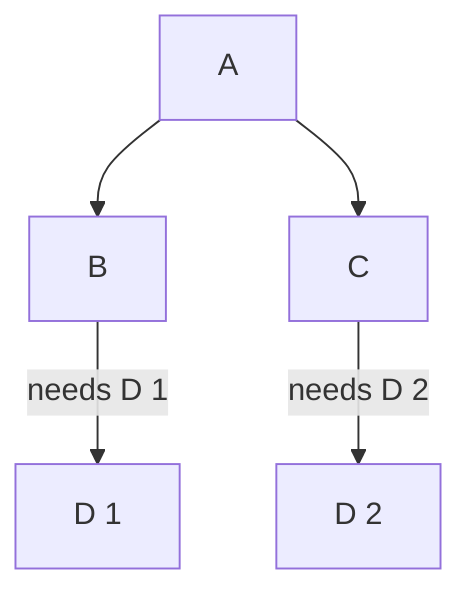

# 17.1 The Hard Parts of Dependency Management

Cox borrows Titus Winters's definition of software engineering as "programming integrated over time
and other programmers" [[Cox, 2019](#ref-cox-2019)]. Dependencies bring in both at once: the
depended-on code is written by someone else and releases new versions on its own schedule. Whether a
program that builds today builds the same way next year, and whether two users of the same
dependency can coexist in one program, are not entirely up to the program's author. Winters likewise
stresses that the compatibility problems dependencies bring are software engineering problems rather
than programming problems: the trouble is not making a dependency work today but how it changes over
time [[Winters et al., 2020](#ref-winters-et-al-2020)]. This section examines the problem at three
levels: why `go get` in the GOPATH era failed on versions, why version selection is NP-complete in
general, and why the policy of taking the latest version conflicts with reproducible builds. The
answer of Go modules is covered in [17.2](./semantics.md) through [17.4](./fight.md).

## 17.1.1 `go get` Without Versions

The first Go package installation tool was `goinstall`, added to the repository by Cox in March
2010; the commit title calls it "an experiment in (external) package
installation" [[Cox, 2010](#ref-cox-2010)]. Before Go 1 it was replaced by `go get`
[[Niemeyer, 2012](#ref-niemeyer-2012)]. Both follow the same model: an import path is at once the
address of a code repository and a directory under `$GOPATH/src`, so `import "github.com/foo/bar"`
corresponds to `$GOPATH/src/github.com/foo/bar` on disk. An import path has exactly one copy of code
on disk, and nothing records which version that copy is.

This was not an oversight. In 2013 the Go 1.2 FAQ gained an entry on versioning explaining that
`go get` deliberately does not handle versions [[Cox, 2013](#ref-cox-2013)]:

```text
"Go get" does not have any explicit concept of package versions.
Versioning is a source of significant complexity, especially in large code bases,
and we are unaware of any approach that works well at scale in a large enough
variety of situations to be appropriate to force on all Go users.
```

The FAQ instead gives two pieces of advice. Package authors should stay backward compatible, add new
names for different functionality rather than changing old ones, and switch to a new import path
when compatibility must be broken completely. Package users who worry about a dependency changing in
unexpected ways should copy it into their own repository under a new import path, which the FAQ
notes is what Google does internally. The former was later named the import compatibility rule
([17.2](./semantics.md)); the latter is the precursor of the `vendor` directory.

Boyer observes that `go get` behaves correctly only under two premises: code is always backward
compatible, and there are no fixed releases [[Boyer, 2016b](#ref-boyer-2016b)]. Because `go get`
fetches only the latest code on a repository's default branch, tagging a release has no effect on
ordinary users, and most developers stopped tagging versions. When the premises fail, `go get` goes
wrong in two opposite ways. Cox illustrates both failures with the following example
[[Cox, 2019](#ref-cox-2019)]:

```text
$ go get D       # downloads the latest D, D 1.0
$ go get C       # downloads C 1.8; C needs D 1.4, but D 1.0 is already on disk and is reused: D is too old
$ go get -u C    # updates every dependency to the latest; D has just released the buggy D 1.6: D is too new
```

C's author developed and tested against D 1.4, so D 1.4 is what the build really needs. `go get`
does not know versions exist and can only choose between what is already on disk and what is newest
in the repository; neither is D 1.4.

The community wrote many tools in response; the Go team's own answer was the `vendor` directory: Go
1.5 offered experimental support through the environment variable `GO15VENDOREXPERIMENT`, Go 1.6
enabled it by default, and from Go 1.7 it is a standard feature
[[Go Authors, 2016a](#ref-go-authors-2016a); [Go Authors, 2016b](#ref-go-authors-2016b)]. `vendor`
lets each project keep copies of its dependencies in its own directory tree. It solves the isolation
of dependencies but does not answer which version a dependency should be, and it provides no uniform
way to record that choice. Tools built on top of it each recorded versions in mutually incompatible
formats. In 2016 the community formed a committee to design a unified tool, which became `dep`
([17.4](./fight.md)).

## 17.1.2 Diamond Dependencies

Suppose program A depends on B and C, B needs version 1 of D, C needs version 2 of D, and the two
versions are incompatible. The dependency graph splits at A and rejoins at D, forming a diamond, so
the situation is called a **diamond dependency** [[Cox, 2016](#ref-cox-2016)]:



If a program can contain only one version of D, this graph cannot be built. In Go the restriction
comes from the build system itself: an import path can denote only one package
[[Cox, 2019](#ref-cox-2019)]. Even if the build system allowed two copies to coexist, the problem
would not disappear. A type of the same name in the two versions is a different type, so a value B
obtains from D 1 cannot be handed to C, which expects D 2. Package-level state is also duplicated:
if D registers a command-line flag or an HTTP handler at initialization, the two versions conflict
when both are present unless they coordinate explicitly [[Cox, 2019](#ref-cox-2019)].

The introduction to the Semantic Versioning specification calls this predicament "dependency
hell" and notes that it has two directions: if dependency specifications are too tight, upgrading
one package forces new releases of every package that depends on it, which is version lock; if they
are too loose, they assume compatibility with too many future versions, which is version promiscuity
[[Preston-Werner, 2013](#ref-preston-werner-2013)]. The former makes upgrades impossible, and the
latter lets a new version break a build at any moment. The whole design of dependency management
tools can be seen as a search for a position between these two directions.

## 17.1.3 Version Selection Is NP-Complete

Diamond dependencies show that version selection may have no solution; the deeper problem is that
deciding whether a solution exists is itself hard. In a 2016 article Cox gave a proof: as long as a
package manager satisfies the following four assumptions, deciding whether a set of dependencies can
be satisfied is NP-complete [[Cox, 2016](#ref-cox-2016)]:

1. A package can list zero or more packages, or specific versions of packages, as dependencies.
2. Installing a package requires installing all of its dependencies.
3. Different versions of a package can have different dependencies.
4. Two different versions of the same package cannot be installed at the same time.

The proof reduces 3-SAT to version selection. Each Boolean variable $x_j$ corresponds to a package
$X_j$ with two mutually exclusive versions $X_j{:}0$ and $X_j{:}1$; installing $X_j{:}1$ means $x_j$
is true. Each clause $C_i$ corresponds to a package with three versions, where version $k$ depends
on the variable version that makes the $k$-th literal of the clause true. Finally, a package $F$
depends on all the $C_i$. Take the clause $C_5 = (x_1 \lor \lnot x_2 \lor x_4)$ as an example:

```text
C5:0 depends on X1:1      the first literal x1 of the clause is true
C5:1 depends on X2:0      the second literal ¬x2 of the clause is true
C5:2 depends on X4:1      the third literal x4 of the clause is true
F    depends on C1, C2, ..., Cn
```

$F$ can be installed if and only if every $C_i$ has a version that can be installed, that is, every
clause has a true literal, which means the original formula is satisfiable. A package with several
versions, each with different dependencies, plays the role of disjunction here. Cox explains that
the EDOS project's 2005 report had already proved package installation for Debian and RedHat
NP-complete, but that proof relied on the "one of several" dependency syntax in those systems,
whereas Cox's construction uses only the four assumptions that nearly every package manager
satisfies, so it applies equally to language-level package managers such as Cargo and npm
[[Cox, 2016](#ref-cox-2016)]. The article also thanks Boyer for pointing out the EDOS report;
Boyer's own survey of the package manager design space is in [[Boyer, 2016a](#ref-boyer-2016a)].

The result has two implications. First, in the worst case a package manager may either take
extremely long to solve or report an installable package as uninstallable. Cox's survey shows that
many package managers therefore turned to SAT solvers or backtracking search
[[Cox, 2016](#ref-cox-2016)]. The EDOS project itself encoded Debian installability as a Boolean
formula and handed it to a SAT solver [[Mancinelli et al., 2006](#ref-mancinelli-et-al-2006)].
Second, the solver's answer is not necessarily unique. When both "newest B with older C" and "older
B with newest C" satisfy the constraints, there is no clear criterion for choosing between them, and
users find the result hard to predict [[Cox, 2019](#ref-cox-2019)]. Moreover, the constraints
themselves are often incomplete: a solver can only rule out incompatibilities that have been
declared, and a combination "not yet found to be broken" is not the same as a combination that
works.

The same article also points out the directions that avoid NP-completeness, which drop one of the
four assumptions [[Cox, 2016](#ref-cox-2016)]. If dependencies can declare only minimum versions,
not specific versions or exclusions of some versions (dropping the first assumption), selection no
longer needs search. If different versions of the same package may coexist (dropping the fourth),
conflicts do not arise. If packages follow semantic versioning, the two can be combined: take one
version within a major version, and treat different major versions as different packages. Go
modules, two years later, were designed along exactly these two directions
[[Cox, 2018a](#ref-cox-2018a)] ([17.2](./semantics.md), [17.3](./minimum.md)).

## 17.1.4 Reproducible Builds and Lock Files

The second difficulty is time. If the rule for resolving dependencies is "take the newest version
that satisfies the constraints", the result of resolution becomes a function of the moment of the
build. C declares that it needs D 1.4 or later: yesterday the newest satisfying version was D 1.5;
today D 1.6 has been released, and the same declaration resolves to D 1.6
[[Cox, 2019](#ref-cox-2019)]. Nobody changed a line of code or a line of dependency declaration, yet
the build output changed. Once D 1.6 introduces a defect, a problem in production may not reproduce
locally, because the two builds quietly used different versions of D.

Tools such as `dep`, Bundler and Cargo respond with **lock files**: the manifest declares acceptable
version ranges, the lock file records the exact version of every dependency from one resolution, and
later builds follow the lock file. A lock file guarantees a reproducible build of a whole program,
but only of a whole program. When C is a library built as part of a larger program, C's own lock
file cannot constrain the outer program's resolution; these tools have to ignore it and fall back to
the time-dependent default [[Cox, 2019](#ref-cox-2019)]. The same library then uses one set of
versions at its author's and another at its user's. Cox calls a build that deviates from the
author's without justification a **low-fidelity build** [[Cox, 2018b](#ref-cox-2018b)].

Reproducibility also requires that a version number always correspond to the same content. The
Semantic Versioning specification states that once a version has been released, its contents must
not be modified [[Preston-Werner, 2013](#ref-preston-werner-2013)], but tags in a version control
system can be moved, and the servers hosting code can be tampered with. This problem is addressed by
`go.sum` and the checksum database ([17.4](./fight.md)).

## 17.1.5 Go's Answer: Three Principles

In 2019, Cox summarized the reasons Go modules did not follow the design of `dep` as three
principles [[Cox, 2019](#ref-cox-2019)]:

```text
Compatibility. The meaning of a name in a program should not change over time.
Repeatability. The result of a build of a given version of a package should not change over time.
Cooperation. To maintain the Go package ecosystem, we must all work together.
Tools cannot work around a lack of cooperation.
```

The first two remove the influence of time on the meaning of a program and on the result of a build,
respectively. The third admits that however advanced the tools, incompatibilities can in the end
only be fixed by the authors involved working together. The correspondence between the three
principles and the difficulties in this section is shown below; the normative definition of each
mechanism is in the Go modules reference [[Go Authors, n.d.](#ref-go-authors-nd)]:

| Difficulty | Principle | Go modules mechanism | See |
|:----|:----|:-------------|:----|
| Incompatible major versions in a diamond dependency | Compatibility | Semantic import versioning: different major versions use different import paths | [17.2](./semantics.md) |
| NP-completeness of version selection | Compatibility | Dependencies declare only minimum versions, never incompatibilities | [17.3](./minimum.md) |
| Resolution results change over time | Repeatability | Minimal version selection, no lock file needed | [17.3](./minimum.md) |
| Version content may be replaced | Repeatability | `go.sum` and the checksum database | [17.4](./fight.md) |
| A new version breaks an existing combination | Cooperation | Builds never adopt new versions automatically, leaving time for a fix | [17.3](./minimum.md) |

## 17.1.6 Summary

The difficulty of dependency management has two sources. One is combination: a diamond dependency
may have no solution, and deciding whether one exists is NP-complete in general. The other is
time: "take the latest version" makes the build result depend on the moment of the build, and a lock
file can patch a whole program but not a library. `go get` in the GOPATH era handled neither; it
knew only the code already on disk and the latest code in the repository. Go modules relax both
premises of the problem at once: incompatible versions get different names, so they can coexist;
dependencies declare only minimum versions, so selection needs no search and does not change over
time. The following sections discuss these two designs and their origins in turn.

## Further Reading

- <a id="ref-boyer-2016a"></a>[Boyer, 2016a] Sam Boyer. *So you want to write a package
  manager.* 2016. https://medium.com/@sdboyer/so-you-want-to-write-a-package-manager-4ae9c17d9527
  The `dep` author's systematic survey of version solving and SAT complexity.
- <a id="ref-boyer-2016b"></a>[Boyer, 2016b] Sam Boyer. *The Saga of Go Dependency Management.*
  Gopher Academy Blog, 2016-12-13.
  https://blog.gopheracademy.com/advent-2016/saga-go-dependency-management/ The implicit premises of
  `go get`, the introduction of `vendor`, and the formation and work plan of the 2016 package
  management committee.
- <a id="ref-cox-2010"></a>[Cox, 2010] Russ Cox. goinstall: an experiment in (external) package
  installation. Go commit 3e4e4ec704, 2010. https://golang.org/cl/224043
  Shipped in the weekly release of 2010-03-15 and removed before Go 1.
- <a id="ref-cox-2013"></a>[Cox, 2013] Russ Cox. doc/faq: add a FAQ about versioning. Go commit
  dc8d903155, 2013. https://golang.org/cl/14283044
  Shipped with Go 1.2.
- <a id="ref-cox-2016"></a>[Cox, 2016] Russ Cox. *Version SAT.* 2016-12-13.
  https://research.swtch.com/version-sat The proof of NP-completeness of version selection, how
  various package managers solve it, and several directions that avoid NP-completeness.
- <a id="ref-cox-2018a"></a>[Cox, 2018a] Russ Cox. *Go & Versioning.* 2018.
  https://research.swtch.com/vgo Index of the seven-part series of February 2018 and its follow-ups;
  see especially *Semantic Import Versioning* and *Minimal Version Selection*, which address diamond
  dependencies and solving complexity respectively.
- <a id="ref-cox-2018b"></a>[Cox, 2018b] Russ Cox. *Minimal Version Selection.* 2018-02-21.
  https://research.swtch.com/vgo-mvs Argues that the constraints MVS produces belong to 2-SAT,
  Horn-SAT and Dual-Horn-SAT at once and so are solvable in polynomial time; contrasts low-fidelity
  and high-fidelity builds.
- <a id="ref-cox-2019"></a>[Cox, 2019] Russ Cox. *The Principles of Versioning in Go.* 2019-12-03.
  https://research.swtch.com/vgo-principles The three principles of compatibility, repeatability and
  cooperation, and how Go modules differ from `dep` in design.
- <a id="ref-go-authors-2016a"></a>[Go Authors, 2016a] The Go Authors. *Go 1.6 Release Notes.* 2016.
  https://go.dev/doc/go1.6
  `vendor` enabled by default.
- <a id="ref-go-authors-2016b"></a>[Go Authors, 2016b] The Go Authors. *Go 1.7 Release Notes.* 2016.
  https://go.dev/doc/go1.7
  `GO15VENDOREXPERIMENT` removed; `vendor` becomes a standard feature.
- <a id="ref-go-authors-nd"></a>[Go Authors, n.d.] The Go Authors. *Go Modules Reference.*
  https://go.dev/ref/mod
  The authoritative definition of `go.mod`, `go.sum`, the module graph, the build list and MVS.
- <a id="ref-mancinelli-et-al-2006"></a>[Mancinelli et al., 2006] Fabio Mancinelli, Jaap Boender,
  Roberto Di Cosmo, Jérôme Vouillon, Berke Durak, Xavier Leroy, Ralf Treinen. Managing the
  Complexity of Large Free and Open Source Package-Based Software Distributions. *ASE 2006*, pp.
  199–208. https://doi.org/10.1109/ASE.2006.49 One result of the EDOS project, which encodes Debian
  installability as a SAT problem and solves it.
- <a id="ref-niemeyer-2012"></a>[Niemeyer, 2012] Gustavo Niemeyer. cmd/goinstall: remove now
  that 'go get' works. Go commit 1e5b7e706e, 2012. https://golang.org/cl/5572083 Shipped with Go 1.
- <a id="ref-preston-werner-2013"></a>[Preston-Werner, 2013] Tom Preston-Werner. *Semantic
  Versioning 2.0.0.* 2013. https://semver.org/ The two directions of "dependency hell" in the
  introduction; item 3: the contents of a released version must not be modified.
- <a id="ref-winters-et-al-2020"></a>[Winters et al., 2020] Titus Winters, Tom Manshreck, Hyrum
  Wright (eds.). *Software Engineering at Google.* O'Reilly, 2020. Chapter 21, "Dependency
  Management" (written by Titus Winters). https://abseil.io/resources/swe-book/html/ch21.html The
  difficulties and trade-offs of dependency management at scale.
- This book: [17.2 Semantic Version Management](./semantics.md),
  [17.3 Minimal Version Selection](./minimum.md), [17.4 The vgo versus dep Dispute](./fight.md).
