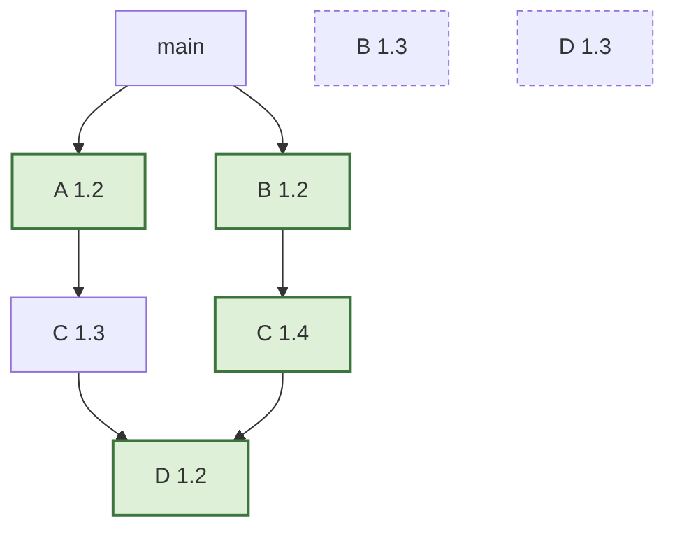

# 17.3 Minimal Version Selection

[17.2](./semantics.md) prepared two premises for version selection: a new version under the same
import path is compatible with the old one, so a dependency need only declare the minimum version it
requires; and incompatible major versions are different modules, so the conflict of "only one of two
versions can be chosen" does not arise. Under these premises Cox proposed **Minimal Version
Selection** (MVS) in the 2018 vgo series [[Cox, 2018a](#ref-cox-2018a)]. It solves no Boolean
formula and only traverses a graph [[Cox, 2018b](#ref-cox-2018b)]. This section first presents the
algorithm itself, then explains why it does not fall into NP-completeness and what it gains and
costs in reproducibility, and finally covers the extensions made since Go 1.17 to handle larger
dependency graphs.

## 17.3.1 The Build List and Four Operations

The list of modules and versions used by one build is called the **build list**. Cox argues that for
stable development, today's build list must also be tomorrow's, while developers must still be able
to change it. Version selection therefore reduces to defining the meaning of the following four
operations and giving algorithms that implement them [[Cox, 2018b](#ref-cox-2018b)]:

1. Construct the current build list.
2. Upgrade all modules to their latest versions.
3. Upgrade one module to a specified newer version.
4. Downgrade one module to a specified older version.

MVS assumes that each module lists, with `require` directives in its `go.mod`, the minimum versions
it needs of other modules, and never declares a maximum version or incompatibility with newer
versions. Under this assumption the rule for constructing a build list is simple: starting from the
target module, add each of its requirements together with that requirement's own build list; when a
module appears more than once, keep only the newest version. The example from the Go modules
reference is as follows [[Go Authors, n.d.a](#ref-go-authors-nda)]:



The main module requires A 1.2 and B 1.2, which require C 1.3 and C 1.4 respectively, and both
versions of C require D 1.2. When the traversal ends, C has appeared with two versions and the
higher, C 1.4, is taken; the build list is A 1.2, B 1.2, C 1.4, D 1.2 (marked green in the figure).
B 1.3 and D 1.3 exist, but no module requires them, so they are not selected.

"Minimal" has two senses. First, for each module MVS chooses the lowest version that satisfies all
requirements, which is the highest of all the requirements. Second, Cox considers this probably the
simplest of the feasible approaches [[Cox, 2019](#ref-cox-2019)]. Every selected version is one that
some module in the build explicitly mentions. The build list therefore does not change when new
versions are released, so the `go` command need not save it in a lock file; every module-aware
command recomputes it at the start [[Go Authors, n.d.a](#ref-go-authors-nda)]. `go.sum` serves only
to verify the integrity of downloaded content and takes no part in version selection
([17.4](./fight.md)).

## 17.3.2 Traversing Every Reachable Version

There are two equivalent definitions of constructing a build list [[Cox, 2018b](#ref-cox-2018b)].
The recursive definition above is suitable as a mental model, but implemented literally it may take
exponential time and recurse forever on a cycle (cycles are allowed in the dependency graph). The
efficient definition is based on graph reachability: all module versions reachable from the target
along requirement edges form the "rough build list", and keeping the highest version of each module
in it yields the final build list. Each reachable version is visited once, and the time is
proportional to the size $|B|$ of the rough build list plus the number of edges to traverse (at most
$|B|^2$). Unreachable versions are never loaded at all, which matters in dependency management
because loading a version's information often means a network round trip.

There is an easily overlooked detail here: the traversal must expand every reachable version,
including versions that are ultimately not selected. The following program compares two approaches.
`mvs` visits every reachable version; `naive` expands only requirements that raise the selected
version, and stops expanding a version that has already been overridden by a higher one when it
appears.

```go {run=true}
package main

import (
	"fmt"
	"slices"
	"strings"
)

// Requirement graph: each module version path@version lists the minimum versions it requires.
// Versions in this example have the form 1.x with a single-digit x, so they can be compared as strings.
var reqs = map[string][]string{
	"A@1.1": {"C@1.1"},
	"B@1.1": {"C@1.2"},
	"C@1.1": {"D@1.3"},
	"C@1.2": {"D@1.1"},
}

// mvs visits every module version reachable from the roots and keeps the highest version seen of each module.
func mvs(roots []string) []string {
	selected := map[string]string{}
	visited := map[string]bool{}
	var visit func(m string)
	visit = func(m string) {
		if visited[m] {
			return
		}
		visited[m] = true
		path, v, _ := strings.Cut(m, "@")
		if v > selected[path] {
			selected[path] = v
		}
		for _, r := range reqs[m] {
			visit(r)
		}
	}
	for _, r := range roots {
		visit(r)
	}
	return list(selected)
}

// naive expands only requirements that raise the selected version; versions that do not are not traversed further.
func naive(roots []string) []string {
	selected := map[string]string{}
	queue := slices.Clone(roots)
	for len(queue) > 0 {
		m := queue[0]
		queue = queue[1:]
		path, v, _ := strings.Cut(m, "@")
		if v <= selected[path] {
			continue
		}
		selected[path] = v
		queue = append(queue, reqs[m]...)
	}
	return list(selected)
}

func list(selected map[string]string) []string {
	var out []string
	for path, v := range selected {
		out = append(out, path+"@"+v)
	}
	slices.Sort(out)
	return out
}

func main() {
	for _, roots := range [][]string{{"A@1.1", "B@1.1"}, {"B@1.1", "A@1.1"}} {
		fmt.Println("roots:", roots)
		fmt.Println("  mvs:  ", mvs(roots))
		fmt.Println("  naive:", naive(roots))
	}
}
```

The output is:

```text
roots: [A@1.1 B@1.1]
  mvs:   [A@1.1 B@1.1 C@1.2 D@1.3]
  naive: [A@1.1 B@1.1 C@1.2 D@1.3]
roots: [B@1.1 A@1.1]
  mvs:   [A@1.1 B@1.1 C@1.2 D@1.3]
  naive: [A@1.1 B@1.1 C@1.2 D@1.1]
```

C 1.1 is ultimately not selected, but the D 1.3 it requires still counts toward the build list. The
result of `naive` depends on traversal order: when B is visited first, C 1.2 is selected first and C
1.1 is no longer expanded, so D gets only 1.1. In describing the upgrade algorithm, Cox explains
with the same reasoning why only edges may be added: in that article's example, C 1.2 requires D 1.4
while C 1.3 does not depend on D; if the edge from A to C 1.2 were replaced with an edge to C 1.3, D
1.4 would vanish from the build list, so upgrading C would downgrade D, an unexpected and
unnecessary change [[Cox, 2018b](#ref-cox-2018b)]. As long as every reachable version is traversed,
the result depends only on the dependency graph itself and not on the order of visits.

The implementation in the `go` command is the same. At the outset Cox estimated that a complete
implementation would take only a few hundred lines of Go [[Cox, 2018b](#ref-cox-2018b)]. The MVS
code was copied from the `vgo` prototype into `cmd/go` in June 2018 [[Cox, 2018c](#ref-cox-2018c)]
and now lives in `cmd/go/internal/mvs`, about 800 lines in Go 1.26 excluding tests. The comment on
the `Reqs` interface explains two design decisions [[Go Authors, 2026a](#ref-go-authors-2026a)]:

```go
// The version strings are opaque except for the special version "none"
// (see the documentation for module.Version). In particular, MVS does not
// assume that the version strings are semantic versions; instead, the Max method
// gives access to the comparison operation.
//
// It must be safe to call methods on a Reqs from multiple goroutines simultaneously.
// Because a Reqs may read the underlying graph from the network on demand,
// the MVS algorithms parallelize the traversal to overlap network delays.
```

First, the algorithm treats version strings as opaque values and leaves comparison to the `Max`
method, so it does not depend on semantic versioning
([17.3.6](#1736-scaling-pruning-workspaces-and-toolchains) uses this). Second, reading the
requirements of a module may need network access, so the traversal runs in parallel with at most 10
goroutines, and `par.Work` guarantees that each module version is processed once. Since Go 1.17, the
selection logic has been extracted by Mills into an incremental `Graph` type
[[Mills, 2021](#ref-mills-2021)]; its `Require` method records the requirements of a module version
and, for every required version, updates the selected version whether or not it is selected later
[[Go Authors, 2026b](#ref-go-authors-2026b)]:

```go
	for _, dep := range reqs {
		// Mark dep reachable, regardless of whether it is selected.
		if _, ok := g.isRoot[dep]; !ok {
			g.isRoot[dep] = false
		}

		if g.cmp(dep.Path, g.Selected(dep.Path), dep.Version) < 0 {
			g.selected[dep.Path] = dep.Version
		}
	}
```

The real `go` command can also confirm this rule. Using replace directives to point the six module
versions of the example above to local directories, with each dependency's `go.mod` declaring
`go 1.17` and the main module declaring `go 1.16` (results are from Go 1.26.10; the `go.mod` files
are omitted):

```bash
$ go list -m all
example.com/main
example.com/a v1.1.0 => ../a11
example.com/b v1.1.0 => ../b11
example.com/c v1.2.0 => ../c12
example.com/d v1.3.0 => ../d13
```

The selected D is likewise v1.3.0. When the main module declares `go 1.17` or later, the result
differs; see 17.3.6.

## 17.3.3 Upgrade and Downgrade

The other three operations all first modify the dependency graph and then run the same traversal
[[Cox, 2018b](#ref-cox-2018b)]. To upgrade all modules, every edge pointing to any version of any
module is changed to point to that module's latest version. To upgrade one module, only one edge
from the target module to the new version is added and all existing edges are kept, so upgrading C
brings only the changes the new version of C actually needs, rather than also upgrading every
dependency of C to the latest. To downgrade a module, versions higher than the target are struck
from the graph, and then modules that require those versions are struck by following edges in
reverse; each requirement of the target module falls back to the newest version not yet struck. A
downgrade only lowers versions; if other modules must be upgraded first, the user must ask for that
explicitly.

After modifying the dependency graph to obtain the new build list, the result must still be written
back to `go.mod` so that the next build can reproduce it with the first operation. For this Cox
gives "Algorithm R": visit the modules in the build list in reverse postorder, that is, visit a
module only after all modules pointing to it have been considered, and keep only those not already
implied by visited modules [[Cox, 2018b](#ref-cox-2018b)]. `mvs.Req` implements this algorithm
[[Go Authors, 2026a](#ref-go-authors-2026a)]. In the reference manual's example, one upgrade raises
B, C and D to 1.3, 1.4 and 1.3; the `go` command then changes the requirement on B to 1.3 and adds
requirements on C 1.4 and D 1.3 with `// indirect` comments, since otherwise those two versions
would not be selected [[Go Authors, n.d.a](#ref-go-authors-nda)].

In the `go` command all these operations are initiated by `go get`: `go get -u ./...` upgrades the
modules imported by the packages in the main module, `go get example.com/c@v1.4.0` upgrades or
downgrades one module, and `@none` removes the requirement on a module and downgrades or removes the
modules that depend on it accordingly [[Go Authors, n.d.a](#ref-go-authors-nda)]. An upgrade is
therefore always an explicit operation; a build never upgrades any dependency.

## 17.3.4 Why Not SAT

[17.1](./challenges.md) showed that version selection in general is NP-complete; the complexity of
MVS can be explained by Schaefer's dichotomy theorem. The theorem identifies six classes of Boolean
formulas whose satisfiability can be decided in polynomial time and proves that satisfiability for
any other class is NP-complete [[Schaefer, 1978](#ref-schaefer-1978)]. Cox points out that the
formulas MVS produces belong to three of these classes at once: 2-SAT, Horn-SAT and Dual-Horn-SAT
[[Cox, 2018b](#ref-cox-2018b)]. A formula is a conjunction of clauses, and each clause takes only
three forms: a single positive literal (this version must be installed, for example in an upgrade),
a single negative literal (this version is unavailable, for example in a downgrade), or the
disjunction of a negative literal and a positive literal, that is, the implication $X \to Y$ (if $X$
is installed, $Y$ must be installed). Each clause has at most two variables, so the formula is
2-CNF; at most one positive literal, so it is a Horn formula; at most one negative literal, so it is
a dual-Horn formula.

Cox considers the latter two more significant. Every Horn formula has a unique satisfying assignment
that makes the fewest variables true, which proves that the build list and each upgrade have a
unique minimal solution: a newer version of a module is not used unless absolutely necessary. Every
dual-Horn formula has a unique satisfying assignment that makes the fewest variables false, which
proves that each downgrade also has a unique minimal solution. (Cox also remarks in passing that the
problem MVS solves is NL-complete, but this has little practical significance: membership in NL
guarantees only polynomial time, and MVS already has a linear-time algorithm.)

This theory also marks the boundary for extensions [[Cox, 2018b](#ref-cox-2018b)]. To preserve
uniqueness and minimality, any new constraint must be expressible as both a Horn and a dual-Horn
formula: it can be an unconditional affirmation $X$ ($X$ must be installed), an unconditional
negation $\lnot Y$ ($Y$ must not be installed), or an affirmative implication $X \to Z$ (if $X$ is
installed, $Z$ must be installed), but not a negative implication $X \to \lnot Y$ (if $X$ is
installed, $Y$ must not be installed). Declaring "C 1.2 cannot be built with D 1.3" is a negative
implication, and MVS does not accept such declarations. In Cox's words, declaring an incompatibility
describes only how to fail, whereas declaring "C 1.2 must be built with D 1.4" describes how to
succeed. Excluding a version must therefore be unconditional, determined before the build begins and
not changing as selection proceeds. The `exclude` and `replace` directives in `go.mod` take effect
only in the main module, and these two directives in dependencies are always ignored. The main
module is the only module certain to take part in the build; furthermore, minimum requirements can
be merged without conflict, while exclusions and replacements may conflict with each other. The
author of a module thus has complete control over builds in which that module is the main module,
but not over other builds that depend on it.

The semantics of `exclude` was later revised once. In Cox's original design, an excluded version was
removed from the dependency graph and requirements on it were redirected to the next newer version
[[Cox, 2018b](#ref-cox-2018b)]. But "the next newer version" changes as new versions are released,
and the build is no longer reproducible. In 2020 Mills changed the rule to drop requirements on
excluded versions, noting that in practice the module containing the excluded version usually
already has a higher or lower version required, so resolving an upgraded version for it separately
was redundant work; the change shipped with Go 1.16 [[Mills, 2020a](#ref-mills-2020a);
[Go Authors, 2021a](#ref-go-authors-2021a)], and the current implementation is in the filtering
`modload` performs when reading `go.mod` [[Go Authors, 2026c](#ref-go-authors-2026c)]. The `exclude`
directive section of the reference manual describes this change, while the "Exclusion" example in
the minimal version selection section still describes the original rule
[[Go Authors, n.d.a](#ref-go-authors-nda)].

## 17.3.5 High-Fidelity Builds and Their Cost

A reproducible build is usually understood as a binary property of a whole program: the user's build
is either identical to the author's or it is not. When a library is built as part of a larger
program, it is often impossible to match the author's build exactly, because other parts of the
build may require newer dependencies. Cox therefore calls a build that deviates from the author's
own build only as far as required by other parts of the build a **high-fidelity build**
[[Cox, 2018b](#ref-cox-2018b)]. In the example of 17.3.1, the author of A 1.2 developed and tested
with C 1.3, and the main module's build switches to C 1.4 because of B 1.2's requirement; this
deviation is necessary. If, as `go get -u`, `dep` and Cargo usually do, the existing D 1.3 were
chosen, the deviation would no longer be necessary. MVS chooses the oldest version that satisfies
the requirements, so releasing a new version has no effect on the build. Winters points out the fact
behind this choice: when a library declares that it needs version 1.7 or later of a dependency, its
author almost certainly has 1.7 installed, and as long as the most basic testing was done before
release, the two versions working together is at least some empirical evidence
[[Winters et al., 2020](#ref-winters-et-al-2020)]. High fidelity is not unique to MVS: Boyer notes
that the `dep` solver `gps` designed a "preferred version" mechanism that could favor the version
the dependency's author used, though it was not yet enabled at the time
[[Boyer, 2018](#ref-boyer-2018)].

This property also serves the principle of cooperation [[Cox, 2019](#ref-cox-2019)]. Suppose C 1.8
requires D 1.4 and the later-released D 1.6 does not work with C 1.8. In a tool like `dep`, which
selects the latest version by default, once D 1.6 is released, every new user's build of C fails,
and C's author must immediately release C 1.9 declaring incompatibility with D 1.6; when D's author
releases the fixed D 1.7, that declaration excludes D 1.7 as well, and C's author must release C
1.10 to undo it. With MVS, no build uses D 1.6 until someone explicitly asks for it, so the authors
of C and D have time to cooperate and fix the problem at its root.

MVS has costs too. First, it requires the declarations of minimum versions to be accurate: if a
dependency declares a minimum version with which it actually does not work, MVS will faithfully
select it. Cox argues that systems that select the latest version by default make it easier for
minimum requirements to be wrong, because the lower bounds in manifests are never built and tested
afterwards [[Cox, 2018b](#ref-cox-2018b)]. Someone who tried selecting minimum versions in Cargo
found that many lower bounds declared in the ecosystem cannot compile
[[illicitonion, 2018](#ref-illicitonion-2018)]; Cox cites this analysis and argues that Cargo's
preference for the latest version masks many missing constraints in manifests
[[Cox, 2019](#ref-cox-2019)]. In Go, the requirements in `go.mod` are usually written by `go get`
and `go mod tidy` and record the versions actually selected at build time, which are exactly the
lower bounds the author builds and tests with. Boyer points out the other side: `require` thereby
merges "the minimum usable version" and "the version currently in use" into a single number, so the
true lower bound can no longer be known [[Boyer, 2018](#ref-boyer-2018)]. Second, fixes and
improvements do not arrive automatically. Cox's judgment is that the selected version is the highest
of all requirements, so as soon as one module among the dependencies raises its requirement in time,
the whole build moves forward with it; if there is a problem, it is more likely the opposite one:
this "maximum of the minimum requirements" works like a ratchet and advances dependencies too fast
[[Cox, 2018b](#ref-cox-2018b)]. But security fixes cannot rely on such chance, and tools are still
needed to report which versions in a build have known problems, after which users upgrade
explicitly; Cox also made this requirement in the 2019 article [[Cox, 2019](#ref-cox-2019)]. Winters
concedes that there is no way to verify empirically whether MVS makes semantic versioning "good
enough", but still considers it a clear improvement on the current way of using semantic versioning
constraints [[Winters et al., 2020](#ref-winters-et-al-2020)]. Solvers continue to evolve as well,
for example PubGrub, proposed by Weizenbaum [[Weizenbaum, 2018](#ref-weizenbaum-2018)].

## 17.3.6 Scaling: Pruning, Workspaces and Toolchains

**Module graph pruning.** Before Go 1.17 the `go` command had to load the complete transitive
closure of the dependency graph, reading the `go.mod` of every reachable version. In a 2020 design
Mills proposed module graph pruning and lazy loading [[Mills, 2020b](#ref-mills-2020b)], which
shipped with Go 1.17 [[Go Authors, 2021b](#ref-go-authors-2021b)]: if the main module declares
`go 1.17` or later, the module graph used for MVS contains only the direct requirements of each
dependency that declares `go 1.17` or later, and their transitive dependencies are pruned. In
exchange, a `go.mod` declaring `go 1.17` or above must write an explicit `require` for every module
that provides a package imported transitively. The reference manual's rationale is that a dependency
not needed to build any package or test of a module cannot affect the run-time behavior of those
packages, and pruned dependencies would only cause interference among unrelated modules
[[Go Authors, n.d.b](#ref-go-authors-ndb)].

Pruning can indeed change the selected versions. Add packages to each module in the example of
17.3.2 so that the main module imports A and B, A and B import C, and C imports D, then change the
main module to declare `go 1.26` and run `go mod tidy` (using Go 1.26.10):

```bash
$ go mod tidy
$ go list -m all
example.com/main
example.com/a v1.1.0 => ../a11
example.com/b v1.1.0 => ../b11
example.com/c v1.2.0 => ../c12
example.com/d v1.1.0 => ../d11
```

C 1.1 is a direct requirement of A, but its own requirement on D 1.3 is pruned, so D takes only the
1.1 required by C 1.2, and `go mod tidy` writes C v1.2.0 and D v1.1.0 into the main module's
`go.mod` with `// indirect`. C 1.1 does not take part in the build, and its requirement on D is
exactly the "interference" the reference manual refers to. For a smooth migration, Go 1.17 added a
`-go` flag to `go mod tidy`, which can convert an existing module to `go 1.17` without changing the
selected versions of dependencies [[Go Authors, 2021b](#ref-go-authors-2021b)]: running
`go mod tidy -go=1.17` on the same module declaring `go 1.16` writes
`example.com/d v1.3.0 // indirect`, preserving the original selection.

**Workspaces.** Go 1.18 introduced workspaces [[Go Authors, 2022](#ref-go-authors-2022)]: the
modules listed in a `go.work` file together act as the main modules of MVS, that is, the roots of
the traversal [[Matloob, 2021a](#ref-matloob-2021a)]. For this, the parameter of `mvs.BuildList` was
changed in the same development cycle from a single target to a set of targets
[[Matloob, 2021b](#ref-matloob-2021b)]; the traversal itself needs no change, since multiple roots
are handled like a single root.

**Toolchains.** Before Go 1.21 the `go` directive in `go.mod` was advisory only: if the build
succeeded, everything was assumed fine, and on failure a note said that an update of the Go version
might be needed [[Go Authors, n.d.c](#ref-go-authors-ndc)]. In a 2022 proposal Cox pointed out that
people initially assumed that every version listed in `go.mod` is the minimum version used by any
build of that module, which was untrue only for the `go` directive; having the `go` directive
specify the minimum toolchain version better matches users' expectations
[[Cox, 2022](#ref-cox-2022)]. From Go 1.21 the `go` directive is a mandatory minimum requirement,
and the new `toolchain` directive gives the suggested minimum toolchain
[[Go Authors, 2023](#ref-go-authors-2023)]. In the implementation, `go` and `toolchain` are treated
as two virtual modules: if a dependency declares a `go` version of 1.21 or later, a requirement on
module `go` is added when its `go.mod` is read [[Go Authors, 2026c](#ref-go-authors-2026c)]:

```go
	if summary.goVersion != "" && gover.Compare(summary.goVersion, gover.GoStrictVersion) >= 0 {
		summary.require = append(summary.require, module.Version{Path: "go", Version: summary.goVersion})
		if gover.Compare(summary.goVersion, gover.Local()) > 0 {
			return summary, &gover.TooNewError{What: "module " + m.String(), GoVersion: summary.goVersion}
		}
	}
```

The selected `go` version is thus the maximum of the `go` directives of the main module and the
dependencies (a dependency's `go` directive counts only if it is at least 1.21), and MVS itself
needs no modification. Go versions are not semantic versions: `1.21`, `1.21rc1` and `1.21.0` have
their own order, which is exactly what treating versions as opaque values in `Reqs` is for: the
comparison function dispatches on the module path [[Go Authors, 2026d](#ref-go-authors-2026d)]:

```go
func ModCompare(path string, x, y string) int {
	if path == "go" {
		return Compare(x, y)
	}
	if path == "toolchain" {
		return Compare(maybeToolchainVersion(x), maybeToolchainVersion(y))
	}
	return semver.Compare(x, y)
}
```

Since Go 1.22 the same order is provided by the standard library package `go/version`:

```go {run=true}
package main

import (
	"fmt"
	"go/version"
	"slices"
)

func main() {
	vs := []string{"go1.21.0", "go1.21rc1", "go1.21", "go1.20.14", "go1.22rc2"}
	slices.SortFunc(vs, version.Compare)
	fmt.Println(vs)
	fmt.Println(version.Lang("go1.21.0"), version.Lang("go1.21rc1"))
}
```

The output is `[go1.20.14 go1.21 go1.21rc1 go1.21.0 go1.22rc2]` and `go1.21 go1.21`: the language
version `go1.21` is lower than its candidate releases and its final release. `go get go@1.22.1`
modifies the `go` directive as it modifies any other requirement [[Cox, 2023](#ref-cox-2023)]. When
a toolchain switch is needed, the `go` command chooses the oldest of the available candidates that
satisfies the requirement, a practice the toolchain documentation describes as consistent with
minimal version selection [[Go Authors, n.d.c](#ref-go-authors-ndc)].

## 17.3.7 Summary

MVS reduces version selection to a graph traversal: visit every reachable module version and take
the highest required version of each module. It avoids NP-completeness because requirements have
only one form, the minimum version, so the corresponding formulas are both Horn and dual-Horn
formulas, and the build, upgrades and downgrades each have a unique minimal solution; it needs no
lock file because the result depends only on the requirements written in `go.mod` and does not
change as new versions are released. That exclusions and replacements take effect only in the main
module, and that `exclude` was revised in Go 1.16 to no longer depend on "the next version", both
serve to protect these two properties. The later pruning, workspaces and toolchain management extend
its reach without changing the core algorithm. [17.4](./fight.md) returns to history, covering the
dispute between this design and `dep` and the evolution of Go modules since.

## Further Reading

- <a id="ref-boyer-2018"></a>[Boyer, 2018] Sam Boyer. *An Analysis of Vgo.* 2018-05-14.
  https://sdboyer.io/vgo/intro/
  Archived: https://web.archive.org/web/20180708073730/https://sdboyer.io/vgo/intro/
  The `dep` author's technical assessment of vgo and MVS; 17.4 presents its main arguments.
- <a id="ref-cox-2018a"></a>[Cox, 2018a] Russ Cox. *Go & Versioning.* 2018.
  https://research.swtch.com/vgo The overall design of semantic import versioning, minimal version
  selection and the module protocol.
- <a id="ref-cox-2018b"></a>[Cox, 2018b] Russ Cox. *Minimal Version Selection.* 2018-02-21.
  https://research.swtch.com/vgo-mvs The original MVS design: the four operations and their
  algorithms, Algorithm R, the relation to Schaefer's dichotomy theorem, exclusion and replacement,
  high-fidelity builds.
- <a id="ref-cox-2018c"></a>[Cox, 2018c] Russ Cox. cmd/go: add dark copy of golang.org/x/vgo. Go
  commit 5756895877, 2018. https://go.dev/cl/118095 Shipped with Go 1.11.
- <a id="ref-cox-2019"></a>[Cox, 2019] Russ Cox. *The Principles of Versioning in Go.* 2019-12-03.
  https://research.swtch.com/vgo-principles The principles of repeatability and cooperation;
  compares MVS with SAT solving using C and D as the example.
- <a id="ref-cox-2022"></a>[Cox, 2022] Russ Cox. *Proposal: Extended forwards compatibility in
  Go.* 2022. https://go.dev/design/57001-gotoolchain
- <a id="ref-cox-2023"></a>[Cox, 2023] Russ Cox. cmd/go: add go get go@version and
  toolchain@version. Go commit ff07c540b1, 2023. https://go.dev/cl/497081 Shipped with Go 1.21.
- <a id="ref-go-authors-2021a"></a>[Go Authors, 2021a] The Go Authors. *Go 1.16 Release
  Notes.* 2021. https://go.dev/doc/go1.16#modules Module-aware mode enabled by default; `exclude` no
  longer redirects to the next newer version.
- <a id="ref-go-authors-2021b"></a>[Go Authors, 2021b] The Go Authors. *Go 1.17 Release
  Notes.* 2021. https://go.dev/doc/go1.17#graph-pruning Module graph pruning and lazy loading;
  `go mod tidy -go`.
- <a id="ref-go-authors-2022"></a>[Go Authors, 2022] The Go Authors. *Go 1.18 Release Notes.* 2022.
  https://go.dev/doc/go1.18#go-work
  Workspace mode.
- <a id="ref-go-authors-2023"></a>[Go Authors, 2023] The Go Authors. *Go 1.21 Release Notes.* 2023.
  https://go.dev/doc/go1.21#tools
  The `go` directive becomes a mandatory minimum requirement; the `toolchain` directive.
- <a id="ref-go-authors-2026a"></a>[Go Authors, 2026a] The Go Authors.
  src/cmd/go/internal/mvs/mvs.go. Go 1.26 source.
  https://github.com/golang/go/blob/release-branch.go1.26/src/cmd/go/internal/mvs/mvs.go
- <a id="ref-go-authors-2026b"></a>[Go Authors, 2026b] The Go Authors.
  src/cmd/go/internal/mvs/graph.go. Go 1.26 source.
  https://github.com/golang/go/blob/release-branch.go1.26/src/cmd/go/internal/mvs/graph.go
- <a id="ref-go-authors-2026c"></a>[Go Authors, 2026c] The Go Authors.
  src/cmd/go/internal/modload/modfile.go. Go 1.26 source.
  https://github.com/golang/go/blob/release-branch.go1.26/src/cmd/go/internal/modload/modfile.go
- <a id="ref-go-authors-2026d"></a>[Go Authors, 2026d] The Go Authors.
  src/cmd/go/internal/gover/mod.go. Go 1.26 source.
  https://github.com/golang/go/blob/release-branch.go1.26/src/cmd/go/internal/gover/mod.go
- <a id="ref-go-authors-nda"></a>[Go Authors, n.d.a] The Go Authors. *Go Modules Reference: Minimal
  version selection.* https://go.dev/ref/mod#minimal-version-selection The official specification,
  with the A, B, C, D build list example and the diagrams of upgrade and downgrade.
- <a id="ref-go-authors-ndb"></a>[Go Authors, n.d.b] The Go Authors. *Go Modules Reference: Module
  graph pruning.* https://go.dev/ref/mod#graph-pruning The rules and rationale of pruning.
- <a id="ref-go-authors-ndc"></a>[Go Authors, n.d.c] The Go Authors. *Go Toolchains.*
  https://go.dev/doc/toolchain
  The `go` and `toolchain` directives, `GOTOOLCHAIN`, and toolchain selection.
- <a id="ref-illicitonion-2018"></a>[illicitonion, 2018] illicitonion. *Rust minimum versions:
  SemVer is a lie!* 2018-06-03.
  https://illicitonion.blogspot.com/2018/06/rust-minimum-versions-semver-is-lie.html An attempt to
  select minimum versions in Cargo; Cox's 2019 article cites this analysis.
- <a id="ref-matloob-2021a"></a>[Matloob, 2021a] Michael Matloob. *Proposal: Multi-Module Workspaces
  in cmd/go.* 2021. https://go.dev/design/45713-workspace
- <a id="ref-matloob-2021b"></a>[Matloob, 2021b] Michael Matloob. [dev.cmdgo] cmd/go: replace Target
  with MainModules, allowing for multiple targets. Go commit a627fcd3c4, 2021.
  https://go.dev/cl/334932 Shipped with Go 1.18.
- <a id="ref-mills-2020a"></a>[Mills, 2020a] Bryan C. Mills. cmd/go/internal/modload: drop
  requirements on excluded versions. Go commit 5a69192765, 2020. https://go.dev/cl/244773 Shipped
  with Go 1.16.
- <a id="ref-mills-2020b"></a>[Mills, 2020b] Bryan C. Mills. *Proposal: Lazy Module Loading.* 2020.
  https://go.dev/design/36460-lazy-module-loading
- <a id="ref-mills-2021"></a>[Mills, 2021] Bryan C. Mills. cmd/go/internal/mvs: factor out an
  incremental implementation. Go commit f9ed8b3f1e, 2021. https://go.dev/cl/244760 Shipped with Go
  1.17.
- <a id="ref-schaefer-1978"></a>[Schaefer, 1978] Thomas J. Schaefer. The Complexity of
  Satisfiability Problems. *STOC '78*, pp. 216–226. https://doi.org/10.1145/800133.804350 The
  dichotomy theorem: six classes of Boolean formulas decidable in polynomial time, all others
  NP-complete.
- <a id="ref-weizenbaum-2018"></a>[Weizenbaum, 2018] Natalie Weizenbaum. *PubGrub: Next-Generation
  Version Solving.* 2018. https://medium.com/@nex3/pubgrub-2fb6470504f A representative of the
  solver approach, the other road in contrast to MVS.
- <a id="ref-winters-et-al-2020"></a>[Winters et al., 2020] Titus Winters, Tom Manshreck, Hyrum
  Wright (eds.). *Software Engineering at Google.* O'Reilly, 2020. Chapter 21, "Dependency
  Management" (written by Titus Winters). https://abseil.io/resources/swe-book/html/ch21.html The
  assessment of minimal version selection.
- This book: [17.1 The Hard Parts of Dependency Management](./challenges.md),
  [17.2 Semantic Version Management](./semantics.md), [17.4 The vgo versus dep Dispute](./fight.md).
