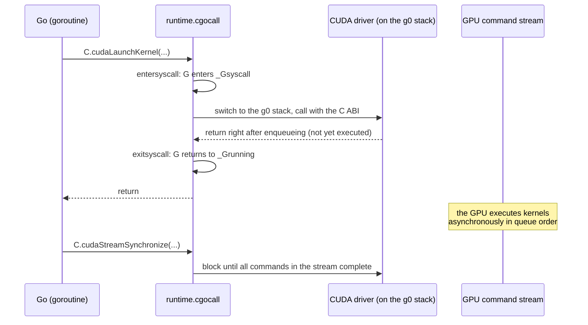
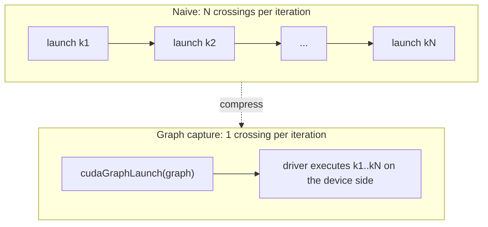

# 18.1 Crossing the FFI Boundary

[15.6](../../part5toolchain/ch15compile/cgo.md) followed a cgo call from start to finish: switch to
the system stack, `entersyscall`, call with C's calling convention, `exitsyscall`. By the
measurements in that section on an Apple M5 Pro (Go 1.26.10), an empty C call takes about 16 ns,
roughly 8 times a non-inlined Go call (about 2 ns), close to an order of magnitude; if the C
function calls back into Go, the cost is about 72 ns. The resulting advice is that cgo suits a small
number of coarse-grained calls and does not belong in hot loops.

GPU programs need to cross this boundary frequently. For one inference or render, the CPU side does
three kinds of work: copy data from host memory to device memory, launch kernels one by one, and
copy the results back. Each step is a call from Go into the driver. For a neural network made of
hundreds of operators, launching them one at a time puts hundreds of boundary crossings in series on
the critical path. Since crossing cannot be avoided, the question for this section is how to design
the boundary so that the fixed overhead does not dominate overall performance.

## 18.1.1 The Other Side of the Boundary: an Asynchronous Command Queue

When Go calls an ordinary C library function, the work is done by the time the call returns. A GPU
driver is different: a call on the CPU side does not perform the computation itself but submits a
command to the device.

Take CUDA as an example. The host interface has two layers. The **driver API** (library `libcuda`,
function prefix `cu`) offers fine-grained control, such as explicitly loading and unloading modules.
The **runtime API** (library `libcudart`, prefix `cuda`) is built on top of it and initializes and
manages the primary context and modules implicitly, which makes code simpler and gives
correspondingly less control [[NVIDIA, n.d.b](#ref-nvidia-ndb)]. The two layers share the same
submission semantics: calls such as `cudaLaunchKernel` and `cudaMemcpyAsync` only place a command in
a work queue called a **stream** and return at once [[NVIDIA, n.d.a](#ref-nvidia-nda)]. The newer
CUDA Programming Guide states it this way [[NVIDIA, n.d.c](#ref-nvidia-ndc)]:

```text
The concurrency is expressed via an asynchronous interface, where a
dispatching function call or kernel launch returns immediately.
Asynchronous calls usually return before the dispatched operation has
completed and may return before the asynchronous operation has started.
```

The GPU performs the computation on its own timeline; the CPU and the GPU advance independently.



"Return once enqueued" is the premise of the optimizations in the rest of this section. It lets the
cost of crossing the boundary overlap with GPU computation: while the CPU finishes one call and
returns to Go to submit the next command, the GPU is still executing earlier ones. As long as
submission keeps up and the queue is not empty, the GPU never idles and the crossing cost stays off
the critical path. Conversely, if every submission is followed by `cudaStreamSynchronize` to wait
for completion, the overlap that asynchrony provides disappears and the fixed cost of every crossing
counts in full toward the total time.

## 18.1.2 Two Kinds of Latency

Two overheads of different origin are stacked on the boundary, and they should be considered
separately.

The first is the **cgo crossing overhead**. It arises on the Go side and is the state transition
analyzed in 15.6: switching stacks, `entersyscall` and `exitsyscall`, passing arguments by C's
calling convention. Whether or not the callee is a GPU driver, every entry into C pays it.

The second is the **kernel launch overhead**. It arises on the driver and device side: a command
takes time to be submitted, processed by the driver and begin executing on the GPU. This has nothing
to do with Go; calling CUDA directly from C++ pays it as well. NVIDIA's Alan Gray points out that on
a modern GPU the execution time of a single kernel or memory copy is often measured in microseconds,
and the overhead of each submission to the GPU is also on the order of microseconds
[[Gray, 2019](#ref-gray-2019)].


The two are distinguished because the remedies differ. The first is specific to cgo and can be
reduced by avoiding cgo (18.1.4); the second is the same in every language and can only be hidden or
amortized through asynchrony and batching (18.1.3). In magnitude, an empty cgo call costs on the
order of ten nanoseconds and a submission on the order of microseconds. Blaming cgo for the
performance problems of a GPU program therefore often charges the second overhead to the first. For
large kernels that run for milliseconds, both overheads are negligible; the programs that suffer are
those with many short-running small kernels, where the fixed overhead makes up most of the total
time.

## 18.1.3 Asynchrony, Batching and Graph Capture

Both the crossing and the launch overhead are fixed costs paid per call, so the ways of reducing
them share one idea: cross fewer times and let each crossing carry more work. This is the same
advice 15.6 gives for cgo, and on a GPU it takes three concrete forms.

**Asynchronous submission with deferred synchronization.** Instead of synchronizing after every
command, put a series of kernels and copies into the same stream asynchronously and synchronize
once, when the result is needed. The overheads of the individual calls then overlap with one another
and with GPU computation, and only the wait for the final synchronization remains on the critical
path. The sketch below contrasts the two styles (`launch` is a hypothetical C wrapper function):

```go
// Synchronize after every command: N kernels pay N full submissions and waits
for _, op := range ops {
	C.launch(op, stream)
	C.cudaStreamSynchronize(stream)
}

// Submit everything asynchronously, synchronize once at the end
for _, op := range ops {
	C.launch(op, stream)
}
C.cudaStreamSynchronize(stream)
```

Gray's experiment quantifies the difference [[Gray, 2019](#ref-gray-2019)]. On a Tesla V100 with
CUDA 10.1, a kernel with an execution time of 2.9 µs was launched 20000 times (in 1000 groups of
20). Synchronizing after every launch, each kernel took 9.6 µs on average; removing the
synchronization within a group and synchronizing only at the end of each group reduced it to 3.8 µs.

**Batching and operator fusion.** At the algorithm level, merge several small kernels into one large
kernel to reduce the number of launches at the source. Operator fusion in deep learning frameworks
is of this kind: for example, matrix multiplication, bias addition and the activation function are
merged into one kernel, and three launches become one. Fusion is usually done by a graph compiler
outside Go, but it directly determines how many times the Go side must cross the boundary.

**Graph capture (CUDA Graphs).** Many workloads submit a command sequence of the same structure in
every iteration, with only the data changing. CUDA Graphs, introduced in CUDA 10.1, let such a
sequence be captured as a graph (`cudaStreamBeginCapture` and `cudaStreamEndCapture`); after
instantiation (`cudaGraphInstantiate`), each iteration submits the whole graph with a single
`cudaGraphLaunch`. In Gray's words, it provides a mechanism for "launching multiple GPU operations
through a single CPU operation". In the same experiment, switching to a graph reduced the average
time per kernel further from 3.8 µs to 3.4 µs; creating and instantiating the graph takes about 400
µs, but only once, which amortizes to about 0.02 µs per kernel. These numbers also show where the
gain comes from: the main improvement (from 9.6 µs to 3.8 µs) comes from removing per-command
synchronization, and graph capture cuts the remaining per-submission overhead on top of that; the
more complex the graph and the more often it is reused, the larger the gain.



The three approaches follow one principle: the variable the Go side can actually control is the
number of crossings. How fast a kernel executes depends on the GPU; what Go can do is let each
crossing carry as much work as possible.

## 18.1.4 Avoiding cgo: a Spectrum

The first overhead mentioned above can be reduced by avoiding cgo. The ways of doing so form a
spectrum: at one end the boundary is still crossed at function granularity, only called in a
different way; at the other end it is not crossed at all. To compare the trade-offs at each point,
first split the cost of cgo into two parts. One is at **build time**: a C toolchain is required, and
cross-compilation and static linking become difficult (see
[15.6.6](../../part5toolchain/ch15compile/cgo.md)). The other is at **run time**: the fixed overhead
of every crossing (the first overhead in 18.1.2).

**First, purego: removing the build-time cost.** purego, maintained by the Ebitengine project, loads
shared libraries and looks up symbols at run time with `Dlopen` and `Dlsym`, then calls the function
address through an assembly trampoline following the platform ABI. The whole process bypasses cgo's
code generation and builds with `CGO_ENABLED=0`. The benefits listed in the project description are:
no C compiler is needed and cross-compilation is simple; pure Go builds can be cached fully; and
binaries are smaller, because cgo generates a wrapper function for every C function it calls
[[Ebitengine, n.d.](#ref-ebitengine-nd)]. But purego does not avoid the run-time state transition.
It calls the runtime's `cgocall` directly through `go:linkname`, and `runtime/cgocall.go` names it
explicitly in the comment on `cgocall` [[Go Authors, 2026b](#ref-go-authors-2026b)]:

```go
// cgocall should be an internal detail,
// but widely used packages access it using linkname.
// Notable members of the hall of shame include:
//   - github.com/ebitengine/purego
//
// Do not remove or change the type signature.
// See go.dev/issue/67401.
//
//go:linkname cgocall
//go:nosplit
func cgocall(fn, arg unsafe.Pointer) int32 {
```

Every call through purego therefore also passes through `entersyscall` and `exitsyscall`, and its
run-time overhead is of the same kind as cgo's.

golang.design/x/accel is a complete example built on this point of the spectrum
[[Ou, 2026a](#ref-ou-2026a)]. It runs computation on a GPU with `CGO_ENABLED=0`: kernels are written
in a subset of Go and compiled ahead of time, and can currently run on a CPU backend and a Metal
backend; the project describes itself as still at an early stage. On darwin it opens
`/System/Library/Frameworks/Metal.framework/Metal` and the Objective-C runtime through purego, and
all Metal calls are issued through purego, the great majority of them `objc_msgSend` message sends.
Its design document lists "no cgo" as a hard requirement and also states the price: it rules out
linking vendor libraries such as cuBLAS and cuDNN, every kernel must be written by hand, and in raw
throughput it will not beat the vendor libraries in the short term [[Ou, 2026b](#ref-ou-2026b)].

accel's measurements also show that the run-time cost does not disappear. Its backend design
document records an attribution on an M2: when submitting a graph of about 790 nodes, most of the
per-node overhead came from the foreign call itself rather than from Metal's encoder. purego's
generic call path rebuilds the argument frame through `reflect.MakeFunc` on every call, and a single
message send took about 667 ns; calling `objc_msgSend` directly through `purego.SyscallN` brought it
down to about 180 ns, and the per-node overhead fell from 14.7 µs to 7.0 µs. The lesson the document
draws is that on a backend without cgo, per-operation overhead should be sought first in the FFI
binding and only then in the driver [[Ou, 2026c](#ref-ou-2026c)]. Running the benchmark from it on
an Apple M5 Pro with Go 1.26.10 (10 runs), the median of the direct send was about 67 ns and that of
the send through reflection about 207 ns, still roughly three times as much:

```shell
$ CGO_ENABLED=0 go test -run '^$' -bench '^BenchmarkFFICost$' -count 10 ./internal/mtl/
```

15.6.6 measured an empty C call at about 16 ns on the same machine. The two measure different
things, the former a complete Objective-C message send and the latter an empty C function, so they
are comparable only in order of magnitude.

accel takes the "recordable, replayable command graph" as the decision on which the whole design
rests: work is first recorded into a `Graph`, validation, memory planning and barrier computation
are done once at `Build`, and every later submission is a replay [[Ou, 2026b](#ref-ou-2026b)]. The
motivation is the same as that of CUDA Graphs, but how much it saves depends on the backend. A Metal
command buffer can be submitted only once, so every submission still re-encodes from the planned
node list; what is saved is validation and planning, and the per-node foreign calls remain
[[Ou, 2026c](#ref-ou-2026c)]. The optimization of the FFI binding described above became necessary
in exactly this context.

**Second, WebAssembly and wazero: running C libraries without cgo.** A more thorough approach
compiles the C library to WebAssembly and executes it with a Wasm runtime implemented in pure Go.
wazero is such a runtime; it has no external dependencies and does not use cgo, so it needs no
shared library or libc and keeps the ability to cross-compile [[Tetrate, n.d.](#ref-tetrate-nd)].
This removes both the build-time and the run-time cost of cgo, in exchange for the execution
overhead of Wasm itself (interpreted or compiled, usually slower than native code) and a call
boundary between host and sandbox. `ncruces/go-sqlite3` used to be representative of this route,
handing a Wasm build of SQLite to wazero for execution. Starting in 2026 it uses wasm2go to
translate the Wasm build into Go source, and the release notes of v0.32.0 say this is most likely
the last version that depends on wazero [[ncruces, 2026](#ref-ncruces-2026)]. Later versions no
longer need a Wasm runtime, which in effect moves them to the next point on the spectrum. For this
chapter this approach has one hard limit: a Wasm module can only call functions that the host
explicitly imports and cannot access the GPU driver directly. It can move CPU-side C libraries
(codecs, cryptography, SQLite) into pure Go, but it cannot submit commands to a GPU on behalf of a
program.

**Third, rewriting in pure Go: no boundary.** The most thorough approach stops using the C library
and reimplements it in pure Go. The FFI boundary no longer exists, and both build-time and run-time
costs vanish. The software rendering in [19.3](../ch19graphics/software.md) is of this kind: it
calls no graphics driver and computes every pixel in Go. The cost is equally clear: the engineering
effort of the rewrite, and the optimizations for SIMD and specific hardware that C libraries have
accumulated over the years, so that pure Go implementations are often slower. This approach suits
cases where the value of the C library lies mainly in its functionality rather than in peak
performance. The wasm2go route of go-sqlite3 shows that a rewrite need not be done by a person; a
tool can also translate compiled output into Go.

**Fourth, out of process: moving the boundary out of the process.** When the needed capability can
be provided as an independent service, it need not be linked into the same process. GPU inference is
placed in a separate service process (usually written in C++ or Python, calling CUDA directly), and
the Go side communicates with it through gRPC or shared memory. The Go process has no cgo; the
boundary changes from an in-process FFI to inter-process communication, at the price of
serialization and cross-process copies. [Chapter 20](../ch20inference/readme.md) will return to this
deployment shape repeatedly: Go handles serving and orchestration, and the part that deals with the
device directly is isolated in another process. The reason accel's design document gives for
rejecting "binding the C library through a subprocess or IPC" marks the scope of this point exactly:
per-call latency makes it unusable for kernel-level submission [[Ou, 2026b](#ref-ou-2026b)].

Taking the four points together: cgo and purego cross at function granularity, which is the most
direct, but they have run-time crossing overhead, and cgo has a build-time cost as well. Wasm
removes cgo but brings Wasm's own overhead and cannot reach the GPU. A pure Go rewrite has no
boundary but requires a rewrite and is often slower. The out-of-process approach isolates the most,
but every interaction must be serialized, so it suits only coarse-grained requests. Which to choose
depends on the call frequency, the data size, whether direct GPU access is required, and how much
the pure Go toolchain matters. Even for those who settle on cgo, the run-time overhead is falling:
Go 1.26 reduced the baseline runtime overhead of cgo calls by about 30%
[[Go Authors, 2026a](#ref-go-authors-2026a)], and [18.2](./sched.md) describes one of the changes.

## Summary

GPUs make the advice of 15.6 to "cross less" the main line of design: a GPU workload consists of
many fine-grained commands, and each command is a crossing. The cost of a single crossing is
determined by its structure and is hard to compress further; the effective remedy is to reduce the
number of crossings: asynchrony makes crossings overlap with GPU computation, batching and operator
fusion reduce the commands at the source, and graph capture compresses a whole command sequence into
one submission. In addition, cgo can be avoided along a spectrum: switch to purego, compile the C
library to Wasm and run it with wazero, rewrite in pure Go, or move the boundary out of the process.

This section discussed only the number and cost of crossings; two questions are left for the next
two sections. When a crossing does block for a long time (for example the final
`cudaStreamSynchronize`), how the scheduler handles the occupied thread is the subject of
[18.2](./sched.md). Among the pointers passed across the boundary, which belong to Go and which to
the device, and how the garbage collector treats them, is the subject of [18.3](./memory.md).

## Further Reading

- <a id="ref-ebitengine-nd"></a>[Ebitengine, n.d.] Ebitengine. *purego.*
  https://github.com/ebitengine/purego
  Run-time FFI without cgo: `Dlopen`/`Dlsym` plus an assembly trampoline.
- <a id="ref-go-authors-2026a"></a>[Go Authors, 2026a] The Go Authors. *Go 1.26 Release
  Notes.* 2026. https://go.dev/doc/go1.26 See the section "Faster cgo calls".
- <a id="ref-go-authors-2026b"></a>[Go Authors, 2026b] The Go Authors. src/runtime/cgocall.go. Go
  1.26 source. https://github.com/golang/go/blob/release-branch.go1.26/src/runtime/cgocall.go The
  comment on `cgocall` names `purego`, which reuses it through linkname.
- <a id="ref-gray-2019"></a>[Gray, 2019] Alan Gray. *Getting Started with CUDA Graphs.* NVIDIA
  Technical Blog, 2019. https://developer.nvidia.com/blog/cuda-graphs/ Measured time per kernel with
  per-command synchronization, overlapped launches and graph capture.
- <a id="ref-ncruces-2026"></a>[ncruces, 2026] ncruces. *go-sqlite3 v0.32.0.* GitHub release, 2026.
  https://github.com/ncruces/go-sqlite3/releases/tag/v0.32.0 The release notes say this is most
  likely the last version that depends on wazero; later versions use wasm2go.
- <a id="ref-nvidia-nda"></a>[NVIDIA, n.d.a] NVIDIA. *CUDA C++ Programming Guide.*
  https://docs.nvidia.com/cuda/cuda-c-programming-guide/ The authoritative definition of
  asynchronous concurrent execution, streams, `cudaMemcpyAsync` and synchronization semantics. Since
  CUDA 13.0 this document is marked Legacy and no longer updated; it is replaced by the new *CUDA
  Programming Guide* ([NVIDIA, n.d.c]).
- <a id="ref-nvidia-ndb"></a>[NVIDIA, n.d.b] NVIDIA. *CUDA Driver API* and *CUDA Runtime API.*
  <https://docs.nvidia.com/cuda/cuda-driver-api/>, <https://docs.nvidia.com/cuda/cuda-runtime-api/>
  The layering of the driver API and the runtime API; the differences between the two are described
  at https://docs.nvidia.com/cuda/cuda-runtime-api/driver-vs-runtime-api.html
- <a id="ref-nvidia-ndc"></a>[NVIDIA, n.d.c] NVIDIA. *CUDA Programming Guide: Asynchronous
  Execution.*
  https://docs.nvidia.com/cuda/cuda-programming-guide/02-basics/asynchronous-execution.html The
  section of the new programming guide on streams, events and asynchronous semantics.
- <a id="ref-ou-2026a"></a>[Ou, 2026a] Changkun Ou. *accel: Run compute on the GPU from Go.*
  https://github.com/golang-design/accel, 2026. A GPU compute library without cgo, currently with a
  CPU and a Metal backend; the project is at an early stage.
- <a id="ref-ou-2026b"></a>[Ou, 2026b] Changkun Ou. *accel: design.* specs/000-decisions.md, 2026.
  https://github.com/golang-design/accel/blob/main/specs/000-decisions.md The two locked
  decisions "recordable, replayable command graph" and "no cgo", and the alternatives each rejected.
- <a id="ref-ou-2026c"></a>[Ou, 2026c] Changkun Ou. *Backends: the contract, the set, and the
  capability matrix.* specs/006-backends.md, 2026.
  https://github.com/golang-design/accel/blob/main/specs/006-backends.md Section 4.3 records the
  measurement and attribution of the per-node overhead of the Metal backend.
- <a id="ref-tetrate-nd"></a>[Tetrate, n.d.] Tetrate. *wazero: the zero dependency WebAssembly
  runtime for Go.* <https://wazero.io/>, and *ncruces/go-sqlite3* (SQLite compiled to Wasm and run
  in pure Go) https://github.com/ncruces/go-sqlite3 A pure Go Wasm runtime without cgo, the
  representative way of running C libraries without cgo. go-sqlite3 has used wasm2go since v0.33.
- This book: [15.6 cgo](../../part5toolchain/ch15compile/cgo.md), [2.3
  Calling Convention and the Register ABI](../../part1overview/ch02asm/callconv.md), [18.2
  The Scheduler and Blocking Foreign Calls](./sched.md), [18.3
  The Divide Between Device Memory and the Garbage Collector](./memory.md), [19.3
  Software Rendering and Parallelism](../ch19graphics/software.md), [Chapter
  20 AI Inference and Serving](../ch20inference/readme.md).
