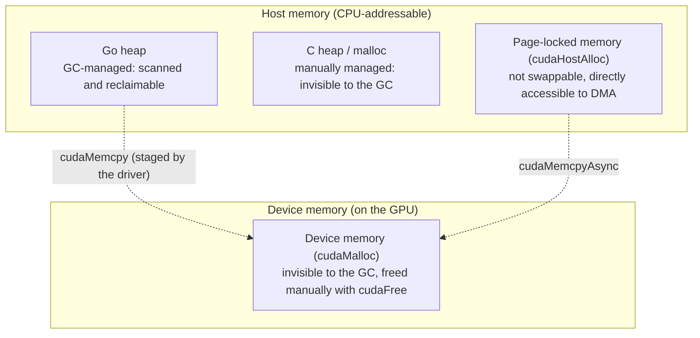

# 18.3 The Divide Between Device Memory and the Garbage Collector

[15.6](../../part5toolchain/ch15compile/cgo.md) covered cgo's pointer-passing rules: a Go pointer
passed to C must point to pinned Go memory; a pointer passed as an argument is implicitly pinned for
the duration of the call; and after the call returns, C may keep holding a Go pointer only if the
memory is still pinned by `runtime.Pinner` [[Go Authors, 2026b](#ref-go-authors-2026b)]. These rules
rest on a division of memory into two regions, Go's and C's. A GPU makes the map more complicated: a
program driving a GPU faces at least four kinds of memory, belonging to different managers and
following different rules. This section draws the map, then looks at where the garbage collector's
jurisdiction ends for each region and which boundary is most easily crossed by asynchronous
transfers.

## 18.3.1 A Map of Memory

A program that drives a GPU from Go faces roughly the following four regions of memory:



Of the four, only the Go heap is managed by the garbage collector; the allocation, marking and
sweeping discussed in Chapters 12 and 13 reach no further. The other three are outside the
collector's jurisdiction: the C heap is managed manually with `malloc` and `free`, page-locked
memory is allocated by CUDA, and device memory is allocated by the driver on the device, where on
systems with a discrete GPU the CPU cannot even dereference its addresses. What this section comes
down to is always knowing which region a pointer falls in.

One point needs clarifying. The current garbage collector does not move objects on the heap; the
comment at the top of `runtime/mgc.go` calls it "non-generational and
non-compacting" [[Go Authors, 2026c](#ref-go-authors-2026c)]. What moves is the goroutine stack,
which is copied whole to a new location when it grows ([14.4](../../part4memory/ch14stack/copy.md)).
A Go pointer passed to C makes the object it points to escape to the heap (unless the C function is
declared both `noescape` and `nocallback`, see 15.6), so it does not move with the stack. But
neither cgo's rules nor the contract of `runtime.Pinner` assume that heap objects do not move; they
rule out both moving and freeing. For GPU programs the practical risk is mainly freeing: a buffer is
no longer referenced after the call returns, is reclaimed and reused for something else, while the
device is still reading it.

## 18.3.2 A Device Pointer Is Not a Go Pointer

What `cudaMalloc` returns is a **device address**, pointing to a location in device memory. It does
not point into host memory, let alone the Go heap.

It follows directly that cgo's pointer rules do not apply to device addresses and the garbage
collector does not process them. The `cgoCheckPointer` check in 15.6 and the rule that "memory
passed to C must not contain Go pointers to unpinned memory" both concern pointers into Go memory. A
device address does not point into Go memory, so it can be passed to C freely, stored in C
structures and held for a long time without violating any rule, and the collector does not scan an
extra byte because of it. In Go it is clearest to keep it as an integer (for example a `uintptr`),
which marks it as a value Go does not need to understand.

The price is on the other side: **device memory is managed entirely by hand**. The garbage collector
does not reclaim device memory allocated by `cudaMalloc`; `cudaFree` must be called explicitly, and
an omission is a device memory leak. C's rules apply to this memory, not Go's memory safety. The
usual practice is to wrap the device address in a Go type with a `Free` method and use
`runtime.AddCleanup` (introduced in Go 1.24) or `runtime.SetFinalizer` as a backstop: after the
wrapper object becomes unreachable, the runtime calls the cleanup function in a separate goroutine
to release the device memory it owns [[Go Authors, n.d.b](#ref-go-authors-ndb)].

This backstop has two limitations, especially visible on GPUs. First, the timing of reclamation is
determined by the Go heap. Garbage collection is triggered by the memory the Go runtime manages, and
the documentation of the soft memory limit states explicitly that it does not count memory outside
Go, such as memory allocated by C code [[Go Authors, 2026d](#ref-go-authors-2026d)]. A wrapper
object of a few dozen bytes may hold several gigabytes of device memory without making the Go heap
grow any faster, so device memory may be exhausted before the next garbage collection. Second, the
cleanup function runs on a runtime goroutine, on an unspecified thread; for driver calls that need a
context already on the thread (18.2.5), calling the driver directly from a cleanup function is
unreliable. The sketch below hands the release request back to the device goroutine that holds the
context (`devAlloc` is a hypothetical C wrapper function, and `freeQueue` is consumed by the device
goroutine of 18.2.5):

```go
type DeviceBuffer struct {
	ptr     uintptr // device address: Go neither dereferences nor tracks it
	cleanup runtime.Cleanup
}

func NewDeviceBuffer(size int) *DeviceBuffer {
	b := &DeviceBuffer{ptr: uintptr(C.devAlloc(C.size_t(size)))}
	// Backstop: if the caller forgets Free, hand the release request to the device goroutine once b is unreachable
	b.cleanup = runtime.AddCleanup(b, func(p uintptr) { freeQueue <- p }, b.ptr)
	return b
}

// Free releases the device memory explicitly and cancels the backstop cleanup function.
func (b *DeviceBuffer) Free() {
	b.cleanup.Stop()
	freeQueue <- b.ptr
}
```

The documentation of `AddCleanup` asks that long-running cleanup functions start a separate
goroutine so as not to block other cleanups; the `freeQueue` in the sketch should have enough
buffering. Calling `Free` explicitly remains the main means, and the cleanup function is only the
last safeguard.

## 18.3.3 Two Kinds of "Pinning"

GPU programming has two mechanisms that are both called "pinning", belonging to different regions of
the map above, and they are easily confused.

**First, pinning in the garbage collection sense: `runtime.Pinner`.** It was introduced in Go 1.21
[[Anderson, 2023](#ref-anderson-2023)] and applies to objects on the Go heap. The documentation of
the `Pin` method says [[Go Authors, 2026a](#ref-go-authors-2026a)]:

```go
// Pin pins a Go object, preventing it from being moved or freed by the garbage
// collector until the [Pinner.Unpin] method has been called.
//
// A pointer to a pinned object can be directly stored in C memory or can be
// contained in Go memory passed to C functions. If the pinned object itself
// contains pointers to Go objects, these objects must be pinned separately if they
// are going to be accessed from C code.
```

The documentation of the `Pinner` type also describes its two uses
[[Go Authors, n.d.a](#ref-go-authors-nda)]: letting C code safely use Go pointers that are not
passed explicitly as arguments, and letting C memory keep holding a Go pointer after a cgo call
returns, as long as the object stays pinned.

accel's Metal backend provides an example [[Ou, 2026a](#ref-ou-2026a)]. Its `SetBytes` passes the
address of a small Go byte slice to Metal through purego as a `uintptr`. A `uintptr` is not a
reference the collector recognizes, and the compiler has no way to know that the address will be
used by external code: the slice may be allocated on the stack, and the stack may grow and move
during the call. It therefore calls `Pin(&data[0])` before the call and `Unpin` after. Unlike cgo, a
call through a `uintptr` does not make the argument escape to the heap automatically and has no
implicit pinning, so the code must take this step itself.

**Second, pinning in the operating system sense: page-locked memory** (also called pinned memory,
allocated by `cudaMallocHost` or `cudaHostAlloc`, or created by locking existing pages with
`cudaHostRegister`) [[NVIDIA, n.d.a](#ref-nvidia-nda)]. It has nothing to do with garbage collection
and acts on the operating system's paging. The CUDA Programming Guide says
[[NVIDIA, n.d.b](#ref-nvidia-ndb)]:

```text
Host allocations made through traditional allocation mechanisms like malloc,
new, or mmap are not page-locked, which means they may be swapped to disk or
physically relocated by the operating system. Page-locked host memory is
required for asynchronous copies between the CPU and GPU.
```

The reason is that the GPU reads and writes host memory directly through DMA, and DMA requires the
target physical pages to stay fixed. When copying from pageable memory, the driver must first
allocate a temporary page-locked buffer, copy the data into it, and then transfer from that buffer
to device memory [[Harris, 2012](#ref-harris-2012)].

| | `runtime.Pinner` | Page-locked memory |
|---|---|---|
| Manager | Go's garbage collector | The operating system's paging |
| Object acted on | Objects on the Go heap | Physical pages of the host |
| Prevents | The collector moving or freeing an object | The operating system swapping out or relocating physical pages |
| Problem solved | C safely holding Go pointers | Direct DMA access, asynchronous transfers |

The two share a name but are orthogonal in meaning. A `[]byte` on the Go heap is both managed by the
garbage collector and swappable by the operating system; `Pinner` solves only the first problem and
not the second. The asynchronous transfer in the next subsection is exactly where both appear at
once.

## 18.3.4 Asynchronous Transfers and Implicit Pinning

Copying a Go `[]byte` to device memory is safe or not depending on whether it is written
synchronously or asynchronously.

**A synchronous copy is safe.** A Go pointer passed to C as an argument is implicitly pinned for the
duration of the call. CUDA's convention for synchronous copies is: for a copy from pageable host
memory to the device, the function returns after the data has been copied to a staging buffer; for a
copy from device to host, the function returns only after the copy completes
[[NVIDIA, n.d.c](#ref-nvidia-ndc)]. In either direction the driver's access to Go memory happens
before the call returns, within the range of the implicit pinning:

```go
buf := make([]byte, n)
// Synchronous: the driver finishes reading buf before the call returns, implicit pinning covers the whole process
C.cudaMemcpy(dst, unsafe.Pointer(&buf[0]), C.size_t(n), C.cudaMemcpyHostToDevice)
```

**An asynchronous copy may go beyond this range.** `cudaMemcpyAsync` can return as soon as the
transfer command is placed in the stream, and the actual transfer may happen later (18.1). Implicit
pinning lasts only until the call returns. For pageable host memory, CUDA's convention says only
that an asynchronous copy "may" be synchronous with respect to the host, and the driver may first
synchronize with the stream and stage the data into page-locked memory
[[NVIDIA, n.d.c](#ref-nvidia-ndc)]. This is behavior the implementation may choose, not a guarantee
a program can rely on. Under cgo's rules, as long as C code can still access a piece of Go memory,
that memory must remain pinned; the program has no way to know whether the driver will still read
`buf` after the call returns, so it must be handled as if it will. Otherwise, once `buf` is no
longer referenced, it may be reclaimed and reused for something else while the transfer is
incomplete.

```go
// Wrong: implicit pinning ends when the call returns, yet the driver may still need to read buf
C.cudaMemcpyAsync(dst, unsafe.Pointer(&buf[0]), C.size_t(n), kindH2D, stream)

// Approach 1: use a Pinner to extend the pinning until the transfer has really completed (stream synchronization)
var pinner runtime.Pinner
pinner.Pin(&buf[0])
C.cudaMemcpyAsync(dst, unsafe.Pointer(&buf[0]), C.size_t(n), kindH2D, stream)
C.cudaStreamSynchronize(stream) // the transfer has certainly completed by here
pinner.Unpin()

// Approach 2: put the data directly in host memory that is neither GC-managed nor pageable,
// which avoids the GC lifetime problem and meets the DMA requirement; the cost is calling cudaFreeHost yourself
var h unsafe.Pointer
C.cudaHostAlloc(&h, C.size_t(n), C.cudaHostAllocDefault)
// ... write the data into h ...
C.cudaMemcpyAsync(dst, h, C.size_t(n), kindH2D, stream)
```

This example makes concrete the orthogonality of the two kinds of pinning in 18.3.3. Approach 1
solves the lifetime problem with `Pinner`: `buf` is not freed during the transfer, but it is still
pageable memory, the driver still goes through a staging buffer, and the transfer is not necessarily
truly asynchronous. Approach 2 solves both the lifetime problem (the memory is outside the GC's
jurisdiction) and DMA (the memory is page-locked) with page-locked memory, at the cost of returning
to manual management. High-performance data paths usually take approach 2 and reuse such a
page-locked buffer as a staging buffer to shuttle data between the Go heap and device memory.

accel puts this pattern behind its API [[Ou, 2026a](#ref-ou-2026a)]. Its `Queue.WriteBuffer` copies
the caller's data into a staging area held by the queue and appends the transfer to the preamble of
the next submission; the function returns once the data no longer shares memory with the caller's
slice, not when the device has finished reading. The documentation states that the caller may reuse
or modify its slice as soon as the function returns, and says this is what "asynchronous" must mean
to be safe. A Go slice therefore never crosses the asynchronous boundary, and the pinning problem
does not arise.

## 18.3.5 Unified Memory: Blurring the Divide Without Removing It

Recent hardware and drivers provide **unified memory**: memory allocated with `cudaMallocManaged`
can be accessed by both CPU and GPU through the same pointer, with the driver migrating data between
host and device; on systems that support HMM or ATS, all system memory implicitly becomes managed
memory [[NVIDIA, n.d.b](#ref-nvidia-ndb)]. Metal devices on Apple silicon also use unified memory.
accel therefore has a `MemoryShared` memory type, meaning memory that is both host-accessible and
device-local, which on unified-memory hardware can save a copy entirely; it is reported per device
rather than inferred from the platform [[Ou, 2026a](#ref-ou-2026a)].

Unified memory does remove the distinction between host pointers and device pointers, and code
becomes much simpler. But what it blurs is the divide of the **address space**, not the divide of
**ownership**. Memory allocated with `cudaMallocManaged` is still released with `cudaFree`, is still
outside the Go heap, and is still not managed by the garbage collector. On HMM or ATS systems the
GPU can even read memory on the Go heap directly, and then the conclusion of 18.3.4 matters even
more: while the device accesses a piece of Go memory, it must stay pinned, and the pinning must last
until the device's access has actually ended. Unified memory hands the question "whether to copy by
hand" to the driver, but does not hand the question "who reclaims this memory" to the garbage
collector. The conclusion has not changed: memory outside the Go heap is neither reclaimed by the
garbage collector nor guaranteed safe to access by it; memory on the Go heap that the device
accesses must be kept alive by the program for the duration of the access.

## Summary

A GPU expands cgo's two regions of memory to four, while the garbage collector's jurisdiction still
ends at the Go heap. Several boundaries follow. A device address is not a Go pointer, is not
governed by the pointer rules and is never reclaimed, so it must be freed by hand; `AddCleanup` can
serve as a backstop, but the timing of reclamation depends on the Go heap rather than device memory.
The two kinds of pinning belong to the garbage collector and the operating system respectively, are
orthogonal and cannot substitute for each other. Asynchronous transfers are the easiest place to go
wrong, because implicit pinning lasts only until the call returns while the transfer may happen
after that: either use a `Pinner` to extend the pinning past stream synchronization, or place the
data in page-locked non-Go memory and let a staging area shuttle it between the two sides. Unified
memory blurs the address space but does not change ownership.

The crossing overhead of [18.1](./boundary.md), the thread occupation of [18.2](./sched.md) and the
memory ownership of this section make up the three problems at the FFI boundary. The last section,
[18.4](./model.md), returns to the concurrency model itself and discusses how the GPU's asynchronous
execution, the device's data parallelism and goroutine concurrency relate.

## Further Reading

- <a id="ref-anderson-2023"></a>[Anderson, 2023] Sven Anderson. runtime: implement Pinner API for
  object pinning. Go commit 251daf46fb, 2023. https://go.dev/cl/367296 Shipped in Go 1.21.
- <a id="ref-go-authors-2026a"></a>[Go Authors, 2026a] The Go Authors. src/runtime/pinner.go. Go
  1.26 source. https://github.com/golang/go/blob/release-branch.go1.26/src/runtime/pinner.go The
  documentation of the `Pinner` type and the `Pin` method.
- <a id="ref-go-authors-2026b"></a>[Go Authors, 2026b] The Go Authors. src/cmd/cgo/doc.go. Go 1.26
  source. https://github.com/golang/go/blob/release-branch.go1.26/src/cmd/cgo/doc.go The
  section "Passing pointers": implicit pinning and `runtime.Pinner`.
- <a id="ref-go-authors-2026c"></a>[Go Authors, 2026c] The Go Authors. src/runtime/mgc.go. Go 1.26
  source. https://github.com/golang/go/blob/release-branch.go1.26/src/runtime/mgc.go The comment at
  the top: the collector is non-generational and non-compacting.
- <a id="ref-go-authors-2026d"></a>[Go Authors, 2026d] The Go Authors. src/runtime/debug/garbage.go.
  Go 1.26 source.
  https://github.com/golang/go/blob/release-branch.go1.26/src/runtime/debug/garbage.go The
  documentation of `SetMemoryLimit`: the memory limit does not count memory outside Go, such as
  memory allocated by C code.
- <a id="ref-go-authors-nda"></a>[Go Authors, n.d.a] The Go Authors. *runtime.Pinner.*
  https://pkg.go.dev/runtime#Pinner The semantics of `Pin`/`Unpin`: prevent the GC from moving or
  reclaiming, and let C keep holding the object after a call returns.
- <a id="ref-go-authors-ndb"></a>[Go Authors, n.d.b] The Go Authors. *runtime.AddCleanup* and
  *runtime.SetFinalizer.* https://pkg.go.dev/runtime#AddCleanup Attach a release callback to the Go
  object that wraps device memory, as a backstop for device memory lifetime.
- <a id="ref-harris-2012"></a>[Harris, 2012] Mark Harris. *How to Optimize Data Transfers in CUDA
  C/C++.* NVIDIA Technical Blog, 2012.
  https://developer.nvidia.com/blog/how-optimize-data-transfers-cuda-cc/ Why page-locked staging
  areas and asynchronous transfers are faster.
- <a id="ref-nvidia-nda"></a>[NVIDIA, n.d.a] NVIDIA. *CUDA C++ Programming Guide: Page-Locked Host
  Memory / Unified Memory.* https://docs.nvidia.com/cuda/cuda-c-programming-guide/ `cudaHostAlloc`
  page-locked memory and DMA, `cudaMallocManaged` unified memory. Since CUDA 13.0 this document is
  marked Legacy and no longer updated; it is replaced by the new *CUDA Programming Guide* ([NVIDIA,
  n.d.b]).
- <a id="ref-nvidia-ndb"></a>[NVIDIA, n.d.b] NVIDIA. *CUDA Programming Guide: Understanding Memory.*
  https://docs.nvidia.com/cuda/cuda-programming-guide/02-basics/understanding-memory.html The
  section of the new programming guide on page-locked host memory, `cudaHostRegister` and unified
  memory.
- <a id="ref-nvidia-ndc"></a>[NVIDIA, n.d.c] NVIDIA. *CUDA Runtime API: API Synchronization
  Behavior.* https://docs.nvidia.com/cuda/cuda-runtime-api/api-sync-behavior.html The conventions
  for synchronous and asynchronous memcpy on pageable and page-locked memory.
- <a id="ref-ou-2026a"></a>[Ou, 2026a] Changkun Ou. *accel: Run compute on the GPU from Go.*
  https://github.com/golang-design/accel, 2026. `SetBytes` in `internal/mtl/queue_darwin.go`,
  `WriteBuffer` in `transfer.go`, `MemoryShared` in `memory.go`. The project is at an early stage.
- This book: [Chapter 12 Memory Allocator](../../part4memory/ch12alloc/readme.md),
  [Chapter 13 Garbage Collector](../../part4memory/ch13gc/readme.md),
  [14.4 Stack Copying and Pointer Adjustment](../../part4memory/ch14stack/copy.md),
  [15.6 cgo](../../part5toolchain/ch15compile/cgo.md),
  [18.1 Crossing the FFI Boundary](./boundary.md),
  [18.2 The Scheduler and Blocking Foreign Calls](./sched.md).
