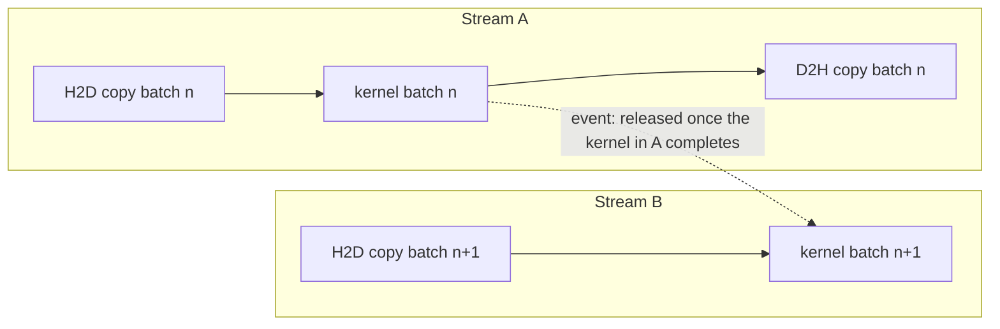

# 18.4 The Asynchronous Programming Model

The first three sections dealt with costs at the FFI boundary: the overhead of crossing
([18.1](./boundary.md)), the threads that crossing occupies ([18.2](./sched.md)), and who manages
the memory passed across ([18.3](./memory.md)). This section turns to the concurrency model itself.
Go's concurrency is built from goroutines and channels, the GPU has a different parallel model, and
the CPU itself has a third. Sorting out where each stands and how they connect closes the chapter,
and gives the criteria for deciding whether a computation is worth pushing across the boundary.

## 18.4.1 Three Kinds of Parallelism

In a 2012 talk Rob Pike distinguished concurrency from parallelism [[Pike, 2012](#ref-pike-2012)].
The Go Blog's introduction to the talk summarizes it as follows
[[Gerrand, 2013](#ref-gerrand-2013)]:

```text
In programming, concurrency is the composition of independently executing
processes, while parallelism is the simultaneous execution of (possibly
related) computations. Concurrency is about dealing with lots of things at
once. Parallelism is about doing lots of things at once.
```

By this standard, the positions of the following three become clear.

- **Goroutine concurrency.** Go's M:N scheduling provides **task-level** concurrency. Each goroutine
  is an independent flow of control, cheap to create, able to block, and communicating over
  channels. It addresses how to organize a program into many concurrent tasks.

- **SIMT (GPU).** Single Instruction, Multiple Threads. One kernel launch unfolds a grid of many
  threads that execute the same program, usually each handling one data element. The CUDA
  Programming Guide describes how it executes [[NVIDIA, n.d.b](#ref-nvidia-ndb)]: a multiprocessor
  creates, manages, schedules and executes threads in groups of 32 called warps; the threads of a
  warp start at the same program address but each has its own instruction address counter and
  register state and can branch independently; a warp executes one common instruction at a time,
  which is most efficient when all 32 threads follow the same path, and if they diverge through a
  data-dependent conditional branch, the warp executes each taken path in turn and masks off the
  threads that are not on that path. Since the Volta architecture, Independent Thread Scheduling
  maintains a program counter and call stack for each thread, so that threads can run fully
  concurrently whether or not they belong to the same warp. The programming model is to write a
  kernel for a single element and then launch a whole grid.

- **SIMD (CPU).** Single Instruction, Multiple Data. Within one CPU core, a single instruction acts
  on multiple data lanes in a vector register at the same time. It is the **data-level** parallelism
  built into the CPU; it needs no GPU and crosses no boundary.

The three are orthogonal dimensions and can be combined: a Go program can use goroutines to handle
many requests concurrently, use SIMD in the inner CPU loop of each request, and hand the heaviest
matrix multiplication to a GPU. Conflating them, for example believing that "a GPU thread is like a
goroutine", skews the design from the start. Goroutines are for tasks that can block and differ
greatly from one another; GPU threads are for large amounts of homogeneous data-parallel
computation, where branch divergence within a warp directly lowers efficiency.

accel's CPU backend illustrates the difference between the two [[Ou, 2026a](#ref-ou-2026a)]. Its
kernels are written in a subset of Go and are formally SIMT single-element programs:

```go
//accel:kernel workgroup=64
func Scale(t accel.Thread, in []float32, out []float32) {
	i := t.GlobalID().X
	if i < uint32(len(out)) {
		out[i] = in[i] * 2
	}
}
```

Mapping each invocation to a goroutine is semantically feasible, and the "as-is execution" form that
accel uses for testing does exactly that. The production execution path does not map invocations to
goroutines: the compiler splits the kernel into states at barriers and subgroup convergence points,
each invocation carries only a program counter and its own locals, and a workgroup scheduler then
advances all active invocations one by one to the next suspension point
[[Ou, 2026b](#ref-ou-2026b)]. This corresponds to the way the threads of a workgroup on a GPU
converge at a barrier and then continue. Goroutines do a different layer of work here: the CPU
backend hands the workgroups of one dispatch to multiple cores to execute at the same time.

## 18.4.2 Streams and Events: Concurrency Built into the Device

[18.1](./boundary.md) introduced GPU asynchrony: a command returns as soon as it is enqueued, and
the GPU executes it on its own timeline. Two primitives organize this asynchronous execution.

**A stream is the unit of concurrency on the device.** Operations in the same stream execute in
submission order; different streams are independent of one another and can overlap. One can
therefore copy the next batch of data into device memory with stream A while computing the kernel of
the previous batch with stream B, making transfer and computation parallel. **An event is a marker
in a stream**: `cudaEventRecord` inserts an event into a stream, and `cudaStreamWaitEvent` makes
commands subsequently added to another stream wait until the event completes. The CUDA Programming
Guide points out that with multiple streams and cross-stream dependencies built with
`cudaStreamWaitEvent`, an application can express a full directed acyclic graph (DAG)
[[NVIDIA, n.d.c](#ref-nvidia-ndc)]:

```text
Using multiple streams and cross-stream dependencies with
cudaStreamWaitEvent, an application can specify a full directed acyclic
graph (DAG) of operations.
```



The device thus already has a complete concurrency model of its own, and the DAG of streams and
events is how the GPU side organizes asynchronous work [[NVIDIA, n.d.a](#ref-nvidia-nda)]. What the
Go side should do is not to reimplement it with goroutines but to submit work to it and observe its
progress. A common anti-pattern is to start a goroutine per kernel and have it wait synchronously
for the kernel to finish. This both causes the thread inflation of [18.2](./sched.md) and uses a set
of expensive blocked threads to restate the dependencies the device already expresses.

A better connection is to align Go's concurrency granularity with **independent pipelines** rather
than individual kernels. The following is a sketch (`submitAsync` and `collect` are hypothetical
functions):

```go
// One goroutine per independent pipeline, each owning a stream (the single-owner form of 18.2.5)
// goroutines pass "this batch is done" over channels, rather than passing each kernel
func pipeline(in <-chan Batch, out chan<- Result) {
	var stream C.cudaStream_t
	C.cudaStreamCreate(&stream)
	defer C.cudaStreamDestroy(stream)
	for b := range in {
		submitAsync(stream, b)          // copy in, compute, copy out, all placed in the stream asynchronously
		C.cudaStreamSynchronize(stream) // synchronize once, at the batch boundary of this pipeline
		out <- collect(b)
	}
}
```

Goroutines handle **task-level** orchestration: which pipelines exist, how batches flow, who
receives the results. Streams and events handle **device-level** asynchronous execution and
dependencies. The two concurrency models each do their own job and meet where "one goroutine owns
one stream". This is the result of applying the channels of
[Chapter 10](../../part3concurrency/ch10chan/readme.md) and the single-owner form of 18.2.5 to
heterogeneous compute.

## 18.4.3 SIMD: Parallelism That Does Not Cross the Boundary

Back on the CPU, the third kind of parallelism has a property the first two lack: it crosses no
boundary.

SIMD is data parallelism within a CPU core. The data is in host memory, on the Go heap, and the
computation happens in place. None of the costs of the first three sections exist here: no cgo
crossing, no launch overhead, no copy between host and device, no device memory, no page locking, no
`Pinner`, and no added load on the scheduler.

In the past, a Go program could use SIMD only by writing assembly by hand (the runtime, `crypto` and
many high-performance libraries do this) or by calling C code through cgo, and both routes take the
code away from portable, readable Go. Go 1.26 introduced the experimental `simd/archsimd` package,
which requires `GOEXPERIMENT=simd` at build time, supported only amd64 at the time, and provides
128-, 256- and 512-bit vector types; its API is deliberately architecture-specific and therefore not
portable [[Go Authors, 2026a](#ref-go-authors-2026a)]. Go 1.27 adds a portable `simd` package on top
of it, also requiring `GOEXPERIMENT=simd` and available on all architectures; `simd/archsimd` gains
support for arm64 Neon and WebAssembly 128-bit SIMD [[Go Authors, 2026b](#ref-go-authors-2026b)].
The documentation of the `simd` package begins [[Go Authors, 2026d](#ref-go-authors-2026d)]:

```text
Package simd implements portable and vector-size-agnostic SIMD types,
and functions and methods for working with these types.  SIMD types
are either implemented in hardware (for example, arm64 "Neon" or
amd64 "AVX/AVX2/AVX512") using the corresponding types in the
[simd/archsimd] package, or emulated in pure Go.  In all cases, the
vector length is at least 128 bits, and within a given program
execution, all vectors have the same length.
```

The following program adds two `float32` slices element by element:

```go
package main

import (
	"fmt"
	"simd"
)

// addVec computes dst[i] = a[i] + b[i], processing one full vector width of elements at a time.
func addVec(a, b, dst []float32) {
	var z simd.Float32s
	lanes := z.Len() // number of float32 values per vector, determined by the target hardware
	i := 0
	for ; i+lanes <= len(dst); i += lanes {
		va := simd.LoadFloat32s(a[i:])
		vb := simd.LoadFloat32s(b[i:])
		va.Add(vb).Store(dst[i:])
	}
	for ; i < len(dst); i++ { // handle the tail shorter than one vector element by element
		dst[i] = a[i] + b[i]
	}
}

func main() {
	a := []float32{1, 2, 3, 4, 5, 6, 7, 8, 9, 10}
	b := []float32{10, 20, 30, 40, 50, 60, 70, 80, 90, 100}
	dst := make([]float32, len(a))
	addVec(a, b, dst)
	var z simd.Float32s
	fmt.Println("lanes:", z.Len())
	fmt.Println(dst)
}
```

Run with Go 1.27.3 on an Apple M5 Pro (darwin/arm64):

```shell
$ GOEXPERIMENT=simd go run .
```

```text
lanes: 4
[11 22 33 44 55 66 77 88 99 110]
```

An arm64 Neon register is 128 bits wide and holds exactly 4 `float32` values, so the first 8
elements are done in two vector additions and the last 2 by the scalar tail loop. The same source
also compiles with `GOARCH=amd64`; the width is determined by the hardware at run time and need not
be assumed when writing code. Without `GOEXPERIMENT=simd`, all files of the `simd` package are
excluded by build constraints and importing it fails.

Two points of the `simd` package's design deserve attention. The first is **vector-length
agnosticism**: types such as `Float32s` and `Int8s` do not put the width in the type name, and the
width is given at run time by `Len`. The second is **hardware if available, emulation if not**: on
platforms with the corresponding instructions it maps to `simd/archsimd`, and otherwise it is
emulated in pure Go, which keeps it portable. It also provides mask types, used to express "operate
only on the lanes that satisfy a condition", and fused multiply-add such as `MulAdd`, which is the
operation most commonly used in the hot inner loops of matrix multiplication, convolution and
geometric transforms.

As of this writing, `simd` is still an experimental feature of Go 1.27 and the corresponding
proposal (#78902) is not yet closed [[Go Authors, 2026c](#ref-go-authors-2026c)]; the API may
change, and `GOEXPERIMENT` must be set explicitly to use it. But its direction is clear: to bring a
kind of parallelism that previously required assembly or a GPU back inside the Go language, onto a
path that crosses no boundary.

## 18.4.4 To Cross or Not to Cross

With SIMD as a reference that does not cross the boundary, the costs of the whole chapter can be
compared together. For the same data-parallel computation there are two common choices: compute in
place on the CPU with SIMD, or hand it to the GPU.

The Roofline model provides a simple framework for such comparisons
[[Williams et al., 2009](#ref-williams-et-al-2009)]: the performance a computation can reach is
bounded by the smaller of the processor's peak compute and "arithmetic intensity times memory
bandwidth", where arithmetic intensity is the number of floating-point operations per byte
transferred. Applying it to the crossing question requires one more, narrower bandwidth: the link
over which data travels between host and device. Take the numbers in Harris's 2012 article as an
example: on a Tesla C2050 the peak bandwidth between device memory and the GPU is 144 GB/s, while
the peak bandwidth between host memory and device memory over PCIe x16 Gen2 is only 8 GB/s
[[Harris, 2012](#ref-harris-2012)]. The GPU's throughput is far higher than the CPU's, but to
realize it all the costs discussed in 18.1 to 18.3 must first be paid: boundary crossing, launch
overhead, data copies in both directions and manual management of device memory. SIMD has none of
these costs, but the parallel width of a single core is limited and the throughput ceiling is much
lower. Therefore:

- **Small data, low arithmetic intensity, or data that is already on the Go heap and used only
  once**: SIMD is often more suitable. The crossing cost cancels the GPU's throughput advantage and
  may even outweigh it.
- **Large data, high arithmetic intensity, reused repeatedly**: the GPU is more suitable. When the
  kernel's computation is large enough, the crossing cost is amortized to negligible. Moving the
  data to device memory once, computing on the device repeatedly and fetching the result only at the
  end aims precisely to spread the fixed crossing cost over as much computation as possible.

Unified-memory hardware (18.3.5) changes one term in this equation: once the copy between host and
device is saved, the crossing cost consists mainly of submission and synchronization, and the
balance tips toward the GPU. There is no universal threshold for this trade-off; it varies with data
size, arithmetic intensity and hardware. But the chapter can be summed up in one sentence: **the
cost of the FFI boundary is the yardstick for whether a computation is worth handing to a GPU.**
Only by working out the cost of the boundary can one decide whether a computation should stay in Go
and be done in place with SIMD, or is worth pushing across the boundary to use the GPU's massive
parallelism.

## Summary

This chapter dissected the FFI boundary between Go and the GPU in four sections. The fixed cost of
crossing calls for fewer crossings, with asynchrony hiding the cost in overlap (18.1). A genuine
block occupies a whole thread, and sysmon takes the P back; large numbers of concurrent blocks cause
thread inflation, so the design tends toward a single owner locked to its thread (18.2). Of the four
kinds of memory only the Go heap is managed by the garbage collector; device addresses are not
governed by the pointer rules and are never reclaimed, and asynchronous transfers are the easiest
place to go wrong on lifetimes (18.3). In the concurrency model, the device has its own asynchronous
DAG of streams and events, and Go only needs to submit work to it in the form of "one goroutine owns
one stream"; for data parallelism that does not cross the boundary, the experimental `simd` package
of Go 1.27 brings it back inside the language (18.4).

One thread runs through the chapter: the boundary is both the source of the cost and the basis of
the design. The next chapter turns to graphics, the earliest heterogeneous workload, where the same
boundary reappears in different forms in the rendering pipeline, graphics contexts and the browser.

## Further Reading

- <a id="ref-gerrand-2013"></a>[Gerrand, 2013] Andrew Gerrand. *Concurrency is not parallelism.* The
  Go Blog, 2013. https://go.dev/blog/waza-talk An introduction to Pike's talk, with concise
  definitions of concurrency and parallelism.
- <a id="ref-go-authors-2026a"></a>[Go Authors, 2026a] The Go Authors. *Go 1.26 Release
  Notes.* 2026. https://go.dev/doc/go1.26 The section "New experimental simd/archsimd package".
- <a id="ref-go-authors-2026b"></a>[Go Authors, 2026b] The Go Authors. *Go 1.27 Release
  Notes.* 2026. https://go.dev/doc/go1.27 The sections "New experimental simd
  package" and "Experimental simd/archsimd package".
- <a id="ref-go-authors-2026c"></a>[Go Authors, 2026c] The Go Authors. *simd: architecture and
  vector-size agnostic SIMD intrinsics under a GOEXPERIMENT.* Go issue #78902, 2026.
  https://go.dev/issue/78902 The proposal for the portable `simd` package.
- <a id="ref-go-authors-2026d"></a>[Go Authors, 2026d] The Go Authors. *Package simd (experimental
  in Go 1.27, requires GOEXPERIMENT=simd).* Implementation in `src/simd/`, documentation in
  `simd/doc.go`: https://github.com/golang/go/tree/master/src/simd Portable, vector-length-agnostic
  SIMD types and operations, with AVX/NEON backends or pure Go emulation. Go 1.27 source:
  https://github.com/golang/go/blob/release-branch.go1.27/src/simd/doc.go
- <a id="ref-harris-2012"></a>[Harris, 2012] Mark Harris. *How to Optimize Data Transfers in CUDA
  C/C++.* NVIDIA Technical Blog, 2012.
  https://developer.nvidia.com/blog/how-optimize-data-transfers-cuda-cc/ The gap between device
  memory bandwidth and host-to-device link bandwidth.
- <a id="ref-nvidia-nda"></a>[NVIDIA, n.d.a] NVIDIA. *CUDA C++ Programming Guide: Streams and
  Events.* https://docs.nvidia.com/cuda/cuda-c-programming-guide/ Concurrency and overlap of
  streams, the dependency DAG formed by events and `cudaStreamWaitEvent`. Since CUDA 13.0 this
  document is marked Legacy and no longer updated; it is replaced by the new *CUDA Programming
  Guide* ([NVIDIA, n.d.c]).
- <a id="ref-nvidia-ndb"></a>[NVIDIA, n.d.b] NVIDIA. *Volta Architecture / Independent Thread
  Scheduling* (the execution model of SIMT and warps).
  https://docs.nvidia.com/cuda/cuda-c-programming-guide/#simt-architecture
  The section "SIMT Architecture" in the CUDA C++ Programming Guide.
- <a id="ref-nvidia-ndc"></a>[NVIDIA, n.d.c] NVIDIA. *CUDA Programming Guide: Asynchronous
  Execution.*
  https://docs.nvidia.com/cuda/cuda-programming-guide/02-basics/asynchronous-execution.html The
  section of the new programming guide on streams, events and cross-stream dependencies.
- <a id="ref-ou-2026a"></a>[Ou, 2026a] Changkun Ou. *accel: Run compute on the GPU from Go.*
  https://github.com/golang-design/accel, 2026.
  The `Scale` kernel in the README and the CPU backend. The project is at an early stage.
- <a id="ref-ou-2026b"></a>[Ou, 2026b] Changkun Ou. *Sequencing.* specs/009-sequencing.md, 2026.
  https://github.com/golang-design/accel/blob/main/specs/009-sequencing.md Milestone M4 "Cooperative
  execution model on the CPU": resumable cooperative lowering replaces one goroutine per invocation.
- <a id="ref-pike-2012"></a>[Pike, 2012] Rob Pike. *Concurrency Is Not Parallelism.* Heroku
  Waza, 2012. https://go.dev/blog/waza-talk The classic distinction between concurrency and
  parallelism, the starting point for understanding where the three kinds of parallelism stand. The
  introductory article was published by Andrew Gerrand on The Go Blog (January 16, 2013); the slides
  are at https://go.dev/talks/2012/waza.slide
- <a id="ref-williams-et-al-2009"></a>[Williams et al., 2009] Samuel Williams, Andrew Waterman,
  David Patterson. *Roofline: An Insightful Visual Performance Model for Multicore Architectures.*
  Communications of the ACM, 52(4):65–76, 2009. https://doi.org/10.1145/1498765.1498785
- This book: [Chapter 9 The goroutine Scheduler](../../part3concurrency/ch09sched/readme.md),
  [Chapter 10 Channels and select](../../part3concurrency/ch10chan/readme.md),
  [18.1 Crossing the FFI Boundary](./boundary.md),
  [18.2 The Scheduler and Blocking Foreign Calls](./sched.md), [18.3 The Divide Between Device
  Memory and the Garbage Collector](./memory.md),
  [19.3 Software Rendering and Parallelism](../ch19graphics/software.md).
