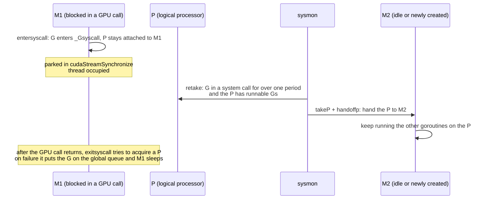

# 18.2 The Scheduler and Blocking Foreign Calls

The advice of [18.1](./boundary.md) is to submit asynchronously and synchronize less: put commands
into a stream, return at once, and wait only once at the end. That last wait still has to happen.
`cudaStreamSynchronize` blocks until the GPU has executed every command in the stream; a synchronous
`cudaMemcpy`, or any driver call that does not take the asynchronous path, leaves the Go-side thread
sitting in C code. How CUDA waits for the device is also configurable: the default
`cudaDeviceScheduleAuto` makes the waiting thread spin when the number of active CUDA contexts in
the process does not exceed the number of logical processors and yield the processor otherwise,
while `cudaDeviceScheduleBlockingSync` makes the thread block on a synchronization primitive
[[NVIDIA, n.d.d](#ref-nvidia-ndd)]. Either way, the thread is in C code for the duration of the
wait. The question for this section is what the scheduler of
[Chapter 9](../../part3concurrency/ch09sched/readme.md) does when a call across the boundary does
not return for a long time, and whether a call parked on the GPU can drag it down.

The question has two directions: Go blocked in C, and C calling back into Go. The scheduler handles
each differently.

## 18.2.1 Blocking Calls as the Scheduler Sees Them

The scheduler of Chapter 9 orchestrates concurrency among M (system threads), P (logical processors,
their number set by `GOMAXPROCS`) and G (goroutines); an M must hold a P to run Go code. The model
comes from Vyukov's 2012 scheduler design: a P is the resource needed to execute Go code, and an M
that is idle or in a system call does not need one [[Vyukov, 2012](#ref-vyukov-2012)].

As 15.6 explained, `cgocall` calls `entersyscall` before calling the C function. In the scheduler's
bookkeeping, a cgo call is the same thing as a system call: the state of the G changes from
`_Grunning` to `_Gsyscall`. Go 1.26 simplified this spot. Earlier runtimes also had a `_Psyscall`
state for P, meaning that the P's M was in a system call; Go 1.26 removed the state and kept only a
placeholder name in the source [[Go Authors, 2026c](#ref-go-authors-2026c)]:

```go
	// _Psyscall_unused is a now-defunct state for a P. A P is
	// identified as "in a system call" by looking at the goroutine's
	// state.
	_Psyscall_unused
```

From then on, whether a P is in a system call is determined only by the state of the goroutine on
it. `entersyscall` also no longer modifies the state of the P; the P stays attached to the current M
for the whole call and can merely be taken away at any time. The commit message states that this
change saves an atomic store and an atomic CAS on the system call path and reduces the `CgoCall`
benchmark from 43.69 ns to 35.83 ns on an AMD EPYC 7B13 [[Knyszek, 2025](#ref-knyszek-2025)]. It is
one of three commits in Go 1.26 that streamline the system call path, and the release notes give
their combined effect as a reduction of about 30% in the baseline runtime overhead of cgo calls
[[Go Authors, 2026a](#ref-go-authors-2026a)], that is, a reduction of the first overhead in 18.1.2.

From `entersyscall` until the C function returns, the goroutine is outside the scheduler's control.
C code runs on the M's system stack; the runtime cannot move it or insert preemption points into it,
and signal-based asynchronous preemption works only for Go code as well. A comment in `retake`
states this [[Go Authors, 2026b](#ref-go-authors-2026b)]:

```go
			// If pp is in a syscall, preemptone doesn't work.
			// The goroutine nor the thread can respond to a
			// preemption request because they're not in Go code,
			// so we need to take the P ourselves.
```

The M carrying the call is therefore fully occupied for its whole duration. Note that what is
occupied is the M, not the P. The number of Ps is limited by `GOMAXPROCS` and they are a scarce
resource; creating an M is relatively cheap. What the scheduler must avoid is a blocking call
holding a P for a long time so that other goroutines cannot run.

## 18.2.2 sysmon Takes the P Back

The component that handles this is **sysmon**, introduced in Chapter 9: an independent monitoring
thread that holds no P. Its sleep interval starts at 20 µs, doubles gradually after a stretch of
consecutive idle rounds, and tops out at 10 ms. In each round, `retake` examines all Ps and takes
back those that have stayed in a system call too long, handing them to other Ms. Blocking cgo calls
are handled by the same mechanism. The following is the part of `retake` in Go 1.26 that deals with
system calls [[Go Authors, 2026b](#ref-go-authors-2026b)]:

```go
		// Try to prevent the P from continuing in the syscall, if it's in one at all.
		thread, ok := setBlockOnExitSyscall(pp)
		if !ok {
			// Not in a syscall, or something changed out from under us.
			goto done
		}

		// Retake the P if it's there for more than 1 sysmon tick (at least 20us).
		if syst := int64(pp.syscalltick); !sysretake && int64(pd.syscalltick) != syst {
			pd.syscalltick = uint32(syst)
			pd.syscallwhen = now
			thread.resume()
			goto done
		}

		// On the one hand we don't want to retake Ps if there is no other work to do,
		// but on the other hand we want to retake them eventually
		// because they can prevent the sysmon thread from deep sleep.
		if runqempty(pp) && sched.nmspinning.Load()+sched.npidle.Load() > 0 && pd.syscallwhen+10*1000*1000 > now {
			thread.resume()
			goto done
		}

		// Take the P. Note: because we have the scan bit, the goroutine
		// is at worst stuck spinning in exitsyscall.
		thread.takeP()
		thread.resume()
		n++

		// Handoff the P for some other thread to run it.
		handoffp(pp)
```

`setBlockOnExitSyscall` first confirms that the goroutine on the P is indeed in `_Gsyscall` and
temporarily prevents it from leaving the system call, so that no race can occur between the check
and the takeover. Two conditions follow. First, the system call must already have lasted longer than
one sysmon period (at least 20 µs); on first observation only the time is recorded. Second, if the
P's local run queue is empty and the system has a spinning M or an idle P, there is no other work
that needs this P for the moment, and it is not taken away within 10 ms. When neither condition
holds, `takeP` removes the P from the blocked M and `handoffp` gives it to another M to continue
with the goroutines in the queue.

A blocking GPU call therefore does not freeze the whole program: as long as other goroutines are
waiting to run, the P is handed over on a scale of tens of microseconds, and the other
`GOMAXPROCS - 1` units of parallelism proceed as usual. When the GPU call returns, the occupied M
tries to reacquire a P in `exitsyscall`: it keeps using the original P if it is still there,
otherwise it tries to get an idle P; if neither is available, the goroutine is put back on the
global run queue and the M goes to sleep.



This is the conclusion for the first direction: a blocking call across the boundary does not drag
down the scheduler, because sysmon protects the scarce P. The price is that the M is occupied for a
while, plus one handoff of the P. One more point deserves attention: if CUDA waits for the device by
spinning, the occupied thread consumes a processor core throughout the wait while the P has been
handed to another M, so the number of threads actually running exceeds `GOMAXPROCS`.

## 18.2.3 Thread Inflation

The cost of a single block is small but is amplified under concurrency.

Compare two kinds of blocking. When a goroutine blocks on a channel or a mutex, the scheduler parks
it and the M goes on to run another goroutine; one M can serve a large number of such blocked
goroutines, which is the basis of the cheapness of goroutines. A goroutine blocked in a cgo call
cannot be parked: the C code occupies the thread's stack, the runtime cannot move it away, and the
goroutine stays bound to its M until the C function returns. It follows that:

Every goroutine blocked in a GPU call at the same time occupies an operating system thread of its
own.

If a goroutine is started for each request and waits synchronously for the GPU to finish, N
concurrent requests can produce as many as N threads. The low cost of goroutines no longer holds
here; what is paid is the cost of threads. Moreover, these threads spend most of their time waiting:
they submit to the same GPU, and adding threads does not add device throughput. The thread count
also has a ceiling. By default the runtime allows at most 10000 threads (adjustable with
`debug.SetMaxThreads`), and the program terminates with "thread exhaustion" when it is exceeded;
threads created by C do not count toward this limit [[Go Authors, 2026b](#ref-go-authors-2026b)].

This is exactly why 15.6 calls for caution with "high concurrency where C calls may block", and it
explains why 18.1 stresses asynchrony. In design terms there are two directions:

- **Do not spread synchronous device calls over many goroutines.** The more goroutines wait
  synchronously for the GPU, the more threads there are, and the benefit does not grow with them.
- **Submit commands to the stream asynchronously from a few goroutines.** A few goroutines put
  commands into the stream asynchronously (18.1), so no thread is occupied while waiting and the
  device can still be kept busy.

18.2.5 gives a more thorough form: a dedicated goroutine owns the device.

## 18.2.4 The Reverse Direction: a Foreign Thread Calls Back into Go

Everything so far is about Go blocked in C. The crossing can also happen in reverse. CUDA lets
`cudaLaunchHostFunc` insert a host function into a stream [[NVIDIA, n.d.a](#ref-nvidia-nda)]; it is
called after the previously submitted work completes and blocks work added after it.
`cudaStreamAddCallback` has a similar effect but is slated for deprecation
[[NVIDIA, n.d.b](#ref-nvidia-ndb)]. The thread that submitted the host function returned long ago;
the caller is a thread managed by the CUDA runtime itself, and the documentation does not specify
which one. The problem arises if the host function wants to call a Go function: this thread was not
created by the Go runtime and has no corresponding M, hence no `g0` and no scheduling context, and
Go code has nowhere to run.

The runtime prepares **extra Ms** for this. `needm` in `runtime/proc.go` handles exactly this case,
and its comment explains the whole design [[Go Authors, 2026b](#ref-go-authors-2026b)]:

```go
// In order to make sure that there is always an m structure
// available to be stolen, we maintain the invariant that there
// is always one more than needed. At the beginning of the
// program (if cgo is in use) the list is seeded with a single m.
// If needm finds that it has taken the last m off the list, its job
// is - once it has installed its own m so that it can do things like
// allocate memory - to create a spare m and put it on the list.
//
// Each of these extra m's also has a g0 and a curg that are
// pressed into service as the scheduling stack and current
// goroutine for the duration of the cgo callback.
//
// It calls dropm to put the m back on the list,
// 1. when the callback is done with the m in non-pthread platforms,
// 2. or when the C thread exiting on pthread platforms.
```

To guarantee that there is always an M to borrow, the runtime maintains the invariant that there is
always one spare M more than needed. A cgo-enabled program puts one M on the list at startup; if
`needm` finds it has taken the last one, then once it has installed its own M and can allocate
memory, it creates another spare M and puts it back on the list. Each extra M has its own `g0` and
`curg`, which serve as the scheduling stack and the current goroutine for the duration of the
callback. When the M is returned depends on the platform: non-pthread platforms call `dropm` at the
end of every callback, while pthread platforms return it only when the C thread exits.

The second behavior dates from Go 1.21. Before that, the M was returned at the end of every callback
and borrowed again for the next one; Go 1.21 changed pthread platforms to remember the M of the C
thread in a thread-local pthread key and return it only when the thread exits
[[Mui, 2023](#ref-mui-2023)]. The release notes give the effect: the cost of later callbacks on the
same C thread falls from about 1–3 µs to about 100-200 ns per call
[[Go Authors, 2023](#ref-go-authors-2023)]. On Unix-like platforms, therefore, a driver thread that
calls back into Go frequently pays the cost of borrowing an M mainly on the first callback, and
after that each callback costs about as much as an ordinary C-to-Go callback (15.6.6 measured a cgo
call with a callback at about 72 ns).

CUDA also places two restrictions on host functions: they must not call any CUDA API, and must not
perform any synchronization that may depend on CUDA work not yet completed
[[NVIDIA, n.d.c](#ref-nvidia-ndc)]. In Go this leaves a callback able to do little more than notify:
for example, send a completion signal on a buffered channel, rather than submit further commands
from inside the callback, and it should not block waiting for a goroutine that is itself waiting for
the GPU. The alternative is to use no callback and query status from the Go side (`cudaStreamQuery`,
`cudaEventQuery`) or block and wait. accel's Metal backend takes the latter approach: it registers
no completion callback and instead blocks on or queries the state of the command buffer, and its
documentation warns that problems with Objective-C object lifetimes follow as soon as the first
completion callback is added [[Ou, 2026d](#ref-ou-2026d)].

## 18.2.5 Locking a Thread to Own the Device

The pressures from the first two directions point to the same design, which also solves a problem
not yet discussed: the **thread affinity of contexts**.

Many device APIs keep state per thread. In the CUDA driver API, `cuCtxSetCurrent` binds the given
context to the CPU thread that calls it, and `cuCtxGetCurrent` returns the context bound to the
calling thread [[NVIDIA, n.d.e](#ref-nvidia-nde)]. The runtime API fares somewhat better: by default
it uses one primary context per device, shared within the process
[[NVIDIA, n.d.f](#ref-nvidia-ndf)], so single-device programs are usually unaffected; but
the "current device" set by `cudaSetDevice` is still state of the calling thread
[[NVIDIA, n.d.d](#ref-nvidia-ndd)], and multi-device programs still face the same problem. An OpenGL
context is likewise "current on a thread" ([19.2](../ch19graphics/bindings.md)). A goroutine,
however, migrates between Ms: it runs on thread A at one moment and may be scheduled onto thread B
the next. A context set up on A does not exist on B.

`runtime.LockOSThread` solves this problem, and its documentation says
[[Go Authors, n.d.](#ref-go-authors-nd)]:

```go
// LockOSThread wires the calling goroutine to its current operating system thread.
// The calling goroutine will always execute in that thread,
// and no other goroutine will execute in it,
// until the calling goroutine has made as many calls to
// [UnlockOSThread] as to LockOSThread.
// If the calling goroutine exits without unlocking the thread,
// the thread will be terminated.
//
// All init functions are run on the startup thread. Calling LockOSThread
// from an init function will cause the main function to be invoked on
// that thread.
//
// A goroutine should call LockOSThread before calling OS services or
// non-Go library functions that depend on per-thread state.
```

accel's draft design document for the CUDA backend records a probe that shows how much this matters
in practice [[Ou, 2026c](#ref-ou-2026c)]. The backend is not yet implemented; the probe program
calls the driver API directly through purego and, on a GB10 (CUDA 13.0), runs 8 goroutines that each
loop over allocation, upload, launch, synchronization, download and verification. With no thread
locking and no context set, calls always return `CUDA_ERROR_INVALID_CONTEXT`. With `cuCtxSetCurrent`
before every driver call, results were mixed, with 2 or 3 failures in 5 repeated runs, because a
goroutine may happen to change threads between setting the context and the call that follows. Only
calling `LockOSThread` first and then setting the context once inside the locked region gave stable
results. The same document also found that calls that take a stream handle explicitly
(`cuLaunchKernel`, `cuMemcpyHtoDAsync`, `cuStreamSynchronize` and so on) obtain the context from the
handle and execute correctly even when the current thread has no context; those that need a context
already on the thread are `cuMemAlloc`, synchronous copies, `cuModuleLoadData` and `cuStreamCreate`,
calls that have no handle to carry a context. Since Go cannot specify which thread a goroutine runs
on, a thread that has been set up cannot be borrowed after the fact, and work that needs the context
can only be given to a goroutine that stays locked to the same thread from start to finish.

Thread affinity is not limited to GPU contexts either. When accel's Metal backend calls an
Objective-C method that may return autoreleased objects, it wraps the call in an autorelease pool,
and the pool must be popped on the same thread that pushed it, so `withPool` locks the thread before
pushing [[Ou, 2026a](#ref-ou-2026a)]:

```go
func withPool(f func()) {
	runtime.LockOSThread()
	defer runtime.UnlockOSThread()
	p, _, _ := purego.SyscallN(fnPoolPush)
	defer purego.SyscallN(fnPoolPop, p)
	f()
}
```

Considering thread affinity together with the thread cost above gives a compact form: a dedicated
goroutine locks its thread and owns the device, and the other goroutines submit requests to it
through a channel. The following sketch shows this form (`createContext`, `submit` and so on are
hypothetical functions):

```go
// A dedicated device goroutine: owns the device, locks its thread, exposes only a channel
func deviceWorker(reqs <-chan Request) {
	runtime.LockOSThread()         // lock: the context lives only on this thread from now on
	defer runtime.UnlockOSThread()
	ctx := C.createContext()       // the context is bound to this thread
	defer C.destroyContext(ctx)
	for r := range reqs {          // handle requests in turn, commands go into the stream asynchronously
		r.result <- submit(ctx, r) // the other goroutines talk to it through channels
	}
}
```

This form solves three problems at once. The first is thread affinity: the context always stays on
the same locked thread and cannot be invalidated by goroutine migration. The second is the number of
threads: however many goroutines issue requests upstream, only this one goroutine touches the
device, so the thread inflation of 18.2.3 does not occur. The third is that it fits Go's concurrency
style: the shared resource, the device, is owned by one goroutine and the others communicate with it
through channels, that is, "do not communicate by sharing memory; instead, share memory by
communicating". This is the form accel plans for its OpenGL ES backend, which has no command
buffers: the backend owns a goroutine that is locked to its thread and holds the context, and
replays the recorded command list on it [[Ou, 2026b](#ref-ou-2026b)]. The agents of
[Chapter 21](../ch21agent/readme.md) also use this "single owner plus channel" structure.

## Summary

The FFI boundary does not crush the scheduler, but it puts pressure on it from two directions. When
Go is blocked in C, the M is occupied for the whole duration and cannot be parked, and only sysmon
can take back the scarce P; large numbers of concurrent blocking calls cause thread inflation,
because a goroutine stuck in a cgo call is not as cheap as one stuck on a channel. In the reverse
direction, a foreign thread calling back into Go needs to borrow an extra M; since Go 1.21, on
Unix-like platforms the same thread pays this cost only on its first callback. The pressure from
both sides pushes the design toward one form: do not spread blocking device calls over many
goroutines; let a few goroutines, locked to their threads where necessary, own the device, and
connect them to the rest of the program with channels.

With scheduling covered, memory remains: of the pointers passed across the boundary, which are
managed by the garbage collector and which are device addresses, and why the collector does not
touch the latter. That is the subject of [18.3](./memory.md).

## Further Reading

- <a id="ref-go-authors-2023"></a>[Go Authors, 2023] The Go Authors. *Go 1.21 Release Notes.* 2023.
  https://go.dev/doc/go1.21 The runtime section: on threads created by C, the cost of later C-to-Go
  calls falls from about 1–3 µs to about 100-200 ns.
- <a id="ref-go-authors-2026a"></a>[Go Authors, 2026a] The Go Authors. *Go 1.26 Release
  Notes.* 2026. https://go.dev/doc/go1.26 See the section "Faster cgo calls".
- <a id="ref-go-authors-2026b"></a>[Go Authors, 2026b] The Go Authors. src/runtime/proc.go. Go 1.26
  source. https://github.com/golang/go/blob/release-branch.go1.26/src/runtime/proc.go
  `entersyscall`/`exitsyscall`, sysmon's `retake`/`handoffp`, `needm`/`dropm` and extra Ms, the
  thread count limit.
- <a id="ref-go-authors-2026c"></a>[Go Authors, 2026c] The Go Authors. src/runtime/runtime2.go. Go
  1.26 source. https://github.com/golang/go/blob/release-branch.go1.26/src/runtime/runtime2.go The
  definition of the P states, including the comment on `_Psyscall_unused`.
- <a id="ref-go-authors-nd"></a>[Go Authors, n.d.] The Go Authors. *runtime.LockOSThread.*
  https://pkg.go.dev/runtime#LockOSThread Locks a goroutine to an operating system thread, for
  device and graphics contexts that require thread affinity.
- <a id="ref-knyszek-2025"></a>[Knyszek, 2025] Michael Knyszek. runtime: eliminate _Psyscall. Go
  commit 7244e9221f, 2025. https://go.dev/cl/646198 Shipped in Go 1.26.
- <a id="ref-mui-2023"></a>[Mui, 2023] Cherry Mui. runtime/cgo: store M for C-created thread in
  pthread key. Go commit c426c87012, 2023. https://go.dev/cl/495855 Shipped in Go 1.21. Reapplies
  doujiang24's CL 481061 and its follow-up fixes.
- <a id="ref-nvidia-nda"></a>[NVIDIA, n.d.a] NVIDIA. *CUDA C++ Programming Guide: Asynchronous
  Concurrent Execution / Stream Callbacks.* https://docs.nvidia.com/cuda/cuda-c-programming-guide/
  `cudaLaunchHostFunc` and related mechanisms that call back into host code on a driver thread.
  Since CUDA 13.0 this document is marked Legacy and no longer updated; it is replaced by the new
  *CUDA Programming Guide* ([NVIDIA, n.d.b]).
- <a id="ref-nvidia-ndb"></a>[NVIDIA, n.d.b] NVIDIA. *CUDA Programming Guide: Asynchronous
  Execution.*
  https://docs.nvidia.com/cuda/cuda-programming-guide/02-basics/asynchronous-execution.html The new
  programming guide; its section "Callback Functions from Streams" describes `cudaLaunchHostFunc`.
- <a id="ref-nvidia-ndc"></a>[NVIDIA, n.d.c] NVIDIA. *CUDA Runtime API: Execution Control.*
  https://docs.nvidia.com/cuda/cuda-runtime-api/group__CUDART__EXECUTION.html
  The semantics of `cudaLaunchHostFunc` and the restrictions on host functions.
- <a id="ref-nvidia-ndd"></a>[NVIDIA, n.d.d] NVIDIA. *CUDA Runtime API: Device Management.*
  https://docs.nvidia.com/cuda/cuda-runtime-api/group__CUDART__DEVICE.html The wait policies
  `cudaDeviceScheduleAuto`, `Spin`, `Yield` and `BlockingSync` of `cudaSetDeviceFlags`;
  `cudaSetDevice` sets the current device of the calling thread.
- <a id="ref-nvidia-nde"></a>[NVIDIA, n.d.e] NVIDIA. *CUDA Driver API: Context Management.*
  https://docs.nvidia.com/cuda/cuda-driver-api/group__CUDA__CTX.html
  `cuCtxSetCurrent` and `cuCtxGetCurrent`: a context is bound to the CPU thread that calls them.
- <a id="ref-nvidia-ndf"></a>[NVIDIA, n.d.f] NVIDIA. *CUDA Runtime API: Difference between the
  driver and runtime APIs.* https://docs.nvidia.com/cuda/cuda-runtime-api/driver-vs-runtime-api.html
  The runtime API implicitly uses one primary context per device, shared within the process.
- <a id="ref-ou-2026a"></a>[Ou, 2026a] Changkun Ou. *accel: Run compute on the GPU from Go.*
  https://github.com/golang-design/accel, 2026.
  `withPool` in `internal/mtl/objc_darwin.go`. The project is at an early stage.
- <a id="ref-ou-2026b"></a>[Ou, 2026b] Changkun Ou. *Backends: the contract, the set, and the
  capability matrix.* specs/006-backends.md, 2026.
  https://github.com/golang-design/accel/blob/main/specs/006-backends.md The OpenGL ES backend holds
  its context in a goroutine locked to its thread.
- <a id="ref-ou-2026c"></a>[Ou, 2026c] Changkun Ou. *CUDA bring-up: the loader shim, a thread-local
  context, and one dispatch.* specs/060-cuda-bringup.md, 2026.
  https://github.com/golang-design/accel/blob/main/specs/060-cuda-bringup.md A design document in
  draft; section 4 records the measured conflict between the thread affinity of CUDA contexts and
  goroutine migration.
- <a id="ref-ou-2026d"></a>[Ou, 2026d] Changkun Ou. *Backend conventions.*
  docs/conventions.md, 2026. https://github.com/golang-design/accel/blob/main/docs/conventions.md
  The section "Objective-C object lifetime across completion handlers".
- <a id="ref-vyukov-2012"></a>[Vyukov, 2012] Dmitry Vyukov. *Scalable Go Scheduler Design
  Doc.* 2012. https://golang.org/s/go11sched The M/P/G model and the handoff of a P under system
  calls, the origin of the sysmon design.
- This book: [9.5 Thread Management](../../part3concurrency/ch09sched/thread.md),
  [9.8 System Monitoring](../../part3concurrency/ch09sched/sysmon.md),
  [15.6 cgo](../../part5toolchain/ch15compile/cgo.md),
  [18.1 Crossing the FFI Boundary](./boundary.md), [18.3 The Divide Between Device Memory and the
  Garbage Collector](./memory.md),
  [19.2 Graphics Bindings and Thread Affinity](../ch19graphics/bindings.md).
