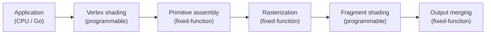

# 19.1 The Rendering Pipeline and Where Go Sits

Chapter 18 treated the GPU as a general-purpose parallel device. The G in GPU stands for graphics:
the hardware was designed for real-time rendering, and its massively parallel structure first served
per-vertex and per-pixel shading. General-purpose computing came later. This chapter returns to
graphics. This section describes the structure of the rendering pipeline, then locates Go code
within it and identifies the boundaries that this location imposes on a Go program.

## 19.1.1 The Pipeline: A Staged Data Flow

To turn a set of three-dimensional vertices into one frame on the screen, the GPU works as a
pipeline: each stage reads the output of the previous stage, applies one kind of transformation, and
hands the result to the next. The classic rasterization pipeline looks like this:

The stages fall into two kinds. **Fixed-function** stages are implemented in hardware and the
program can only set parameters, for example primitive assembly, rasterization, and the depth test
and blending performed when fragments are written to the framebuffer. **Programmable** stages run
small programs supplied by the application, called **shaders**: a vertex shader processes vertices
one at a time, and a fragment shader processes each fragment produced by rasterization. This is how
the WebGPU specification summarizes the GPU: it lets data flow through a pipeline of fixed-function
and programmable stages to execute the commands encoded in a command buffer
[[W3C, n.d.](#ref-w3c-webgpu)]. Rasterization sits between the two kinds of shaders: it determines
which pixels a triangle covers and generates one fragment for each covered pixel. Chapters 2 and 3
of [[Akenine-Möller et al., 2018](#ref-akenine-moller-2018)] discuss each stage in detail.

The pipeline suits the GPU because its units of work are independent. The same shader runs over
thousands of vertices or fragments with no dependencies among them, which is exactly the workload
that the SIMT execution model discussed in [18.4](../ch18gpu/model.md) handles well.

## 19.1.2 Go's Position: An Orchestrator on the CPU Side

Go code sits only in the application stage at the left end of the pipeline. It runs on the CPU and
organizes scene data, including vertices, textures and transformation matrices, uploads it to GPU
memory, and then issues **draw calls** that specify which data and which shaders to draw with. After
a draw call is issued, vertex shading, rasterization and fragment shading all happen on the GPU and
Go code takes no further part, other than reading back results when needed or handing the finished
frame to the window system for display.

This position means a graphics program faces two boundaries.

The first is the FFI boundary. Graphics APIs are C interfaces, and a Go program calls the graphics
driver through cgo or purego ([18.1](../ch18gpu/boundary.md)). A draw call is essentially a command
submission: an OpenGL driver returns as soon as a command such as `glDrawElements` is queued, and
Vulkan's `vkCmdDraw` only records the command into a command buffer, which is not actually submitted
until `vkQueueSubmit`. Either way the GPU executes asynchronously on its own timeline, so the
asynchronous submission model of 18.1 applies here as well. A frame often contains many draw calls,
so "reduce the number of boundary crossings" becomes "reduce the number of draw calls" in graphics.

The second is the language boundary. Shaders run on the GPU, and the driver accepts the shading
language or intermediate representation that each graphics API prescribes: GLSL for OpenGL, HLSL for
Direct3D, MSL for Metal, WGSL for WebGPU, and SPIR-V, the binary intermediate representation used by
Vulkan. The Go compiler does not generate GPU code, so a shader in a Go program must in the end
reach the driver in one of these forms. Some Go-ecosystem approaches make shaders look like Go.
Ebitengine's shading language Kage has Go syntax, can be formatted with `gofmt`, and is compiled at
run time into the language required by the current graphics backend
[[Ebitengine, n.d.b](#ref-ebitengine-ndb)]; polyred compiles Go functions marked with comments such
as `//gpu:vertex` and `//gpu:fragment` into the backend's shading language [[Ou, n.d.](#ref-ou-nd)].
These shaders are not ordinary Go programs, though. In Kage, most types other than `int` (strings,
slices, pointers, interfaces, channels and so on), structs, `import`, goroutines and `defer` are
unsupported [[Ebitengine, n.d.b](#ref-ebitengine-ndb)]. The language boundary remains; it has only
moved inside the toolchain.

The CPU and GPU sides meet through agreed interfaces: vertex attributes, uniform variables
(organized as bind groups in WebGPU) and textures. Go prepares and binds this data, and the shaders
perform the per-vertex and per-fragment computation.

## 19.1.3 Draw-Call Overhead and Explicit APIs

Every draw call goes through the driver. In APIs such as OpenGL, the driver checks and translates
the current state at call time, and this CPU overhead was long a performance bottleneck of graphics
programs. At GDC 2014, four engineers from NVIDIA, Intel and AMD presented "Approaching Zero Driver
Overhead in OpenGL" (AZDO). They pointed out that driver overhead lowers the frame rate on desktop
systems and costs both battery life and frame rate on mobile devices, and they described techniques,
usable in existing OpenGL implementations, that reduce driver overhead to a tenth or less
[[Everitt et al., 2014](#ref-everitt-2014)].

These techniques follow the same idea as 18.1: do more work in one call. The two most common are:

- **Batching**: merge objects that use the same state into one draw call. Ebitengine internally
  merges multiple images into a texture atlas and batches draw operations automatically where
  possible [[Ebitengine, n.d.a](#ref-ebitengine-nda)].
- **Instancing**: draw many copies of the same mesh (grass blades, crowds) with one draw call, where
  the copies differ only in a few parameters such as the transform.

A larger change happened at the API level. OpenGL maintains an implicit state machine whose
management and validation the driver performs behind the scenes; the generation of **explicit** APIs
(Vulkan, Metal, Direct3D 12 and WebGPU) hands this work to the application. The application first
records a sequence of commands into a **command buffer** and then submits it to a device queue for
execution. The Vulkan specification defines a command buffer as an object used to record commands,
which are later submitted to a device queue for execution [[Khronos, n.d.](#ref-khronos-vulkan)].
WebGPU adopts the same model, and its specification says the API was designed from the start to map
efficiently onto native GPU APIs from 2014 onward [[W3C, n.d.](#ref-w3c-webgpu)].

Once recording and submission are separate, the cost of building commands can be amortized over
multiple submissions. A Vulkan command buffer can be recorded once and submitted many times, unless
it was recorded with `VK_COMMAND_BUFFER_USAGE_ONE_TIME_SUBMIT_BIT`
[[Khronos, n.d.](#ref-khronos-vulkan)]; a WebGPU command buffer can be submitted only once, and
rendering commands that must be reused across submissions use a render bundle, `GPURenderBundle`,
instead [[W3C, n.d.](#ref-w3c-webgpu)]. This is the same idea as the CUDA Graph discussed in 18.1:
build once, execute many times.

Explicit APIs also change the conditions for multithreading. The Vulkan specification states that
one of its goals is scalable performance across multiple host threads: all commands may be called
concurrently from multiple threads, but some parameters require **external synchronization**,
meaning the caller guarantees that at most one thread uses the parameter at a time
[[Khronos, n.d.](#ref-khronos-vulkan)]. A command pool belongs to this category and cannot be used
by several threads concurrently. To record in parallel, each thread holds its own command pool,
records its own command buffers, and all buffers are submitted together at the end. This arrangement
fits goroutines: each goroutine owns a command pool and records one part of the scene. External
synchronization only requires a single user at a time and does not pin the user to one particular
thread, which is an essential difference from the OpenGL context discussed in the next section.

Graphics libraries in the Go ecosystem all do this orchestration on the CPU side. Besides
Ebitengine's automatic batching described above, Gio is an immediate-mode GUI library whose vector
renderer draws shapes and text on the GPU; its home page says the implementation is based on OpenGL
ES and Direct3D 11 and is moving to a renderer based on compute shaders [[Gio, n.d.](#ref-gio-nd)].

## Summary

The rendering pipeline is a staged data flow in which fixed-function stages alternate with
programmable shader stages. Go code sits only in the application stage: it prepares data on the CPU
and issues draw calls. A graphics program therefore faces two boundaries. One is the FFI boundary
discussed in 18.1, where a draw call is a command submission and reducing draw calls means reducing
boundary crossings. The other is the language boundary: shaders must be delivered in a language or
intermediate representation that the GPU driver accepts, and shading languages with Go-like syntax
such as Kage only move this boundary into the toolchain. The fixed cost of a draw call gave rise to
batching and instancing; explicit APIs such as Vulkan and WebGPU go further by separating the
recording of commands from their submission and allowing several threads to record command buffers
separately, which makes room for goroutines to take part in CPU-side orchestration.

The next section discusses a constraint the first boundary imposes on graphics in particular: why an
OpenGL context is bound to a thread, why window systems require the main thread, and the role of
`runtime.LockOSThread` in both ([19.2](./bindings.md)).

## Further Reading

- [Akenine-Möller et al., 2018] Tomas Akenine-Möller, Eric
  Haines, Naty Hoffman, et al. *Real-Time Rendering, 4th Edition.* A K Peters/CRC Press, 2018.
  https://www.routledge.com/Real-Time-Rendering-Fourth-Edition/Akenine-Moller-Haines-Hoffman/p/book/9781138627000
  The standard textbook on real-time rendering; Chapter 2 covers the graphics rendering pipeline and
  Chapter 3 covers the GPU.
- [Ebitengine, n.d.a] Ebitengine. https://ebitengine.org/
  A 2D game engine for Go; texture atlases and automatic batching of draw operations.
- [Ebitengine, n.d.b] Ebitengine. *Shader.*
  https://ebitengine.org/en/documents/shader.html The shading language Kage: Go syntax, compiled at
  run time to each graphics backend; the list of unsupported Go features.
- [Everitt et al., 2014] Cass Everitt, Tim Foley, John McDonald, Graham
  Sellers. *Approaching Zero Driver Overhead in OpenGL (AZDO).* GDC, 2014.
  https://gdcvault.com/play/1020791/Approaching-Zero-Driver-Overhead-in
  Where draw-call driver overhead comes from, and techniques to cut it in existing OpenGL.
- [Gio, n.d.] Gio. https://gioui.org/
  A cross-platform immediate-mode GUI library for Go that draws vector graphics on the GPU.
- [Khronos, n.d.] The Khronos Group. *Vulkan Specification: Rendering
  and Command Buffers.* https://registry.khronos.org/vulkan/ Command buffers:
  https://docs.vulkan.org/spec/latest/chapters/cmdbuffers.html Threading behavior and external
  synchronization: https://docs.vulkan.org/spec/latest/chapters/fundamentals.html How explicit APIs
  separate command recording from submission with command buffers.
- [Ou, n.d.] Changkun Ou. *polyred: 3D graphics in Go.*
  https://github.com/changkun/polyred
  A shading language for writing shaders in Go and compiling them to backends such as Metal.
- [W3C, n.d.] W3C GPU for the Web Working Group. *WebGPU Specification.*
  W3C Candidate Recommendation Draft. https://www.w3.org/TR/webgpu/ An explicit graphics and compute
  API for the Web; command buffers, render bundles and the pipeline model. Related to 19.4.
- This book: [18.1 Crossing the FFI Boundary](../ch18gpu/boundary.md),
  [18.4 The Asynchronous Programming Model](../ch18gpu/model.md),
  [19.2 Graphics Bindings and Thread Affinity](./bindings.md).
