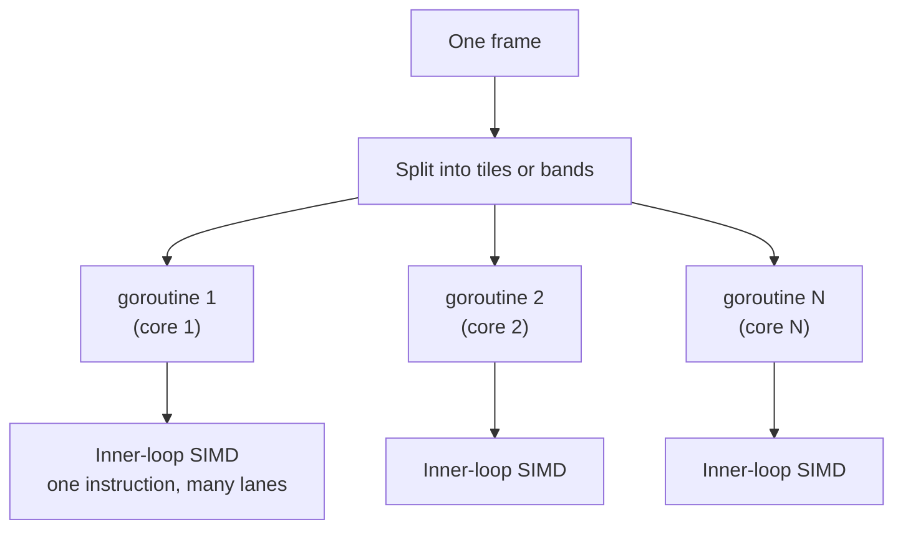

# 19.3 Software Rendering and Parallelism

The rendering of the previous two sections crosses a boundary: data and commands go to the GPU,
which incurs the costs discussed in Chapter 18 and obeys the thread discipline of graphics contexts
([19.2](./bindings.md)). This section discusses another route, **software rendering**: computing
every pixel entirely on the CPU, with no GPU, driver or FFI boundary. Without the boundary, the
question becomes how to use the CPU's own parallelism. The CPU offers two layers of it: task
parallelism across cores, provided by goroutines, and data parallelism within a single core,
provided by SIMD.

## 19.3.1 Why Software Rendering Still Matters

The GPU's throughput is far higher than the CPU's, but in several kinds of scenarios the GPU is
either unavailable or not worth using.

- **No GPU.** Server-side batch generation of images, thumbnails and charts, or rendering of PDFs,
  often runs on headless machines with neither a graphics card nor a display. This is a common
  deployment environment for Go programs.
- **Reproducible results.** The output of software rendering does not depend on the driver version
  or the graphics card model, which suits test baselines and document generation. Reproducibility is
  not automatic, however: the Go language specification allows an implementation to fuse several
  floating-point operations into one (such as FMA), whose result may differ from executing and
  rounding them one by one; an explicit floating-point conversion rounds to the target precision and
  so prevents the fusion [[Go Authors, 2026a](#ref-go-authors-2026a)]. To get bit-identical images
  across architectures, write such conversions at the critical operations, or use integer arithmetic
  only.
- **Full control.** With no context, thread constraints or boundary, the renderer is ordinary Go
  code that can be read, debugged and single-stepped. The standard library's `image` and
  `image/draw`, the extension library `golang.org/x/image` (whose `vector` package is a vector
  rasterizer), and the CPU rendering path of polyred [[Ou, n.d.](#ref-ou-nd)] all belong to this
  category.

## 19.3.2 Tiling: Goroutine-Level Parallelism

Software rendering has a favorable property: pixels mostly do not depend on one another, and pixels
in different regions of the image can be computed entirely independently. This is a classic
embarrassingly parallel problem. The standard approach is **tiling**: cut the image into tiles or
bands of rows and give each goroutine one of them. Mature renderers all do this; for example, all
CPU-based integrators in pbrt split the image into tiles and render them on different processors
[[Pharr et al., 2023](#ref-pharr-2023)].

The following program splits a 300×203 image into 4 bands of rows, renders them in parallel, and
compares the result byte by byte with a serial rendering:

```go {run=true}
package main

import (
	"bytes"
	"fmt"
	"hash/crc32"
	"image"
	"image/color"
	"sync"
)

// shade computes the color of pixel (x, y), depending only on its own coordinates.
func shade(x, y int) color.RGBA {
	return color.RGBA{uint8(x ^ y), uint8(x), uint8(y), 255}
}

// renderRows renders rows y0 through y1-1.
func renderRows(img *image.RGBA, y0, y1 int) {
	for y := y0; y < y1; y++ {
		for x := 0; x < img.Rect.Dx(); x++ {
			img.SetRGBA(x, y, shade(x, y))
		}
	}
}

// renderParallel splits the frame into workers non-overlapping bands of rows
// and renders each band in its own goroutine.
func renderParallel(img *image.RGBA, workers int) {
	h := img.Rect.Dy()
	var wg sync.WaitGroup
	for w := range workers {
		y0, y1 := w*h/workers, (w+1)*h/workers // the last band ends at h, so no rows are missed
		wg.Go(func() { renderRows(img, y0, y1) })
	}
	wg.Wait()
}

func main() {
	r := image.Rect(0, 0, 300, 203) // 203 rows are not divisible by 4
	serial, parallel := image.NewRGBA(r), image.NewRGBA(r)
	renderRows(serial, 0, r.Dy())
	renderParallel(parallel, 4)
	fmt.Println("same as serial result:", bytes.Equal(serial.Pix, parallel.Pix))
	fmt.Printf("CRC-32: %08x\n", crc32.ChecksumIEEE(parallel.Pix))
}
```

Run with Go 1.26.10 (and with `-race`, which reports nothing), the output is:

```text
same as serial result: true
CRC-32: e1bf1a5f
```

The shading function uses only integer arithmetic, so the checksum is the same on every
architecture. The band boundaries are computed as `w*h/workers`, so the last band ends exactly at
`h`. With the common alternative `rows := h / workers` and bounds `w*rows` and `(w+1)*rows`, the
last 3 of the 203 rows would be rendered by no goroutine, and the program would print `false`.

The code uses no locks, because each goroutine writes only the pixels in its own band and the
written regions do not overlap, so there is no data race. `image.RGBA` stores pixels contiguously by
row, so a band is one contiguous range of memory, and two adjacent bands share at most one cache
line at the boundary; the effect of false sharing ([12.2](../../part4memory/ch12alloc/component.md))
is small. If several goroutines wrote to the same region in an interleaved way, synchronization
would be needed, or performance would be lost to false sharing.

Splitting into equal bands assumes that rows cost about the same. If the cost differs greatly
between regions (for example, only part of the image has complex geometry and lighting), a static
equal split leaves some goroutines idle early. In that case the image can be cut finer and the
goroutines can claim the next tile dynamically from a shared counter or channel: a goroutine that
finishes first claims a new tile at once, and the load across cores evens out.

## 19.3.3 Vectorizing the Inner Loop: SIMD

Tiling distributes the work over multiple cores; the data parallelism inside each core comes from
SIMD. The innermost rendering loop does color blending, interpolation and lighting pixel by pixel.
This is regular arithmetic applying the same operation to a set of data, which suits the SIMD
discussed in [18.4](../ch18gpu/model.md): one instruction processes several data lanes of a vector
register at once.

Before Go 1.26, the only way for a Go program to use SIMD was to write Go assembly. That was
worthwhile only for the most performance-critical kernels, so a great deal of code that could have
benefited from SIMD never used it [[Chase and Shao, 2026](#ref-chase-and-shao-2026)]. Image
libraries are no exception: the standard library's `image/draw` is implemented entirely in Go, and
in `golang.org/x/image` only the `vector` package has an amd64 assembly implementation of the
accumulation step of rasterization, enabled on processors with SSE4.1
[[Go Authors, n.d.](#ref-go-authors-nd)].

Go 1.26 introduced the experimental `simd/archsimd` package, which provides fixed-width 128-, 256-
and 512-bit vector types on amd64; Go 1.27 adds the portable `simd` package on top of it, and both
require `GOEXPERIMENT=simd` at build time [[Go Authors, 2026b](#ref-go-authors-2026b)]
[[Go Authors, 2026c](#ref-go-authors-2026c)]. The vector types of the `simd` package, such as
`Float32s` and `Int8s`, do not fix a width. All vectors in one program execution have the same
width, determined at program start from the CPU features: on amd64 it is 128, 256 or 512 bits
depending on support for AVX, AVX2 or AVX-512 (falling back to a narrower width when some
instructions are missing), on arm64 it is currently the 128 bits of NEON, and on wasm it is 128
bits; on other architectures, or with `GODEBUG=simd=0`, a pure-Go emulation is used
[[Chase and Shao, 2026](#ref-chase-and-shao-2026)].

Take the most common case, alpha blending. `dst = src·α + dst·(1−α)` is one multiply-add per
channel, which corresponds exactly to `MulAdd` in the `simd` package:

```go
//go:build goexperiment.simd

package main

import (
	"fmt"
	"simd"
)

// blendRow blends one color channel of a row of pixels with the background by alpha:
// dst = src*alpha + dst*(1-alpha).
func blendRow(dst, src, alpha []float32) {
	var z simd.Float32s
	lanes := z.Len()
	one := simd.BroadcastFloat32s(1)
	i := 0
	for ; i+lanes <= len(dst); i += lanes {
		s := simd.LoadFloat32s(src[i:])
		d := simd.LoadFloat32s(dst[i:])
		a := simd.LoadFloat32s(alpha[i:])
		// x.MulAdd(y, z) computes x*y + z element by element
		s.MulAdd(a, d.Mul(one.Sub(a))).Store(dst[i:])
	}
	for ; i < len(dst); i++ { // the tail shorter than one vector is handled with scalars
		dst[i] = src[i]*alpha[i] + dst[i]*(1-alpha[i])
	}
}

func main() {
	var z simd.Float32s
	fmt.Println("lanes:", z.Len())
	dst := []float32{0, 0, 0, 0, 1, 1, 1, 1, 0.5, 0.5}
	src := []float32{1, 1, 1, 1, 0, 0, 0, 0, 1, 0}
	alpha := []float32{0, 0.25, 0.5, 1, 0, 0.25, 0.5, 1, 0.5, 0.5}
	blendRow(dst, src, alpha)
	fmt.Println(dst)
}
```

This program needs Go 1.27 and cannot run directly on this book's pages. Run with Go 1.27.3 on
darwin/arm64 with `GOEXPERIMENT=simd`, the output is:

```text
lanes: 4
[0 0.25 0.5 1 1 0.75 0.5 0 0.75 0.25]
```

The first 8 elements are done by two vector operations and the last 2 by the scalar loop; with
`GODEBUG=simd=0`, which switches to the emulation, the output is identical. The same `blendRow` need
not be written once per vector width: on an amd64 machine with AVX-512, `lanes` can be 16. The
`simd` package is still experimental and its API may change; see 18.4 for more discussion of the
design.

## 19.3.4 Stacking the Two Layers, and the Division of Labor with the GPU

Stacking the two layers of parallelism gives the complete parallel structure of software rendering
on the CPU:



The outer layer uses goroutines to cut the image into tiles distributed over all cores (task
parallelism); the inner layer uses SIMD so that each core processes several data lanes at a time
(data parallelism). The layers are independent and multiply: with N cores and W lanes per
instruction on each core, the ideal speedup over a naive scalar serial implementation is bounded by
about N×W. The actual speedup is usually below this bound, because memory bandwidth, load imbalance
and scalar tail handling all eat into the gain.

The division of labor between software and GPU rendering is the cost trade-off of 18.4 applied to
graphics. GPU rendering has much higher throughput but bears the cost of crossing the boundary and
the thread constraints of the context; software rendering has capped throughput but no boundary,
controllable results, and runs on any headless machine. Interactive rendering that is real-time,
high-resolution and heavy on shading (games, real-time 3D) therefore suits the GPU; headless batch
image generation, scenarios that need reproducible results, medium-sized image processing, and
environments without a graphics card suit software rendering. The polyred renderer provides both
paths: it uses the GPU by default, falls back to the CPU stage by stage when acquiring a device
fails, and can be forced onto the CPU path with `render.CPU()` [[Ou, n.d.](#ref-ou-nd)].

## Summary

Software rendering sits on the other side of the FFI boundary: it gives up the GPU's throughput in
exchange for zero boundary overhead, controllable results, and the ability to produce images on
headless machines. Parallelism on the CPU has two layers. The outer layer uses goroutines to cut the
image into non-overlapping regions distributed over several cores, with no locks needed. The inner
layer uses SIMD to vectorize the per-pixel arithmetic, and the experimental `simd` package of Go
1.27 lets this layer be expressed in portable Go code instead of assembly. The two layers multiply
to give the upper bound of CPU parallelism. Whether to switch to the GPU still depends on the
boundary costs discussed in 18.4.

That completes the two rendering routes on the local machine. The last section, [19.4](./wasm.md),
turns to the browser: where the rendering boundary lies once Go is compiled to WebAssembly, and how
much of this section's two layers of parallelism remains there.

## Further Reading

- <a id="ref-chase-and-shao-2026"></a>[Chase and Shao, 2026] David Chase and Junyang Shao.
  *Platform-independent SIMD in Go.* The Go Blog, 2026-09-24. https://go.dev/blog/simd-experiment
  The motivation and design of the `simd` package: portability, no fixed vector width, emulation
  when hardware support is missing, and the `GODEBUG=simd` setting.
- <a id="ref-go-authors-nd"></a>[Go Authors, n.d.] The Go Authors. *Package image/draw and
  golang.org/x/image.* https://pkg.go.dev/image/draw , https://pkg.go.dev/golang.org/x/image Go's
  standard and extended image libraries. `image/draw` is implemented in pure Go; the accumulation
  step of `x/image/vector` has an SSE4.1 assembly implementation on amd64.
- <a id="ref-go-authors-2026a"></a>[Go Authors, 2026a] The Go Authors. *The Go Programming Language
  Specification: Floating-point operators.* https://go.dev/ref/spec#Floating_point_operators An
  implementation may fuse several floating-point operations into one; an explicit type conversion
  prevents the fusion.
- <a id="ref-go-authors-2026b"></a>[Go Authors, 2026b] The Go Authors. *Go 1.26 Release
  Notes.* 2026. https://go.dev/doc/go1.26 The experimental `simd/archsimd` package (amd64, 128-,
  256- and 512-bit vectors).
- <a id="ref-go-authors-2026c"></a>[Go Authors, 2026c] The Go Authors. *Package simd (Go 1.27
  experiment, requires GOEXPERIMENT=simd).* https://github.com/golang/go/tree/master/src/simd
  Documentation: https://pkg.go.dev/simd ; release notes: https://go.dev/doc/go1.27 Variable-width
  vector types such as `Float32s`, and operations such as `LoadFloat32s`, `BroadcastFloat32s` and
  `MulAdd`.
- <a id="ref-ou-nd"></a>[Ou, n.d.] Changkun Ou. *polyred: 3D graphics in Go.*
  https://github.com/changkun/polyred Originally titled *polyred: a 3D graphics facility in pure
  Go*. A 3D renderer for Go with both a GPU path and a pure-Go CPU path.
- <a id="ref-pharr-2023"></a>[Pharr et al., 2023] Matt Pharr, Wenzel Jakob, Greg Humphreys.
  *Physically Based Rendering: From Theory to Implementation, 4th ed.* 2023. https://pbr-book.org/
  The architecture of a software renderer; the `ImageTileIntegrator` of Section 1.3.4 splits the
  image into tiles and renders them in parallel.
- This book: [Chapter 9 The goroutine Scheduler](../../part3concurrency/ch09sched/readme.md),
  [Chapter 11 Synchronization Primitives and Patterns](../../part3concurrency/ch11sync/readme.md),
  [12.2 Components](../../part4memory/ch12alloc/component.md),
  [18.4 The Asynchronous Programming Model](../ch18gpu/model.md),
  [19.1 The Rendering Pipeline and Where Go Sits](./pipeline.md),
  [19.4 Rendering in the Browser](./wasm.md).
