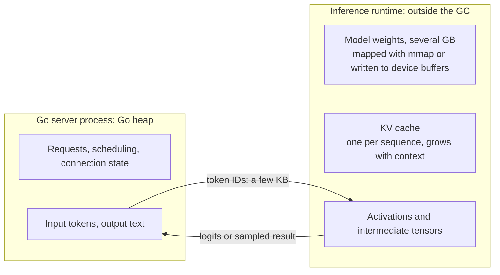

# 20.1 The Inference Runtime and FFI

The FFI boundary discussed in Chapters 18 and 19 reappears in large-model inference. Training large
models relies mainly on Python and CUDA; once a model is trained and has to serve many requests, the
nature of the problem changes, and Go has a role to play. But Go itself does not multiply matrices.
It must attach to a native inference runtime, and that attachment leads back to the boundary of
Chapter 18. This section examines three questions: how Go attaches to an inference runtime, who owns
the tensors' memory, and whether the runtime should share a process with the Go service or run in a
separate one.

## 20.1.1 The Division of Labor Between Training and Serving

**Training** is research work: trying different network architectures, tuning hyperparameters and
watching loss curves. It calls for expressive flexibility and a rich ecosystem. Python, PyTorch and
CUDA are the mainstream combination on this side; Go has no place here and does not need one.

**Inference and serving** are a different kind of work. The model's weights are frozen, and what
remains is almost entirely systems problems: serving a large number of concurrent requests with high
throughput and low latency; loading several gigabytes of weights into memory reliably and handing
them to the device; and packaging all of this as a service that is easy to deploy, withstands
production traffic, and is easy to monitor and operate. These problems overlap heavily with what Go
does well: a statically linked single binary, goroutines and channels, predictable memory
management, and a mature standard-library network stack. The server process of Ollama, a local LLM
service, is written in Go; the `go.mod` of its v0.40.13 declares `go 1.26.10`
[[Ollama, n.d.](#ref-ollama-nd)].

## 20.1.2 Attaching to a Native Inference Runtime

Go does not perform the compute-intensive work itself (matrix multiplication, attention,
dequantization). It hands that work to an **inference runtime**: llama.cpp and its tensor library
ggml (C/C++) [[Gerganov et al., n.d.](#ref-gerganov-nd)], ONNX Runtime, which exposes a C API
[[Microsoft, n.d.](#ref-microsoft-nd)], or Apple's MLX. These runtimes are heavily optimized for CPU
SIMD instructions and for various GPU backends. The most direct way for Go to attach to them is
still cgo.

The mechanisms of Chapter 18 therefore return unchanged. Take Ollama: the native part is built with
CMake, and GPU backends must be selected explicitly, for example
`-DOLLAMA_LLAMA_BACKENDS="cuda_v13;vulkan"`. The llama.cpp it uses is pinned to a tag by
`LLAMA_CPP_VERSION` at the repository root (`b11963` in v0.40.13), with patches from `llama/compat/`
applied on top [[Ollama, 2026a](#ref-ollama-2026a)]. The costs discussed at the end of
[15.6 cgo](../../part5toolchain/ch15compile/cgo.md) are inherited as well: the build needs a C/C++
toolchain, pure-Go cross-compilation is no longer available, and every crossing of the boundary at
run time pays for a state switch. Ollama's development documentation carries a warning about this:

```text
Ollama includes native code compiled with CGO.  From time to time these data structures can change and
CGO can get out of sync resulting in unexpected crashes. You can force a full build of the native code
by running `go clean -cache` first.
```

This is a build-level problem, rooted in the design of the Go build cache. `go help cache` states
that the build cache correctly tracks changes to Go source files, the compiler and compiler options,
but does not detect changes to C libraries pulled in through cgo; after a C library changes, the
cache must be cleaned explicitly or a rebuild forced with `-a`. In the implementation of `cmd/go`,
only the files inside the package directory (Go, C, headers and so on) take part in computing the
action ID; headers that are `#include`d from outside the package directory do not (as of Go 1.26).
cgo ties the type definitions of two languages together, while the Go toolchain sees only half of
them.

The design discipline is the same as in [18.1 Crossing the FFI Boundary](../ch18gpu/boundary.md):
**coarse granularity**. Nobody crosses the boundary once per operator. A single call has the runtime
perform "one complete forward pass over this batch of tokens", leaving the scheduling of hundreds or
thousands of operators on the other side. Section 18.1 pointed out that GPU workloads are naturally
a flood of fine-grained commands; one of the values of an inference runtime is precisely that it
keeps this flood on the far side of the boundary and leaves Go with a coarse-grained interface.

## 20.1.3 Where the Tensors Live

Once attached, the most important engineering question is memory. Memory for large models is
measured in gigabytes, and the cost of copying across the boundary cannot be ignored. Applying the
memory division of [18.3 The Divide Between Device Memory and the Garbage
Collector](../ch18gpu/memory.md) to inference gives the following ownership (the inference runtime
may share a process with Go or be a separate subprocess; the ownership does not change either way):



**First, the weights are not in the Go heap.** There are two common approaches. llama.cpp's load
mode defaults to `auto`, meaning "use mmap unless a device does not support
it" [[ggml-org, 2026a](#ref-ggml-org-2026a)]. The GGUF format lists mmap compatibility among its
design goals: the data of every tensor in the file is aligned to `general.alignment` (32 bytes when
unspecified), so it can be used directly once mapped [[ggml-org, 2026b](#ref-ggml-org-2026b)]. The
mapped pages belong to the kernel's page cache and are swapped in and out on demand; the Go garbage
collector neither scans them nor counts them toward the heap size. The other approach appears in the
pure-Go Forma: it does not use mmap but reads each tensor with `ReadAt` into a temporary `[]byte`,
converts precision and layout, and writes the result into a device buffer that accel requested from
Metal. On a unified-memory device the converted result is written straight into device memory, and
the host keeps no converted copy [[Ou, 2026a](#ref-ou-2026a)]. Both routes end the same way: the
resident gigabytes of weights are not in the Go heap.

Why does this matter so much? A `[]byte` contains no pointers, so the collector need not scan its
contents, but it does count toward the live heap. With the default `GOGC=100`, the heap goal for the
next cycle is about twice the live heap (see [13.3](../../part4memory/ch13gc/pacing.md)). If 8 GB of
weights sat in the Go heap, the process's memory limit would have to be planned at 16 GB, and that
memory still could not be handed to the device directly.

**Second, the KV cache is a large block of per-sequence state.** During autoregressive generation,
the model reads back the keys and values of all earlier positions at every step, so the runtime
maintains a KV cache for each sequence. The cost per position is
$2 \times \text{layers} \times \text{KV heads} \times \text{head dimension} \times \text{bytes per element}$.
For Qwen3-4B (36 layers, 8 KV heads, head dimension 128) stored as f16, that is about 144 KiB per
position and about 576 MiB for 4096 positions [[Ou, 2026a](#ref-ou-2026a)]. This memory is also
managed by the runtime; the Go side holds only a handle or a sequence number.

**Third, only small data crosses the boundary.** Input token IDs, the logits or sampled result of
each step, and the final text are all small compared with the weights, and copying them across the
boundary does little harm. Where sampling happens affects how much data crosses: when sampling is
done inside the runtime, only one token needs to be returned per step; Forma currently samples in Go
(a design for sampling on the device is still a draft), so logits must be read back to the host at
every step [[Ou, 2026a](#ref-ou-2026a)]. "Zero-copy" in inference means exactly this discipline:
gigabyte-scale data stays where it is, and Go passes only handles and small data.

**Fourth, releasing native memory cannot be left to the GC.** The collector schedules cycles only by
the growth of the Go heap and cannot see how much memory the native side holds. If a finalizer or
`runtime.AddCleanup` released a gigabyte-scale native buffer, the timing of the release would be
unpredictable (see [13.10](../../part4memory/ch13gc/finalizer.md)). The `mlx` package of Ollama
chooses deterministic release: every array handle belongs to a scope, and when the scope ends the
arrays in it are released together; arrays move between scopes only through return values, `Attach`
or `Detach` [[Ollama, 2026d](#ref-ollama-2026d)]. The same package also has to deal with
thread-local state. Part of MLX's state is bound to an operating-system thread, so `mlxthread`
starts a long-running worker goroutine that calls `runtime.LockOSThread` and then deliberately never
unlocks; the comment says this keeps MLX's thread-local state from leaking to other goroutines. Go's
documentation specifies that a thread is terminated when its goroutine exits while locked to it
(`runtime/proc.go`, as of Go 1.26), and this rule backstops the design. This is the same class of
problem as the GPU context discussed in [18.2](../ch18gpu/sched.md).

## 20.1.4 Where to Put the Process Boundary

The last question is the choice discussed in [18.1](../ch18gpu/boundary.md): should the inference
runtime share a process with the Go service, or run in another one? In inference deployments this
choice directly determines the topology of the system. Existing Go projects are spread along a
spectrum.

**Same process, called through cgo.** There is no inter-process communication or serialization;
inputs and outputs are passed as handles within one address space, which gives the lowest latency.
The cost is inheriting cgo wholesale, and a crash in native code takes down the whole process: when
a segmentation fault occurs in C code, the Go runtime prints `signal arrived during cgo execution`
and terminates the process (`runtime/signal_unix.go`, as of Go 1.26), and the runtime cannot recover
from it. The `mlx` package above belongs to this category: array operations execute through cgo in
the process of the caller, except that in Ollama the process that executes them is the subprocess
described next.

**Same machine, separate subprocess.** This is the structure Ollama actually uses. In v0.40.13,
every GGUF model is served by an upstream `llama-server` subprocess: the Go server process starts it
with `exec.Command`, has it listen on a port on `127.0.0.1`, and communicates with it over HTTP
[[Ollama, 2026b](#ref-ollama-2026b)]; MLX models are served by the server process re-executing
itself with a `runner` argument and running in the subprocess. This is not a recent turn. The server
process of v0.20.0 already re-executed its own executable with a `runner` argument, the subprocess
linked ggml through cgo, and parent and child communicated over local HTTP through endpoints such as
`/load`, `/health` and `/completion` [[Ollama, 2026c](#ref-ollama-2026c)]. At least since v0.20.0,
then, Ollama has kept the cgo code that executes models in a subprocess, so a crash in native code
takes down only one subprocess and not the Go process responsible for scheduling and the API. The
server process of v0.40.13 still calls native code through cgo itself, but only for probing and
loading: on macOS it queries Metal devices through Objective-C, on Linux it loads ggml's backend
libraries with `dlopen` to probe devices, and it provides replacement implementations for `!cgo`
builds; the `mlx` package also tries to load MLX's dynamic library at initialization, and the server
process uses this to decide whether MLX models can run.

Fornax is another example of the same structure. In one Go binary it freezes and verifies the
weights, then starts vLLM or SGLang as the inference engine, with a translation layer in front that
is compatible with the OpenAI and Anthropic interfaces; `/readyz` does not report ready until weight
verification has passed [[Ou, 2026c](#ref-ou-2026c)]. The code that supervises the engine process is
as follows:

```go
cmd := exec.CommandContext(ctx, args[0], args[1:]...)
cmd.Stdout, cmd.Stderr = opts.Log, opts.Log
if err := cmd.Start(); err != nil {
	return fmt.Errorf("start engine: %w", err)
}

engineErr := make(chan error, 1)
go func() { engineErr <- cmd.Wait() }()
select {
case <-ctx.Done():
	<-engineErr // CommandContext kills the engine; reap it
	return nil
case err := <-engineErr:
	return fmt.Errorf("engine exited: %w", err)
case err := <-serveErr:
	return fmt.Errorf("shim server: %w", err)
}
```

The documentation of `exec.CommandContext` specifies that if the context is cancelled before the
command finishes on its own, `cmd.Cancel` (by default `os.Process.Kill`) is called to interrupt the
process. Putting `cmd.Wait` in a goroutine turns the blocking wait into an event on a channel, so
cancellation, engine exit and a translation-layer error can all be handled in a single `select` (for
`select`, see [Chapter 10](../../part3concurrency/ch10chan/readme.md)). Here an engine crash is just
a return value. The cost is an extra layer of local communication and serialization, and one more
component to deploy.

**Same process, no C toolchain.** Forma is built with `CGO_ENABLED=0` and depends on no C++ runtime,
Python or vendor SDK [[Ou, 2026a](#ref-ou-2026a)]. A model is described as a computation graph,
compiled by accel and executed on the CPU backend or on Metal [[Ou, 2026b](#ref-ou-2026b)]; accel
drives Metal by calling `objc_msgSend` at run time through purego. Note that purego makes its calls
through the runtime's `runtime.cgocall`, which it reaches with `go:linkname`
[[Ebitengine, n.d.](#ref-ebitengine-nd)], so what it removes is the build-time cost; the run-time
state switch remains, as 18.1 discussed. Forma is at an early stage and has no release tags. On an
8-core Apple-silicon machine, Qwen3-0.6B at f16 with a single session decodes at about 18 tokens per
second, with a time to first token (TTFT) of about 170 ms; the CPU backend is correct but far too
slow to serve; and no comparison with vLLM has been made [[Ou, 2026a](#ref-ou-2026a)]. It represents
one end of the spectrum: cross-compilation and single-file deployment are fully preserved, at the
price of being limited to the backends and operators that accel already supports.

**Remote service.** The inference runtime is deployed as a standalone service, for example vLLM
[[vLLM, n.d.](#ref-vllm-nd)] or the server that ships with llama.cpp, and the Go process reaches it
over gRPC or HTTP. The Go side contains no cgo at all, and the inference service can be scaled and
restarted independently. The cost is network round trips and cross-service operations.

There is no universal answer. For the lowest latency and a willingness to bear cgo, choose the same
process. For fault isolation on a single machine, choose a subprocess. For single-file deployment
and cross-compilation, when the target backend happens to be supported, consider the pure-Go route.
For independent scaling, choose a remote service. As 18.1 put it, the FFI boundary is not a fixed
line but a design choice that can be moved.

## Summary

Once a model is trained, serving it is a systems problem, which is why Go enters the AI inference
and serving layer. But Go does not compute tensors itself; it attaches to a native runtime through
cgo, a subprocess or purego, and the boundary of Chapter 18 returns with its costs: the discipline
of coarse-grained calls, the C toolchain at build time, C dependencies the Go build cache cannot
see, and the crossing overhead at run time. In memory terms, gigabytes of weights are mapped with
mmap or written into device buffers, the KV cache and activations also stay on the native side, Go
passes only handles, tokens and logits, and native memory is released by deterministic scopes. Where
the process boundary goes determines the system topology: Ollama and Fornax put the native engine in
a subprocess, while Forma chooses to do without a C toolchain.

With weights and tensors settled, [20.2](./tokenize.md) turns to the data itself: how text is split
into tokens and restored to text, and why the mechanisms of
[5.2](../../part2lang/ch05data/string.md) concerning strings and bytes decide whether the result is
correct.

## Further Reading

- <a id="ref-ebitengine-nd"></a>[Ebitengine, n.d.] Ebitengine. *purego: A library for calling C
  functions from Go without Cgo.* https://github.com/ebitengine/purego As of v0.10.1;
  `go_runtime.go` references `runtime.cgocall` through `go:linkname`.
- <a id="ref-gerganov-nd"></a>[Gerganov et al., n.d.] Georgi Gerganov et al. *llama.cpp and ggml.*
  https://github.com/ggml-org/llama.cpp, https://github.com/ggml-org/ggml
  A C/C++ tensor runtime, the GGUF weight format with `mmap` loading, and the KV cache.
- <a id="ref-ggml-org-2026a"></a>[ggml-org, 2026a] ggml-org. *llama.cpp b11963* (commit 39febd2adb):
  `llama_load_mode` in `include/llama.h` and `tools/server/README.md`. 2026.
  https://github.com/ggml-org/llama.cpp/blob/b11963/tools/server/README.md
- <a id="ref-ggml-org-2026b"></a>[ggml-org, 2026b] ggml-org. *GGUF.* ggml v0.28.0 (commit
  facdc44a67),
  2026. https://github.com/ggml-org/ggml/blob/v0.28.0/docs/gguf.md
  The design goals of GGUF (single-file deployment, mmap compatibility) and its alignment rules.
- <a id="ref-microsoft-nd"></a>[Microsoft, n.d.] Microsoft. *ONNX Runtime C API.*
  https://onnxruntime.ai/docs/api/c/
  An inference runtime exposed through a C API, reachable from Go through cgo.
- <a id="ref-ollama-nd"></a>[Ollama, n.d.] Ollama. *Ollama.* https://github.com/ollama/ollama A
  local LLM service written in Go; its native inference engine is built with CMake for multiple
  backends.
- <a id="ref-ollama-2026a"></a>[Ollama, 2026a] Ollama. *Development.* v0.40.13 (commit
  04088e7c9d), 2026. https://github.com/ollama/ollama/blob/v0.40.13/docs/development.md The CMake
  build, backend selection and the warning about CGO getting out of sync; see also
  `LLAMA_CPP_VERSION` and `llama/README.md` of the same version.
- <a id="ref-ollama-2026b"></a>[Ollama, 2026b] Ollama. *llm/llama_server.go.* v0.40.13 (commit
  04088e7c9d), 2026. https://github.com/ollama/ollama/blob/v0.40.13/llm/llama_server.go Wraps the
  upstream `llama-server` as a subprocess and communicates over local HTTP; see also
  `mlxrunner/client.go` of the same version.
- <a id="ref-ollama-2026c"></a>[Ollama, 2026c] Ollama. *llm/server.go.* v0.20.0 (commit
  de9673ac3f), 2026. https://github.com/ollama/ollama/blob/v0.20.0/llm/server.go Re-executes itself
  with a `runner` argument; the subprocess links ggml through cgo.
- <a id="ref-ollama-2026d"></a>[Ollama, 2026d] Ollama. *mlx/scope.go* and *mlx/mlxthread/thread.go.*
  v0.40.13 (commit 04088e7c9d), 2026. https://github.com/ollama/ollama/tree/v0.40.13/mlx Scoped
  release of array handles, a worker locked to an OS thread, and dynamic library loading in
  `dynamic.go`.
- <a id="ref-ou-2026a"></a>[Ou, 2026a] Changkun Ou. *Forma: Run open-weight LLMs from Go.*
  https://github.com/latere-ai/forma, 2026.
  As of commit 5af707fbe6; see `docs/orientation.md`, `safetensors/` and `weights/`.
- <a id="ref-ou-2026b"></a>[Ou, 2026b] Changkun Ou. *accel: Run compute on the GPU from Go.*
  https://github.com/golang-design/accel, 2026.
  As of commit 9aa37847fd; for the Metal bindings see `internal/mtl/`.
- <a id="ref-ou-2026c"></a>[Ou, 2026c] Changkun Ou. *Fornax: Run open-weight models on GPUs you
  control.* https://github.com/latere-ai/fornax, 2026. As of commit b2b035cc7b; for engine
  supervision see `internal/runtime/serve.go`.
- <a id="ref-vllm-nd"></a>[vLLM, n.d.] vLLM. *vLLM: Easy, Fast, and Cheap LLM Serving.*
  https://docs.vllm.ai/
  A representative out-of-process inference service, the peer that Go reaches over RPC.
- This book: [15.6 cgo](../../part5toolchain/ch15compile/cgo.md),
  [18.1 Crossing the FFI Boundary](../ch18gpu/boundary.md),
  [18.2 The Scheduler and Blocking Foreign Calls](../ch18gpu/sched.md), [18.3 The Divide Between
  Device Memory and the Garbage Collector](../ch18gpu/memory.md),
  [20.2 Tokenization and Tensors](./tokenize.md),
  [20.3 Serving, Batching, and Streaming](./serving.md).
