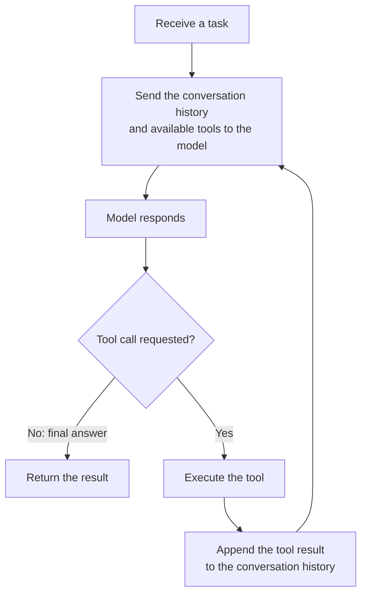

# 21.1 The Agent Control Loop

Chapter 20 covered how to serve a model: a request goes in, tokens stream out. An agent adds a layer
on top. The model no longer only generates an answer; it can also request a tool call. The runtime
executes the tool and hands the result back, and the model decides the next step. The task advances
in this way, step by step, until it is done. How the model reaches its decisions is outside the
scope of this book; this chapter covers the runtime that carries the process. From the runtime's
point of view, an agent is a control loop, and the concurrency problems it faces were all discussed
in Part 3.

## 21.1.1 The Control Loop

In summarizing its experience building agents with customers, Anthropic distinguishes two kinds of
systems. A **workflow** orchestrates models and tools through predefined code paths. An **agent**
lets the model dynamically direct its own steps and tool use
[[Anthropic, 2024](#ref-anthropic-2024)]. The article's description of how the latter is implemented
is plain:

```text
Agents can handle sophisticated tasks, but their implementation is often
straightforward. They are typically just LLMs using tools based on
environmental feedback in a loop.
```

The form has academic roots. ReAct has a language model interleave reasoning traces with
task-specific actions: reasoning helps the model induce, track and update action plans, while
actions let it interact with external sources such as knowledge bases or environments to gather
additional information. In question answering and fact verification, the paper has the model call a
simple Wikipedia API, which mitigates the hallucination and error propagation of reasoning alone
[[Yao et al., 2023](#ref-yao-et-al-2023)]. Toolformer trains a model to decide for itself which APIs
to call, when to call them, what arguments to pass, and how to incorporate the results into later
generation [[Schick et al., 2023](#ref-schick-et-al-2023)]. Weng's survey splits a
language-model-based agent into three components: planning, memory and tool use
[[Weng, 2023](#ref-weng-2023)]. In Anthropic's API, for example, when the model intends to call a
tool, the response contains a tool-use block naming the tool and its arguments
[[Anthropic, 2024](#ref-anthropic-2024)]. The runtime's job is to recognize that block, execute the
tool, and append the result to the context.



The program below replaces the real model with a deterministic stub model and writes this loop as
runnable Go code. The stub returns prepared replies in order and ignores the history, so the output
is fixed; the loop itself is no different from one connected to a real model.

```go {run=true}
package main

import (
	"context"
	"errors"
	"fmt"
)

type Message struct{ Role, Text string }

// Reply is one model response: a non-nil Call requests a tool call; otherwise Final is the final answer.
type Reply struct {
	Call  *Call
	Final string
}

type Call struct{ Tool, Arg string }

type Model func(ctx context.Context, history []Message) (Reply, error)

type Tool func(ctx context.Context, arg string) (string, error)

var errStepLimit = errors.New("agent: step limit reached")

func run(ctx context.Context, model Model, tools map[string]Tool, task string, maxSteps int) (string, error) {
	history := []Message{{"user", task}}
	for step := 1; step <= maxSteps; step++ {
		if err := ctx.Err(); err != nil {
			return "", err
		}
		r, err := model(ctx, history)
		if err != nil {
			return "", err
		}
		if r.Call == nil {
			return r.Final, nil
		}
		out, err := invoke(ctx, tools, *r.Call)
		if err != nil {
			out = "error: " + err.Error() // a tool error is also handed to the model as an observation
		}
		fmt.Printf("  step %d: %s(%s) -> %s\n", step, r.Call.Tool, r.Call.Arg, out)
		history = append(history,
			Message{"assistant", r.Call.Tool + "(" + r.Call.Arg + ")"},
			Message{"tool", out})
	}
	return "", errStepLimit
}

func invoke(ctx context.Context, tools map[string]Tool, c Call) (string, error) {
	t, ok := tools[c.Tool]
	if !ok {
		return "", fmt.Errorf("unknown tool %q", c.Tool)
	}
	return t(ctx, c.Arg)
}

// scripted is a deterministic stub model: it returns the prepared replies in order and ignores the history.
func scripted(replies ...Reply) Model {
	return func(ctx context.Context, history []Message) (Reply, error) {
		n := len(history) / 2 // number of completed tool calls
		if n >= len(replies) {
			return replies[len(replies)-1], nil
		}
		return replies[n], nil
	}
}

func main() {
	versions := map[string]string{"loopvar": "Go 1.22", "iter": "Go 1.23"}
	ctx, cancel := context.WithCancel(context.Background())
	defer cancel()
	tools := map[string]Tool{
		"lookup": func(ctx context.Context, arg string) (string, error) {
			if v, ok := versions[arg]; ok {
				return v, nil
			}
			return "", fmt.Errorf("no entry for %q", arg)
		},
		"stop": func(ctx context.Context, arg string) (string, error) {
			cancel() // simulates the user pressing "Stop" while a tool runs
			return "stopped", nil
		},
	}

	fmt.Println("Task 1")
	m1 := scripted(
		Reply{Call: &Call{"lookup", "rangefunc"}},
		Reply{Call: &Call{"lookup", "iter"}},
		Reply{Final: "the iter package shipped with Go 1.23"})
	report(run(ctx, m1, tools, "When was the iter package released?", 8))

	fmt.Println("Task 2")
	m2 := scripted(Reply{Call: &Call{"lookup", "loopvar"}}) // only ever requests tools
	report(run(ctx, m2, tools, "Query repeatedly", 3))

	fmt.Println("Task 3")
	m3 := scripted(Reply{Call: &Call{"stop", ""}}, Reply{Final: "unreachable"})
	report(run(ctx, m3, tools, "Cancel midway", 8))
}

func report(answer string, err error) {
	if err != nil {
		fmt.Println("  error:", err)
		return
	}
	fmt.Println("  answer:", answer)
}
```

```text
Task 1
  step 1: lookup(rangefunc) -> error: no entry for "rangefunc"
  step 2: lookup(iter) -> Go 1.23
  answer: the iter package shipped with Go 1.23
Task 2
  step 1: lookup(loopvar) -> Go 1.22
  step 2: lookup(loopvar) -> Go 1.22
  step 3: lookup(loopvar) -> Go 1.22
  error: agent: step limit reached
Task 3
  step 1: stop() -> stopped
  error: context canceled
```

The three tasks correspond to the loop's three exits. In task 1, the first tool call fails. The
error does not end the loop; it goes back to the model as an observation, and the model retries with
different arguments. Section 21.2 shows that MCP likewise separates such tool execution errors from
protocol errors at the protocol level. In task 2, the model never produces a final answer, and the
step limit ends the loop. Anthropic's article likewise recommends stop conditions for agents, such
as a maximum number of iterations, to keep control of the run
[[Anthropic, 2024](#ref-anthropic-2024)]. In task 3, the context is canceled while a tool runs, and
the loop notices the cancellation before the next step begins and returns. `ctx` is passed to both
the model and every tool; how the cancellation signal travels through these layers is the subject of
21.3.

The stub model makes the output reproducible, which suits testing the runtime itself: the loop's
exits, error handling and cancellation. An agent's behavior has to be tested another way: the output
of a real model can differ from run to run, so a single run says little. examen is a service for
running experiments on agents and model-based programs. It repeats every combination of task, system
under test, model and environment many times, measures the spread between runs, and attaches an
interval to every number it reports; differences within the noise are reported as noise
[[Ou, 2026a](#ref-ou-2026a)].

There is no machine learning in this loop. What it needs is to organize the context, the tool set
and the stop conditions correctly, and to keep it reliable under concurrency, failure and
cancellation.

## 21.1.2 Explicit State

The `run` above leaves its state implicit in the control flow: whether it is waiting on the model or
on a tool can only be inferred from the program counter. A long-running task may last minutes and
call tools dozens of times, and then it is better to make the state explicit. In discussing the
agent **harness**, Ou divides the responsibilities of a run among several parties: the model
proposes the next step, the harness orders and durably records every step, and tools and external
systems carry the actual effects. The run state should also distinguish "waiting for the
model", "waiting for a tool", "waiting for approval", "canceling" and so on; a client should not
guess what is happening from the fact that no new token appears in the output stream
[[Ou, 2026b](#ref-ou-2026b)].

Explicit state brings three engineering benefits. It is **observable**: at any moment the run can
report which step it is at. It is **persistable and recoverable**: once the state is written to
storage, a crashed or migrated process can continue from where it stopped instead of starting over.
It is **controllable**: timeouts, retries, budgets and human intervention can all hang on
well-defined state transitions.

managed-agents is a library that gives managed agent sessions from different vendors a uniform Go
interface [[Ou, 2026c](#ref-ou-2026c)]. It defines the externally visible lifecycle as an ordered
enumeration and turns "state only moves forward" into an executable check:

```go
// State is the externally visible lifecycle of a managed session.
type State uint8

// ...
const (
	StateUnknown State = iota
	StatePending
	StateRunning
	StateDone
	StateFailed
)
```

```go
	if previous.State.Valid() {
		if previous.State.Terminal() && current.State != previous.State {
			return fmt.Errorf("%w: terminal state changed", ErrContract)
		}
		if stateRank(current.State) < stateRank(previous.State) {
			return fmt.Errorf("%w: state regressed from %s to %s", ErrContract, previous.State, current.State)
		}
		// ...
```

The second excerpt comes from `ValidateObservation`, which compares two successive observations of
the same session: a terminal state must not change, the state must not regress, and cumulative usage
must not decrease. Type signatures cannot express constraints on a sequence of observations, so the
library writes them as a function and adds a black-box test suite that every adapter must pass.

Once state is explicit, persistence and recovery have somewhere to stand. topos is an agent session
runtime that stores a session as an append-only log of typed events: user messages, every tool call
and its result, every model request, and the session state [[Ou, 2026d](#ref-ou-2026d)]. The
transcript the model sees is computed from the log:

```go
// Fold renders the transcript of one thread from a session's events
// (spec 004). thread is "" for the session's own thread. The fold is
// pure: the same events give byte-identical output.
func Fold(events []Event, thread string) (Transcript, error) {
```

The fold is a pure function, so the same event sequence always yields a byte-identical transcript,
and any executor can take over the log and continue the session. Its harness repeatedly executes a
single step within a turn: fold the log, check the budget, build the request, send it to the model,
and execute the tool calls the model requested, until some stop reason holds. The stop reasons
listed by the `session` package include normal completion (`end_turn`), budget exhaustion
(`budget`), turn timeout (`turn_limit`), output limit (`output_limit`), interruption (`interrupted`)
and error (`error`). The stop condition need not be a budget either. agon has several reviewers
repeatedly challenge a code change; besides a turn limit and a shared token budget, it also
terminates when two consecutive rounds raise no new objection, a stop condition based on convergence
[[Ou, 2026e](#ref-ou-2026e)].

Persistence does not make a tool's side effects replayable. If the process crashes while a tool is
running, the log holds the call but no result, and the call's effect on the external system is
unknown: the write may or may not have been committed. When topos resumes a session, it does not
re-execute a call that cannot be confirmed safe to repeat. It appends a result to the call that
tells the model:

```text
The runner stopped while this call ran. Its effects are unknown; inspect
the machine before repeating it.
```

The discussion of the harness gives the same rule: a state transition must be committed before the
command is issued, and recovery must first find out what happened to the external effect before
deciding whether to replay [[Ou, 2026b](#ref-ou-2026b)]. This is the same kind of problem as
idempotence and compensation in databases and distributed systems, and agents do not make it any
simpler.

## 21.1.3 One Goroutine Per Agent, or Centralized Orchestration

A single agent is a loop; when many agents run at the same time, we are back to concurrency design.
There are two common orientations.

**One goroutine per agent.** This is the most natural form: each agent's loop is a goroutine,
isolated from the others. Goroutine creation and switching are cheap
([Chapter 9](../../part3concurrency/ch09sched/readme.md)), and an agent's loop spends most of its
time waiting for I/O from the model or a tool, which is the load goroutines handle best. A main
agent that spawns sub-agents to work on subtasks in parallel is fan-out and fan-in
([10.7](../../part3concurrency/ch10chan/pattern.md)): the main goroutine starts child goroutines and
collects results over a channel or an errgroup. The orchestrator-workers workflow in Anthropic's
terms, in which a central model dynamically breaks down a task, delegates to workers and synthesizes
their results [[Anthropic, 2024](#ref-anthropic-2024)], has the same structure at the runtime level.

**Centralized orchestration.** When many agents contend for the same scarce resource, running each
on its own is not enough. The most typical scarce resource is the model backend: whether an
in-process inference service as in Chapter 20 or a rate-limited remote API, its throughput is
finite. Thousands of agent goroutines issuing inference requests at once would overwhelm the
backend. A central scheduling layer is then needed to gather all agents' model calls in one place,
to queue, rate-limit and prioritize them uniformly. Its shape is the one that recurs in
[18.2](../ch18gpu/sched.md) and [20.3](../ch20inference/serving.md): a shared resource managed by a
single owner, with many users communicating with it over channels. The more agents there are, the
more backpressure and fairness at this meeting point matter, which is the topic of 21.3.

## 21.1.4 The Agent Stands on Chapter 20

Every "thinking" step of an agent is an inference request in the sense of Chapter 20, the streamed
token output that needs backpressure and cancellation. The agent is therefore a client of the
inference service of Chapter 20, and its control loop repeatedly consumes the stream discussed in
[20.3](../ch20inference/serving.md).

The boundary changes as well. The core boundary of Chapters 18 to 20 is the in-process FFI, the path
through cgo to devices and inference runtimes. At the agent layer, the model backend is often in
another process or even on another machine, and the boundary becomes a network RPC.
[18.1](../ch18gpu/boundary.md) already noted that the in-process FFI boundary and the inter-process
boundary are the same design choice at different positions. The form of the boundary has changed,
but the requirements have not: streaming, backpressure and cancellation are still needed.

Where the loop runs also changes the semantics of failure. The vendors managed-agents faces differ
in shape: some host the session remotely and return an identifier that can be polled from any
process; some drive the model loop inside the caller's process and put only the sandbox remotely;
some are entirely in-memory libraries, where the session ends when the process does. Its README
points out that wrapping a blocking in-process executor as a pollable session is easy and passes
every test, but the first time the process restarts, the run is silently lost instead of reporting
an error [[Ou, 2026c](#ref-ou-2026c)]. Its approach is to keep the interface small and declare these
differences explicitly:

```go
type Runtime interface {
	// ...
	// Capabilities reports what this runtime can do. It creates nothing and
	// mutates nothing, so a caller may ask before deciding to start at all.
	Capabilities(context.Context) (Capabilities, error)
	// ...
	// Start creates the session and returns as soon as it exists, without
	// waiting for it to finish.
	Start(context.Context, SessionSpec) (SessionRef, error)

	// Poll reports the current state of a session without blocking. Successive
	// observations must satisfy ValidateObservation.
	Poll(context.Context, SessionRef) (Status, error)
	// ...
	// Cancel stops a live session. Cancelling a session that has already
	// finished is success, and the evidence stays readable afterwards.
	Cancel(context.Context, SessionRef) error
	// ...
}
```

The interface documentation requires every method that may block to accept a context and honor its
cancellation, so that a session can be abandoned from outside. `Capabilities` declares whether the
runtime can resume a session after a process restart, whether it can cancel, whether it can grade,
and so on; when a caller requests more than is declared, `ValidateCapabilities` rejects it before
any remote resource is created. This matches the design orientation of small interfaces such as
`io.Reader`: the interface specifies the minimum behavior, and differences beyond it are reported
explicitly instead of being guessed by the caller.

## Summary

Setting the model's decision-making aside, an agent looks to the runtime like a control loop: send
the context to the model, which either gives an answer or requests a tool call; the runtime executes
the tool and appends the result to the context, and repeats until an answer appears, a stop
condition holds, or the run is canceled. Making the loop's state explicit buys observability,
recoverability and control; a persistent event log lets any executor take over a session, but a
tool's external effects do not become replayable because of it, and recovery must verify them first.
The concurrency of many agents trades off "one goroutine per agent" against "centralized
orchestration of the scarce model backend", and the latter is still the "single owner plus
channels" shape. The agent is a client of the inference service of Chapter 20, and it carries the
requirements of streaming, backpressure and cancellation into a loop that crosses the network.

The most important action in the loop is calling a tool. The next section, [21.2](./mcp.md), covers
tools themselves: how a tool is described and dispatched, and how the Model Context Protocol
standardizes tool integration.

## Further Reading

- <a id="ref-anthropic-2024"></a>[Anthropic, 2024] Anthropic. *Building Effective Agents.* December
  19,
  2024. https://www.anthropic.com/research/building-effective-agents
  (Bylined Erik S. and Barry Zhang; distinguishes workflows from agents, describes an agent as a
  language model using tools based on environmental feedback in a loop, and discusses stop
  conditions and patterns such as orchestrator-workers)
- <a id="ref-ou-2026a"></a>[Ou, 2026a] Changkun Ou. examen.
  https://github.com/latere-ai/examen, 2026. (A service for experiments and evaluation of agents and
  model-based programs; every combination is run repeatedly, and compared results carry intervals;
  still an early version)
- <a id="ref-ou-2026b"></a>[Ou, 2026b] Changkun Ou. *运行框架* [The Harness]. AI as an
  Infrastructure, 2026. https://aaai.latere.ai/zh/orchestration/the-harness (Division of the
  harness's responsibilities, an explicit state machine, and the rule of checking external effects
  before replaying on recovery)
- <a id="ref-ou-2026c"></a>[Ou, 2026c] Changkun Ou. managed-agents.
  https://github.com/latere-ai/managed-agents, 2026. (A uniform Go interface for managed agent
  sessions; `Runtime`, `Capabilities` and `ValidateObservation`)
- <a id="ref-ou-2026d"></a>[Ou, 2026d] Changkun Ou. topos. https://github.com/latere-ai/topos, 2026.
  (An agent session runtime; the append-only event log, the pure function `session.Fold`, and the
  single-step loop in the `harness` package)
- <a id="ref-ou-2026e"></a>[Ou, 2026e] Changkun Ou. agon. https://github.com/latere-ai/agon, 2026.
  (Adversarial review of agent code changes; terminates on a stable state, a turn limit or a shared
  budget)
- <a id="ref-schick-et-al-2023"></a>[Schick et al., 2023] Timo Schick et al. *Toolformer: Language
  Models Can Teach Themselves to Use Tools.* NeurIPS, 2023. https://arxiv.org/abs/2302.04761
  (Self-supervised training of a model to decide which API to call, when, and with what arguments;
  first arXiv version February 9, 2023)
- <a id="ref-weng-2023"></a>[Weng, 2023] Lilian Weng. *LLM Powered Autonomous Agents.* June
  23, 2023. https://lilianweng.github.io/posts/2023-06-23-agent/ (A survey of an agent's components:
  planning, memory and tool use)
- <a id="ref-yao-et-al-2023"></a>[Yao et al., 2023] Shunyu Yao et al. *ReAct: Synergizing Reasoning
  and Acting in Language Models.* ICLR, 2023. https://arxiv.org/abs/2210.03629 (The alternating
  reason-act loop, a representative formalization of the agent control loop; first arXiv version
  October 6, 2022)
- This book: [Chapter 9 The goroutine Scheduler](../../part3concurrency/ch09sched/readme.md),
  [Chapter 10 Channels and select](../../part3concurrency/ch10chan/readme.md),
  [10.7 Engineering Practice and Cross-Language Comparison](../../part3concurrency/ch10chan/pattern.md),
  [18.1 Crossing the FFI Boundary](../ch18gpu/boundary.md),
  [18.2 The Scheduler and Blocking Foreign Calls](../ch18gpu/sched.md),
  [20.3 Serving, Batching, and Streaming](../ch20inference/serving.md),
  [21.2 Tool Calls and MCP](./mcp.md).
