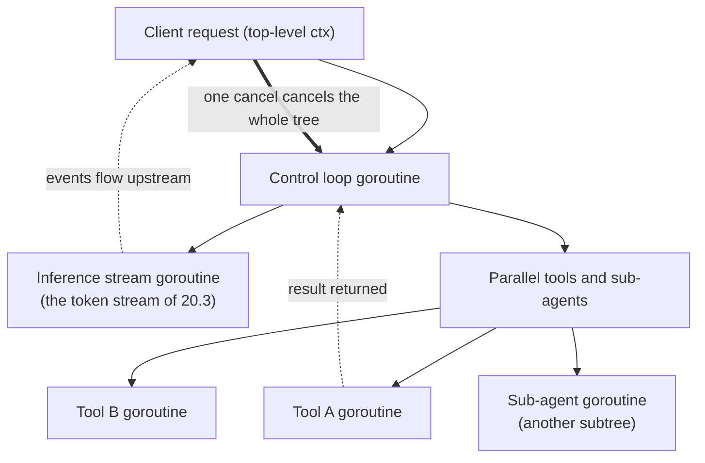

# 21.3 Streaming, Backpressure, and Cancellation

[21.1](./loop.md) gave the agent's control loop, and [21.2](./mcp.md) covered the tool calls inside
it. The difficulty of a production-grade agent lies not in the skeleton of the loop but in three
things that run through the whole chain: streaming, backpressure and cancellation. The three are
intertwined, and what unifies them is a structure familiar to Go programmers: a tree of goroutines
bound by a context. The context and channels used in this section are covered in
[11.8](../../part3concurrency/ch11sync/context.md) and
[Chapter 10](../../part3concurrency/ch10chan/readme.md) respectively.

## 21.3.1 The Whole Chain Is Streamed

Start with how data flows through an agent. A request enters the agent's control loop from the
client. At each step the loop issues an inference to the model, and that inference is the streamed
token output discussed in [20.3](../ch20inference/serving.md). The loop also calls tools, which may
themselves be slow or return their results as a stream. Streaming is therefore not a feature of one
layer but the norm along the whole chain.

A user should not face an interface with no feedback while the agent executes dozens of steps. What
the model is outputting, which tool it is calling and what the tool returned should all be shown as
they happen. This means the agent not only consumes the stream below it but also generates an event
stream of its own for the layer above: tokens the model outputs, the start of a tool call, a tool's
result. Over HTTP, each time the handler writes an event, it pushes the buffered data to the client
with `Flush` of `http.ResponseController` (added in Go 1.20). MCP's Streamable HTTP has the same
shape: the server can answer with an SSE stream scoped to that request, in which progress and other
notifications related to the request come first and the response comes last
[[Model Context Protocol, 2026](#ref-model-context-protocol-2026)].

There are two common ways to represent a stream in Go. One is goroutines plus channels: the producer
runs in its own goroutine and sends elements to a channel, and the consumer receives from it; a
buffered channel lets production and consumption overlap in time. The other is the iterator
`iter.Seq`, added in Go 1.23: the producer is a function that runs on the consumer's call stack and
calls `yield` once for every element it produces. The documentation of the `iter` package says:

```text
The function stops either when the sequence is finished or
when yield returns false, indicating to stop the iteration early.
```

An iterator needs no extra goroutine; if the consumer does not take the next element, the producer
does not continue, so backpressure comes for free, and when the consumer leaves a `for range` early,
the producer returns with it. The cost is that production and consumption cannot overlap. When the
producer needs to progress in parallel with network I/O, for example receiving the inference
service's output while forwarding it to the client, goroutines and channels are still required.

## 21.3.2 Cancellation Must Reach Every Layer

Besides streaming, the hardest requirement is cancellation. A user may click "Stop" or close the
connection at any moment, and when one subtask fails, the other subtasks running in parallel should
stop too. A cancellation must be able to pass through every layer of calls in the agent, which is
exactly what context is for: cancellation and deadlines travel down the call chain to every
goroutine working on the request [[Go Authors, 2026a](#ref-go-authors-2026a)]
[[Ajmani, 2014](#ref-ajmani-2014)].

Pass one ctx from the topmost client request all the way down: into the control loop, to every
inference, to every tool call, and then to every HTTP request and database query inside a tool.

```go
// The same ctx runs through the loop, the inference, the tool, and the tool's internal I/O
func (a *Agent) step(ctx context.Context) error {
	stream, err := a.model.InferStream(ctx, a.history) // generation stops on cancellation
	if err != nil {
		return err
	}
	for ev, err := range stream { // the type of stream is iter.Seq2[Event, error]
		if err != nil {
			return err
		}
		if err := a.emit(ctx, ev); err != nil { // forward the event to the upstream client
			return err
		}
		if ev.ToolCall != nil {
			res, err := a.callTool(ctx, *ev.ToolCall) // see 21.2; ctx is passed with the call
			if err != nil {
				return err
			}
			a.history = append(a.history, toolMsg(res))
		}
	}
	return ctx.Err()
}
```

Cancellation often starts at the HTTP connection. The context `net/http` provides for a server
request is canceled when the client disconnects:

```go
// For incoming server requests, the context is canceled when the
// client's connection closes, the request is canceled (with HTTP/2),
// or when the ServeHTTP method returns.
func (r *Request) Context() context.Context {
```

MCP's cancellation also depends on the transport
[[Model Context Protocol, 2026](#ref-model-context-protocol-2026)]. On Streamable HTTP, closing the
SSE response stream of the request is itself the cancellation signal, and the server must treat a
client disconnect as cancellation of that request, which corresponds to the behavior of
`Request.Context` above. On stdio there is no per-request stream to close, so the client must send a
`notifications/cancelled` notification naming the `id` of the request to cancel. A server that
receives a cancellation notification should stop processing, free the related resources and not send
a response; but a cancellation notification may arrive after processing has finished, and both sides
must handle this race correctly.

The official Go SDK connects the contexts of the two ends on connections such as stdio
[[modelcontextprotocol, 2026](#ref-modelcontextprotocol-2026)]. On the client side, when the ctx of
an outgoing request is canceled, the SDK stops waiting for the response immediately and sends a
cancellation notification in another goroutine:

```go
	case ctx.Err() != nil:
		// ...
		conn.Retire(call, ctx.Err())
		go func() {
			notifyCtx, stop := context.WithTimeout(context.WithoutCancel(ctx), notifyCancellationTimeout)
			defer stop()
			_ = conn.Notify(notifyCtx, notificationCancelled, &CancelledParams{
				Reason:    ctx.Err().Error(),
				RequestID: call.ID().Raw(),
			})
		}()
```

The context used to send the notification is derived with `context.WithoutCancel`; otherwise the
notification could not be sent, because the caller's ctx has already been canceled (for the design
of `WithoutCancel`, see [11.8](../../part3concurrency/ch11sync/context.md)). On the server side,
after receiving the cancellation notification, the context of the corresponding request's handler is
canceled:

```go
// A canceller is a jsonrpc2.Preempter that cancels in-flight requests on MCP
// cancelled notifications.
type canceller struct {
	conn *jsonrpc2.Connection
}

// Preempt implements [jsonrpc2.Preempter].
func (c *canceller) Preempt(ctx context.Context, req *jsonrpc.Request) (result any, err error) {
	if req.Method == notificationCancelled {
		// ...
		go c.conn.Cancel(id)
	}
	return nil, jsonrpc2.ErrNotHandled
}
```

So a `cancel()` in the agent process becomes, through a JSON-RPC notification, the `ctx.Done()` of
the handler in the tool server's process.

How far cancellation gets depends on whether every layer cooperates. Context cancellation is
cooperative ([11.8](../../part3concurrency/ch11sync/context.md)): it only closes the `Done` channel
and relies on every layer to check it and exit, and if any layer ignores ctx, cancellation stops
right there. The same holds for the inference service: only if it stops generating when the
request's context is canceled is the KV cache each request occupies in 20.1 released. The hardest
case is a tool blocked in a cgo call, discussed in [18.2](../ch18gpu/sched.md): the runtime cannot
preempt a thread executing C code ([15.6](../../part5toolchain/ch15compile/cgo.md)), a cooperative
context is even less able to help, and the upper layer's cancellation can only wait for the call to
return by itself. The reach of cooperative cancellation ends at the non-preemptible FFI boundary.
When designing tools, use cancellable I/O wherever possible; a non-cancellable blocking call can be
put in a separate process, which is terminated on cancellation.

Cancellation is not rollback either. By the moment of cancellation, a tool's external effects may
already have happened, which is why topos in 21.1 marks calls interrupted during execution
as "effects unknown". The topos harness derives a cancellable context for each step and starts a
watcher goroutine that cancels it on receiving an interrupt signal [[Ou, 2026a](#ref-ou-2026a)]:

```go
// interruptible is the context one step's request and calls run under:
// ...
func (t *turn) interruptible(ctx context.Context) (context.Context, func()) {
	sctx, cancel := context.WithCancel(ctx)
	// ...
	// The watcher ends before the step's stop returns, so a cut it makes
	// is the step's own and never the next one's.
	done, exited := make(chan struct{}), make(chan struct{})
	go func() {
		defer close(exited)
		// ...
	}()
	return sctx, func() {
		close(done)
		<-exited
		cancel()
	}
}
```

The returned stop function first tells the watcher goroutine to finish, waits until it has actually
exited, and only then cancels the context. This guarantees that an interrupt affects only the step
it belongs to and never hits the next one by mistake. When a turn ends because of cancellation, the
harness still has to write the "interrupted" state to the log, and it again uses `WithoutCancel` for
this:

```go
	// Every other way out of a turn still closes it, so the header never
	// stays running: a cancel as interrupted, a failure of the harness as
	// error with its session.error.
	closing := context.WithoutCancel(ctx)
	if ctx.Err() != nil {
		err = t.finish(closing, session.StopInterrupted, "canceled")
```

## 21.3.3 Backpressure and Fan-Out

The third matter is backpressure, which is a third side of the same system as streaming and
cancellation.

Follow the stream of 21.3.1: if the client reads slowly, the channel through which the agent sends
events upstream fills up; once it is full, the agent is forced to slow down its consumption of the
model's token stream; this in turn blocks the model's generation
([20.3](../ch20inference/serving.md)) while it keeps holding KV cache. The pressure of a slow
consumer propagates along the whole stream all the way back to the lowest-level device. This is the
bounded channel acting as a backpressure valve: the whole chain advances at the pace of its slowest
link, instead of letting the fast end pile up memory. The key is that the channel at every hop must
be bounded, so that backpressure can propagate instead of accumulating somewhere as unbounded memory
growth.

The program below shrinks this chain to its minimum: a producer simulating streaming inference hands
tokens to the client through a channel of capacity 2, and the client disconnects after reading the
third token, whereupon the producer should exit.

```go {run=true}
package main

import (
	"context"
	"fmt"
)

// generate simulates one streaming inference: it produces tokens one by one until it is done or ctx is canceled.
// The send and ctx.Done() sit in the same select: it blocks when downstream does not read and exits on cancellation.
func generate(ctx context.Context, out chan<- string, produced *int) error {
	defer close(out)
	for i := 0; ; i++ {
		select {
		case out <- fmt.Sprintf("tok%d", i):
			*produced++
		case <-ctx.Done():
			return context.Cause(ctx)
		}
	}
}

func main() {
	const capacity = 2 // bounded buffer: the producer runs at most 2 tokens ahead of the consumer
	ctx, cancel := context.WithCancelCause(context.Background())
	tokens := make(chan string, capacity)
	produced := 0
	done := make(chan error)
	go func() { done <- generate(ctx, tokens, &produced) }()

	received := 0
	for tok := range tokens {
		received++
		fmt.Println("client got", tok)
		if received == 3 {
			cancel(fmt.Errorf("client closed the stream"))
			break
		}
	}
	err := <-done // wait for the producer to actually exit, confirming no goroutine leaks
	fmt.Println("producer exited:", err)
	fmt.Println("produced - received <= capacity:", produced-received <= capacity)
}
```

```text
client got tok0
client got tok1
client got tok2
producer exited: client closed the stream
produced - received <= capacity: true
```

How many tokens the producer actually produced depends on scheduling and may be 3, 4 or 5, but it
never exceeds the number read plus the channel capacity; this is the guarantee a bounded channel
gives. The `select` waits on the send and on `ctx.Done()` at once: while the consumer does not read,
the producer blocks on the send, and once the consumer disconnects, the producer exits through
cancellation, with the reason retrieved by `context.Cause`
([11.8](../../part3concurrency/ch11sync/context.md)). The main goroutine finally waits on `done` to
confirm the producer has returned, instead of leaving it behind on a channel nobody receives from.

When an agent spawns parallel subtasks, for example calling several tools at once or spawning
several sub-agents, backpressure and cancellation must be combined with fan-out and fan-in.
`golang.org/x/sync/errgroup` packages the three together
[[Go Authors, 2026b](#ref-go-authors-2026b)]; see [10.7](../../part3concurrency/ch10chan/pattern.md)
for its implementation:

```go
// Call several tools in parallel: share one cancellable ctx; if any fails, the rest are canceled too
g, ctx := errgroup.WithContext(ctx)
g.SetLimit(4) // at most 4 tools execute at the same time
results := make([]Result, len(calls))
for i, call := range calls { // since Go 1.22, each iteration has its own i and call
	g.Go(func() error {
		r, err := a.callTool(ctx, call)
		results[i] = r
		return err
	})
}
err := g.Wait() // wait for all to finish and return the first error
```

Since Go 1.22, the loop variables are fresh instances in every iteration
([6.1](../../part2lang/ch06func/func.md)), and the `i, call := i, call` once written for closures is
no longer needed. `SetLimit` and `TryGo` were added in 2022 [[Ou, 2022](#ref-ou-2022)]. Once
`SetLimit` sets the limit, `Go` sends a token into a channel whose capacity equals the limit before
starting the goroutine:

```go
func (g *Group) Go(f func() error) {
	if g.sem != nil {
		g.sem <- token{}
	}

	g.wg.Add(1)
	go func() {
		defer g.done()

		// It is tempting to propagate panics from f()
		// up to the goroutine that calls Wait, but
		// it creates more problems than it solves:
		// ...
		// See #53757, #74275, #74304, #74306.

		if err := f(); err != nil {
			// ...
		}
	}()
}
```

When the slots are used up, `Go` blocks on this send and the caller slows down with it; this is
blocking backpressure. The comment in the code also records a reversal: v0.14.0 of x/sync once had
`Wait` propagate a child goroutine's panic back to the caller, and v0.16.0 undid the change, on the
grounds that it arbitrarily delays the panic and makes bugs harder to find, turns the panic's stack
trace into an ordinary value that crash-monitoring tools cannot see, and can hide the panic entirely
through a deadlock [[Donovan, 2025](#ref-donovan-2025)]. For agents, this means that if a tool
running in-process panics, errgroup does not catch it for the caller, and an unrecovered panic
terminates the whole process. Tool code that is untrusted or not stable enough should either
`recover` itself at the call site or be moved outside the process and called through MCP.

Backpressure has another strategy: do not wait, refuse outright. `TryGo` returns false immediately
when the slots are full. Across a network, refusing is often more appropriate than blocking:
blocking keeps holding a connection and a goroutine, whereas refusing returns the decision to the
caller, who can retry later or give up. When forwarding tool calls, pons limits the number of
simultaneous in-flight requests for the whole process, for each caller and for each connection, and
refuses immediately with a "too many requests" error when a limit is exceeded
[[Ou, 2026b](#ref-ou-2026b)]:

```go
// PerConnection is how many requests one connection has in flight in one
// process.
const PerConnection = 16
```

```go
// connectionPlace takes one of a connection's places in flight.
func (p *places) connectionPlace(connection string) (func(), error) {
	p.mu.Lock()
	defer p.mu.Unlock()
	if p.connections[connection] >= p.connection {
		return nil, apierr.Fail(apierr.CodeRateLimited, "connection_inflight="+strconv.Itoa(p.connection))
	}
	p.connections[connection]++
	return func() {
		p.mu.Lock()
		defer p.mu.Unlock()
		if p.connections[connection]--; p.connections[connection] <= 0 {
			delete(p.connections, connection)
		}
	}, nil
}
```

When a slot is acquired, a release function is returned, which the caller invokes when the request
ends. This plays the same role as `g.done` receiving a token from the semaphore channel in errgroup;
the only difference is that when no slot is available, one blocks and waits while the other refuses
immediately.

## 21.3.4 A Tree of Goroutines Bound by Context

Putting this section together, to the runtime an agent is a tree of goroutines bound by a context:



Each node of the tree is a goroutine: the control loop, the inference stream, the parallel tools,
and recursively spawned sub-agents. Along every edge of the tree, streaming lets events flow
upstream, backpressure lets a slow node restrain production upstream, and cancellation lets a single
signal at the root reach the whole subtree. For the tree to really wind down after a cancellation,
every child must also be waited on until it exits, which is the concern of structured concurrency
([11.8](../../part3concurrency/ch11sync/context.md),
[10.7](../../part3concurrency/ch10chan/pattern.md)). Every component of the tree, goroutines,
channels, `select`, context and errgroup, was covered earlier in this book. The agent is a new kind
of load that requires no new mechanism at the runtime level.

## Summary

The difficulty of a production-grade agent is not the loop skeleton but the streaming, backpressure
and cancellation that run through the whole chain. Streaming is the norm: the agent consumes the
token stream below it and generates an event stream of its own for the layer above. Channels and
iterators are two ways to represent a stream, the former allowing production and consumption to
overlap, the latter carrying backpressure naturally. Cancellation must reach every layer: from the
disconnect of an HTTP connection, through MCP's cancellation notification, to `ctx.Done()` in a tool
handler, with the official Go SDK connecting these segments. But cancellation is cooperative, stops
at a non-preemptible cgo call, and cannot undo external effects that have already happened.
Backpressure propagates through the bounded channel at every hop; when slots run out, one can either
block and wait or refuse immediately; parallel fan-out uses errgroup to combine a shared ctx, a
concurrency limit and fan-in. Together, an agent is a tree of goroutines bound by a context.

## Summary of This Part

Chapter 21 reduces the agent to a control loop, tool calls and a cancellation tree. It uses no
machine learning; it uses the scheduling, channels and context of Chapters 9 to 11. This is also the
common conclusion of the chapters of Part 6: new loads such as GPUs, graphics, inference and agents
require not new mechanisms at the runtime level but the application of existing principles in new
settings, including the cost accounting of the FFI boundary, resource management with a single owner
plus channels, and cooperative cancellation and backpressure. The book's closing
[final words](../../finalwords.md) discuss where Go is heading.

## Further Reading

- <a id="ref-ajmani-2014"></a>[Ajmani, 2014] Sameer Ajmani. *Go Concurrency Patterns: Context.* The
  Go Blog, 2014. https://go.dev/blog/context (The design intent of context: carry cancellation and
  deadlines through a tree of goroutines)
- <a id="ref-donovan-2025"></a>[Donovan, 2025] Alan Donovan. errgroup: revert propagation of panics.
  x/sync commit 7fad2c9213, 2025. https://go.dev/cl/682935 Released with x/sync v0.16.0. (Reverts
  the change in v0.14.0 that made `Wait` return a panic, and leaves a comment in `Go` explaining
  why)
- <a id="ref-go-authors-2026a"></a>[Go Authors, 2026a] The Go Authors. *Package context.*
  https://pkg.go.dev/context (Cooperative cancellation propagating down the call tree, the mechanism
  behind the agent's cancellation tree)
- <a id="ref-go-authors-2026b"></a>[Go Authors, 2026b] The Go Authors. *Package
  golang.org/x/sync/errgroup.* https://pkg.go.dev/golang.org/x/sync/errgroup (Fan-out, fan-in and a
  shared cancellable ctx, where one failure cancels the rest; the excerpts in this section are based
  on x/sync v0.24.0)
- <a id="ref-model-context-protocol-2026"></a>[Model Context Protocol, 2026] Model Context Protocol.
  *Specification,* revision 2026-07-28. https://modelcontextprotocol.io/specification/2026-07-28
  (Request-scoped SSE streams in Streamable HTTP; cancellation by transport: disconnecting the SSE
  stream cancels, and on stdio `notifications/cancelled` is sent)
- <a id="ref-modelcontextprotocol-2026"></a>[modelcontextprotocol, 2026] modelcontextprotocol.
  *Official Go SDK.* v1.8.0, 2026. https://github.com/modelcontextprotocol/go-sdk (The client sends
  `notifications/cancelled` when ctx is canceled, and the server cancels the handler's context
  accordingly)
- <a id="ref-ou-2022"></a>[Ou, 2022] Changkun Ou. x/sync/errgroup: add TryGo and SetLimit to control
  concurrency. x/sync commit 0976fa681c, 2022. https://go.dev/cl/405174
  Released with x/sync v0.1.0.
  (A channel with capacity equal to the limit serves as a semaphore bounding the number of running
  goroutines)
- <a id="ref-ou-2026a"></a>[Ou, 2026a] Changkun Ou. topos. https://github.com/latere-ai/topos, 2026.
  (An agent session runtime; the interruptible context of each step, and recording the terminal
  state with `context.WithoutCancel` after cancellation)
- <a id="ref-ou-2026b"></a>[Ou, 2026b] Changkun Ou. pons. https://github.com/latere-ai/pons, 2026.
  (A service that forwards tool calls; limits in-flight requests per process, caller and connection,
  and refuses immediately when exceeded)
- This book: [6.1 Function Calls](../../part2lang/ch06func/func.md),
  [Chapter 10 Channels and select](../../part3concurrency/ch10chan/readme.md),
  [10.7 Engineering Practice and Cross-Language Comparison](../../part3concurrency/ch10chan/pattern.md),
  [Chapter 11 Synchronization Primitives and Patterns](../../part3concurrency/ch11sync/readme.md),
  [11.8 Context](../../part3concurrency/ch11sync/context.md),
  [15.6 cgo](../../part5toolchain/ch15compile/cgo.md),
  [18.2 The Scheduler and Blocking Foreign Calls](../ch18gpu/sched.md),
  [20.3 Serving, Batching, and Streaming](../ch20inference/serving.md),
  [21.1 The Agent Control Loop](./loop.md), [21.2 Tool Calls and MCP](./mcp.md).
