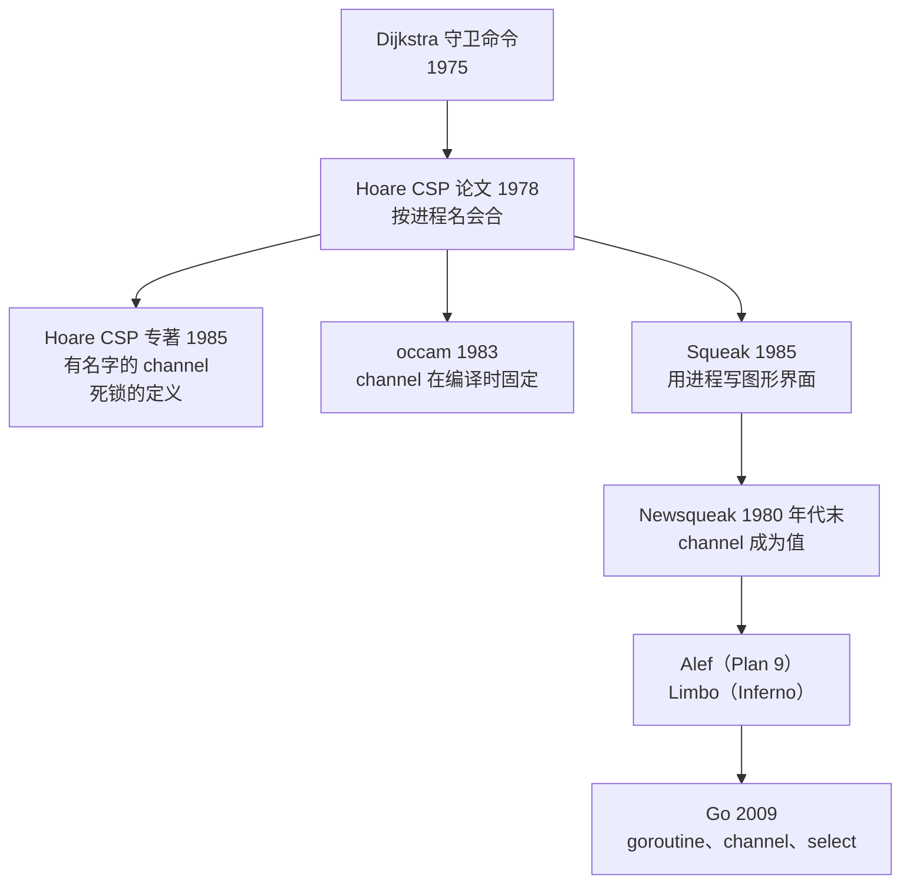

# 1.3 通信顺序进程

> 本节内容提供一个线上演讲：[YouTube 在线](https://www.youtube.com/watch?v=Z8ZpWVuEx8c)，[Google Slides 讲稿](https://changkun.de/s/csp/)。

五位哲学家围坐在一张圆桌旁用餐，每两人之间放一把叉子，共五把，每人进餐时须同时使用左右两把叉子。在下面
的程序中，每位哲学家是一个 goroutine，每把叉子是一个容量为 1 的 channel：从 channel 中取出值表示拿起
叉子，把值放回表示放下叉子。每位哲学家先拿起左手的叉子，思考片刻，再拿起右手的叉子。

```go {run=true}
package main

import (
	"fmt"
	"sync"
	"time"
)

const footman = false // 改为 true：桌旁只留四把椅子

func main() {
	const n = 5
	forks := make([]chan struct{}, n) // 叉子：channel 中有一个值，表示叉子在桌上
	for i := range forks {
		forks[i] = make(chan struct{}, 1)
		forks[i] <- struct{}{}
	}
	seats := make(chan struct{}, n-1) // 椅子：最多 n-1 人同时入座

	var wg sync.WaitGroup
	for i := range n {
		left, right := forks[i], forks[(i+1)%n]
		wg.Go(func() {
			if footman {
				seats <- struct{}{} // 入座（没有空椅子时等待）
			}
			<-left                            // 拿起左手的叉子
			time.Sleep(10 * time.Millisecond) // 思考片刻
			<-right                           // 拿起右手的叉子
			fmt.Println("哲学家", i, "开始用餐")
			left <- struct{}{} // 放回两把叉子
			right <- struct{}{}
			if footman {
				<-seats // 离座
			}
		})
	}
	wg.Wait()
	fmt.Println("五位哲学家均已用餐")
}
```

输出如下（省略了大部分调用栈；goroutine 编号与文件路径因机器而异）：

```
fatal error: all goroutines are asleep - deadlock!

goroutine 1 [sync.WaitGroup.Wait]:
...
goroutine 19 [chan receive]:
main.main.func1()
	.../main.go:29 +0x4c
...
```

其后共列出五个处于 `chan receive` 状态的 goroutine，第 29 行正是 `<-right`。五位哲学家都已拿起左手的
叉子，等待右手的那一把，而那一把握在邻座手中；没有人能等到，也没有人会先放下。一组参与者相互等待、
全都无法继续执行，这种状态称为**死锁**（deadlock）。Go 运行时发现所有 goroutine 都在等待、不再有任何
goroutine 能够改变这一局面，便报错退出。

把第一行改为 `const footman = true` 后再运行，程序正常结束（进餐的先后次序每次运行都可能不同）：

```
哲学家 2 开始用餐
哲学家 1 开始用餐
哲学家 0 开始用餐
哲学家 4 开始用餐
哲学家 3 开始用餐
五位哲学家均已用餐
```

改动只有一处：桌旁只留四把椅子，以容量为 4 的 channel `seats` 表示，第五位哲学家须等有人用餐完毕离座后
才能入座。四人分用五把叉子，至少有一人能拿到两把；他用餐完毕放下叉子之后，其他人便能继续。

这一问题最早由 Dijkstra 提出。1978 年，Tony Hoare 在提出 CSP 的论文中以它为例，并指出这样的写法可能使五位
哲学家同时饿死；论文给出的提示正是不允许五人同时入座（Hoare 注明这一解法出自
Dijkstra）[[Hoare, 1978](#ref-hoare-1978)]。这篇论文的主张是：并发程序由一组各自顺序执行的进程组成，
进程之间不共享变量，只通过收发消息相互协作。goroutine 与 channel 都源于此。本节讨论这一思路如何逐步演变为
Go 的设计，以及 Go 采纳了其中哪些部分、舍弃了哪些部分。

## 1.3.1 两种协作方式

若干同时运行的线程要合作完成一项任务，就必须约定执行的先后次序与数据的交接方式。20 世纪 60、70 年代，
这类方法主要有两类。

一类是共享内存加锁：各线程读写同一块数据，用锁保证同一时刻只有一个线程在修改。Dijkstra 于 1965 年提出的
**信号量**（semaphore）是最早的这类工具。1973 至 1974 年，Per Brinch Hansen 与 Hoare
又提出了**管程**（monitor）[[Hoare, 1974](#ref-hoare-1974)]：把共享数据与操作它的过程封装在一起，
保证同一时刻只有一个线程在其中执行。Go 中一个 `sync.Mutex` 连同它所保护的若干字段，
就相当于一个手工构造的管程。

另一类是消息传递：每个线程只管理自己的数据，需要其他线程的数据时，就请对方发送过来。

这两类方法并无强弱之分。1979 年，Hugh Lauer 与 Roger Needham 比较了分别按这两种方式设计的操作系统，
论证二者可以相互转换：一种设计中的每一个成分，在另一种设计中都有对应物，转换后系统的行为相同，
性能也可以相同 [[Lauer and Needham, 1979](#ref-lauer-needham-1979)]。因此，选择哪一种方式，
取决于哪一种写法更清晰、底层机器更适合哪一种，而不在于哪一种的表达能力更强。

Hoare 选择了消息传递，而且只采用消息传递。Go 同时提供这两种方式，但更提倡消息传递。这一取向被概括为
一句广为流传的格言：「不要通过共享内存来通信，而应通过通信来共享内存」（Do not communicate by sharing
memory; instead, share memory by communicating）[[Gerrand, 2010](#ref-gerrand-2010)]。

## 1.3.2 1978 年的 CSP：按名称指定通信对象

Hoare 1978 年的论文题为《Communicating Sequential Processes》，简称 **CSP**，中文通常译作
**通信顺序进程**。「顺序进程」指每个进程内部按语句的次序依次执行；「通信」指进程之间只通过收发消息协作。

论文中的进程直接以名称指定通信的对象。`lineprinter!lineimage` 把 `lineimage` 发送给名为 `lineprinter`
的进程，`cardreader?cardimage` 从名为 `cardreader` 的进程接收一个值，存入 `cardimage`。收发双方都须等待
对方：先到达的一方暂停，直到双方都执行到相应的语句，值才从一方复制到另一方，随后双方各自继续执行。这种
双方同时到场才完成交接的通信称为**会合**（rendezvous）。Go 中无缓冲的 channel 正是以这种方式工作的。

以名称指定对方带来一个直接的问题：每个进程都必须知道自己与谁通信。若要编写一个通用的缓冲进程，就必须在
代码中写明从哪个进程接收、向哪个进程发送，换一个使用场合就要修改代码。

论文还从 Dijkstra 1975 年提出的**守卫命令**（guarded command）[[Dijkstra, 1975](#ref-dijkstra-1975)]中借
用了「选择」：一条选择命令由若干分支组成，每个分支前有一个条件，称为守卫，执行时从守卫成立的分支中选择一
个。Hoare 允许守卫是一次接收，含义是「若从 A 收到值则执行此分支，若从 B 收到值则执行彼分支」，
哪一方的消息先到达就执行哪一个分支。这就是 Go 中 `select` 的前身。多个分支同时满足时选择哪一个，
论文明确不作规定：Hoare 认为高效的实现应优先选择等待最久的输出，但由于进程的相对执行速度没有定义，
语言本身无法规定这一点 [[Hoare, 1978](#ref-hoare-1978)]。程序因此不能依赖任何一种选择方式。

## 1.3.3 1985 年的专著：channel 与死锁

1985 年，Hoare 出版了同名专著 [[Hoare, 1985](#ref-hoare-1985)]，做出了两处改动。

第一处是通信的对象。进程不再以名称指定对方，而是在具名的 **channel** 上收发：`c!v` 向 channel `c` 发送
`v`，`c?x` 从 `c` 接收。进程只需知道 channel，无须知道另一端是谁，上述问题由此消除。INMOS 公司于
1983 年为其 transputer 处理器设计的 occam 语言也采用了这种方式 [[INMOS, 1984](#ref-inmos-1984)]。

不过，这里的 channel 还不是 Go 中那种可以传递的值。CSP 的 channel 只是写在程序中的名称；occam 的 channel
可以作为参数传给过程，但不能赋给变量，不能经由另一个 channel 发送，也不能在运行时创建。哪些进程相互连接，
在编写程序时就已确定。

第二处改动更为重要：专著为「进程的行为」给出了精确的数学定义。其思路是只考察从外部能够观察到的内容，即
进程可能依次完成哪些通信，以及在某一步之后它可能拒绝哪些通信。举例而言，一台售货机在投币后由顾客选择茶
或咖啡；另一台在投币后由机器自行决定这一次只提供茶或只提供咖啡。若只记录「可能售出过什么」，两台机器无法
区分；但一位只要咖啡的顾客遇到第二台机器，就可能陷入僵局。二者的区别在于「可能拒绝什么」。按照这一定义，
死锁就是进程在某一步之后拒绝一切通信，此后再不会发生任何事件。

Go 程序中也存在这两种机器。`select` 同时等待多个 channel，哪一个先就绪就执行哪一个，对应第一台机器。一个
goroutine 先认定「只从 `a` 接收」，再在 `<-a` 处等待，对应第二台机器。哲学家们的死锁正是这样产生的：每个
人都事先认定了右手的那把叉子。

定义精确之后，便可以交由计算机检查。20 世纪 90 年代，Bill Roscoe 等人在牛津开发了 FDR 工具
[[Roscoe, 1997](#ref-roscoe-1997)]，它遍历以 CSP 描述的系统模型的所有可能执行次序，回答「是否会死锁」
「是否符合规约」等问题。最著名的一个案例是：1995 年，Gavin Lowe 借助 FDR，在 1978 年发表、
十余年来被认为正确的 Needham–Schroeder 公钥认证协议中找到了漏洞 [[Lowe, 1996](#ref-lowe-1996)]。

Go 没有走这条路。Go 程序在运行时创建 channel、改变连接关系，事先遍历所有执行次序并不现实。运行时只能发现
最极端的一种情况：所有 goroutine 都在等待，正如上面的哲学家（判定方法见
[16.1](../../part5toolchain/ch16tools/deadlock.md)）。若只有一部分 goroutine 相互阻塞、其余 goroutine
照常运行，程序不会报错，被阻塞的 goroutine 及其占用的内存将一直保留。Go 1.26 为此提供了一项实验性功能：
构建时设置 `GOEXPERIMENT=goroutineleakprofile`，垃圾回收器便会找出那些阻塞在 channel 或锁上、而这些
channel 或锁已无法被任何可运行的 goroutine 访问的 goroutine，并通过 `runtime/pprof` 中名为
`goroutineleak` 的剖析数据报告出来 [[Go Authors, 2026c](#ref-go-authors-2026c)]。

## 1.3.4 Newsqueak：channel 成为值

使 channel 成为可以自由传递的值，是在 Rob Pike 设计的几门语言中完成的。

1985 年，Luca Cardelli 与 Pike 在贝尔实验室设计了 Squeak
[[Cardelli and Pike, 1985](#ref-cardelli-pike-1985)]，用于编写图形界面：鼠标、键盘、屏幕各由一个进程负责，
进程之间以 channel 相连。不过在 Squeak 中，有哪些进程、哪些 channel，在编译时就已确定。

20 世纪 80 年代末，Pike 设计了 Newsqueak [[Pike, 1990](#ref-pike-1990)]。在 Newsqueak 中，channel
是普通的值：可以在运行时创建、存入变量、传给函数，也可以经由另一个 channel 发送；进程也可以在运行时随时启
动。程序的连接结构从此可以在运行过程中动态生成和改变。1990 年，Doug McIlroy 用 Newsqueak
实现了幂级数的计算 [[McIlroy, 1990](#ref-mcilroy-1990)]，级数的每一种运算都由一串相互连接的进程完成。

此后，这一做法进入了 Plan 9 上的 Alef（Phil Winterbottom 设
计）[[Winterbottom, n.d.](#ref-winterbottom-nd)]与 Inferno 上的 Limbo
[[Dorward et al., 1997](#ref-dorward-et-al-1997)]，从界面编程扩展到系统编程，最终进入 Go
[[Cox, n.d.](#ref-cox-nd)]。Go 的 FAQ 在介绍 Go 的渊源时，关于并发一项写的正是「受 Hoare 的 CSP
启发的语言，如 Newsqueak 与 Limbo」[[Go Authors, 2026a](#ref-go-authors-2026a)]。

在理论方面也有同样的推进。Robin Milner 于 1980 年提出的 CCS 与 CSP 同属进程代数，
通信的端口在进程定义中写定，不能作为消息传递 [[Milner, 1980](#ref-milner-1980)]。Milner 与 Joachim
Parrow、David Walker 于 1992 年发表的 π-演算允许把 channel 的名称本身作为消息发送，
从而能够描述连接结构在运行中改变的系统 [[Milner et al., 1992](#ref-milner-et-al-1992)]，在理论上对应于
Newsqueak 中「channel 是值」的做法。



## 1.3.5 Go 的做法

### 会合与缓冲

`make(chan int)` 创建的是无缓冲 channel，发送须等待接收方取走，即会合。`make(chan int, 4)` 创建的
channel 带有一个可容纳 4 个值的缓冲区：缓冲区未满时发送立即返回，已满时才等待；接收则在缓冲区为空时
等待。Hoare 1978 年的 CSP 只有会合，需要缓冲时，便在双方之间插入一个专门存放数据的进程。

下图模拟一对 goroutine：发送方生产一个值需要 1 拍，接收方处理一个值需要 3 拍，共传递 4 个值。可以单步
回放，也可以调整容量与场景。

<div class="viz" data-viz="csp-rendezvous"></div>

容量为 0 时，发送方每发送一个值都须等待接收方处理完上一个值，前 10 拍中有 6 拍处于等待状态。容量改为 2
后，发送方无须任何等待，第 4 拍即发送完毕。但在两种情况下，接收方都在第 13 拍才处理完毕。缓冲区减少了
较快一方的等待，却不会使较慢的一方变快。若把场景改为「发送慢、接收快」，缓冲区始终为空，容量大小便
无关紧要。

### channel 是值：素数筛

下面是 Go 的一个经典示例，Hoare 1978 年的论文中已有它的 CSP 版本。它用一串 goroutine 求素数：

```go {run=true}
package main

import "fmt"

// generate 依次向 out 发送 2, 3, 4, …。
func generate(out chan<- int) {
	for i := 2; ; i++ {
		out <- i
	}
}

// filter 从 in 读取数值，只把不能被 p 整除的数转发给 out。
func filter(in <-chan int, out chan<- int, p int) {
	for {
		if n := <-in; n%p != 0 {
			out <- n
		}
	}
}

func main() {
	ch := make(chan int)
	go generate(ch)
	for range 10 {
		p := <-ch // 通过现有全部过滤器的第一个数必为素数
		fmt.Print(p, " ")
		next := make(chan int)
		go filter(ch, next, p) // 在流水线末端接入一个新的过滤器
		ch = next
	}
	fmt.Println()
}
```

```
2 3 5 7 11 13 17 19 23 29
```

`generate` 依次向 channel 送入 2、3、4……。`main` 从流水线末端收到的数一定是素数：比它小的每个素数都对应
一个过滤器，而它未被其中任何一个滤除。收到素数 `p` 后，`main` 新建一个 channel，启动 `filter` 把原来的
末端连接到新 channel 上，再令 `ch` 指向新 channel。流水线的长度在编写程序时并不确定，而是在运行时逐节
接上的。在 occam 中，这需要事先写定进程的数目；Hoare 论文中的版本使用的正是一个大小固定的进程数组。

<div class="viz" data-viz="csp-sieve"></div>

图中送完 2 至 30 时共有 10 个过滤器，连同生成器与 `main` 共 12 个 goroutine、11 个 channel。
每个素数都要依次经过所有比它小的素数所对应的过滤器，因此这个程序实际上是在逐一试除
[[O'Neill, 2009](#ref-oneill-2009)]，求素数的效率并不高，其价值在于结构清晰。此外，`main` 打印完
10 个素数便返回，生成器与过滤器仍阻塞在 channel 上，进程退出时它们随之消失（[3.6](../ch03life/main.md)）。

### select：多个分支就绪时随机选择

```go {run=true}
package main

import "fmt"

func main() {
	a := make(chan int, 1)
	b := make(chan int, 1)
	count := map[string]int{}
	for range 10000 {
		a <- 1 // 两个 channel 中各放入一个值，
		b <- 2 // 下面两个 case 因此都能立即执行
		select {
		case <-a:
			count["a"]++
			<-b // 清空另一个 channel，准备下一轮
		case <-b:
			count["b"]++
			<-a
		}
	}
	fmt.Println("选中 a:", count["a"], " 选中 b:", count["b"])
}
```

两个计数之和为 10000，各自在 5000 上下浮动，每次运行的结果都不相同。某一次运行的结果如下：

```
选中 a: 5094  选中 b: 4906
```

Go 语言规范规定，多个分支都能执行时，以均匀的伪随机方式选择其中一个
[[Go Authors, 2026b](#ref-go-authors-2026b)]。运行时的做法是在每次执行 `select` 时随机打乱各分支的检查次序
（`runtime/select.go`）。若总是选择书写次序中第一个可执行的分支，那么当排在前面的 channel 始终有数据时，
后面的分支将永远得不到执行。随机打乱使每个就绪的分支获得相同的机会。实现细节见
[10.5](../../part3concurrency/ch10chan/select.md)。

## 1.3.6 与 Actor 模型的比较

常与 CSP 相提并论的，是 Carl Hewitt 等人于 1973 年提出的 **Actor 模型**
[[Hewitt et al., 1973](#ref-hewitt-et-al-1973)]。它同样不共享状态、只传递消息。1986 年，Gul Agha
将其整理为一个完整的计算模型 [[Agha, 1986](#ref-agha-1986)]。Actor 模型最常被引用的实例是 Erlang。
二者的区别在于消息的去向：

| | Go（CSP 一脉） | Actor（如 Erlang） |
| --- | --- | --- |
| 发送消息时指定 | 一个 channel | 一个接收者的地址 |
| 是否具有名称 | goroutine 没有对外可见的名称或编号 | 每个 actor 都有地址，可被引用和监视 |
| 发送是否等待 | 无缓冲时等待对方取走 | 不等待，消息放入对方的信箱 |
| 出错之后 | 语言不作规定，依靠约定 | 进程之间可以建立关联，崩溃后由监督者重启 |

Go 为通信的管道命名：goroutine 彼此不知道对方是谁，持有 channel 的一方即可参与通信。Erlang
为通信的对方命名，因此每个进程都有地址与信箱，并在此基础上建立了「崩溃后重启」的容错机制
[[Armstrong, 2003](#ref-armstrong-2003)]。在 Go 中实现类似的功能，需要借助 `context`、`errgroup`
等工具自行组合。

## 1.3.7 Go 采纳与舍弃的部分

- **顺序进程与会合。** goroutine 内部按顺序执行，无缓冲 channel 即是会合。Pike 把这种写法概括为「独立执行
  的进程的组合」，并指出并发关乎程序的结构，并行关乎程序的执行，二者不是一回事
  [[Pike, 2012](#ref-pike-2012)]。
- **选择。** `select` 源自守卫命令，选择方式规定为均匀随机。
- **Newsqueak 的 channel。** channel 是值，可以在运行时创建和传递。其代价是连接关系无法事先确定，不能像
  FDR 那样在运行之前检查出死锁。
- **不限于消息传递。** Go 保留了共享内存、`sync.Mutex` 与原子操作
  （[第 11 章](../../part3concurrency/ch11sync/readme.md)）。按照 Lauer 与 Needham 的结论，两种方式的
  表达能力相同，Go 让程序员选择写法更清晰的一种。保护一个计数器，一把锁远比一个 goroutine 加一个 channel
  简单。
- **开销很小的进程。** 一个新 goroutine 只占用约 2 KB 的栈（[1.2](./go.md) 中有测量），「为每一项并发任务
  启动一个 goroutine」的写法因此切实可行。调度器如何把它们分配到线程上，见
  [第 9 章](../../part3concurrency/ch09sched/readme.md)。

## 延伸阅读

- <a id="ref-dijkstra-1975"></a>[Dijkstra, 1975] Edsger W. Dijkstra. "Guarded Commands, Nondeterminacy and
  Formal Derivation of Programs." *Communications of the ACM*, 18(8): 453–457, 1975.
  https://doi.org/10.1145/360933.360975
  守卫命令的出处，`select` 的源头。
- <a id="ref-hoare-1978"></a>[Hoare, 1978] C. A. R. Hoare. "Communicating Sequential Processes."
  *Communications of the ACM*, 21(8): 666–677, 1978. https://doi.org/10.1145/359576.359585
  CSP 的第一篇论文。进程按名称会合，尚无 channel；哲学家就餐与素数筛都是文中的例子。
- <a id="ref-hoare-1985"></a>[Hoare, 1985] C. A. R. Hoare. *Communicating Sequential Processes*. Prentice
  Hall International, 1985. CSP 的专著，改用具名的 channel 通信，并给出了死锁等概念的精确定义。
- <a id="ref-lauer-needham-1979"></a>[Lauer and Needham, 1979] Hugh C. Lauer, Roger M. Needham. "On the
  Duality of Operating System Structures." *ACM SIGOPS Operating Systems Review*, 13(2): 3–19, 1979.
  论证消息传递与过程调用加锁两种系统设计可以相互转换。
- <a id="ref-hoare-1974"></a>[Hoare, 1974] C. A. R. Hoare. "Monitors: An Operating System Structuring
  Concept." *Communications of the ACM*, 17(10): 549–557, 1974. 管程的经典论文。
- <a id="ref-roscoe-1997"></a>[Roscoe, 1997] A. W. Roscoe. *The Theory and Practice of Concurrency*.
  Prentice Hall, 1997. CSP 理论的系统阐述，也介绍了 FDR 的用法。
- <a id="ref-lowe-1996"></a>[Lowe, 1996] Gavin Lowe. "Breaking and Fixing the Needham-Schroeder
  Public-Key Protocol Using FDR." *TACAS 1996*, LNCS 1055, Springer, 1996: 147–166. 借助 FDR
  发现协议漏洞的论文。
- <a id="ref-cardelli-pike-1985"></a>[Cardelli and Pike, 1985] Luca Cardelli, Rob Pike. "Squeak: a
  Language for Communicating with Mice." *Computer Graphics (SIGGRAPH '85)*, 19(3): 199–204, 1985.
  以进程与 channel 编写图形界面的最初尝试。
- <a id="ref-pike-1990"></a>[Pike, 1990] Rob Pike. "The Implementation of Newsqueak." *Software: Practice
  and Experience*, 20(7): 649–659, 1990. Newsqueak 的实现，channel 在此成为可以传递的值。
- <a id="ref-mcilroy-1990"></a>[McIlroy, 1990] M. Douglas McIlroy. "Squinting at Power Series."
  *Software: Practice and Experience*, 20(7): 661–683, 1990. 以 Newsqueak 的进程串计算幂级数，与 Pike
  的论文刊于同一期。
- <a id="ref-winterbottom-nd"></a>[Winterbottom, n.d.] Phil Winterbottom. *Alef Language Reference
  Manual*. Plan 9 Programmer's Manual, AT&T Bell Laboratories. Alef 的语言手册。
- <a id="ref-dorward-et-al-1997"></a>[Dorward et al., 1997] Sean Dorward, Rob Pike, David Leo Presotto,
  Dennis M. Ritchie, Howard Trickey, Phil Winterbottom. "The Inferno Operating System." *Bell Labs
  Technical Journal*, 2(1): 5–18, 1997. Inferno 与 Limbo 的介绍。
- <a id="ref-cox-nd"></a>[Cox, n.d.] Russ Cox. "Bell Labs and CSP Threads." https://swtch.com/~rsc/thread/
  从 CSP 到 Go 这一脉络中各门语言的简史与示例。
- <a id="ref-hewitt-et-al-1973"></a>[Hewitt et al., 1973] Carl Hewitt, Peter Bishop, Richard Steiger. "A
  Universal Modular ACTOR Formalism for Artificial Intelligence." *IJCAI*, 1973. Actor 模型的出处。
- <a id="ref-agha-1986"></a>[Agha, 1986] Gul Agha. *Actors: A Model of Concurrent Computation in
  Distributed Systems*. MIT Press, 1986. Actor 模型的系统整理。
- <a id="ref-armstrong-2003"></a>[Armstrong, 2003] Joe Armstrong. *Making Reliable Distributed Systems in
  the Presence of Software Errors*. PhD thesis, Royal Institute of Technology (KTH), Stockholm, 2003.
  https://erlang.org/download/armstrong_thesis_2003.pdf
  Erlang 的设计与「崩溃后重启」的容错方法。
- <a id="ref-oneill-2009"></a>[O'Neill, 2009] Melissa E. O'Neill. "The Genuine Sieve of Eratosthenes."
  *Journal of Functional Programming*, 19(1): 95–106, 2009. 说明这类流水线式「筛法」实为试除，
  并与真正的筛法作了比较。
- <a id="ref-gerrand-2010"></a>[Gerrand, 2010] Andrew Gerrand. "Share Memory By Communicating." The Go
  Blog, 2010. https://go.dev/blog/codelab-share
  Go 官方对上述格言的解释。
- <a id="ref-milner-1980"></a>[Milner, 1980] Robin Milner. *A Calculus of Communicating Systems.* LNCS
  92, Springer, 1980.（CCS）
- <a id="ref-milner-et-al-1992"></a>[Milner et al., 1992] Robin Milner, Joachim Parrow, David Walker. "A
  Calculus of Mobile Processes, I & II." *Information and Computation*, 100(1): 1-77, 1992.（π-演算，
  通道名可传递的移动性）
- <a id="ref-inmos-1984"></a>[INMOS, 1984] INMOS Ltd. *occam Programming Manual.* Prentice-Hall, 1984.（occam
  的 channel 与 ALT）
- <a id="ref-pike-2012"></a>[Pike, 2012] Rob Pike. *Concurrency Is Not Parallelism.* Heroku Waza, 2012;
  The Go Blog, 2013-01-16. https://go.dev/blog/waza-talk
- <a id="ref-go-authors-2026a"></a>[Go Authors, 2026a] The Go Authors. *Frequently Asked Questions: What
  are Go's ancestors?* https://go.dev/doc/faq#ancestors
- <a id="ref-go-authors-2026b"></a>[Go Authors, 2026b] The Go Authors. *The Go Programming Language
  Specification: Select statements.* https://go.dev/ref/spec#Select_statements
- <a id="ref-go-authors-2026c"></a>[Go Authors, 2026c] The Go Authors. *Go 1.26 Release Notes: Goroutine
  leak profiles.* https://go.dev/doc/go1.26#goroutineleak-profiles
