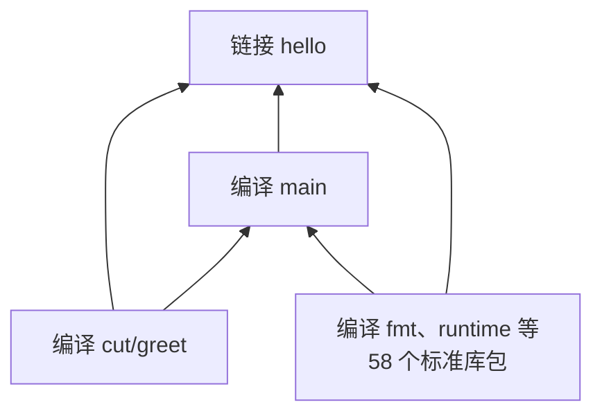

# 3.1 从 `go` 命令谈起

先看一个实验。模块 `cut` 中有两个包，`main` 调用 `cut/greet` 中的一个函数：

```go
// greet/greet.go
package greet

// Hello 返回问候语。
func Hello(name string) string { return "hello, " + name }
```

```go
// main.go
package main

import (
	"fmt"

	"cut/greet"
)

func main() { fmt.Println(greet.Hello("gopher")) }
```

从空的构建缓存开始，每次对源码做一种改动，然后执行 `go build -x -o hello .`，统计输出中编译器
`compile` 与链接器 `link` 被调用的情况（Go 1.26.10，darwin/arm64）：

| 构建前的操作 | 重新编译的包 | 重新链接 |
| --- | --- | --- |
| 首次构建 | 58 个标准库包、`cut/greet`、`main` | 是 |
| 不做任何修改 | 无 | 否 |
| `touch greet/greet.go`，仅更新修改时间 | 无 | 否 |
| 修改 `greet.go` 中的注释 | `cut/greet` | 否 |
| 修改 `Hello` 的函数体 | `cut/greet`、`main` | 是 |
| 将 `greet.go` 恢复为最初的内容 | 无 | 是 |

其中三行结果有违直觉：`touch` 之后没有任何包被重新编译；只修改注释时，`greet` 被重新编译，依赖它的
`main` 却没有；恢复原样之后，没有一个包需要编译。本节说明 `go` 命令如何把一次构建分解为许多步骤，
又如何判断哪些步骤可以跳过。这套方法建立在数十年来构建系统研究的基础上，也直接决定了 Go 能否做到
「相同的源码产生相同的二进制」。

## 3.1.1 `go` 命令的职责

`go` 命令本身并不翻译源码。以 `-x` 让它输出实际执行的每条命令，构建一个输出 `hello, world` 的程序
（`fmt` 等标准库包已在缓存中，路径有删节）：

```shell
$ go build -x -o hello .
WORK=/var/folders/.../go-build2047229470
mkdir -p $WORK/b001/
cat >$WORK/b001/importcfg << 'EOF' # internal
# import config
packagefile fmt=/Users/changkun/Library/Caches/go-build/93/931515f5...-d
packagefile runtime=/Users/changkun/Library/Caches/go-build/68/6859d6a5...-d
EOF
.../pkg/tool/darwin_arm64/compile -o $WORK/b001/_pkg_.a -trimpath "$WORK/b001=>" -p main \
    -lang=go1.26 -complete \
    -buildid dlhVKz4Cg7gapk_IKXLH/dlhVKz4Cg7gapk_IKXLH -goversion go1.26.10 ... \
    -importcfg $WORK/b001/importcfg -pack ./main.go
go tool buildid -w $WORK/b001/_pkg_.a # internal
cp $WORK/b001/_pkg_.a /Users/changkun/Library/Caches/go-build/38/38c3c38b...-d # internal
cat >$WORK/b001/importcfg.link << 'EOF' # internal
packagefile hello=$WORK/b001/_pkg_.a
packagefile fmt=/Users/changkun/Library/Caches/go-build/93/931515f5...-d
...（共 59 行，每个要链接的包一行）
EOF
.../pkg/tool/darwin_arm64/link -o $WORK/b001/exe/a.out -importcfg $WORK/b001/importcfg.link ...
go tool buildid -w $WORK/b001/exe/a.out # internal
mv $WORK/b001/exe/a.out hello
```

`go` 命令自身所做的工作只有以下几项：创建临时目录；写出 `importcfg` 文件，告知编译器每个被导入的包
的编译结果位于何处；调用编译器把 `main.go` 编译为归档文件 `_pkg_.a`，并将其存入构建缓存；写出链接
所用的 `importcfg.link`，调用链接器生成可执行文件。实际的翻译工作由 `$GOROOT/pkg/tool/<系统_体系
结构>/` 下的几个独立程序完成：编译器 `compile`（[3.2](./compile.md)）、汇编器 `asm` 和链接器
`link`（[3.4](./link.md)）。

把一次构建分解为若干步骤，安排其先后，决定哪些可以并行、哪些可以跳过，这正是 `make` 和 Bazel 等
构建系统的职责。Go 把这一职责纳入了 `go` 命令。

## 3.1.2 动作图

包 P 导入包 Q 时，编译 P 需要读取 Q 的编译结果，因此 Q 必须先编译。以顶点表示构建步骤，以从 A 指向
B 的有向边表示「A 必须在 B 之前完成」，便得到一张有向图。Go 禁止循环导入，因此这张图中不存在环。

`go` 命令把每个步骤称为一个**动作**（action），整张图称为**动作图**（action graph）。
动作的定义如下（`cmd/go/internal/work/action.go`，仅保留与调度有关的字段
[[Go Authors, 2026b](#ref-go-authors-2026b)]）：

```go
type Action struct {
	Mode    string        // 动作类型："build"（编译一个包）、"link"（链接）等
	Package *load.Package // 所处理的包
	Deps    []*Action     // 必须先完成的动作
	Actor   Actor         // 执行该动作的函数，例如调用 compile

	actionID cache.ActionID // 该动作全部输入的哈希，用作缓存的键（3.1.4）
	buildID  string         // 输入哈希与输出哈希，写入产物（3.1.4）
	pending  int            // 尚未完成的 Deps 个数，降为零即可执行
	priority int            // 就绪动作之间的执行优先级
}
```

建图的规则并不复杂。`CompileAction` 为一个包创建编译动作，并递归地为它导入的每个包创建编译动作，
作为自身的 `Deps`；`AutoAction` 遇到 `main` 包时改为创建链接动作，链接依赖于 `main` 包的编译。对于
上面的 `cut` 模块，动作图的主干如下：



这张图在执行之前就已完整：Go 源文件开头的 `import` 声明了全部依赖，`go` 命令只需解析这些声明即可建出整张图
[[Go Authors, 2026c](#ref-go-authors-2026c)]，无须先编译任何代码。Go 1.26 还为每个编译动作增加了一个「检查
缓存」动作，专门负责计算缓存的键并查找结果。`go build -debug-actiongraph=ag.json` 可以把动作图导出为
JSON：前述 `hello, world` 程序的动作图共有 122 个节点，其中编译动作 59 个、检查缓存动作 59 个、链接动作
1 个，另有 3 个辅助节点。

动作图由 `Builder.Do`（`cmd/go/internal/work/exec.go`）执行。它为每个节点记录尚未完成的依赖数
`pending`，将其中为零的节点放入就绪队列；一个动作完成后，依赖它的节点的 `pending` 减一，降为零即
进入就绪队列。这与 [3.6](./main.md) 中确定初始化顺序的 Kahn 算法思路相同，区别在于这里允许多个动作
并行执行：并行度由 `-p` 控制，默认等于 `GOMAXPROCS`（通常即 CPU 的个数，见 [3.5](./boot.md)）。

## 3.1.3 何时需要重新构建

### make 的时间戳规则

1976 年，贝尔实验室的 Stuart Feldman 编写了 `make`，并于 1979 年发表了描述它的论文
[[Feldman, 1979](#ref-feldman-1979)]。当时 Unix 上的程序规模日益增大，开发者经常在修改一个文件后忘记重新编
译依赖它的部分，调试许久才发现运行的仍是旧代码。`make` 的规则可以概括为一句话：
**若目标文件的修改时间早于它的任何一个依赖文件，就重新生成该目标。**

这条规则开销低、适用面广，沿用至今。然而它判断的是文件是否被修改过，而不是内容是否发生了变化：

- `touch` 一个文件，内容未变，依赖它的所有目标都会重新生成；
- 切换到旧的分支后，文件的修改时间可能早于产物，应当重新生成的目标反而被跳过；
- 编译器版本或编译参数发生变化，文件的修改时间不变，产物却已过时；
- 一个文件被重新生成而内容完全相同，它的修改时间仍会更新，依赖它的步骤因而也要重做。

### 构建系统的两个维度

2018 年，Andrey Mokhov、Neil Mitchell 与 Simon Peyton Jones 在 ICFP 上发表了《Build Systems à la Carte》，
把 Make、Excel、Shake、Bazel 等看似无关的系统纳入同一个框架
[[Mokhov et al., 2018](#ref-mokhov-et-al-2018)]。他们指出，任何构建系统都要回答两个相互独立的问题：

1. **调度**（scheduling）：以何种顺序执行各个步骤。若全部依赖事先已知，可以一次排定顺序再依次执行
   （Make 的做法）；若依赖要在执行过程中才能发现，就需要边执行边调整。
2. **重建判定**（rebuilding）：某个步骤是否需要重新执行。Make 比较时间戳；另一类系统记录上一次
   各步骤输入的摘要，本次重新计算并比较；还有一类系统建立一个以输入摘要为键、记录对应输出的缓存。

第三种方式有两个优点。其一，只要本次的输入在缓存中出现过，就可以直接复用对应的输出，无论它是何时、
甚至在哪台机器上产生的。其二，某个步骤重新执行后，若输出与原来相同，依赖它的步骤就无须重做，重建
在此处终止，这一性质称为**提前截断**（early cutoff）[[Mokhov et al., 2018](#ref-mokhov-et-al-2018)]。

`go build` 在这一框架中的位置十分明确：依赖由 `import` 事先给出，因此采用一次排定顺序的调度方式；
是否重建由构建缓存判定，而构建缓存正是以输入摘要为键、记录输出的缓存。Bazel 的缓存同样属于这一类型
[[Bazel Authors, n.d.](#ref-bazel-authors-nd)]，区别在于它允许在执行过程中发现新的依赖，调度方式也更复杂。

## 3.1.4 内容寻址的构建缓存

### 内容寻址与 Merkle 树

以数据内容的哈希值作为存取地址的方式，称为**内容寻址**（content addressing）。Go 的构建缓存使用
SHA-256，摘要长 32 字节。

一个产物的摘要应当涵盖它所依赖的全部输入，而这些依赖本身又是其他步骤的产物。Ralph Merkle 在
1979 年前后为数字签名设计的一种结构 [[Merkle, 1988](#ref-merkle-1988)]，解决的正是这类问题：
数据位于一棵树的叶子上，每个内部节点的哈希值由其子节点的哈希值计算得出。根节点的一个哈希值即可代表整棵树；
任何一片叶子发生变化，从它到根的路径上的哈希值都会改变，而未受影响的子树的哈希值保持不变。
这种结构后来称为 **Merkle 树**（Merkle tree），Git 存储提交与目录时采用的也是这种结构。

### 缓存键的计算

编译动作的缓存键称为 **action ID**，由 `buildActionID`（`cmd/go/internal/work/exec.go`）
把该动作的全部输入写入 SHA-256 计算得出。设置 `GODEBUG=gocachehash=1` 后，`go` 命令会输出写入哈希的每一行
[[Go Authors, 2026a](#ref-go-authors-2026a)]。以 3.1.1 的 `hello, world` 程序为例（模块名为 `hello`，
只摘录 `main` 包的编译动作）：

```shell
$ GODEBUG=gocachehash=1 go build -o /dev/null .
HASH[build hello]: "go1.26.10"                              # Go 版本，每个哈希都首先写入它
HASH[build hello]: "compile\n"
HASH[build hello]: "dir /private/tmp/.../hello\n"           # 源码所在目录（会写入调试信息）
HASH[build hello]: "go 1.26\n"                              # go.mod 中声明的语言版本
HASH[build hello]: "goos darwin goarch arm64\n"             # 目标平台
HASH[build hello]: "import \"hello\"\n"
...
HASH[build hello]: "compile compile version go1.26.10 [\"-shared\"] []\n"  # 编译器与编译参数
HASH[build hello]: "GOARM64=v8.0\n"
HASH[build hello]: "file main.go ndwR08Lz3EpwYHjxBZW0\n"     # 源文件内容的哈希
HASH[build hello]: "import fmt dNREUiHuykkfKQNLuuw2\n"       # 依赖 fmt 的产物的哈希
HASH[build hello]: "import runtime GvQgxar5yLrWdvDo90Uh\n"
HASH[build hello]: 7658552b3e0283b81aa64fc82972c758fc8120b2cb684550c6c74a5085448eeb
```

最后一行即 action ID，也就是缓存的键。值得注意的是倒数第二、三行：依赖以其**产物内容的哈希**
参与计算，称为 **content ID**，而不是依赖的 action ID。每个包的产物中都写有一个 build ID，形如
`actionID/contentID`（可执行文件的 build ID 格式有所扩展）。在前面 `-x` 的输出中，编译器得到的是一个
占位的 `dlhVKz4Cg7gapk_IKXLH/dlhVKz4Cg7gapk_IKXLH`；产物写出之后，`go tool buildid -w` 计算文件内容
的哈希（计算时 build ID 所在的字节按全零处理），并把后半部分改写为真正的 content ID。

由此，每个键都涵盖了其下的整棵依赖树，这正是 Merkle 树的结构；而向上传递的是产物的摘要，不是输入的
摘要，这使得重建可以提前截断。回到开头的实验：

- `touch` 只改变修改时间。文件内容的哈希不变，键也不变，直接命中缓存。
- 修改注释后，`greet.go` 的哈希改变，`greet` 的键随之改变，因此必须重新编译。但注释不会进入产物，
  新的 `greet` 产物与原来逐字节相同，content ID 不变，`main` 的键也就不变，重建在此截断。
- 修改函数体后，`greet` 的产物发生变化（`Hello` 被内联到 `main` 中，见 [3.2](./compile.md)），
  `main` 的键随之改变，链接动作的键也随之改变。
- 恢复原样后，每个键都与首次构建时相同，而缓存中仍保留着当时的结果。缓存保存所有出现过的「键 →
  产物」，只有 5 天未被使用的条目才会被清除。链接之所以重新执行，是因为 `go build` 不把可执行文件
  存入缓存，而是检查目标文件 `hello` 中的 build ID 是否与本次计算出的键一致，此时的 `hello` 则是
  上一次构建的结果。

下面的交互图再现了这个实验。每个节点显示其 action ID 与 content ID（示意值），选择一种改动后点击
「构建」，可以观察哪些键发生变化、哪些动作命中缓存，以及 `make` 的时间戳规则会重做哪些步骤。

<div class="viz" data-viz="build-cache"></div>

### 缓存正确性的前提

这套方法的正确性依赖于一个前提：**凡是可能影响产物的因素，都必须计入键中。** 一旦遗漏某一项，
输入发生变化而键不变，`go` 命令就会取出过时的产物，并且不报告任何错误。`exec.go` 中执行编译的函数之前专门
有一条注释：对这段逻辑的任何新的影响因素，都必须同样反映在 `buildActionID` 中
[[Go Authors, 2026b](#ref-go-authors-2026b)]。上面哈希中出现的 `GOARM64`、`GOEXPERIMENT`，乃至
`GOSSAFUNC` 这类调试用的环境变量，都是出于这一原因加入的。

为了发现遗漏，`go` 命令提供了 `GODEBUG=gocacheverify=1`：每个动作照常重新执行，再将新产物与缓存中
同一个键下的旧产物比较，二者不一致即报错 [[Go Authors, 2026a](#ref-go-authors-2026a)]。

## 3.1.5 可复现构建

内容寻址的缓存隐含着一个假设：相同的输入必然产生相同的输出。这一性质称为**可复现构建**（reproducible
build）。Reproducible Builds 项目给出的定义是：给定相同的源码、构建环境和构建指令，
任何人都能重新得到逐字节相同的产物 [[Reproducible Builds, n.d.](#ref-reproducible-builds-nd)]。
它的意义不限于缓存：若一个发布的二进制可以由任何人从源码重新构建并逐字节比对，用户就不必信任构建它的那台机
器未遭篡改。

破坏可复现性的通常是以下几种因素：构建时间、随机数、map 的遍历顺序，以及源码所在的绝对路径。Go 的
编译器与链接器在产物中避免了前三种因素，最后一种可以用 `-trimpath` 消除。把同一个 `hello, world`
模块复制到两个不同的目录，分别构建：

```shell
$ (cd a/hello && go build -o ../../h1 . && go build -trimpath -o ../../h1t .)
$ (cd b/src/hello && go build -o ../../../h2 . && go build -trimpath -o ../../../h2t .)
$ shasum -a 256 h1 h2 h1t h2t | cut -c1-16,65-
210c9a5524efb8c2  h1      # 目录 a/hello，默认参数
91cfb5c24d5fd180  h2      # 目录 b/src/hello，默认参数
1bbde893d88e78fb  h1t     # 目录 a/hello，-trimpath
1bbde893d88e78fb  h2t     # 目录 b/src/hello，-trimpath
```

默认情况下，源码目录会写入调试信息，两个二进制因而不同（这也是上面的哈希中包含 `dir` 一行的原因）；
加上 `-trimpath` 后，路径被改写为模块路径，两个二进制完全相同。Go 工具链自身从 Go 1.21 起实现了完全
可复现 [[Cox, 2023](#ref-cox-2023)]，详见 [3.3](./bootstrap.md)。

## 3.1.6 取舍

在 C/C++ 中，同样的工作分散在许多工具之间：编译使用 `gcc` 或 `clang`，调度使用 `make`、CMake 或
Ninja，缓存需另行安装 `ccache`，查找依赖库使用 `pkg-config`，每个项目都要把它们逐一配置妥当。Go 把
构建、测试、缓存与交叉编译集中于一个 `go` 命令，在新机器上执行 `git clone` 之后即可直接 `go build`，
无须先理解一套构建脚本。

代价是构建模型被固定下来。`go` 命令假定「一个目录即一个包，`import` 即依赖」，无法像 `make` 那样描述
任意的、跨语言的自定义规则。`go generate` 和 `//go:embed` 覆盖了生成代码、嵌入资源等常见需求，更复杂
的情形则需要借助外部脚本，或者改用 Bazel 这类与语言无关的构建系统。

缓存的位置过去也是固定的，只能位于本机的 `$GOCACHE` 目录。Go 1.21 以实验特性的形式加入了 `GOCACHEPROG`
[[Fitzpatrick, 2023](#ref-fitzpatrick-2023)]，Go 1.24 起正式启用
[[Go Authors, 2025](#ref-go-authors-2025)]：`go` 命令通过一个基于 JSON 的协议，把缓存的读写交给外部程序完
成，团队可以借此搭建共享的或远程的缓存。键的计算方法不变，改变的只是缓存的存放位置。

## 延伸阅读

- <a id="ref-feldman-1979"></a>[Feldman, 1979] Stuart I. Feldman. "Make — A Program for Maintaining
  Computer Programs." *Software: Practice and Experience*, 9(4): 255–265, 1979.
  https://doi.org/10.1002/spe.4380090402
  `make` 的原始论文，时间戳规则的出处。
- <a id="ref-mokhov-et-al-2018"></a>[Mokhov et al., 2018] Andrey Mokhov, Neil Mitchell, Simon Peyton
  Jones. "Build Systems à la Carte." *Proceedings of the ACM on Programming Languages*, 2(ICFP): 79, 2018.
  https://doi.org/10.1145/3236774
  以调度与重建判定两个维度比较各种构建系统，本节的框架出自此文。
- <a id="ref-merkle-1988"></a>[Merkle, 1988] Ralph C. Merkle. "A Digital Signature Based on a
  Conventional Encryption Function." *Advances in Cryptology — CRYPTO '87*, LNCS 293: 369–378, Springer,
  1988. Merkle 树的经典出处。
- <a id="ref-go-authors-2026a"></a>[Go Authors, 2026a] The Go Authors. *Command go*, "Build and test
  caching". https://pkg.go.dev/cmd/go
  构建缓存、`GOCACHE`、`GODEBUG=gocacheverify` 等的官方说明。
- <a id="ref-go-authors-2026b"></a>[Go Authors, 2026b] The Go Authors. `cmd/go/internal/work/action.go`、
  `exec.go`、`buildid.go`.
  https://github.com/golang/go/tree/release-branch.go1.26/src/cmd/go/internal/work
  https://github.com/golang/go/tree/master/src/cmd/go （`cmd/go/internal/cache/hash.go`）
  动作图与 `buildActionID` 的实现；`buildid.go` 开头对 action ID 与 content ID 有详细说明。
- <a id="ref-reproducible-builds-nd"></a>[Reproducible Builds, n.d.] Reproducible Builds. "Definitions."
  https://reproducible-builds.org/docs/definition/
  项目主页 https://reproducible-builds.org/
  可复现构建的定义。
- <a id="ref-cox-2023"></a>[Cox, 2023] Russ Cox. "Perfectly Reproducible, Verified Go Toolchains." The Go
  Blog, 2023. https://go.dev/blog/rebuild
  Go 工具链实现逐字节可复现的过程。
- <a id="ref-fitzpatrick-2023"></a>[Fitzpatrick, 2023] Brad Fitzpatrick. "cmd/go: add
  GOEXPERIMENT=cacheprog to let a child process implement the internal action/output cache." Go issue
  59719, 2023. https://go.dev/issue/59719
  `GOCACHEPROG` 的提案与讨论。
- <a id="ref-go-authors-2026c"></a>[Go Authors, 2026c] The Go Authors. *Go Modules Reference*（`go.mod`、
  MVS、`go.sum` 与可验证构建）。 https://go.dev/ref/mod
- <a id="ref-bazel-authors-nd"></a>[Bazel Authors, n.d.] The Bazel Authors. *Bazel: Remote Caching.*
  https://bazel.build/remote/caching （内容寻址 action cache 的工业级形态）。
- <a id="ref-go-authors-2025"></a>[Go Authors, 2025] The Go Authors. *Go 1.24 Release Notes*, "Go
  command". https://go.dev/doc/go1.24#go-command
  `GOCACHEPROG` 不再需要 `GOEXPERIMENT` 即可使用。
- 本书 [3.2 编译](./compile.md)、[3.4 链接](./link.md)、
  [第 17 章 模块](../../part5toolchain/ch17modules/readme.md)。

