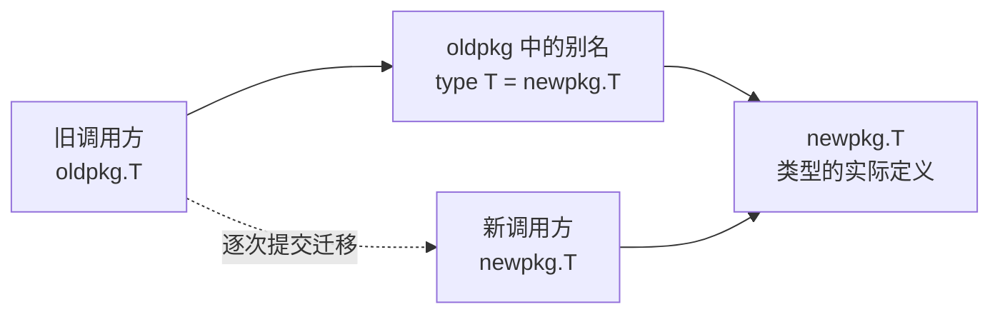

# 4.3 类型别名

`type A = B` 与 `type A B` 只差一个等号，语义却截然不同：前者为已有的类型另取一个名字，后者定义一个具有
独立标识的新类型。这一区别涉及类型同一性、方法集与可赋值性等一系列规则（[4.1](./type.md)），也关系到 Go
一贯重视的一个工程问题：在大型代码库中，如何在不破坏兼容性的前提下把一个类型从一个包迁移到另一个包。本节
先说明别名与定义类型在语义上的区别，再介绍别名在 Go 1.9 中引入的缘由，最后讨论 Go 1.24 引入的泛型类型别名
及其在类型检查器中的表示。

## 4.3.1 别名与定义类型

按照语言规范，类型声明有两种形式：**别名声明**（alias declaration）与**类型定义**（type definition），
二者以等号区分 [[Go Authors, 2026a](#ref-go-authors-2026a)]。

`type Celsius float64` 是类型定义。它创建一个新的、与其他类型都不相同的类型，其底层类型与可用的操作与
`float64` 相同。此后 `Celsius` 与 `float64` 是两个不同的命名类型：`Celsius` 有自己的标识，可以声明自己的
方法，与 `float64` 之间不能直接赋值，只能显式转换。

`type Temperature = float64` 是别名声明。它只是把一个标识符绑定到已有的类型上，在该标识符的作用域内，`Temperature`
与 `float64` 是同一个类型的两个名字，可以完全互换。预声明标识符中的 `byte`（`uint8` 的
别名）、`rune`（`int32` 的别名），以及自 Go 1.18 起的 `any`（`interface{}` 的别名），都是这样的别名。

二者的区别在方法集上体现得最为明显。下面的程序无法通过编译：

```go
package main

import "bytes"

type AliasBuf = bytes.Buffer // 别名：与 bytes.Buffer 是同一个类型
type DefBuf bytes.Buffer     // 定义类型：底层类型相同，方法集为空

func main() {
	var a AliasBuf
	a.WriteString("x") // 正确：方法集与 bytes.Buffer 相同

	var d DefBuf
	d.WriteString("x")  // 编译错误
	_ = bytes.Buffer(d) // 显式转换是允许的
}
```

```
./main.go:13:4: d.WriteString undefined (type DefBuf has no field or method WriteString)
```

`DefBuf` 与 `bytes.Buffer` 的底层类型相同，因此二者之间可以显式转换；但 `DefBuf` 是一个新类型，不继承
`bytes.Buffer` 的任何方法。`AliasBuf` 则根本不是新类型，它就是 `bytes.Buffer`，方法集自然完全相同。概括
而言，类型定义产生新的类型标识，方法须另行声明；别名只增加一个名字，类型标识与方法集均保持不变。

别名只存在于源代码与编译器之中，运行时并不知道它的存在。程序运行时可见的类型信息来自类型描述符
（[4.1](./type.md)），而别名不产生新的类型描述符：

```go {run=true}
package main

import (
	"fmt"
	"reflect"
)

type Celsius float64                // 定义类型
type Temperature = float64          // 别名
type Set[T comparable] = map[T]bool // 泛型别名（Go 1.24）

func main() {
	var c Celsius
	var t Temperature
	s := Set[string]{"go": true}

	fmt.Println(reflect.TypeOf(c), reflect.TypeOf(t))
	fmt.Printf("%T\n", s)

	var m map[string]bool = s // 同一个类型，无须转换
	fmt.Println(len(m))
}
```

```
main.Celsius float64
map[string]bool
1
```

`Celsius` 在运行时有自己的名字 `main.Celsius`；`Temperature` 与 `Set[string]` 则分别显示为 `float64` 与
`map[string]bool`。与此相对，编译器的错误信息会保留别名的名字。把字符串赋给 `Temperature` 类型的变量，Go
1.26 报告的错误是：

```
./main.go:6:22: cannot use "hot" (untyped string constant) as Temperature value in variable declaration
```

错误信息中出现的是 `Temperature` 而不是 `float64`。这是因为自 Go 1.23 起，编译器的类型检查器为别名保留了
独立的节点，4.3.5 将讨论这一点。

## 4.3.2 其他语言中的对应

「为已有类型另取名字」与「定义具有独立标识的新类型」之间的区分，在采用名义类型的语言中普遍存在，只是名称
不同：

- **Haskell** 的 `type` 声明定义**类型同义词**（type synonym），并且可以带参数，例如
  `type Assoc k v = [(k, v)]`，与 Go 的别名（包括 Go 1.24 起的泛型别名）相对应；需要独立标识的新类型时，
  则使用 `newtype` 或 `data`，与 Go 的类型定义相对应。
- **C++** 中的 `typedef T Name;` 与 `using Name = T;` 是别名；C++11 引入的**别名模板**（alias template），
  如 `template<class T> using Vec = std::vector<T>;`，与 Go 的泛型别名相当。
- **Rust** 的 `type Km = i32;` 是别名，不产生新类型；需要新的类型标识时，通常采用 newtype 模式
  `struct Km(i32);`。

由此可见，「同义词」与「新类型」是名义类型系统中的一个普遍抉择：是只改变称呼，还是改变类型的身份。Go 以
等号的有无来表达这一选择，并且在很长一段时间内只允许不带类型参数的别名。

## 4.3.3 引入别名的动机：渐进式代码修复

别名并非 Go 1.0 就有的特性。Russ Cox 在 2016 年 11 月的 GothamGo 大会上作了题为《Codebase Refactoring
(with help from Go)》的报告，讨论大型代码库的重构问题 [[Cox, 2016](#ref-cox-2016)]。报告以 Google
的代码库为例：截至 2015 年 1 月，该代码库每天有约 4 万次提交。在这种规模下，修改一个被广泛引用的 API 时，
很难把 API 的变更与所有调用方的修改放在同一次提交中完成（Cox 称之为**原子式代码修复**，atomic code
repair）；更可行的做法是设置一个过渡期，在此期间逐步修改调用方，即**渐进式代码修复**（gradual code
repair）。

渐进式修复的前提是：在过渡期内，同一个 API 必须能够同时从新旧两个位置访问，并且新旧代码可以相互操作。该
报告指出，Go 已经可以为所有常量、所有函数以及几乎所有变量引入替代名称，唯独类型不行：`oldpkg.T` 与
`newpkg.T` 即使底层类型相同，也是两个不同的类型，相互赋值须显式转换。因此，迁移一个类型只能一次性修改所有
引用 [[Cox, 2016](#ref-cox-2016)]。

为此，Go 团队起初为 Go 1.8 设计了通用的别名机制 [[Griesemer, 2016](#ref-griesemer-2016)]，允许为常量、
函数、变量和类型等各类声明取别名，但该特性最终被搁置，没有随 Go 1.8 发布。随后 Russ Cox 与 Robert
Griesemer 于 2016 年 12 月提出了只针对类型的别名提案
[[Cox and Griesemer, 2016](#ref-cox-griesemer-2016)]，取代通用别名。提案的理由是：
通用别名与其他声明形式相互重叠，使之复杂化，而真正迫切需要别名的只有类型。该提案在 Go 1.9（2017 年 8 月）
中实现 [[Go Authors, 2017](#ref-go-authors-2017)]。

有了别名，迁移一个类型可以分步完成。首先在新包中定义该类型，然后在旧包中保留一个指向它的别名：

```go
// newpkg/t.go：类型的新位置
package newpkg

type T struct { /* ... */ }

// oldpkg/t.go：旧包只保留一个别名
package oldpkg

import "path/to/newpkg"

type T = newpkg.T // oldpkg.T 与 newpkg.T 是同一个类型
```

此时 `oldpkg.T` 与 `newpkg.T` 是同一个类型，而不仅仅是底层类型相同的两个类型，因此新旧代码可以混合使用、
相互传值：

```go
package caller

import (
	"path/to/newpkg"
	"path/to/oldpkg"
)

func use() {
	var a oldpkg.T // 尚未迁移的代码仍使用旧名
	var b newpkg.T // 已迁移的代码使用新名
	a = b          // 同一个类型，可以直接赋值
	_ = a
}
```

调用方可以分批把 `oldpkg.T` 改为 `newpkg.T`，每次修改都可以单独提交、单独通过持续集成，不必等待所有引用
同时就绪。待不再有代码引用旧名时，删除旧包中的别名即可。在整个迁移过程中，代码库始终处于可以编译和发布的
状态。迁移过程如下图所示，别名是新旧两侧之间的临时桥梁：



可见，别名所解决的是一个软件工程问题，即如何在不破坏兼容性的前提下移动类型，而不是一个类型理论问题。也正
因为如此，别名主要用作重构的过渡手段，而不是日常的建模手段：它不引入新类型，也不改变类型标识，只在命名
层面起作用，不宜用来为同一个类型取一系列不同的名字。

## 4.3.4 泛型类型别名

Go 1.18 引入泛型时，别名不能带类型参数。类型参数的设计文档在附录中说明：别名可以指向泛型类型，
但其本身不能带类型参数，因为当时尚不清楚应如何处理类型参数带有约束的别名
[[Taylor and Griesemer, 2021](#ref-taylor-griesemer-2021)]。2021 年 6 月，Matthew Dempsky 提出议题
#46477，建议允许别名带类型参数 [[Dempsky, 2021](#ref-dempsky-2021)]。Robert Griesemer
在讨论中指出了其中的困难：别名只是一个类型的另一个名字，并不是新类型；而一旦别名的类型参数可以收窄约束，
或者只实例化部分参数，它实际上就定义了一个新类型。

该特性在 Go 1.23 中作为实验（`GOEXPERIMENT=aliastypeparams`）提供，在 Go 1.24（2025 年 2 月）中默认启用
[[Go Authors, 2025](#ref-go-authors-2025)]；Go 1.26 删除了这一实验开关。**泛型类型别名**的写法如下：

```go
type Set[T comparable] = map[T]bool // 带类型参数的别名

func demo() {
	s := Set[string]{"a": true} // 使用时必须实例化
	_ = s
}
```

与非泛型别名一样，`Set[string]` 与 `map[string]bool` 是同一个类型（见 4.3.1 的程序）。规范要求泛型别名在
使用时必须实例化：不能单独写 `Set`，只能写 `Set[string]` 这样的实例。这使别名在泛型代码
（[第 8 章](../ch08generics/readme.md)）中同样可以起到简化名称与支持渐进重构的作用。

泛型别名带来了一条需要注意的限制：它不能用作方法的接收者。规范规定，若接收者类型由别名（或指向别名的指针）
表示，则该别名不得是泛型的，也不得表示一个已实例化的泛型类型，无论中间经过多少层别名或指针
[[Go Authors, 2026a](#ref-go-authors-2026a)]。以规范中的例子为例：

```go
package main

type Point struct{ x, y float64 }

type GPoint[P any] = Point
type HPoint = *GPoint[int]

func (*GPoint[P]) Draw(P) {}
func (HPoint) Draw()      {}

func main() {}
```

```
./main.go:8:8: cannot define new methods on generic alias type GPoint[P any]
./main.go:9:7: cannot define new methods on instantiated type GPoint[int]
```

其原因与 4.3.1 的讨论一致：方法属于定义类型，别名只是一个名字，没有可以附加方法的独立类型标识。泛型别名
扩展了别名的表达能力，但没有改变「别名只是别名」这一性质。

## 4.3.5 类型检查器中的别名节点

在 Go 1.22 之前，类型检查器（`go/types` 以及编译器内部对应的 `types2`）并不为别名单独建立类型节点：对于
`type A = int`，`A` 的类型直接表示为 `int`。这种做法简单，但有两个缺点。其一，错误信息只能显示别名所指的
类型，而无法显示用户实际写下的别名。其二，泛型别名的类型参数与类型实参无处存放。

为此，Go 1.22 在 `go/types` 中引入了 `Alias` 类型，但默认并不创建它，须设置 `GODEBUG=gotypesalias=1` 才会
启用；Go 1.23 起该设置默认开启，编译器也随之启用了别名节点，预声明的 `any` 同样表示为一个 `Alias`。`Alias`
的主要字段如下（Go 1.26 `go/types/alias.go` [[Go Authors, 2026b](#ref-go-authors-2026b)]）：

```go
type Alias struct {
	obj     *TypeName      // 对应的别名声明
	orig    *Alias         // 未实例化的原始别名
	tparams *TypeParamList // 类型参数，可能为 nil
	targs   *TypeList      // 类型实参，可能为 nil
	fromRHS Type           // 声明右侧的类型，可能仍是别名
	actual  Type           // 实际指向的类型，一定不是别名
}
```

`fromRHS` 可能仍是一个别名，因此别名可以形成链条；`Unalias` 函数沿着链条找到第一个非别名的类型，即
`actual`。引入 `Alias` 之后，所有按类型种类分情况处理的代码都必须先调用 `Unalias`，否则会把别名误当作一种
新的类型种类，此后若干版本中修补遗漏的 `Unalias` 调用的提交即由此而来。`GODEBUG=gotypesalias` 设置在
Go 1.27 中被删除，别名节点从此总是存在。

这一表示只存在于编译期。编译器生成代码时会把别名解析为它所指的类型，因此运行时看到的只有实际类型，正如
4.3.1 的程序所示。

## 4.3.6 取舍

别名是一个刻意保持小巧的特性。理解了「别名只是别名，定义类型才是新类型」这一点，便可避免许多关于类型
同一性、方法集与可赋值性的困惑，这些问题的根源都在于 [4.1](./type.md) 中的类型标识规则。别名的局限也
源于此：它不能声明方法，也不产生新的类型标识，因此不能用来为已有类型附加语义上的约束，这是定义类型的职责。
在别名与定义类型之间作选择，所问的始终是同一个问题：是只需要另一个名字，还是需要一个新的类型。Go 1.24 的
泛型别名把别名的适用范围扩展到了泛型代码，但没有越过这一界限。

## 延伸阅读

- <a id="ref-cox-2016"></a>[Cox, 2016] Russ Cox. "Codebase Refactoring (with help from Go)." GothamGo,
  2016. https://go.dev/talks/2016/refactor.article （亦见 https://talks.golang.org/2016/refactor.article
  ）
  原子式与渐进式代码修复的区分，以及引入别名的动机。
- <a id="ref-cox-griesemer-2016"></a>[Cox and Griesemer, 2016] Russ Cox, Robert Griesemer. "Proposal: Type
  Aliases." 2016. https://go.googlesource.com/proposal/+/master/design/18130-type-alias.md
  Go 1.9 类型别名的设计文档，说明了为何只为类型提供别名。
- <a id="ref-griesemer-2016"></a>[Griesemer, 2016] Robert Griesemer. "Proposal: Alias declarations for
  Go." golang/go#16339, 2016. https://github.com/golang/go/issues/16339
  为 Go 1.8 设计、后被搁置的通用别名提案。
- <a id="ref-taylor-griesemer-2021"></a>[Taylor and Griesemer, 2021] Ian Lance Taylor, Robert Griesemer.
  "Type Parameters Proposal." 2021.
  https://go.googlesource.com/proposal/+/master/design/43651-type-parameters.md
  附录 "Generic type aliases" 说明了泛型别名最初被排除的原因。
- <a id="ref-dempsky-2021"></a>[Dempsky, 2021] Matthew Dempsky. "spec: generics: permit type parameters on
  aliases." golang/go#46477, 2021. https://github.com/golang/go/issues/46477
  Go 1.24 泛型类型别名的提案与讨论。
- <a id="ref-go-authors-2026a"></a>[Go Authors, 2026a] The Go Authors. *The Go Programming Language
  Specification*, "Alias declarations" 与 "Method declarations".
  https://go.dev/ref/spec#Alias_declarations ，https://go.dev/ref/spec#Type_declarations
  别名声明、泛型别名以及接收者限制的规范定义。
- <a id="ref-go-authors-2026b"></a>[Go Authors, 2026b] The Go Authors. `go/types/alias.go`.
  https://github.com/golang/go/blob/release-branch.go1.26/src/go/types/alias.go
  https://github.com/golang/go/blob/master/src/go/types/alias.go
  `Alias` 类型、`Unalias` 以及 `gotypesalias` 设置的说明。
- <a id="ref-go-authors-2017"></a>[Go Authors, 2017] The Go Authors. *Go 1.9 Release Notes*, "Changes to
  the language"（类型别名）. https://go.dev/doc/go1.9
- <a id="ref-go-authors-2025"></a>[Go Authors, 2025] The Go Authors. *Go 1.24 Release Notes*, "Changes to
  the language"（泛型类型别名）. https://go.dev/doc/go1.24
- 本书 [4.1 运行时类型系统](./type.md)、[8 泛型](../ch08generics/readme.md).

