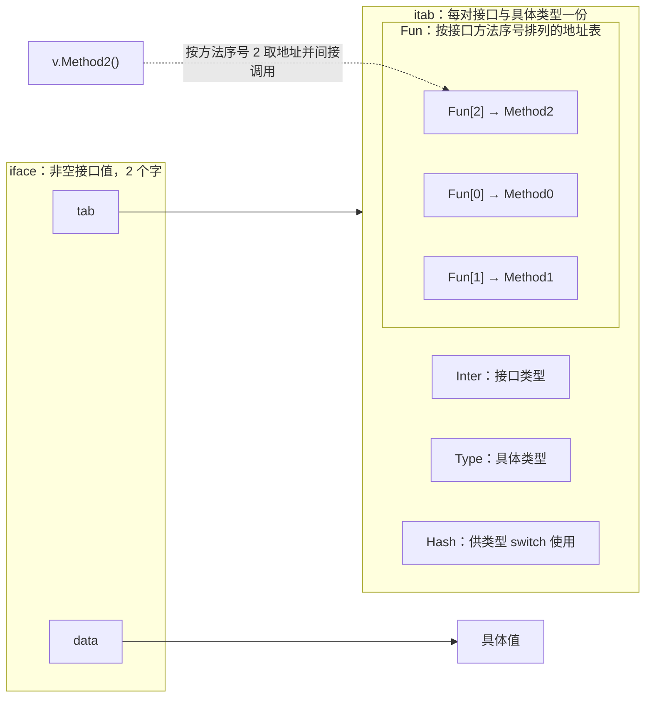

# 4.2 接口

接口使「行为」与「实现」相互分离。与多数主流语言不同，Go 的接口采用结构化、隐式的满足方式。本节讨论接口
在运行时如何表示、方法如何动态分派、类型断言如何实现，以及这一设计在各种多态机制中所处的位置。下文列出的
结构体只保留了与讨论相关的字段，完整定义见 Go 1.26 的 `runtime/runtime2.go`、`internal/abi/iface.go` 与
`runtime/iface.go`。

## 4.2.1 两种表示：iface 与 eface

接口值在运行时总是占两个字，但有两种形式。带有方法的接口（**非空接口**）表示为 `iface`：一个指向接口表
`itab` 的指针，加上一个指向具体数据的指针。空接口 `interface{}`（即 `any`）表示为 `eface`：一个指向类型
描述符（[4.1](./type.md)）的指针，加上一个数据指针。空接口没有方法，不需要方法表，直接记录类型即可，省去了
一层间接：

```go
// runtime/runtime2.go
type iface struct {
	tab  *itab          // 接口类型与具体类型这一对组合的方法表
	data unsafe.Pointer // 指向具体值
}

type eface struct {
	_type *_type // 具体值的动态类型
	data  unsafe.Pointer
}
```

`data` 存放的是指针。指针形状的值（指针、map、channel、函数等，其大小恰为一个指针且本身就是指针）
直接存放在 `data` 中；其他值则须先**装箱**（boxing），即复制到一块可寻址的内存中，再让 `data` 指向它。
装箱通常意味着一次堆分配，但运行时对常见情形做了优化：例如小于 256 的整数直接指向运行时预先分配的静态数组
`staticuint64s`，无须分配。下面的程序测量三种赋值各引起几次分配：

```go {run=true}
package main

import (
	"fmt"
	"os"
	"testing"
)

var sink any

func main() {
	small := len(os.Args) + 6 // 7，运行时才能确定的值
	large := small * 1000     // 7000
	p := &large

	fmt.Println(testing.AllocsPerRun(1000, func() { sink = small })) // 小整数
	fmt.Println(testing.AllocsPerRun(1000, func() { sink = large })) // 大整数
	fmt.Println(testing.AllocsPerRun(1000, func() { sink = p }))     // 指针
}
```

```
0
1
0
```

值 7 指向静态数组，不分配；值 7000 须装箱，分配一次；指针直接存入 `data`，也不分配。两个字的表示是理解后续
内容的基础：动态分派、类型断言以及下面的 nil 问题，都可以从它推出。

## 4.2.2 带类型的 nil

接口值等于 `nil`，当且仅当它的两个字都为 `nil`。只要表示动态类型的那个字已被填写，即使数据指针为 `nil`，
接口值也不等于 `nil`：

```go {run=true}
package main

import "fmt"

type MyErr struct{}

func (*MyErr) Error() string { return "boom" }

func do() error {
	var p *MyErr = nil // 值为 nil 的具体类型指针
	return p           // 装入 error 接口
}

func main() {
	err := do()
	fmt.Println(err == nil)
	fmt.Printf("%T %v\n", err, err)
}
```

```
false
*main.MyErr boom
```

`do` 返回的 `error` 中，`tab` 指向「`error` 与 `*MyErr`」这一对组合的接口表，不为 `nil`；为 `nil` 的只是
`data`。因此接口值不等于 `nil`。返回类型为 `error` 的函数尤其容易出现这一问题，正确的做法是显式地
`return nil`，而不是返回一个恰好为 `nil` 的具体类型指针。这并非特例，而是两字表示的必然结果。

## 4.2.3 itab：方法表与动态分派

`itab`（interface table）是非空接口的核心。运行时为每一对「接口类型与具体类型」的组合维护一份 `itab`，其中
记录接口类型、具体类型、一个类型哈希值，以及最关键的方法地址表 `Fun`：

```go
// internal/abi/iface.go
type ITab struct {
	Inter *InterfaceType // 接口类型：要求哪些方法
	Type  *Type          // 具体类型（动态类型）
	Hash  uint32         // Type.Hash 的副本，供类型 switch 使用
	Fun   [1]uintptr     // 变长：各方法的代码地址；Fun[0] == 0 表示未实现该接口
}
```



`Fun` 表的顺序由接口决定：接口的方法按名称排序，与具体类型的写法无关。动态分派正是建立在这一点上：编译器在
编译期就知道某个方法在接口中的序号，调用时只需按序号从 `Fun` 中取出地址，再间接调用。设接口 `I` 的第 2 个
方法是 `Method2`，则：

```go
var v I = concrete{}
v.Method2(args)
// 大致相当于（伪代码）：
//   fn := v.tab.Fun[2]    // 序号 2 在编译期确定，地址在运行时才知道
//   call fn(v.data, args) // data 作为隐式的接收者传入
```

序号是静态的，地址是动态的：同一个调用点，`v` 中存放的具体类型不同，执行的代码就不同。这就是**动态分派**
（dynamic dispatch）[[Cox, 2009](#ref-cox-2009)]。

构造 `itab`（`getitab`）的代价不小：须逐一核对具体类型是否实现了接口要求的每个方法，并填写整张 `Fun` 表。
由于接口与具体类型的方法都按名称排序，核对可以同步推进两个列表，时间与两者方法数之和成正比。构造好的
`itab` 被缓存在全局哈希表 `itabTable` 中，同一对组合只构造一次。`getitab` 的快速路径不加锁：它以
`inter.Type.Hash ^ typ.Hash` 为哈希值在表中查找（二次探测），命中即返回，这是最常见的情形；
找不到时才加锁，构造新的 `itab` 并插入表中，表的装载因子达到 75% 时扩容
[[Go Authors, 2026a](#ref-go-authors-2026a)]。实际上，多数 `itab` 无须在运行时构造：
凡是在编译期即可确定的接口与具体类型组合（例如把 `*os.File` 赋给 `io.Reader`，或类型 switch
中出现的类型），编译器都会静态生成相应的 `itab`，链接器把它们汇总到 `itablink` 段中，程序启动时由
`itabsinit` 预先登记到表中。

## 4.2.4 结构化满足：解耦的收益与代价

经由方法表进行间接调用，其机制与 C++ 的虚函数表（vtable）相同。Go 真正的不同之处在于，
接口的满足关系是结构化、隐式的：一个类型只要具有接口所要求的方法集，就自动满足该接口，无须像 Java 或 C#
那样显式声明 `implements`。这是**结构化类型**（structural typing）相对于名义类型（[4.1](./type.md)）
的选择 [[Go Authors, 2026b](#ref-go-authors-2026b)]。

其收益是解耦。程序员可以为他人编写的类型、甚至标准库中的类型定义它们恰好满足的接口，而无须修改这些类型。
`io.Reader`、`io.Writer` 这类小接口得以广泛使用，正源于此：`bytes.Buffer`、`os.File`、`net.Conn` 都没有
声明自己实现了 `io.Reader`，却都能传给任何接受 `io.Reader` 的函数。接口与实现可以各自演进，二者之间靠
方法集自然对接。

其代价有两方面。其一，隐式满足使「哪些类型实现了哪些接口」不再一目了然，需要借助工具或阅读代码才能确认；
`var _ io.Reader = (*T)(nil)` 这种编译期断言的惯用法即由此而来。其二，接口调用是间接调用：
按序号取址再跳转，编译器通常无法跨越接口内联被调函数，也就失去了内联带来的进一步优化。
在热路径上频繁调用的小方法，经由接口调用与直接调用，性能可能相差可观。编译器能确定接口值的动态类型时，
会把接口调用改写为直接调用，即去虚化；无法静态确定的热点调用，性能制导优化可以依据剖析数据有条件地
去虚化（[15.3](../../part5toolchain/ch15compile/optimize.md)），部分弥补这一损失。

## 4.2.5 类型断言与类型 switch

`x.(T)` 断言接口值的动态类型，其实现取决于 `T`：

- `T` 是具体类型时，断言只需比较接口的类型字（非空接口则为 `itab` 指针）与 `T` 对应的描述符（或 `itab`）
  地址是否相等，一次指针比较即可。
- `T` 是另一个接口时，需要判断 `x` 的动态类型是否满足 `T`，即取得相应的 `itab`，这正是 4.2.3 中
  `getitab` 的路径。

无论哪种情形，使用 `v, ok := x.(T)` 形式时，断言失败只会得到零值与 `false`，而不会 panic。

类型 switch `switch v := x.(type)` 借助哈希值加速分支选择（[4.1](./type.md)）：先按哈希值定位候选分支，
再精确比较类型。这里有两个不同的哈希值需要区分：`itab.Hash` 是动态类型 `Type.Hash` 的副本，服务于类型
switch，由编译器静态生成的 `itab` 携带；`itabTable` 查表使用的则是 `inter.Type.Hash ^ typ.Hash`。运行时
动态构造的 `itab`，其 `Hash` 字段被置为 0，因为按运行时源码的注释，这些 `itab` 不会参与类型 switch。

断言到接口类型，以及类型 switch 中的接口类型分支，过去每次都要调用运行时。自 Go 1.22 起，
编译器为每个这样的调用点生成一个小型缓存，记录在该处出现过的具体类型及其匹配结果（分支序号与 `itab`），
运行时（`typeAssert`、`interfaceSwitch`）先查缓存，未命中时才走完整路径
[[Go Authors, 2026a](#ref-go-authors-2026a)]。即便如此，在热路径上频繁断言到接口类型，
或使用分支众多的类型 switch，仍不是零开销的操作。

## 4.2.6 方法集：值与指针

接口中可以存放值还是指针，由**方法集**（method set）规则决定：指针接收者的方法不属于值类型的方法集
[[Go Authors, 2026b](#ref-go-authors-2026b)]。

```go
package main

type T struct{}

func (t T) Read()   {}
func (t *T) Write() {}

type ReadWriter interface {
	Read()
	Write()
}

var _ ReadWriter = &T{}
var _ ReadWriter = T{}

func main() {}
```

```
./main.go:14:20: cannot use T{} (value of struct type T) as ReadWriter value in variable declaration: T does not implement ReadWriter (method Write has pointer receiver)
```

`*T` 同时拥有 `Read` 与 `Write`，`T` 的方法集则只有 `Read`。Go FAQ 对此的解释是：接口中存放的若是 `*T`，
方法调用可以通过解引用得到值；若存放的是 `T`，则没有安全的办法得到指向它的指针，否则方法便可以修改接口内部
的值，而语言规范不允许这样做 [[Go Authors, 2026c](#ref-go-authors-2026c)]。与带类型的 nil 一样，
这条规则也源于接口的底层表示：接口中保存的是值的副本。

## 4.2.7 设计取舍：小接口

Go 社区关于接口的几条经验，都可以看作上述机制的工程结论。

第一，接口宜小。单方法接口（如 `io.Reader`）最容易被满足，也最容易组合。Rob Pike 的 Go 格言中有一条：
「接口越大，抽象越弱」（The bigger the interface, the weaker the
abstraction）[[Pike, 2015](#ref-pike-2015)]。接口要求的方法越多，能满足它的类型就越少，解耦的收益也越小。

第二，「接受接口，返回结构体」（accept interfaces, return structs）。函数参数使用接口以求通用，调用方可以
自由替换实现；返回值使用具体类型，以免过早抽象，也让调用方获得完整的能力，而不是经过接口裁剪的视图。

这些经验的共同出发点是：接口是用于解耦的轻量抽象，宜小不宜大，宜晚不宜早。

## 4.2.8 与其他语言的比较

各种语言实现多态的方式不同 [[Cardelli and Wegner, 1985](#ref-cardelli-wegner-1985)]，把 Go 置于其中，
其取舍便清楚了：

| 语言与机制 | 分派方式 | 满足关系 | 运行时表示 |
| --- | --- | --- | --- |
| Go 接口 | 动态（itab 方法表） | 结构化、隐式 | 两个字：itab 指针与数据指针 |
| C++ 虚函数 | 动态（vtable） | 名义、须继承基类 | 对象内嵌 vptr，指向类的 vtable |
| Rust trait | 静态（泛型单态化）或动态（`dyn Trait`） | 名义、显式 `impl` | `dyn Trait` 为胖指针：数据指针与 vtable 指针 |
| Haskell 类型类 | 字典传递（dictionary passing） | 名义、`instance` 声明 | 实例是一张方法字典，在调用处隐式传入 |
| Java/C# 接口 | 动态（接口方法表） | 名义、显式 `implements` | 对象头中有类元数据指针；JIT 以内联缓存加速 |

Rust 的 `dyn Trait` 与 Go 的 `iface` 在表示上非常接近，都是数据指针加方法表指针
[[Rust Project, n.d.](#ref-rust-project-nd)]。区别在于 Rust 的方法表在编译期按每对「trait 与类型」生成，
Go 的 `itab` 则可能在运行时首次需要时才构造，因为结构化满足关系无法在编译期穷举。

Haskell 的类型类以**字典传递**实现，由 Wadler 与 Blott 于 1989 年提出
[[Wadler and Blott, 1989](#ref-wadler-blott-1989)]：每个实例对应一张方法字典，在调用处作为隐式参数传入。
Go 泛型的实现采用了类似的思想（[第 8 章](../ch08generics/readme.md)）：按 GC 形状共用的函数体在调用时接收
一张字典，从中取得具体类型的信息与方法。接口的 `itab` 在运行时随值一同传递，泛型的字典则在编译期确定并由调
用方传入。Go 的独特之处在于把 vtable 式的高效动态分派与结构化、隐式满足的松耦合结合在一起。

## 延伸阅读

- <a id="ref-cox-2009"></a>[Cox, 2009] Russ Cox. "Go Data Structures: Interfaces." 2009.
  https://research.swtch.com/interfaces
  iface 与 itab 表示的经典讲解。
- <a id="ref-go-authors-2026a"></a>[Go Authors, 2026a] The Go Authors. `runtime/iface.go`、
  `internal/abi/iface.go`、`runtime/runtime2.go`.
  https://github.com/golang/go/blob/release-branch.go1.26/src/runtime/iface.go
  https://github.com/golang/go/blob/master/src/runtime/iface.go
  `getitab`、`itabTable`、`typeAssert` 与 `interfaceSwitch` 的实现。
- <a id="ref-cardelli-wegner-1985"></a>[Cardelli and Wegner, 1985] Luca Cardelli, Peter Wegner. "On
  Understanding Types, Data Abstraction, and Polymorphism." *ACM Computing Surveys*, 17(4): 471–523, 1985.
  https://doi.org/10.1145/6041.6042
  多态与类型抽象的经典综述。
- <a id="ref-wadler-blott-1989"></a>[Wadler and Blott, 1989] Philip Wadler, Stephen Blott. "How to Make
  ad-hoc Polymorphism Less ad hoc." *POPL 1989*: 60–76. https://doi.org/10.1145/75277.75283
  类型类与字典传递的出处。
- <a id="ref-pike-2015"></a>[Pike, 2015] Rob Pike. "Go Proverbs." Gopherfest, 2015.
  https://go-proverbs.github.io/
  「接口越大，抽象越弱」等格言。
- <a id="ref-go-authors-2026b"></a>[Go Authors, 2026b] The Go Authors. *The Go Programming Language
  Specification*, "Interface types" 与 "Method sets". https://go.dev/ref/spec#Interface_types
  结构化满足与方法集的规范定义。
- <a id="ref-rust-project-nd"></a>[Rust Project, n.d.] The Rust Project. *The Rust Reference*, "Trait
  objects". https://doc.rust-lang.org/reference/types/trait-object.html
  `dyn Trait` 的胖指针表示。
- <a id="ref-go-authors-2026c"></a>[Go Authors, 2026c] The Go Authors. *Frequently Asked Questions: Why do
  T and \*T have different method sets?* https://go.dev/doc/faq#different_method_sets

