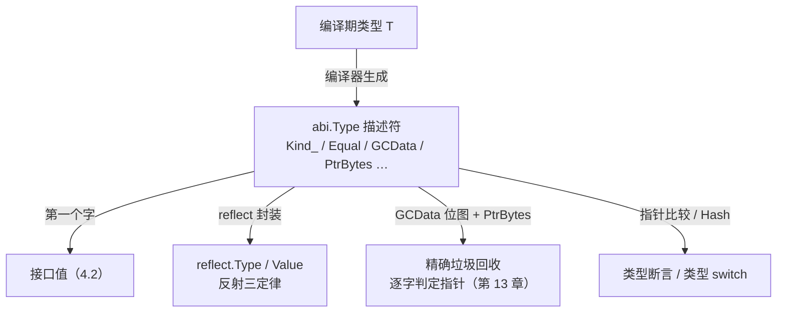

# 4.1 运行时类型系统

Go 是静态类型语言，类型检查在编译期完成 [[Cardelli and Wegner, 1985](#ref-cardelli-wegner-1985)]。但 Go
程序在运行时仍保留了一部分类型信息，称为**运行时类型信息**（runtime type information，RTTI）：
接口（[4.2](./interface.md)）、类型断言、类型 switch、反射，以及垃圾回收器对指针的精确识别，都依赖于它。
本节讨论编译期的类型在运行时还保留了哪些内容、以何种形式存在，以及这些信息支撑了哪些功能。
其核心是一个称为**类型描述符**（type descriptor）的结构。

下文列出的结构体只保留了与讨论相关的字段，完整定义见 Go 1.26 的 `internal/abi/type.go` 与 `reflect` 包
[[Go Authors, 2026a](#ref-go-authors-2026a)]。

## 4.1.1 类型描述符

编译器为程序中用到的每一个类型生成一份类型描述符。它在 Go 1.26 的源码中名为 `abi.Type`，运行时内部
沿用旧名 `_type`。描述符位于只读数据段中，在程序运行期间保持不变。同一类型在一个程序中通常只有一份
描述符，这一性质在判断两个值的类型是否相同时会用到。

```go
// internal/abi/type.go（字段与 Go 1.26 一致，注释为说明）
type Type struct {
	Size_       uintptr // 该类型的值占用的字节数，分配与复制时使用
	PtrBytes    uintptr // 值中可能含有指针的前缀字节数，垃圾回收器扫描到此为止
	Hash        uint32  // 类型的哈希值，供类型 switch 与哈希表查找使用
	TFlag       TFlag   // 标志位：是否具名、是否带有 UncommonType 等
	Align_      uint8   // 该类型变量的对齐要求
	FieldAlign_ uint8   // 该类型作为结构体字段时的对齐要求
	Kind_       Kind    // 种类：int、struct、slice、chan 等
	// 比较该类型的两个值是否相等；不可比较的类型为 nil
	Equal func(unsafe.Pointer, unsafe.Pointer) bool
	// 指针位图：标出该类型的哪些字（word）是指针，供垃圾回收器使用
	GCData    *byte
	Str       NameOff // 类型名称在名称表中的偏移
	PtrToThis TypeOff // 类型 *T 的描述符的偏移，可能为零
}
```

每个字段都服务于某项运行时功能。`Size_` 是内存分配器（[第 12 章](../../part4memory/ch12alloc/readme.md)）
与值复制的依据。`Kind_` 是一个枚举，指明这块内存应按哪一类类型解释，除 `Invalid` 外共有 26 种取值：

```go
type Kind uint8

const (
	Invalid Kind = iota
	Bool
	Int
	// … 省略其余整数、浮点数与复数类型 …
	Array
	Chan
	Func
	Interface
	Map
	Pointer
	Slice
	String
	Struct
	UnsafePointer
)
```

`Kind` 只区分种类，不区分具体类型：`type Celsius float64` 与 `float64` 的 `Kind` 都是 `Float64`，但它们
拥有两份不同的描述符（4.1.3）。

`Equal` 是编译器为该类型生成的相等比较函数，map 的键比较、接口值的比较最终都调用它。若标志位
`TFlagRegularMemory` 被置位，说明该类型的值是一段不含填充的连续内存，比较可以退化为一次按字节的内存比较
（`memequal`），无须逐字段进行。切片、map、函数等不可比较的类型，`Equal` 为 `nil`。两个接口值相比较时，
运行时若发现其动态类型的 `Equal` 为 `nil`，便会触发 panic：

```go {run=true}
package main

import "fmt"

func main() {
	var a, b any = 1, 1
	fmt.Println(a == b)

	a, b = []int{1}, []int{1}
	fmt.Println(a == b)
}
```

```
true
panic: runtime error: comparing uncomparable type []int
```

这一错误只能在运行时发现：编译器知道 `a` 与 `b` 的静态类型是可比较的 `any`，却无法预知其中存放的动态
类型。

带有方法的具名类型，其描述符之后还紧跟一个 `UncommonType`（由标志位 `TFlagUncommon` 标明），记录方法表。
结构体、切片、map、函数等类型另有各自的扩展描述符（如 `StructType`、`SliceType`），它们把 `Type` 嵌入在
首部，再追加元素类型、字段列表等信息。换言之，`abi.Type` 是所有类型描述符共有的前缀：运行时先读取
`Kind_` 判明种类，再把指针转换为相应的扩展描述符，读取其余字段。

## 4.1.2 从编译期到运行时

类型描述符是编译期的类型在运行时的唯一表示，其最直接的用途体现在空接口上。`any`（即 `interface{}`）在
运行时由两个字组成：

```go
// internal/abi/iface.go
type EmptyInterface struct {
	Type *Type          // 动态类型的描述符
	Data unsafe.Pointer // 指向实际数据；指针形状的值直接存放于此（4.2）
}
```

把一个具体值赋给 `any` 时，编译器把该类型描述符的地址写入 `Type`，把数据的地址写入 `Data`。于是，「接口
中存放的是什么类型」这一运行时问题，便归结为读取 `Type` 指针、确定它指向哪一份描述符。下面的程序用
`unsafe` 读出接口值的第一个字，验证同一类型的值共用同一份描述符：

```go {run=true}
package main

import (
	"fmt"
	"reflect"
	"unsafe"
)

type Celsius float64
type Fahrenheit float64

// eface 与 abi.EmptyInterface 的布局相同：类型描述符指针与数据指针。
type eface struct {
	typ, data unsafe.Pointer
}

// typeWord 返回接口值的第一个字，即动态类型的描述符地址。
func typeWord(v any) unsafe.Pointer { return (*eface)(unsafe.Pointer(&v)).typ }

func main() {
	var a, b Celsius = 1, 2
	var f Fahrenheit = 3
	fmt.Println(typeWord(a) == typeWord(b)) // 同一类型
	fmt.Println(typeWord(a) == typeWord(f)) // 底层类型相同的两个具名类型
	fmt.Println(reflect.TypeOf(a).Kind(), reflect.TypeOf(f).Kind())
}
```

```
true
false
float64 float64
```

`Celsius` 与 `Fahrenheit` 的种类相同，描述符却不同。带有方法的非空接口在类型描述符之外还多一层接口表
（`ITab`），其方法分派机制见 [4.2](./interface.md)；这里只需注意，无论空接口还是非空接口，第一个字最终都
指向一份 `abi.Type` [[Cox, 2009](#ref-cox-2009)]。

从编译期到运行时，类型信息大为收窄。编译期的类型是一套可推导、可检查的完整静态信息；到了运行时，程序
手中只有这份描述符，加上接口值中的一个数据指针。类型断言、反射、垃圾回收器的扫描，都建立在这两者之上。

## 4.1.3 名义类型与类型标识

Go 的具名类型是**名义类型**（nominal type）：类型的身份由其声明决定，而不由其结构决定。

```go
package main

type Celsius float64
type Fahrenheit float64

func main() {
	var c Celsius = 100
	var f Fahrenheit = c
	var x float64 = c
	_, _ = f, x
}
```

```
./main.go:8:21: cannot use c (variable of float64 type Celsius) as Fahrenheit value in variable declaration
./main.go:9:18: cannot use c (variable of float64 type Celsius) as float64 value in variable declaration
```

`Celsius` 与 `Fahrenheit` 的底层类型都是 `float64`，三者的 `Kind` 也相同，但它们是三个不同的类型，
彼此不能直接赋值。这一限制在编译期施加，其意义在于防止「摄氏温度」被误当作「华氏温度」或普通浮点数使用。
两个类型何时相同、何时可以赋值或转换，由语言规范中「Type identity」「Assignability」等小节精确规定
[[Go Authors, 2026e](#ref-go-authors-2026e)]。

名义类型的身份在运行时的体现十分简单：由于同一类型通常只有一份描述符，判断两个值的类型是否相同，只需比较
两者的描述符指针。断言到具体类型的 `x.(T)` 因此只需一次指针比较。类型 switch 的分支较多时，编译器还会
利用描述符中的 `Hash`：它把各个具体类型的分支按哈希值排序，生成运行时的二分查找（分支数不少于 5 个时
可能改用跳转表），先按哈希值找到候选分支，再比较描述符指针加以确认。分支是接口类型时，一个具体类型是否
满足该接口无法在编译期确定；自 Go 1.22 起，这类判断交由运行时的 `interfaceSwitch` 完成，其结果按动态
类型缓存，后续的同类判断可以直接命中缓存 [[Go Authors, 2026c](#ref-go-authors-2026c)]。

把具名类型与接口对照，可以看出 Go 类型系统中的一项分工。具名类型采用名义的身份，`Celsius` 不会被误当作
`float64`；接口的满足关系则是**结构化**的（[4.2](./interface.md)）：一个类型只要具有接口所要求的方法集，
就自动满足该接口，无须显式声明。前者使具体类型的边界清晰，后者使接口易于解耦与组合。

## 4.1.4 反射：基于描述符的自省

`reflect` 包允许程序在运行时检视和操作任意类型的值 [[Go Authors, 2026d](#ref-go-authors-2026d)]。它建立在
4.1.2 所述的两个字之上：`reflect.Type` 封装了 `*abi.Type`，`reflect.Value` 则同时持有类型描述符与数据指
针。Rob Pike 在 2011 年的文章《The Laws of Reflection》中把这一关系概括为三条定律
[[Pike, 2011](#ref-pike-2011)]，每一条都可以对应到接口的布局上：

```go
var x float64 = 3.4

// 定律一：反射对象由接口值得到。
// TypeOf 与 ValueOf 的参数类型是 any，二者读取的正是接口值的 Type 与 Data。
t := reflect.TypeOf(x)  // t.Kind() == reflect.Float64，读取的是描述符的 Kind_
v := reflect.ValueOf(x) // v 同时持有 *abi.Type 与指向数据的指针

// 定律二：反射对象可以还原为接口值。
var i any = v.Interface() // 把类型与数据重新组合为一个接口值

// 定律三：要修改反射对象，其值必须可设置（settable）。
p := reflect.ValueOf(&x).Elem() // 经由指针得到可寻址的 Value
p.SetFloat(7.1)                 // x 变为 7.1；对不可寻址的 v 调用则会 panic
```

第三条定律中的「可设置」并非额外的规则，而是接口布局的必然结果：`reflect.ValueOf(x)` 装入接口的是 `x`
的副本，修改它不会影响原变量，因此反射拒绝设置；只有先取 `&x`、再用 `Elem()` 解引用，`Value` 中持有的
才是原变量的地址，设置才有意义。

反射的能力很强，代价也很明显：它绕过了编译期的类型检查，执行速度慢于直接的代码，错误也只能在运行时
暴露。因此，反射主要用于序列化（`encoding/json`）、ORM 等确实需要统一处理任意类型的库。Go 1.18 引入的
泛型（[第 8 章](../ch08generics/readme.md)）使一大类过去只能依靠反射实现的通用代码，重新获得了编译期的
类型安全，也不再有反射的运行时开销。

## 4.1.5 指针位图：描述符如何支持精确扫描

描述符中的 `GCData` 与 `PtrBytes` 供垃圾回收器（[第 13 章](../../part4memory/ch13gc/readme.md)）使用。Go
的垃圾回收器是**精确的**（precise）：扫描一个对象时，它必须确切知道哪些字是指针、哪些是普通数据，
不能把一个恰好形似地址的整数当作指针追踪。这一信息正由类型描述符提供。

`GCData` 通常指向一张**指针位图**（pointer mask）：每一位对应该类型的一个字，1 表示指针，0 表示非指针，
位图的长度至少覆盖 `PtrBytes`。回收器扫描一个对象时，按其描述符取出这张位图，逐位决定是否追踪。`PtrBytes`
给出了一个上界：该类型的指针只可能出现在前 `PtrBytes` 个字节之内，其后都是普通数据，扫描到此
即可结束。一个末尾是大数组的结构体，因此可以省去相当一部分扫描。



描述符的存储方式仍在演进。早期每个类型的指针位图都在编译期算好并写入可执行文件，含有大型类型的程序会因此增
大只读数据段。自 Go 1.24 起，若一个类型可能含有指针的前缀超过 16384 个字（64 位平台上为 128 KB），
编译器便设置标志位 `TFlagGCMaskOnDemand`：此时 `GCData` 实际上是一个 `**byte`，真正的位图由运行时在首次需
要时生成并缓存（`runtime/type.go` 中的 `getGCMask`）[[Go Authors, 2026b](#ref-go-authors-2026b)]，
以少量运行时计算换取更小的可执行文件。Go 1.26 又把「值是否直接存放在接口的数据字中」这一信息从 `Kind_`
的一个位移到了 `TFlag` 中的 `TFlagDirectIface`；按其注释，它只是对条件「`Size_` 与 `PtrBytes`
都等于一个指针的大小」的缓存 [[Go Authors, 2026a](#ref-go-authors-2026a)]。

上图把前面几小节归纳到一处：编译期的类型 `T` 收窄为一份 `abi.Type`，而这份描述符同时是接口、反射、垃圾
回收与类型断言的共同基础。

## 4.1.6 与其他语言的比较

运行时保留多少类型信息，各种语言的取舍差异很大。

**Java 与 C#** 保留得最多。堆上的每个对象都带有一个对象头，其中有指向类元数据的指针；运行时可以经由
`Class` 或 `Type` 取得字段、方法、注解乃至泛型签名，反射的能力几乎不受限制，依赖注入、序列化、ORM、
动态代理等框架都建立在这之上。其代价是每个对象都要负担元数据指针，反射调用也有运行时开销。

**C++** 保留得最少，遵循「不为未使用的功能付出代价」的原则。启用 RTTI 时，`typeid` 与 `dynamic_cast`
可以查询对象的动态类型，但仅限于含有虚函数的多态类型；非多态类型在运行时无法查询其真实类型。

**Rust** 没有通用的运行时反射。`std::any::Any` 只能借助 `TypeId` 进行有限的向下转换，无法取得字段与
方法的结构。Rust 把通用代码交给编译期的泛型与 trait 处理，序列化等需求由 `serde` 借助过程宏在编译期
生成代码，而不依赖运行时反射。

Go 介于二者之间：它保留了足以支撑接口、类型断言、类型 switch、反射与精确垃圾回收的类型信息，但不像
Java 那样为每个对象附加元数据。类型信息集中在每个类型唯一的描述符中，对象本身不带类型头，普通值在内存中
就是数据本身，类型信息只在需要时经由接口值或描述符指针取得。

## 延伸阅读

- <a id="ref-pike-2011"></a>[Pike, 2011] Rob Pike. "The Laws of Reflection." The Go Blog, 2011.
  https://go.dev/blog/laws-of-reflection
  反射三定律的出处。
- <a id="ref-cox-2009"></a>[Cox, 2009] Russ Cox. "Go Data Structures: Interfaces." 2009.
  https://research.swtch.com/interfaces
  接口值与类型描述符内存布局的早期说明。
- <a id="ref-go-authors-2026a"></a>[Go Authors, 2026a] The Go Authors. `internal/abi/type.go`、`internal/abi/iface.go`.
  https://github.com/golang/go/blob/release-branch.go1.26/src/internal/abi/type.go
  https://github.com/golang/go/blob/master/src/internal/abi/type.go
  Go 1.26 的类型描述符与接口布局，各标志位的含义见其注释。
- <a id="ref-go-authors-2026b"></a>[Go Authors, 2026b] The Go Authors. `runtime/type.go`（`getGCMask`）.
  https://github.com/golang/go/blob/release-branch.go1.26/src/runtime/type.go
  https://github.com/golang/go/blob/master/src/runtime/type.go
  指针位图的按需生成。
- <a id="ref-go-authors-2026c"></a>[Go Authors, 2026c] The Go Authors.
  `cmd/compile/internal/walk/switch.go`.
  https://github.com/golang/go/blob/release-branch.go1.26/src/cmd/compile/internal/walk/switch.go
  类型 switch 的编译：按哈希值的二分查找、跳转表与 `interfaceSwitch`。
- <a id="ref-go-authors-2026d"></a>[Go Authors, 2026d] The Go Authors. *Package reflect*.
  https://pkg.go.dev/reflect
- <a id="ref-go-authors-2026e"></a>[Go Authors, 2026e] The Go Authors. *The Go Programming Language
  Specification*, "Types" 与 "Type identity". https://go.dev/ref/spec#Types
  ，https://go.dev/ref/spec#Type_identity
- <a id="ref-cardelli-wegner-1985"></a>[Cardelli and Wegner, 1985] Luca Cardelli, Peter Wegner. "On
  Understanding Types, Data Abstraction, and Polymorphism." *ACM Computing Surveys*, 17(4): 471–523, 1985.
  https://doi.org/10.1145/6041.6042
  类型、数据抽象与多态的经典综述。

