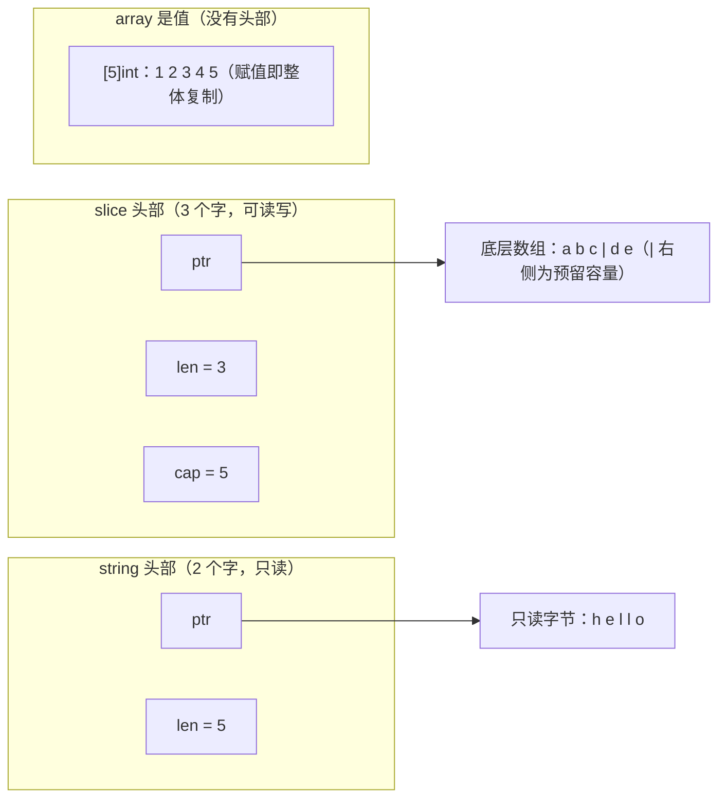

# 5.1 数组与切片

数组与切片是 Go 中最基本的两种序列类型。二者在语法上相似，内存模型却不相同，理解这一差别便可以解释
`append` 的各种表现以及切片之间的别名问题。切片与字符串都由一个很小的**头部**描述一段连续的内存
[[Gerrand, 2011](#ref-gerrand-2011)]，区别在于头部中包含哪些字段，以及这段内存由谁拥有
[[Pike, 2013](#ref-pike-2013)]。本节先说明三者的内存布局，再从**动态数组**这一经典抽象出发，讨论 `append`
如何在摊还意义下达到 $O(1)$，以及运行时与编译器为减少分配所做的工作，最后讨论别名问题并与其他语言作比较。
字符串虽然在表示上与切片相近，但它不可变，另有一套规则，留待 [5.2](./string.md) 讨论。

## 5.1.1 三种内存布局

**数组是值。** `[5]int` 就是连续排列的 5 个 `int`，长度是类型的一部分，`[5]int` 与 `[6]int` 是两个不同的
类型。数组在赋值、传参以及作为结构体字段时都会被整体复制。正因为如此，Go 程序中较少直接传递大数组，通常
传递它的切片或指针。反过来，切片也可以转换为数组指针（Go 1.17 起）或数组（Go 1.20 起），例如
`(*[4]byte)(s)` 与 `[4]byte(s)`；若切片的长度小于数组的长度，转换会在运行时 panic。

**切片是底层数组某一段的视图。** 在运行时中，切片是一个三字的头部（`runtime/slice.go`）：

```go
type slice struct {
	array unsafe.Pointer // 指向切片第一个元素在底层数组中的位置
	len   int            // 长度：可以访问的元素个数
	cap   int            // 容量：从 array 起至底层数组末尾的元素个数
}
```

`len` 是可以索引的范围，`cap` 是在不重新分配内存的前提下切片最多能增长到的长度。二者的分离是切片能够充当
视图的关键：`s[1:3]` 只需计算新头部的三个字段，并不触及底层数组。

**字符串是只读的字节序列。** 它的头部只有两个字，没有 `cap`（`runtime/string.go`）：

```go
type stringStruct struct {
	str unsafe.Pointer // 指向只读的字节
	len int            // 字节数，而非字符（rune）数
}
```

字符串没有 `cap` 字段并非疏忽：字符串**不可变**，长度一经确定便不再增长，因而不需要容量。不可变性带来了
三方面的好处：多个字符串可以安全地共享同一段字节，子串 `s[i:j]` 无须复制，字符串可以直接用作 map 的键而
无须防御性复制。其代价是任何修改都必须生成新的字符串。字符串的转换与零拷贝问题见 [5.2](./string.md)。

三者的布局对比如下：



数组没有头部，它本身就是那段内存；切片与字符串则由头部和位于别处的一段内存组成。下文讨论的各种行为都源于
这一区别。

## 5.1.2 动态数组与摊还分析

切片是**动态数组**（dynamic array）在 Go 中的形式，即一个可以按需增长的连续数组。它的核心保证是：尽管偶尔
需要重新分配内存并搬迁全部元素，连续 $n$ 次 `append` 的**摊还**（amortized）代价仍为每次 $O(1)$。

这一保证来自按倍数增长。设每当容量用尽时，新容量为原容量乘以一个常数因子 $g>1$（最简单的情形是 $g=2$）。
把 $n$ 次 `append` 作为一个整体来看，代价较高的只有触发搬迁的那几次，而且各次搬迁的规模呈几何级数。从空
切片增长到 $n$ 个元素，各次搬迁的元素数依次约为 $\dots, n/4, n/2, n$，求和得：

$$
\sum_{i=0}^{\infty} \frac{n}{2^i} = n + \frac{n}{2} + \frac{n}{4} + \cdots < 2n
$$

搬迁的总代价不超过 $2n$，再加上写入 $n$ 个新元素本身的 $O(n)$，$n$ 次 `append` 合计为 $O(n)$，平摊到每次
即为常数。这是《算法导论》中讲解摊还分析时所用的动态表（dynamic table）的例子，用聚合分析（aggregate
analysis）或势能法（potential method）都能得到同样的界 [[Cormen et al., 2022](#ref-cormen-et-al-2022)]。

关键在于增长必须是**乘性**的。若每次只增加固定的 $c$ 个槽位，第 $k$ 次扩容需要搬迁约 $kc$ 个元素，总代价为
$\sum kc = \Theta(n^2)$，平摊到每次便退化为 $O(n)$。乘性增长的代价是空间：扩容刚完成时，只有约 $1/g$ 的
容量被使用；按两倍增长时，最多约有一半的空间闲置。增长因子的选择因此是时间与空间之间的权衡，各语言给出的
答案见 5.1.6。

## 5.1.3 append 的增长策略

理论上只要按常数因子增长即可，Go 的实现则更细致。`append` 在容量不足时调用运行时的 `growslice`，后者先由
`nextslicecap` 计算目标容量，再根据内存分配器的尺寸类调整。计算目标容量的代码如下（Go 1.26
`runtime/slice.go`，注释为笔者所译 [[Go Authors, 2026a](#ref-go-authors-2026a)]）：

```go
func nextslicecap(newLen, oldCap int) int {
	newcap := oldCap
	doublecap := newcap + newcap
	if newLen > doublecap {
		return newLen // 一次追加的元素过多，直接取所需的长度
	}

	const threshold = 256
	if oldCap < threshold {
		return doublecap // 小切片：容量翻倍
	}
	for {
		// 由小切片的 2 倍增长过渡到大切片的 1.25 倍增长，
		// 该公式使两者之间的过渡较为平滑。
		newcap += (newcap + 3*threshold) >> 2

		// 同时检查 newcap >= newLen 以及 newcap 是否溢出。
		if uint(newcap) >= uint(newLen) {
			break
		}
	}

	// 计算溢出时，直接取所需的长度。
	if newcap <= 0 {
		return newLen
	}
	return newcap
}
```

增长策略以 256 为界。旧容量小于 256 时容量翻倍，小切片增长较快，以减少搬迁次数。旧容量达到 256 之后，
每轮增加 $\tfrac{1}{4}(\text{newcap} + 768)$：`newcap` 较小时，常数项 768 所占比重较大，增长倍率接近 2；
`newcap` 很大时，常数项可以忽略，倍率趋于 $1.25$。于是增长倍率从 2 连续地过渡到 1.25。这一公式由 Keith
Randall 于 2021 年提出并在 Go 1.18 中采用 [[Randall, 2021](#ref-randall-2021)]；此前的策略是容量小于 1024
时翻倍、此后按 1.25 倍增长，倍率在 1024 处突变。

`nextslicecap` 算出的容量还要经过一步调整。`growslice` 把所需的字节数（容量乘以元素大小）交给
`roundupsize`，向上取整到内存分配器的某个**尺寸类**（size class，见
[第 12 章](../../part4memory/ch12alloc/readme.md)），再由取整后的字节数反推容量。以指针大小的元素为例：

```go
capmem = roundupsize(uintptr(newcap)*goarch.PtrSize, noscan)
newcap = int(capmem / goarch.PtrSize) // 容量扩大到尺寸类的边界
```

分配器无论如何都会分配整个尺寸类大小的内存块，`growslice` 只是把这部分本会闲置的空间计入容量。下面的程序
逐个追加元素，并在容量变化时打印新的容量：

```go {run=true}
package main

import "fmt"

func main() {
	var s []int
	last := -1
	for i := range 4000 {
		s = append(s, i)
		if cap(s) != last {
			fmt.Print(cap(s), " ")
			last = cap(s)
		}
	}
	fmt.Println()
}
```

```
4 8 16 32 64 128 256 512 848 1280 1792 2560 3408 5120
```

256 之前容量逐次翻倍，256 到 512 也是翻倍，因为 $256 + (256 + 768)/4 = 512$。512 之后，按公式应得
$512 + (512 + 768)/4 = 832$，即 6656 字节；分配器中不小于 6656 字节的最小尺寸类是 6784 字节，因此容量为
$6784 / 8 = 848$。下一次按公式得 1252，即 10016 字节，取整到 10240 字节的尺寸类，容量为 1280。可见切片
实际的容量是乘性增长与尺寸类取整共同作用的结果。

序列的第一个数是 4 而不是 1，这与另一项优化有关：这个切片没有逃逸，编译器为它在栈上预留了
32 字节的缓冲区，恰好容纳 4 个 `int`。使用 `-gcflags=-d=variablemakethreshold=0` 关闭这项优化后，序列从
`1 2 4 8` 开始。

## 5.1.4 栈上的底层数组

按 5.1.3 的策略，一个从空切片开始、在循环中逐个追加元素的切片，会在第 1、2、4、8……次追加时各分配一次内存，
而除最后一次以外，每次分配的内存在下一次扩容后立即成为垃圾。对于不逃逸
（[15.5](../../part5toolchain/ch15compile/escape.md)）的切片，这些分配本可以避免。

长度为常量且不逃逸的 `make` 早已分配在栈上。Go 1.25 把这一做法推广到长度在运行时才能确定的 `make([]T, n)`
以及向 nil 切片的追加：只要结果不逃逸，编译器便在栈上预留一个 32 字节的缓冲区，所需空间不超过
32 字节时直接使用该缓冲区，超过时才调用运行时在堆上分配。Go 1.26 进一步引入了一个专门的分析
（`cmd/compile/internal/slice`）[[Go Authors, 2026b](#ref-go-authors-2026b)]：若切片的底层数组只通过最后
的 `return` 等少数位置逃逸，编译器便在这些位置之前插入 `move2heap`，此前的追加仍可使用栈上的缓冲区，
到需要逃逸时再把内容复制到堆上。下面的程序测量两种情形下的分配次数：

```go {run=true}
package main

import (
	"fmt"
	"os"
	"testing"
)

//go:noinline
func local(n int) int {
	var s []int
	for i := range n {
		s = append(s, i)
	}
	return len(s) // s 不逃逸
}

//go:noinline
func escaping(n int) []int {
	var s []int
	for i := range n {
		s = append(s, i)
	}
	return s // s 在返回时逃逸
}

var sink []int

func main() {
	n := len(os.Args) + 3 // 4，运行时才能确定的值
	fmt.Println(testing.AllocsPerRun(100, func() { local(n) }))
	fmt.Println(testing.AllocsPerRun(100, func() { local(n * 25) }))
	fmt.Println(testing.AllocsPerRun(100, func() { sink = escaping(n) }))
	fmt.Println(testing.AllocsPerRun(100, func() { sink = escaping(n * 25) }))
}
```

```
0
5
1
5
```

在 Go 1.26 下，追加 4 个元素的 `local` 完全不分配；同样的循环在 `escaping` 中只在返回时分配一次，而不是
容量为 1、2、4 时各分配一次。追加 100 个元素时，栈上的缓冲区很快用尽，此后与通常的情形相同，容量为 8、16、
32、64、128 时各分配一次，共 5 次。关闭这项优化后，四个数字依次为 3、8、3、8。

与此相关，Go 1.26 还实现了 `growsliceNoAlias`：当编译器能够证明切片的旧底层数组没有其他引用时，扩容后可以
立即释放旧数组，而不必等待垃圾回收。这项功能由实验开关 `GOEXPERIMENT=runtimefreegc` 控制，在 Go 1.26 中
默认关闭。

## 5.1.5 别名与常见陷阱

切片是视图，多个切片可以共享同一个底层数组。这是切片高效的原因，也是许多错误的来源。

**`append` 的结果可能与原切片共享底层数组，也可能不共享。** 若追加后长度未超出容量，返回的切片与原切片共享
底层数组，通过其中一个写入元素，另一个也能看到；一旦超出容量而重新分配，二者便不再相关：

```go {run=true}
package main

import "fmt"

func main() {
	a := make([]int, 3, 5) // len 3，cap 5
	b := append(a, 1)      // 未超出容量：b 与 a 共享底层数组
	b[0] = 99
	fmt.Println(a, b) // a[0] 也变为 99

	c := append(b, 2, 3) // 超出容量：c 指向新分配的数组
	c[0] = 7
	fmt.Println(a, b, c) // a 与 b 不受影响

	d := a[0:3:3]    // 完整切片表达式：cap(d) == len(d)
	d = append(d, 4) // 必然重新分配
	d[0] = 0
	fmt.Println(a, d)
}
```

```
[99 0 0] [99 0 0 1]
[99 0 0] [99 0 0 1] [7 0 0 1 2 3]
[99 0 0] [0 0 0 4]
```

这种不确定性在函数边界上尤其危险：把切片传入函数，函数内部对它执行 `append`，调用方能否看到修改取决于当时
的容量。**完整切片表达式**（full slice expression）`a[lo:hi:max]` 可以解决这一问题
[[Go Authors, 2026c](#ref-go-authors-2026c)]：它把新切片的容量限制为 `max - lo`，当 `hi == max` 时，
下一次 `append` 必然重新分配，从而切断与原数组的联系，如上例中的 `d`。库函数返回内部缓冲区的一段时，
常用这种写法防止调用方通过 `append` 改写缓冲区的后续内容：

```go
view := buf[off : off+n : off+n] // cap == len，调用方追加时必然复制
```

**子切片导致的内存滞留。** 只要切片头部仍可达，它所指向的整个底层数组就不能被回收，即使程序只用到其中的
很小一部分：

```go
small := big[:10] // small 的底层数组仍是 big 的整个底层数组
// 只要 small 可达，big 的底层数组（可能很大）就不能被回收
```

需要长期持有一小段数据时，应使用 `copy` 或 `slices.Clone` 得到独立的副本。删除元素时也有类似的问题。
手写的 `s = append(s[:i], s[i+1:]...)` 会把后面的元素前移，但原来位于末尾的元素仍留在底层数组中，在
`len(s)` 之外。若元素包含指针，它们引用的对象便仍被视为存活。Go 1.21 引入的 `slices` 包起初也是如此
[[Go Authors, 2026d](#ref-go-authors-2026d)]；自 Go 1.22 起，`slices.Delete`、`DeleteFunc`、`Compact` 与
`Replace` 等函数会把被移出的元素清零 [[Go Authors, 2024](#ref-go-authors-2024)]。Go 1.26 中 `Delete`
的实现如下：

```go
func Delete[S ~[]E, E any](s S, i, j int) S {
	_ = s[i:j:len(s)] // 边界检查

	if i == j {
		return s
	}

	oldlen := len(s)
	s = append(s[:i], s[j:]...)
	clear(s[len(s):oldlen]) // 将被移出的元素置零，以便垃圾回收
	return s
}
```

## 5.1.6 与其他语言的比较

动态数组是一种通用的抽象：C++ 的 `std::vector`、Rust 的 `Vec<T>`、Python 的 `list` 与 Java 的
`ArrayList`，本质上都是摊还 $O(1)$ 的乘性增长数组。各实现的差异主要在两个方面：增长因子与视图。

增长因子是各实现对时间与空间之间权衡的不同回答。C++ 标准库中，libstdc++ 按 2 倍增长，MSVC 按 1.5 倍增长；
增长因子小于黄金分割比时，此前释放的各块内存之和有可能容纳下一次分配，这是选择 1.5 倍的理由之一。Rust 的
`Vec` 按 2 倍增长；Python 的 `list` 约按 1.125 倍增长，较为保守，稳定后更节省内存；Java 的 `ArrayList` 按
1.5 倍增长。Go 采用 5.1.3 所述的由 2 倍平滑过渡到 1.25 倍的策略。增长因子越小越节省内存，但搬迁越频繁；
越大则搬迁越少，但内存浪费越多。没有普遍最优的选择，只有针对各自典型负载的权衡。

在视图方面，Go 的切片与 Rust 的 `&[T]` 属于同一类：都是指向他人数组中一段的胖指针（指针与长度，Go 还多一个
容量），可以零拷贝地引用子段，自身并不拥有内存。`std::vector`、`Vec`、`list` 与 `ArrayList` 则是**拥有型**
容器，持有并负责释放底层内存。C++ 直到 C++20 才以 `std::span` 提供独立的视图类型；Rust 从一开始就在类型
层面区分拥有内存的 `Vec` 与借用内存的 `&[T]`，并借助借用检查器在编译期阻止通过别名的写入。Go 的选择不同：
它用同一种切片类型同时承担动态数组与视图两种角色，使语言更为简单，代价则是 5.1.5 讨论的别名问题。在简洁与
安全之间，Go 在这里选择了简洁，并把管理别名的责任交给了程序员。

## 延伸阅读

- <a id="ref-cormen-et-al-2022"></a>[Cormen et al., 2022] Thomas H. Cormen, Charles E. Leiserson, Ronald
  L. Rivest, Clifford Stein. *Introduction to Algorithms*, 4th ed. MIT Press, 2022. 第 16 章「摊还分析」
  中的动态表一节给出了按倍数扩张的摊还界。
- <a id="ref-go-authors-2026a"></a>[Go Authors, 2026a] The Go Authors. `runtime/slice.go`.
  https://github.com/golang/go/blob/release-branch.go1.26/src/runtime/slice.go
  https://github.com/golang/go/blob/master/src/runtime/slice.go
  `growslice`、`nextslicecap` 以及 Go 1.26 新增的 `growsliceBuf`、`growsliceNoAlias`。
- <a id="ref-randall-2021"></a>[Randall, 2021] Keith Randall. "runtime: make slice growth formula a bit
  smoother." Go commit 2dda92ff6f, 2021. https://go.googlesource.com/go/+/2dda92ff6f
  Go 1.18 起采用的平滑增长公式。
- <a id="ref-go-authors-2026b"></a>[Go Authors, 2026b] The Go Authors.
  `cmd/compile/internal/slice/slice.go`.
  https://github.com/golang/go/blob/release-branch.go1.26/src/cmd/compile/internal/slice/slice.go
  Go 1.26 中切片底层数组的栈上分配与 `move2heap` 的设计说明。
- <a id="ref-gerrand-2011"></a>[Gerrand, 2011] Andrew Gerrand. "Go Slices: usage and internals." The Go
  Blog, 2011. https://go.dev/blog/slices-intro
- <a id="ref-pike-2013"></a>[Pike, 2013] Rob Pike. "Arrays, slices (and strings): The mechanics of
  'append'." The Go Blog, 2013. https://go.dev/blog/slices
- <a id="ref-go-authors-2026c"></a>[Go Authors, 2026c] The Go Authors. *The Go Programming Language
  Specification*, "Slice expressions". https://go.dev/ref/spec#Slice_expressions
  包括完整切片表达式 `a[lo:hi:max]` 的定义。
- <a id="ref-go-authors-2026d"></a>[Go Authors, 2026d] The Go Authors. *`slices` 包文档*（Go 1.21，
  `Clone` / `Delete` / `Insert` / `Grow`）. https://pkg.go.dev/slices
- <a id="ref-go-authors-2024"></a>[Go Authors, 2024] The Go Authors. *Go 1.22 Release Notes*, "slices".
  https://go.dev/doc/go1.22
  缩短切片的 `Delete`、`DeleteFunc`、`Compact`、`CompactFunc` 与 `Replace` 改为清零被移出的元素。

