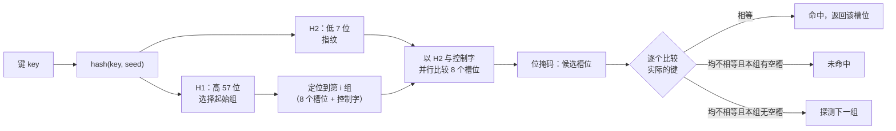
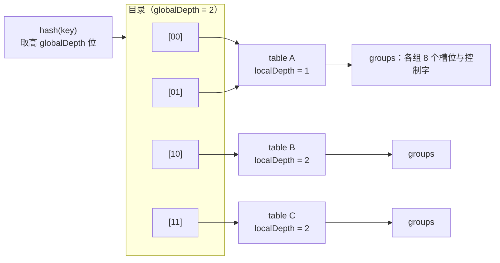

# 5.4 Swiss Table 与 Go 1.24 实现

[5.3](./map.md) 讨论了散列表的一般原理与安全问题。本节讨论 Go 的两代主要实现：先介绍 Swiss Table 这一现代
开放定址设计，再介绍 Go 1.1 至 Go 1.23 使用的桶式实现，然后讨论 Go 1.24 如何在 Swiss Table 的基础上满足
Go 的额外要求，以及由实现决定的两条语言规则，最后与其他语言的散列表作比较。

## 5.4.1 Swiss Table 的设计

Swiss Table 由 Google 的工程师设计，Matt Kulukundis 在 CppCon 2017 上作了公开介绍
[[Kulukundis, 2017](#ref-kulukundis-2017)]，2018 年随 Abseil C++ 库开源。它属于开放定址法，核心改进在于：
判断一组槽位中哪些为空、哪些值得进一步比较，不再逐个槽位进行，而是用一次并行操作完成。

它把哈希值分为两部分：高 57 位称为 **H1**，用于确定从哪一组（group）开始探测；低 7 位称为 **H2**，作为键的
指纹。槽位每 8 个组成一组，每组配有一个 8 字节的**控制字**（control word），其中每个字节对应组内的一个
槽位：

```
空槽      empty     1000 0000   （0x80）
墓碑      deleted   1111 1110   （0xfe）
已占用    full      0hhh hhhh   （最高位为 0，低 7 位为该键的 H2）
```

最高位区分空槽或墓碑与已占用的槽位，已占用槽位的低 7 位直接保存指纹。查找一个键时，先由 H1 确定起始组，
再用 H2 与该组的 8 个控制字节同时比较，相当于一次完成 8 步探测；借助 SIMD 指令，还可以把一组扩展到 16 个
槽位。比较的结果是一个位掩码，标出指纹相符的槽位，再逐个比较这些候选槽位中的实际键即可。指纹只有 7 位，
每个槽位约有 $1/128 \approx 0.78\%$ 的概率误判为相符；但匹配之后本来就要比较完整的键，误判只会偶尔多一次
比较，不影响正确性。



控制字使另外两个频繁的判断也只需一次位运算：本组是否有空槽（`matchEmpty`，决定探测何时停止），以及哪些
槽位为空或为墓碑（`matchEmptyOrDeleted`，插入时寻找位置）。这些操作都可以用 **SWAR**（SIMD Within A
Register）技巧实现，即在一个普通的 64 位整数上并行处理 8 个字节，在没有向量指令的平台上也只需几条整数
运算与位运算。

## 5.4.2 此前的桶式实现（Go 1.1 至 Go 1.23）

要理解 Go 1.24 的重写，先要了解它所取代的实现。Go 1.0 的 `map` 采用一种多级子表的设计；2013 年 3 月，
Keith Randall 重写了 `map`，提交说明写道：散列表由 8 个槽位一组的桶构成的数组组成，
以链接的溢出桶处理冲突，每个桶为每个键额外保存 8 位哈希以加速桶内查找，并且表是渐进增长的
[[Randall, 2013](#ref-randall-2013)]。这一设计随 Go 1.1 发布，一直使用到 Go 1.23。其顶层结构 `hmap`
如下（Go 1.23 `runtime/map.go`，注释为笔者所译）：

```go
type hmap struct {
	count     int    // 元素个数，len() 直接读取该字段
	flags     uint8
	B         uint8  // 桶数的以 2 为底的对数
	noverflow uint16 // 溢出桶的大致数量
	hash0     uint32 // 哈希种子

	buckets    unsafe.Pointer // 2^B 个桶组成的数组
	oldbuckets unsafe.Pointer // 扩容期间大小为一半的旧桶数组
	nevacuate  uintptr        // 搬迁进度：下标小于它的旧桶均已搬迁

	extra *mapextra // 溢出桶等可选字段
}
```

每个桶 `bmap` 保存 8 个键值对，以及 8 个 `tophash`，即各键哈希值的高 8 位（小于 5 的值被保留，用于标记槽位
的空闲与搬迁状态）。8 个键与 8 个值分别连续存放，桶装满后再链接一个溢出桶。装载因子的上限是平均每桶 6.5 个
元素（源码中写作 `loadFactorNum / loadFactorDen`，即 13/2），超过后桶数翻倍；溢出桶过多时，则进行一次桶数
不变的整理。扩容采用**渐进式搬迁**：旧桶数组保留在 `oldbuckets` 中，此后每次写操作顺带搬迁一两个旧桶，从而
把扩容的代价分摊到后续操作中，避免单次插入出现长时间的停顿。

这一设计使用了约 12 年，其不足也很明显：指纹与键分开存放，查找时先扫描 `tophash` 再跳到键所在的位置，访存
不连续；溢出桶以链表相连，负载较高时链变长，缓存局部性差。

## 5.4.3 Go 1.24 的实现

2022 年 8 月，YunHao Zhang 提出议题 #54766，建议 Go 的 `map` 改用 Swiss Table
[[Zhang, 2022](#ref-zhang-2022)]。此后 YunHao Zhang、PJ Malloy 与 andy-wm-arthur 先后实现了 Go 版 Swiss
Table 的早期版本；CockroachDB 的 Peter Mattis 在这些工作的基础上，实现了一个满足 Go 规范要求的版本
`github.com/cockroachdb/swiss` [[Mattis, 2024](#ref-mattis-2024)]。Go 1.24 的内置 `map` 由 Michael Pratt
实现，位于 `internal/runtime/maps` 包中，按照 Go 官方博客的说法，它在很大程度上基于 Peter Mattis 的工作
[[Pratt, 2025a](#ref-pratt-2025a)]。Go 1.24 默认启用新实现，仍可以用 `GOEXPERIMENT=noswissmap` 退回旧实现
[[Go Authors, 2025](#ref-go-authors-2025)]；Go 1.26 删除了这一开关以及约 6000 行旧实现的代码
[[Pratt, 2025b](#ref-pratt-2025b)]。

### 两项额外要求

Abseil 的设计不能直接照搬，因为 Go 的 `map` 有两项额外的要求。

其一是限制扩容的停顿。开放定址法的探测序列依赖组的数量，组数翻倍后所有元素都必须按新的探测序列重新放置，
即整张表必须一次性扩容。Go 常用于对延迟敏感的服务器程序，不能允许一次插入因为扩容一张巨大的表而产生任意长
的停顿。

其二是遍历语义。Go 允许在遍历 `map` 的过程中修改它，规范的要求可以概括为：遍历期间增删元素不得导致同一个
元素被返回两次；遍历期间新增的元素可能被返回，也可能不被返回；遍历期间被修改的元素必须返回最新的值；遍历
期间被删除的元素不得被返回；遍历顺序不作规定。Abseil 等许多散列表则禁止在遍历期间修改表。

### 目录与可扩展哈希

对于第一项要求，Go 的做法是**可扩展哈希**（extendible
hashing）[[Fagin et al., 1979](#ref-fagin-et-al-1979)]：把一个 `map` 的内容分散到多张 `table` 中，每张
table 都是一个完整的 Swiss Table，但只负责哈希空间的一部分；顶层的 `Map` 持有一个由这些 table 组成的
**目录**（directory），以哈希值的高 `globalDepth` 位作为目录下标，选出键所属的 table。`Map`
的字段如下（Go 1.26 `internal/runtime/maps/map.go` [[Go Authors, 2026](#ref-go-authors-2026)]，
注释为笔者所加）：

```go
type Map struct {
	used uint64  // 元素个数，len() 直接读取该字段
	seed uintptr // 该 map 的哈希种子（5.3.2）

	dirPtr unsafe.Pointer // 目录：*[dirLen]*table；小 map 时直接指向唯一的组
	dirLen int

	globalDepth uint8 // 选择 table 所用的哈希高位位数
	globalShift uint8 // 64 - globalDepth，取目录下标时的移位量

	writing uint8 // 写操作进行中的标志，用于检测并发写（5.4.4）

	tombstonePossible bool   // 是否可能存在墓碑
	clearSeq          uint64 // clear 的次数，用于在遍历中发现 clear
}
```

每张 table 有自己的容量与装载上限，独立扩容（`table.go`）：

```go
type table struct {
	used       uint16 // 元素个数
	capacity   uint16 // 槽位总数，总是 2 的幂
	growthLeft uint16 // 在需要扩容之前还能填入的槽位数
	localDepth uint8  // 创建该 table 时目录所用的位数
	index      int    // 在目录中的第一个下标；-1 表示已失效

	groups groupsReference // 由各组（8 个槽位与控制字）组成的数组
}
```

相关的常量有三个：每组有 `MapGroupSlots = 8` 个槽位；平均每组最多填入 `maxAvgGroupLoad = 7` 个元素，以保证
表中总有空槽，探测序列最终会遇到一个含空槽的组而终止；单张 table 的容量上限为 `maxTableCapacity = 1024`。
扩容规则因此分为两种情形：

- table 的容量未达到 1024 时，扩容就是用一张容量加倍的新 table 替换它，所有元素重新放置；由于表不大，代价
  有界。
- 容量达到 1024 后，扩容不再加倍，而是把这张 table **分裂**（split）为两张，各负责原哈希区间的一半。若该
  table 的 `localDepth` 等于 `globalDepth`，目录也随之加倍。

这样，单次扩容涉及的元素数始终不超过 1024 个。目录允许多个下标指向同一张 table（该 table 的 `localDepth`
小于 `globalDepth` 时），因此目录加倍并不要求每张 table 都立即分裂，只有装满的 table 才会分裂：



table A 的 `localDepth` 为 1，小于 `globalDepth` 的 2，因此目录的 `[00]` 与 `[01]` 两项共享它；只有当 A
装满需要分裂时，才会拆成两张 `localDepth` 为 2 的 table。这一结构不再像旧实现那样逐桶渐进搬迁，
而是通过限制单张 table 的大小来限制单次扩容的代价。

### 探测序列

table 内的探测序列如下（`table.go`）：

```go
func makeProbeSeq(hash uintptr, mask uint64) probeSeq {
	return probeSeq{
		mask:   mask,
		offset: uint64(hash) & mask,
		index:  0,
	}
}

func (s probeSeq) next() probeSeq {
	s.index++
	s.offset = (s.offset + s.index) & s.mask
	return s
}
```

每一步把递增的 `index` 累加到 `offset` 上，于是相对于起始组的偏移依次为 $0, 1, 3, 6, 10, \dots$，即三角数
$T_k = k(k+1)/2$。源码与 Abseil 都称之为二次探测，因为 $T_k$ 是 $k$ 的二次多项式。它之所以可用，
依赖一个数论事实：当组数为 $2^n$ 时，$T_k \bmod 2^n$ 在 $k = 0, 1, \dots, 2^n-1$ 上恰好取遍所有余数，
即探测序列不重不漏地访问每一组。这就是「组数必须是 2 的幂」这一探测不变量的由来；否则探测序列可能在仍有空
槽时陷入循环，查找会误判为未命中。

### 控制字的并行匹配

查找的内层循环就是 5.4.1 所述的并行匹配。`ctrlGroupMatchH2` 的可移植实现如下（`group.go`，
注释为笔者所加）：

```go
const (
	ctrlEmpty   ctrl = 0b10000000
	ctrlDeleted ctrl = 0b11111110

	bitsetLSB = 0x0101010101010101
	bitsetMSB = 0x8080808080808080
)

func ctrlGroupMatchH2(g ctrlGroup, h uintptr) bitset {
	// 把 8 个控制字节同时与 H2 异或：相等的字节变为 0
	v := uint64(g) ^ (bitsetLSB * uint64(h))
	// 经典的 SWAR 技巧：在值为 0 的字节的最高位置 1
	return bitset(((v - bitsetLSB) &^ v) & bitsetMSB)
}
```

源码的注释指出，这一通用实现在少数情形下会产生误报：减法的借位可能使紧邻一个真实匹配的字节也被标记为匹配。
但误报只在确有真实匹配时出现，且不会落在空槽或墓碑上，随后的键比较会将其排除，因此只是偶尔的低效，
并不影响正确性。在 amd64 上，自 Go 1.24 起编译器把 `matchH2`、`matchEmpty` 等函数替换为 SSE 指令；
组的大小仍保持 8 个槽位，以免改变内存布局。

查找时，先定位起始组，由 `matchH2` 得到候选槽位并逐个比较键；若该组含有空槽，则探测终止，返回未命中；否则
沿探测序列进入下一组。

### 删除与墓碑

删除需要格外小心。探测在遇到含空槽的组时停止，因此若从一个满组中删除元素后直接把槽位标记为空，
后续本应沿探测序列找到的键就会因探测提前终止而找不到。此时该槽位须标记为墓碑 `ctrlDeleted`，
探测遇到墓碑时继续向前；只有当该组仍有空槽时，才可以直接把槽位标记为空。插入时优先复用墓碑。
由于就地清理墓碑会使遍历变得复杂，墓碑原则上只在扩容时被完全清除。

对于反复插入与删除的负载，墓碑可能不断积累，使 table 在元素并不多时也频繁扩容
[[thepudds, 2024](#ref-thepudds-2024)]。Go 1.25 因此增加了 `pruneTombstones`：扩容之前，
若墓碑数达到容量的 10%，先尝试清除不再需要的墓碑 [[Randall, 2025](#ref-randall-2025)]。源码注释强调，
清理必须能够移除 $O(n)$ 个墓碑才值得进行，否则为找到一个可移除的墓碑付出 $O(n)$ 的代价，
下一次插入又要重复这一过程。Go 1.25 起，`clear(m)` 也会同时清除墓碑。

### 小 map

不超过 8 个元素的 `map` 恰好可以放进一个组中。此时运行时省去目录与 table 两层间接，`dirPtr` 直接指向这唯一
的组，`dirLen` 为 0。小 map 不需要探测序列，因此可以用满全部 8 个槽位，删除时也无须墓碑。绝大多数 `map` 都
很小，这项优化省去了它们的目录开销。

### 遍历

Go 官方博客称遍历是 `map` 实现中最复杂的部分 [[Pratt, 2025a](#ref-pratt-2025a)]。若遍历期间 `map`
没有扩容，只需依次遍历目录中的每张 table 及其中的每个组和槽位即可。若遍历期间发生了扩容，新的 table
有不同的探测序列，仅记录当前的组与槽位下标已不足以避免重复返回元素。Go 的做法是：迭代器保留对当前正在遍历
的旧 table 的引用，即使它已被替换，仍按旧 table 的顺序继续遍历，以保证不会重复返回同一元素；只存在于新
table 中的新增元素被跳过，这是规范所允许的。但旧 table 中的数据可能已经过时，因此每取得一个键，都要到新
table 中重新查找一次，以确定它是否已被修改或删除。

### 性能

Go 1.24 的发布说明称，在一组有代表性的基准测试中，运行时的若干改进使 CPU 开销平均降低 2% 至 3%；
这些改进包括基于 Swiss Table 的新 `map`、更高效的小对象分配，以及新的运行时内部互斥锁实现
[[Go Authors, 2025](#ref-go-authors-2025)]。也就是说，这一数字是三项改动合计的结果。Go 官方博客给出了
`map` 本身的数据：在微基准测试中，`map` 操作比 Go 1.23 最多快 60%，少数边缘情形有所退化；
在完整应用的基准测试中，CPU 时间的几何平均改善约为 1.5% [[Pratt, 2025a](#ref-pratt-2025a)]。
具体的收益随键的类型、负载与访问模式而异。

## 5.4.4 两条语言规则的由来

`map` 有两条常被问到的语言规则，它们都可以从上述实现得到解释。

**不能对 `map` 元素取址。** 无论是旧实现的搬迁，还是新实现的扩容与分裂，元素都可能在内存中移动，此前取得的
指针便会失效。语言因此在编译期禁止对 `map` 元素取址，同样也禁止直接给 `map` 中结构体元素的字段赋值：

```go
package main

type point struct{ x, y int }

func main() {
	m := map[string]point{"a": {1, 2}}
	p := &m["a"]  // 不能对 map 元素取址
	m["a"].x = 10 // 也不能直接给元素的字段赋值
	_ = p
}
```

```
./main.go:7:8: invalid operation: cannot take address of m["a"] (map index expression of struct type point)
./main.go:8:2: cannot assign to struct field m["a"].x in map
```

要修改结构体元素的某个字段，须先整体读出，修改后再整体写回；或者在 `map` 中存放指针。

**并发写会使程序终止。** 若多个 goroutine 同时写同一个 `map`，或一个读一个写，运行时会调用 `fatal`
直接终止程序，而不是像一般的数据竞争那样留下未定义的结果：

```go
package main

import "sync"

func main() {
	m := map[int]int{}
	var wg sync.WaitGroup
	for g := range 2 {
		wg.Go(func() {
			for i := range 1_000_000 {
				m[i] = g // 两个 goroutine 同时写同一个 map
			}
		})
	}
	wg.Wait()
}
```

```
fatal error: concurrent map writes
```

检测依靠 `Map.writing` 字段。每个写操作开始时检查它是否为 0，然后将它翻转（`writing ^= 1`）；
结束前再检查它是否仍为 1，然后翻转回来。以 `PutSlot` 为例（Go 1.26，有删节）：

```go
func (m *Map) PutSlot(typ *abi.MapType, key unsafe.Pointer) unsafe.Pointer {
	if m.writing != 0 {
		fatal("concurrent map writes")
	}

	hash := typ.Hasher(key, m.seed)

	// 在调用 Hasher 之后才设置 writing，因为 Hasher 可能 panic，
	// 那种情况下实际上并没有发生写操作。
	m.writing ^= 1 // 翻转，参见 writing 字段的注释

	// ……插入……

	if m.writing == 0 {
		fatal("concurrent map writes")
	}
	m.writing ^= 1
	// ……
}
```

读操作只检查该字段，发现它不为 0 时报告 `concurrent map read and map write`。源码对 `writing`
字段的注释解释了为什么用翻转而不是简单地置 1：若有多个写者同时进入，翻转可以提高双方都检测到竞争的概率。
例如两个写者先后翻转，标志回到 0，结束前的检查便会发现异常。这是一种尽力而为（best-effort）的检测：
它不加锁，不保证捕获每一次竞争，但以几乎为零的代价把大多数误用尽早暴露为明确的崩溃，
而不是留下难以排查的错误。在多个 goroutine 之间共享 `map` 时，仍须使用 `sync.Mutex` 或 `sync.RWMutex`
加以保护，或者改用 `sync.Map`（[第 11 章](../../part3concurrency/ch11sync/readme.md)）。

## 5.4.5 其他语言的散列表

把 Go 的两代实现与其他语言的散列表放在一起比较，可以看出哪些是共识，哪些是取舍：

| 语言或库 | 设计 | 冲突处理 | 要点 |
| --- | --- | --- | --- |
| Go 1.24 及以后 | Swiss Table 与可扩展哈希目录 | 开放定址，二次探测 | 控制字并行匹配；以 table 分裂限制单次扩容的代价 |
| Rust `HashMap` | hashbrown（Swiss Table 的移植） | 开放定址，按组 SIMD 探测 | 自 Rust 1.36 起为标准库实现；默认使用 SipHash 1-3 |
| C++ `absl::flat_hash_map` | Swiss Table 原始实现 | 开放定址，按组 SIMD 探测 | 键值内联连续存放，对缓存友好 |
| C++ `std::unordered_map` | 链地址 | 桶与链表 | 标准规定的桶接口与元素引用稳定性，实际上要求链地址法 |
| Java `HashMap` | 链地址，必要时转为红黑树 | 链表，超过阈值转为树 | 单个桶中的元素达到 8 个（且表足够大）时转为树，最坏情况由 $O(n)$ 降为 $O(\log n)$（JEP 180 [[OpenJDK, 2014](#ref-openjdk-2014)]） |
| Python `dict` | 紧凑的开放定址 | 扰动探测与独立的索引表 | 索引表与按插入顺序存放的数据数组分离，节省内存并保持插入顺序 |

其中有两点值得注意。其一，C++ 标准要求 `std::unordered_map` 提供桶接口，并保证元素的引用在重新散列后仍然有
效，这实际上要求采用链地址法，使它无法获得开放定址法在缓存上的优势；这也是 Abseil 另行提供
`flat_hash_map` 的原因。Go 没有这方面的约束，`map` 的内存布局从未成为语言规范的一部分，因此 Go 1.24
可以整体替换实现而不影响任何用户代码。其二，Rust 与 Go 各自独立地采用了 Abseil 的设计
[[Rust Release Team, 2019](#ref-rust-release-team-2019)]，这说明 Swiss Table 已经成为现代开放定址散列表的
一种主流设计。

性能的提升并非没有代价。Swiss Table 以控制字占用的额外空间、SIMD 与 SWAR 带来的实现复杂度以及目录的间接访
问，换取了在高装载因子下仍然连续、可以并行探测的查找。Go 在此之上还要满足有界扩容、垃圾回收器的精确扫描、
遍历语义与并发写检测等要求，而这些复杂性都隐藏在运行时内部，使用者面对的仍然只是 `m[k]`。

## 延伸阅读

- <a id="ref-kulukundis-2017"></a>[Kulukundis, 2017] Matt Kulukundis. "Designing a Fast, Efficient,
  Cache-friendly Hash Table, Step by Step." CppCon, 2017. https://www.youtube.com/watch?v=ncHmEUmJZf4
  Swiss Table 设计的公开讲解。另见 Abseil 的设计说明：https://abseil.io/about/design/swisstables
- <a id="ref-pratt-2025a"></a>[Pratt, 2025a] Michael Pratt. "Faster Go maps with Swiss Tables." The Go
  Blog, 2025. https://go.dev/blog/swisstable
  Go 1.24 实现的缘起、有界扩容与遍历语义的处理，以及性能数据。
- <a id="ref-zhang-2022"></a>[Zhang, 2022] YunHao Zhang. "runtime: use SwissTable." golang/go#54766, 2022.
  https://github.com/golang/go/issues/54766
  Go 采用 Swiss Table 的提案与讨论。
- <a id="ref-mattis-2024"></a>[Mattis, 2024] Peter Mattis. `github.com/cockroachdb/swiss`. 2024.
  https://github.com/cockroachdb/swiss
  Go 1.24 实现所依据的、满足 Go 规范要求的 Swiss Table 实现。
- <a id="ref-go-authors-2026"></a>[Go Authors, 2026] The Go Authors. `internal/runtime/maps/map.go`.
  https://github.com/golang/go/blob/release-branch.go1.26/src/internal/runtime/maps/map.go
  （开发版本：<https://github.com/golang/go/blob/master/src/internal/runtime/maps/map.go>）
  包注释详细说明了可扩展哈希、目录、分裂与遍历的设计。
- <a id="ref-openjdk-2014"></a>[OpenJDK, 2014] OpenJDK. "JEP 180: Handle Frequent HashMap Collisions with
  Balanced Trees." 2014. https://openjdk.org/jeps/180
  Java `HashMap` 以红黑树应对最坏情况的方案。
- <a id="ref-go-authors-2025"></a>[Go Authors, 2025] The Go Authors. Go 1.24 Release Notes.
  https://go.dev/doc/go1.24
  Runtime 一节说明了新 `map` 实现、`GOEXPERIMENT=noswissmap` 开关，以及三项运行时改进合计的性能数据。
- <a id="ref-randall-2013"></a>[Randall, 2013] Keith Randall. "runtime: faster hashmap implementation." Go
  commit 00224a356a, 2013. https://go.dev/cl/7504044
  Go 1.1 至 Go 1.23 所用桶式实现的最初提交，提交说明概括了桶、溢出链与渐进扩容的设计。
- <a id="ref-thepudds-2024"></a>[thepudds, 2024] thepudds. "runtime: Swiss Table maps can double size
  multiple times when deleting/adding elements." golang/go#70886, 2024.
  https://github.com/golang/go/issues/70886
  反复插入与删除时墓碑积累、导致 table 反复扩容的问题报告。
- <a id="ref-randall-2025"></a>[Randall, 2025] Keith Randall. "internal/runtime/maps: prune tombstones in
  maps before growing." Go commit 05ed8a00e0, 2025. https://go.dev/cl/640955
  随 Go 1.25 发布的 `pruneTombstones`，扩容之前先尝试清除墓碑。
- <a id="ref-pratt-2025b"></a>[Pratt, 2025b] Michael Pratt. "all: remove GOEXPERIMENT=swissmap." Go commit
  2ae059ccaf, 2025. https://github.com/golang/go/commit/2ae059ccaf
  Go 1.26 删除旧实现与实验开关的提交，删去约 6100 行代码。
- <a id="ref-fagin-et-al-1979"></a>[Fagin et al., 1979] Ronald Fagin, Jürg Nievergelt, Nicholas Pippenger,
  H. Raymond Strong. "Extendible Hashing—A Fast Access Method for Dynamic Files." ACM Transactions on
  Database Systems 4(3):315–344, 1979. https://doi.org/10.1145/320083.320092
  可扩展哈希的原始论文：以目录与局部深度把文件的增长限制在单个桶的分裂上。
- <a id="ref-rust-release-team-2019"></a>[Rust Release Team, 2019] The Rust Release Team. "Announcing Rust
  1.36.0." Rust Blog, 2019-07-04. https://blog.rust-lang.org/2019/07/04/Rust-1.36.0/
  Rust 标准库的 `HashMap` 改用基于 Swiss Table 的 hashbrown，默认哈希函数仍为 SipHash 1-3。

