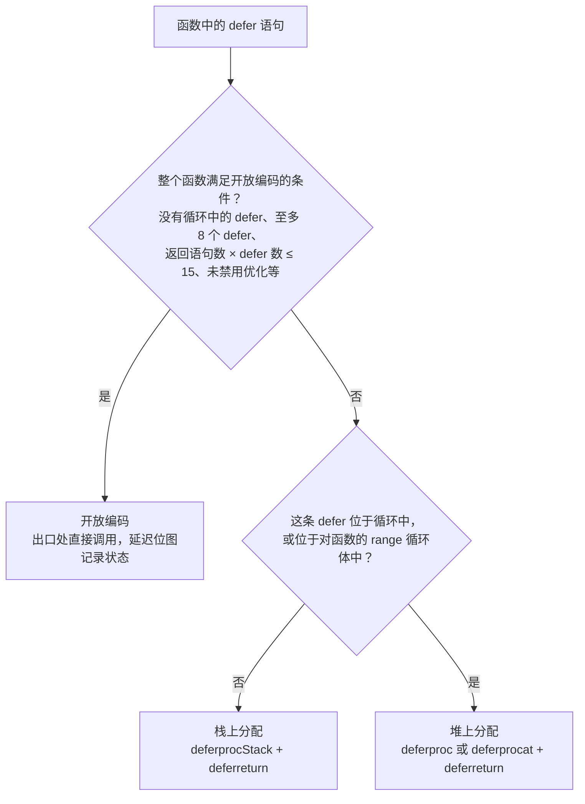

# 6.2 延迟语句

`defer` 语句并非 Go 最初设计的一部分。2009 年 1 月 27 日，Robert Griesemer 在语言规范中加入了 `defer`
语句 [[Griesemer, 2009](#ref-griesemer-2009)]，同一天 Ken Thompson 提交了它最早的实现
[[Thompson, 2009](#ref-thompson-2009)]。按照规范，被延迟的调用在外层函数返回时执行，无论函数是执行了
`return` 语句、到达了函数体末尾，还是所在的 goroutine 发生了 panic
[[Go Authors, 2026b](#ref-go-authors-2026b)]；调用 `runtime.Goexit` 终止 goroutine 时，
已登记的延迟调用同样会执行。初看之下，这像是一个纯粹的编译期特性，类似 C++ 中对象离开作用域时自动调用析构
函数：编译器只需把延迟的调用移到函数的各个出口处，似乎不应有运行时开销。

实际情况要复杂一些。Go 的 `defer` 不与某个作用域或某个资源绑定，并且可以出现在条件语句和循环中。一个函数在
运行时会登记多少个延迟调用，在编译期往往无法确定：

```go
func randomDefers() {
	for rand.Intn(100) > 42 {
		defer println("golang-design/under-the-hood") // 执行次数在运行时才能确定
	}
}
```

因此 `defer` 需要运行时的支持，其开销也一度相当可观。本节先说明 `defer` 的语义，再讨论它的三种实现以及编译
器如何在其间选择，最后讨论 `defer` 与 panic 共用的执行机制。这一机制也是理解 [6.3](./panic.md) 的基础：
在今天的运行时中，正常返回时执行延迟调用，与 panic 展开时执行延迟调用，由同一段代码完成。

## 6.2.1 语义

`defer` 的可观察语义可以归纳为四条。

第一，**后进先出**。同一函数中的多个延迟调用按登记的逆序执行。这使得「先打开 A，再打开 B」与「先关闭 B，
再关闭 A」自然对称，正是资源清理所需的顺序。

第二，**正常返回与 panic 都会触发**。无论函数是正常返回，还是因 panic 而向上展开，已登记的延迟调用都会被
执行。这使 `defer` 可以用于必须执行的清理，也使 [6.3](./panic.md) 中借助 `recover` 拦截 panic 成为可能。

第三，**实参在 `defer` 语句处求值，调用被推迟**。被延迟的函数及其实参在执行 `defer` 语句时即已确定，
只有调用本身推迟到函数退出时。若在 `f, _ := os.Open(...)` 之后立即写 `defer f.Close()`，
而实参推迟到最后才求值，那么中途对 `f` 的重新赋值就会导致关闭错误的文件。在 `defer` 处求值，
才符合写下这行代码时的意图。

第四，**延迟调用在 `return` 设置结果之后执行**。`return 3` 先把结果赋给返回值，再执行延迟调用，最后才真正
返回。因此，延迟调用中的闭包可以读取并修改命名的返回值；这也是 [6.3](./panic.md) 中 `recover` 之后得以改写
函数返回值的原因。

```go {run=true}
package main

import "fmt"

func order() {
	for i := range 3 {
		defer fmt.Print(i, " ") // 后进先出
	}
}

func args() {
	i := 0
	defer fmt.Println("deferred:", i) // 实参在此处求值
	i++
	fmt.Println("now:", i)
}

func double() (n int) {
	defer func() { n *= 2 }() // 在 return 设置结果之后执行
	return 3
}

func main() {
	order()
	fmt.Println()
	args()
	fmt.Println(double())
}
```

```
2 1 0
now: 1
deferred: 0
6
```

第三条语义的实现方式后来有所改变，语义本身则保持不变。早期的实现把实参复制到延迟记录中保存。Go 1.17 在
amd64 上引入基于寄存器的调用约定时，编译器开始把每个带参数的延迟调用改写为一个无参闭包
[[McIntosh, 2021](#ref-mcintosh-2021)]：实参在构造闭包时求值并被闭包捕获，运行时最后只需调用这个闭包。自
Go 1.18 起，这一改写在所有平台上进行 [[Mui, 2021](#ref-mui-2021)]，运行时中处理参数的代码随之删除，
延迟记录也不再需要保存参数。

这一改写可以从编译器的诊断输出中直接看到。以 `-gcflags=-m=2` 编译下面的程序：

```go
package main

import "sync"

func unlock(mu *sync.Mutex) {
	mu.Lock()
	defer mu.Unlock()
}

func main() {
	var mu sync.Mutex
	unlock(&mu)
}
```

输出中有一行描述编译器为这条 `defer` 语句生成的闭包：

```
./main.go:7:2: can inline unlock.deferwrap1 with cost 76 as: func() { (*sync.Mutex).Unlock(.autotmp_1) }
```

其中 `.autotmp_1` 是执行 `defer` 语句时求值并保存下来的接收者 `mu`，闭包 `unlock.deferwrap1`
本身不带参数。

## 6.2.2 三种实现

`defer` 的开销几乎全部来自一个问题：记录「有哪些延迟调用待执行」的数据存放在哪里，何时分配，
如何在函数退出时找到并执行它们。Go 先后给出了三种答案，它们并非依次取代，而是**同时存在**，
由编译器根据每个函数的情况选择。在 Go 1.26 中，延迟调用的记录 `_defer` 定义如下（`runtime/runtime2.go`
[[Go Authors, 2026c](#ref-go-authors-2026c)]，注释为笔者所译）：

```go
type _defer struct {
	heap      bool
	rangefunc bool    // 是否属于对函数的 range 所用的链表
	sp        uintptr // 登记时的栈指针
	pc        uintptr // 登记时的程序计数器
	fn        func()  // 被延迟的调用；开放编码时可以为 nil
	link      *_defer // goroutine 上的下一个记录，可能位于堆上，也可能位于栈上

	// 若 rangefunc 为 true，*head 是对函数的 range 执行期间所用原子链表的表头。
	head *atomic.Pointer[_defer]
}
```

记录中没有参数大小，也没有参数缓冲区，实参都已由闭包 `fn` 捕获。一个 goroutine 登记的记录通过 `link` 连成
链表，表头保存在 `g._defer` 中，越晚登记的越靠前，自然实现了后进先出。

### 堆上分配

最直接的做法是：每执行一次 `defer` 语句，就由运行时分配一个 `_defer`，填好 `fn`、`pc` 与 `sp`，挂到
`g._defer` 链表的表头。编译器把 `defer` 语句翻译为对 `deferproc` 的调用，并在函数的出口处插入对
`deferreturn` 的调用 [[Go Authors, 2026a](#ref-go-authors-2026a)]：

```go
func deferproc(fn func()) {
	gp := getg()
	if gp.m.curg != gp {
		// 在系统栈上运行的 Go 代码不能使用 defer
		throw("defer on system stack")
	}

	d := newdefer()
	d.link = gp._defer
	gp._defer = d
	d.fn = fn
	d.pc = sys.GetCallerPC()
	// 在调用 GetCallerSP 与写入 d.sp 之间不能被抢占，
	// 因为 GetCallerSP 返回的是一个 uintptr 形式的栈指针。
	d.sp = sys.GetCallerSP()
}
```

`newdefer` 并不每次都分配新内存：它优先从当前处理器（P）的本地缓存 `deferpool` 中取出一个记录，
本地缓存为空时，再从全局的 `sched.deferpool` 中一次取来足以填满本地缓存一半的记录，两者都为空时才分配。
这与内存分配器的多级缓存（[12.2](../../part4memory/ch12alloc/component.md)）是同一思路。即便如此，
这仍是三种实现中最慢的一种：登记与归还都要访问缓存池，并维护链表。早年「不要在热路径上使用 `defer`」
的建议即由此而来。

### 栈上分配（Go 1.13）

`_defer` 的生命周期不会超过登记它的函数调用，因此可以把记录直接放在该函数的栈帧上。Keith Randall 早在
2013 年就提出了这一设想 [[Randall, 2013](#ref-randall-2013)]，它最终于 2019 年实现，随 Go 1.13 发布。
对于在一次函数调用中至多执行一次的 `defer` 语句（即不在循环中的 `defer`），编译器在栈帧中预留 `_defer`
的空间，并调用 `deferprocStack` 对其初始化、挂入链表；函数返回时，记录随栈帧一同释放，省去了分配与回收：

```go
func deferprocStack(d *_defer) {
	gp := getg()
	if gp.m.curg != gp {
		// 在系统栈上运行的 Go 代码不能使用 defer
		throw("defer on system stack")
	}

	// fn 已由调用方设置，其余字段在此初始化。
	d.heap = false
	d.rangefunc = false
	d.sp = sys.GetCallerSP()
	d.pc = sys.GetCallerPC()
	// 以下三行相当于：
	//   d.link = gp._defer
	//   d.head = nil
	//   gp._defer = d
	// 但不使用写屏障。前两项写入的是栈，本不需要写屏障，
	// 并且写入的是未初始化的内存，因而不能使用写屏障。
	// 第三项也无须写屏障，因为所有的 defer 记录都会被显式标记，
	// 不必借助写屏障追踪指向它们的指针。
	*(*uintptr)(unsafe.Pointer(&d.link)) = uintptr(unsafe.Pointer(gp._defer))
	*(*uintptr)(unsafe.Pointer(&d.head)) = 0
	*(*uintptr)(unsafe.Pointer(&gp._defer)) = uintptr(unsafe.Pointer(d))
}
```

Go 1.13 的发布说明称，这一改进使大多数 `defer` 的性能提高了 30%
[[Go Authors, 2019](#ref-go-authors-2019)]。但它仍要维护链表，仍要在函数出口处调用 `deferreturn`，
距离零开销还有差距。

### 开放编码（Go 1.14）

Go 1.14 引入的**开放编码式延迟**（open-coded defer）由 Dan Scales、Keith Randall 与 Austin Clements 设计
[[Scales et al., 2019](#ref-scales-et-al-2019)]，Dan Scales 实现。其思路回到了最初的直觉：大多数函数中
`defer` 的数量与位置在编译期即可确定，那么就不经过运行时，由编译器直接在函数的每个出口处生成调用延迟函数的
代码，连 `_defer` 记录都不需要。例如：

```go
var mu sync.Mutex

func f() {
	mu.Lock()
	defer mu.Unlock()
}
```

编译后的代码中既没有 `deferproc` 或 `deferprocStack`，也不在正常路径上调用 `deferreturn`，`mu.Unlock()`
的调用直接出现在函数返回之前。实现该功能的提交给出了一组基准数据：一条 `defer` 语句的代价，
在只使用栈上分配时为 35.4 ns，使用开放编码后为 5.6 ns，直接调用函数本身（去掉 `defer` 关键字）则需要
4.4 ns [[Scales, 2019](#ref-scales-2019)]。Go 1.14 的发布说明因此称，大多数 `defer`
与直接调用被延迟的函数相比已几乎没有额外开销 [[Go Authors, 2020](#ref-go-authors-2020)]。

开放编码的难点在于条件分支。若某个 `defer` 位于只有运行时才能确定是否执行的 `if` 中，
出口处的代码如何知道是否应当调用它？编译器为此在栈上维护一个 8 位的**延迟位图**（defer bits）`deferBits`，
每个开放编码的 `defer` 占一位。执行到 `defer` 语句时，先把被延迟的闭包保存到栈上的槽位中，
保存完成后才把对应的位置 1；在出口处按逆序检查各位，只调用已置位的那些。每个位在调用之前即被清零并写回栈
上，这样即使被延迟的调用本身发生 panic，panic 处理也不会再次执行它。以伪代码表示：

```go
var tmp0, tmp1 func() // 栈上的闭包槽位
deferBits := uint8(0)

tmp0 = f0 // 执行到第一个 defer：先保存闭包（实参已由闭包捕获）
deferBits |= 1 << 0
if cond {
	tmp1 = f1 // 执行到第二个 defer
	deferBits |= 1 << 1
}
// ……函数体……

// 出口处按逆序检查：
if deferBits&(1<<1) != 0 {
	deferBits &^= 1 << 1 // 调用之前清零
	tmp1()
}
if deferBits&(1<<0) != 0 {
	deferBits &^= 1 << 0
	tmp0()
}
```

可见开放编码并非绝对零开销：仍要为函数值保留栈槽，条件 `defer` 还要付出少量位运算。但与分配记录、
维护链表相比，这些开销可以忽略。`deferBits` 只有一个字节，这也就是一个函数最多只能有 8 个开放编码的
`defer` 的原因。

开放编码也有代价。`defer` 的记录不再进入链表，panic 便无法沿链表找到它们（见 6.2.4）。为此，panic
处理须扫描栈上的各个栈帧，寻找使用了开放编码的函数。同一提交给出的数据表明，panic 之后再 recover 的代价从
62 ns 增加到 255 ns [[Scales, 2019](#ref-scales-2019)]。这是有意的取舍：正常路径远比 panic 路径常见。

### 编译器如何选择

编译器以函数为单位决定是否使用开放编码。只要以下任一条件成立，整个函数便不使用开放编码（Go 1.26
`cmd/compile/internal/walk` 与 `ssagen`）：

- 函数中有 `defer` 位于循环中（逃逸分析把这样的 `defer` 标记为可能多次执行）；
- 函数中的 `defer` 多于 8 个（`maxOpenDefers = 8`）；
- 返回语句的数量与 `defer` 数量的乘积大于 15；开放编码须在每个出口重复生成代码，源码注释指出，
  开放编码主要是为了改善较小函数的性能，这类函数的出口不多；
- 以 `-N` 禁用优化编译，或者启用了竞态检测；
- 函数有分配在堆上的结果参数（6.2.4 所述的额外代码段无法把这样的结果写回）；
- 函数中有位于对函数的 `range` 循环体中的 `defer`（Go 1.23 起，见下文）。

不使用开放编码时，每个 `defer` 再单独决定分配在栈上还是堆上：不在循环中的 `defer` 使用栈上分配，
位于循环中的则只能堆上分配。

整个决策过程如下图所示：



以 `-gcflags=-d=defer` 编译，编译器会报告每个 `defer` 所采用的实现：

```go
package main

import "sync"

func lock(mu *sync.Mutex) {
	mu.Lock()
	defer mu.Unlock()
}

func cond(b bool) {
	if b {
		defer println("a")
	}
	defer println("b")
}

func loop(n int) {
	for range n {
		defer println("x")
	}
}

func mixed(n int) {
	defer println("y")
	for range n {
		defer println("x")
	}
}

func seq(yield func(int) bool) { yield(1) }

func rangefunc() {
	for x := range seq {
		defer println(x) // 属于 rangefunc 的栈帧，而非循环体闭包
	}
}

func main() {
	var mu sync.Mutex
	lock(&mu)
	cond(true)
	loop(1)
	mixed(1)
	rangefunc()
}
```

```
./main.go:7:2: open-coded defer
./main.go:12:3: open-coded defer
./main.go:14:2: open-coded defer
./main.go:19:3: heap-allocated defer
./main.go:24:2: stack-allocated defer
./main.go:26:3: heap-allocated defer
./main.go:34:3: heap-allocated defer
```

`mixed` 说明了以函数为单位决策的后果：循环中的 `defer` 使整个函数放弃开放编码，循环外的那个 `defer`
也只能退而使用栈上分配。最后一行是对函数的 `range` 带来的新情形。按照语义，循环体中的 `defer`
属于外层函数 `rangefunc`，应在 `rangefunc` 返回时执行，而不是在每次调用循环体闭包（[6.1.5](./func.md)）
返回时执行。为此，外层函数先调用 `runtime.deferrangefunc`，在 `g._defer` 链表上登记一个 `rangefunc`
字段为 true 的特殊记录，并取得一个代表当前栈帧的令牌；循环体中的 `defer` 则改为调用 `deferprocat`，
登记到这个令牌所指的另一条链表上。之所以需要单独的链表，是因为被遍历的迭代器函数自己也可能登记 `defer`，
这个特殊记录未必位于 `g._defer` 的表头。为了使行为不当的程序（例如迭代器在多个 goroutine
中并发调用循环体）不致破坏运行时的数据结构，这条链表以原子操作维护，即 `_defer` 中的 `head` 字段。
延迟调用的处理进行到这个特殊记录时，运行时调用 `deferconvert` 把挂在它上面的记录并入主链表
[[Cox, 2023](#ref-cox-2023)]。这类 `defer` 总是在堆上分配。

## 6.2.3 演进简史

`defer` 十余年的优化，可以概括为把运行时的工作逐步移到编译期：

| 版本 | 内容 | 作者 |
| --- | --- | --- |
| 2009 年 | 语言规范加入 `defer` 语句；首个实现，记录在堆上分配 | Robert Griesemer、Ken Thompson |
| 1.1 | 以 2 KB 的内存块为每个 goroutine 批量分配记录 [[Cox, 2011](#ref-cox-2011)] | Russ Cox |
| 1.3 | 改为按处理器（P）划分的记录缓存池 [[Vyukov, 2014](#ref-vyukov-2014)] | Dmitry Vyukov |
| 1.8 | 只在慢速路径上切换到系统栈，`defer` 提速约 2.2 倍 | Austin Clements |
| 1.13 | 记录在栈上分配，大多数 `defer` 提速 30% | Keith Randall |
| 1.14 | 开放编码，大多数 `defer` 几乎没有额外开销 | Dan Scales |
| 1.17 至 1.18 | 带参数的延迟调用改写为无参闭包，运行时不再处理参数 | Than McIntosh、Cherry Mui |
| 1.22 | `gopanic`、`Goexit` 与 `deferreturn` 共用同一个处理延迟调用的状态机 | Matthew Dempsky |
| 1.23 | 对函数的 `range` 成为正式特性，循环体中的 `defer` 登记到外层函数 | Russ Cox |

关于 Go 1.8 一项：在此之前，每次调用 `deferproc` 与 `deferreturn` 都要切换到系统栈，
以防止在操作链表的过程中发生抢占或栈增长。Austin Clements 的修改把这一切换移到分配与释放记录的慢速路径中，
常见路径上的函数改为 `nosplit`，即不做栈空间检查，从而以不触发栈增长的方式防止抢占。提交说明中的数据显示，
以加锁后 `defer` 解锁与直接加锁、解锁相比，`defer` 的额外开销从 61.4 ns 降至 27.9 ns
[[Clements, 2016](#ref-clements-2016)]。

## 6.2.4 `deferreturn` 与 panic：同一套机制

栈上分配与堆上分配的记录都在 `g._defer` 链表上，开放编码的 `defer` 则没有记录。这带来一个必须回答的问题：panic
沿调用栈向上展开、需要执行每一帧中已登记的延迟调用时，如何找到开放编码的 `defer`？

答案是编译器为使用开放编码的函数生成一份额外的元数据 `FUNCDATA_OpenCodedDeferInfo`，记录 `deferBits`
以及各个延迟调用的函数值在栈帧中的位置 [[Scales et al., 2019](#ref-scales-et-al-2019)]。panic
展开到这样的栈帧时，读取这份元数据以及栈上 `deferBits` 的当前值，便能准确地执行那些本应在正常返回时执行、
却被 panic 打断的延迟调用。此外，编译器还在这类函数末尾生成一小段正常执行流程不会到达的代码，它只调用
`deferreturn`，把结果装入寄存器，然后返回。`recover` 之后，运行时把执行流程转到函数中对 `deferreturn`
的调用处（对于使用开放编码的函数，就是这段代码），使函数能够执行余下的延迟调用并正常返回。开放编码省去了
`_defer` 记录，代价是这些栈帧必须在 panic 时仍可被准确地遍历。

Go 1.22 进一步统一了这套机制。Matthew Dempsky 重构了 `gopanic`、`Goexit` 与 `deferreturn`，
使三者共用一个处理待执行延迟调用的状态机 [[Dempsky, 2023](#ref-dempsky-2023)]。今天的 `deferreturn`
构造一个标记为 `deferreturn` 的 `_panic` 值，然后执行与真正的 panic 相同的循环：

```go
func deferreturn() {
	var p _panic
	p.deferreturn = true

	p.start(sys.GetCallerPC(), unsafe.Pointer(sys.GetCallerSP()))
	for {
		fn, ok := p.nextDefer()
		if !ok {
			break
		}
		fn()
	}
}
```

`nextDefer` 是这一机制的核心：它既能沿 `g._defer` 链表取出栈上与堆上的延迟调用，也能借助上述元数据取出开放
编码的延迟调用，从而对调用方屏蔽了三种实现的差别。正常返回、panic 展开与 `runtime.Goexit` 执行延迟调用，
自此由同一段代码完成。[6.3](./panic.md) 将讨论 `recover` 如何在这一循环中被发现并终止展开。

## 6.2.5 其他语言中的确定性清理

`defer` 所解决的是一个普遍的问题：如何保证无论从哪条路径离开，清理工作都会执行。各语言的做法不同。

C++ 的 **RAII**（Resource Acquisition Is Initialization，这一名称由 Bjarne Stroustrup 提出
[[Stroustrup, 1994](#ref-stroustrup-1994)]）把清理与对象的生命周期绑定：对象离开作用域时，
编译器确定地调用其析构函数。这是纯粹的编译期机制，没有运行时的记录开销；代价是清理必须依附于某个类型，
不能像 `defer` 那样就地登记任意一段代码。Rust 的 `Drop` 沿用了 RAII 的思路，并由所有权系统在编译期确定释放
时机。Java 的 `try`-`finally`（以及 try-with-resources）与 Python 的 `with` 语句
[[van Rossum and Coghlan, 2005](#ref-van-rossum-coghlan-2005)]则把清理显式地放在语法块中，作用域清晰，
但同时管理多个资源时嵌套层次较深。

Go 选择了另一条路：`defer` 不与类型绑定，也不需要额外的语法块，可以紧挨着获取资源的代码登记释放操作，写下
`Open` 的下一行就是 `defer Close`，可读性很好。代价正是本节讨论的内容：由于 `defer` 脱离了静态作用域、可以
出现在条件与循环中，编译器无法总是把它化为 RAII 那样的静态调用，因而需要运行时的参与，也才有了此后为把开销
降到接近零而进行的一系列优化。

也正因为这些优化，「不要在热路径上使用 `defer`」这一流传已久的经验已经过时。在堆上分配的时代，它是正确的；
开放编码实现之后，小函数中的 `defer` 与手写的清理代码几乎没有差别。性能经验有其适用的版本，在依据某条经验
调优之前，应当先确认它所依据的成本模型是否仍然成立。

## 延伸阅读

- <a id="ref-scales-et-al-2019"></a>[Scales et al., 2019] Dan Scales, Keith Randall, Austin Clements.
  "Proposal: Low-cost defers through inline code, and extra funcdata to manage the panic case." 2019.
  https://go.googlesource.com/proposal/+/master/design/34481-opencoded-defers.md
  （另一写法：<https://go.googlesource.com/proposal/+/refs/heads/master/design/34481-opencoded-defers.md>）
  开放编码 `defer` 的设计文档。
- <a id="ref-scales-2019"></a>[Scales, 2019] Dan Scales. "cmd/compile, cmd/link, runtime: make defers
  low-cost through inline code and extra funcdata." Go commit be64a19d99, 2019.
  https://go.googlesource.com/go/+/be64a19d99
  开放编码的实现，提交说明中给出了 `defer` 与 panic/recover 的基准数据。
- <a id="ref-randall-2013"></a>[Randall, 2013] Keith Randall. "cmd/compile: allocate some defers in stack
  frames." golang/go#6980, 2013. https://github.com/golang/go/issues/6980
  栈上分配 `defer` 记录的最初设想，于 Go 1.13 实现。
- <a id="ref-clements-2016"></a>[Clements, 2016] Austin Clements. "runtime: optimize defer code." Go
  commit f8b2314c56, 2016. https://go.googlesource.com/go/+/f8b2314c56
  Go 1.8 中对 `deferproc` 与 `deferreturn` 的优化。
- <a id="ref-dempsky-2023"></a>[Dempsky, 2023] Matthew Dempsky. "runtime: refactor defer processing." Go
  commit 9eb1d5317b, 2023. https://go.googlesource.com/go/+/9eb1d5317b
  Go 1.22 中统一 `gopanic`、`Goexit` 与 `deferreturn` 的重构。
- <a id="ref-go-authors-2026a"></a>[Go Authors, 2026a] The Go Authors. `runtime/panic.go`.
  https://github.com/golang/go/blob/release-branch.go1.26/src/runtime/panic.go
  （开发版本：<https://github.com/golang/go/blob/master/src/runtime/panic.go>）`deferproc`、`deferprocStack`、`newdefer`、`deferreturn`
  与 `nextDefer` 的实现。
- <a id="ref-go-authors-2026b"></a>[Go Authors, 2026b] The Go Authors. *The Go Programming Language
  Specification*, "Defer statements". https://go.dev/ref/spec#Defer_statements
- <a id="ref-go-authors-2019"></a>[Go Authors, 2019] The Go Authors. Go 1.13 Release Notes.
  https://go.dev/doc/go1.13#performance
  栈上分配 `defer` 记录，大多数 `defer` 的性能提高 30%。
- <a id="ref-go-authors-2020"></a>[Go Authors, 2020] The Go Authors. Go 1.14 Release Notes.
  https://go.dev/doc/go1.14#runtime
  开放编码 `defer`，与直接调用被延迟的函数相比几乎没有额外开销。
- <a id="ref-cox-2011"></a>[Cox, 2011] Russ Cox. "runtime: aggregate defer." golang/go#2364, 2011.
  https://github.com/golang/go/issues/2364
  以内存块为每个 goroutine 批量分配 `defer` 记录。
- <a id="ref-vyukov-2014"></a>[Vyukov, 2014] Dmitry Vyukov. "runtime: per-P defer pool." Go commit
  1ba04c171a, 2014. https://github.com/golang/go/commit/1ba04c171a3c3a1ea0e5157e8340b606ec9d8949
  Go 1.3 中按处理器（P）划分的 `defer` 记录缓存池。
- <a id="ref-griesemer-2009"></a>[Griesemer, 2009] Robert Griesemer. "defer statement." Go commit
  4a903e0b32, 2009. https://github.com/golang/go/commit/4a903e0b32be5a590880ceb7379e68790602c29d
  在语言规范中加入 `defer` 语句。
- <a id="ref-thompson-2009"></a>[Thompson, 2009] Ken Thompson. "defer." Go commit 1e1cc4eb57, 2009.
  https://github.com/golang/go/commit/1e1cc4eb570aa6fec645ff4faf13431847b99db8
  `defer` 最早的实现，与规范的修改同日提交。
- <a id="ref-go-authors-2026c"></a>[Go Authors, 2026c] The Go Authors. `runtime/runtime2.go`：`_defer`。
  https://github.com/golang/go/blob/release-branch.go1.26/src/runtime/runtime2.go
  延迟调用记录的定义。
- <a id="ref-mcintosh-2021"></a>[McIntosh, 2021] Than McIntosh. "cmd/compile: wrap/desugar defer calls for
  register abi." Go commit 769d4b68ef, 2021. https://go.googlesource.com/go/+/769d4b68ef
  Go 1.17 中把带参数的延迟调用改写为无参闭包。
- <a id="ref-mui-2021"></a>[Mui, 2021] Cherry Mui. "cmd/compile, runtime: always enable defer/go
  wrapping." Go commit a9de78ac88, 2021. https://go.googlesource.com/go/+/a9de78ac88
  Go 1.18 起在所有平台上进行这一改写。
- <a id="ref-cox-2023"></a>[Cox, 2023] Russ Cox. "runtime: add support for range-over-func." Go commit
  e82cb14255, 2023. https://go.googlesource.com/go/+/e82cb14255
  `deferrangefunc`、`deferprocat` 与 `deferconvert` 的引入。
- <a id="ref-stroustrup-1994"></a>[Stroustrup, 1994] Bjarne Stroustrup. *The Design and Evolution of
  C++*. Addison-Wesley, 1994. §16.5 "Resource Management".「资源获取即初始化」（RAII）这一名称的出处，
  以及以析构函数管理资源的设计动机。
- <a id="ref-van-rossum-coghlan-2005"></a>[van Rossum and Coghlan, 2005] Guido van Rossum, Alyssa Coghlan.
  "PEP 343 – The 'with' Statement." 2005. https://peps.python.org/pep-0343/
  Python `with` 语句的设计，随 Python 2.5 发布。

