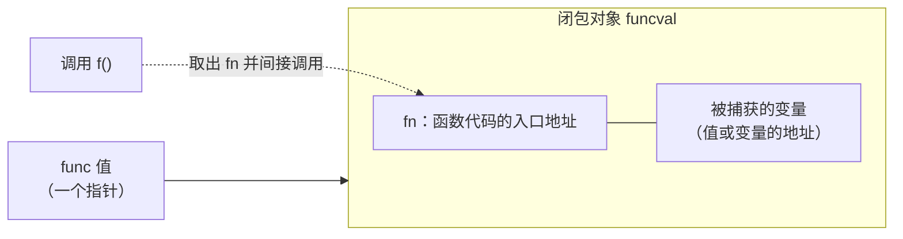

# 6.1 函数调用

函数在 Go 中是一等公民：可以赋值给变量、作为参数传递、作为结果返回，也可以捕获外部变量而成为闭包。
这一能力的实现涉及两个问题：函数值（尤其是闭包）在内存中如何表示，以及调用一个函数值时，
被调函数如何找到它所捕获的变量。本节讨论这两个问题，并讨论由此派生的几项特性：Go 1.22
对循环变量语义的修改、方法值与方法表达式、变参，以及 Go 1.23 引入的对函数的 `range`。
函数调用的参数传递与栈帧布局已在第 2 章讨论（[2.3](../../part1overview/ch02asm/callconv.md)、
[2.4](../../part1overview/ch02asm/args.md)），本节只在需要时引用其结论。

## 6.1.1 函数值与闭包

一个 `func` 类型的值，是一个指向**闭包对象**的指针。运行时把这个对象称为 `funcval`，它在
`runtime/runtime2.go` 中的定义只有一个字段 [[Go Authors, 2026c](#ref-go-authors-2026c)]：

```go
type funcval struct {
	fn uintptr
	// 其后是长度可变、与具体函数相关的数据
}
```

`fn` 是函数代码的入口地址；源码中的注释说明，其后紧跟着与具体函数相关、长度可变的数据，即闭包捕获的变量。
不捕获任何变量的函数，其 `funcval` 只有 `fn` 一个字，由编译器静态生成并存放在只读数据中，同一个函数的所有
函数值共享这一对象。捕获了变量的闭包则须在每次求值时构造一个新的 `funcval`，把捕获的变量放在 `fn` 之后；若
该闭包逃逸（[15.5](../../part5toolchain/ch15compile/escape.md)），这个对象分配在堆上，否则分配在栈上。



在语义上，闭包捕获的是变量本身，而非变量在某一时刻的值。下面的 `counter` 返回的两个闭包共享同一个 `n`：

```go {run=true}
package main

import "fmt"

func counter() (inc, get func() int) {
	n := 0
	inc = func() int { n++; return n } // 捕获变量 n
	get = func() int { return n }      // 捕获同一个 n
	return
}

func main() {
	inc, get := counter()
	inc()
	inc()
	fmt.Println(get())
}
```

```
2
```

由于 `n` 在 `counter` 返回之后仍被两个闭包使用，逃逸分析会把它分配到堆上，两个闭包对象中保存的都是 `n`
的地址。不过，按引用捕获只是语义上的规定。若一个变量在被捕获之后从未被重新赋值、从未被取地址，
且大小不超过 128 字节，编译器便直接把它的值复制到闭包对象中（`cmd/compile/internal/escape`
[[Go Authors, 2026d](#ref-go-authors-2026d)]）。这样做不改变程序的行为，因为该变量此后不会再变化，
却可以省去一次堆分配和一层间接访问。

## 6.1.2 闭包的调用：上下文寄存器

被调函数要读取捕获的变量，首先需要得到闭包对象的地址。为此，Go 的内部调用约定在传递普通参数的寄存器之外，
另外指定了一个**闭包上下文寄存器**：调用函数值之前，调用方把 `funcval` 的地址放入该寄存器，
被调函数从中取得捕获的变量。在 amd64 上它是 `RDX`，在 arm64 上是 `R26`
[[Go Authors, 2026a](#ref-go-authors-2026a)]。`RDX` 不在 amd64 用于传递整数参数的
9 个寄存器之中（[2.3](../../part1overview/ch02asm/callconv.md)），专门留作此用。

以下面的程序为例：

```go
package main

//go:noinline
func adder(base int) func(int) int {
	return func(x int) int { return base + x }
}

func main() {
	f := adder(40)
	println(f(2))
}
```

以 `GOOS=linux GOARCH=amd64 go build -gcflags=-S` 编译，`adder` 构造闭包对象的部分如下（省略了栈检查等代
码）：

```asm
LEAQ  type:noalg.struct { F uintptr; X0 int }(SB), AX
CALL  runtime.newobject(SB)           // 在堆上分配闭包对象
LEAQ  main.adder.func1(SB), CX
MOVQ  CX, (AX)                        // 第一个字：函数入口地址 fn
MOVQ  main.base+32(SP), CX
MOVQ  CX, 8(AX)                       // 第二个字：捕获的 base
```

闭包对象的类型是编译器合成的 `struct { F uintptr; X0 int }`：`F` 即 `fn`，`X0` 是捕获的 `base`。由于
`base` 从未被重新赋值，它按值捕获，直接存放在对象中。`main` 中调用 `f(2)` 的代码为：

```asm
MOVQ  (AX), CX     // AX 是 adder 返回的闭包对象地址，取出其中的 fn
MOVQ  AX, DX       // 闭包对象地址放入上下文寄存器 DX
MOVL  $2, AX       // 参数 x
CALL  CX           // 间接调用
```

而闭包的函数体只有两条指令：

```asm
TEXT  main.adder.func1(SB), NOSPLIT|NEEDCTXT|NOFRAME|ABIInternal, $0-8
ADDQ  8(DX), AX    // 从 DX 指向的闭包对象中读取 base，加到参数 x 上
RET
```

`NEEDCTXT` 标记表明该函数需要上下文寄存器。调用函数值的方式与接口的动态分派
（[4.2](../ch04type/interface.md)）相似，都是从一个对象中取出代码地址后间接调用；不同之处在于，接口通过
`itab` 中的方法表找到地址，函数值则直接把地址保存在闭包对象的第一个字中。

## 6.1.3 循环变量与 Go 1.22

按引用捕获的语义，曾与 `for` 循环的变量作用域结合，造成 Go 中最常见的错误之一。在 Go 1.21 及以前，`for`
循环声明的变量在整个循环中只有一个实例，每轮迭代只是给它赋新值：

```go {run=true}
package main

import "fmt"

func main() {
	var fs []func()
	for i := 0; i < 3; i++ {
		fs = append(fs, func() { fmt.Print(i, " ") })
	}
	for _, f := range fs {
		f()
	}
	fmt.Println()
}
```

若模块的 `go.mod` 声明 `go 1.21`，这个程序输出 `3 3 3`：三个闭包捕获的是同一个 `i`，
调用它们时循环早已结束。在 `go 1.22` 及以上的模块中，它输出：

```
0 1 2
```

Go 1.22 把循环变量改为每轮迭代一个新的实例，对三段式 `for` 与 `for range` 都适用
[[Go Authors, 2024a](#ref-go-authors-2024a)]。这一修改并没有改变捕获的方式，而是改变了被捕获的对象：
既然每轮迭代都有一个新变量，闭包按引用捕获到的自然也是各自独立的变量。在此之前，Go
程序员通常在循环体内写一行 `i := i` 来为每轮迭代创建一个新变量，Go 1.22 相当于把这一惯用写法变成了语言规则
[[Cox, 2022](#ref-cox-2022)]。

这一修改也体现了 Go 修改语言语义的一种审慎做法。它不向后兼容，可能使依赖旧行为的代码悄然改变结果，
因此新语义与 `go.mod` 中声明的语言版本绑定：只有声明 `go 1.22` 及以上的模块才采用新语义，
旧模块的行为保持不变 [[Chase and Cox, 2023b](#ref-chase-cox-2023b)]。Go 1.21 先以 `GOEXPERIMENT=loopvar`
提供预览；对于行为可能因此改变的代码，还可以借助 `bisect` 工具在新旧语义之间二分查找，
定位受影响的具体循环 [[Chase and Cox, 2023a](#ref-chase-cox-2023a)]。把语义变更与版本声明绑定，
并辅以预览开关与定位工具，是 Go 在演进语言与保持兼容之间所作的折中，这套机制的意义超出了循环变量这一处修改
本身。

## 6.1.4 方法值、方法表达式与变参

**方法值** `t.M` 把接收者 `t` 绑定到方法上，得到一个可以单独传递的函数值；它本质上就是一个闭包，
捕获的变量是接收者的副本（接收者为指针时，复制的是指针）。**方法表达式** `T.M` 不绑定接收者，
得到一个以接收者为第一个参数的普通函数：

```go {run=true}
package main

import (
	"fmt"
	"testing"
)

type T struct{ x int }

func (t T) Add(d int) int { return t.x + d }

var sink func(int) int

func main() {
	t := T{x: 1}
	f := t.Add // 方法值：func(int) int，接收者 t 被复制进闭包
	g := T.Add // 方法表达式：func(T, int) int，接收者成为第一个参数
	fmt.Println(f(1), g(t, 1))

	fmt.Println(testing.AllocsPerRun(100, func() { sink = t.Add }))     // 方法值逃逸
	fmt.Println(testing.AllocsPerRun(100, func() { f := t.Add; f(1) })) // 方法值不逃逸
}
```

```
2 2
1
0
```

编译器为方法值合成一个包装函数（如 `main.T.Add-fm`），它从闭包对象中取出接收者，再调用真正的方法。与一般的
闭包一样，方法值的闭包对象只有在逃逸时才分配在堆上：上例中赋给全局变量的方法值引起一次分配，只在局部使用
的则不分配。方法表达式不捕获任何东西，是一个静态的函数值，从不需要分配。

**变参** `f(xs ...int)` 在调用方被打包成一个切片传入：`sum(1, 2, 3)` 由编译器构造一个底层数组并生成切片
头，`sum(s...)` 则直接传入已有的切片。被构造的底层数组遵循 [5.1](../ch05data/slice.md) 所述的规则，
若不逃逸，便分配在栈上。

## 6.1.5 对函数的 range：把循环体变成闭包

Go 1.23 允许对函数使用 `range`：若 `f` 的类型为 `func(yield func(T) bool)`，则 `for x := range f { ... }`
会反复执行循环体，每次的 `x` 由 `f` 通过调用 `yield` 提供 [[Cox, 2023](#ref-cox-2023)]
[[Go Authors, 2024b](#ref-go-authors-2024b)]。标准库的 `iter.Seq` 与 `iter.Seq2` 就是这种函数类型，
`maps.Keys`、`slices.Values` 等函数都返回这样的迭代器 [[Taylor, 2024](#ref-taylor-2024)]。

这一特性完全由编译器通过改写实现，运行时没有为它提供专门的机制。`cmd/compile/internal/rangefunc` 包的注释
[[Go Authors, 2026b](#ref-go-authors-2026b)]说明，其基本思路是把

```go
for x := range f {
	...
}
```

改写为

```go
f(func(x T) bool {
	...
	return true
})
```

即把循环体变成一个闭包，作为 `yield` 传给 `f`。循环体中的 `continue` 改写为 `return true`，告诉 `f` 继续；
`break` 改写为 `return false`，告诉 `f` 停止。循环体中的 `return`、带标签的 `break`、`continue` 与 `goto`
则较为复杂：编译器引入一个隐藏变量 `#next` 记录闭包返回后应执行的控制流，由闭包设置该变量并返回 `false`，
待 `f` 返回之后，再根据 `#next` 执行相应的跳转或返回。

由于循环体成了一个可以被任意调用的函数，编译器还须防范行为不当的迭代器，例如在 `yield` 返回 `false` 之后
仍继续调用它。每个改写后的循环都有一个状态变量，记录循环体是否已经退出，并在每次调用时检查：

```go {run=true}
package main

import "fmt"

// 一个不遵守约定的迭代器：yield 返回 false 之后仍继续调用它
func bad(yield func(int) bool) {
	for i := range 3 {
		yield(i)
	}
}

func main() {
	for x := range bad {
		fmt.Println(x)
		break
	}
}
```

```
0
panic: runtime error: range function continued iteration after function for loop body returned false
```

panic 的调用栈中，循环体所在的函数名为 `main.main-range1`，这正是编译器为循环体生成的闭包。
改写在编译器前端完成，生成的闭包因此可以像普通函数一样参与内联；当迭代器函数与循环体都被内联时，
这层间接调用便不复存在。

## 6.1.6 栈帧、可增长栈与逃逸

每次函数调用在 goroutine 的栈上占用一个栈帧。Go 的栈是**可增长的连续栈**：函数开头的栈空间检查发现剩余空间
不足时，调用 `morestack` 分配一段更大的栈，把旧栈的内容复制过去，并调整所有指向旧栈的指针
（[2.4](../../part1overview/ch02asm/args.md)、[第 14 章](../../part4memory/ch14stack/readme.md)）。

可增长栈与闭包之间有一个不可回避的关系。栈会移动，而闭包按引用捕获变量；若一个局部变量的地址被一个可能比当
前栈帧存活得更久的闭包所持有（例如闭包被返回、被存入全局变量或交给另一个 goroutine），
这个变量就不能留在栈上。逃逸分析（[15.5](../../part5toolchain/ch15compile/escape.md)）
在编译期判断变量的地址是否会逃出当前函数，若会，则把变量分配在堆上。6.1.1 中 `counter` 的 `n` 能在
`counter` 返回后继续被使用，正是因为它被分配到了堆上。按引用捕获的闭包与可移动的栈，依靠逃逸分析得以共存。

## 6.1.7 与其他语言的比较

「闭包」（closure）一词出自 Peter Landin。1964 年，Landin 在描述如何机械地对表达式求值时，把一个 λ
表达式与其求值时所处的环境合称为闭包 [[Landin, 1964](#ref-landin-1964)]。闭包已是现代语言的普遍特性，
各语言的主要差别在于捕获的语义。Go 在语义上一律按引用捕获，较为简洁，复制与否由编译器在不改变行为的前提下
决定，生命周期则交给逃逸分析与垃圾回收处理。C++ 的 lambda 要求在捕获列表中显式选择按值（`[=]`）
或按引用（`[&]`）捕获，控制更精细，但按引用捕获的局部变量一旦超出作用域，便会留下悬空引用。Rust 以 `move`
关键字区分按值与按引用捕获，并以 `Fn`、`FnMut`、`FnOnce` 三个 trait 区分闭包能否修改所捕获的变量、
能否被多次调用，把所有权与可变性的检查放在编译期完成 [[Rust Project, n.d.](#ref-rust-project-nd)]。简洁、
控制力与安全性之间，各语言的取舍不同。

在调用约定上，C 与 C++ 遵循平台的标准 ABI（如 System V AMD64 psABI），以便与系统库及其他编译器生成的目标文
件直接互操作，这一约定一经公开便难以更改。Go 则为内部调用定义了自己的 ABI，放弃了与外部目标文件的直接互通
（cgo 调用须跨越 ABI 边界，代价见 [15.6](../../part5toolchain/ch15compile/cgo.md)），
换取了按自身需要演进调用约定的自由，Go 1.17 从栈传参到寄存器传参的切换
[[Clements, 2020](#ref-clements-2020)] [[Go Authors, 2021](#ref-go-authors-2021)]
（[2.3](../../part1overview/ch02asm/callconv.md)）正得益于此。

## 延伸阅读

- <a id="ref-go-authors-2026a"></a>[Go Authors, 2026a] The Go Authors. "Go internal ABI specification."
  https://github.com/golang/go/blob/release-branch.go1.26/src/cmd/compile/abi-internal.md
  （开发版本：<https://github.com/golang/go/blob/master/src/cmd/compile/abi-internal.md>）
  闭包上下文寄存器（amd64 的 RDX、arm64 的 R26）与寄存器传参的规定。
- <a id="ref-chase-cox-2023a"></a>[Chase and Cox, 2023a] David Chase, Russ Cox. "Fixing For Loops in Go
  1.22." The Go Blog, 2023. https://go.dev/blog/loopvar-preview
  循环变量语义修改的缘由、兼容策略与 `bisect` 工具。
- <a id="ref-cox-2022"></a>[Cox, 2022] Russ Cox. "redefining for loop variable semantics." golang/go
  discussion #56010, 2022. https://github.com/golang/go/discussions/56010
  修改循环变量语义的最初讨论。
- <a id="ref-taylor-2024"></a>[Taylor, 2024] Ian Lance Taylor. "Range Over Function Types." The Go Blog,
  2024. https://go.dev/blog/range-functions
  对函数的 `range` 的设计与用法。
- <a id="ref-cox-2023"></a>[Cox, 2023] Russ Cox. "spec: add range over int, range over func."
  golang/go#61405, 2023. https://github.com/golang/go/issues/61405
  对整数与函数的 `range` 的提案。
- <a id="ref-go-authors-2026b"></a>[Go Authors, 2026b] The Go Authors.
  `cmd/compile/internal/rangefunc/rewrite.go`.
  https://github.com/golang/go/blob/release-branch.go1.26/src/cmd/compile/internal/rangefunc/rewrite.go
  包注释详细说明了 `range` 循环的改写规则与迭代器检查。
- <a id="ref-clements-2020"></a>[Clements, 2020] Austin Clements. "Proposal: Register-based Go calling
  convention." Go design document, 2020.
  https://go.googlesource.com/proposal/+/master/design/40724-register-calling.md
  Go 1.17 寄存器调用约定的设计文档，Cherry Zhang、Michael Knyszek、David Chase 等参与了讨论。
- <a id="ref-go-authors-2021"></a>[Go Authors, 2021] The Go Authors. Go 1.17 Release Notes.
  https://go.dev/doc/go1.17
  新的寄存器调用约定：代表性基准测试的性能提升约 5%，二进制体积约减小 2%。
- <a id="ref-go-authors-2024a"></a>[Go Authors, 2024a] The Go Authors. Go 1.22 Release Notes.
  https://go.dev/doc/go1.22
  循环变量改为每轮迭代一个新的实例。
- <a id="ref-go-authors-2024b"></a>[Go Authors, 2024b] The Go Authors. Go 1.23 Release Notes.
  https://go.dev/doc/go1.23
  `for range` 接受迭代器函数。
- <a id="ref-chase-cox-2023b"></a>[Chase and Cox, 2023b] David Chase, Russ Cox. "Proposal: Less
  Error-Prone Loop Variable Scoping." Go design document, 2023.
  https://go.googlesource.com/proposal/+/master/design/60078-loopvar.md
  循环变量语义修改的正式设计：与 `go.mod` 语言版本绑定的兼容策略及其论证。
- <a id="ref-go-authors-2026c"></a>[Go Authors, 2026c] The Go Authors. `runtime/runtime2.go`：`funcval`。
  https://github.com/golang/go/blob/master/src/runtime/runtime2.go
  闭包在运行时的表示。
- <a id="ref-go-authors-2026d"></a>[Go Authors, 2026d] The Go Authors.
  `cmd/compile/internal/escape/escape.go`.
  https://github.com/golang/go/blob/release-branch.go1.26/src/cmd/compile/internal/escape/escape.go
  闭包变量按值捕获的条件：从未被重新赋值、从未被取地址，且不超过 128 字节。
- <a id="ref-landin-1964"></a>[Landin, 1964] Peter J. Landin. "The Mechanical Evaluation of Expressions."
  The Computer Journal 6(4):308–320, 1964. https://doi.org/10.1093/comjnl/6.4.308
  SECD 机器的出处，「闭包」一词即在此文中提出：λ 表达式与其求值环境的组合。
- <a id="ref-rust-project-nd"></a>[Rust Project, n.d.] The Rust Project. *The Rust Reference*, "Closure
  types". https://doc.rust-lang.org/reference/types/closure.html
  Rust 闭包的捕获模式与 `Fn`、`FnMut`、`FnOnce` 三个 trait。
- 本书 [4.2 接口](../ch04type/interface.md)、[5.1 切片](../ch05data/slice.md)、
  [14 执行栈管理](../../part4memory/ch14stack)、
  [15.5 逃逸分析](../../part5toolchain/ch15compile/escape.md).

