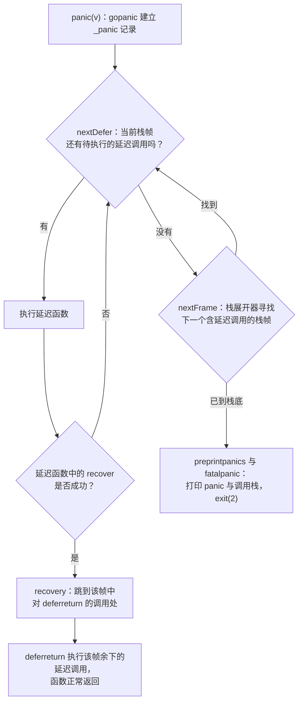

# 6.3 恐慌与恢复内建函数

Go 没有异常机制。函数通过返回 `error` 值报告预期之内的失败（[第 7 章](../ch07errors/readme.md)），
而对于程序无法继续正常执行的情形，Go 提供了一对内建函数：`panic` 引发**恐慌**（panic），
中止当前的正常控制流，开始执行延迟调用并沿调用栈向上传播；`recover` 在延迟调用中截获恐慌，
使程序恢复正常执行 [[Gerrand, 2010](#ref-gerrand-2010)]。

这对内建函数也不是 Go 最初就有的。2010 年 3 月 25 日，Rob Pike 在 golang-nuts 邮件列表上发表了题为
「Proposal for an exception-like mechanism」的提案 [[Pike, 2010a](#ref-pike-2010a)]，当天即修改了语言规范
[[Pike, 2010b](#ref-pike-2010b)]；Russ Cox 在 3 月 31 日完成了编译器中的实现
[[Cox, 2010a](#ref-cox-2010a)]。提案明确表示，它有意不同于通常作为控制结构的异常模型，以免像 Java
等语言那样把错误与异常混为一谈。在此之前，数组越界、空指针解引用等运行时错误会直接使程序崩溃；同年 4 月，Russ
Cox 把这些运行时错误也改为 panic，使它们可以被 `recover` 截获 [[Cox, 2010b](#ref-cox-2010b)]
[[Cox, 2010c](#ref-cox-2010c)]。同一提案还修改了 `defer` 的语义，使延迟调用在函数设置结果之后、
返回调用方之前执行，这正是 [6.2.1](./defer.md) 所述第四条语义的由来：只有这样，延迟调用才能在 panic
被截获后改写函数的返回值。

本节先说明 `panic` 与 `recover` 的语义，再讨论运行时的实现：`gopanic` 如何沿栈逐帧执行延迟调用，`gorecover`
如何判定一次调用是否有资格截获 panic，以及截获之后执行流程如何回到正常的轨道。最后讨论 panic
与其他语言中异常机制的区别，以及在工程中应当如何使用它。

## 6.3.1 语义

调用 `panic(v)` 后，当前函数的正常执行立即中止，当前 goroutine 已登记的延迟调用按后进先出的顺序依次执行，
先是当前函数的，然后是其调用方的，逐层向上。若这一过程到达 goroutine 的顶层函数时仍未被截获，
程序便会终止：运行时打印 panic 的值与调用栈，并以退出状态 2 结束**整个进程**，而不只是发生 panic 的那个
goroutine。

运行时检测到的错误同样以 panic 的形式报告，例如数组越界、向 nil map 写入、空指针解引用以及整数除以零。这类
panic 的值实现了 `runtime.Error` 接口，可以据此与程序主动发起的 panic 相区分。

`recover` 用于截获 panic。按照语言规范，以下两种情况下 `recover` 返回 nil：goroutine 当前没有发生 panic，
或者 `recover` 不是由延迟函数**直接**调用的 [[Go Authors, 2026a](#ref-go-authors-2026a)]。反之，若
goroutine 正在 panic，并且 `recover` 由延迟函数直接调用，那么它返回传给 `panic` 的值，panic 随之停止；
登记该延迟函数的那个函数随后正常返回其调用方，返回值即当时结果变量中的值。「直接调用」这一限制十分严格，
多一层调用或少一层调用都不行：

```go {run=true}
package main

import "fmt"

func direct() (err error) {
	defer func() {
		if r := recover(); r != nil {
			err = fmt.Errorf("recovered: %v", r) // 改写返回值
		}
	}()
	panic("boom")
}

func nested() {
	defer func() {
		func() { fmt.Println("nested:", recover()) }() // 多了一层调用
	}()
	panic("boom")
}

func deferRecover() {
	defer recover() // 被延迟的就是 recover 本身
	panic("boom")
}

func guard(f func()) {
	defer func() { fmt.Println("guard:", recover()) }()
	f()
}

func main() {
	fmt.Println(direct())
	guard(nested)
	guard(deferRecover)
}
```

```
recovered: boom
nested: <nil>
guard: boom
guard: boom
```

`direct` 中的延迟函数直接调用 `recover`，截获了 panic 并改写了命名返回值 `err`。`nested` 中调用 `recover`
的是延迟函数内部的另一个函数，`deferRecover` 中被延迟的则是 `recover` 本身，两者都不满足条件，`recover`
返回 nil，panic 继续向上传播，最终由 `guard` 截获。6.3.4 将说明，运行时正是通过检查调用栈的形状来实施这条
规则的。

规范同时保证，在满足上述条件时 `recover` 的返回值不为 nil。为此，Go 1.21 规定 `panic(nil)`
本身会引发一个运行时 panic，其值的类型为 `*runtime.PanicNilError`；此前，`panic(nil)` 被 `recover`
截获后得到的是 nil，调用方无法区分「发生了 panic」与「没有
panic」[[Fitzpatrick, 2018](#ref-fitzpatrick-2018)]。需要旧行为的程序可以设置 `GODEBUG=panicnil=1`
[[Go Authors, 2023](#ref-go-authors-2023)]。下面的程序打印三种 panic 值的动态类型，以及它们是否实现了
`runtime.Error`：

```go {run=true}
package main

import (
	"fmt"
	"runtime"
)

func catch(f func()) {
	defer func() {
		r := recover()
		_, ok := r.(runtime.Error)
		fmt.Printf("%T %v\n", r, ok)
	}()
	f()
}

func main() {
	var s []int
	i := 3
	catch(func() { _ = s[i] })      // 越界
	catch(func() { panic(nil) })    // Go 1.21 起不再得到 nil
	catch(func() { panic("boom") }) // 程序主动发起
}
```

```
runtime.boundsError true
*runtime.PanicNilError true
string false
```

还有两类情形与 panic 相似，但不能被 `recover` 截获。其一是 `runtime.Goexit`：它终止当前 goroutine，并像
panic 一样执行所有延迟调用，但它不是 panic，延迟函数中的 `recover` 返回 nil。其二是运行时的**致命错误**（fatal
error），例如并发读写 map、所有 goroutine 都陷入死锁、栈溢出以及内存耗尽。
运行时在这些情形下调用内部的 `throw` 或 `fatal` 函数，打印以 `fatal error:` 开头的信息后直接终止进程，
不执行任何延迟调用。前者用于运行时自身可能有缺陷的情形，后者用于错误多半出在用户代码的情形，
两者都意味着程序的状态已不可信，继续执行没有意义。

## 6.3.2 展开期间的调用栈

在讨论实现之前，有一个容易被忽视的事实需要说明：panic 执行延迟调用的时候，调用栈并没有被弹出。延迟函数作为
普通的函数调用，运行在发生 panic 的那一帧之上；只有当某个延迟函数截获了 panic，运行时才会丢弃中间的栈帧。Rob
Pike 的提案中已经指出这一点：延迟调用像普通调用一样运行，因此对调用方栈帧的展开，只在某个延迟调用停止
了 panic 时才会发生 [[Pike, 2010a](#ref-pike-2010a)]。

这一性质使延迟函数能够看到 panic 发生时完整的调用栈。下面的程序在延迟函数中调用 `runtime.Stack` 获取当前的
调用栈，并打印各帧的函数名：

```go {run=true}
package main

import (
	"fmt"
	"runtime"
	"strings"
)

//go:noinline
func handler() {
	var m map[string]int
	m["k"] = 1 // 向 nil map 写入
}

func serve() {
	defer func() {
		r := recover()
		buf := make([]byte, 4096)
		buf = buf[:runtime.Stack(buf, false)] // 此时的调用栈
		for _, line := range strings.Split(string(buf), "\n") {
			if fn, _, ok := strings.Cut(line, "("); ok && !strings.HasPrefix(line, "\t") {
				fmt.Println(fn)
			}
		}
		fmt.Println("recovered:", r)
	}()
	handler()
}

func main() { serve() }
```

```
main.serve.func1
panic
main.handler
main.serve
main.main
recovered: assignment to entry in nil map
```

延迟函数 `main.serve.func1` 之下是 `panic`（即运行时的 `gopanic`，在栈回溯中以 `panic` 显示），
再往下是发生错误的 `main.handler`，它的栈帧依然完好。标准库 `net/http` 正是利用这一点：处理连接的
goroutine 在延迟函数中截获 handler 的 panic 后，先调用 `runtime.Stack` 记录出错位置的调用栈，
再写入服务器的错误日志。

同样由于栈未被弹出，延迟函数在执行过程中可以再次发生 panic。此时新的 panic 记录挂在旧的记录之前，
未被截获的程序在终止时会依次打印它们：

```go
func main() {
	defer func() {
		panic("second") // 在执行延迟调用时再次 panic
	}()
	panic("first")
}
```

```
panic: first
	panic: second
```

一种常见的写法是截获 panic、做一些记录之后，以同一个值再次 panic。Go 1.25 起，这种情形不再把同一个值打印
两遍，而是标注为 `[recovered, repanicked]` [[Go Authors, 2025](#ref-go-authors-2025)]：

```go
func main() {
	defer func() {
		panic(recover()) // 截获之后以同一个值再次 panic
	}()
	panic("boom")
}
```

```
panic: boom [recovered, repanicked]
```

## 6.3.3 gopanic：沿栈逐帧执行延迟调用

编译器把 `panic(v)` 翻译为对 `runtime.gopanic` 的调用，把 `recover()` 翻译为对 `runtime.gorecover` 的调用
[[Go Authors, 2026d](#ref-go-authors-2026d)]。一次进行中的 panic 由一个 `_panic` 结构体描述。
它只存在于栈上，并通过 `link` 字段与更早的 panic 连成链表，表头保存在 `g._panic` 中。Go 1.26
中的定义如下（`runtime/runtime2.go` [[Go Authors, 2026e](#ref-go-authors-2026e)]，注释为笔者所译）：

```go
type _panic struct {
	arg  any     // 传给 panic 的值
	link *_panic // 更早的 panic

	// startPC 与 startSP 记录 _panic.start 被调用的位置。
	startPC uintptr
	startSP unsafe.Pointer

	// 当前正在为之执行延迟调用的栈帧。
	sp unsafe.Pointer
	lr uintptr
	fp unsafe.Pointer

	// 若 _panic.next() 最近返回的函数截获了 panic，retpc 是应当跳回的 PC。
	retpc uintptr

	// 处理开放编码式延迟所需的额外状态。
	deferBitsPtr *uint8
	slotsPtr     unsafe.Pointer

	recovered   bool // 是否已被截获
	repanicked  bool // 是否以同一个值再次 panic
	goexit      bool
	deferreturn bool

	gopanicFP unsafe.Pointer // gopanic 所在栈帧的帧指针
}
```

`gopanic` 首先处理 `panic(nil)`，然后排除几种无法安全执行用户代码的情形：在系统栈上、在内存分配过程中、
在禁止抢占期间或在持有运行时锁的情况下发生的 panic，都会直接以 `throw` 终止程序。此后的主体部分只有一个循
环：

```go
func gopanic(e any) {
	if e == nil {
		if debug.panicnil.Load() != 1 {
			e = new(PanicNilError)
		} else {
			panicnil.IncNonDefault()
		}
	}

	gp := getg()
	// ……排除系统栈、内存分配、禁止抢占与持有锁的情形……

	var p _panic
	p.arg = e
	p.gopanicFP = unsafe.Pointer(sys.GetCallerSP())

	runningPanicDefers.Add(1)

	p.start(sys.GetCallerPC(), unsafe.Pointer(sys.GetCallerSP()))
	for {
		fn, ok := p.nextDefer()
		if !ok {
			break
		}
		fn()
	}

	// ……
	preprintpanics(&p)
	fatalpanic(&p)   // 不会返回
	*(*int)(nil) = 0 // 不会执行到此处
}
```

这个循环与 [6.2.4](./defer.md) 中 `deferreturn` 的循环完全相同，区别只在于 `_panic` 的初始状态。`p.start`
把 `p` 挂到 `g._panic` 的表头，并找到第一个含有待执行延迟调用的栈帧；`p.nextDefer`
每次返回一个待执行的延迟函数，循环结束意味着所有延迟调用都已执行，而 panic 仍未被截获，于是进入
`fatalpanic`。

`nextDefer` 需要应对 6.2 所述的三种实现。对于当前栈帧，它先查看延迟位图 `deferBitsPtr`，若仍有已置位的位，
便清除最高的一位并从对应的槽位中取出闭包，即按逆序取出开放编码式延迟；然后查看 `g._defer` 链表的表头，若该
记录登记于当前栈帧（`d.sp` 与当前帧的栈指针相等），便将其摘下并返回其中的函数。两者都已取尽时，调用
`nextFrame` 前往下一个栈帧：

```go
// nextFrame 寻找下一个含有延迟调用的栈帧。
func (p *_panic) nextFrame() (ok bool) {
	if p.lr == 0 {
		return false
	}

	gp := getg()
	systemstack(func() {
		var limit uintptr
		if d := gp._defer; d != nil {
			limit = d.sp
		}

		var u unwinder
		u.initAt(p.lr, uintptr(p.fp), 0, gp, 0)
		for {
			if !u.valid() {
				p.lr = 0
				return // ok == false
			}
			if u.frame.sp == limit {
				break // 找到一个在链表上登记了延迟调用的栈帧
			}
			if p.initOpenCodedDefers(u.frame.fn, unsafe.Pointer(u.frame.varp)) {
				break // 找到一个有待执行的开放编码式延迟的栈帧
			}
			u.next()
		}

		p.lr = u.frame.lr
		p.sp = unsafe.Pointer(u.frame.sp)
		p.fp = unsafe.Pointer(u.frame.fp)

		ok = true
	})

	return
}
```

`nextFrame` 借助运行时的栈展开器（unwinder）逐帧向上移动，判断一帧是否有延迟调用的依据有两个：`g._defer`
表头记录的栈指针恰好等于该帧的栈指针，或者该函数带有 `FUNCDATA_OpenCodedDeferInfo`
元数据且其延迟位图不为零。后者正是 [6.2.4](./defer.md) 所说开放编码式延迟在 panic 时仍可被找到的机制：`initOpenCodedDefers`
从元数据中读出延迟位图与闭包槽位在栈帧中的偏移量，并把该函数中对 `deferreturn`
的调用地址记入 `p.retpc`，供截获之后使用。

在 Go 1.22 之前，`gopanic` 自己遍历 `_defer` 链表，开放编码式延迟则由另一段代码（`addOneOpenDeferFrame`）
扫描栈帧，为其临时生成 `_defer` 记录插入链表，与 `deferreturn` 的逻辑相互独立。Matthew Dempsky
的重构把三者统一为上面这个以 `_panic` 为状态的循环 [[Dempsky, 2023](#ref-dempsky-2023)]，正常返回、panic
与 `runtime.Goexit` 从此共用同一套延迟调用的处理逻辑。

## 6.3.4 gorecover：检查调用栈的形状

`recover` 的难点在于判定调用者是否有资格截获 panic，即实现「由延迟函数直接调用」这条规则。Go 1.26 的
`gorecover` 通过检查调用栈的形状来完成这一判定，源码注释说明了它的依据（注释为笔者所译）：

```go
func gorecover() any {
	gp := getg()
	p := gp._panic
	if p == nil || p.goexit || p.recovered {
		return nil
	}

	// 检查调用 recover() 的函数是否由发生 panic 的函数直接延迟调用。
	// 对于如下代码：
	//     func foo() {
	//         defer bar()
	//         panic("panic")
	//     }
	//     func bar() {
	//         recover()
	//     }
	// 调用栈通常是这样的：
	//     foo
	//     runtime.gopanic
	//     bar
	//     runtime.gorecover
	//
	// 但如果被延迟的函数需要某种包装函数，就应当忽略这个包装函数。
	// 此时调用栈是这样的：
	//     foo
	//     runtime.gopanic
	//     wrapper
	//     bar
	//     runtime.gorecover
	// 这种情况也应当成功截获。
	//
	// 最后，在 "defer recover()" 这种奇特的情形中，调用栈是这样的：
	//     foo
	//     runtime.gopanic
	//     wrapper
	//     runtime.gorecover
	// 这种情况不应截获。
	//
	// 因此判定准则是：gopanic 与 gorecover 之间必须恰好有一个非包装函数的栈帧。
	//
	// defer func() { func() { recover() }() }() 不会截获，
	// 因为其间有 2 个非包装函数的栈帧。
	//
	// defer recover() 不会截获，
	// 因为其间有 0 个非包装函数的栈帧。
	canRecover := false
	systemstack(func() {
		var u unwinder
		u.init(gp, 0)
		u.next() // 跳过 systemstack_switch
		u.next() // 跳过 gorecover
		nonWrapperFrames := 0
	loop:
		for ; u.valid(); u.next() {
			for iu, f := newInlineUnwinder(u.frame.fn, u.symPC()); f.valid(); f = iu.next(f) {
				sf := iu.srcFunc(f)
				switch sf.funcID {
				case abi.FuncIDWrapper:
					continue
				case abi.FuncID_gopanic:
					if u.frame.fp == uintptr(p.gopanicFP) && nonWrapperFrames > 0 {
						canRecover = true
					}
					break loop
				default:
					nonWrapperFrames++
					if nonWrapperFrames > 1 {
						break loop
					}
				}
			}
		}
	})
	if !canRecover {
		return nil
	}
	p.recovered = true
	return p.arg
}
```

这里所说的**包装函数**（wrapper function），是编译器自动生成、仅用于转发调用的函数，例如
[6.2.1](./defer.md) 所述为带参数的延迟调用生成的无参闭包（如 `unlock.deferwrap1`），
以及为值接收者方法生成的指针接收者版本。若 `defer obj.M(x)` 中的方法 `M` 调用了 `recover`，`gopanic` 与
`M` 之间就隔着这样一个闭包，但按照语义，这次调用应当截获成功，因此计数时必须跳过包装函数。

6.3.1 中的 `nested` 与 `deferRecover` 恰好落在这条准则的两侧：前者在 `gopanic` 与 `gorecover`
之间有两个非包装栈帧，后者一个也没有。判定时还要求找到的 `gopanic` 栈帧正是当前这次 panic 的（`gopanicFP`
相符）；计数借助内联展开器（inline unwinder）进行，被内联到同一个物理栈帧中的函数也按源码中的函数逐一计
数。

这一实现是 Go 1.26 才采用的。此前的 `gorecover` 接受一个参数 `argp`，即调用者的参数指针，运行时把它与
`_panic` 中记录的、最上层延迟调用的参数指针相比较，二者相等才允许截获。包装函数会在两者之间多插入一帧，
为此编译器不得不在每个包装函数的序言中插入一段代码：若当前有 panic 且其 `argp` 指向本帧，
便把它调整为被包装函数的参数指针。Keith Randall 在 2025 年把判定改为上面的栈展开方式，
并删除了包装函数中的这段调整代码 [[Randall, 2025](#ref-randall-2025)]。正如其提交说明所述，新方法只在
panic 期间调用 `recover` 时才需要展开少数几个栈帧，这种情形下代价有所增加，其余情形下则更为廉价。

## 6.3.5 recovery：回到正常的执行流程

`gorecover` 只是把 `p.recovered` 置为 true 并返回 panic 的值，截获本身发生在延迟函数返回之后。`gopanic`
的循环再次调用 `nextDefer` 时，后者检查到 `p.recovered`，便通过 `mcall` 切换到系统栈调用 `recovery`，
不再返回。

`recovery` 的任务是让登记了该延迟函数的那个函数从对 `deferreturn` 的调用处继续执行。它根据 `p.retpc`
找到这个函数，并从 `p.sp` 与 `p.fp` 取得其栈帧；然后沿 `g._panic` 链表弹出所有起始于这一帧所调用的函数中的
`_panic` 记录，其中既有被截获的这次 panic，也有在它之前发生、已被它取代的 panic；若途中遇到一个由
`runtime.Goexit` 发起的记录，则不能越过它，转而回到 `Goexit` 的循环继续执行延迟调用。
若这一帧仍有尚未执行的开放编码式延迟，`recovery` 还会把延迟位图与槽位的位置保存下来，交给随后的
`deferreturn` 继续处理。最后，它把 goroutine 的调度上下文 `gp.sched` 中的栈指针设为该帧的栈指针，
程序计数器设为该函数中调用 `deferreturn` 的位置，然后通过 `gogo` 跳转过去，中间被 panic
跨过的所有栈帧就此被丢弃。

之所以跳到 `deferreturn` 而不是直接返回，是因为这一帧可能还登记了尚未执行的延迟调用，必须先执行它们。
链接器在每个含有 `defer` 的函数的元数据中记录了其中调用 `deferreturn` 的位置，对于使用开放编码的函数，
这就是 [6.2.4](./defer.md) 所述那段在正常流程中不会执行的代码。`deferreturn` 执行完余下的延迟调用后，
函数随之返回，返回值就是结果变量中的值，执行流程从此回到正常的轨道。

## 6.3.6 fatalpanic：无人截获时

若所有延迟调用都已执行完毕仍无人截获，`gopanic` 进入程序终止的流程。它先调用 `preprintpanics`，对 panic
链表上每个实现了 `error` 接口或带有 `String` 方法的值调用其 `Error` 或 `String` 方法，
事先得到要打印的字符串，因为随后会冻结整个程序，届时再执行任意的用户代码是不安全的；以同一个值再次 panic
的记录也在这一步被标记为 `repanicked`。然后，`fatalpanic` 切换到系统栈，由 `startpanic_m`
尽力冻结整个程序的执行（若此时又发生 panic，则只打印 `panic during panic`），`printpanics`
按从早到晚的顺序打印 panic 链表，`dopanic_m` 根据 `GOTRACEBACK` 环境变量的设置打印调用栈，最后以
`exit(2)` 终止进程。

从 `panic` 开始到程序恢复正常执行或终止，整个过程可以概括为下图：



需要再次强调的是，这一过程终止的是整个进程。一个后台 goroutine 中未被截获的 panic，会使与它毫不相关的其他
goroutine 一同终止；并且 `recover` 只能截获本 goroutine 的 panic，一个 goroutine 无法截获另一个 goroutine
中发生的 panic。

## 6.3.7 panic 与异常

`panic` 与 `recover` 在形式上与 C++、Java、Python 的异常处理相似：都是中止当前的执行，沿调用栈向上传播，
在某处被截获。但二者的设计目标不同。Go FAQ 在解释 Go 为何没有异常时指出，把异常与 `try`-`catch`-`finally`
这样的控制结构结合在一起，会使代码变得曲折；它还容易诱使程序员把太多寻常的错误，例如打开文件失败，
当作异常处理 [[Go Authors, 2026b](#ref-go-authors-2026b)]。Go 的做法是：寻常的错误作为返回值报告，
由调用方显式处理；`panic` 与 `recover` 只用于真正异常的情形。

这一区别在机制上也有体现。C++ 与 Java 的异常处理程序以类型声明在 `catch` 子句中，运行时在抛出异常时可以先
查找是否存在匹配的处理程序。Itanium C++ ABI（GCC 与 Clang 在多数平台上采用的异常处理规
范）[[Itanium C++ ABI, n.d.](#ref-itanium-cxx-abi-nd)]把这一过程分为两个阶段：先在不改变调用栈的情况下搜索
处理程序，找到之后再进入清理阶段，逐帧执行析构函数并转移控制；若搜索阶段没有找到处理程序，便直接调用
`terminate()`，不进入清理阶段。C++ 标准也只规定此时调用 `std::terminate`，栈是否展开由实现决定
[[Smith, 2020](#ref-smith-2020)]。Go 没有这样的搜索阶段，因为是否截获 panic 并不是由类型静态声明的，
而是由延迟函数中的任意代码在运行时决定：一个延迟函数是否会调用 `recover`，只有执行了才知道。因此，panic
总是依次执行所有延迟调用，即便最终无人截获，延迟调用也已全部执行完毕，程序才会终止。

Rust 的取舍与 Go 相近。可恢复的错误以 `Result<T, E>` 类型表示，`panic!` 则用于不可恢复的错误
[[Klabnik et al., n.d.](#ref-klabnik-et-al-nd)]。Rust 也提供了截获 panic 的 `std::panic::catch_unwind`，
但其文档明确表示，不建议把它用作通用的 try/catch 机制，经常可能失败的函数应当返回 `Result`
[[Rust Project, n.d.](#ref-rust-project-nd)]；而且当程序以 `panic=abort` 方式编译时，panic 直接终止进程，`catch_unwind`
也无从截获。

在 Go 中，`recover` 的合理用途主要有两种。第一种是在包的内部使用 panic 简化错误的传递，
再在包的边界上把它转换为错误值，使调用方看不到 panic [[Go Authors, 2026c](#ref-go-authors-2026c)]。标准库
`encoding/json` 的编码器就是这样做的：深层的递归代码以 `panic(jsonError{err})` 中止编码，最外层的
`marshal` 在延迟函数中截获它，取出其中的错误作为返回值；其他类型的 panic 则原样再次 panic，不予掩盖：

```go
func (e *encodeState) marshal(v any, opts encOpts) (err error) {
	defer func() {
		if r := recover(); r != nil {
			if je, ok := r.(jsonError); ok {
				err = je.error
			} else {
				panic(r)
			}
		}
	}()
	e.reflectValue(reflect.ValueOf(v), opts)
	return nil
}
```

第二种是在服务的边界上隔离故障。`net/http` 的文档说明，若 handler 的 `ServeHTTP` 发生 panic，服务器假定
panic 的影响仅限于当前请求：它截获 panic，把调用栈写入错误日志，然后关闭网络连接（HTTP/2 下则重置该流），
其余请求不受影响 [[Go Authors, 2026f](#ref-go-authors-2026f)]。不过，这种做法本身也有争议。2018 年，Damien
Neil 提议 `net/http` 不再截获 handler 的 panic [[Neil, 2018](#ref-neil-2018)]：panic 意味着
handler 中存在缺陷，而 handler 未必在 panic 之后正确地完成了清理，例如一个未被释放的互斥锁会使后续的请求全
部阻塞，与其让服务带着不一致的状态继续运行，不如让进程崩溃后重新启动。Brad Fitzpatrick 回复说，
这一行为令人遗憾，但出于兼容性的考虑，在 Go 1.x 中无法改变。由此可见，在边界上截获 panic
只有在能够确认状态未被破坏时才是安全的。

最后还有成本。含有 `defer` 语句或调用 `recover` 的函数不会被编译器内联。以 `-gcflags=-m=2`
编译下面的程序：

```go
package main

import "sync"

func withDefer(mu *sync.Mutex) {
	mu.Lock()
	defer mu.Unlock()
}

func withRecover() (r any) {
	defer func() { r = recover() }()
	return nil
}

func main() {
	var mu sync.Mutex
	withDefer(&mu)
	_ = withRecover()
}
```

编译器给出的诊断信息中有如下几行：

```
./main.go:5:6: cannot inline withDefer: unhandled op DEFER
./main.go:10:6: cannot inline withRecover: unhandled op DEFER
./main.go:11:8: cannot inline withRecover.func1: call to recover
```

panic 本身的代价也较高：它要借助栈展开器逐帧查找延迟调用，[6.2](./defer.md) 所述的开放编码式延迟
更是有意以 panic 路径变慢为代价换取正常路径的速度。这些都说明，panic 是为罕见的异常情形设计的。Rob Pike 在
2015 年总结的 Go 谚语（Go Proverbs）中有一条只有两个词：「Don't panic.」

## 延伸阅读

- <a id="ref-pike-2010a"></a>[Pike, 2010a] Rob Pike. "Proposal for an exception-like mechanism."
  golang-nuts, 25 March 2010. https://groups.google.com/g/golang-nuts/c/HOXNBQu5c-Q
  `panic` 与 `recover` 的原始提案，包括对 `defer` 语义的修改。
- <a id="ref-gerrand-2010"></a>[Gerrand, 2010] Andrew Gerrand. "Defer, Panic, and Recover." The Go Blog, 4
  August 2010. https://go.dev/blog/defer-panic-and-recover
- <a id="ref-go-authors-2026a"></a>[Go Authors, 2026a] The Go Authors. *The Go Programming Language
  Specification*, "Handling panics" 与 "Run-time panics". https://go.dev/ref/spec#Handling_panics
- <a id="ref-go-authors-2026b"></a>[Go Authors, 2026b] The Go Authors. Go FAQ, "Why does Go not have
  exceptions?" https://go.dev/doc/faq#exceptions
- <a id="ref-go-authors-2026c"></a>[Go Authors, 2026c] The Go Authors. *Effective Go*, "Panic" 与
  "Recover". https://go.dev/doc/effective_go#panic
  包括在包内部使用 panic、在边界上转换为错误值的写法。
- <a id="ref-randall-2025"></a>[Randall, 2025] Keith Randall. "runtime: detect successful recovers
  differently." Go commit 7b50024330, 2025. https://go.googlesource.com/go/+/7b50024330
  Go 1.26 中以栈展开判定 `recover` 是否有效的实现。
- <a id="ref-neil-2018"></a>[Neil, 2018] Damien Neil. "proposal: net/http: don't recover from handler
  panics." golang/go#25245, 2018. https://github.com/golang/go/issues/25245
- <a id="ref-itanium-cxx-abi-nd"></a>[Itanium C++ ABI, n.d.] *Itanium C++ ABI: Exception Handling*.
  https://itanium-cxx-abi.github.io/cxx-abi/abi-eh.html
  两阶段异常处理模型的规范。
- <a id="ref-rust-project-nd"></a>[Rust Project, n.d.] The Rust Project. `std::panic::catch_unwind`.
  https://doc.rust-lang.org/std/panic/fn.catch_unwind.html
- <a id="ref-go-authors-2026d"></a>[Go Authors, 2026d] The Go Authors. `runtime/panic.go`.
  https://github.com/golang/go/blob/release-branch.go1.26/src/runtime/panic.go
  `gopanic`、`nextDefer`、`nextFrame`、`gorecover`、`recovery` 与 `fatalpanic` 的实现。
- <a id="ref-go-authors-2026e"></a>[Go Authors, 2026e] The Go Authors. `runtime/runtime2.go`：`_panic` 与
  `_defer`。 https://github.com/golang/go/blob/release-branch.go1.26/src/runtime/runtime2.go
  （运行时源码目录：<https://github.com/golang/go/tree/master/src/runtime>）
- <a id="ref-dempsky-2023"></a>[Dempsky, 2023] Matthew Dempsky. "runtime: refactor defer processing." Go
  commit 9eb1d5317b, 2023. https://go.googlesource.com/go/+/9eb1d5317b
  Go 1.22 中 `gopanic`、`Goexit` 与 `deferreturn` 改为共用以 `_panic` 为状态的循环，即 `nextDefer` 与
  `nextFrame` 的由来。
- <a id="ref-klabnik-et-al-nd"></a>[Klabnik et al., n.d.] Steve Klabnik, Carol Nichols, Chris Krycho. *The
  Rust Programming Language*, Chapter 9 "Error Handling".
  https://doc.rust-lang.org/book/ch09-00-error-handling.html
  可恢复错误（`Result`）与不可恢复错误（`panic!`）的划分。
- <a id="ref-pike-2010b"></a>[Pike, 2010b] Rob Pike. "spec changes for panic and recover." Go commit
  5bb29fb116, 2010. https://go.googlesource.com/go/+/5bb29fb116
  提案发表当天对语言规范的修改。
- <a id="ref-cox-2010a"></a>[Cox, 2010a] Russ Cox. "gc: implement panic and recover." Go commit
  9b1507b050, 2010. https://go.googlesource.com/go/+/9b1507b050
  `panic` 与 `recover` 在编译器中的最初实现。
- <a id="ref-cox-2010b"></a>[Cox, 2010b] Russ Cox. "runtime: turn run time errors checks into panics." Go
  commit f75d0d224f, 2010. https://go.googlesource.com/go/+/f75d0d224f
  数组越界等运行时检查改为引发 panic。
- <a id="ref-cox-2010c"></a>[Cox, 2010c] Russ Cox. "runtime: turn divide by zero, nil dereference into
  panics." Go commit 5963dbac08, 2010. https://go.googlesource.com/go/+/5963dbac08
  整数除以零与空指针解引用改为引发 panic。
- <a id="ref-fitzpatrick-2018"></a>[Fitzpatrick, 2018] Brad Fitzpatrick. "spec: guarantee non-nil return
  value from recover." golang/go#25448, 2018. https://github.com/golang/go/issues/25448
  `panic(nil)` 改为引发 `*runtime.PanicNilError` 的提案。
- <a id="ref-go-authors-2023"></a>[Go Authors, 2023] The Go Authors. Go 1.21 Release Notes.
  https://go.dev/doc/go1.21
  `panic(nil)` 的新语义与 `GODEBUG=panicnil=1`。
- <a id="ref-go-authors-2025"></a>[Go Authors, 2025] The Go Authors. Go 1.25 Release Notes.
  https://go.dev/doc/go1.25
  以同一个值再次 panic 时打印 `[recovered, repanicked]`。
- <a id="ref-go-authors-2026f"></a>[Go Authors, 2026f] The Go Authors. `net/http` package documentation,
  "Handler". https://pkg.go.dev/net/http#Handler
  `ServeHTTP` 发生 panic 时服务器的处理方式。
- <a id="ref-smith-2020"></a>[Smith, 2020] Richard Smith, ed. "Working Draft, Standard for Programming
  Language C++." WG21 N4861, 2020. https://www.open-std.org/jtc1/sc22/wg21/docs/papers/2020/n4861.pdf
  C++20 的最终工作草案。§14.4 [except.handle] 第 9 段：找不到匹配的处理程序时调用 `std::terminate`，
  此前是否展开栈由实现决定。
- 本书 [6.2 延迟调用](./defer.md)、[第 7 章 错误处理](./../ch07errors/readme.md).

