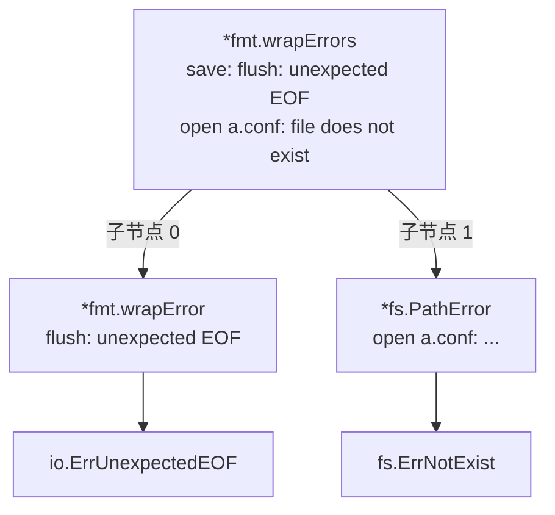

# 7.2 错误值检查

[7.1.5](./value.md) 指出，Go 1.13 之前附加上下文与保留错误的身份二者难以兼得：用 `fmt.Errorf`
和 `%v` 补充一句说明之后，`==` 比较与类型断言都会失效。Go 1.13 的解决办法分为两部分。一是
**包装**（wrapping）：错误可以实现一个 `Unwrap` 方法，返回它所包装的下层错误，`fmt.Errorf`
的 `%w` 动词会生成这样的错误。二是**检查**：`errors.Is` 与 `errors.As` 沿着包装关系逐层查找，
取代 `==` 与类型断言。Go 1.20 允许一个错误同时包装多个错误，Go 1.26 又增加了泛型版本的
`errors.AsType` [[Neil and Amsterdam, 2019](#ref-neil-amsterdam-2019)]。

本节依次讨论包装如何构成一棵错误树，`Unwrap`、`Is`、`As` 与 `AsType` 的实现及其开销，这套设计
在 Go 1.13 定型之前的取舍，以及它与其他语言的异常链的比较。

## 7.2.1 包装与错误树

`fmt.Errorf` 根据格式串中 `%w` 的个数，返回三种不同的错误。Go 1.26 的实现如下：

```go
// src/fmt/errors.go
func Errorf(format string, a ...any) (err error) {
	// 这个函数的拆分方式有些不自然，
	// 目的是让它本身与对 errors.New 的调用都能被内联。
	if err = errorf(format, a...); err != nil {
		return err
	}
	// 无需格式化。可以省去一些分配与其他工作。
	// 详见 https://go.dev/cl/708836 。
	return errors.New(format)
}

// errorf 格式化并返回一个错误值；若无需格式化，则返回 nil。
func errorf(format string, a ...any) error {
	if len(a) == 0 && stringslite.IndexByte(format, '%') == -1 {
		return nil
	}
	p := newPrinter()
	p.wrapErrs = true
	p.doPrintf(format, a)
	s := string(p.buf)
	var err error
	switch len(p.wrappedErrs) {
	case 0:
		err = errors.New(s)
	case 1:
		w := &wrapError{msg: s}
		w.err, _ = a[p.wrappedErrs[0]].(error)
		err = w
	default:
		if p.reordered {
			slices.Sort(p.wrappedErrs)
		}
		var errs []error
		for i, argNum := range p.wrappedErrs {
			if i > 0 && p.wrappedErrs[i-1] == argNum {
				continue
			}
			if e, ok := a[argNum].(error); ok {
				errs = append(errs, e)
			}
		}
		err = &wrapErrors{s, errs}
	}
	p.free()
	return err
}
```

（注释为笔者所译。）格式化时，`doPrintf` 每遇到一个 `%w`，就把对应实参的下标记入 `p.wrappedErrs`，然后按
`%v` 打印该实参，因此 `%w` 与 `%v` 生成的文本完全相同。区别只在返回值的类型：没有 `%w` 时是 `errors.New`
生成的 `*errorString`；有一个 `%w` 时是 `*wrapError`；有多个 `%w` 时是 `*wrapErrors`，若格式串用 `%[n]w`
显式指定了实参下标，则先按下标排序，并去掉重复引用的同一个实参。最前面的快速路径是 Go 1.26
新增的（thepudds，c1e6e49d5d）[[Go Authors, 2026b](#ref-go-authors-2026b)]：没有实参、格式串中也没有 `%`
时，直接调用 `errors.New`，使 `fmt.Errorf("x")` 与 `errors.New("x")` 的分配次数相同。

两种包装类型都只多了一个方法：

```go
// src/fmt/errors.go
type wrapError struct {
	msg string
	err error
}

func (e *wrapError) Error() string { return e.msg }
func (e *wrapError) Unwrap() error { return e.err }

type wrapErrors struct {
	msg  string
	errs []error
}

func (e *wrapErrors) Error() string   { return e.msg }
func (e *wrapErrors) Unwrap() []error { return e.errs }
```

`Unwrap() []error` 是 Go 1.20 引入的第二种形式（Damien Neil，4a0a2b33df）[[Go
Authors, 2023](#ref-go-authors-2023)]。同一次修改还加入了 `errors.Join`，
它把若干个错误合并为一个，丢弃其中的 `nil`，全部为 `nil` 时返回 `nil`；合并后的错误消息是各错误消息以换行
符连接而成：

```go
// src/errors/join.go
func Join(errs ...error) error {
	n := 0
	for _, err := range errs {
		if err != nil {
			n++
		}
	}
	if n == 0 {
		return nil
	}
	e := &joinError{
		errs: make([]error, 0, n),
	}
	for _, err := range errs {
		if err != nil {
			e.errs = append(e.errs, err)
		}
	}
	return e
}

func (e *joinError) Unwrap() []error {
	return e.errs
}
```

`errors` 包的文档 [[Go Authors, 2026a](#ref-go-authors-2026a)]据此定义了**错误树**（error tree）：若错误
`e` 的 `Unwrap` 方法返回 `w`，或返回的切片中含有 `w`，就称 `e` 包装了 `w`；反复调用 `Unwrap`
得到的所有错误，连同 `e` 本身，构成一棵以 `e` 为根的树。实现了 `Unwrap() error` 的节点有一个子节点，
实现了 `Unwrap() []error` 的节点有多个子节点，叶子是不再包装其他错误的错误，通常是哨兵错误或某个具体类型。`Is`
与 `As` 以先序、深度优先的顺序遍历这棵树。文档还规定，`Unwrap() []error` 返回的切片中不得含有 `nil`。



下面的程序构造了上图中的错误树，然后分别用 `==`、`errors.Is`、`errors.As` 与 `errors.AsType`
检查它：

```go {run=true}
package main

import (
	"errors"
	"fmt"
	"io"
	"io/fs"
)

func main() {
	flush := fmt.Errorf("flush: %w", io.ErrUnexpectedEOF)
	open := &fs.PathError{Op: "open", Path: "a.conf", Err: fs.ErrNotExist}
	err := fmt.Errorf("save: %w\n%w", flush, open)

	fmt.Println(err)
	fmt.Println(err == io.ErrUnexpectedEOF)
	fmt.Println(errors.Is(err, io.ErrUnexpectedEOF), errors.Is(err, fs.ErrNotExist))

	var pe *fs.PathError
	if errors.As(err, &pe) {
		fmt.Println("As:", pe.Op, pe.Path)
	}
	if pe, ok := errors.AsType[*fs.PathError](err); ok {
		fmt.Println("AsType:", pe.Op, pe.Path)
	}
	fmt.Println(errors.Unwrap(err) == nil) // Unwrap 不处理 Unwrap() []error
}
```

```
save: flush: unexpected EOF
open a.conf: file does not exist
false
true true
As: open a.conf
AsType: open a.conf
true
```

## 7.2.2 Unwrap

`errors.Unwrap` 只调用 `Unwrap() error` 形式的方法，不处理 `Unwrap() []error`，因此对
`errors.Join` 或含有多个 `%w` 的错误返回 `nil`，上面程序的最后一行即是如此。遍历整棵树是 `Is` 与
`As` 的职责：

```go
// src/errors/wrap.go
func Unwrap(err error) error {
	u, ok := err.(interface {
		Unwrap() error
	})
	if !ok {
		return nil
	}
	return u.Unwrap()
}
```

## 7.2.3 Is

`errors.Is(err, target)` 判断 `err` 的树中是否有错误与 `target` 匹配。匹配有两种情形：该错误与
`target` 相等，或者该错误实现了 `Is(error) bool` 方法且 `Is(target)` 返回真。

```go
// src/errors/wrap.go
func Is(err, target error) bool {
	if err == nil || target == nil {
		return err == target
	}

	isComparable := reflectlite.TypeOf(target).Comparable()
	return is(err, target, isComparable)
}

func is(err, target error, targetComparable bool) bool {
	for {
		if targetComparable && err == target {
			return true
		}
		if x, ok := err.(interface{ Is(error) bool }); ok && x.Is(target) {
			return true
		}
		switch x := err.(type) {
		case interface{ Unwrap() error }:
			err = x.Unwrap()
			if err == nil {
				return false
			}
		case interface{ Unwrap() []error }:
			for _, err := range x.Unwrap() {
				if is(err, target, targetComparable) {
					return true
				}
			}
			return false
		default:
			return false
		}
	}
}
```

单链部分用循环实现，遇到多个子节点时才递归。`Is` 开头先检查 `target` 的动态类型是否可比较：
两个接口值的动态类型相同但不可比较时（例如含有切片字段的结构体），`==` 会引发运行时 panic，
因此对不可比较的 `target` 只尝试 `Is` 方法。这一检查是在 Go 1.13 发布之前补上的（0bf1f02ed9）。

`Is` 方法使一个错误可以声明自己等价于另一个错误，而无需包装它。标准库中最典型的例子是
`syscall.Errno`。`os`、`io/fs` 中的 `ErrPermission`、`ErrExist`、`ErrNotExist` 都定义在
`internal/oserror` 包中，以便 `syscall` 也能引用它们，`Errno.Is` 再把若干错误号映射到这些抽象的
哨兵上：

```go
// src/syscall/syscall_unix.go
func (e Errno) Is(target error) bool {
	switch target {
	case oserror.ErrPermission:
		return e == EACCES || e == EPERM
	case oserror.ErrExist:
		return e == EEXIST || e == ENOTEMPTY
	case oserror.ErrNotExist:
		return e == ENOENT
	case errorspkg.ErrUnsupported:
		return e == ENOSYS || e == ENOTSUP || e == EOPNOTSUPP
	}
	return false
}
```

因此 `errors.Is(err, fs.ErrNotExist)` 可以识别出包装在 `*fs.PathError` 中的 `ENOENT`。在此之前，
同样的判断要靠 `os.IsNotExist` 这类函数，它们只认识 `os` 包自己的几种包装类型，无法穿过用户自定义的包装。Go
1.26 中 `os.IsNotExist` 的文档写明，该函数早于 `errors.Is`，只支持 `os` 包返回的错误，新代码应当使用
`errors.Is(err, fs.ErrNotExist)` [[Amsterdam and Mills, 2019](#ref-amsterdam-mills-2019)]。文档还要求，`Is`
方法只应浅层地比较 `err` 与 `target`，不应对任何一方调用 `Unwrap`，遍历是 `errors.Is` 的事。

## 7.2.4 As 与 AsType

`errors.As(err, target)` 在树中查找第一个可以赋值给 `*target` 的错误，找到后写入 `*target`。`target`
的类型是 `any`，因此 `As` 在运行时用 `internal/reflectlite` 检查参数并完成赋值：

```go
// src/errors/wrap.go
func As(err error, target any) bool {
	if err == nil {
		return false
	}
	if target == nil {
		panic("errors: target cannot be nil")
	}
	val := reflectlite.ValueOf(target)
	typ := val.Type()
	if typ.Kind() != reflectlite.Ptr || val.IsNil() {
		panic("errors: target must be a non-nil pointer")
	}
	targetType := typ.Elem()
	if targetType.Kind() != reflectlite.Interface && !targetType.Implements(errorType) {
		panic("errors: *target must be interface or implement error")
	}
	return as(err, target, val, targetType)
}

func as(err error, target any, targetVal reflectlite.Value, targetType reflectlite.Type) bool {
	for {
		if reflectlite.TypeOf(err).AssignableTo(targetType) {
			targetVal.Elem().Set(reflectlite.ValueOf(err))
			return true
		}
		if x, ok := err.(interface{ As(any) bool }); ok && x.As(target) {
			return true
		}
		switch x := err.(type) {
		case interface{ Unwrap() error }:
			err = x.Unwrap()
			if err == nil {
				return false
			}
		case interface{ Unwrap() []error }:
			for _, err := range x.Unwrap() {
				if err == nil {
					continue
				}
				if as(err, target, targetVal, targetType) {
					return true
				}
			}
			return false
		default:
			return false
		}
	}
}
```

这一签名有两处不便。其一，`target` 必须是指向错误类型或接口类型的非空指针，但这只能在运行时检查，
传错了就会 panic，`go vet` 的 `errorsas` 检查只能发现其中一部分错误。其二，调用方要先声明变量，
再传入它的地址，`target` 因此通过 `any` 参数逃逸到堆上。

2022 年 3 月，GitHub 用户 slnt 提出了泛型版本的提案（#51945）[[slnt, 2022](#ref-slnt-2022)]，三年后由
Julien Cretel 实现，进入 Go 1.26（a846bb0aa5）。`AsType` 以类型参数代替指针参数：

```go
// src/errors/wrap.go
func AsType[E error](err error) (E, bool) {
	if err == nil {
		var zero E
		return zero, false
	}
	var pe *E // 延迟初始化
	return asType(err, &pe)
}

func asType[E error](err error, ppe **E) (_ E, _ bool) {
	for {
		if e, ok := err.(E); ok {
			return e, true
		}
		if x, ok := err.(interface{ As(any) bool }); ok {
			if *ppe == nil {
				*ppe = new(E)
			}
			if x.As(*ppe) {
				return **ppe, true
			}
		}
		switch x := err.(type) {
		case interface{ Unwrap() error }:
			err = x.Unwrap()
			if err == nil {
				return
			}
		case interface{ Unwrap() []error }:
			for _, err := range x.Unwrap() {
				if err == nil {
					continue
				}
				if x, ok := asType(err, ppe); ok {
					return x, true
				}
			}
			return
		default:
			return
		}
	}
}
```

（注释为笔者所译。）遍历的结构与 `as` 相同，区别在两处。一是匹配用的是普通的类型断言
`err.(E)`，不需要反射；`E` 被约束为 `error`，参数错误在编译期即被拒绝。二是只有当树中某个错误
实现了 `As(any) bool` 方法时，才分配一个 `*E` 交给它，绝大多数情况下根本不分配。

这两处区别在开销上相当明显。下面是在 Go 1.26.10、Apple M5 Pro 上测得的结果，其中「三层」指
`fmt.Errorf` 以 `%w` 嵌套包装三次，目标位于最内层（每项运行 5 次，取中位数）：

| 操作 | 每次耗时 | 分配 |
| :-- | --: | --: |
| `err == sentinel`（未包装） | 1.8 ns | 0 |
| `errors.Is`（未包装） | 3.3 ns | 0 |
| `errors.Is`（三层） | 8.5 ns | 0 |
| `err.(*fs.PathError)`（未包装） | 1.7 ns | 0 |
| `errors.As`（三层） | 48.3 ns | 1 次，8 B |
| `errors.AsType`（三层） | 6.5 ns | 0 |

`As` 的那一次分配来自目标变量：以 `-gcflags=-m` 编译测试，编译器报告
`moved to heap: pe`。`AsType` 既省去了反射，也省去了这次分配，在这个例子中快了约 7 倍。`As` 的
文档因此建议多数情况下使用 `AsType`；`As` 仍然保留，它的目标可以是任意接口类型，不要求实现
`error`。

## 7.2.5 设计的由来

这套机制并非一次成型。2018 年 8 月，Jonathan Amsterdam 与 Damien Neil 随 Go 2 草案发布了错误检查（error
inspection）的草案设计 [[Amsterdam and Neil, 2018](#ref-amsterdam-neil-2018)]，提出了 `Unwrap`、`Is` 与
`As` 的雏形；实现先在 `golang.org/x/xerrors` 中试验。2019 年 1 月，Amsterdam 提交了正式提案 #29934
[[Amsterdam et al., 2019](#ref-amsterdam-et-al-2019)]。同年 2 月，Marcel van Lohuizen
把它合入主干（62f5e8156e、6be6f114e0），当时的版本还包括记录调用位置的帧信息、`errors.Formatter` 与
`errors.Printer` 接口、`%+v` 的多行输出格式，以及对格式串末尾的特殊处理：`%w` 只能以 `": %w"`
的形式出现在格式串末尾，末尾为 `": %s"` 或 `": %v"` 且最后一个实参是错误时，该错误不被包装，
但会在详细格式中打印出来。

2019 年 5 月 6 日，开发冻结前夕，Damien Neil 在 #29934 中公布了 Go 1.13 的决定
[[Neil, 2019](#ref-neil-2019)]：保留 `Unwrap`、`Is`、`As` 与 `%w`；`%w` 可以出现在格式串的任意位置；
删除与格式化、调用位置有关的全部内容，留待以后重新考虑。理由是对这些格式化接口的使用经验还不够，
并且已有迹象表明设计并不完全正确；而对格式串末尾的特殊处理违背了 printf 的一贯模型，即 `%`
动词的含义与上下文无关、其余文本没有任何含义，这是原设计中争议最大的一点。一周后，Neil
回退了这些修改（3e2c522d5c）。同一份决定还解释了为何不沿用 `pkg/errors` 的 `Cause` 这个名字：现有的包对
`Cause` 的含义各执一词，而 `Unwrap` 更准确地描述了这一操作。

至于为何用 `%w` 这样一个格式动词，而不是新增一个 `errors.Wrap` 函数，Russ Cox 次日在同一个讨论中做了说明
[[Cox, 2019a](#ref-cox-2019a)]。一个错误能否被拆开取出内层错误，是一个关乎语义的决定，
好比结构体的字段是否导出：有时需要暴露，有时不应暴露。如果用 `errors.Wrap` 生成可拆开的错误、用
`fmt.Errorf` 生成不透明的错误，选择哪种 API 就会左右是否暴露内层错误。`%w` 把这两个决定分开：API 始终是
`fmt.Errorf`，是否暴露则由 `%w` 还是 `%v` 决定，改变主意只需改动一个字母。

Go 1.13 的 `fmt.Errorf` 只允许出现一个 `%w`。2022 年 6 月，Damien Neil 提出了包装多个错误的提案
（#53435）[[Neil, 2022](#ref-neil-2022)]，由此有了 Go 1.20 的 `Unwrap() []error` 与 `errors.Join`，
错误链也由此成为错误树。

## 7.2.6 与异常链的比较

为异常保留它的「原因」，在其他语言中早已有之。Java 1.4（2002 年）引入了异常链（chained exception
facility），`Throwable` 可以携带一个作为原因的 `Throwable`，以 `getCause` 取出，原因本身还可以有原因，
形成一条链 [[Oracle, 2014](#ref-oracle-2014)]；C# 的 `Exception.InnerException` 作用相同。Python 3 按照
PEP 3134（Ka-Ping Yee，2005 年）[[Yee, 2005](#ref-yee-2005)]加入了 `raise ... from` 语法，
显式设置的原因保存在 `__cause__` 中。Rust 的 `std::error::Error` 特征则以 `source`
方法返回下层错误（2018 年的 RFC 2504 引入 [[Rust, 2018](#ref-rust-2018)]，Rust 1.33 起取代旧的 `cause`
方法）。Go 的 `Unwrap` 与这些机制一脉相承。

差别在于检查的方式。异常语言按类型层级捕获异常：`catch` 一个基类，就捕获了其下所有子类，要让
一个错误「也算作」另一类，通常需要调整继承关系；而且捕获只看最外层的异常，原因链主要用于打印
诊断信息。Go 的检查则是在整棵树上进行的：

- 哨兵与具体类型可以出现在同一棵树中。`Is` 按值匹配哨兵，`As` 与 `AsType` 按类型取回具体错误，
  两种检查互不干扰。
- 等价关系由错误自己声明。`Is(error) bool` 与 `As(any) bool` 方法使一个错误可以等价于某个哨兵，
  或被当作另一种类型，无需任何继承关系，`syscall.Errno.Is` 即是一例。
- 包装是组合而非继承。树的形状由运行时的数据决定，而不是由编译期固定的类层级决定。

代价是检查从一次类型分派变成了一次树的遍历，并且需要调用方显式地调用 `Is` 或 `As`。

## 7.2.7 惯用法与陷阱

几条实践建议，大多是上述机制的直接推论：

- **`%w` 是 API 的一部分。** 用 `%w` 包装，就意味着调用方可以用 `Is` 或 `As` 匹配内层错误，内层
  错误随之成为对外契约的一部分。若内层错误只是实现细节，应当用 `%v`。7.4 将从库作者的角度
  讨论这一点。
- **不要包装 `nil`。** `fmt.Errorf("read: %w", err)` 在 `err` 为 `nil` 时并不返回 `nil`，而是返回
  一个消息为 `read: %!w(<nil>)` 的非 `nil` 错误。包装应当放在 `if err != nil` 之内。
- **只在有用时包装。** 每一层都包装一次，会使错误消息冗长重复。包装应当补充本层特有的信息，
  例如正在处理的文件名或请求编号。
- **优先使用 `AsType`。** 它在编译期检查类型参数，没有反射与分配。只有目标是某个不实现 `error`
  的接口时，才需要 `As`。
- **自定义的 `Is`、`As` 方法要浅。** 只比较错误自身与 `target`，不要在其中调用 `Unwrap`。

## 延伸阅读

- <a id="ref-neil-amsterdam-2019"></a>[Neil and Amsterdam, 2019] Damien Neil, Jonathan Amsterdam. *Working
  with Errors in Go 1.13.* The Go Blog, 2019. https://go.dev/blog/go1.13-errors
  （`%w`/`Unwrap`/`Is`/`As` 的设计动机与用法）
- <a id="ref-go-authors-2026a"></a>[Go Authors, 2026a] The Go Authors. *Package errors.*
  https://pkg.go.dev/errors （`New`/`Unwrap`/`Is`/`As`/`AsType`/`Join` 的权威文档）
- <a id="ref-amsterdam-et-al-2019"></a>[Amsterdam et al., 2019] Jonathan Amsterdam, Russ Cox, Marcel van
  Lohuizen, Damien Neil. *Proposal: Go 2 Error Inspection (#29934).* 2019.
  https://go.googlesource.com/proposal/+/master/design/29934-error-values.md ；讨论见
  https://go.dev/issue/29934 （`Is`/`As`/`Unwrap` 的设计提案，记录了被否决的替代方案）
- <a id="ref-go-authors-2023"></a>[Go Authors, 2023] The Go Authors. *Go 1.20 Release Notes: Wrapping
  multiple errors.* https://go.dev/doc/go1.20#errors （`Unwrap() []error` 与 `errors.Join`）
- <a id="ref-slnt-2022"></a>[slnt, 2022] *errors: AsType (As with type parameters) (#51945).* 2022–2025.
  https://go.dev/issue/51945 （go1.26 泛型 `AsType` 的提案与讨论）
- <a id="ref-go-authors-2026b"></a>[Go Authors, 2026b] The Go Authors.
  *src/errors/wrap.go、join.go、 src/fmt/errors.go.* https://github.com/golang/go/tree/master/src/errors
  （本节实现的一手来源）；Go
  1.26：[src/errors/wrap.go](https://github.com/golang/go/blob/release-branch.go1.26/src/errors/wrap.go)、[src/errors/join.go](https://github.com/golang/go/blob/release-branch.go1.26/src/errors/join.go)、[src/fmt/errors.go](https://github.com/golang/go/blob/release-branch.go1.26/src/fmt/errors.go)；Go
  1.13 前的回退提交 https://go.googlesource.com/go/+/3e2c522d5c
- <a id="ref-amsterdam-mills-2019"></a>[Amsterdam and Mills, 2019] Jonathan Amsterdam, Bryan C. Mills.
  *Error Values: Frequently Asked Questions.* 2019. https://github.com/golang/go/wiki/ErrorValueFAQ
  （`Is`/`As`/`%w` 实际使用中的常见疑问与权威解答）
- <a id="ref-amsterdam-neil-2018"></a>[Amsterdam and Neil, 2018] Jonathan Amsterdam, Damien Neil. *Error
  Inspection, Draft Design.* 2018.
  https://go.googlesource.com/proposal/+/master/design/go2draft-error-inspection.md
- <a id="ref-neil-2019"></a>[Neil, 2019] Damien Neil. *Go 1.13 launch decision about error values.* 2019.
  https://github.com/golang/go/issues/29934#issuecomment-489682919
- <a id="ref-cox-2019a"></a>[Cox, 2019a] Russ Cox. *Response regarding "proposal: Go 2 error values".*
  2019. https://github.com/golang/go/issues/29934#issuecomment-490087200
- <a id="ref-neil-2022"></a>[Neil, 2022] Damien Neil. *errors: add support for wrapping multiple errors
  (#53435).* 2022. https://go.dev/issue/53435
- <a id="ref-oracle-2014"></a>[Oracle, 2014] Oracle. *Java Platform SE 8 API: Class Throwable*（异常链，`getCause`
  自 1.4 起）. https://docs.oracle.com/javase/8/docs/api/java/lang/Throwable.html
- <a id="ref-yee-2005"></a>[Yee, 2005] Ka-Ping Yee. *PEP 3134: Exception Chaining and Embedded
  Tracebacks.* 2005. https://peps.python.org/pep-3134/
- <a id="ref-rust-2018"></a>[Rust, 2018] *RFC 2504: fix_error.* Rust RFCs, 2018.
  https://rust-lang.github.io/rfcs/2504-fix-error.html
- 本书 [7.1 问题的演化](./value.md)、[7.5 错误处理的未来](./future.md)。
