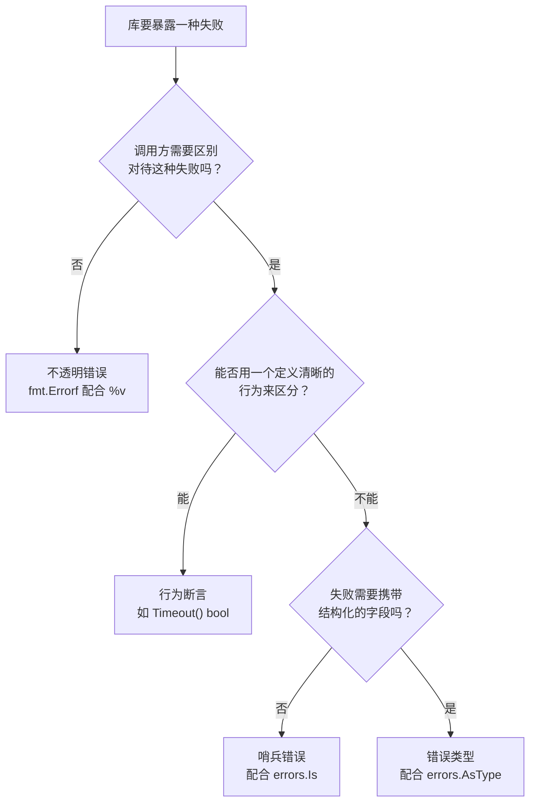

# 7.4 错误语义

[7.2](./inspect.md) 与 [7.3](./context.md) 站在调用方一侧，讨论拿到一个 `error` 之后如何检查、
如何补充上下文。本节站在库作者一侧，讨论一个更早的问题：一个包要把失败暴露给调用方时，应当以
什么形式暴露？导出一个可以比较的值，导出一个带字段的类型，还是什么都不导出？

错误既然是值 [[Pike, 2015](#ref-pike-2015)]，它以何种形式出现，就由库作者决定。这并非单纯的风格问题。
错误的形式一旦发布，就和函数签名一样成为包的公开契约：调用方会依据它编写分支逻辑，库日后再想修改，
就会破坏这些调用方。不同的形式向契约承诺的内容不同，留给库日后修改的余地也就不同。Dave Cheney 在
2016 年春季东京 GoCon 的演讲中，把 Go 的错误处理归纳为三种基本策略：哨兵错误、错误类型与不透明错误
[[Cheney, 2016a](#ref-cheney-2016a)] [[Cheney, 2016b](#ref-cheney-2016b)]。本节在此基础上加入第四种，
即断言错误的行为，按照各自向契约承诺了什么逐一讨论，最后给出取舍的次序。

## 7.4.1 哨兵错误：承诺一个值

最直接的形式是导出一个预先创建的错误值，供调用方比较。标准库中的例子很多：

```go
// src/io/io.go
// EOF 是 Read 在没有更多输入时返回的错误。
// （Read 必须返回 EOF 本身，而不能返回包装了 EOF 的错误，
// 因为调用方会用 == 检测 EOF。）
// 函数只应在输入正常结束时返回 EOF。
// 如果在结构化的数据流中意外遇到 EOF，
// 应当返回 ErrUnexpectedEOF 或其他更具体的错误。
var EOF = errors.New("EOF")

// src/database/sql/sql.go
// 当 DB.QueryRow 没有返回任何行时，Row.Scan 返回 ErrNoRows。
// 此时 QueryRow 返回一个占位的 *Row，把这个错误推迟到 Scan 时才报告。
var ErrNoRows = errors.New("sql: no rows in result set")
```

（注释为笔者所译。）这类预先定义的错误值称为**哨兵错误**（sentinel error）。它们表达的往往
不是故障，而是正常结果之外的某种确定结局：`io.EOF` 表示输入正常结束，`sql.ErrNoRows` 表示查询
没有命中任何行 [[Go Authors, 2026a](#ref-go-authors-2026a)]。

`io.EOF` 的文档同时揭示了哨兵的隐含代价。由于调用方用 `==` 检测它，`Read` 必须原样返回 `EOF`，不能用 `%w`
为它补充任何上下文。`errors.Is` 缓解了这一点，但 `io.EOF` 这样在 Go 1.13 之前就已发布的哨兵，
仍然受当初契约的约束。Cheney 认为哨兵最大的问题在于它在两个包之间建立了源码上的依赖：调用方为了检查
`io.EOF`，必须导入 `io` [[Cheney, 2016b](#ref-cheney-2016b)]。此外，导出的哨兵是变量，
任何导入该包的代码都可以改写它（见 [7.1.5](./value.md) [[Cheney, 2016e](#ref-cheney-2016e)]）。Cheney
的建议是，在自己的代码中尽量避免使用哨兵错误。

Go 1.13 之后，哨兵的用法有所变化。Go 1.21 加入的 `errors.ErrUnsupported` 的文档
[[Go Authors, 2026c](#ref-go-authors-2026c)]写道：函数与方法不应直接返回这个错误，
而应返回一个包含适当上下文、并且满足 `errors.Is(err, errors.ErrUnsupported)` 的错误，可以直接包装
`ErrUnsupported`，也可以实现 `Is` 方法。哨兵在这里不再是被原样返回的值，而是一个供 `Is` 匹配的类别；[7.2.3](./inspect.md)
中 `syscall.Errno` 把 `ENOSYS` 等错误号映射到 `ErrUnsupported`，用的正是这种方式。

## 7.4.2 错误类型：承诺一个结构

失败需要携带数据时，自然的做法是定义一个实现了 `error` 的类型，把数据放在字段中：

```go
// src/io/fs/fs.go
// PathError 记录一个错误，以及导致该错误的操作与文件路径。
type PathError struct {
	Op   string
	Path string
	Err  error
}

func (e *PathError) Error() string { return e.Op + " " + e.Path + ": " + e.Err.Error() }

func (e *PathError) Unwrap() error { return e.Err }
```

（注释为笔者所译。）调用方用 `errors.AsType` 取出这个类型，再读取它的字段：

```go
if pe, ok := errors.AsType[*fs.PathError](err); ok {
	log.Printf("%s %s 失败", pe.Op, pe.Path)
}
```

错误类型能携带的信息远多于哨兵，代价是耦合更深一层：哨兵只承诺一个值，类型则把整个结构承诺给了
契约。调用方的代码中写死了 `*fs.PathError` 及其字段名，库日后若要重命名字段、改变字段的含义，
或者换用另一个类型，都会破坏这些调用方。为错误类型增加字段是兼容的修改，重命名或删除字段则不是。
因此，导出的字段应当尽量少，只保留调用方确实需要据以分支的那些 [[Cheney, 2014](#ref-cheney-2014)]。

一个更完整的例子是 Rob Pike 与 Andrew Gerrand 在 2017 年描述的 Upspin 错误包
[[Pike and Gerrand, 2017](#ref-pike-gerrand-2017)]。Upspin 的错误类型只有一个，字段包括路径 `Path`、用户
`User`、操作 `Op`、类别 `Kind` 与嵌套的下层错误 `Err`，任何字段都可以为空；构造函数
`errors.E(args ...interface{})` 根据每个实参的类型决定把它放进哪个字段。`Kind` 把错误分为 `Permission`、`IO`、`NotExist`
等若干类，调用方用 `errors.Is(kind, err)` 判断类别，而不必关心具体是哪一个错误。
他们列出的设计目标是：易于构造信息丰富的错误消息，便于用户理解，便于程序员诊断。嵌套的错误记录的是请求经过
了系统中的哪些组件，他们称之为操作轨迹，以区别于记录代码执行路径的调用栈，并特意强调 Upspin
的错误模型中没有调用栈。他们也说明，这一设计并不是对其他系统的推荐。今天看来，`Kind` 的匹配可以用
[7.2](./inspect.md) 中的 `Is` 方法实现，与 `errors.Is` 无缝配合。

## 7.4.3 不透明错误：不承诺

另一个极端是只返回 `error`，不导出任何哨兵或类型。调用方除了判断成功与否之外，无法对错误作
结构化的判断：

```go
func (c *Config) Load(path string) error {
	f, err := os.Open(path)
	if err != nil {
		return fmt.Errorf("load config: %v", err)
	}
	defer f.Close()
	// ...
	return nil
}
```

Cheney 称之为**不透明错误**（opaque error），并建议尽可能把所有错误都当作不透明的
[[Cheney, 2016b](#ref-cheney-2016b)]。它的好处恰好是前两种形式的代价的反面：库没有向契约承诺任何东西，
内部如何表示失败、使用什么类型、带什么字段，都可以随意修改。注意上面用的是 `%v` 而不是 `%w`：`%w` 会使
`*fs.PathError` 成为可以被调用方匹配的内层错误，从而把它变成契约的一部分（见 [7.2.5](./inspect.md) 中
Russ Cox 关于 `%w` 与 `%v` 的说明）。

不透明的代价是调用方失去了区分错误的能力。有些失败确实需要区别对待：超时可以重试，查无此行
可以使用默认值。把这些情形一律做成不透明错误，调用方就只能去匹配错误消息的文本，而 Cheney 也
明确指出，`Error` 方法是给人看的，程序不应根据它的输出改变行为。问题于是变成：能否让调用方
分支，又不把一个值或一个类型写进契约？

## 7.4.4 断言行为

Cheney 给出的答案是断言错误的行为，而不是它的类型 [[Cheney, 2014](#ref-cheney-2014)]。
错误类型实现一个只描述某种行为的小接口，调用方断言这个接口，而不是某个具体类型。标准库 `net` 包的 `Error`
接口是典型的例子 [[Go Authors, 2026b](#ref-go-authors-2026b)]：

```go
// src/net/net.go
// Error 表示一个网络错误。
type Error interface {
	error
	Timeout() bool // 这个错误是否为超时？

	// 已弃用：「临时」错误的定义并不明确。
	// 大多数「临时」错误都是超时，少数例外则出人意料。
	// 不要使用这个方法。
	Temporary() bool
}
```

（注释为笔者所译。）调用方无需导入 `net`，只要在本地声明一个结构相同的接口即可。Go 的接口是
结构化满足的（见 [4.2.4](../ch04type/interface.md)），任何实现了 `Timeout() bool` 的错误都满足它，
不论来自哪个包。`context.DeadlineExceeded` 与 `os.ErrDeadlineExceeded` 都实现了这个方法，前者
与 `net` 包毫无关系。

在 Go 1.13 之前，这种断言直接作用于错误本身；错误被包装之后，断言就会失败。如今应当用
`errors.As` 沿错误树查找实现了该接口的错误。`As` 的目标可以是任意接口类型，`AsType` 则要求
类型参数满足 `error` 约束，因此接口中需要嵌入 `error`：

```go {run=true}
package main

import (
	"context"
	"errors"
	"fmt"
	"os"
)

type timeout interface{ Timeout() bool }

func main() {
	for _, cause := range []error{context.DeadlineExceeded, os.ErrDeadlineExceeded, os.ErrClosed} {
		err := fmt.Errorf("fetch: %w", cause)

		_, direct := err.(timeout) // 最外层是 *fmt.wrapError，断言失败

		var t timeout
		viaAs := errors.As(err, &t) && t.Timeout()

		te, ok := errors.AsType[interface {
			error
			Timeout() bool
		}](err)
		viaAsType := ok && te.Timeout()

		fmt.Println(cause, direct, viaAs, viaAsType)
	}
}
```

```
context deadline exceeded false true true
i/o timeout false true true
file already closed false false false
```

库一侧也要配合。`net.OpError` 会包装下层的错误，它的 `Timeout` 方法本身并不判断，而是转发给
下层：

```go
// src/net/net.go
func (e *OpError) Timeout() bool {
	if ne, ok := e.Err.(*os.SyscallError); ok {
		t, ok := ne.Err.(timeout)
		return ok && t.Timeout()
	}
	t, ok := e.Err.(timeout)
	return ok && t.Timeout()
}
```

`*fs.PathError` 也有一个同样转发给 `Err` 的 `Timeout` 方法。这类代码写于 `Unwrap` 出现之前：
每一个会包装其他错误的类型都必须自己转发这个行为，`OpError` 还为 `*os.SyscallError` 这一层多写了一次判断。`errors.As`
出现之后，只要包装类型实现了 `Unwrap`，沿树查找就由标准库统一完成，各个包装类型不必再逐一转
发。

行为断言也有失效的时候，`net.Error` 的第二个方法就是一个例子。`Temporary() bool` 的本意是表示
「这个错误是暂时的，值得重试」。2021 年 4 月，Damien Neil 提议弃用它 [[Neil, 2021](#ref-neil-2021)]：
超时的含义相当直观，即操作是否超过了截止时间；「临时」的含义却并不明确，例如 `EHOSTUNREACH`
可能源于暂时的路由故障，那它算不算临时错误？一个超过截止时间的操作，若不延长截止时间就重试，
仍然会失败，它又算不算永久错误？Neil 统计了标准库中 `Temporary` 返回真的情形，发现大部分其实是
超时。这一方法从 Go 1.18 起被标记为弃用（a53e3d5f88）。教训是：值得断言的行为，必须有清晰且
公认的定义，`Timeout()` 符合这一点，`Temporary()` 则不然。

## 7.4.5 其他语言中的形式

以异常为主的语言把错误组织成类型层级。`catch (FileNotFoundException e)` 本质上是
[7.4.2](#742-错误类型承诺一个结构) 中的类型检查，只是借助继承来组织：捕获一个基类，就捕获了其下的
所有子类。整个异常层级因此都进入了契约。Java 的受检异常更进一步，把异常写进方法签名，[7.1.1](./value.md)
介绍的 Hejlsberg 的批评，正是针对这一点。

Rust 把错误类型写进 `Result<T, E>` 的签名，由编译器强制调用方处理。社区中，`thiserror` 用于为
库定义结构化的错误枚举，相当于 Go 的错误类型；`anyhow` 把错误装箱为不透明的类型，相当于 Go 的
不透明错误。可见错误类型与不透明错误并非 Go 独有，凡是把错误当作值的语言都要面对这一选择，区别
在于 Go 以接口与运行时检查表达，Rust 以枚举与编译期的穷尽检查表达。行为断言则是四种形式中最
具 Go 特色的一种：它依赖结构化的接口满足，在只有名义类型的语言中不容易复现。

## 7.4.6 如何取舍

按向契约承诺的内容排列，四种形式如下：

| 形式 | 向契约承诺的 | 耦合 | 调用方能做什么 |
| :-- | :-- | :-- | :-- |
| 不透明错误 | 无 | 最低 | 只能判断 `err != nil` |
| 行为断言 | 一个小接口 | 低 | `errors.As(err, &t)`，`t` 为 `interface{ Timeout() bool }` |
| 哨兵错误 | 一个值 | 中 | `errors.Is(err, ErrX)` |
| 错误类型 | 一个结构 | 高 | `errors.AsType[*T](err)`，读取字段 |

一个可行的默认次序是：先做成不透明的，库不暴露任何内部细节，等到确有调用方需要区分时再说。
某种失败确实需要区别对待时，优先考虑行为断言，定义一个尽可能小的接口。只有行为不足以表达，
例如调用方必须读取结构化的字段时，才导出哨兵或类型，并且清楚地意识到：从此以后，这个值或这个
结构就是 API 的一部分，它的演变受 Go 1 兼容性承诺的约束 [[Go Authors, 2012](#ref-go-authors-2012)]。



Go 1.13 的 `Unwrap`、`Is`、`As` 改变了这几种形式的相对代价。在此之前，哨兵与错误类型一旦被包装就无法识别，
这是 Cheney 当年力主不透明错误的重要背景；`errors.Is` 与 `errors.As` 出现之后
[[Neil and Amsterdam, 2019](#ref-neil-amsterdam-2019)]，它们可以穿过包装被识别，实用性随之提高。
但向契约承诺的内容并没有因此减少：哨兵仍是一个值，类型仍是一个结构，包装时选择 `%w`
还意味着把内层错误也加入了契约。因此上述次序仍然成立：先少承诺，确有需要时再多承诺，
并清楚每多承诺一分换来了什么。

## 延伸阅读

- <a id="ref-cheney-2016b"></a>[Cheney, 2016b] Dave Cheney. Don't just check errors, handle them
  gracefully. GoCon Spring (Tokyo), 2016-04; blog post 2016-04-27; also given at GopherCon 2016.
  https://dave.cheney.net/2016/04/27/dont-just-check-errors-handle-them-gracefully
- <a id="ref-cheney-2016a"></a>[Cheney, 2016a] Dave Cheney. My philosophy for error handling. GoCon
  Spring, 2016-04. https://dave.cheney.net/paste/gocon-spring-2016.pdf （哨兵、类型、不透明三种形式
  取舍的讲稿）
- <a id="ref-pike-gerrand-2017"></a>[Pike and Gerrand, 2017] Rob Pike, Andrew Gerrand. Error handling in
  Upspin. 2017-12-06. https://commandcenter.blogspot.com/2017/12/error-handling-in-upspin.html
  （在真实系统里设计错误类型的一手案例）
- <a id="ref-cheney-2014"></a>[Cheney, 2014] Dave Cheney. Inspecting errors. 2014-12-24.
  https://dave.cheney.net/2014/12/24/inspecting-errors
- <a id="ref-cheney-2016e"></a>[Cheney, 2016e] Dave Cheney. Constant errors. 2016-04-07.
  https://dave.cheney.net/2016/04/07/constant-errors
- <a id="ref-go-authors-2026b"></a>[Go Authors, 2026b] The Go Authors. Package net: type Error.
  https://pkg.go.dev/net#Error
- <a id="ref-go-authors-2026a"></a>[Go Authors, 2026a] The Go Authors. Package io: variable EOF.
  https://pkg.go.dev/io#EOF
- <a id="ref-neil-amsterdam-2019"></a>[Neil and Amsterdam, 2019] Damien Neil, Jonathan Amsterdam. Working
  with Errors in Go 1.13. The Go Blog, 2019-10-17. https://go.dev/blog/go1.13-errors
- <a id="ref-pike-2015"></a>[Pike, 2015] Rob Pike. Errors are values. The Go Blog, 2015-01-12.
  https://go.dev/blog/errors-are-values
- <a id="ref-neil-2021"></a>[Neil, 2021] Damien Neil. net: deprecate Temporary error status. 2021.
  https://go.dev/issue/45729 ；弃用提交 https://go.googlesource.com/go/+/a53e3d5f88
- <a id="ref-go-authors-2026c"></a>[Go Authors, 2026c] The Go Authors. Package errors: ErrUnsupported.
  https://pkg.go.dev/errors#ErrUnsupported
- <a id="ref-go-authors-2012"></a>[Go Authors, 2012] The Go Authors. Go 1 and the Future of Go Programs.
  2012. https://go.dev/doc/go1compat
