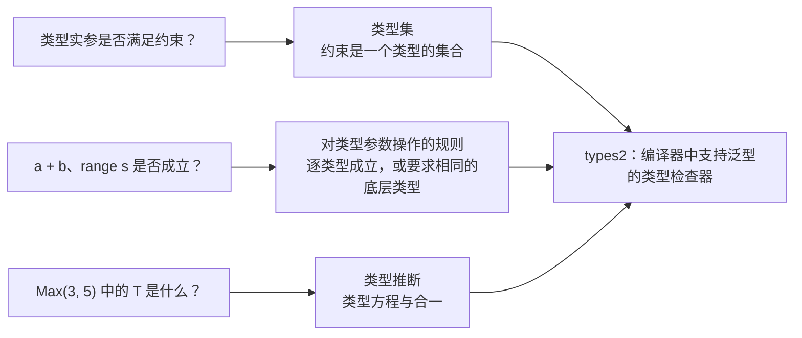

# 8.3 类型检查技术

泛型使类型检查器面对的问题困难了许多。没有泛型时，检查器要判断的基本上只有一类问题：一个值是否属于某个
类型。有了类型参数，它还要回答三个新的问题：一个类型实参是否满足约束；`a + b`、`range s` 这样的操作在类型
尚未确定时是否成立；以及调用 `Max(3, 5)` 时，没有写出的 `T` 究竟是什么。本节依次讨论与之对应的三项技术：
类型集、对类型参数操作的规则，以及类型推断，最后讨论编译器中实现这些规则的类型检查器 `types2`。它们是
[8.1](./history.md) 与 [8.2](./contracts.md) 所述设计在编译期的落实，编译器前端的整体结构见
[第 15 章](../../part5toolchain/ch15compile/readme.md)。



泛型的类型规则也有形式化的研究。2020 年，Griesemer、Taylor 与 Philip Wadler 等人以 Featherweight Java
为蓝本，提出了 Go 的两个核心演算 FG 与 FGG，后者带有类型参数。与 Java 不同，Go 的子类型关系是结构化的，
泛型以单态化而非类型擦除实现；论文分别证明了两个演算的类型可靠性，并把 FGG 到 FG 的单态化翻译形式化，
证明它保持类型且构成互模拟，作者称这是最早形式化单态化的工作之一
[[Griesemer et al., 2020](#ref-griesemer-et-al-2020)]。这项工作发表于类型参数提案在 2021 年被接受之前，
而 Griesemer 与 Taylor 正是 Go 泛型的两位设计者。

## 8.3.1 类型集：约束是一个类型的集合

约束的核心概念是**类型集**（type set）。普通的接口描述一个类型有哪些方法，作为约束的接口则进一步描述哪些类
型属于它（[8.2.4](./contracts.md)）。类型集由**类型项**（type term）的并集构成，编译器
`cmd/compile/internal/types2` 包中的 `term` 结构直接沿用了集合的记法
[[Go Authors, 2026c](#ref-go-authors-2026c)]：

```go
// Go 1.26 cmd/compile/internal/types2/typeterm.go（注释为笔者所译）
//
// term 描述基本的类型集：
//
//	 ∅:  (*term)(nil)     == ∅                      // 空集
//	 𝓤:  &term{}          == 𝓤                      // 所有类型构成的全集
//	 T:  &term{false, T}  == {T}                    // 只含类型 T 的集合
//	~t:  &term{true, t}   == {t' | under(t') == t}  // 底层类型为 t 的所有类型
type term struct {
	tilde bool // 仅当 typ != nil 时有意义
	typ   Type
}
```

约束中的三种写法各自对应一种集合：`int` 是只含 `int` 的集合；`~int` 是 $\{t \mid \mathrm{under}(t) =
\texttt{int}\}$，即所有底层类型为 `int` 的类型；`A | B` 是二者的并集 $S_A \cup S_B$。语言规范对 `~T`
有两条限制：`T` 的底层类型必须是它自身，因此 `~MyInt` 不合法；`T` 也不能是接口，因此 `~error` 不合法
[[Go Authors, 2026a](#ref-go-authors-2026a)]。一个接口的类型集，是其各个接口元素的类型集之交：
方法元素对应所有具有该方法的类型，联合元素对应其各个类型项之并
[[Taylor and Griesemer, 2021](#ref-taylor-griesemer-2021)]。`types2` 以下面的结构表示它：

```go
// Go 1.26 cmd/compile/internal/types2/typeset.go（注释为笔者所译）
type _TypeSet struct {
	methods    []*Func  // 接口的全部方法，按唯一标识排序
	terms      termlist // 类型集的类型项
	comparable bool     // 不变式：!comparable || terms.isAll()
}
```

「类型 $T$ 满足约束 $C$」由此有了精确的定义：$T$ 属于 `terms` 所描述的集合，实现了 `methods`
中的全部方法，并且在 `comparable` 为真时是可比较的类型。检查器的工作就是计算这些集合，再判断归属。

`comparable` 值得单独说明。它无法写成若干类型项的并集，因此 `_TypeSet` 以一个独立的布尔字段表示它。Go
1.18 中，`comparable` 只允许严格可比较的类型，即保证 `==` 不会在运行时引发 panic 的类型，
接口类型因此被排除在外。Go 1.20 放宽了这一规则：普通的接口类型，以及含有接口字段的复合类型，也可以满足
`comparable` 约束，代价是当两个接口值的动态类型不可比较时，比较会在运行时引发 panic
[[Go Authors, 2023a](#ref-go-authors-2023a)]。为了表达能力，一部分检查从编译期推迟到了运行时。

## 8.3.2 对类型参数的操作：逐类型成立与相同的底层类型

类型集回答了「哪些类型可以传入」，泛型函数体中的操作则带来另一个问题：一个操作在类型参数上何时成立？Go
1.26 的规范对不同的操作采用两类规则，初学泛型时容易把二者混淆。

第一类规则要求操作对类型集中的**每一个类型**都成立。运算符属于此类：若操作数的类型是类型参数，
运算符必须适用于其类型集中的每一个类型，运算则按实例化时的具体类型进行
[[Go Authors, 2026a](#ref-go-authors-2026a)]。因此 `a + b` 在 `interface{ ~float32 | ~float64 }` 上成立，`a < b`
在包含十余种底层类型的 `cmp.Ordered` 上也成立，这正是 `slices.Sort` 得以实现的原因。`len`、`cap`
与下标同样遵循这一规则：`len(s)` 只需对类型集中的每个类型都合法；下标 `s[i]` 除此之外还要求各类型的元素类
型相同。

第二类规则要求类型集中的所有类型具有**相同的底层类型**，适用于那些依赖统一的底层结构才能定义的操作：`range`、
切片表达式 `s[i:j]`、`append`、`make`，以及复合字面量。只有知道统一的底层结构，编译器才能确定
`range s` 按何种结构遍历，`s[i:j]` 得到什么类型。规范为其中一些情形规定了例外：类型集中的通道可以方向不
同，只要元素类型相同、方向不冲突；切片表达式与 `append` 允许 `string` 与底层类型为 `[]byte`
的类型同时出现。

下面的例子展示了两类规则的分界：

```go
package main

type SliceOrArray interface{ ~[]int | ~[2]int }

func First[T SliceOrArray](s T) (int, int) {
	return len(s), s[0] // len 与下标：对类型集中的每个类型逐一成立即可
}

func Sum[T SliceOrArray](s T) (n int) {
	for _, v := range s { // range：要求类型集中所有类型有相同的底层类型
		n += v
	}
	return
}
```

`First` 可以通过编译，因为切片与数组都能取长度、都能以下标访问，元素类型也都是 `int`；`Sum` 则不能：

```
./main.go:10:20: cannot range over s (variable of type T constrained by SliceOrArray): []int and [2]int have different underlying types
```

从 Go 1.18 到 Go 1.24，规范以**核心类型**（core type）这一概念表述第二类规则：非类型参数的核心类型就是它的
底层类型；类型参数的核心类型是其类型集中所有类型共同的那个底层类型，若底层类型各不相同则不存在核心类型。
为了处理通道方向与 `[]byte`、`string` 混用等情形，核心类型的定义又附加了若干调整。Go 1.25
从规范中删除了这一概念，改为在每一处需要的地方写出明确而等价的规则，程序的行为没有任何变化
[[Go Authors, 2025](#ref-go-authors-2025)]。Griesemer 在博客中解释了这样做的理由：
核心类型的定义对某些具体操作过于严格，例如 Go 1.24
的切片表达式依赖核心类型，于是同时允许 `[]byte` 与 `string` 的类型参数无法切片，尽管这本可以成立；
读者为了理解切片表达式这样与泛型无关的特性，也不得不先学习核心类型；而下标、`len` 与 `cap`
等不依赖核心类型的规则，反倒显得像是例外。改为逐项说明之后，规范的概念更少，非泛型代码的规则不再涉及泛型的
概念，也为今后放宽具体操作的规则留出了余地 [[Griesemer, 2025](#ref-griesemer-2025)]。

在编译器中，求取共同底层类型的是 `types2/under.go` 中的 `commonUnder` 函数
[[Go Authors, 2026c](#ref-go-authors-2026c)]，其主体如下：

```go
// Go 1.26 cmd/compile/internal/types2/under.go，有删节，注释为笔者所译
func commonUnder(t Type, cond func(t, u Type) *typeError) (Type, *typeError) {
	var ct, cu Type // 迄今见到的类型及其共同底层类型
	for t, u := range typeset(t) {
		// ……
		if cu == nil { // 见到的第一个类型
			ct, cu = t, u
			continue
		}
		// 此前见过通道、现在又是通道：二者必须相容。
		// 元素类型必须相同；方向不同时保留受限的方向，方向冲突则报错。
		// ……
		// 其余情形：当前类型的底层类型必须与此前所有类型的相同。
		if !Identical(cu, u) {
			return nil, typeErrorf("%s and %s have different underlying types", ct, t)
		}
	}
	return cu, nil
}
```

上面 `Sum` 的错误信息正是由这里产生的。规范虽然已经删除了核心类型的说法，编译器中类型推断的代码与注释仍然
使用「core type」与 `coreTerm` 这些名称；规范先行更名、实现中的旧称谓滞后，是阅读编译器源码时常见的现象。

## 8.3.3 类型推断：让调用方少写类型实参

如果每次调用泛型函数都要写出全部类型实参，例如 `Max[int](3, 5)`，泛型的语法便显得冗长。Go
的类型检查器实现了 **类型推断**（type inference），使大多数调用可以写成 `Max(3, 5)`，
缺少的类型实参由编译器推出。

Griesemer 把 Go 的类型推断描述为一种类型的模式匹配：编译器从调用中收集一组**类型方程**，
再以**合一**（unification）求解其中的类型参数 [[Griesemer, 2023](#ref-griesemer-2023)]。方程的来源有三种：
显式给出的类型实参，每一个都构成一个平凡的方程；每个函数实参与其形参之间的赋值关系；
以及每个类型参数与其约束之间的满足关系。合一递归地比较两个类型的结构，在类型参数与具体类型相遇处记下对应关
系，若结构不符或同一类型参数对应了两个不同的类型，推断便失败。无类型常量单独处理：有类型的实参优先，
只有当某个类型参数仍未确定时，才以对应的无类型常量的默认类型补齐。在 Go 1.26 中，这一过程由
`types2/infer.go` 中的 `infer` 方法完成：

```go
// 已知部分类型实参 targs，由形参 params 与实参 args 推断其余的类型实参；
// reverse 表示由赋值的目标类型反向推断。失败时返回 nil。
func (check *Checker) infer(pos syntax.Pos, tparams []*TypeParam, targs []Type,
	params *Tuple, args []*operand, reverse bool, err *error_) (inferred []Type)
```

约束提供的方程有时是推断的关键。下面的 `Scale` 把切片的每个元素乘以一个系数：

```go {run=true}
package main

import "fmt"

type Number interface {
	~int | ~int64 | ~float64
}

// E 没有单独出现在参数类型中，要由约束 ~[]E 推出
func Scale[S ~[]E, E Number](s S, c E) S {
	r := make(S, len(s))
	for i, v := range s {
		r[i] = v * c
	}
	return r
}

type Point []int

func (p Point) String() string { return fmt.Sprint([]int(p)) }

func main() {
	p := Point{1, 2}
	q := Scale(p, 2) // S = Point；E 由 Point 的底层类型 []int 推出为 int
	fmt.Println(q.String())
}
```

```
[2 4]
```

由实参 `p` 可知 `S = Point`；`2` 是无类型常量，单凭它无法确定 `E`。此时约束 `S ~[]E` 提供了一个方程：`S`
的底层类型 `[]int` 必须与 `[]E` 相同，合一随即得到 `E = int`。类型参数提案把这一步称为**约束类型推断**（constraint
type inference）[[Taylor and Griesemer, 2021](#ref-taylor-griesemer-2021)]。结果 `q`
的类型是 `Point` 而非 `[]int`，因此可以调用 `String` 方法；若把 `Scale` 的签名写成
`func Scale[E Number](s []E, c E) []E`，返回值便丢失了 `Point` 这一类型。

Go 1.21 进一步增强了类型推断 [[Go Authors, 2023b](#ref-go-authors-2023b)]。其一，由于类型实参必须实现其约
束的全部方法，推断时会把类型实参的方法与约束的方法逐一匹配，从中推出更多的类型实参。[8.2.4](./contracts.md)
的图就是一例：`New([]*Vertex{a, b})` 只给出了节点切片，Go 1.21 及以后的编译器由
`*Vertex` 的 `Edges` 方法推出边的类型 `*FromTo`，而 Go 1.20 的编译器报告 `cannot infer Edge`。其二，
泛型函数可以在赋值时由目标类型反向推断：

```go
func lessThan[T int | float64](a, b T) bool { return a < b }

var less func(int, int) bool = lessThan // Go 1.21 起，T 由变量的类型推出为 int
```

Go 1.20 的编译器对此报告 `cannot use generic function lessThan without instantiation`。其三，
同一个类型参数对应多个不同种类的无类型常量实参时，例如一个无类型整数与一个无类型浮点数，推断不再报错，
而是按无类型常量运算的规则确定类型。规范中类型推断一节的表述也在这一版中得到澄清
[[Go Authors, 2026b](#ref-go-authors-2026b)]。

与 ML、Haskell 采用的 Hindley-Milner 类型推断相比，Go 的推断有意保持局部。Hindley-Milner
系统可以推出函数定义本身的类型，程序员往往不必写出任何类型注解 [[Milner, 1978](#ref-milner-1978)]；Go
则要求函数的签名写明类型，推断只在一次泛型函数调用或一次赋值的范围内，求解该函数的类型参数。推断失败时，
错误信息可以准确地指出是哪一个类型参数无法确定。Go 也不推断泛型类型的类型实参，泛型类型总要显式实例化。Griesemer
解释说，实例化一个类型时只有类型实参可供推断，不像函数调用那样还有普通的实参，
因此至少要给出一个类型实参，推断只在补全部分实例化的类型时才有用，这种情形并不常见；更重要的是，
类型参数使得一类全新的递归类型成为可能，例如约束引用正在声明的类型本身的 `type T[P T[P]] interface{ … }`，
加上多个类型参数之间复杂的相互引用，类型推断会变得复杂得多，团队尚未完全理解其后果
[[Griesemer, 2023](#ref-griesemer-2023)]。

## 8.3.4 types2：编译器中支持泛型的类型检查器

实现上述规则的，是编译器内部的 **`types2`** 包（`cmd/compile/internal/types2`）。Go 1.18 为了支持泛型，
完整替换了编译器原有的类型检查器，发布说明还提醒，部分错误信息的措辞因此有所改变
[[Go Authors, 2022](#ref-go-authors-2022)]。`types2` 是标准库 `go/types` 的姊妹实现：二者的算法同源、
行为一致，区别在于 `types2` 直接处理编译器自己的语法树 `cmd/compile/internal/syntax`，而 `go/types`
处理标准库 `go/ast` 的语法树。

两份实现并存，是因为它们服务于不同的使用者。`types2` 服务于编译本身，与编译流程紧密结合，
并对编译速度敏感。`go/types` 则是一个公开的库，`gopls`、各类静态检查工具与代码生成器都建立在它之上
[[Go Authors, 2026d](#ref-go-authors-2026d)]（[第 16 章](../../part5toolchain/ch16tools/readme.md)）。
编辑器中的跳转、补全与重命名，因此与编译器对同一段泛型代码的理解保持一致。维持两份实现同步的负担，
则通过代码生成来减轻：自 2023 年起，`go/types` 中的一部分源文件由测试程序从 `types2` 的对应文件自动生成，
文件开头注明「DO NOT EDIT」与其来源。在 Go 1.26 中，`go/types` 的 74 个非测试源文件里有
46 个是这样生成的。

## 8.3.5 仍未解决的边界

推断的克制是有意的选择，也意味着它在若干边界之前停下。其一，推断并不完备：存在在类型上可以确定、但 Go
的算法不去求解的情形，例如约束缺少统一的底层类型时，更复杂的方法或许仍能推出类型信息；
此时仍需显式写出类型实参。Griesemer 认为，推断失败的情形在实际代码中要么罕见，要么无关紧要
[[Griesemer, 2023](#ref-griesemer-2023)]。其二，在 Go 1.26 中，方法不能声明自己的类型参数，`func (r Recv) M[T any]()`
不合法；Go 1.27 放开了这一限制，但泛型方法不参与接口的满足，其经过见
[8.4.2](./future.md)。其三，泛型类型不能被推断。其四，类型参数上的操作只能使用类型集共有的方法，
即使类型集中的所有结构体都有同名的字段，也不能通过类型参数访问它：

```go
type A struct{ X int }
type B struct{ X int }

func GetX[T A | B](v T) int { return v.X } // 错误：v.X undefined (type T has no field or method X)
```

允许这种访问的提案（#48522）于 2023 年 11 月被拒绝，理由是应当先等待删除核心类型的整体清理（#63940），
而不是逐点修补 [[Beoran, 2021](#ref-beoran-2021)]。Griesemer 在解释删除核心类型的理由时指出，
没有了核心类型，这一特性将成为普通字段访问规则的自然推论 [[Griesemer, 2025](#ref-griesemer-2025)]；但截至
Go 1.27，它仍未实现。这些边界并非缺陷，而是先把保守、可预测的核心做扎实，再逐版谨慎放宽这一策略的结果。Go
1.21 对推断的增强与 Go 1.25 对规范的整理都是这样的放宽；Go 1.26 则取消了泛型类型不能在其类型参数列表中引用
自身的限制，Griesemer 文中假设的 `type T[P T[P]]` 这类声明现已合法
[[Go Authors, 2026e](#ref-go-authors-2026e)]，这一点在 [8.4](./future.md) 中讨论。

## 8.3.6 取舍：复杂度的重新安置

泛型的类型检查使 Go 类型系统的复杂度显著上升：类型集的并与交、共同底层类型的求解、基于合一的推断，都比泛型
之前的检查复杂得多。Go 团队接受了这部分复杂度，但尽量把它限制在编译器内部：

- 对使用者而言，约束就是接口，无须学习一套新的约束语法（[8.2](./contracts.md)）；
- 调用泛型函数时，大多不必写出类型实参，由推断补齐；
- 推断与约束检查失败时，错误信息力求指出具体的类型参数，或者类型集中引起问题的具体类型。

这与 [8.1](./history.md) 中的实现策略是同一问题的两面。那里讨论的是运行时：以 GC 形状模板化加字典，
在代码膨胀与运行效率之间折中。这里讨论的是编译期：以类型集加保守的推断，在表达能力与使用者的认知负担之间折
中。复杂度并没有消失，而是被安置到了编译器中这个最少打扰使用者的地方。

## 延伸阅读

- <a id="ref-taylor-griesemer-2021"></a>[Taylor and Griesemer, 2021] Ian Lance Taylor, Robert Griesemer.
  "Type Parameters Proposal." Go design document, 2021.
  https://go.googlesource.com/proposal/+/refs/heads/master/design/43651-type-parameters.md
  类型集、核心类型、函数实参推断与约束类型推断的设计依据。
- <a id="ref-griesemer-2023"></a>[Griesemer, 2023] Robert Griesemer. "Everything You Always Wanted to Know
  About Type Inference - And a Little Bit More." The Go Blog, 2023-10-09.
  https://go.dev/blog/type-inference
  类型方程、合一、无类型常量的处理，以及推断尚未覆盖的情形。
- <a id="ref-go-authors-2026a"></a>[Go Authors, 2026a] The Go Authors. *The Go Programming Language
  Specification*, "Interface types"、"Type sets"、"Type constraints".
  https://go.dev/ref/spec#Interface_types
  类型集、`~T` 的限制与约束的规范定义。
- <a id="ref-go-authors-2026b"></a>[Go Authors, 2026b] The Go Authors. *The Go Programming Language
  Specification*, "Type inference". https://go.dev/ref/spec#Type_inference
  类型推断的规范定义，含 Go 1.21 起的反向推断。
- <a id="ref-go-authors-2025"></a>[Go Authors, 2025] The Go Authors. Go 1.25 Release
  Notes：规范以专门的说明取代「core type」. https://go.dev/doc/go1.25 ；规范定义见
  https://go.dev/ref/spec#Underlying_types
  Go 1.25 从规范中删除核心类型的概念，程序的行为不变。
- <a id="ref-go-authors-2026c"></a>[Go Authors, 2026c] The Go Authors. `cmd/compile/internal/types2`.
  https://github.com/golang/go/tree/master/src/cmd/compile/internal/types2
  编译器前端支持泛型的类型检查器：`typeset.go`、`typeterm.go`、`under.go`、`infer.go`。
- <a id="ref-go-authors-2026d"></a>[Go Authors, 2026d] The Go Authors. `go/types` package documentation.
  https://pkg.go.dev/go/types
  驱动 `gopls` 与各类静态检查工具的姊妹实现。
- <a id="ref-griesemer-2025"></a>[Griesemer, 2025] Robert Griesemer. "Goodbye core types - Hello Go as we
  know and love it!" The Go Blog, 2025-03-26. https://go.dev/blog/coretypes
  核心类型的定义、它带来的问题，以及 Go 1.25 删除这一概念的理由（提案 #70128）。
- <a id="ref-beoran-2021"></a>[Beoran, 2021] Beoran. "proposal: spec: permit referring to a field shared
  by all elements of a type set." golang/go#48522, 2021-09-21. https://github.com/golang/go/issues/48522
  通过类型参数访问类型集共有字段的提案，2023 年 11 月为等待核心类型的整体清理（#63940）而被拒绝。
- <a id="ref-griesemer-et-al-2020"></a>[Griesemer et al., 2020] Robert Griesemer, Raymond Hu, Wen Kokke,
  Julien Lange, Ian Lance Taylor, Bernardo Toninho, Philip Wadler, Nobuko Yoshida. "Featherweight Go."
  *Proceedings of the ACM on Programming Languages* 4(OOPSLA): 1–29, 2020. https://doi.org/10.1145/3428217
  Go 泛型的形式化：FG 与 FGG 两个演算、类型可靠性，以及单态化变换。
- <a id="ref-milner-1978"></a>[Milner, 1978] Robin Milner. "A Theory of Type Polymorphism in Programming."
  *Journal of Computer and System Sciences* 17(3): 348–375, 1978.
  https://doi.org/10.1016/0022-0000(78)90014-4
  Hindley-Milner 类型推断的出处之一，可与 Go 局部的推断对照。
- <a id="ref-go-authors-2022"></a>[Go Authors, 2022] The Go Authors. Go 1.18 Release Notes.
  https://go.dev/doc/go1.18
  泛型的发布，以及为支持泛型而完整替换的编译器类型检查器。
- <a id="ref-go-authors-2023a"></a>[Go Authors, 2023a] The Go Authors. Go 1.20 Release Notes.
  https://go.dev/doc/go1.20
  普通接口类型也可以满足 `comparable` 约束。
- <a id="ref-go-authors-2023b"></a>[Go Authors, 2023b] The Go Authors. Go 1.21 Release Notes.
  https://go.dev/doc/go1.21
  类型推断的增强：方法匹配、反向推断与不同种类的无类型常量。
- <a id="ref-go-authors-2026e"></a>[Go Authors, 2026e] The Go Authors. Go 1.26 Release Notes.
  https://go.dev/doc/go1.26
  泛型类型可以在其类型参数列表中引用自身。
