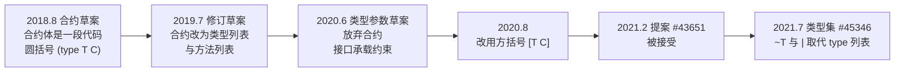

# 8.2 基于合约的泛型

> 本节另有一份配套的演讲：[YouTube 录像](https://www.youtube.com/watch?v=E16Y6bI2S08)、
> [Google Slides 讲稿](https://changkun.de/s/go2generics/)。演讲录于合约草案尚在讨论的 2019 年，
> 可与本节对照阅读。

[8.1](./history.md) 只用一句话提到了约束的设计从合约转向接口的过程。本节展开这段过程：合约是什么样子，
它的表达能力有多强，又为何最终被放弃。这段被否决的设计解释了今天 `[T Ordered]` 这一语法的由来，也表明了
Go 设计中反复出现的一种做法：先提出一个表达能力强但较为复杂的方案，再追问它所做的事能否用已有的概念表达。

本节展示的 `contract` 语法只出现在 2018 年至 2020 年的设计草案中，从未被任何正式发布的 Go 编译器接受。凡是
合约的写法，下文都按草案原貌给出，并在注释中注明「已废弃」，以免与今天的语法混淆。

## 8.2.1 约束要解决的问题

泛型函数必须回答一个问题：类型参数 `T` 的值可以进行哪些操作？求最大值的 `Max` 要用到比较运算符 `<`，若
`T` 被实例化为一个不支持比较的类型，例如某个结构体或切片，函数体便不再成立。因此泛型机制必须提供一种手段，
让函数的作者**声明** `T` 必须支持哪些操作，并让编译器在实例化处据此检查。这就是**约束**（constraint）。

没有约束，泛型只有两条退路。一条是像 C++ 的模板那样完全不加约束，类型错误推迟到实例化时才以冗长难懂的错误
信息暴露出来；另一条是像 `interface{}` 那样放弃静态的类型信息，依靠运行时的断言，同时牺牲类型安全与性能
（[8.1](./history.md)）[[Cox, 2009](#ref-cox-2009)]。约束把「`T` 必须能做什么」提前到声明处说明，
使错误在调用处即被发现，也使编译器有依据生成正确的代码。剩下的问题是，用什么语法写出这组要求。

## 8.2.2 合约：一段不会执行的代码

2018 年 8 月，Ian Lance Taylor 与 Robert Griesemer 发布了合约的设计草案，并在当年的 GopherCon 上作了介绍
[[Taylor and Griesemer, 2018](#ref-taylor-griesemer-2018)]。草案引入了一个新的关键字 `contract`。
合约在形式上像一个函数：它有一组类型参数，函数体中写出使用这些类型的代码，凡是能使这段代码通过类型检查的类
型，就满足这个合约。例如，要求类型支持 `<`：

```go
// 已废弃：2018 年草案的写法，合约体是一段只做类型检查的代码
contract ordered(e Ele) { e < e }

func Max(type T ordered)(a, b T) T {
	if a < b {
		return b
	}
	return a
}
```

合约体中的 `e < e` 并不会执行，它的含义是「满足 `ordered` 的类型必须支持 `<`」；同理，`x == x`
表示可比较，`var x bool = v.Equal(v)` 表示必须有一个返回 `bool` 的 `Equal` 方法。另一处与今天不同的是类型
参数的声明方式：草案使用圆括号，并以关键字 `type` 开头，写作 `func Max(type T ordered)(a, b T) T`。
括号从圆括号改为方括号，也是后文所述演变的一部分。

以代码表达约束看似自然，问题却在于这段代码能写成什么样子几乎没有限制：读者必须推断一段任意的代码究竟对类型
提出了哪些要求，而编译器也要回答同样的问题。2019 年 7 月，Taylor 在介绍修订后的草案时写道，他们收到了大量
反馈，认为此前的合约过于复杂；新的合约写起来、读起来与理解起来都简单得多，它可以规定类型参数的底层类型，
可以列出类型参数的方法，也可以描述不同类型参数之间的关系 [[Taylor, 2019](#ref-taylor-2019)]。修订后的合约
不再是任意的代码，而是一份列表 [[Taylor and Griesemer, 2019](#ref-taylor-griesemer-2019)]。允许的类型以
**类型列表**（type list）枚举：

```go
// 已废弃：2019 年草案的写法，以类型列表枚举允许的类型
contract Ordered(T) {
	T int, int8, int16, int32, int64,
		uint, uint8, uint16, uint32, uint64, uintptr,
		float32, float64,
		string
}

func Max(type T Ordered)(a, b T) T {
	if a < b {
		return b
	}
	return a
}
```

列表中的类型都支持 `<`，编译器只需确认 `T` 的底层类型是其中之一，便可知道 `a < b` 合法。方法要求写成类型
名之后跟方法签名，合约之间还可以嵌入组合，被嵌入合约的条件就地展开：

```go
// 已废弃：要求 X 有 String 与 Print 两个方法
contract stringer(X) {
	X String() string
}

contract PrintStringer(X) {
	stringer(X)
	X Print()
}
```

合约最能体现其表达能力之处，是描述**多个类型参数之间的关系**。草案中的一个例子是图：节点类型必须有一个
返回其所有边的方法，边类型必须有一个返回其两端节点的方法，两个类型参数互相引用：

```go
// 已废弃：一个合约同时约束 Node 与 Edge 两个类型参数
contract G(Node, Edge) {
	Node Edges() []Edge
	Edge Nodes() (from Node, to Node)
}

type Graph(type Node, Edge G) struct { ... }
```

草案特别指出，这里的 `Node` 与 `Edge` 并不是接口类型，而是具有特定方法的具体类型，例如 `*Vertex` 与
`*FromTo`。一个接口只描述一个类型，这种跨类型参数的关系一度被视为合约独有的能力，也是后来以接口取代合约时
必须解决的难点。到这里，合约的全部能力都已展示：枚举底层类型、要求方法、组合已有的合约，以及约束多个类型
参数之间的关系。

## 8.2.3 为何被放弃

修订后的合约虽然简单了许多，却仍然在语言中建立了第二套声明机制：描述一个值有哪些方法用 `interface`，描述
一个类型参数须满足哪些条件却用 `contract`，二者的职责高度重叠，语法却各不相同。2020 年 6 月，Taylor 与
Griesemer 发布了新的设计草案，并在博客中写道：「最大的改动是我们放弃了合约这一概念。合约与接口类型之间的
区别令人困惑，因此我们要消除这一区别。」[[Taylor and Griesemer, 2020a](#ref-taylor-griesemer-2020a)]

新草案说明了这一决定的两点理由：许多人难以理解合约与接口类型的区别；而且事实证明，
合约可以用一组相应的接口表示，去掉合约并不损失表达能力
[[Taylor and Griesemer, 2020b](#ref-taylor-griesemer-2020b)]。合约被放弃，并不是因为它做不到什么，
而是因为它要求使用者学习一套新的机制，而这套机制所做的事，一个人人都已熟悉的概念恰好能够承担。

草案还回答了另一个自然的问题：为什么不允许以运算符作为方法名，例如 `+(T) T`，从而只用方法描述一切约束？
草案的回答是这并不足够：移位 `<<` 与下标 `[]` 接受任意整数类型的操作数，需要一种描述「任意整数类型」
的机制；`==` 的结果是无类型的布尔值；类型转换、`range` 以及无类型常量的取值范围都需要新的记法；
还要决定支持 `<` 是否意味着也支持 `<=`，支持 `+` 是否意味着也支持 `++`。相比之下，
类型列表只需要一种新的语法结构，再加一个新的名字 `comparable`
[[Taylor and Griesemer, 2020b](#ref-taylor-griesemer-2020b)]。

## 8.2.4 从方法集到类型集

能够承担约束职责的已有概念就是接口。接口原本描述一个类型必须有哪些方法，即它的**方法集**（method set）。
约束要表达的是一个类型必须支持哪些操作，二者高度重合：方法是操作，运算符也是操作，所缺的只是接口无法表达
「`T` 的底层类型必须是 `int`」这类要求。2020 年的草案因此允许作为约束的接口包含类型列表，写法是在接口中以
`type` 开头列出类型：

```go
// 已废弃：2020 年 6 月草案的写法，接口中以 type 开头的类型列表
type Ordered interface {
	type int, int8, int16, int32, int64,
		uint, uint8, uint16, uint32, uint64, uintptr,
		float32, float64,
		string
}
```

2021 年 4 月，Taylor 提出以**类型集**（type set）重新表述接口的语义（#45346），该提案于同年 7 月被接受
[[Taylor, 2021](#ref-taylor-2021)]。按照这一表述，接口不再只描述「实现了这组方法的类型」，
而是直接描述一个类型的集合，即哪些类型满足它。方法集只是划定类型集的一种方式（实现了某组方法的所有类型构成
一个集合），类型集还可以用并集、底层类型以及预声明的 `comparable` 来划定。于是 `Ordered`
成为一个普通的接口：

```go
// 最终方案：约束是一个以类型集描述的接口
type Ordered interface {
	~int | ~int8 | ~int16 | ~int32 | ~int64 |
		~uint | ~uint8 | ~uint16 | ~uint32 | ~uint64 | ~uintptr |
		~float32 | ~float64 |
		~string
}

func Max[T Ordered](a, b T) T {
	if a < b {
		return b
	}
	return a
}
```

新的写法中有两个为类型集服务的记号：`|` 表示**并集**，把多个类型并入同一个集合；`~T` 表示**底层类型为 `T`
的所有类型**。有了 `~`，`type Celsius float64` 这样以 `float64` 为底层类型的自定义类型也属于 `Ordered`，`Max(Celsius(21.5), 19)`
可以直接调用，而不必在约束中逐一列举。2020 年草案中的类型列表同样按底层类型匹配，
类型集只是把这一规则写成了显式的记号，并去掉了 `type` 关键字。方法要求沿用接口原有的写法，合约之间的组合也
回归为接口的嵌入。

8.2.2 末尾的难点，即多个类型参数之间的关系，则由**参数化接口**解决：接口本身也可以带有类型参数。合约 `G`
描述的图可以拆成两个带类型参数的接口，再在 `Graph` 的类型参数列表中把它们的参数对齐
[[Taylor and Griesemer, 2021](#ref-taylor-griesemer-2021)]：

```go
// 最终方案：以参数化接口表达多个类型参数之间的关系
type NodeConstraint[Edge any] interface {
	Edges() []Edge
}

type EdgeConstraint[Node any] interface {
	Nodes() (from, to Node)
}

type Graph[Node NodeConstraint[Edge], Edge EdgeConstraint[Node]] struct { ... }
```

`Graph[Node NodeConstraint[Edge], Edge EdgeConstraint[Node]]` 在实例化时把两个约束中的 `Node` 与 `Edge`
绑定为同一组类型。合约以专门的语法表达的关系，就这样落入了接口与类型参数已有的组合规则之中，
没有引入新的概念。以 `*Vertex` 与 `*FromTo` 实例化时，Go 1.21 及以后的编译器甚至可以只根据节点切片推断出边
的类型（见 [8.3](./checker.md)）。对于「类型必须支持 `==`」这一常见的约束，类型集方案提供了预声明的
`comparable`，不必像合约那样列举所有可比较的类型。简化并没有损失合约的核心表达能力。

## 8.2.5 演进的时间线

从合约到类型集并非一步完成。按时间排列：



2018 年 8 月的草案以一段代码描述约束 [[Taylor and Griesemer, 2018](#ref-taylor-griesemer-2018)]；2019 年
7 月的修订把合约改为类型列表与方法列表 [[Taylor and Griesemer, 2019](#ref-taylor-griesemer-2019)]；2020
年 6 月的草案放弃了合约，由接口承载约束
[[Taylor and Griesemer, 2020b](#ref-taylor-griesemer-2020b)]，同年 8 月改用方括号声明类型参数；2021 年
1 月，草案转为正式提案 #43651，并于 2 月被接受
[[Taylor and Griesemer, 2021](#ref-taylor-griesemer-2021)]；2021 年 7 月，类型集的提案 #45346 被接受，`~T`
与 `|` 取代了以 `type` 开头的类型列表 [[Taylor, 2021](#ref-taylor-2021)]。2022 年 3 月，这一设计随
Go 1.18 发布。

括号的变化有其具体原因。最终的提案解释说，圆括号的写法可行，却带来了若干语法分析上的歧义：在
`var f func(x(T))` 中，无法确定这是一个参数类型为实例化类型 `x(T)` 的函数，还是一个名为 `x`、
类型为带括号的 `(T)` 的参数；`[]T(v1)` 与 `[]T(v2){}` 在读到左括号时无法区分类型转换与复合字面量；`interface { M(T) }`
中的 `M(T)` 既可能是方法，也可能是嵌入的实例化接口。这些歧义可以靠添加括号解决，
但写法别扭；此外，`func F(T any)(v T)(r1, r2 T)` 与 `F(int)(1)` 这样一连串的括号也让许多人感到困扰
[[Taylor and Griesemer, 2021](#ref-taylor-griesemer-2021)]。

每一步都在做减法：先把合约体从任意的代码收窄为列表，再去掉 `contract` 这个关键字，最后把类型列表收编进
类型集这一统一的语义。复杂度在一次次「能否用已有概念表达」的追问中被压缩，最终只剩下接口这一已有抽象的
自然推广。

## 8.2.6 这次取舍说明了什么

合约的兴废体现了一种具体的工作方法：先允许一个表达能力强但较为复杂的方案存在，再反复追问能否以已有的概念
替代它，让复杂度证明自己不可或缺。合约没有通过这一追问：它要求使用者学习一套只用于约束的机制，而它所做的
一切，推广后的接口都能做到。

C++ 的 **Concepts** 经历了相似的过程，结局却不同。Concepts 是一套描述模板参数要求的机制，
旨在解决模板接口缺乏明确规定、错误信息难以理解的问题。为 C++0x 设计的 Concepts 在
2009 年被从标准草案中移除；同年，Stroustrup 与 Gabriel Dos Reis、Andrew Sutton 从头开始重新设计，2015
年形成了技术规范 [[Stroustrup, 2017](#ref-stroustrup-2017)]，最终于 C++20 进入标准。值得注意的是，C++20
的 `requires` 表达式以一段不会执行的代码描述要求，例如
`requires(T x) { { x == x } -> std::convertible_to<bool>; }` [[Smith, 2020](#ref-smith-2020)]，与 Go
2018 年草案中的合约体十分接近。Go 放弃了这种形式，选择以类型集描述约束；C++ 则保留了它，
并以命名的概念加以组织。两种语言对同一问题给出了不同的回答，这也说明「约束应当如何表达」
是泛型设计中公认的难题。

理解了这段被放弃的历史，便能明白今天 `[T Constraint]` 的朴素并非理所当然，而是一个表达能力很强的方案被否
决、再被简化的结果。[8.3](./checker.md) 讨论编译器如何依据类型集，在实例化处检查 `T` 是否满足约束。

## 延伸阅读

- <a id="ref-cox-2009"></a>[Cox, 2009] Russ Cox. "The Generic Dilemma." 2009.
  https://research.swtch.com/generic
  泛型的两难，合约所要解决的约束问题即源于其中的取舍。
- <a id="ref-taylor-griesemer-2019"></a>[Taylor and Griesemer, 2019] Ian Lance Taylor, Robert Griesemer.
  "Contracts — Draft Design." Go design document, 2019-07-31（已被取代）.
  https://go.googlesource.com/proposal/+/master/design/go2draft-contracts.md
  修订后的合约草案：类型列表、方法列表与多类型参数的合约。
- <a id="ref-taylor-griesemer-2020a"></a>[Taylor and Griesemer, 2020a] Ian Lance Taylor, Robert Griesemer.
  "The Next Step for Generics." The Go Blog, 2020-06-16. https://go.dev/blog/generics-next-step
  宣布放弃合约、改由接口承载约束的转折点。
- <a id="ref-taylor-griesemer-2020b"></a>[Taylor and Griesemer, 2020b] Ian Lance Taylor, Robert Griesemer.
  "Type Parameters — Draft Design." Go design document, 2020.
  https://go.googlesource.com/proposal/+/master/design/go2draft-type-parameters.md
  以接口表示约束、接口中包含类型列表的阶段；「What happened to contracts?」一节说明了放弃合约的理由。
- <a id="ref-taylor-griesemer-2021"></a>[Taylor and Griesemer, 2021] Ian Lance Taylor, Robert Griesemer.
  "Type Parameters Proposal." Go design document, 2021-08-20.
  https://go.googlesource.com/proposal/+/refs/heads/master/design/43651-type-parameters.md
  最终方案：方括号、类型集、`~T` 与 `|`，以及选择方括号的理由。
- <a id="ref-taylor-2019"></a>[Taylor, 2019] Ian Lance Taylor. "Why Generics?" The Go Blog, 2019-07-31.
  https://go.dev/blog/why-generics
  泛型的必要性，以及修订后的合约相对于 2018 年草案的简化。
- <a id="ref-stroustrup-2017"></a>[Stroustrup, 2017] Bjarne Stroustrup. "Concepts: The Future of Generic
  Programming, or How to Design Good Concepts and Use Them Well." WG21 P0557R1, 2017-01-31.
  https://www.stroustrup.com/good_concepts.pdf
  C++ Concepts 的设计与历史，与 Go 合约相对照的另一段约束机制的演变。
- <a id="ref-taylor-griesemer-2018"></a>[Taylor and Griesemer, 2018] Ian Lance Taylor, Robert Griesemer.
  "Contracts — Draft Design." Go design document, 2018-08-27.
  https://github.com/golang/proposal/blob/00fd2f6529/design/go2draft-contracts.md
  最初的合约草案：合约体是一段只做类型检查的代码。
- <a id="ref-taylor-2021"></a>[Taylor, 2021] Ian Lance Taylor. "spec: generics: use type sets to remove
  type keyword in constraints." golang/go#45346, 2021. https://github.com/golang/go/issues/45346
  以类型集重新表述接口的语义，引入 `~T` 与 `|`。
- <a id="ref-smith-2020"></a>[Smith, 2020] Richard Smith, ed. "Working Draft, Standard for Programming
  Language C++." WG21 N4861, 2020. https://www.open-std.org/jtc1/sc22/wg21/docs/papers/2020/n4861.pdf
  C++20 的最终工作草案，§13.7.8 [temp.concept] 定义了概念。
