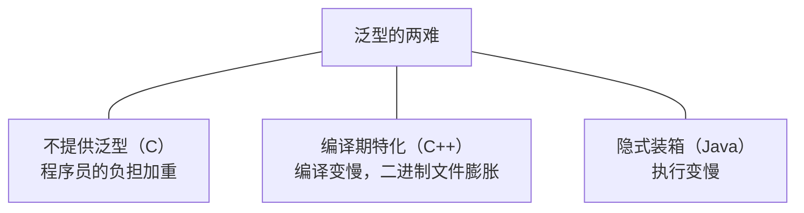
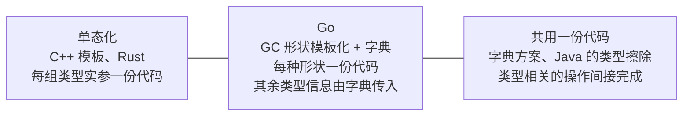

# 8.1 泛型设计的演进

**泛型**（generics）指以类型为参数编写函数与数据结构，使同一段代码可以用于多种类型。Go 于 2009 年开源，
直到 2022 年 3 月发布的 Go 1.18 才支持泛型 [[Go Authors, 2022](#ref-go-authors-2022)]，
其间经历了十余年的讨论与多份被放弃的草案。本节讨论三个问题：Go 为何长期没有泛型，最终加入的语法有何特点，
以及编译器如何实现它。从合约到类型集的设计演变见 [8.2](./contracts.md)，类型集与类型推断等类型检查问题见
[8.3](./checker.md)，Go 1.18 以后的进展见 [8.4](./future.md)。

## 8.1.1 久拖不决：泛型的两难

没有泛型时，对多种类型执行相同逻辑的代码只有三种写法。第一种是为每种类型各写一份：

```go
func MaxInt(a, b int) int {
	if a > b {
		return a
	}
	return b
}

func MaxFloat64(a, b float64) float64 {
	if a > b {
		return a
	}
	return b
}

// 每增加一种类型，就要再写一份逻辑相同的代码
```

这些函数的逻辑完全相同，只有类型不同。第二种是以空接口 `interface{}` 抹去类型的差别，让一份代码处理所有
类型：

```go
func Max(a, b interface{}) interface{} {
	// 编译器不知道 a 与 b 能否比较大小，只能在运行时断言其类型
	if a.(int) > b.(int) { // 只能处理 int，传入其他类型时断言失败并引发 panic
		return a
	}
	return b
}
```

这种写法失去了静态类型检查，类型错误要到运行时才暴露，每次调用还要付出装箱与类型断言的开销
（[4.2](../ch04type/interface.md)）。第三种是代码生成：先写一份模板，再由工具为每种类型生成具体的代码。`genny`
是当时较常用的工具之一，它的模板本身就是可以编译的 Go 代码：

```go
package maxgen

import "github.com/cheekybits/genny/generic"

// T 是占位类型。执行
//
//	cat max.go | genny gen "T=int,float64" > max_gen.go
//
// 即可为 int 与 float64 各生成一份具体的函数。
type T generic.Number

func MaxT(a, b T) T {
	if a > b {
		return a
	}
	return b
}
```

代码生成恢复了静态类型检查与运行效率，代价是构建过程多出一个生成步骤，模板修改后必须重新生成，而且生成
工具本身并不理解 Go 的类型系统。三种写法各有缺点，这正是 Go 程序员在 Go 1.18 之前的处境。

Russ Cox 在 2009 年 12 月的一篇短文中把这一处境概括为**泛型的两难**（the generic
dilemma）[[Cox, 2009](#ref-cox-2009)]。文中把已有的做法归为三类：C 的做法是不提供泛型，这拖慢了程序员，
但不增加语言的复杂度；C++ 的做法是在编译期为每种类型特化代码，这拖慢了编译，并生成大量重复的代码；Java
的做法是把一切隐式装箱，这拖慢了执行。Cox 的结论是：「泛型的两难在于：要缓慢的程序员，
要缓慢的编译器与臃肿的二进制文件，还是要缓慢的执行速度？」



Go 既重视编译速度，也重视运行效率，长期没有找到一个在三方面都可以接受的方案，因此宁可暂不提供泛型。
这并不是说 Go 团队没有尝试。Ian Lance Taylor 在 2010 年至 2013 年间先后写了四份泛型草案，Bryan C. Mills
在 2016 年提出了编译期函数与一等类型的方案，它们都没有被采纳
[[Go Authors, 2026b](#ref-go-authors-2026b)]。2016 年 4 月，Andrew Gerrand 开启议题 #15292，随附 Taylor
自 2011 年起撰写的总体性文档「Go 应当有泛型」；Taylor 在文中把此前的四份草案作为历史资料列出，
并承认它们「都在不同方面存在缺陷」，议题本身也说明，其目的不是在当时加入泛型，而是展示一份完整的提案应当是
什么样子 [[Taylor, 2016](#ref-taylor-2016)]。2018 年 8 月，Russ Cox 发表「泛型：问题概述」，与 Taylor 和
Robert Griesemer 的合约草案一同重启了设计 [[Cox, 2018](#ref-cox-2018)]。此后三年间，
合约被以接口表示的约束所取代；2021 年 2 月，Taylor 与 Griesemer 的类型参数提案（#43651）被接受
[[Taylor and Griesemer, 2021](#ref-taylor-griesemer-2021)]，一年后随 Go 1.18 发布。这一段演变详见
[8.2](./contracts.md)。

## 8.1.2 落地的语法：约束即接口

Go 1.18 加入的语法只在已有的概念上增加了一处：函数与类型可以在方括号中声明**类型参数**（type parameter），
每个类型参数带有一个**约束**（constraint），约束本身是一个接口
[[Taylor and Griesemer, 2021](#ref-taylor-griesemer-2021)]：

```go
func Max[T cmp.Ordered](a, b T) T { // T 是类型参数，cmp.Ordered 是它的约束
	if a > b {
		return a
	}
	return b
}

var x = Max[int](3, 5) // 显式给出类型实参
var y = Max(3.0, 5.0)  // 由实参推断，等价于 Max[float64](3.0, 5.0)
```

`cmp.Ordered` 是 Go 1.21 加入标准库的约束，允许所有支持 `<`、`<=`、`>=`、`>` 运算符的类型；Go 1.18
发布时，与它对应的 `constraints.Ordered` 位于实验性的 `golang.org/x/exp/constraints` 中。同样自 Go 1.21
起，`max` 与 `min` 已是内建函数 [[Go Authors, 2023](#ref-go-authors-2023)]，这里的 `Max` 只用于说明。

关键的变化在于对接口的推广。此前，接口描述一个**方法集**：实现了哪些方法的类型满足该接口。
作为约束的接口则描述一个**类型集**（type set）：哪些类型满足它。除了方法，约束中还可以写出类型的并集
（`int | string`）、底层类型为某一类型的所有类型（`~int`），以及预声明的约束 `comparable`（可以用 `==` 与
`!=` 比较的类型）[[Griesemer and Taylor, 2022](#ref-griesemer-taylor-2022)]。以已有的接口承载约束，
避免了在语言中再引入一套独立的约束机制；这一点几经反复才确定，详见 [8.2](./contracts.md)。
类型集的精确定义及其在类型检查中的作用见 [8.3](./checker.md)。

## 8.1.3 实现：GC 形状模板化与字典

类型参数提案本身并不规定实现方式。提案引用了 Cox 的「泛型的两难」，并指出这一设计使人们不必再选择缓慢的
程序员，至于在缓慢的编译器（为每组类型实参分别编译）与缓慢的执行速度（以方法调用完成对类型参数值的每一种
操作）之间如何取舍，则留给实现决定 [[Taylor and Griesemer, 2021](#ref-taylor-griesemer-2021)]。

2020 年，Keith Randall 在三份设计文档中比较了可能的实现。第一种是**单态化**（monomorphization），Go
的文档称之为模板化（stenciling）：编译器为每一组类型实参复制一份函数体，代入具体的类型后再编译，`Max[int]`
与 `Max[float64]` 是两份独立的机器码 [[Randall, 2020a](#ref-randall-2020a)]。C++ 的模板与 Rust
的泛型都采用这种做法。它没有额外的运行时开销，每份代码都可以针对具体类型充分优化；代价是代码膨胀、
编译变慢，即两难中「缓慢的编译器与臃肿的二进制文件」。第二种是**字典**（dictionary）：
每个泛型函数只生成一份代码，与具体类型有关的信息由调用方以一个额外的参数传入
[[Randall, 2020b](#ref-randall-2020b)]。这种做法代码紧凑、编译快，代价是对类型参数值的许多操作都要经过字典
间接完成，接近两难中「缓慢的执行速度」；Java 的泛型在编译后**擦除**（erase）类型参数、
所有实例共用一份代码 [[Bracha et al., 1998](#ref-bracha-et-al-1998)]，也属于共用代码的一端。
第三份文档提出了二者之间的折中，即 Go 1.18 实际采用的 **GC 形状模板化**（GC shape stenciling）加字典
[[Randall, 2020c](#ref-randall-2020c)] [[Scales, 2022](#ref-scales-2022)]：



### 形状

编译器不为每一种类型实参生成代码，而是先把类型实参归入 **GC 形状**（GC shape），同一形状的类型共用一份代
码。这一名称来自 Randall 的设计：一个类型的 GC 形状指它在内存分配器与垃圾回收器眼中的样子，由大小、
对齐要求以及哪些部分是指针决定
（[第 13 章](../../part4memory/ch13gc/readme.md)）[[Randall, 2020c](#ref-randall-2020c)]。
实际的实现采用了更细的划分。Go 1.18 的实现文档写道，两个类型属于同一形状，当且仅当它们的底层类型相同，
或者二者都是指针类型；这样划分是为了保证字典中永远不需要放入运算符的实现：`int` 与 `float64`
的运算是不同的机器指令，`int16` 与 `int32` 的移位运算也各不相同，因此它们都属于不同的形状
[[Scales, 2022](#ref-scales-2022)]。Randall 的文档还指出了另一个原因：在基于寄存器的调用约定下，`struct{ x, y int }`
与 `[2]int` 大小与指针布局相同，分配到寄存器的方式却不同，仅凭大小与指针布局无法确定
参数放在哪里。

在 Go 1.26 中，确定形状的是 `cmd/compile/internal/noder` 包中的 `shapify` 函数
[[Go Authors, 2026a](#ref-go-authors-2026a)]，其核心逻辑如下：

```go
// Go 1.26 cmd/compile/internal/noder/reader.go，有删节，注释为笔者所加
func shapify(targ *types.Type, basic bool) *types.Type {
	// basic 为 true 表示对应类型参数的约束是基本接口（只含方法的接口）。
	// 此时指针所指向的类型不影响生成的代码，所有指针都以 *byte 为形状。
	pointerShaping := basic && targ.IsPtr() && !targ.Elem().NotInHeap()
	// ……
	under := targ.Underlying() // 其余情形以底层类型为形状
	if pointerShaping {
		under = types.NewPtr(types.Types[types.TUINT8])
	}
	// ……以 under 为键，在 go.shape 包中查找或创建唯一的形状类型
}
```

形状类型都位于一个名为 `go.shape` 的特殊包中，例如 `go.shape.int`、`go.shape.string`；被归并的指针一律以
`go.shape.*uint8` 表示。可见在 Go 1.26 中，指针的归并还有一个前提：类型参数的约束必须是只含方法的基本接
口，例如 `any`。`shapify` 的注释中有一段待办说明，形状还可以划分得更粗：把所有指针形状的类型归为一类，
把大小与对齐相同的标量归为一类，递归地对复合类型的元素做形状化，并丢弃结构体的字段名与标签；
但要实现其中一部分，需要先追踪类型参数在函数体中实际是如何被使用的。

### 字典

同一份形状代码要服务多种类型，它缺少的类型信息由**字典**补足。字典是编译期静态生成的只读数据，每一组
「泛型函数与具体类型实参」对应一个字典，例如 `main..dict.Max[int]`；编译器为每个形状实例增加一个隐藏的首
参数 `.dict`，调用时把字典的地址传入 [[Scales, 2022](#ref-scales-2022)]。在 Go 1.26 中，运行时字典依次由四
部分组成，对应 `readerDict` 结构的最后四个字段 [[Go Authors, 2026a](#ref-go-authors-2026a)]：

- 约束中所声明方法的方法表达式，用于调用类型参数的方法；
- 子字典，即函数体内调用其他泛型函数时传给被调函数的字典；
- 类型描述符（[4.1](../ch04type/type.md)），用于把类型参数的值转换为空接口，以及类型断言与类型分支；
- 接口表 `itab`（[4.2](../ch04type/interface.md)），用于把类型参数的值转换为非空接口。

只有单凭形状无法完成的操作才需要查询字典。下面的程序以三种类型实例化 `Max`，以两种指针类型实例化 `Last`：

```go {run=true}
package main

import (
	"cmp"
	"fmt"
	"os"
)

type Node struct{ v int }

//go:noinline
func Max[T cmp.Ordered](a, b T) T {
	if a > b {
		return a
	}
	return b
}

//go:noinline
func Last[T any](s []T) T { return s[len(s)-1] }

func main() {
	fmt.Println(Max(3, 5), Max[int64](3, 5), Max("a", "b"))
	n := Last([]*Node{{1}, {2}})
	f := Last([]*os.File{os.Stdout})
	fmt.Println(n.v, f == os.Stdout)
}
```

```
5 5 b
2 true
```

以 `GOOS=linux GOARCH=amd64 go build` 编译，再用 `go tool nm` 查看二进制文件中的符号，与这两个函数有关的
只有以下几项：

```
main.Max[go.shape.int]
main.Max[go.shape.int64]
main.Max[go.shape.string]
main.Last[go.shape.*uint8]
main..dict.Max[int]
main..dict.Max[int64]
main..dict.Max[string]
main..dict.Last[*main.Node]
main..dict.Last[*os.File]
```

`Max` 的约束 `cmp.Ordered` 只允许标量与字符串，三个类型实参的底层类型互不相同，因此各得一份代码；`int` 与
`int64` 大小相同，也没有被合并。`Last` 的约束是 `any`，两个指针类型被归入同一形状 `*uint8`，共用一份代码，
只是字典不同。以 `-gcflags=-S` 查看汇编，`main` 中调用 `Max(3, 5)` 的代码为：

```asm
LEAQ  main..dict.Max[int](SB), AX   // 字典的地址作为隐藏的第一个参数
MOVL  $3, BX                        // a
MOVL  $5, CX                        // b
CALL  main.Max[go.shape.int](SB)
```

形状实例本身则是：

```asm
TEXT  main.Max[go.shape.int](SB), DUPOK|NOSPLIT|NOFRAME|ABIInternal, $0-24
CMPQ  CX, BX       // 直接比较 a 与 b，没有使用 AX 中的字典
JGE   9
MOVQ  BX, AX
RET
MOVQ  CX, AX
RET
```

参数区的大小是 24 字节，比 `a` 与 `b` 多出的 8 字节就是字典指针。`>` 在形状 `go.shape.int`
上就是整数比较，编译器直接生成比较指令，这一实例完全不需要字典，与手写的 `MaxInt` 并无二致。

需要字典的是另一类操作。下面的 `Describe` 以 `fmt.Stringer` 为约束，在函数体中调用约束所声明的 `String`
方法：

```go
//go:noinline
func Describe[T fmt.Stringer](x T) string {
	return "<" + x.String() + ">" // 调用约束中声明的方法
}

// 调用：Describe(&Celsius{21.5})、Describe(&Meter{8848})
```

两个实参都是指针，约束是基本接口，于是二者共用 `main.Describe[go.shape.*uint8]`。在这份代码中，编译器无从
得知 `x.String()` 应当调用哪一个方法，只能从字典中取出：

```asm
MOVQ  (AX), CX   // 从字典的第一项取出 String 方法的入口地址
MOVQ  AX, DX     // 闭包上下文寄存器指向这一项
MOVQ  BX, AX     // 接收者 x
CALL  CX         // 间接调用
```

字典的第一项保存方法表达式 `(*Celsius).String`（对另一个字典则是 `(*Meter).String`）的入口地址，
生成的代码按调用函数值的方式（[6.1.2](../ch06func/func.md)）间接调用它。与直接调用相比，
这次调用多了一次访存与一次间接跳转；更重要的是，编译器在编译 `Describe` 时看不到被调用的方法，
因而无法将其内联，逃逸分析也只能作保守的假设。Randall 在设计文档中已经预见了这一点：
形状模板化生成的代码多数与完全单态化相同，例外是对类型参数的方法调用无法在编译期确定，
可能导致更多的堆分配，也会错过本可以进行的内联 [[Randall, 2020c](#ref-randall-2020c)]。

把这一机制与 [4.2](../ch04type/interface.md) 中 Haskell 类型类的**字典传递**比较，可以看出二者一脉相承：Haskell
编译受 `Ord a` 约束的函数时，把 `Ord` 的方法实现打包成一个字典，作为隐式参数传入
[[Wadler and Blott, 1989](#ref-wadler-blott-1989)]；Go 的字典同样是一个隐藏参数，只是其内容在编译期按形状
实例的需要确定，并且只在形状不足以决定操作时才被使用。

若程序中出现 $n$ 种不同的类型实参，归并后得到 $s$ 种形状（$s \le n$），完全单态化生成的代码量与 $n$
成正比，共用一份代码的方案与 $1$ 成正比，Go 的方案则与 $s$ 成正比。运行时的代价则恰好相反：
单态化的代码中没有额外的间接访问；共用代码的方案几乎每一种与类型有关的操作都要间接完成；Go
只在形状无法决定的操作上查询字典，即调用类型参数的方法、转换为接口以及类型断言等。形状划分得越粗，$s$
越小，代码越少，需要查询字典的操作也越多。`shapify` 中的待办说明表明，这一取舍仍在调整之中。

## 8.1.4 理论渊源与跨语言对照

以类型为参数的思想有很长的历史。Christopher Strachey 在 1967 年的讲义中区分了两种多态：**参
数多态**（parametric polymorphism）指一个函数以统一的方式作用于任意类型，例如把一个函数依次作用于列表
中每个元素的 `map`；**特设多态**（ad hoc polymorphism）则没有统一的规则，同一个名字在不同类型上有不同的实
现，算术运算符即属此类 [[Strachey, 2000](#ref-strachey-2000)]。1978 年，Robin Milner 为 ML
语言给出了参数多态的类型系统与类型推断算法 [[Milner, 1978](#ref-milner-1978)]。1989 年，David Musser 与
Alexander Stepanov 提出 **泛型编程**（generic programming）：从具体而高效的算法出发进行抽象，
得到可以与不同的数据表示相组合的泛型算法 [[Musser and Stepanov, 1989](#ref-musser-stepanov-1989)]，
这一思想后来成为 C++ 标准模板库的基础。同年，Philip Wadler 与 Stephen Blott 提出 Haskell 的类型类，
以字典传递实现受约束的多态 [[Wadler and Blott, 1989](#ref-wadler-blott-1989)]。Go 的类型参数属于参数多态，
约束则为它加上了限制条件。

在实现策略上，各语言的选择大致分布在单态化与共用代码两端之间：

| 语言 | 实现策略 | 运行时的类型信息 | 主要代价 |
| --- | --- | --- | --- |
| C++ 模板 | 单态化 | 无需保留 | 代码膨胀、编译慢，模板的错误信息难以理解 |
| Rust | 单态化（另有 `dyn` 动态分派） | 无需保留 | 代码膨胀、编译慢 |
| Java | 类型擦除，所有实例共用一份代码 | 不保留类型实参 | 基本类型必须装箱，如只能写 `List<Integer>` |
| C# | 运行时具体化，引用类型共用代码，值类型按需特化 | 保留类型实参 | 需要 JIT 在运行时生成特化的代码 |
| Haskell | 类型类与字典传递 | 由字典提供 | 经字典的间接调用 |
| Go | GC 形状模板化加字典 | 由字典提供 | 经字典的间接调用，部分调用无法内联 |

Java 的泛型源于 Bracha、Odersky、Stoutamire 与 Wadler 在 1998 年提出的 GJ。为了与已有的类库和虚拟机兼容，GJ
在编译后擦除类型参数，泛型代码与原有的非泛型代码可以互相调用
[[Bracha et al., 1998](#ref-bracha-et-al-1998)]。C# 走了另一条路：Andrew Kennedy 与 Don Syme 在 .NET
公共语言运行时中保留类型实参，所有以引用类型实例化的代码共用一份，以值类型实例化时则由 JIT
编译器在运行时按需生成特化的代码，值类型因此无须装箱 [[Kennedy and Syme, 2001](#ref-kennedy-syme-2001)]。

Go 的位置与 C# 最为接近：二者都让指针或引用类型共用代码，并在运行时保留具体的类型信息。不同的是，Go 没有
JIT，所有形状实例与字典都在编译期生成，共用代码的粒度由 GC 形状这一与内存布局和垃圾回收直接相关的概念决
定。

## 8.1.5 取舍

Go 的泛型有意省略了许多其他语言具备的能力。类型参数提案明确列出了它不支持的内容，其中包括：特化，
即为特定的类型实参另写一个版本；元编程，即在编译期执行代码以生成代码；以泛型函数或泛型类型作为参数的更高层
抽象；函数参数的协变与逆变；运算符方法；部分实例化（柯里化）；变长的类型参数；以及以常量等非类型的值作为参
数 [[Taylor and Griesemer, 2021](#ref-taylor-griesemer-2021)]。方法也不能声明额外的类型参数，这一限制直到
Go 1.27 才以受限的形式解除，经过见 [8.4.2](./future.md)。提案认为，它已经覆盖了泛型编程的基本需求；
其余的需求是否存在、以何种形式满足，留待实践检验。

此后的演进延续了这一节奏：先提供最小可用的泛型，再根据实践补充。Go 1.21 加入了 `slices`、`maps` 与 `cmp`
等泛型包，Go 1.24 支持了泛型类型别名（[4.3](../ch04type/alias.md)），Go 1.26 允许约束引用正在被约束的泛型
类型本身，Go 1.27 加入了泛型方法，这些内容见 [8.4](./future.md)。在实现层面，形状划分的粒度与字典带来的间
接开销仍是可以改进之处：更粗的形状可以进一步减少代码，但须先确认不会使本可内联的操作退化为查询字典；
而在调用处能够确定具体实例时，Go 1.21 起的编译器已能把从字典读出的入口地址折叠为常量，
却仍错过了内联的时机（[8.4.4](./future.md)）。泛型在 Go 中的十余年历程表明了 Go 对复杂度的态度：宁可推迟，
也要在编译速度、运行效率与语言的简单性之间找到一个各方面都可以接受的方案。

## 延伸阅读

- <a id="ref-cox-2009"></a>[Cox, 2009] Russ Cox. "The Generic Dilemma." 2009-12-03.
  https://research.swtch.com/generic
  「三者择二」的最初表述。
- <a id="ref-taylor-griesemer-2021"></a>[Taylor and Griesemer, 2021] Ian Lance Taylor, Robert Griesemer.
  "Type Parameters Proposal." Go design document, 2021-08-20.
  https://go.googlesource.com/proposal/+/refs/heads/master/design/43651-type-parameters.md
  Go 1.18 泛型的最终设计：类型参数、约束与类型集、类型推断，以及有意省略的特性。
- <a id="ref-scales-2022"></a>[Scales, 2022] Dan Scales. "Go 1.18 Implementation of Generics via
  Dictionaries and Gcshape Stenciling." Go design document, 2022.
  https://go.googlesource.com/proposal/+/refs/heads/master/design/generics-implementation-dictionaries-go1.18.md
  Go 1.18 实现的设计文档：形状的划分、字典的格式与命名、编译器中的处理流程。
- <a id="ref-go-authors-2026a"></a>[Go Authors, 2026a] The Go Authors.
  `cmd/compile/internal/noder/reader.go`.
  https://github.com/golang/go/blob/master/src/cmd/compile/internal/noder/reader.go
  （Go 1.26：<https://github.com/golang/go/blob/release-branch.go1.26/src/cmd/compile/internal/noder/reader.go>）`readerDict`
  与 `shapify`：字典条目与形状归并的实际实现。
- <a id="ref-go-authors-2022"></a>[Go Authors, 2022] The Go Authors. Go 1.18 Release Notes.
  https://go.dev/doc/go1.18
  泛型的正式发布。
- <a id="ref-griesemer-taylor-2022"></a>[Griesemer and Taylor, 2022] Robert Griesemer, Ian Lance Taylor.
  "An Introduction To Generics." The Go Blog, 2022-03-22. https://go.dev/blog/intro-generics
  类型参数、类型集与类型推断的入门介绍。
- <a id="ref-wadler-blott-1989"></a>[Wadler and Blott, 1989] Philip Wadler, Stephen Blott. "How to Make
  Ad-hoc Polymorphism Less Ad Hoc." *POPL '89*, 60–76, 1989. https://doi.org/10.1145/75277.75283
  类型类与字典传递的原始论文，Go 字典做法的理论源头。
- <a id="ref-go-authors-2026b"></a>[Go Authors, 2026b] The Go Authors. Proposal: Generics（design/15292
  系列）. golang/proposal. https://github.com/golang/proposal/tree/master/design/15292
  2010 年至 2016 年历次泛型草案的存档：Taylor 的 Type Functions、Generalized Types（两版）与 Type
  Parameters in Go，以及 Mills 的 Compile-time Functions and First Class Types。
- <a id="ref-taylor-2016"></a>[Taylor, 2016] Ian Lance Taylor. "Proposal: Go should have generics." Go
  design document, created 2011-01, last updated 2016-04.
  https://go.googlesource.com/proposal/+/master/design/15292-generics.md
  议题 #15292 的随附文档：泛型的必要性、对一个泛型方案的要求，以及此前四份草案的列表。
- <a id="ref-cox-2018"></a>[Cox, 2018] Russ Cox. "Generics — Problem Overview." Go design document,
  2018-08-27. https://go.googlesource.com/proposal/+/master/design/go2draft-generics-overview.md
  2018 年重启泛型设计时对问题的重新表述。
- <a id="ref-randall-2020a"></a>[Randall, 2020a] Keith Randall. "Generics implementation - Stenciling." Go
  design document, 2020.
  https://go.googlesource.com/proposal/+/master/design/generics-implementation-stenciling.md
  为每组类型实参各生成一份代码的方案。
- <a id="ref-randall-2020b"></a>[Randall, 2020b] Keith Randall. "Generics implementation - Dictionaries."
  Go design document, 2020.
  https://go.googlesource.com/proposal/+/master/design/generics-implementation-dictionaries.md
  只生成一份代码、以字典传入类型信息的方案。
- <a id="ref-randall-2020c"></a>[Randall, 2020c] Keith Randall. "Generics implementation - GC Shape
  Stenciling." Go design document, 2020.
  https://go.googlesource.com/proposal/+/master/design/generics-implementation-gcshape.md
  前两种方案的折中：按 GC 形状生成代码，以字典处理同一形状内不同类型的差异。
- <a id="ref-go-authors-2023"></a>[Go Authors, 2023] The Go Authors. Go 1.21 Release Notes.
  https://go.dev/doc/go1.21
  内建函数 `min`、`max` 与 `cmp` 包。
- <a id="ref-strachey-2000"></a>[Strachey, 2000] Christopher Strachey. "Fundamental Concepts in
  Programming Languages." *Higher-Order and Symbolic Computation* 13(1–2): 11–49, 2000.
  https://doi.org/10.1023/A:1010000313106
  1967 年哥本哈根暑期学校的讲义，区分参数多态与特设多态。
- <a id="ref-milner-1978"></a>[Milner, 1978] Robin Milner. "A Theory of Type Polymorphism in Programming."
  *Journal of Computer and System Sciences* 17(3): 348–375, 1978.
  https://doi.org/10.1016/0022-0000(78)90014-4
  ML 的多态类型系统与类型推断算法。
- <a id="ref-musser-stepanov-1989"></a>[Musser and Stepanov, 1989] David R. Musser, Alexander A. Stepanov.
  "Generic Programming." *Symbolic and Algebraic Computation (ISSAC '88)*, LNCS 358: 13–25, 1989.
  https://doi.org/10.1007/3-540-51084-2_2
  「泛型编程」一词的出处。
- <a id="ref-bracha-et-al-1998"></a>[Bracha et al., 1998] Gilad Bracha, Martin Odersky, David Stoutamire,
  Philip Wadler. "Making the Future Safe for the Past: Adding Genericity to the Java Programming
  Language." *OOPSLA '98*, 183–200, 1998. https://doi.org/10.1145/286936.286957
  GJ 与类型擦除，Java 泛型的前身。
- <a id="ref-kennedy-syme-2001"></a>[Kennedy and Syme, 2001] Andrew Kennedy, Don Syme. "Design and
  Implementation of Generics for the .NET Common Language Runtime." *PLDI '01*, 1–12, 2001.
  https://doi.org/10.1145/378795.378797
  保留类型实参的具体化泛型：引用类型共用代码，值类型由 JIT 按需特化。
