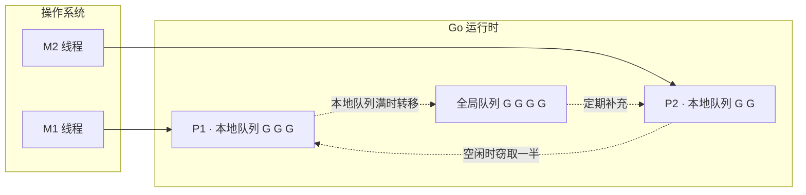
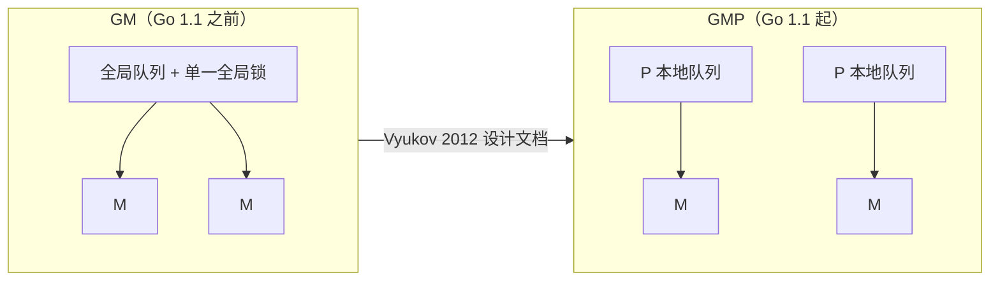

# 9.1 调度问题与 GMP 模型

执行 `go f()` 之后，函数 `f` 便在一个新的 goroutine 中运行。决定它何时、在哪个线程上运行的，
是运行时的调度器。调度器要解决的问题可以这样表述：如何让成千上万个 goroutine 在数量有限的 CPU
核心上轮流执行，使创建与切换的代价足够低，使程序能够随核心数扩展，同时让 goroutine 的阻塞对程序员透明。
本节先讨论这一问题的历史背景与几种经典答案，再介绍 Go 的 GMP 模型及其由来，最后从调度理论的角度说明调度器
能够达到怎样的保证。后续各节将逐一讨论模型中的各个部分。

## 9.1.1 三种线程模型

把并发任务映射到处理器上，历史上形成了三种线程模型，它们在开销、并行性与实现复杂度之间作出了不同的取舍。

- **1:1 模型**，即内核线程模型：每个用户线程对应一个操作系统线程。线程可以真正并行，阻塞的系统调用由内核
  透明处理，实现也最简单；代价是线程的创建与切换都要陷入内核，每个线程还要预留以兆字节计的栈空间。Linux
  的 NPTL、Windows 以及 Java 的平台线程都采用这一模型。
- **N:1 模型**，即纯用户态线程，早期称为「绿色线程」：多个用户线程共用一个操作系统线程。切换只在用户态
  进行，开销极低，栈也可以很小；但它无法利用多核，并且任何一个线程执行阻塞的系统调用，都会使所有线程一起
  停顿。
- **M:N 模型**，即两级模型：把 $M$ 个用户线程复用到 $N$ 个内核线程上。它兼顾了低开销与并行性，代价是需要
  用户态与内核态两个调度器协同工作，这正是其复杂性的来源。

20 世纪 90 年代，M:N 模型一度被寄予厚望。其中影响最大的方案是 Anderson 等人提出的**调度器激活**（scheduler
activations）：内核在线程阻塞、恢复等时刻通知用户态调度器，使两级调度器得以协同
[[Anderson et al., 1992](#ref-anderson-et-al-1992)]。然而工业界最终大多回到了 1:1 模型。Drepper 与 Molnar
在 Linux NPTL 的设计文档中解释了这一选择：M:N 模型中有两个调度器同时工作，二者若不协同，
调度决策会显著降低性能；而内核开发者的共识是，M:N 实现不符合 Linux 内核的理念，为此需要加入的基础设施代价
过高，例如为了在用户态调度器中切换上下文，常常需要从内核空间复制寄存器的内容
[[Drepper and Molnar, 2005](#ref-drepper-molnar-2005)]。

Go 却选择了 M:N 模型。它之所以能避开前人遇到的困难，是因为所需的条件都掌握在运行时自己手中，
而不必依赖内核的配合。首先，goroutine 的栈很小且可以增长，最小为 2 KiB，自 Go 1.19
起初始大小还会根据历史上 goroutine 的平均栈用量调整，因此创建与切换的代价都很低
[[Go Authors, 2022](#ref-go-authors-2022)]。其次，所有可能阻塞的操作都经过运行时：channel、
锁等同步操作只挂起 goroutine 而不阻塞线程；网络 I/O 由内置的网络轮询器接管（[9.9](./poller.md)），
等待中的 goroutine 被挂起，不占用线程；对于确实会阻塞线程的系统调用，运行时把执行 Go
代码所需的资源（即下文的 P）交给另一个线程，使其余 goroutine 不受影响（[9.5](./thread.md)）。
调度器激活需要内核在线程阻塞时通知用户态调度器；Go 则在进入系统调用之前就由运行时自行安排，
因而不需要内核的配合。

## 9.1.2 GMP 模型

下面的交互示意图演示了 GMP 模型的运行：每个 P 持有一条本地运行队列，M 绑定一个 P 后执行队首的 G；当某个 P
的本地队列与全局队列都为空时，它从其他 P 窃取一半的 G。读者可以暂停、单步执行，或手动执行 `go func()`，
观察队列与窃取的变化。

Go 调度器围绕三种结构展开，合称 GMP：

- **G**（goroutine）：一段并发执行的用户代码，连同它的栈与执行现场；
- **M**（machine）：一个操作系统线程，是在 CPU 上实际执行指令的实体；
- **P**（processor）：一个逻辑处理器，代表执行 Go 代码所需的资源与许可。P 的数量由 `GOMAXPROCS` 决定。

三者的关系可以概括为一句话：**M 必须持有一个 P，才能执行 G**。因此，P 的数量就是同时执行 Go
代码的并行度上限。每个 P 有一条容量为 256 的**本地运行队列**，存放就绪的 G；此外还有一条由所有 P
共享的**全局运行队列** [[Go Authors, 2026](#ref-go-authors-2026)]。调度的基本过程是：持有 P 的 M
从队列中取出一个 G 执行，G 让出或被抢占后再取下一个；本地队列为空时，M 到全局队列与其他 P
那里寻找可运行的 G，这就是 [9.2](./steal.md) 讨论的工作窃取。

goroutine 是**有栈协程**（stackful coroutine）：它拥有独立的栈，可以在任意深度的函数调用中挂起，也可以被
抢占。这是它与下文无栈协程的根本区别。goroutine 的栈早期以分段栈实现，Go 1.3 改为连续栈：栈空间不足时，
整个栈被复制到一块更大的连续内存中，从而消除了计算反复跨越段边界时的「热点」问题
[[Go Authors, 2014](#ref-go-authors-2014)]，详见[第 14 章](../../part4memory/ch14stack)。

## 9.1.3 其他运行时的选择

如何以低廉的代价运行海量并发单元，是这一代语言运行时共同面对的问题，GMP 只是其中一种答案。与其他运行时
对照，可以更清楚地看到 GMP 的定位。

- **Erlang/BEAM**：轻量进程各自拥有独立的堆，互不共享可变状态；调度器按**归约计数**（reduction，大致相当于
  函数调用的次数）进行抢占，每个核心一个调度器，各自持有运行队列，并通过进程迁移平衡负载
  [[Stenman, n.d.](#ref-stenman-nd)]。
- **Java 虚拟线程**（JEP 444，2023 年随 JDK 21 定稿）：虚拟线程挂载到平台线程（称为载体线程）上运行，在
  I/O 等阻塞操作时卸载；调度器是一个以 FIFO 模式运行的工作窃取 `ForkJoinPool`，并行度默认等于可用处理器的
  数量 [[OpenJDK, 2023](#ref-openjdk-2023)]。这本质上也是 M:N 模型，即当年在 Linux 上被否决、如今在 JVM
  中重新采用的模型。
- **GHC Haskell**：轻量线程复用到数量与核心数相当的 Haskell 执行上下文上，配合工作窃取与 `par` 产生的
  spark 实现并行 [[Marlow et al., 2009](#ref-marlow-et-al-2009)]。
- **Rust 与 .NET 的 async**：采用**无栈协程**（stackless coroutine）。`async` 函数被编译为状态机，挂起时的
  状态保存在状态机对象中，而不是一条独立的栈上，由 Tokio 等运行时驱动执行。

这里出现了一条关键的设计轴：有栈还是无栈。有栈协程需要为每个并发单元准备一条栈，换来的是可以在任意深度
挂起，并且可以被抢占。无栈协程省去了独立的栈，但挂起点在编译期固定于 `.await` 处，因而只能协作式调度：
一个不含 `.await` 的循环无法被运行时打断。Go 选择有栈协程，因而能够实现 [9.7](./preemption.md) 所述的异步
抢占，即使是没有函数调用的死循环也可以被打断。

## 9.1.4 从 GM 到 GMP

P 并非一开始就存在。2008 年的调度器只有 G 与 M 两种结构 [[Cox, 2008](#ref-cox-2008)]；2009 年 Go 开源时，
调度器默认只允许一个线程执行用户代码，设置环境变量 `GOMAXPROCS` 可以提高这一上限
[[Cox, 2009](#ref-cox-2009)]。所有就绪的 G 都位于一条全局队列上，由一把全局锁保护。2012 年，Dmitry Vyukov
在《Scalable Go Scheduler Design Doc》中指出，这一调度器限制了并发程序的可扩展性：Vtocc 服务器在 8
核机器上最多只能用到 70% 的 CPU，性能剖析显示 14% 的时间花在 `runtime.futex` 上。Vyukov 归纳了四个问题
[[Vyukov, 2012](#ref-vyukov-2012)]：

1. 单一的全局互斥锁与集中式的状态：创建、结束、重新调度等所有与 goroutine 相关的操作都要争用这把锁；
2. G 的交接：工作线程之间频繁交接可运行的 G，增加了延迟与额外开销；
3. 每个 M 一份内存缓存：内存缓存等资源与所有 M 相关联，而实际上只有正在执行 Go 代码的 M 才需要它们；执行
   Go 代码的 M 与全部 M 之比可能低至 1:100，每份缓存最多可占 2 MB，既浪费内存，又损害数据的局部性；
4. 过于激进的线程阻塞与唤醒：存在系统调用时，工作线程频繁地阻塞与唤醒，开销很大。

引入 P 正是针对这些问题。本地运行队列使多数入队与出队操作不再争用全局锁；内存缓存等资源从 M 移到 P 上，
份数固定为 `GOMAXPROCS`，局部性也随之改善；M 与 P 可以分离与重新结合，线程陷入系统调用时可以把 P 交给其他
M 继续执行 Go 代码。这一实现于 2013 年 3 月提交 [[Vyukov, 2013a](#ref-vyukov-2013a)]，
同月提交的还有与运行时集成的网络轮询器 [[Vyukov, 2013b](#ref-vyukov-2013b)]，二者都随 2013 年 5 月的 Go
1.1 发布。值得一提的是，Go 1.1 的发布说明并未提及调度器的重写，只在性能一节写道，由于运行时与网络库的结合
更加紧密，网络操作所需的上下文切换减少了 [[Go Authors, 2013](#ref-go-authors-2013)]。

`GOMAXPROCS` 即 P 的数量，它的默认值经历了两次变化。在 Go 1.5 之前，默认值为 1，因为频繁切换 goroutine
的程序在多线程下运行得慢得多：在同一线程内切换两个 goroutine，远比在不同线程之间切换廉价。Cox 在
2015 年的设计文档中指出，调度亲和性等方面的改进已经在很大程度上解决了这一问题，使并发而不并行的 goroutine
留在同一线程上；而随着核数不断增加，默认不使用多核会使 Go 处于劣势 [[Cox, 2015](#ref-cox-2015)]。于是 Go
1.5 起，默认值改为可用的 CPU 核心数 [[Go Authors, 2015](#ref-go-authors-2015)]。

在容器中，
这一默认值可能过高：容器的 CPU 限额通过 Linux cgroup 的带宽控制实现，进程用完一个周期内的配额后，
会在该周期剩余的时间里被完全暂停，对尾延迟的影响很大。Go 1.25 起，若 `GOMAXPROCS` 未被显式设置，
运行时在容器中取 CPU 限额与核心数中的较小者作为默认值，限额为小数时向上取整，并周期性地检查限额的变化
[[Pratt and Amedee, 2025](#ref-pratt-amedee-2025)]。在 Go 1.26 的实现中，这一逻辑只用于 Linux，
限额向上取整后不小于 2，由系统监控至多每秒检查一次 [[Go Authors, 2026](#ref-go-authors-2026)]。

## 9.1.5 调度理论的视角

> 本小节面向对理论感兴趣的读者，跳过它不影响对后续实现的理解。

不存在「最优」的调度器，原因在于真实的调度器是**在线**（online）的：它必须在不知道未来哪些 goroutine
将会到来、何时阻塞的情况下当场作出决策。掌握全部未来信息的**离线**调度器总能做得更好，
二者的差距以**竞争比**（competitive ratio）衡量，即在线算法的代价与离线最优代价之比在最坏情况下的值。Sleator
与 Tarjan 于 1985 年在研究表更新与分页问题时系统地提出了这种分析方法
[[Sleator and Tarjan, 1985](#ref-sleator-tarjan-1985)]。因此，对调度器能够期望的，是可以证明的良好界限，
而不是最优。

在线调度的分析通常追溯到 Graham 在 1966 年证明的结论：贪心的**列表调度**，即任一处理器空闲时立即从就绪
任务中取出一个执行，在 $m$ 台相同的机器上完成全部任务所需的时间，不超过最优值的 $2 - 1/m$ 倍
[[Graham, 1966](#ref-graham-1966)]。这一结论说明，只要不让处理器在有工作可做时空闲，即使不了解未来，
结果也不会比最优差太多。工作窃取则把这一原则推广到分布式的运行队列上。Blumofe 与 Leiserson 证明，
对总工作量为 $T_1$、关键路径长度为 $T_\infty$ 的计算，随机化工作窃取在 $P$ 个处理器上的期望执行时间为
$T_1/P + O(T_\infty)$ [[Blumofe and Leiserson, 1999](#ref-blumofe-leiserson-1999)]。其中 $T_1/P$
是理想的线性加速，$O(T_\infty)$ 是无法并行的部分。Go、GHC、Erlang 与 Java 虚拟线程不约而同地采用每核一条运
行队列加工作窃取的结构，这一界限是其理论依据。它的完整陈述、证明思路与适用范围（该结论针对 fork-join
式的计算，对任意结构的 goroutine 程序只是一种启发，而非严格的保证）见 [9.2](./steal.md)。

## 延伸阅读

- [Anderson et al., 1992] Thomas E. Anderson, Brian N. Bershad, Edward
  D. Lazowska, Henry M. Levy. "Scheduler Activations: Effective Kernel Support for the User-Level
  Management of Parallelism." *ACM Transactions on Computer Systems* 10(1): 53–79, 1992（会议版本见 SOSP
  1991）. https://doi.org/10.1145/146941.146944
- [Drepper and Molnar, 2005] Ulrich Drepper, Ingo Molnar. *The Native
  POSIX Thread Library for Linux*. Red Hat, 2005. https://www.akkadia.org/drepper/nptl-design.pdf
  1:1 模型在 Linux 上胜出的论证。
- [Vyukov, 2012] Dmitry Vyukov. *Scalable Go Scheduler Design Doc*.
  2012-05-02. https://go.dev/s/go11sched
- [Marlow et al., 2009] Simon Marlow, Simon Peyton Jones, Satnam Singh.
  "Runtime Support for Multicore Haskell." *Proceedings of the 14th ACM SIGPLAN International Conference
  on Functional Programming (ICFP 2009)*, 65–78. https://doi.org/10.1145/1596550.1596563
- [OpenJDK, 2023] OpenJDK. *JEP 444: Virtual Threads*. JDK 21, 2023.
  https://openjdk.org/jeps/444
- [Blumofe and Leiserson, 1999] Robert D. Blumofe, Charles E.
  Leiserson. "Scheduling Multithreaded Computations by Work Stealing." *Journal of the ACM* 46(5):
  720–748, 1999. https://doi.org/10.1145/324133.324234
- [Pratt and Amedee, 2025] Michael Pratt, Carlos Amedee.
  "Container-aware GOMAXPROCS." The Go Blog, 2025-08-20. https://go.dev/blog/container-aware-gomaxprocs
- [Stenman, n.d.] Erik Stenman. *The BEAM Book: Understanding the Erlang
  Runtime System*. https://github.com/happi/theBeamBook
- [Cox, 2008] Russ Cox. "comment, clean up scheduler; rewrite lock implementation
  to be correct; ……" Go commit 96824000ed, 2008-08-05.
  https://github.com/golang/go/commit/96824000ed89d13665f6f24ddc10b3bf812e7f47
  全局锁、单一队列调度器的早期形态，本节所述演进的起点。
- [Cox, 2009] Russ Cox. "update old comment: things are much better now." Go
  commit fe1e49241c, 2009-11-10.
  https://github.com/golang/go/commit/fe1e49241c04c748d0e3f4762925241adcb8d7da
  开源之初的调度器注释：默认只有一个线程执行用户代码，`GOMAXPROCS` 可以提高这一上限。
- [Vyukov, 2013a] Dmitry Vyukov. "runtime: improved scheduler." Go commit
  779c45a507, 2013-03-01. https://github.com/golang/go/commit/779c45a50700bda0f6ec98429720802e6c1624e8
  将 go11sched 设计落地为 GMP 实现的关键提交。
- [Vyukov, 2013b] Dmitry Vyukov. "runtime: integrated network poller for
  linux." Go commit 49e0300854, 2013-03-14. https://github.com/golang/go/commit/49e0300854
- [Go Authors, 2013] The Go Authors. Go 1.1 Release Notes.
  https://go.dev/doc/go1.1
- [Go Authors, 2014] The Go Authors. Go 1.3 Release Notes.
  https://go.dev/doc/go1.3
  goroutine 的栈由分段栈改为连续栈。
- [Go Authors, 2015] The Go Authors. Go 1.5 Release Notes.
  https://go.dev/doc/go1.5
  `GOMAXPROCS` 的默认值由 1 改为可用的核心数。
- [Go Authors, 2022] The Go Authors. Go 1.19 Release Notes.
  https://go.dev/doc/go1.19
  按历史平均栈用量分配 goroutine 的初始栈。
- [Go Authors, 2026] The Go Authors. `runtime/runtime2.go` 与
  `runtime/cgroup_linux.go`. https://github.com/golang/go/tree/master/src/runtime
  P 的本地运行队列，以及容器中 `GOMAXPROCS` 默认值的计算。
- [Graham, 1966] R. L. Graham. "Bounds for Certain Multiprocessing Anomalies."
  *Bell System Technical Journal* 45(9): 1563–1581, 1966.
  https://doi.org/10.1002/j.1538-7305.1966.tb01709.x
  列表调度的 $2 - 1/m$ 界限，在线调度分析的起点之一。
- [Sleator and Tarjan, 1985] Daniel D. Sleator, Robert E. Tarjan.
  "Amortized Efficiency of List Update and Paging Rules." *Communications of the ACM* 28(2): 202–208,
  1985. https://doi.org/10.1145/2786.2793
  竞争分析方法的出处。
- [Cox, 2015] Russ Cox. *Go 1.5 GOMAXPROCS Default*. Go design document, 2015-05.
  https://go.dev/s/go15gomaxprocs
